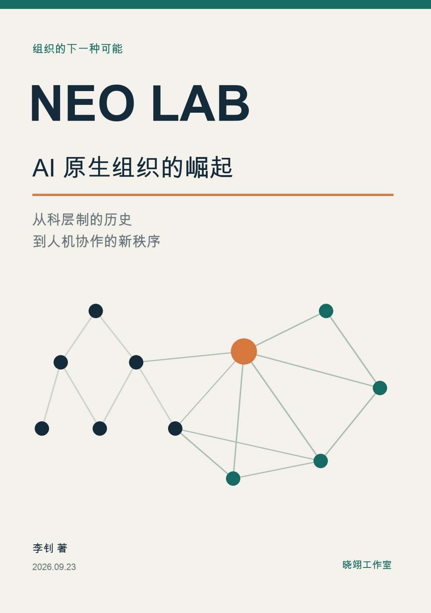
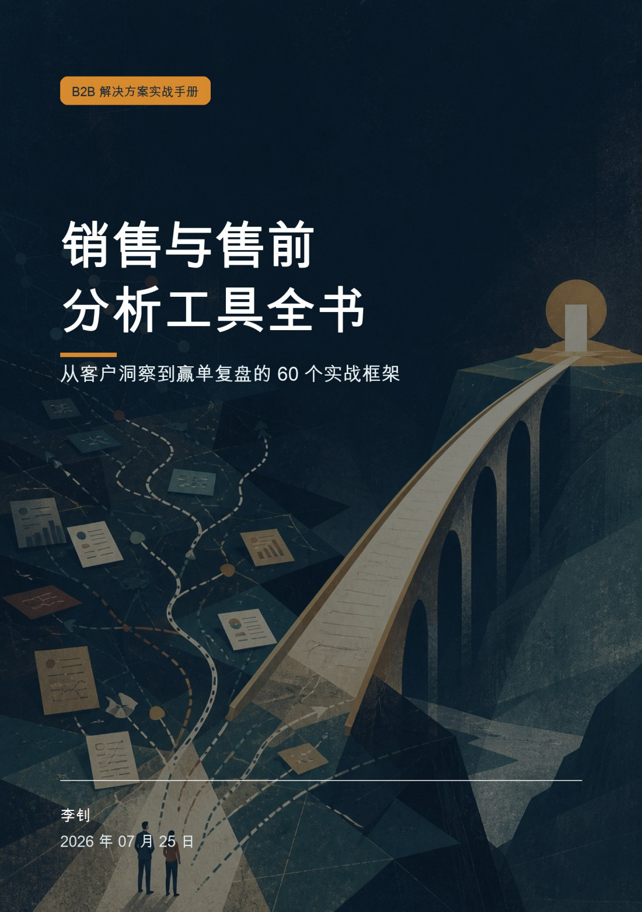
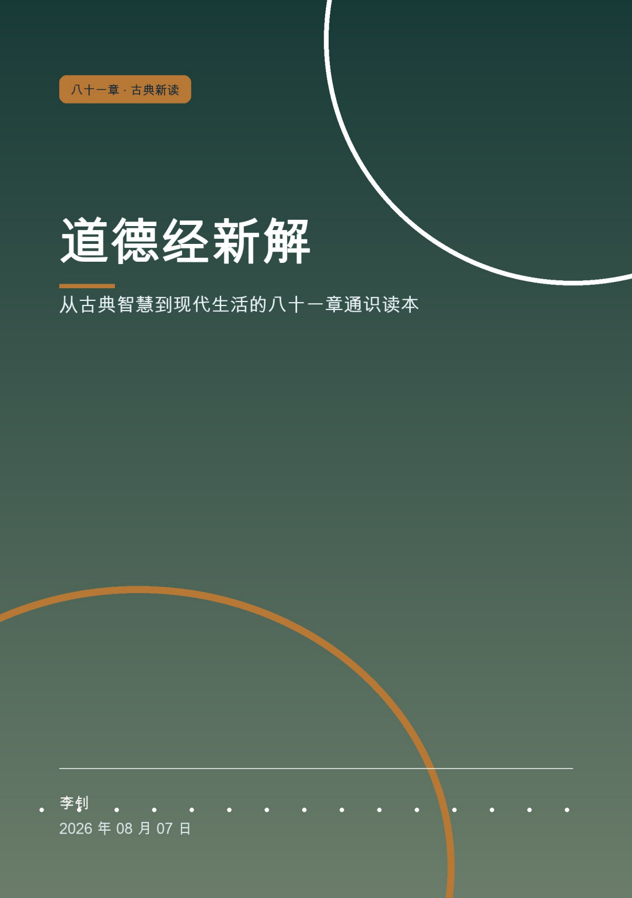
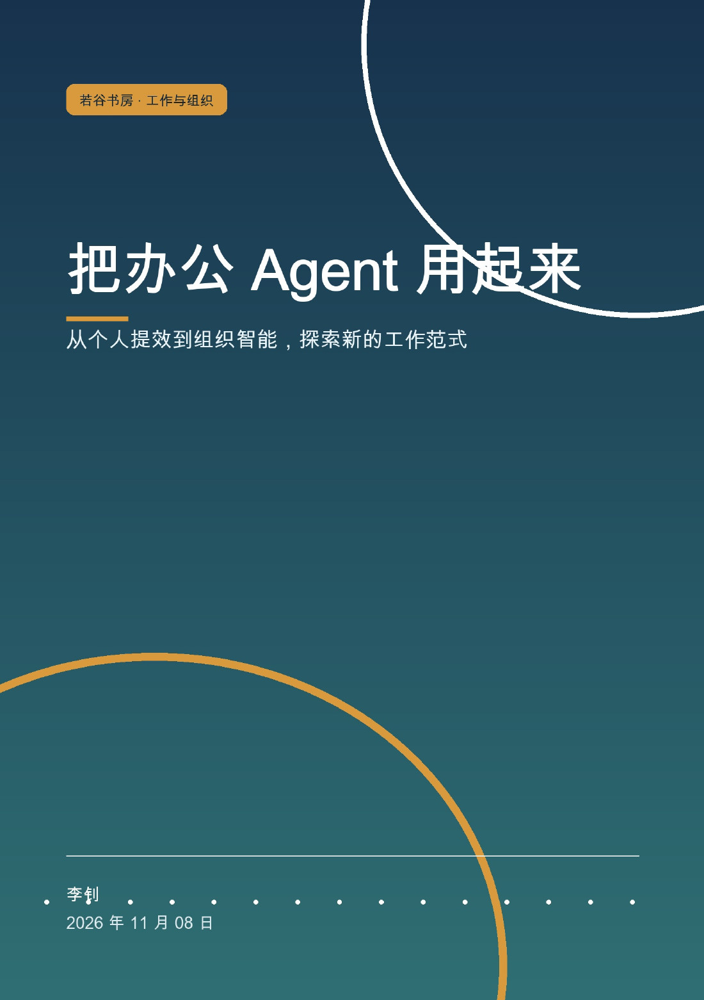
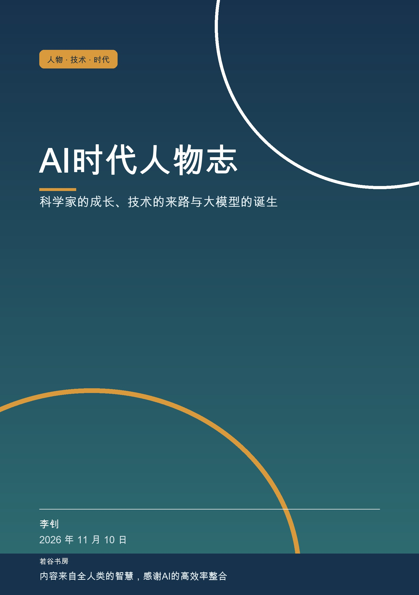
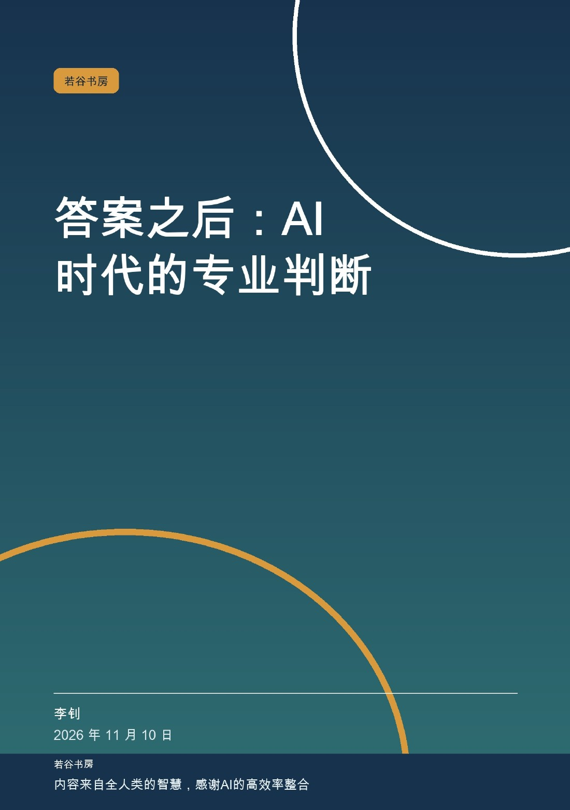
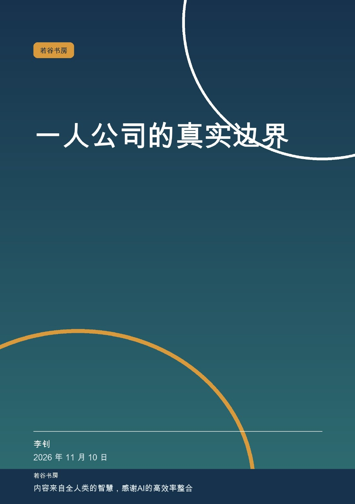
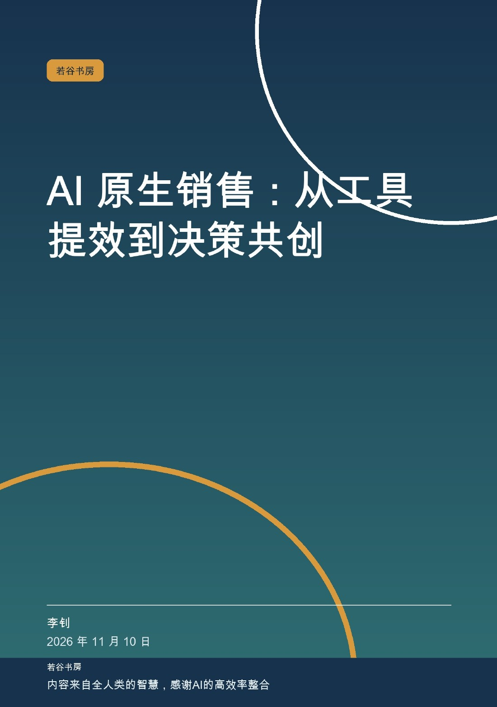
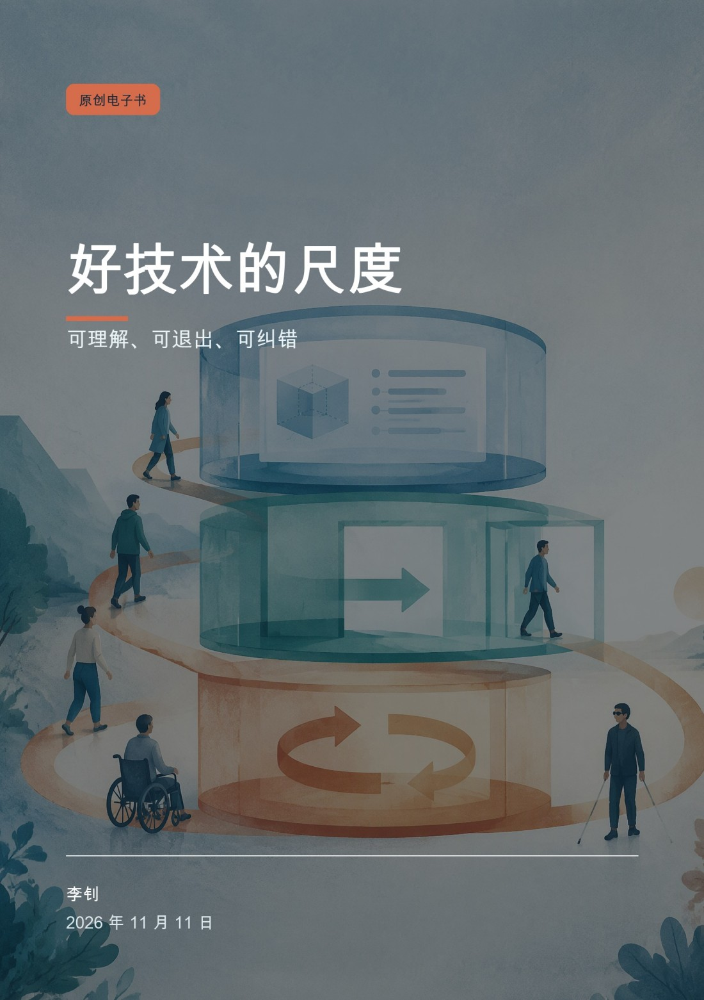

# 若谷书房

> 旷兮其若谷。——《道德经》第十五章

**若谷书房**是李钊的个人创作与阅读书库，围绕工作、生活、哲学、个人思考与经典重读，持续整理值得留下的作品。

“若谷”取意于《道德经》第十五章的“旷兮其若谷”。山谷空旷，能够容纳；借这个名字，希望在创作中保持虚心与开放，容纳不同知识、经验与观点，也为尚未想明白的问题留下空间。这里的作品，先帮助作者把问题想清楚，再分享给有相似困惑的人，在阅读、讨论与修订中继续生长。[原文出处](https://zh.wikisource.org/wiki/道德經_%28王弼本%29#十五章)

书房采用人与 AI 共同讨论、创作和修订的方式。具体作品保留各自的署名、出版说明与来源记录；作者负责辨认观点、核查材料和决定公开内容。我们重视清楚的表达、可信的来源和有条件的判断，也保留反例与未决问题。

## 阅读与下载

<!-- book-cover-gallery:start -->
<table>
<tr>
<td align="center"> <a href="books/neo-lab/README.md">Neo Lab：AI 原生组织的崛起</a></td>
<td align="center"> <a href="books/sales-presales-tools/README.md">销售与售前分析工具全书</a></td>
<td align="center"> <a href="books/dao-de-jing/README.md">道德经新解</a></td>
</tr>
<tr>
<td align="center"> <a href="books/soe-fde-handbook/README.md">国央企 FDE 工程师实战手册</a></td>
<td align="center"> <a href="books/finance-fde-handbook/README.md">金融行业 FDE 工程师实战手册</a></td>
<td align="center"> <a href="books/office-agent/README.md">把办公 Agent 用起来</a></td>
</tr>
<tr>
<td align="center"> <a href="books/ai-portraits/README.md">AI时代人物志</a></td>
<td align="center"> <a href="books/professional-judgment/README.md">答案之后：AI 时代的专业判断</a></td>
<td align="center"> <a href="books/solo-company/README.md">一人公司的真实边界</a></td>
</tr>
<tr>
<td align="center"> <a href="books/ai-native-sales/README.md">AI 原生销售：从工具提效到决策共创</a></td>
</tr>
<tr>
<td align="center"> <a href="books/quantified-self/README.md">被量化的自己</a></td>
<td align="center"> <a href="books/idea-to-work/README.md">从想法到作品</a></td>
<td align="center"> <a href="books/solo-editorial/README.md">一人编辑部</a></td>
</tr>
<tr>
<td align="center"> <a href="books/organizational-memory/README.md">组织记忆</a></td>
<td align="center"> <a href="books/customer-decisions/README.md">客户如何决定</a></td>
<td align="center"> <a href="books/after-disconnection/README.md">断网之后</a></td>
</tr>
<tr>
<td align="center"> <a href="books/machine-companionship/README.md">机器陪伴</a></td>
<td align="center"> <a href="books/good-technology/README.md">好技术的尺度</a></td>
<td align="center"> <a href="books/restraint/README.md">克制</a></td>
</tr>
</table>
<!-- book-cover-gallery:end -->

完整的版本信息与阅读入口见 **[书籍目录](目录.md)**。现有十本成品书均提供 Markdown 在线阅读、PDF、EPUB 和包含配套材料的 Markdown 离线包。首批五本已有作品保存在 [v2026.11.08 Release](https://github.com/njxshr/ruogu-books/releases/tag/v2026.11.08)；新作《把办公 Agent 用起来》保存在独立的 [office-agent-v1.0 Release](https://github.com/njxshr/ruogu-books/releases/tag/office-agent-v1.0)。《AI时代人物志》见 [ai-portraits-v1.0 Release](https://github.com/njxshr/ruogu-books/releases/tag/ai-portraits-v1.0)；《答案之后》《一人公司的真实边界》《AI 原生销售》见 [A1—A3 第一版 Release](https://github.com/njxshr/ruogu-books/releases/tag/a1-a3-v1.0)。

| 书名 | 内容 | 阅读与下载 |
| --- | --- | --- |
| [Neo Lab：AI 原生组织的崛起](books/neo-lab/README.md) | 从科层制的历史到人机协作的新秩序。 | [Markdown](books/neo-lab/output/markdown/Neo_Lab_AI原生组织.md) · [PDF](https://github.com/njxshr/ruogu-books/releases/download/v2026.11.08/neo-lab.pdf) · [EPUB](https://github.com/njxshr/ruogu-books/releases/download/v2026.11.08/neo-lab.epub) · [离线包](https://github.com/njxshr/ruogu-books/releases/download/v2026.11.08/neo-lab-markdown.zip) |
| [销售与售前分析工具全书](books/sales-presales-tools/README.md) | 从客户洞察到赢单复盘的 60 个实战框架。 | [Markdown](books/sales-presales-tools/output/markdown/销售与售前分析工具全书_重制版_李钊_20260725.md) · [PDF](https://github.com/njxshr/ruogu-books/releases/download/v2026.11.08/sales-presales-tools.pdf) · [EPUB](https://github.com/njxshr/ruogu-books/releases/download/v2026.11.08/sales-presales-tools.epub) · [离线包](https://github.com/njxshr/ruogu-books/releases/download/v2026.11.08/sales-presales-tools-markdown.zip) |
| [道德经新解](books/dao-de-jing/README.md) | 从古典智慧到现代生活的八十一章通识读本，含 81 幅正文插图。 | [Markdown](books/dao-de-jing/output/markdown/道德经新解.md) · [PDF](https://github.com/njxshr/ruogu-books/releases/download/v2026.11.08/dao-de-jing.pdf) · [EPUB](https://github.com/njxshr/ruogu-books/releases/download/v2026.11.08/dao-de-jing.epub) · [离线包](https://github.com/njxshr/ruogu-books/releases/download/v2026.11.08/dao-de-jing-markdown.zip) |
| [国央企 FDE 工程师实战手册](books/soe-fde-handbook/README.md) | 从 AI 战略到生产落地，涵盖场景、工程、治理与组织变革。 | [Markdown](books/soe-fde-handbook/output/markdown/国央企%20FDE%20工程师实战手册.md) · [PDF](https://github.com/njxshr/ruogu-books/releases/download/v2026.11.08/soe-fde-handbook.pdf) · [EPUB](https://github.com/njxshr/ruogu-books/releases/download/v2026.11.08/soe-fde-handbook.epub) · [离线包](https://github.com/njxshr/ruogu-books/releases/download/v2026.11.08/soe-fde-handbook-markdown.zip) |
| [金融行业 FDE 工程师实战手册](books/finance-fde-handbook/README.md) | 面向银行、证券、保险、基金与资产管理的 AI 工程实践。 | [Markdown](books/finance-fde-handbook/output/markdown/金融行业%20FDE%20工程师实战手册.md) · [PDF](https://github.com/njxshr/ruogu-books/releases/download/v2026.11.08/finance-fde-handbook.pdf) · [EPUB](https://github.com/njxshr/ruogu-books/releases/download/v2026.11.08/finance-fde-handbook.epub) · [离线包](https://github.com/njxshr/ruogu-books/releases/download/v2026.11.08/finance-fde-handbook-markdown.zip) |
| [把办公 Agent 用起来](books/office-agent/README.md) | 从个人提效到组织智能，探索新的工作范式；李钊著，若谷书房出版。 | [Markdown](books/office-agent/output/markdown/把办公Agent用起来.md) · [PDF](https://github.com/njxshr/ruogu-books/releases/download/office-agent-v1.0/office-agent.pdf) · [EPUB](https://github.com/njxshr/ruogu-books/releases/download/office-agent-v1.0/office-agent.epub) · [离线包](https://github.com/njxshr/ruogu-books/releases/download/office-agent-v1.0/office-agent-markdown.zip) |
| [AI时代人物志](books/ai-portraits/README.md) | 科学家的成长、技术的来路与大模型的诞生。 | [Markdown](books/ai-portraits/output/markdown/AI时代人物志.md) · [PDF](https://github.com/njxshr/ruogu-books/releases/download/ai-portraits-v1.0/ai-portraits.pdf) · [EPUB](https://github.com/njxshr/ruogu-books/releases/download/ai-portraits-v1.0/ai-portraits.epub) · [离线包](https://github.com/njxshr/ruogu-books/releases/download/ai-portraits-v1.0/ai-portraits-markdown.zip) |
| [答案之后：AI 时代的专业判断](books/professional-judgment/README.md) | 从问题定义、证据核验到复核与责任的专业判断方法。 | [Markdown](books/professional-judgment/output/markdown/professional-judgment.md) · [PDF（28页）](https://github.com/njxshr/ruogu-books/releases/download/a1-a3-v1.0/professional-judgment.pdf) · [EPUB](https://github.com/njxshr/ruogu-books/releases/download/a1-a3-v1.0/professional-judgment.epub) · [离线包](https://github.com/njxshr/ruogu-books/releases/download/a1-a3-v1.0/professional-judgment-markdown.zip) |
| [一人公司的真实边界](books/solo-company/README.md) | 用需求、报价、交付和完整账目检验个人经营的边界。 | [Markdown](books/solo-company/output/markdown/solo-company.md) · [PDF（29页）](https://github.com/njxshr/ruogu-books/releases/download/a1-a3-v1.0/solo-company.pdf) · [EPUB](https://github.com/njxshr/ruogu-books/releases/download/a1-a3-v1.0/solo-company.epub) · [离线包](https://github.com/njxshr/ruogu-books/releases/download/a1-a3-v1.0/solo-company-markdown.zip) |
| [AI 原生销售：从工具提效到决策共创](books/ai-native-sales/README.md) | 从客户研究到验证、谈判与复盘的八阶段协作方法。 | [Markdown](books/ai-native-sales/output/markdown/ai-native-sales.md) · [PDF（31页）](https://github.com/njxshr/ruogu-books/releases/download/a1-a3-v1.0/ai-native-sales.pdf) · [EPUB](https://github.com/njxshr/ruogu-books/releases/download/a1-a3-v1.0/ai-native-sales.epub) · [离线包](https://github.com/njxshr/ruogu-books/releases/download/a1-a3-v1.0/ai-native-sales-markdown.zip) |

## 2026-11-11 新书九种

九本均为李钊著，保留原书出版单位“晓翊工作室”，由若谷书房整理上架。每本含八章、前言、附录与参考资料。

| 书名 | 简介 | 版本与原书日期 | 阅读与下载 |
| --- | --- | --- | --- |
| [被量化的自己](books/quantified-self/README.md) | 帮助读者区分测量、解释与行动，建立个人数据审计和恢复主观判断的方法。 | 第一版 · 2026-11-11 | [Markdown](books/quantified-self/output/markdown/被量化的自己_李钊_20261111.md) · [PDF（18页）](https://github.com/njxshr/ruogu-books/releases/download/new-books-20261111-v1.0/quantified-self.pdf) · [EPUB](https://github.com/njxshr/ruogu-books/releases/download/new-books-20261111-v1.0/quantified-self.epub) · [离线包](https://github.com/njxshr/ruogu-books/releases/download/new-books-20261111-v1.0/quantified-self-markdown.zip) |
| [从想法到作品](books/idea-to-work/README.md) | 让读者能完成从需求、原型、审阅、测试到发布维护的完整低风险项目。 | 第一版 · 2026-11-11 | [Markdown](books/idea-to-work/output/markdown/从想法到作品_李钊_20261111.md) · [PDF（19页）](https://github.com/njxshr/ruogu-books/releases/download/new-books-20261111-v1.0/idea-to-work.pdf) · [EPUB](https://github.com/njxshr/ruogu-books/releases/download/new-books-20261111-v1.0/idea-to-work.epub) · [离线包](https://github.com/njxshr/ruogu-books/releases/download/new-books-20261111-v1.0/idea-to-work-markdown.zip) |
| [一人编辑部](books/solo-editorial/README.md) | 建立从选题、来源、采访、结构、起草、核查到出版的个人编辑系统。 | 第一版 · 2026-11-11 | [Markdown](books/solo-editorial/output/markdown/一人编辑部_李钊_20261111.md) · [PDF（18页）](https://github.com/njxshr/ruogu-books/releases/download/new-books-20261111-v1.0/solo-editorial.pdf) · [EPUB](https://github.com/njxshr/ruogu-books/releases/download/new-books-20261111-v1.0/solo-editorial.epub) · [离线包](https://github.com/njxshr/ruogu-books/releases/download/new-books-20261111-v1.0/solo-editorial-markdown.zip) |
| [组织记忆](books/organizational-memory/README.md) | 把分散资料和经验转化为可找到、可使用、可更新、可追责的组织知识。 | 第一版 · 2026-11-11 | [Markdown](books/organizational-memory/output/markdown/组织记忆_李钊_20261111.md) · [PDF（17页）](https://github.com/njxshr/ruogu-books/releases/download/new-books-20261111-v1.0/organizational-memory.pdf) · [EPUB](https://github.com/njxshr/ruogu-books/releases/download/new-books-20261111-v1.0/organizational-memory.epub) · [离线包](https://github.com/njxshr/ruogu-books/releases/download/new-books-20261111-v1.0/organizational-memory-markdown.zip) |
| [客户如何决定](books/customer-decisions/README.md) | 从买方内部理解决策触发、共识、证据、风险、不决定与上线复盘。 | 第一版 · 2026-11-11 | [Markdown](books/customer-decisions/output/markdown/客户如何决定_李钊_20261111.md) · [PDF（17页）](https://github.com/njxshr/ruogu-books/releases/download/new-books-20261111-v1.0/customer-decisions.pdf) · [EPUB](https://github.com/njxshr/ruogu-books/releases/download/new-books-20261111-v1.0/customer-decisions.epub) · [离线包](https://github.com/njxshr/ruogu-books/releases/download/new-books-20261111-v1.0/customer-decisions-markdown.zip) |
| [断网之后](books/after-disconnection/README.md) | 建立覆盖数据、账号、设备、关键服务和家庭协作的可恢复能力。 | 第一版 · 2026-11-11 | [Markdown](books/after-disconnection/output/markdown/断网之后_李钊_20261111.md) · [PDF（17页）](https://github.com/njxshr/ruogu-books/releases/download/new-books-20261111-v1.0/after-disconnection.pdf) · [EPUB](https://github.com/njxshr/ruogu-books/releases/download/new-books-20261111-v1.0/after-disconnection.epub) · [离线包](https://github.com/njxshr/ruogu-books/releases/download/new-books-20261111-v1.0/after-disconnection-markdown.zip) |
| [机器陪伴](books/machine-companionship/README.md) | 理解机器陪伴的吸引力、真实帮助、依赖风险与家庭及产品的保护边界。 | 第一版 · 2026-11-11 | [Markdown](books/machine-companionship/output/markdown/机器陪伴_李钊_20261111.md) · [PDF（18页）](https://github.com/njxshr/ruogu-books/releases/download/new-books-20261111-v1.0/machine-companionship.pdf) · [EPUB](https://github.com/njxshr/ruogu-books/releases/download/new-books-20261111-v1.0/machine-companionship.epub) · [离线包](https://github.com/njxshr/ruogu-books/releases/download/new-books-20261111-v1.0/machine-companionship-markdown.zip) |
| [好技术的尺度](books/good-technology/README.md) | 把抽象伦理转化为可评审、可测试、可验收的产品与服务标准。 | 第一版 · 2026-11-11 | [Markdown](books/good-technology/output/markdown/好技术的尺度_李钊_20261111.md) · [PDF（17页）](https://github.com/njxshr/ruogu-books/releases/download/new-books-20261111-v1.0/good-technology.pdf) · [EPUB](https://github.com/njxshr/ruogu-books/releases/download/new-books-20261111-v1.0/good-technology.epub) · [离线包](https://github.com/njxshr/ruogu-books/releases/download/new-books-20261111-v1.0/good-technology-markdown.zip) |
| [克制](books/restraint/README.md) | 以可靠文本阅读讨论过度干预、权力、自主、冲突、扩张与责任。 | 第一版 · 2026-11-11 | [Markdown](books/restraint/output/markdown/克制_李钊_20261111.md) · [PDF（17页）](https://github.com/njxshr/ruogu-books/releases/download/new-books-20261111-v1.0/restraint.pdf) · [EPUB](https://github.com/njxshr/ruogu-books/releases/download/new-books-20261111-v1.0/restraint.epub) · [离线包](https://github.com/njxshr/ruogu-books/releases/download/new-books-20261111-v1.0/restraint-markdown.zip) |

[本批次下载与校验和](https://github.com/njxshr/ruogu-books/releases/tag/new-books-20261111-v1.0)

## 持续创作

[《把办公 Agent 用起来》](books/office-agent/README.md)第一版 1.0 于 2026-11-08 制作完成，以三篇十五章和两份附录，从个人工作改善出发，讨论组织共同能力，以及企业集团、行业与时代的变化。《智能生活》（Agent）作为后续选题保留。

整体安排见[写作计划](写作计划.md)：保留《智能生活》后续选题与《AI时代人物志》已上架记录，新增 A1—A6、B1—B6 共 12 个选题。A1《答案之后》、A2《一人公司的真实边界》、A3《AI 原生销售》已完成第一版 1.0 并发布；A4—A6、B1—B6 九种已于 2026-11-11 完成第一版并上架。

每本书以 `manuscript/book.md` 为写作与出版主稿，修订后重新制作对应阅读版本。通过检查的成品再进入书籍目录；筹备中的作品会标明进度。更多约定见[项目需求](PROJECT_REQUIREMENTS.md)。

## 交流与使用

欢迎通过 [Issues](https://github.com/njxshr/ruogu-books/issues)反馈错误、提出问题，或分享有依据的不同理解。反馈时请注明书名、版本和章节；PDF 问题可附页码。

各书署名、版权和第三方材料权利以书内说明为准。本仓库提供公开阅读与下载，尚未另行授予全库统一的开放许可。需要转载、改编、再发行或商业使用时，请先核对相应权利与授权范围。
