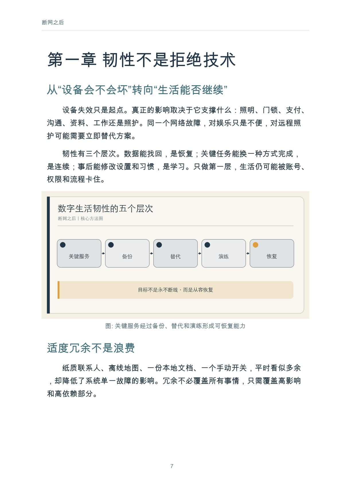
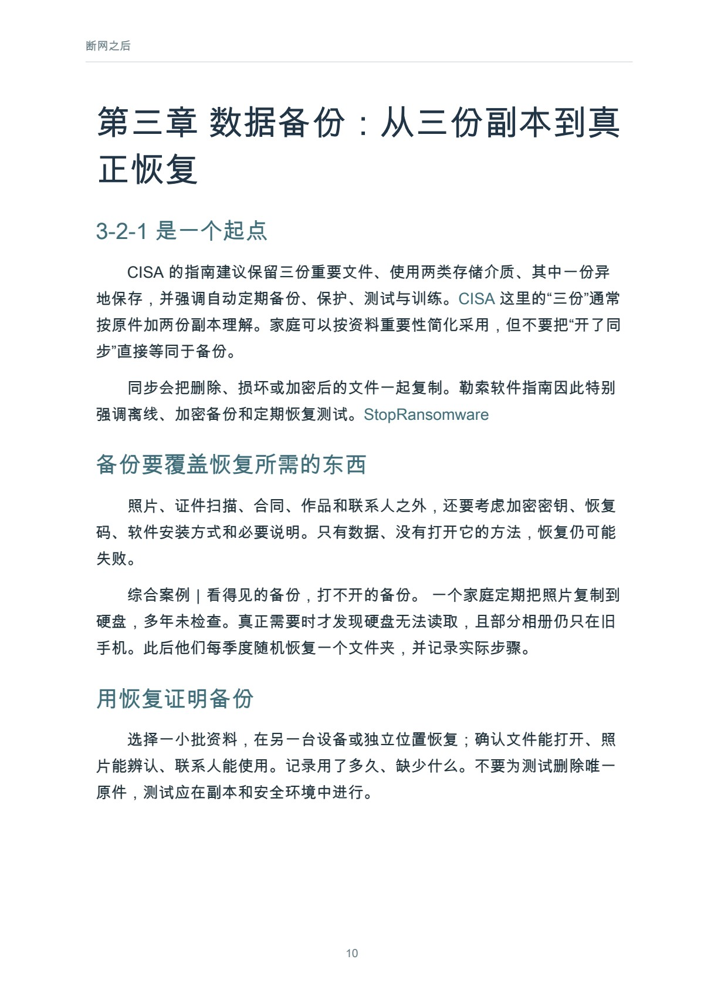

# 断网之后

数字生活的韧性

作者：李钊 · 出版单位：晓翊工作室  
第一版 · 原书日期：2026-11-11 · 上架日期：2026-11-11 · PDF 17 页

建立覆盖数据、账号、设备、关键服务和家庭协作的可恢复能力。

## 阅读导引

家里的灯需要应用才能打开，路线需要实时导航才能找到，工作文件只在云端，与远方老人的联系也依赖同一个平台。正常运行时，这些安排几乎不需要思考；故障发生时，生活却可能同时停在许多地方。

韧性不是拒绝技术，也不是为每一种小概率灾难囤货。它是一种恢复能力：知道什么最重要，保留必要副本和手动路径，在压力下能够找到人、恢复数据、继续关键活动。

本书面向普通家庭，提供一张关键服务地图、一套备份与账号恢复方法，以及一次可以实际完成的演练。它不替代企业灾备和专业应急方案，也不要求读者掌握复杂技术。

建议先读前言与前两章，理解问题和基本方法；再结合当前问题选择后续章节，使用附录整理自己的记录。

## 完整目录

展开全书目录

- 前言　真正的方便，包括出问题时仍有办法
- 第一章　韧性不是拒绝技术
- 第二章　画出家庭关键服务地图
- 第三章　数据备份：从三份副本到真正恢复
- 第四章　账号与访问：找回数字生活的钥匙
- 第五章　断网、断电与设备失效：保留手动路径
- 第六章　支付、出行、工作与学习的备用方案
- 第七章　照护中的技术边界
- 第八章　一次家庭恢复演练
- 附录　家庭应急卡与演练表
- 参考资料

## 实际内页预览

页码为包含封面的 PDF 文件页码，从 1 起算。

PDF 文件第 7 页：断网之后 7 第一章 韧性不是拒绝技术 从“设备会不会坏”转向“生活能否继续” 设备失效只是起点。真正的影响取决于它支撑什么：照明

PDF 文件第 10 页：断网之后 10 第三章 数据备份：从三份副本到真 正恢复 3-2-1 是一个起点 CISA 的指南建议保留三份重要文件、使用两类存

## 阅读与下载

- [Markdown 在线阅读](output/markdown/断网之后_李钊_20261111.md)
- [PDF · 17 页](https://github.com/njxshr/ruogu-books/releases/download/new-books-20261111-v1.0/after-disconnection.pdf)
- [EPUB](https://github.com/njxshr/ruogu-books/releases/download/new-books-20261111-v1.0/after-disconnection.epub)
- [Markdown 离线包（含配图）](https://github.com/njxshr/ruogu-books/releases/download/new-books-20261111-v1.0/after-disconnection-markdown.zip)

## 来源与权利

[来源记录](SOURCES.md) · [主稿](manuscript/book.md) · [出版配置](book.json)

书中的综合案例、模拟情境和作者建议按正文标注理解，不作为真实客户成效承诺。来源记录保留原有核查范围，本次上架不代表重新核查全部外部来源。

版权所有 © 2026 李钊。保留所有权利。 第三方资料权利归原权利人。公开阅读与下载不另行授予开放许可。

[返回书目](../../目录.md)
