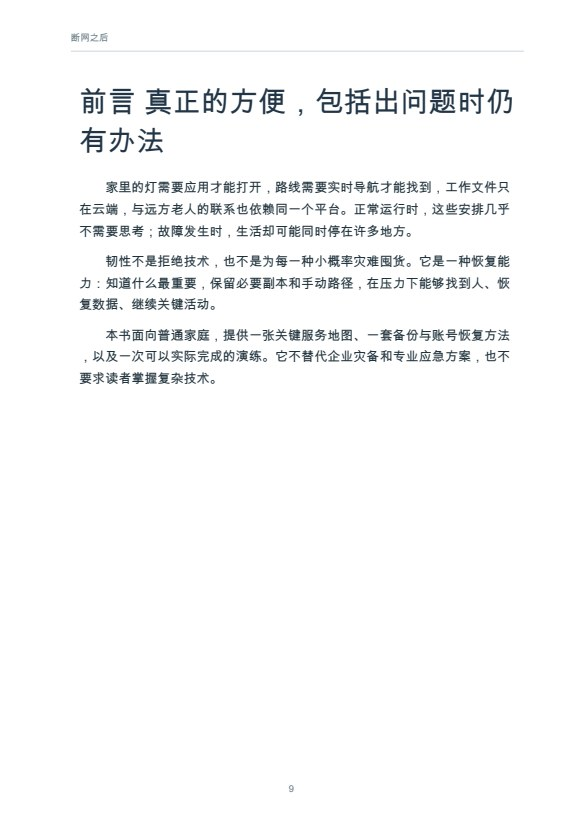
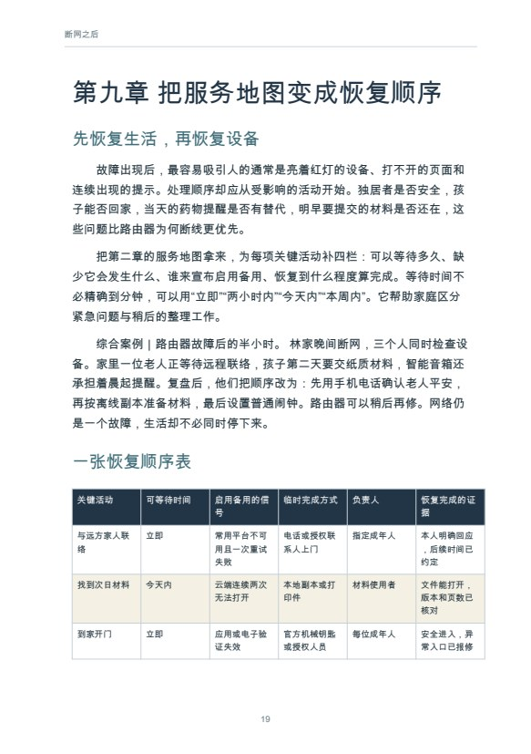

# 断网之后

数字生活的韧性

作者：李钊 · 出版单位：晓翊工作室  
增订版 1.1 · 原书日期：2026-11-11 · 增订日期：2026-11-19 · PDF 50 页

建立覆盖数据、账号、设备、关键服务和家庭协作的可恢复能力。十八章、四份附录，从家庭服务地图进入恢复顺序、账号与数据恢复、离线活动、照护交接和完整演练。

## 阅读导引

正常运行时，支付、导航、云文档和远程联络几乎不需要思考；故障发生后，生活却可能同时停在许多地方。本书帮助家庭保留必要副本、手动路径和可信联系人，让关键活动在服务失效时仍有办法继续。

建议先读前两章找出高影响活动，再按当前问题选读数据、账号或照护章节。正文之外的附录可按需使用：七份工作单整理自己的信息，七个恢复分支训练失败时的判断，两类模拟家庭展示取舍。

原书八章完整保留，本次增加第十至第十八章所需实践内容、七份可填写工作单和七个恢复分支练习。新增案例均为综合案例或模拟推演，不代表真实客户成效。

## 完整目录

展开全书目录

- 前言　真正的方便，包括出问题时仍有办法
- 第一章　韧性不是拒绝技术
- 第二章　画出家庭关键服务地图
- 第三章　数据备份：从三份副本到真正恢复
- 第四章　账号与访问：找回数字生活的钥匙
- 第五章　断网、断电与设备失效：保留手动路径
- 第六章　支付、出行、工作与学习的备用方案
- 第七章　照护中的技术边界
- 第八章　一次家庭恢复演练
- 第九章　把服务地图变成恢复顺序
- 第十章　四类常见失效的处置卡
- 第十一章　做一次不碰唯一原件的数据恢复
- 第十二章　账号恢复链与家庭授权
- 第十三章　安排一个离线日
- 第十四章　儿童、老人、访客与照护场景
- 第十五章　设备更换、服务停用与年度维护
- 第十六章　九十分钟家庭恢复演练
- 第十七章　故障中的沟通、记录与求助
- 第十八章　让方案在主人缺席时仍能工作
- 附录　家庭应急卡与演练表
- 附录二　可直接使用的家庭工作单
- 附录三　七个恢复分支练习
- 附录四　两种家庭的取舍示例
- 参考资料

## 实际内页预览

页码为包含封面的 PDF 文件页码，从 1 起算。以下样页均由本次 50 页 PDF 重新生成。

PDF 文件第 9 页：前言。

PDF 文件第 19 页：恢复顺序。

## 阅读与下载

- [Markdown 在线阅读](output/markdown/断网之后_李钊_20261111.md)
- [PDF · 50 页](https://github.com/njxshr/ruogu-books/releases/download/expanded-books-20261119-v1.1/after-disconnection.pdf)
- [EPUB](https://github.com/njxshr/ruogu-books/releases/download/expanded-books-20261119-v1.1/after-disconnection.epub)
- [Markdown 离线包（含配图）](https://github.com/njxshr/ruogu-books/releases/download/expanded-books-20261119-v1.1/after-disconnection-markdown.zip)

## 增订与检查

[20 轮增订记录](REVISION_LOG.md) · [实际检查报告](QA_REPORT.md)

本次重新生成 Markdown、PDF 和 EPUB。PDF 全部 50 页已渲染并查看总览；EPUB 解包读取封面、前中后章节，111 个导航目标与本地资源检查通过。检查范围及 NIST 链接访问失败等限制见报告。

## 来源与权利

[来源记录](SOURCES.md) · [主稿](manuscript/book.md) · [出版配置](book.json)

书中的综合案例、模拟情境和作者建议按正文标注理解，不作为真实客户成效承诺。动态平台恢复机制、设备手动操作与当地紧急服务方式，以当前官方说明为准。

版权所有 © 2026 李钊。保留所有权利。第三方资料权利归原权利人。公开阅读与下载不另行授予开放许可。

[返回书目](../../目录.md)
