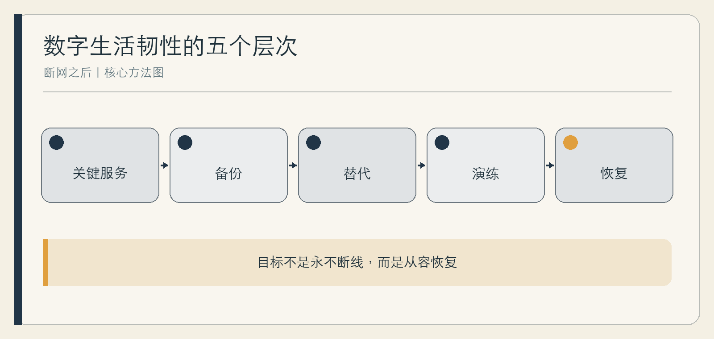

# 断网之后

数字生活的韧性

作者：李钊  
日期：2026 年 11 月 11 日

---

## 前言　真正的方便，包括出问题时仍有办法

家里的灯需要应用才能打开，路线需要实时导航才能找到，工作文件只在云端，与远方老人的联系也依赖同一个平台。正常运行时，这些安排几乎不需要思考；故障发生时，生活却可能同时停在许多地方。

韧性不是拒绝技术，也不是为每一种小概率灾难囤货。它是一种恢复能力：知道什么最重要，保留必要副本和手动路径，在压力下能够找到人、恢复数据、继续关键活动。

本书面向普通家庭，提供一张关键服务地图、一套备份与账号恢复方法，以及一次可以实际完成的演练。它不替代企业灾备和专业应急方案，也不要求读者掌握复杂技术。

## 第一章　韧性不是拒绝技术

### 从“设备会不会坏”转向“生活能否继续”

设备失效只是起点。真正的影响取决于它支撑什么：照明、门锁、支付、沟通、资料、工作还是照护。同一个网络故障，对娱乐只是不便，对远程照护可能需要立即替代方案。

韧性有三个层次。数据能找回，是恢复；关键任务能换一种方式完成，是连续；事后能修改设置和习惯，是学习。只做第一层，生活仍可能被账号、权限和流程卡住。

### 适度冗余不是浪费

纸质联系人、离线地图、一份本地文档、一个手动开关，平时看似多余，却降低了系统单一故障的影响。冗余不必覆盖所有事情，只需覆盖高影响和高依赖部分。

**综合案例｜回家路线的两种准备。** 周禾每天依赖导航。一次手机没电，他才发现自己记不住常用路线。后来他熟悉两条主路，保存离线地图，并在包里放小额应急电源。目标不是不用导航，而是导航消失时不至于失去判断。

### 先定义可接受的不便

家庭可以讨论：哪些服务中断几小时没关系，哪些必须在半小时内替代，哪些资料绝不能丢。没有这套优先级，备份和演练很容易变成无边界投入。

## 第二章　画出家庭关键服务地图

### 从一天而不是设备清单开始

从起床到入睡，记录哪些活动依赖账号、网络、电力、平台或他人服务。然后标出失效后的具体后果。设备清单告诉你拥有什么，服务地图告诉你不能轻易失去什么。

地图包含：关键活动、依赖项、主要使用者、受影响者、当前备用、恢复负责人和可接受中断时间。儿童、老人和访客可能不是设置者，却是实际受影响者。

### 找到共同故障点

多部手机、云文档和家庭监控可能都依赖同一个账号；许多设备可能共用一台路由器；紧急联系人可能只记得同一个手机号。表面上的多设备，并不等于真正冗余。

**综合案例｜所有钥匙都在一个地方。** 家庭成员把密码、照片和文件都放在同一账号，方便的同时也形成共同故障点。他们将恢复信息分开保管，导出最重要资料，并让另一位成年人掌握必要的紧急访问方法。

### 先补最明显的缺口

如果唯一备份从未测试、唯一联系人无法接通、唯一钥匙在故障设备里，就先处理这些。不要一开始购买复杂系统。

## 第三章　数据备份：从三份副本到真正恢复

### 3-2-1 是一个起点

CISA 的指南建议保留三份重要文件、使用两类存储介质、其中一份异地保存，并强调自动定期备份、保护、测试与训练。[CISA](https://www.cisa.gov/audiences/small-and-medium-businesses/secure-your-business/back-up-business-data) 这里的“三份”通常按原件加两份副本理解。家庭可以按资料重要性简化采用，但不要把“开了同步”直接等同于备份。

同步会把删除、损坏或加密后的文件一起复制。勒索软件指南因此特别强调离线、加密备份和定期恢复测试。[StopRansomware](https://www.cisa.gov/stopransomware/ransomware-guide)

### 备份要覆盖恢复所需的东西

照片、证件扫描、合同、作品和联系人之外，还要考虑加密密钥、恢复码、软件安装方式和必要说明。只有数据、没有打开它的方法，恢复仍可能失败。

**综合案例｜看得见的备份，打不开的备份。** 一个家庭定期把照片复制到硬盘，多年未检查。真正需要时才发现硬盘无法读取，且部分相册仍只在旧手机。此后他们每季度随机恢复一个文件夹，并记录实际步骤。

### 用恢复证明备份

选择一小批资料，在另一台设备或独立位置恢复；确认文件能打开、照片能辨认、联系人能使用。记录用了多久、缺少什么。不要为测试删除唯一原件，测试应在副本和安全环境中进行。

## 第四章　账号与访问：找回数字生活的钥匙

### 账号比单个设备更关键

手机可以更换，账号无法恢复却可能让数据、联系人和服务一起失去。列出核心账号及其绑定邮箱、手机号、二次验证、恢复码和紧急联系人，检查这些信息是否仍有效。

恢复信息不应只存在同一个账号里。可以使用可靠的密码管理工具、离线加密副本或纸质封存，具体方式取决于家庭能力和风险。不要把完整密码写在容易丢失或公开放置的纸上。

### 为缺席与紧急情况安排授权

家庭共享不等于人人知道所有密码。需要明确谁在什么情况下可以处理照片、账单、订阅和照护服务。涉及平台功能时，以当前官方的遗产、家庭或恢复机制为准，不假设家人能自然获得访问权。

**综合案例｜验证码去了旧手机。** 用户更换手机号后未更新账号，设备丢失时无法接收验证码。事后他才补全恢复邮箱和备用验证。真正需要定期核对的是整条恢复链，而不是只记住登录密码。

### 每年做一次账号检查

核心账号能否登录；绑定方式是否有效；恢复码是否可用；旧设备是否退出；家庭共享权限是否仍符合需要；重要资料是否有账号之外的副本。

## 第五章　断网、断电与设备失效：保留手动路径

### 手动入口要在正常时看得见

智能门锁、照明、窗帘和设备控制器若完全依赖应用，故障时会让使用者慌乱。检查物理解锁、墙面开关、本地控制和备用电源，并让所有家庭成员知道在哪里。

NIST 的连续性规划强调关键功能、恢复优先级与演练。家庭不需要照搬企业体系，但可以采用同样的思路：先保证人身安全和基本生活，再处理便利。[NIST SP 800-34](https://csrc.nist.gov/pubs/sp/800/34/rev-1/final)

### 不把演练变成冒险

不要在陌生路线、恶劣天气、夜间或真实照护需求中故意断网。选择安全、低风险、可随时恢复的时段，先告知家人。涉及门锁、报警、医疗和消防设备时，不自行制造故障，只核对官方手动方案。

**综合案例｜灯还亮着，生活没有停。** 一次网络中断后，家人发现部分智能灯仍可墙面控制，但音箱无法提供提醒。他们把重要提醒改为普通闹钟，并保留一份设备手动操作卡。

### 一张失效处理卡

设备名称；正常现象；本地开关；安全停止方式；备用方案；服务电话；何时寻求专业帮助。卡片放在故障时也能找到的位置，而不是只存在需要网络的笔记里。

## 第六章　支付、出行、工作与学习的备用方案

### 支付与出行

保留适量现金或另一种合法支付方式，具体金额按家庭需要；重要行程保存地址、电话和票据的离线副本；在熟悉环境中练习不依赖实时导航的基本方向判断。任何备用都不应牺牲安全与合规。

### 工作与学习

关键文件在截止前导出本地副本，记录可编辑格式；线上会议提前保存 dial-in 或联系人；学习资料保留必要章节和纸笔替代。不是把所有内容下载，而是确保任务最核心部分能够继续。

**综合案例｜演示前十五分钟。** 会议平台无法登录，讲者此前只保存了云端链接，只能等待。后来他把最终幻灯片导出为 PDF，并把关键数据和联系人保存在本地。下一次故障仍有不便，却不再让所有准备归零。

### 与家人约定降级模式

断网时哪些付费下载暂停，哪些共享任务改用电话，哪些工作截止时间需要沟通。明确降级模式能减少每个人都在临时发问。

## 第七章　照护中的技术边界

### 监测正常不等于没有需要

远程提醒可以说明设备没有报警，却不能告诉照护者对方今天情绪怎样、是否真正吃饭、是否需要陪伴。备用方案不能只复制更多传感器，还要保留电话、邻里和线下支持。

### 被照护者应参与规则

安装摄像头、位置共享和自动提醒前，讨论谁能看、何时看、如何关闭、异常后谁联系。老人或儿童不一定能熟练使用系统，却应尽可能理解并表达拒绝。

**综合案例｜提醒没有响。** 家属一度完全依赖活动监测。设备离线后，他们才发现没有约定日常联络。之后建立简单规则：固定时间电话，异常先直接联系，无法接通再联系附近的授权人，设备只作辅助。

### 危机不走普通备用流程

遇到人身安全、急性疾病、自伤或其他紧急情况，应立即联系当地急救、警方或合格专业服务，不等待设备恢复，也不依赖通用聊天工具判断。

## 第八章　一次家庭恢复演练

### 选择一个低风险场景

例如“主手机不可用两小时”或“家里网络中断一小时”。提前说明范围，不关闭真实安防与医疗设备。目标是完成关键任务，不是证明谁准备最好。

演练前写下三项任务：找到重要联系人；恢复一份关键文件；完成一项日常活动。演练后记录哪里等待、哪里找不到、哪项备用实际上不能用。

### 复盘要产生修改

**综合案例｜纸质清单也过期。** 家庭找到纸质应急卡，却发现联系电话和宽带信息已旧。复盘后指定每年两次更新，并把恢复码检查加入日程。演练的价值正是暴露这些平时看不见的小缺口。

### 保持轻量而持续

一次大规模准备容易，持续维护更难。把备份恢复、账号检查和应急卡更新分散到固定日期，每次只处理少量项目。韧性不是一次买齐，而是关键能力始终可用。

## 附录　家庭应急卡与演练表

### 家庭应急卡

关键联系人；住址与必要医疗信息；网络和电力服务信息；核心账号恢复位置；重要资料副本位置；手动门锁与设备入口；附近可协助者；紧急服务电话。

应急卡只记录恢复所需的最少信息，不写完整密码。纸质卡应安全存放并让相关家庭成员知道位置；涉及医疗等敏感内容时，限制可见范围并定期复核是否仍有必要保留。

### 数据清单

资料名称；主要副本；本地备份；异地或离线副本；加密与恢复钥匙；最近恢复测试；负责人；下次检查。

### 演练记录

演练场景；必须完成的三项任务；实际耗时；失败点；是否有人不知道该怎么做；需要补充的工具或信息；修改负责人；复查日期。

### 安全红线

不在真实风险环境故意断网；不测试唯一原件的删除恢复；不公开完整密码和恢复码；不让儿童单独承担恢复任务；不让照护完全依赖自动报警；紧急情况直接联系正式服务。

## 参考资料

1. CISA：[Back Up Business Data](https://www.cisa.gov/audiences/small-and-medium-businesses/secure-your-business/back-up-business-data)。
2. CISA：[#StopRansomware Guide](https://www.cisa.gov/stopransomware/ransomware-guide)，2025。
3. NIST：[Contingency Planning Guide for Federal Information Systems](https://csrc.nist.gov/pubs/sp/800/34/rev-1/final)，2010。
4. NIST：[Guide for Cybersecurity Event Recovery](https://csrc.nist.gov/pubs/sp/800/184/final)，2016。
5. 李钊：《智能生活》全书提纲与素材库，2026。

资料收集截至 2026 年 11 月 11 日。具体平台恢复机制、设备手动操作与当地紧急服务方式，应以当前官方说明为准。
