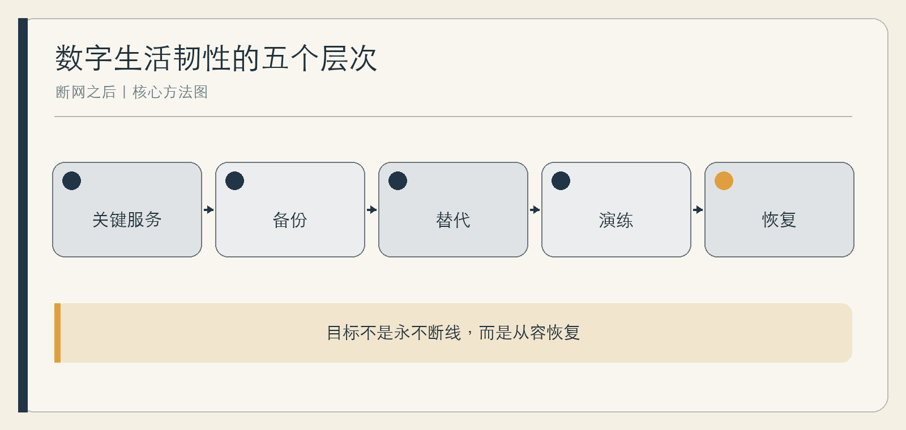

# 断网之后

数字生活的韧性

作者：李钊  
日期：2026 年 11 月 11 日  
增订：2026 年 11 月 19 日（新增实践章节与工作单）

---

## 前言　真正的方便，包括出问题时仍有办法

家里的灯需要应用才能打开，路线需要实时导航才能找到，工作文件只在云端，与远方老人的联系也依赖同一个平台。正常运行时，这些安排几乎不需要思考；故障发生时，生活却可能同时停在许多地方。

韧性不是拒绝技术，也不是为每一种小概率灾难囤货。它是一种恢复能力：知道什么最重要，保留必要副本和手动路径，在压力下能够找到人、恢复数据、继续关键活动。

本书面向普通家庭，提供一张关键服务地图、一套备份与账号恢复方法，以及一次可以实际完成的演练。它不替代企业灾备和专业应急方案，也不要求读者掌握复杂技术。

## 第一章　韧性不是拒绝技术

### 从“设备会不会坏”转向“生活能否继续”

设备失效只是起点。真正的影响取决于它支撑什么：照明、门锁、支付、沟通、资料、工作还是照护。同一个网络故障，对娱乐只是不便，对远程照护可能需要立即替代方案。

韧性有三个层次。数据能找回，是恢复；关键任务能换一种方式完成，是连续；事后能修改设置和习惯，是学习。只做第一层，生活仍可能被账号、权限和流程卡住。

### 适度冗余不是浪费

纸质联系人、离线地图、一份本地文档、一个手动开关，平时看似多余，却降低了系统单一故障的影响。冗余不必覆盖所有事情，只需覆盖高影响和高依赖部分。

**综合案例｜回家路线的两种准备。** 周禾每天依赖导航。一次手机没电，他才发现自己记不住常用路线。后来他熟悉两条主路，保存离线地图，并在包里放小额应急电源。保留这些准备，导航消失时就不至于失去判断。

### 先定义可接受的不便

家庭可以讨论：哪些服务中断几小时没关系，哪些必须在半小时内替代，哪些资料绝不能丢。没有这套优先级，备份和演练很容易变成无边界投入。

## 第二章　画出家庭关键服务地图

### 从一天而不是设备清单开始

从起床到入睡，记录哪些活动依赖账号、网络、电力、平台或他人服务。然后标出失效后的具体后果。设备清单告诉你拥有什么，服务地图告诉你不能轻易失去什么。

地图包含：关键活动、依赖项、主要使用者、受影响者、当前备用、恢复负责人和可接受中断时间。儿童、老人和访客可能不是设置者，却是实际受影响者。

### 找到共同故障点

多部手机、云文档和家庭监控可能都依赖同一个账号；许多设备可能共用一台路由器；紧急联系人可能只记得同一个手机号。表面上的多设备，并不等于真正冗余。

**综合案例｜所有钥匙都在一个地方。** 家庭成员把密码、照片和文件都放在同一账号，方便的同时也形成共同故障点。他们将恢复信息分开保管，导出最重要资料，并让另一位成年人掌握必要的紧急访问方法。

### 先补最明显的缺口

如果唯一备份从未测试、唯一联系人无法接通、唯一钥匙在故障设备里，就先处理这些。不要一开始购买复杂系统。

## 第三章　数据备份：从三份副本到真正恢复

### 3-2-1 是一个起点

CISA 的指南建议保留三份重要文件、使用两类存储介质、其中一份异地保存，并强调自动定期备份、保护、测试与训练。[CISA](https://www.cisa.gov/audiences/small-and-medium-businesses/secure-your-business/back-up-business-data) 这里的“三份”通常按原件加两份副本理解。家庭可以按资料重要性简化采用，但不要把“开了同步”直接等同于备份。

同步会把删除、损坏或加密后的文件一起复制。勒索软件指南因此特别强调离线、加密备份和定期恢复测试。[StopRansomware](https://www.cisa.gov/stopransomware/ransomware-guide)

### 备份要覆盖恢复所需的东西

照片、证件扫描、合同、作品和联系人之外，还要考虑加密密钥、恢复码、软件安装方式和必要说明。只有数据、没有打开它的方法，恢复仍可能失败。

**综合案例｜看得见的备份，打不开的备份。** 一个家庭定期把照片复制到硬盘，多年未检查。真正需要时才发现硬盘无法读取，且部分相册仍只在旧手机。此后他们每季度随机恢复一个文件夹，并记录实际步骤。

### 用恢复证明备份

选择一小批资料，在另一台设备或独立位置恢复；确认文件能打开、照片能辨认、联系人能使用。记录用了多久、缺少什么。不要为测试删除唯一原件，测试应在副本和安全环境中进行。

## 第四章　账号与访问：找回数字生活的钥匙

### 账号比单个设备更关键

手机可以更换，账号无法恢复却可能让数据、联系人和服务一起失去。列出核心账号及其绑定邮箱、手机号、二次验证、恢复码和紧急联系人，检查这些信息是否仍有效。

恢复信息不应只存在同一个账号里。可以使用可靠的密码管理工具、离线加密副本或纸质封存，具体方式取决于家庭能力和风险。不要把完整密码写在容易丢失或公开放置的纸上。

### 为缺席与紧急情况安排授权

家庭共享不等于人人知道所有密码。需要明确谁在什么情况下可以处理照片、账单、订阅和照护服务。涉及平台功能时，以当前官方的遗产、家庭或恢复机制为准，不假设家人能自然获得访问权。

**综合案例｜验证码去了旧手机。** 用户更换手机号后未更新账号，设备丢失时无法接收验证码。事后他才补全恢复邮箱和备用验证。真正需要定期核对的是整条恢复链，而不是只记住登录密码。

### 每年做一次账号检查

核心账号能否登录；绑定方式是否有效；恢复码是否可用；旧设备是否退出；家庭共享权限是否仍符合需要；重要资料是否有账号之外的副本。

## 第五章　断网、断电与设备失效：保留手动路径

### 手动入口要在正常时看得见

智能门锁、照明、窗帘和设备控制器若完全依赖应用，故障时会让使用者慌乱。检查物理解锁、墙面开关、本地控制和备用电源，并让所有家庭成员知道在哪里。

NIST 的连续性规划强调关键功能、恢复优先级与演练。家庭不需要照搬企业体系，但可以采用同样的思路：先保证人身安全和基本生活，再处理便利。[NIST SP 800-34](https://csrc.nist.gov/pubs/sp/800/34/rev-1/final)

### 不把演练变成冒险

不要在陌生路线、恶劣天气、夜间或真实照护需求中故意断网。选择安全、低风险、可随时恢复的时段，先告知家人。涉及门锁、报警、医疗和消防设备时，不自行制造故障，只核对官方手动方案。

**综合案例｜灯还亮着，生活没有停。** 一次网络中断后，家人发现部分智能灯仍可墙面控制，但音箱无法提供提醒。他们把重要提醒改为普通闹钟，并保留一份设备手动操作卡。

### 一张失效处理卡

设备名称；正常现象；本地开关；安全停止方式；备用方案；服务电话；何时寻求专业帮助。卡片放在故障时也能找到的位置，而不是只存在需要网络的笔记里。

## 第六章　支付、出行、工作与学习的备用方案

### 支付与出行

保留适量现金或另一种合法支付方式，具体金额按家庭需要；重要行程保存地址、电话和票据的离线副本；在熟悉环境中练习不依赖实时导航的基本方向判断。任何备用都不应牺牲安全与合规。

### 工作与学习

关键文件在截止前导出本地副本，记录可编辑格式；线上会议提前保存 dial-in 或联系人；学习资料保留必要章节和纸笔替代。只下载任务最核心部分，确保关键活动能够继续。

**综合案例｜演示前十五分钟。** 会议平台无法登录，讲者此前只保存了云端链接，只能等待。后来他把最终幻灯片导出为 PDF，并把关键数据和联系人保存在本地。下一次故障仍有不便，已有准备却能继续发挥作用。

### 与家人约定降级模式

断网时哪些付费下载暂停，哪些共享任务改用电话，哪些工作截止时间需要沟通。明确降级模式能减少每个人都在临时发问。

## 第七章　照护中的技术边界

### 监测正常不等于没有需要

远程提醒可以说明设备没有报警，却不能告诉照护者对方今天情绪怎样、是否真正吃饭、是否需要陪伴。备用方案不能只复制更多传感器，还要保留电话、邻里和线下支持。

### 被照护者应参与规则

安装摄像头、位置共享和自动提醒前，讨论谁能看、何时看、如何关闭、异常后谁联系。老人或儿童不一定能熟练使用系统，却应尽可能理解并表达拒绝。

**综合案例｜提醒没有响。** 家属一度完全依赖活动监测。设备离线后，他们才发现没有约定日常联络。之后建立简单规则：固定时间电话，异常先直接联系，无法接通再联系附近的授权人，设备只作辅助。

### 危机不走普通备用流程

遇到人身安全、急性疾病、自伤或其他紧急情况，应立即联系当地急救、警方或合格专业服务，不等待设备恢复，也不依赖通用聊天工具判断。

## 第八章　一次家庭恢复演练

### 选择一个低风险场景

例如“主手机不可用两小时”或“家里网络中断一小时”。提前说明范围，不关闭真实安防与医疗设备。目标是完成关键任务，不是证明谁准备最好。

演练前写下三项任务：找到重要联系人；恢复一份关键文件；完成一项日常活动。演练后记录哪里等待、哪里找不到、哪项备用实际上不能用。

### 复盘要产生修改

**综合案例｜纸质清单也过期。** 家庭找到纸质应急卡，却发现联系电话和宽带信息已旧。复盘后指定每年两次更新，并把恢复码检查加入日程。演练的价值正是暴露这些平时看不见的小缺口。

### 保持轻量而持续

一次大规模准备容易，持续维护更难。把备份恢复、账号检查和应急卡更新分散到固定日期，每次只处理少量项目。韧性依靠长期维护，让关键能力始终可用。

## 第九章　把服务地图变成恢复顺序

### 先恢复生活，再恢复设备

故障出现后，最容易吸引人的通常是亮着红灯的设备、打不开的页面和连续出现的提示。处理顺序却应从受影响的活动开始。独居者是否安全，孩子能否回家，当天的药物提醒是否有替代，明早要提交的材料是否还在，这些问题比路由器为何断线更优先。

把第二章的服务地图拿来，为每项关键活动补四栏：可以等待多久、缺少它会发生什么、谁来宣布启用备用、恢复到什么程度算完成。等待时间不必精确到分钟，可以用“立即”“两小时内”“今天内”“本周内”。它帮助家庭区分紧急问题与稍后的整理工作。

**综合案例｜路由器故障后的半小时。** 林家晚间断网，三个人同时检查设备。家里一位老人正等待远程联络，孩子第二天要交纸质材料，智能音箱还承担着晨起提醒。复盘后，他们把顺序改为：先用手机电话确认老人平安，再按离线副本准备材料，最后设置普通闹钟。路由器可以稍后再修。网络仍是一个故障，生活却不必同时停下来。

### 一张恢复顺序表

| 关键活动 | 可等待时间 | 启用备用的信号 | 临时完成方式 | 负责人 | 恢复完成的证据 |
| --- | --- | --- | --- | --- | --- |
| 与远方家人联络 | 立即 | 常用平台不可用且一次重试失败 | 电话或授权联系人上门 | 指定成年人 | 本人明确回应，后续时间已约定 |
| 找到次日材料 | 今天内 | 云端连续两次无法打开 | 本地副本或打印件 | 材料使用者 | 文件能打开，版本和页数已核对 |
| 到家开门 | 立即 | 应用或电子验证失效 | 官方机械钥匙或授权人员 | 每位成年人 | 安全进入，异常入口已报修 |
| 恢复全部照片 | 本周内 | 原设备不可用 | 从副本逐步整理 | 资料负责人 | 抽样可读，缺失范围已记录 |

表格中的例子需要根据家庭实际替换。负责人写姓名或明确角色，避免“大家”这一无人承担的形式。恢复证据写可以观察的结果，例如“对方接听”“合同能打开并看到签字页”，不写“应该好了”。

### 设定恢复边界

每次处理只承诺当前最重要的活动。恢复网络不等于恢复所有智能家居，找回账号也不等于立刻整理多年数据。把目标缩小，能够减少连续重置设备、反复修改密码造成的二次损失。

遇到数据可能覆盖、账号可能锁定、安防可能失效、陌生链接要求验证时，先停止尝试。保存错误提示、发生时间和最近操作，随后查找官方说明或请求合格人员协助。试错次数也应当成为恢复记录的一部分。

## 第十章　四类常见失效的处置卡

### 主手机丢失

先确认人身与周边环境安全，再借用可信电话联系可能拾到设备的人或场所。通过官方渠道使用定位、丢失标记、锁定或运营商停机服务。远程擦除属于后续选择，执行前考虑资料副本、再次定位的需要和官方功能后果，不在慌乱中连续操作。

随后保护与手机关联的支付、邮箱和身份验证。记录设备丢失时间、已采取措施、运营商或服务受理信息。补办设备后，从可信副本恢复必要内容，并检查旧会话是否已退出。若手机同时装着家庭唯一的恢复码，应把这次事件列为账号体系的整改信号。

**模拟推演｜旅行途中遗失手机。** 许宁记得云账号密码，却发现二次验证仍发往丢失的设备。她没有点击陌生人发来的“找回链接”，而是使用离线保存的恢复码进入官方账号页面，再更新验证方式。这个推演的重点是提前保存恢复路径，实际功能随平台变化，操作时应查阅官方说明。

### 核心账号被锁定

先判断是密码错误、验证不可用、平台安全限制，还是疑似被他人控制。停止无规律地重复输入，保留官方提示。使用已经登记过的恢复邮箱、备用验证或官方申诉路径，核对网址和联系人来源。

恢复后立即检查绑定手机号、邮箱、登录设备、转发规则与授权应用。发现异常变更时保存记录，再按平台流程撤销。不要仅改一个密码就宣布完成；账号若能重置其他服务，还要沿恢复链检查下游影响。

### 家庭网络中断

先区分单一设备、全户网络和外部服务故障。查看普通网页、设备本地开关和路由器状态，做一次有记录的常规重启即可。若仍失败，使用服务提供商公布的故障查询或报修方式。不要凭书中固定步骤拆改陌生设备。

同时启动服务顺序表：电话联络改用手机网络或电话，工作文件使用已导出的副本，必要提醒转到普通闹钟。家中有人依赖联网医疗或安防服务时，遵循设备供应商和专业人员的应急指引，本书不建议主动切断这些系统测试。

### 局部停电

先确认照明、通行、温度与人员安全，使用随手可得的照明，避免在黑暗中寻找复杂工具。电器恢复、储能设备和发电设备涉及具体安全风险，应按制造商和当地专业要求处理，不在室内使用产生有害气体的设备。

电力恢复后，检查时钟、提醒、网络与关键设备状态。某些设备会恢复供电却不会恢复原有任务。把“电回来了”和“服务恢复了”分开验收。

## 第十一章　做一次不碰唯一原件的数据恢复

### 准备一份小型练习集

从非唯一资料中选择三类样本：一份文字文档、一组照片、一份联系人或表格。记录数量、文件名和原本所在位置，再复制到独立练习目录。样本应包含中文文件名、较大文件和需要特定软件打开的文件，以暴露真实问题。

练习只操作副本。不要在原硬盘上格式化，不为测试删除云端唯一文件，也不在不明设备上解开包含敏感信息的全部档案。涉及家庭成员资料时先取得同意，并使用合适的访问限制。

### 按读者视角验收

恢复完成后，请另一位家庭成员在只拿到操作卡的情况下寻找文件。他能否辨认最新版本，能否打开文档，能否从联系人中找到需要的人，能否判断哪些照片尚未恢复？这些结果比“复制进度百分之百”更能说明备份是否可用。

**综合案例｜文件夹都在，版本却错了。** 周家从移动硬盘恢复了“最终材料”，打开后发现内容是两个月前的草稿。后来他们在清单中增加版本日期和抽样位置：文档看指定章节，照片看某月某日，表格核对行数与关键行。验收不再停留在文件夹数量。

### 恢复记录表

| 字段 | 本次填写 |
| --- | --- |
| 样本与来源位置 |  |
| 原件是否保持不动 |  |
| 使用的副本与读取设备 |  |
| 开始和结束时间 |  |
| 需要安装的软件或许可 |  |
| 加密钥匙由谁保管 |  |
| 实际打开的文件与核对位置 |  |
| 缺失、损坏或版本不明的内容 |  |
| 需要修正的备份步骤 |  |
| 下次复查日期与负责人 |  |

记录耗时有助于安排真正故障时的工作。若一批照片的恢复需要数小时，就不能把“立即取回所有照片”写进应急卡。此时可以优先恢复证件、近期联络所需资料和少量关键照片，其余分批处理。

### 结束练习

移除练习设备上不再需要的敏感副本，保留必要的恢复记录。把发现的问题转成一项可完成的修改，例如补一条软件安装说明、把钥匙分开保管、给硬盘标注日期。下次只抽查修改后的环节，同时随机选一项旧环节，防止长期失修。

## 第十二章　账号恢复链与家庭授权

### 从登录名画到最终落脚点

为核心账号画出一条链：登录名由谁掌握，密码放在哪里，二次验证发往哪台设备，恢复邮箱又依赖什么验证，恢复码是否离线保存，手机号变更后由谁更新。链条最后应落到一个故障时仍能使用的落脚点，例如另一位授权成年人、离线封存恢复码或官方人工流程。

画图时不需要公开密码。只记录位置、保管人和使用方法。完整秘密与使用说明可以分开存放，降低单张纸或单台设备丢失后的风险。

**综合案例｜循环的验证。** 主邮箱把恢复信息发到备用邮箱，备用邮箱又只接受主邮箱验证。两台设备同时不可用后，这个安排失去作用。家庭随后增加离线恢复码，并指定一名成年人保管必要说明。改善发生在整条链上，单纯增加一个密码强度没有解决循环依赖。

### 备用验证的最小集合

为每个核心账号确认至少一种当前官方支持的备用方式。记录恢复码生成日期和存放位置，实际查看官方页面的入口，不在书中提供可能过期的固定点击路径。更换手机、手机号、邮箱或密码管理工具后，立即重走关键步骤。

备用方式越多不一定越好。每增加一个邮箱、设备或受托人，也增加一处需要保护的入口。保留家庭真正维护得过来的少数路径，每年清理不再使用的设备和授权。

### 授权要对应任务

“帮我处理照片”“替我缴某项账单”“在失联时关闭订阅”是三种不同任务。分别写明启动条件、允许范围、有效期限和结束方式。能够使用平台家庭共享、平台内委托访问或正式授权时，优先采用权限清晰的机制，不共用全部账号秘密。

对于儿童、认知障碍者或需要监护的家庭成员，授权安排可能涉及法律与平台规则，应寻求当地合格意见。本书表格只能帮助整理需求，不能替代正式文件。

### 每年十五分钟的账号走查

选一个核心账号，由实际保管人演示如何找到恢复说明。检查绑定信息、恢复码位置、旧设备会话、家庭共享成员和最近变更。演练可以不提交密码，也不真正锁定账号。结束时记录失效环节和更新日期。

## 第十三章　安排一个离线日

### 选择一项完整活动

离线练习最好围绕真实活动，例如一顿晚餐、一段熟悉路线的出行、一次作业或一场内部分享。提前准备必要资料，设定开始和结束时间，让不参加的人知道联络方式。保留安全与照护所需的通信，不把“离线”变成失联。

练习的价值在于观察一个任务如何被在线服务切开。导航、支付、清单、聊天、资料、验证和娱乐可能同时进入同一件事。记录这些入口，回家后才能决定哪些保留离线副本，哪些根本无需替代。

### 三种活动的准备

**熟悉路线出行。** 保存目的地地址、电话、交通票证和返程信息，事先辨认主要方向。只走熟悉的白天路线，天气或治安条件不合适就取消。同行者知道集合点和改期信号。

**离线完成一次分享。** 导出最终演示文件，同时保存可编辑版本与 PDF，检查视频和字体是否仍依赖网络。把联系人、会议地址和关键数据放在本地。提前在演示设备上从头播放一次，确认备用副本确实可读。

**完成作业或阅读。** 下载必要章节与题目，记录来源和页码，准备纸笔。若提交必须联网，先约定提交恢复后的处理，不为练习错过真实截止时间。孩子参与时，由成年人负责时间与安全边界。

### 观察而不是评分

活动中只记录三类时刻：需要停下来找什么、临时求助谁、哪个备用反而增加麻烦。不要给家庭成员打分，也不要比较谁更能离开手机。有人发现普通纸清单更方便，有人确认语音读屏或在线字幕对自己不可缺少，这些差异都应进入下一版方案。

### 回家后的三十分钟

把记录归到“补充副本”“调整流程”“保留在线”三栏。在线服务对无障碍、沟通和效率的价值应当保留。离线能力用于扩大选择，不用于给生活增加一套持续考核。

**模拟推演｜一次短途出行。** 一家人预先保存地址和返程票证，却忘记记录同行者的新手机号。途中短暂失联后，他们在约定集合点碰面。复盘只需补一张同行联系卡和明确集合时间，无需为此购买新设备。小缺口被看见，练习就完成了主要任务。

## 第十四章　儿童、老人、访客与照护场景

### 让实际使用者参与设计

恢复卡常由最熟悉技术的人编写，真正使用时却可能交给儿童、老人、临时照护者或留宿访客。请他们指出卡片中看不懂的词、找不到的位置和做不到的步骤。字太小、缩写太多、设备标识与实物不一致，都会让纸面方案失效。

为不同使用者准备不同视图。儿童需要可信成年人、集合点和简明规则；访客需要住址、联络人与基本手动入口；照护者还可能需要经授权的必要信息。敏感资料按任务限制，不把全家的账号清单交给每一位临时帮助者。

### 儿童的练习边界

儿童可以练习辨认可信成年人、记住必要联络方式和找到纸质地址，不承担重置路由器、保管全家恢复码或处理支付锁定的责任。练习必须由成年人陪同，真实紧急情况下直接联系当地正式服务和监护人。

不要通过假扮陌生人、制造惊吓或故意让孩子迷路来测试。安全感比“测试是否逼真”重要。复盘关注成年人安排是否清楚，不责怪孩子没有记住复杂流程。

### 维护老人的选择权

远程提醒和位置共享应说明用途、可见范围和关闭方法。能本人决定的，由本人参与决定；需要代理或监护的，按适用规则处理。备用联络可以先从本人偏好的方式开始，例如固定电话、每日约定或邻里互助，而非默认增加监控。

**综合案例｜一张能看清的电话卡。** 家属原先把应急说明放在手机笔记里，老人并不熟悉操作。他们改为在固定位置放大字号打印三项：先联系谁、无法接通再联系谁、何时直接寻求当地紧急帮助。设备仍在使用，但家人不再把设备在线当作本人平安的唯一证据。

### 照护交接的四句话

交接时至少说明：今天最需要完成的活动是什么，什么迹象需要直接求助，哪些设备只作辅助，发生变更后在哪里留下记录。交接内容由被照护者同意并控制可见范围，避免在无关群聊公开健康或位置细节。

## 第十五章　设备更换、服务停用与年度维护

### 更换设备前保留出口

新设备到手后再清理旧设备。先确认资料副本、账号恢复、软件许可、双重验证迁移和必要附件。对旧手机或电脑执行退出、取消授权和清除操作之前，按官方说明核对后果。设备无法开机时，标记尚未确认的资料范围，避免误把“应该同步过”当成验收。

**综合案例｜旧手机最后一次用途。** 陈莉换机后立即退出旧设备，后来发现某验证工具尚未迁移。她只能走较长的账号申诉。此后，她把顺序改成：先迁移验证，登录新设备检查核心账号，抽样恢复资料，最后再清理旧设备。新设备可用是整个过程的一部分，旧设备退出同样需要验收。

### 服务停用前先读导出说明

平台停运、订阅取消或家庭更换服务时，列出仍在其中的资料、成员、自动流程与付款关系。确认官方导出格式、截止时间和删除政策，保存导出文件及必要说明。导出后抽样打开，不能只下载一个从未检查的压缩包。

服务之间的自动流程要逐项解除或替换。例如相册自动上传、邮箱自动转发、家庭设备联动和账单自动续费，可能在主账号关闭后留下不同后果。此处没有适用于所有平台的统一按钮，应以当前官方页面为准。

### 迁移验收表

| 验收对象 | 最小检查 | 发现的问题 | 处理人 | 完成日期 |
| --- | --- | --- | --- | --- |
| 资料 | 抽样打开，核对数量、日期和关键版本 |  |  |  |
| 账号 | 新路径登录，备用验证可用 |  |  |  |
| 成员 | 应保留的人可用，应退出的人已移除 |  |  |  |
| 自动流程 | 上传、转发、提醒和支付逐项核对 |  |  |  |
| 旧服务 | 按官方流程退出或关闭，保存必要凭据 |  |  |  |

### 把维护分散到一年

可以按季度轮换重点：第一季度抽查资料恢复，第二季度核对账号恢复链，第三季度检查手动入口和应急卡，第四季度整理设备与授权。生日、换季、旅行前等已有日程也能成为提醒，无需另建复杂系统。

每次维护结束时只留下少量明确动作：谁，在哪天前，改哪项，如何验证。如果一项备用连续两次维护都没有人使用或维护，重新评估它是否适合家庭。可靠的一页卡片胜过无人理解的一盒工具。

## 第十六章　九十分钟家庭恢复演练

### 零到十分钟：约定安全边界

选择“主手机不可用”或“家庭网络不可用”中的一个模拟情境，不同时叠加停电、账号丢失和人员失联。指定一名演练主持人和一名观察员。所有人知道停止词，任何人说出后即刻恢复正常服务。

不触碰真实安防、医疗、消防与报警设备，不关闭工作必需服务，不删除资料，不输入或朗读完整密码。有真实照护、天气、出行或截止任务时改期。主持人写下三项任务和预计时长。

### 十到二十五分钟：找到人

模拟常用聊天平台不可用，参与者从应急卡找到一位家庭成员和一位授权协助者。实际拨打电话前先征得对方同意，说明是演练。核对住址、集合点和再次联络时间是否清楚。

观察员记录找卡用了多久、卡片是否看得清、电话号码是否有效、是否有人只知道网名。若联络未完成，停止在“补录或更新联系卡”，不用继续翻找更多设备。

### 二十五到五十分钟：恢复一份文件

使用第十一章准备好的练习副本。参与者按操作卡找到资料，打开指定文件，核对版本与一处具体内容。恢复过程遇到加密钥匙、软件许可或文件格式障碍时，记录并停止该分支，不临时绕过安全保护。

验收由未执行恢复的人完成。他可以复述文件在哪里、何时更新、什么情况下不能使用。这样可检验方案是否依赖某一个人的记忆。

### 五十到七十分钟：完成一项日常活动

从第十三章选择一项安全活动，例如准备一顿简单晚餐、找到次日出行地址或播放一份离线演示。只使用事先准备的备用，不临时购买新设备。观察哪些步骤顺利，哪些步骤仍要求原平台。

如果活动涉及儿童或老人，先听取他们对卡片和步骤的感受。把“做不到”视为方案需要修改的信号。

### 七十到九十分钟：形成整改闭环

每位参与者只提出一个最影响自己的困难，主持人把它们合并为至多三项整改。每项写明负责人、截止日期和验收证据，再约定下一次检查日期。

| 发现 | 影响的活动 | 整改动作 | 负责人 | 截止日 | 验收方式 |
| --- | --- | --- | --- | --- | --- |
| 联系卡号码过期 | 找到人 | 两位成年人分别核对并更新 |  |  | 经对方同意试拨成功 |
| 恢复说明缺少软件名 | 找到文件 | 记录官方安装来源和许可保管处 |  |  | 另一人按卡打开样本 |
| 纸质演示版本过旧 | 完成分享 | 发布时同步替换离线副本 |  |  | 核对标题、日期和关键页 |

### 结束与停止条件

恢复所有被调整的服务，确认提醒、联络和文件访问回到正常状态。纸质记录妥善收回，练习中产生的敏感副本按要求清理。主持人保存一页记录即可，无需把演练变成新的资料负担。

出现人员不适、真实故障、未经授权的信息暴露、无法停止的设备操作或任何安全疑虑时立即终止。恢复正常和寻求适当帮助优先于完成流程。若家庭从未做过准备，第一次演练只完成“找到应急卡并读懂它”也算有效起点。

## 第十七章　故障中的沟通、记录与求助

### 第一条消息只传达必要事实

故障发生时，家庭群容易出现连续的截图、猜测和重复询问。第一条消息可以固定为四项：哪项活动受影响，当前已采用什么备用，谁正在处理，下一次何时更新。例如：“家里网络中断，老人联络已改用电话，我负责报修，二十分钟后更新。”这条消息能减少其他人的不确定，也给处理者留出操作空间。

不要在群里发送完整密码、恢复码、证件照片或位置等无关敏感信息。需要协助的人只获得当前任务所需的最少内容。公开求助时尤其要隐藏账号、住址和设备标识，官方支持也不会以索要不必要秘密来证明服务可靠。

### 记录最近变化，减少重复试错

在处理记录中保留发生时间、最近变更、错误提示原文、已经尝试的步骤和结果。截图可以帮助回忆，但应先遮住敏感信息。每一步只做一项改动，完成后再观察结果；同时改密码、重启路由器和清理设备，会让原因与后果难以辨认。

**综合案例｜五次重启没有增加信息。** 家里的平板无法打开资料，成员轮流重启，仍无法判断问题在哪。后来他们停止重复动作，记下“同一文件在另一设备可打开，平板其他文档正常”，由此把排查范围缩小到这台设备的应用与文件关联。记录没有立刻修好问题，却让下一次求助有了事实基础。

### 把求助说成可回答的问题

向家人、供应商或专业人员求助时，可以按以下顺序整理：要恢复的活动、设备或服务名称、故障何时开始、最近做过什么变更、看到的准确提示、已经尝试什么、目前有哪些副本。若对方提出高风险操作，先确认后果和撤回方式，再决定是否继续。

遇到疑似入侵、资金异常、身份盗用、数据被加密或人身安全风险，普通恢复流程可能不再适用。及时联系相应平台、金融机构、当地执法或合格专业人员。保存必要的交易与沟通记录，不为了验证猜测继续操作。

### 结束时区分三种状态

“已恢复”表示关键活动经过实际验收；“临时替代”表示活动能继续但原服务尚未恢复；“等待处理”表示仍需外部支持或后续维护。三种状态分别对应不同的下次更新时间。避免一条“好了”让家人误以为所有资料、权限与自动流程都已恢复。

## 第十八章　让方案在主人缺席时仍能工作

### 独居者也需要一位知情联系人

独居并不意味着所有事情都要独自处理。可以与一位可信任的人约定：多久没有回应时再次联系，哪些服务故障可以提供远程帮助，什么情况需要当地正式服务介入。双方都应知道约定的边界，也能随时重新商量。

家中保留必要的手动入口说明和最小联络卡，敏感索引安全存放。外地联系人无法解决门锁或急性疾病等现场问题，因此还应考虑附近的合法支持。不要把位置持续共享当作唯一方案，具体选择兼顾本人意愿、隐私和可获得帮助的能力。

### 临时离开前做一次交接

旅行、住院、出差或一段时间无法上网前，列出仍在运行的自动任务：账单、资料同步、宠物或住宅照护、家庭设备提醒、需要回复的约定。逐项决定暂停、转交或保持。交接只包含当前任务所需的权限，结束后及时收回。

**模拟推演｜两周旅行前。** 方启把家中设备的管理密码交给朋友，却没有说明异常时该做什么。更合适的准备是列出需要朋友处理的两项任务、官方授权入口、联络顺序和结束日期。旅行结束后，双方核对日志并取消临时权限。任务越明确，长期共享全部秘密的需要就越少。

### 身故与长期失能不能只靠家庭默契

照片、订阅、创作材料和账号在身故或长期失能后的处理，可能受到平台条款、财产与继承规则、隐私义务及所在地法律影响。家庭可以提前记录愿望、保管必要索引并了解平台提供的机制；需要正式安排时，咨询当地合格专业人士。

本章不提供数字遗产的法律结论，也不鼓励家人绕过平台验证。可执行的起点是把“本人希望保留什么、删除什么、由谁处理哪些事务”写下来，并在重大生活变化后复核。这些愿望与正式文件如何衔接，应由合格人士结合实际判断。

### 每次交接都有结束

临时受托人完成任务后，应归还设备、删除不再需要的副本、退出会话并说明处理结果。委托人检查关键服务是否恢复，更新发生变更的凭据和索引。涉及共同资料时，与其他权利人确认后再删除。

交接记录保留四类内容：授权任务、开始与结束时间、实际处理、未解决事项。无关聊天、健康信息和身份材料不应为了“以后可能有用”无限留存。减少留存也减少未来泄露的范围。

### 最小可行方案的最终检查

完成全书后，可以用六个问题验收：最重要的三项活动是什么；各自的备用由谁启动；一份关键资料能否从副本打开；核心账号的恢复落脚点在哪里；实际使用者是否理解并愿意采用；下一次复核定在哪天。任何一项答不出来，就先补那一项。

家庭不必把每个表格填满。对某些人，最小方案是一位知情联系人、一份可靠资料副本和一张看得懂的手动入口卡。对另一些人，还需要完整授权和照护交接。规模可以不同，每项安排都应当有负责人、使用方法和验收结果。

## 附录　家庭应急卡与演练表

### 家庭应急卡

关键联系人；住址与必要医疗信息；网络和电力服务信息；核心账号恢复位置；重要资料副本位置；手动门锁与设备入口；附近可协助者；紧急服务电话。

应急卡只记录恢复所需的最少信息，不写完整密码。纸质卡应安全存放并让相关家庭成员知道位置；涉及医疗等敏感内容时，限制可见范围并定期复核是否仍有必要保留。

### 数据清单

资料名称；主要副本；本地备份；异地或离线副本；加密与恢复钥匙；最近恢复测试；负责人；下次检查。

### 演练记录

演练场景；必须完成的三项任务；实际耗时；失败点；是否有人不知道该怎么做；需要补充的工具或信息；修改负责人；复查日期。

### 安全红线

不在真实风险环境故意断网；不测试唯一原件的删除恢复；不公开完整密码和恢复码；不让儿童单独承担恢复任务；不让照护完全依赖自动报警；紧急情况直接联系正式服务。

## 附录二　可直接使用的家庭工作单

以下工作单用于整理家庭自己的信息。空格由使用者填写，不应把书中示例直接当作真实联系方式或设备能力。敏感页分散保管，公共区域只放必要信息。

### 工作单一：一天的服务依赖

先选普通的一天，从起床开始记录。每行只写一项活动，随后追问它依赖的账号、电力、网络、设备与他人服务。连续记录工作日和休息日，可以发现依赖并不相同。

| 时间与活动 | 谁实际使用 | 依赖的服务 | 中断后的影响 | 现在能怎样替代 | 需要补充什么 |
| --- | --- | --- | --- | --- | --- |
| 起床与提醒 |  |  |  |  |  |
| 出门与通行 |  |  |  |  |  |
| 支付与采购 |  |  |  |  |  |
| 工作或学习 |  |  |  |  |  |
| 与家人联络 |  |  |  |  |  |
| 用药或照护提醒 |  |  |  |  |  |
| 晚餐与家务 |  |  |  |  |  |
| 睡前检查 |  |  |  |  |  |

填完后只圈出三项高影响活动。判断依据包括人员安全、不可逆损失、时间限制和受影响者能否自助。娱乐中断通常可以等待，但某些人的娱乐也是情绪支持和日常联络，应听取本人感受，不替别人统一划定重要性。

### 工作单二：最小应急联络卡

公共联络卡只写姓名、关系、电话和约定任务，不写账号密码。需要保密的医疗或地址信息可另页封存，并注明何时允许查看。

| 联系对象 | 联系方式 | 何时联系 | 对方已同意的事项 | 最近核对日期 |
| --- | --- | --- | --- | --- |
| 家庭成员一 |  | 日常联络中断时 |  |  |
| 家庭成员二 |  | 第一位无法接通时 |  |  |
| 附近授权协助者 |  | 需要线下查看时 |  |  |
| 服务提供商 |  | 对应服务故障时 |  |  |
| 当地正式紧急服务 | 按所在地官方信息填写 | 人身安全、急性疾病或其他紧急情况 | 不以设备恢复为前提 |  |

在卡片底部补充两个约定：无法接通时过多久联系下一位；大家走散时在哪个安全地点集合。经对方同意，偶尔做一次简短试拨。发现空号、离职、搬家或不愿继续承担时，及时替换，不把对方过去的同意视为永久义务。

### 工作单三：资料与打开方法

| 资料类别 | 原件位置 | 副本位置 | 最近更新 | 打开所需软件或钥匙 | 抽样结果 | 负责人 |
| --- | --- | --- | --- | --- | --- | --- |
| 身份与住所必要资料 |  |  |  |  |  |  |
| 合同与财务记录 |  |  |  |  |  |  |
| 家庭照片与视频 |  |  |  |  |  |  |
| 工作或学习材料 |  |  |  |  |  |  |
| 联系人与日历 |  |  |  |  |  |  |
| 个人创作与项目 |  |  |  |  |  |  |

“打开所需”一栏常能暴露被遗漏的依赖。例如加密压缩包需要密码，旧文档需要特定软件，导出的日历需要知道如何导入。说明应让另一位授权成员能按步骤操作，但完整秘密仍分开保存。涉及他人资料时同时记录保管权限和应删除的时间。

### 工作单四：账号恢复位置索引

索引只指向秘密的保管位置，不直接抄录秘密。每个核心账号填写一行，检查是否存在循环验证。

| 服务用途 | 账号标识的提示 | 密码保管位置 | 备用验证位置 | 恢复码位置 | 受托人与权限 | 核对日期 |
| --- | --- | --- | --- | --- | --- | --- |
| 主邮箱 |  |  |  |  |  |  |
| 云资料 |  |  |  |  |  |  |
| 通信与联系人 |  |  |  |  |  |  |
| 支付与金融 |  |  |  |  |  |  |
| 家庭设备管理 |  |  |  |  |  |  |

完成后做三项检查：恢复信息是否全在同一设备；手机号或邮箱变更是否已更新；受托人是否清楚授权启动条件。金融等高影响账号的具体保护和恢复，以相应机构的官方流程为准。

### 工作单五：设备手动入口卡

| 设备或区域 | 正常用途 | 断网时还能做什么 | 手动入口位置 | 安全停止方式 | 不应自行尝试的操作 |
| --- | --- | --- | --- | --- | --- |
| 入户与门锁 |  |  |  |  |  |
| 照明与通行 |  |  |  |  |  |
| 提醒与时钟 |  |  |  |  |  |
| 工作设备 |  |  |  |  |  |
| 照护相关设备 |  |  |  |  |  |

请实际使用者指出入口，操作时不拆机、不屏蔽报警、不模拟危险。厂商说明无法确认的能力写“待核实”，不要写“应该可以”。设备更新或搬家后重新填写。

### 工作单六：故障处理与交接

| 时间 | 受影响的活动 | 已采用的备用 | 做过的一项操作及结果 | 下一步与负责人 | 下次更新时间 |
| --- | --- | --- | --- | --- | --- |
|  |  |  |  |  |  |
|  |  |  |  |  |  |
|  |  |  |  |  |  |

交接时由接手人复述当前状态：已恢复、临时替代或等待处理。记录中不保留无关秘密。事件结束后，表格可以成为复盘依据，也可按家庭的资料保留规则清理。

### 工作单七：复盘与整改

复盘按事实顺序展开：原来期待发生什么，实际发生什么，在哪一步开始偏离，哪些准备发挥了作用，哪个改动最值得先做。避免把讨论变成追责。没有使用备用的人也可以说明当时为何找不到或不敢用。

| 整改事项 | 关联故障 | 完成定义 | 负责人 | 日期 | 验证结果 |
| --- | --- | --- | --- | --- | --- |
|  |  |  |  |  |  |
|  |  |  |  |  |  |
|  |  |  |  |  |  |

完成定义必须能观察，例如“另一位成年人从副本打开指定合同并核对签署页”，不写“加强备份意识”。到复查日期仍未完成的事项，可以缩小范围、换负责人或取消低价值方案。家庭韧性依靠少数得到维护的安排，表格数量本身没有成绩意义。

## 附录三　七个恢复分支练习

以下七个情境均为模拟练习，用来训练判断顺序。读者可以任选一项，对照自己的服务地图写出处理卡。练习只在纸面或副本上进行，不主动制造真实故障。

### 分支一：删除也同步到了另一台设备

**情境。** 一份已经整理好的文件在原设备被误删，另一台同步设备随后也看不到它。家庭成员想立刻重新安装同步应用。

**处理。** 暂停会继续写入或清理数据的操作，记下删除时间、文件名、最近正常版本和涉及设备。查看服务官方提供的版本历史、回收站或离线副本，明确恢复会还原单个文件还是整批状态。若平台功能不清楚，先保存现有信息并请求官方支持。

**验收。** 在独立位置恢复指定版本，打开并核对内容，再决定是否写回原位置。保留当前其他新增文件的清单，防止用旧快照覆盖后续工作。

**整改。** 为重要资料增加不随每次删除即时变化的副本，并把“同步不等于版本保护”写进数据清单。

### 分支二：硬盘能被识别，文件却读不出

**情境。** 移动存储设备显示已连接，部分目录为空或文件无法打开。家人准备运行不熟悉的修复工具。

**处理。** 停止向该设备写入内容，不反复格式化或尝试来源不明的软件。记录设备、文件系统和错误信息，优先使用另一份健康副本恢复。若设备中存有唯一资料且价值较高，考虑合格的数据恢复服务，先了解费用、隐私和失败可能性。

**验收。** 恢复结果按预先选定的文件和具体内容核对，不能仅看设备能否挂载。需要专业处理的设备保留必要交接记录。

**整改。** 将“有副本”细化为副本可读取、软件可打开、钥匙可使用三项检查，并错开设备的存放环境。

### 分支三：恢复码找到了，却无法辨认对应账号

**情境。** 封存袋里有多组恢复码，标签只写“重要账号”。真正需要时，无人知道每组属于哪个服务，也不确定是否已经作废。

**处理。** 不在多个账号中盲目尝试。根据保管记录和官方页面确认服务归属；无法确认时，把恢复码视为不可用，改走平台提供的正式恢复流程。不要将恢复码拍照发到家庭群请求辨认。

**验收。** 账号恢复后，由实际使用者确认绑定方式与恢复材料的位置。旧码若按官方机制失效，应安全处理，避免以后误用。

**整改。** 索引增加服务用途、生成日期、保管人和最近核对日期。秘密本体与索引分开保存，走查时只核对位置和有效性，不公开朗读。

### 分支四：联系人导出成功，却缺了常用字段

**情境。** 家人把联系人导出成一个文件，转移到新设备后发现部分备注、多个号码或分组关系没有保留。

**处理。** 保留原设备和原导出文件，不继续覆盖。抽取几位字段不同的联系人，比较原服务、导出文件与导入结果。查阅当前官方格式说明，区分导出遗漏、格式不支持和导入匹配错误。

**验收。** 除联系人总数外，检查多个号码、备注、中文姓名和指定分组。确认哪些字段无法迁移，用合适方式另行保存必要信息。

**整改。** 迁移验收表增加字段样本。任何导入试验先在小型副本和测试分组进行，确认后再处理全部联系人。

### 分支五：备用联系人也联系不上

**情境。** 常用平台中断，第一位备用联系人没有及时回应。家人开始把消息转发给越来越多的人。

**处理。** 按预先约定的等待时间联系下一位授权人，同时说明当前安全状况和实际需要。无紧急风险时避免无限扩散消息，有紧急风险时直接联系当地正式服务。未收到回应不等于对方已经发生危险。

**验收。** 记录最终由谁回应、耗时多久、信息是否准确。恢复常用平台后，向参与者说明事件已结束，避免过时的求助继续传播。

**整改。** 与联系人重新确认可承担的时段和任务，必要时增加线下集合点。联络链要适应真实生活，不依赖某个人永远在线。

### 分支六：家人拒绝使用备用流程

**情境。** 一份恢复卡要求老人使用陌生应用，或要求儿童记住过长步骤。演练中，他们明确表示不愿继续。

**处理。** 立即停止该分支，听取不舒服或困难来自哪里。恢复原有安全服务，重新评估任务是否真的需要他们完成。对能够本人决定的事项尊重其选择，涉及法定代理或监护时依适用规则处理。

**验收。** 新方案由实际使用者演示，能够看懂、找到并愿意使用。对无法接受的数字方案，可改用电话、纸质卡、线下协助或其他合法方式。

**整改。** 把“本人参与设计”加入所有照护与家庭恢复卡。方案的有效性包含人的意愿和可达性，不能只由设置者判断。

### 分支七：文件恢复了，任务仍无法完成

**情境。** 离线演示文件可以打开，但视频缺失；合同能读取，却缺少签署所需权限；学习资料已经下载，提交平台仍不可用。

**处理。** 回到关键活动的完成定义，拆解资料之外的依赖。演示可以准备不含在线媒体的版本，签署应遵循原服务的合法流程，学习提交需要提前约定延期或替代渠道。遇到许可和身份验证限制，不采用绕过方式。

**验收。** 由任务负责人确认活动达到最低目标，并记录尚未恢复的部分。临时替代状态要告知受影响者，避免误以为原流程全部恢复。

**整改。** 服务地图补充“文件之外还依赖什么”。下一次演练把完成任务作为终点，文件复制只作为中间步骤。

## 附录四　两种家庭的取舍示例

以下均为模拟推演，用来展示如何选择，不代表特定家庭的真实经历，也不要求读者照单准备。

### 两人租住家庭：先减少账号共同故障

两位成年人合租，工作资料、照片和家庭设备管理集中在一个账号。收入与居住安排使她们不愿添置多台存储设备。她们优先完成三项：各自维护独立的核心邮箱与备用验证；把重要证件和本月工作材料保存在一份加密移动存储中；约定一方设备不可用时另一方可以提供的具体帮助。

她们暂缓复杂家庭服务器，也不为所有视频保留多份副本。验收由一次小练习完成：一方只拿操作卡，找到当月合同并打开；另一方演示核心账号恢复码的存放位置。成本被控制在可维护范围，共同账号的单点风险也有了出口。

### 多代同堂家庭：先保证联络和提醒

这个家庭有儿童、老人和两名工作繁忙的成年人。服务地图显示，普通网络故障对娱乐影响有限，对老人联络和晨起提醒影响更大。家属与老人讨论后，保留固定电话和约定联络时间，把关键提醒改成不依赖网络的方式，并请一位附近亲友担任经本人同意的备用联系人。

儿童只学习找可信成年人和纸质地址，不承担设备恢复。全家演练选在白天的三十分钟，完成“联系老人、找到地址、确认提醒”三项。真正的医疗与安防设备没有参与断电测试。方案没有追求所有服务离线化，只补上了最容易伤害成员的几个环节。

## 参考资料

1. CISA：[Back Up Business Data](https://www.cisa.gov/audiences/small-and-medium-businesses/secure-your-business/back-up-business-data)。
2. CISA：[#StopRansomware Guide](https://www.cisa.gov/stopransomware/ransomware-guide)，2023。
3. NIST：[Contingency Planning Guide for Federal Information Systems](https://csrc.nist.gov/pubs/sp/800/34/rev-1/final)，2010。
4. NIST：[Guide for Cybersecurity Event Recovery](https://csrc.nist.gov/pubs/sp/800/184/final)，2016。
5. 李钊：《智能生活》全书提纲与素材库，2026。

原资料收集截至 2026 年 11 月 11 日；2026 年 11 月 19 日增订时抽查了 CISA 两项指南与 NIST SP 800-184 页面。NIST SP 800-34 链接本次未能打开，相关方法只作家庭简化迁移。具体平台恢复机制、设备手动操作与当地紧急服务方式，应以当前官方说明为准。
