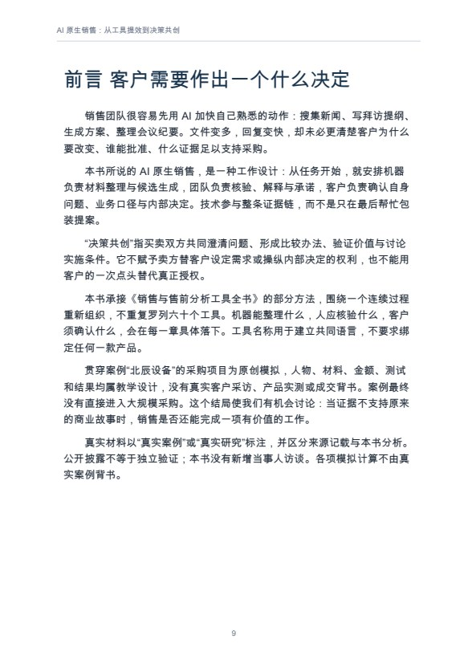
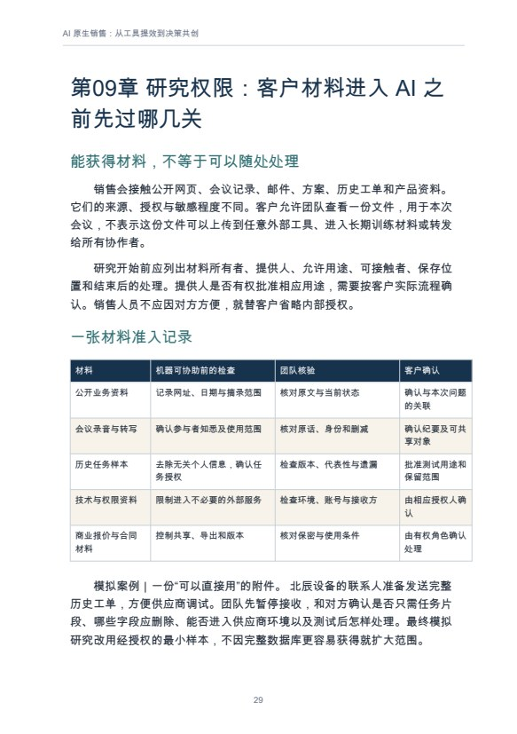

# AI 原生销售：从工具提效到决策共创

作者：李钊 · 出版单位：若谷书房  
增订版 1.1 · 原书日期：2026-11-10 · 增订日期：2026-11-19 · PDF 56 页

## 阅读导引

本次增订保留原书基础内容、署名和出版记录，形成16章、7份附录。新增实践方法、综合模拟、练习与可直接使用的工作表；模拟人物、数字和结果不构成真实客户成效或专业结果保证。

读者可先浏览前言与原八章建立共同概念，再按当前任务选读新增章节和附录。表格需结合自己的资料填写，动态规则、产品能力和专业事项仍按当前正式来源核实。

## 完整目录

展开全书目录

- 前言　客户需要作出一个什么决定
- 第01章　客户研究：把资料变成可以验证的问题
- 第02章　访谈准备：从答案收集转向过程理解
- 第03章　权力地图：谁能确认哪一部分事实
- 第04章　价值假设：先把收益拆开
- 第05章　POC 与 POV：让测试有机会失败
- 第06章　方案生成：让每项承诺都有出处
- 第07章　谈判：交换条件之前，先确认责任
- 第08章　复盘：让证据改变团队的经营方式
- 第09章　研究权限：客户材料进入 AI 之前先过哪几关
- 第10章　访谈证据：把原话、观察和推断分别留下
- 第11章　决策过程核验：权力地图要接受行为检验
- 第12章　价值基线：没有比较对象就没有可信收益
- 第13章　验证失败以后：复测、缩小与停止各有条件
- 第14章　方案承诺审查：销售、售前与交付共同签收
- 第15章　谈判变更：让价格、范围与证据始终一致
- 第16章　上线交接与复盘：签约以后证据继续流动
- 结语　让下一次决定更清楚
- 附录A　八阶段工作分工
- 附录B　一页验证章程
- 附录C　方案发布前的核对
- 附录D　材料准入与访谈证据账本
- 附录E　决策核验与价值基线工作台
- 附录F　失败复测与方案版本控制
- 附录G　上线交接与三十天复盘记录
- 来源与方法说明
- 若谷书房

## 实际内页预览

页码包含封面，从 1 起算。样页由本次 56 页 PDF 重新生成。

PDF 文件第 9 页：前言。

PDF 文件第 29 页：新增实践章节。

## 阅读与下载

- [Markdown 在线阅读](output/markdown/ai-native-sales.md)
- [PDF · 56 页](https://github.com/njxshr/ruogu-books/releases/download/expanded-books-20261119-v1.1/ai-native-sales.pdf)
- [EPUB](https://github.com/njxshr/ruogu-books/releases/download/expanded-books-20261119-v1.1/ai-native-sales.epub)
- [Markdown 离线包（正文与实际生成资源）](https://github.com/njxshr/ruogu-books/releases/download/expanded-books-20261119-v1.1/ai-native-sales-markdown.zip)

## 增订与检查

[20 轮增订记录](REVISION_LOG.md) · [实际检查报告](QA_REPORT.md)

本次重新生成 Markdown、PDF 和 EPUB。PDF 全部 56 页已渲染并逐张查看总览；EPUB 解包读取封面、前中后章节，105 个导航目标与本地资源检查通过。具体范围与限制见报告。

## 来源与权利

[来源记录](SOURCES.md) · [主稿](manuscript/book.md) · [出版配置](book.json)

来源记录保留原有核查范围。本次扩充没有借综合模拟或练习新增真实访谈、客户成效和统计证据，也没有将重新成书记为全部旧来源的再次独立核验。

© 2026 李钊／若谷书房。第三方资料的权利归原权利人所有。公开阅读与下载不另行授予开放许可。

[返回书目](../../目录.md)
