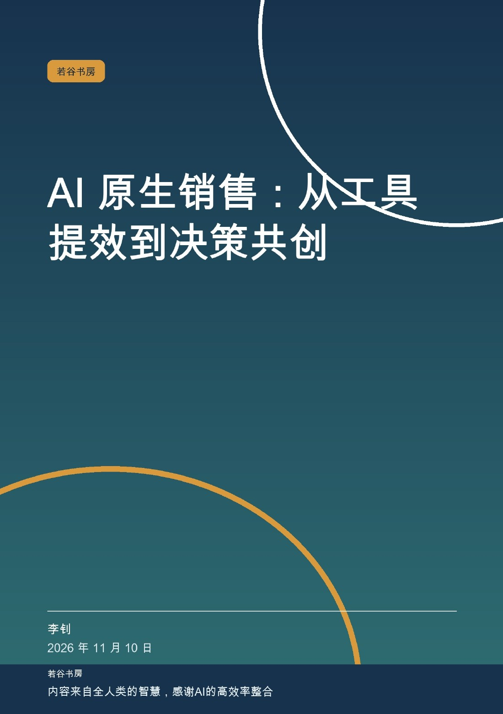
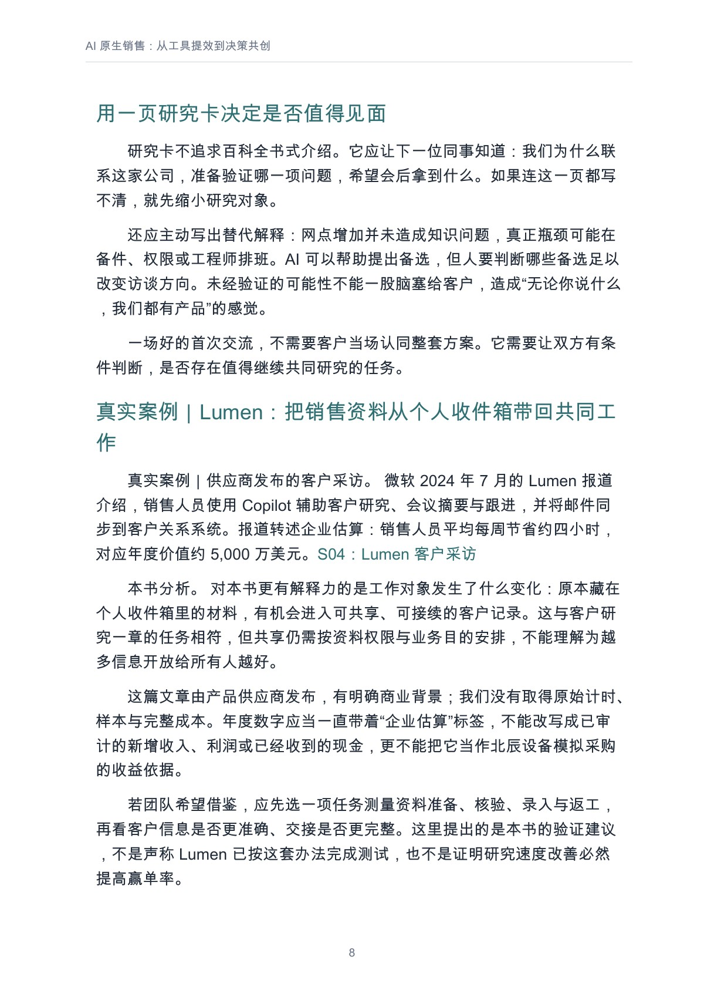
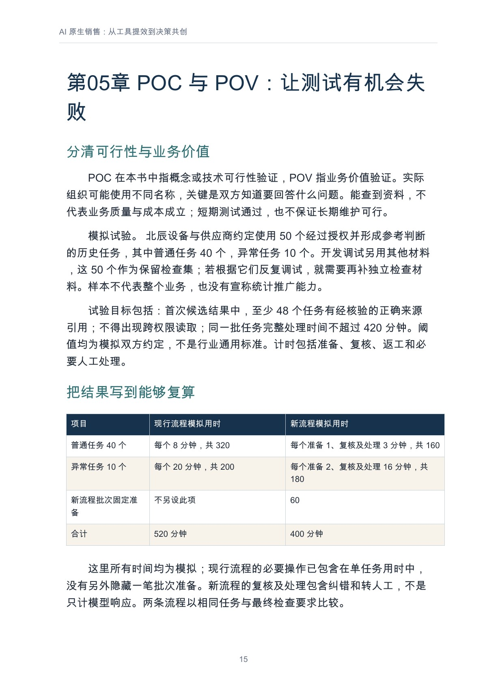
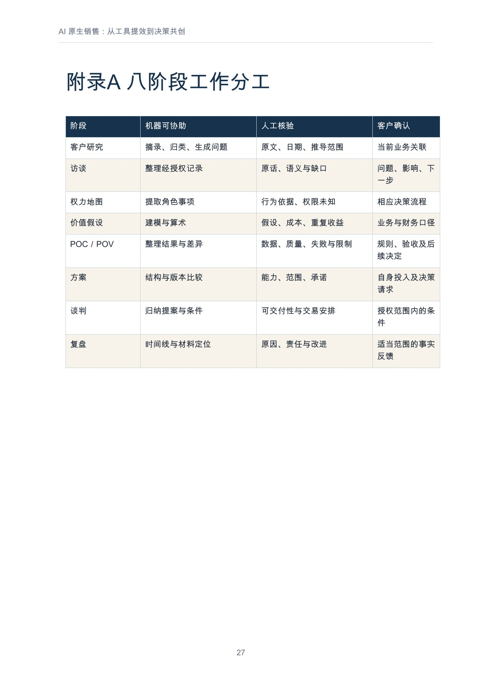

# AI 原生销售：从工具提效到决策共创

**李钊著 · 若谷书房 · 第一版 1.0 · 2026-11-10 · PDF 31 页**

把 AI 放进客户研究、证据验证和团队协作，让采购决定获得更清楚的依据。

[在线阅读全文](output/markdown/ai-native-sales.md) · [下载 PDF](https://github.com/njxshr/ruogu-books/releases/download/a1-a3-v1.0/ai-native-sales.pdf) · [下载 EPUB](https://github.com/njxshr/ruogu-books/releases/download/a1-a3-v1.0/ai-native-sales.epub) · [Markdown 离线包](https://github.com/njxshr/ruogu-books/releases/download/a1-a3-v1.0/ai-native-sales-markdown.zip)

## 这本书讨论什么

本书沿客户研究、访谈、权力地图、价值假设、POC／POV、方案、谈判与复盘八个阶段展开，逐步说明机器整理什么、团队核验什么、客户确认什么。它承接《销售与售前分析工具全书》的部分方法，按实际任务重组，而非再次罗列工具。

贯穿模拟“北辰设备”展示一轮未达到全部准出条件的验证：时间有改善，仍不足以支持原范围采购。后续讨论怎样设计复测、缩小方案和记录暂缓决定，附录提供八阶段分工、验证章程与方案发布核对。

## 适合谁读

企业级销售、售前、销售运营及参与复杂采购协作的人；不依赖某一款 AI 产品。

## 怎样阅读

| 当前需要 | 建议先读 | 带着什么问题读 |
| --- | --- | --- |
| 准备客户拜访 | [第01章　客户研究：把资料变成可以验证的问题](output/markdown/ai-native-sales.md#user-content-第01章客户研究把资料变成可以验证的问题)、[第02章　访谈准备：从答案收集转向过程理解](output/markdown/ai-native-sales.md#user-content-第02章访谈准备从答案收集转向过程理解)、[第03章　权力地图：谁能确认哪一部分事实](output/markdown/ai-native-sales.md#user-content-第03章权力地图谁能确认哪一部分事实) | 把公开信息转成可验证的问题，核对角色与权限。 |
| 准备价值论证与试验 | [第04章　价值假设：先把收益拆开](output/markdown/ai-native-sales.md#user-content-第04章价值假设先把收益拆开)、[第05章　POC 与 POV：让测试有机会失败](output/markdown/ai-native-sales.md#user-content-第05章poc-与-pov让测试有机会失败) | 分开计算收益与成本，提前确定通过和失败规则。 |
| 需要改方案或复盘 | [第06章　方案生成：让每项承诺都有出处](output/markdown/ai-native-sales.md#user-content-第06章方案生成让每项承诺都有出处)、[第07章　谈判：交换条件之前，先确认责任](output/markdown/ai-native-sales.md#user-content-第07章谈判交换条件之前先确认责任)、[第08章　复盘：让证据改变团队的经营方式](output/markdown/ai-native-sales.md#user-content-第08章复盘让证据改变团队的经营方式) | 让证据进入承诺、谈判条件与下一轮投入判断。 |

## 完整目录

展开前言、8 章、结语与附录目录

- [前言　客户需要作出一个什么决定](output/markdown/ai-native-sales.md#user-content-前言客户需要作出一个什么决定)
- [第01章　客户研究：把资料变成可以验证的问题](output/markdown/ai-native-sales.md#user-content-第01章客户研究把资料变成可以验证的问题)
- [第02章　访谈准备：从答案收集转向过程理解](output/markdown/ai-native-sales.md#user-content-第02章访谈准备从答案收集转向过程理解)
- [第03章　权力地图：谁能确认哪一部分事实](output/markdown/ai-native-sales.md#user-content-第03章权力地图谁能确认哪一部分事实)
- [第04章　价值假设：先把收益拆开](output/markdown/ai-native-sales.md#user-content-第04章价值假设先把收益拆开)
- [第05章　POC 与 POV：让测试有机会失败](output/markdown/ai-native-sales.md#user-content-第05章poc-与-pov让测试有机会失败)
- [第06章　方案生成：让每项承诺都有出处](output/markdown/ai-native-sales.md#user-content-第06章方案生成让每项承诺都有出处)
- [第07章　谈判：交换条件之前，先确认责任](output/markdown/ai-native-sales.md#user-content-第07章谈判交换条件之前先确认责任)
- [第08章　复盘：让证据改变团队的经营方式](output/markdown/ai-native-sales.md#user-content-第08章复盘让证据改变团队的经营方式)
- [结语　让下一次决定更清楚](output/markdown/ai-native-sales.md#user-content-结语让下一次决定更清楚)
- [附录A　八阶段工作分工](output/markdown/ai-native-sales.md#user-content-附录a八阶段工作分工)
- [附录B　一页验证章程](output/markdown/ai-native-sales.md#user-content-附录b一页验证章程)
- [附录C　方案发布前的核对](output/markdown/ai-native-sales.md#user-content-附录c方案发布前的核对)
- [来源与方法说明](output/markdown/ai-native-sales.md#user-content-来源与方法说明)
- [若谷书房](output/markdown/ai-native-sales.md#user-content-若谷书房)

目录名称和顺序取自正式阅读版；以上链接指向 GitHub 正文的实际章节锚点。

## 实际内页预览

下列图片均直接渲染自已发布的正式 PDF，点击可放大。页码为从 1 起算、包含封面的 **PDF 文件页码**。

### 客户研究与 Lumen 销售应用披露节选

PDF 文件第 **8** 页。

### POC／POV：模拟测试设计与计时口径

PDF 文件第 **15** 页。

### 附录 A：机器、人工与客户的八阶段分工

PDF 文件第 **27** 页。

## 案例与证据边界

Lumen 案例来自微软发布的客户采访，年度价值保持“企业估算”性质，不写成已审计收入。客服现场研究用于相邻场景的测量启发，不直接证明销售赢率。北辰设备的采购过程、测试数据和费用为模拟，不是产品性能报告。

## 阅读、下载与来源

- [Markdown 在线阅读](output/markdown/ai-native-sales.md)
- [PDF（31 页）](https://github.com/njxshr/ruogu-books/releases/download/a1-a3-v1.0/ai-native-sales.pdf)
- [EPUB](https://github.com/njxshr/ruogu-books/releases/download/a1-a3-v1.0/ai-native-sales.epub)
- [Markdown 离线 ZIP](https://github.com/njxshr/ruogu-books/releases/download/a1-a3-v1.0/ai-native-sales-markdown.zip)
- [第一版 Release](https://github.com/njxshr/ruogu-books/releases/tag/a1-a3-v1.0) · [附件 SHA-256](https://github.com/njxshr/ruogu-books/releases/download/a1-a3-v1.0/SHA256SUMS.txt)
- [来源账本](SOURCES.md) · [修订记录](REVISION_LOG.md) · [成书检查](QA_REPORT.md)
- [唯一主稿](manuscript/book.md) · [制作说明](BUILD.md) · [书房目录](../../目录.md)

## 版本与使用说明

本次仅完善介绍与实际页面预览，正文、第一版阅读成品、Release 标签和下载 URL 保持原样。公开阅读与下载不自动授予新的开放许可；第三方材料权利归原权利人所有，复用请核对书内说明及适用授权。
