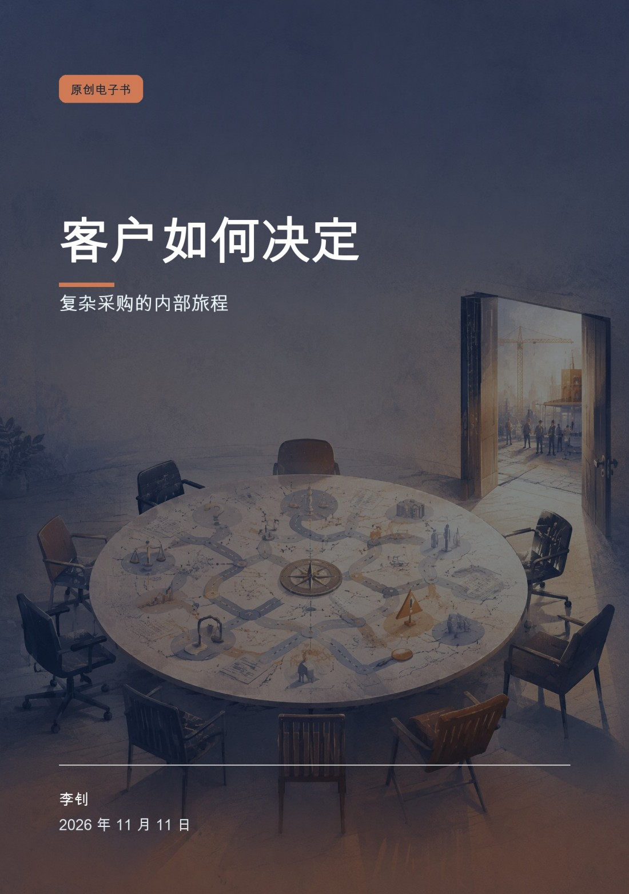
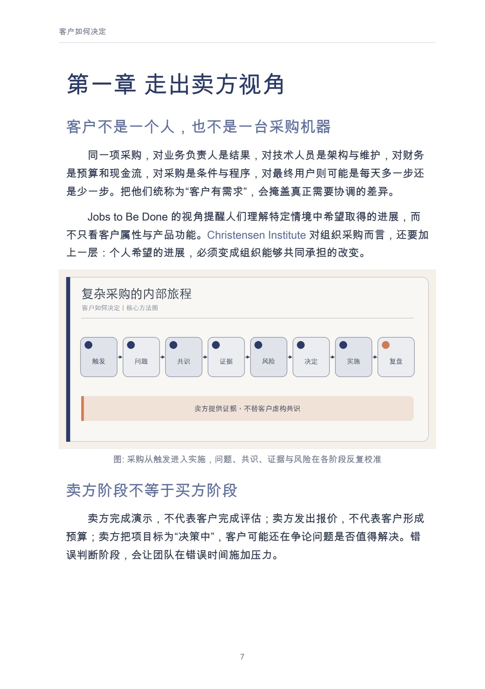
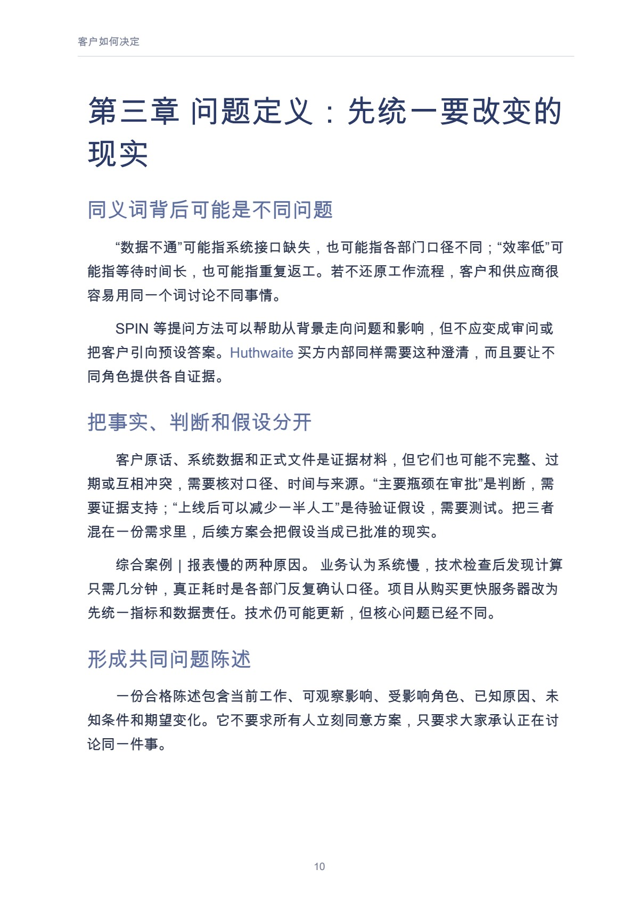

# 客户如何决定

复杂采购的内部旅程

作者：李钊 · 出版单位：晓翊工作室  
第一版 · 原书日期：2026-11-11 · 上架日期：2026-11-11 · PDF 17 页

从买方内部理解决策触发、共识、证据、风险、不决定与上线复盘。

## 阅读导引

卖方看到的是一连串活动：初次交流、需求会议、产品演示、方案汇报、测试、报价和谈判。客户内部经历的却可能是另一件事：有人发现问题，有人认为时机不对，有人担心实施失败，有人需要向财务解释，有人只想让这场争论尽快结束。

复杂采购不是一条由销售推动的漏斗，而是一段组织学习、协商和承担风险的过程。本书把视角移到买方内部，讨论为什么改变被提出、问题怎样获得共同定义、证据如何跨角色流动，以及为什么“暂不决定”经常比竞争对手更难战胜。

本书不采用未经核实的“平均有多少决策人”等数字，也不提供赢单保证。书中的买方地图和访谈问题，旨在帮助读者减少猜测，尊重客户真实决策过程。

建议先读前言与前两章，理解问题和基本方法；再结合当前问题选择后续章节，使用附录整理自己的记录。

## 完整目录

展开全书目录

- 前言　签约之前，客户已经走了很长一段路
- 第一章　走出卖方视角
- 第二章　触发：为什么是现在
- 第三章　问题定义：先统一要改变的现实
- 第四章　购买群体：共识不是把人说服一遍
- 第五章　方案比较：证据怎样进入内部讨论
- 第六章　风险、采购与合规：为什么不能只讲价值
- 第七章　不决定：最常被忽略的竞争者
- 第八章　上线与价值复盘：决定并没有在签约时结束
- 附录　买方访谈与决策地图
- 参考资料

## 实际内页预览

页码为包含封面的 PDF 文件页码，从 1 起算。

PDF 文件第 7 页：客户如何决定 7 第一章 走出卖方视角 客户不是一个人，也不是一台采购机器 同一项采购，对业务负责人是结果，对技术人员是架构与维护

PDF 文件第 10 页：客户如何决定 10 第三章 问题定义：先统一要改变的 现实 同义词背后可能是不同问题 “数据不通”可能指系统接口缺失，也可能指各部

## 阅读与下载

- [Markdown 在线阅读](output/markdown/客户如何决定_李钊_20261111.md)
- [PDF · 17 页](https://github.com/njxshr/ruogu-books/releases/download/new-books-20261111-v1.0/customer-decisions.pdf)
- [EPUB](https://github.com/njxshr/ruogu-books/releases/download/new-books-20261111-v1.0/customer-decisions.epub)
- [Markdown 离线包（含配图）](https://github.com/njxshr/ruogu-books/releases/download/new-books-20261111-v1.0/customer-decisions-markdown.zip)

## 来源与权利

[来源记录](SOURCES.md) · [主稿](manuscript/book.md) · [出版配置](book.json)

书中的综合案例、模拟情境和作者建议按正文标注理解，不作为真实客户成效承诺。来源记录保留原有核查范围，本次上架不代表重新核查全部外部来源。

版权所有 © 2026 李钊。保留所有权利。 第三方资料权利归原权利人。公开阅读与下载不另行授予开放许可。

[返回书目](../../目录.md)
