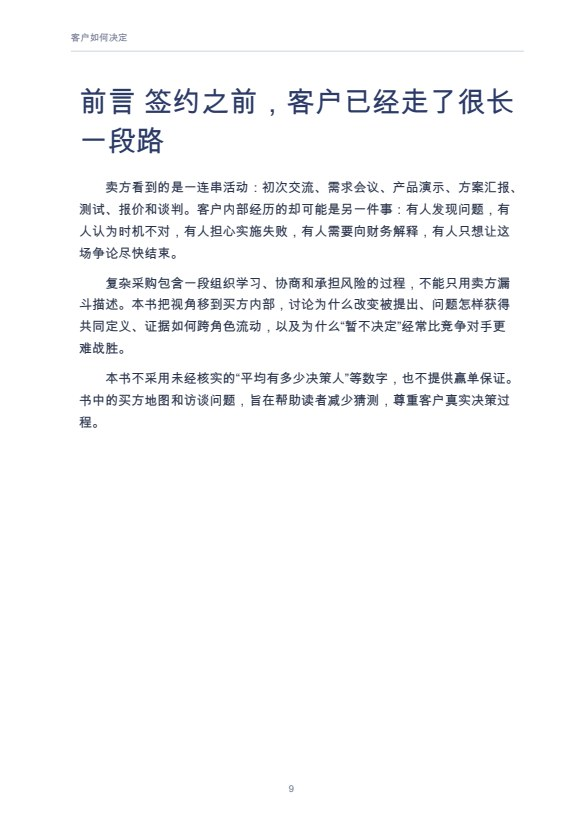

# 客户如何决定

复杂采购的内部旅程

作者：李钊 · 出版单位：晓翊工作室  
增订版 1.1 · 原书日期：2026-11-11 · 增订日期：2026-11-19 · PDF 50 页

从买方内部理解决策触发、共识、证据、风险、不决定与上线复盘。

## 阅读导引

本次增订保留原书基础内容、署名和出版记录，20章、5份附录。新增实践方法、综合案例或模拟练习及可直接使用的工作表。案例的材料性质以正文标注为准，不构成真实客户成效或专业结果保证。

读者可先浏览前言与原八章建立共同概念，再按当前任务选读新增章节和附录。表格需结合自己的资料填写，动态规则、产品能力和专业事项仍按当前正式来源核实。

## 完整目录

展开全书目录

- 前言　签约之前，客户已经走了很长一段路
- 第一章　走出卖方视角
- 第二章　触发：为什么是现在
- 第三章　问题定义：先统一要改变的现实
- 第四章　购买群体：共识不是把人说服一遍
- 第五章　方案比较：证据怎样进入内部讨论
- 第六章　风险、采购与合规：为什么不能只讲价值
- 第七章　不决定：最常被忽略的竞争者
- 第八章　上线与价值复盘：决定并没有在签约时结束
- 第九章　角色访谈：听懂各自的损失与约束
- 第十章　问题定义工作坊：让分歧可以工作
- 第十一章　预算、权限与正式程序
- 第十二章　总成本、退出与一笔算得清的账
- 第十三章　证据包：让未参会的人也能复核
- 第十四章　主动不采购与暂停
- 第十五章　上线采用：把承诺变成日常工作
- 第十六章　价值复盘：把结论交回下一次决定
- 第十七章　风险评审：把担忧分到具体事件
- 第十八章　合同与范围变更：保存决定的边界
- 第十九章　内部汇报：帮助推动者说清未知
- 第二十章　续约、扩容与退出：再次作出决定
- 附录　买方访谈与决策地图
- 附录二　六张决策工作台
- 附录三　贯穿练习：一次跨部门报表采购
- 附录四　决策信号的核对练习
- 附录五　材料交接索引
- 参考资料

## 实际内页预览

页码包含封面，从 1 起算。样页由本次 50 页 PDF 重新生成。

PDF 文件第 9 页：前言。

PDF 文件第 19 页：新增实践章节。

## 阅读与下载

- [Markdown 在线阅读](output/markdown/客户如何决定_李钊_20261111.md)
- [PDF · 50 页](https://github.com/njxshr/ruogu-books/releases/download/expanded-books-20261119-v1.1/customer-decisions.pdf)
- [EPUB](https://github.com/njxshr/ruogu-books/releases/download/expanded-books-20261119-v1.1/customer-decisions.epub)
- [Markdown 离线包（含配图）](https://github.com/njxshr/ruogu-books/releases/download/expanded-books-20261119-v1.1/customer-decisions-markdown.zip)

## 增订与检查

[20 轮增订记录](REVISION_LOG.md) · [实际检查报告](QA_REPORT.md)

本次重新生成 Markdown、PDF 和 EPUB。PDF 全部 50 页已渲染并逐张查看总览；EPUB 解包读取封面、前中后章节，105 个导航目标与本地资源检查通过。具体范围与限制见报告。

## 来源与权利

[来源记录](SOURCES.md) · [主稿](manuscript/book.md) · [出版配置](book.json)

来源记录保留原有核查范围。本次扩充没有借综合案例或模拟推演新增真实访谈、客户成效和统计证据。

版权所有 © 2026 李钊。保留所有权利。第三方资料权利归原权利人。公开阅读与下载不另行授予开放许可。

[返回书目](../../目录.md)
