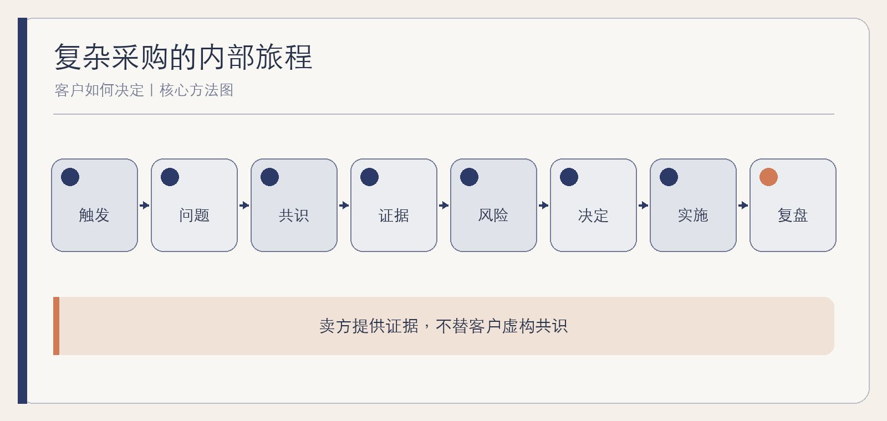

# 客户如何决定

复杂采购的内部旅程

作者：李钊  
日期：2026 年 11 月 11 日

---

## 前言　签约之前，客户已经走了很长一段路

卖方看到的是一连串活动：初次交流、需求会议、产品演示、方案汇报、测试、报价和谈判。客户内部经历的却可能是另一件事：有人发现问题，有人认为时机不对，有人担心实施失败，有人需要向财务解释，有人只想让这场争论尽快结束。

复杂采购不是一条由销售推动的漏斗，而是一段组织学习、协商和承担风险的过程。本书把视角移到买方内部，讨论为什么改变被提出、问题怎样获得共同定义、证据如何跨角色流动，以及为什么“暂不决定”经常比竞争对手更难战胜。

本书不采用未经核实的“平均有多少决策人”等数字，也不提供赢单保证。书中的买方地图和访谈问题，旨在帮助读者减少猜测，尊重客户真实决策过程。

## 第一章　走出卖方视角

### 客户不是一个人，也不是一台采购机器

同一项采购，对业务负责人是结果，对技术人员是架构与维护，对财务是预算和现金流，对采购是条件与程序，对最终用户则可能是每天多一步还是少一步。把他们统称为“客户有需求”，会掩盖真正需要协调的差异。

Jobs to Be Done 的视角提醒人们理解特定情境中希望取得的进展，而不只看客户属性与产品功能。[Christensen Institute](https://www.christenseninstitute.org/video/what-is-jobs-to-be-done-theory/) 对组织采购而言，还要加上一层：个人希望的进展，必须变成组织能够共同承担的改变。

### 卖方阶段不等于买方阶段

卖方完成演示，不代表客户完成评估；卖方发出报价，不代表客户形成预算；卖方把项目标为“决策中”，客户可能还在争论问题是否值得解决。错误判断阶段，会让团队在错误时间施加压力。

**综合案例｜一场过早的汇报。** 供应商精心准备高管汇报，客户业务团队却尚未确认现状数据。高管追问损失口径，现场无人能答。项目不是输在方案不够漂亮，而是客户的问题定义还没有成为共同事实。

### 一张买方地图

记录当前触发、问题定义、参与者、各自证据、未解决风险、内部下一步。不要只画权力关系，也要画信息如何流动和冲突在哪里。

## 第二章　触发：为什么是现在

### 长期问题不等于当前项目

许多问题存在多年，真正让组织行动的是触发事件：成本压力、客户投诉、系统到期、监管变化、新业务、人员更替，或原有方式已经无法维持。触发让“应该改善”变成“现在需要处理”。

但触发也可能只是临时情绪。一次事故后，组织迅速采购，随后发现没人愿意改变流程。卖方需要理解事件背后的持续条件，而不是把紧迫感直接当项目成熟度。

### 维持现状也有成本

不行动并非没有代价，但代价必须与客户确认。不能由供应商替客户编写损失数字。可追问：现在谁额外承担什么工作，哪些风险正在被接受，如果不处理会影响哪个目标，谁最有切身感受。

**综合案例｜系统到期之外。** 一家企业的旧系统即将停止维护，看似明确触发。访谈后发现，真正让业务愿意参与的是新门店无法按旧流程复制。若只围绕“换系统”讨论，项目会被技术部门理解为迁移；围绕“支持扩张”讨论，才会形成跨部门任务。

### 判断触发的持续性

问三个问题：事件过去后，问题是否仍然重要；谁已经把改变纳入自己的目标；是否有具体时间窗口和资源约束。答案比客户口头说“很重视”更能说明项目条件。

## 第三章　问题定义：先统一要改变的现实

### 同义词背后可能是不同问题

“数据不通”可能指系统接口缺失，也可能指各部门口径不同；“效率低”可能指等待时间长，也可能指重复返工。若不还原工作流程，客户和供应商很容易用同一个词讨论不同事情。

SPIN 等提问方法可以帮助从背景走向问题和影响，但不应变成审问或把客户引向预设答案。[Huthwaite](https://www.huthwaiteinternational.com/hubfs/Whitepapers%20-%202025/Whitepaper%20PDFs/The%20Science%20behind%20SPIN%20Selling.pdf) 买方内部同样需要这种澄清，而且要让不同角色提供各自证据。

### 把事实、判断和假设分开

客户原话、系统数据和正式文件是证据材料，但它们也可能不完整、过期或互相冲突，需要核对口径、时间与来源。“主要瓶颈在审批”是判断，需要证据支持；“上线后可以减少一半人工”是待验证假设，需要测试。把三者混在一份需求里，后续方案会把假设当成已批准的现实。

**综合案例｜报表慢的两种原因。** 业务认为系统慢，技术检查后发现计算只需几分钟，真正耗时是各部门反复确认口径。项目从购买更快服务器改为先统一指标和数据责任。技术仍可能更新，但核心问题已经不同。

### 形成共同问题陈述

一份合格陈述包含当前工作、可观察影响、受影响角色、已知原因、未知条件和期望变化。它不要求所有人立刻同意方案，只要求大家承认正在讨论同一件事。

## 第四章　购买群体：共识不是把人说服一遍

### 每个角色都在保护自己的合理目标

技术部门担心维护，不一定是阻碍创新；财务追问收益，不一定是短视；一线反对额外录入，也不等于不配合。把阻力都解释为“保守”，会让团队错过真实风险。

共识不是所有人同样热情，而是关键角色知道要做什么、自己承担什么、哪些担忧已有处理、哪些仍待验证。有些人需要批准，有些人需要不再反对，有些人只需要知道如何获得支持。

### 内部推动者不是传声筒

真正有效的推动者能解释问题、组织讨论、暴露分歧并帮助获得资源。只替供应商转发材料的人，未必能推动内部决定。供应商应帮助其形成内部可用的证据，而不是要求不断安排会议。

**综合案例｜被遗漏的最终用户。** 项目获得业务与技术认可，试点时却遭一线抵制。原来新流程把数据补录工作全部转给门店。团队重新设计输入和责任，才让用户从被动接受者变成方案评审者。

### 用“承诺”观察进展

客户愿意提供数据、让关键角色参加、安排试点资源、确认问题陈述，通常比“方案不错”更能说明共识正在形成。但承诺也要结合具体组织，不能机械换算成赢率。

MEDDICC 等卖方框架可以帮助整理决策角色、指标、流程和内部推动者等待核信息，但框架中的空格不是事实。凡是没有得到客户材料或行为支持的内容，都应标为“待确认”，而不是为了填全模板替客户作答。[MEDDICC](https://meddicc.com/meddpicc-sales-methodology-and-process)

## 第五章　方案比较：证据怎样进入内部讨论

### 客户比较的不只是供应商

备选路径包括维持现状、改造旧流程、内部开发、分阶段实施和购买产品。BATNA 的思维提醒我们理解真实替代方案，而不是把比较简化成两家报价。[Harvard PON](https://www.pon.harvard.edu/daily/batna/translate-your-batna-to-the-current-deal/)

不同角色需要不同证据，但证据应能互相连接。业务价值要能追到当前工作，技术验证要覆盖真实约束，实施计划要说明谁投入时间。单份面向所有人的长方案，往往让每个人都找不到自己的判断依据。

### POC 与 POV 回答不同问题

概念可行性验证关注“能不能做到”，业务价值验证关注“这样做是否值得”。两者可以相连，但不能用技术跑通自动证明业务价值，也不能用漂亮收益测算掩盖关键功能未验证。

**综合案例｜演示数据与真实数据。** 演示环境效果很好，客户仍不愿扩大试点。原因不是不相信技术，而是真实数据缺少必要字段。下一轮试点改为先验证数据准备成本，避免把价值讨论建立在不可获得的输入上。

### 建立证据包

问题陈述、验证范围、样例与口径、实际结果、未通过项、限制、投入、下一步。证据包要能让未参加会议的人复核，而不是只有一张成功截图。

## 第六章　风险、采购与合规：为什么不能只讲价值

### 采购是在安排后果

合同、数据、信息安全、服务连续性、供应商锁定和退出机制，都决定错误发生后由谁承担。价值很高并不自动使这些风险消失。成熟买方会把风险前置，而不是等签约后才发现无法上线。

采购程序也有公共和组织理性：比较、审批、留痕和职责分离能够减少任意决定。卖方把程序只当阻碍，容易忽略客户必须履行的责任。

### 把风险写成可处理的问题

不要只列“安全、合规、稳定”，而要写：什么事件、影响谁、当前控制、还需证据、谁接受剩余风险。对无法消除的风险，讨论限制范围、人工复核、退出和补救。

**综合案例｜低价并未降低风险。** 两个方案价格接近，便宜方案却要求全部数据长期锁定在专有格式。客户把迁移与退出成本纳入比较，最终选择可分阶段退出的路径。决定依据从采购价格扩展到整个使用周期。

### 让采购更早参与

在方案后期才介绍采购与法务，往往意味着重新讨论范围和责任。提前了解正式程序、必要材料和不可接受条款，可以减少双方无效工作。

## 第七章　不决定：最常被忽略的竞争者

### 不决定可能是理性结果

当问题不够重要、共识不足、风险过高、资源不够或替代路径更好，不决定不是失败，而是组织在当前条件下较合理的选择。卖方如果只会加压，可能推动一个最终无法实施的项目。

也有些不决定来自无人承担下一步：会议不断，问题始终没人拥有；试点结束，没有标准判断继续还是停止。此时需要不是更多材料，而是明确决策权和停止条件。

### 区分四种停滞

问题停滞：没有共同定义；证据停滞：关键假设未验证；权力停滞：没人能批准或协调；资源停滞：愿意做但没有人、钱或时间。四种停滞不能用同一种“跟进”解决。

**综合案例｜主动结束一次机会。** 供应商发现客户没有实施负责人，试点需要的一线资源也无法保证。双方把项目缩为问题诊断，暂缓采购。短期没有订单，却避免了一场注定失败的上线，也保留了未来重新启动的清晰条件。

### 给“不决定”一个体面出口

写清当前结论、未满足条件、保留资料和重新评估时间。好的退出比无限期“还在推进”更节省组织成本。

## 第八章　上线与价值复盘：决定并没有在签约时结束

### 签约把争论变成共同交付

采购决定之后，真实用户、数据、流程和旧系统开始进入项目。此前未暴露的问题会出现。双方需要确认谁负责采用、培训、数据准备、异常处理和最终验收，而不是把合同签署当价值已经实现。

PDSA 的学习循环适合用于上线后的验证：研究结果，再决定扩大、调整或停止，而不是机械宣布按计划完成。[Deming Institute](https://deming.org/explore/pdsa/)

### 回到最初的问题与口径

价值复盘要对照客户确认的起点，而不是临时选择最好看的数字。除了效率，也检查质量、风险、用户负担和未预见后果。若没有可靠基线，就如实说明证据限制。

**综合案例｜使用率背后的闲置。** 上线率很高，但核心团队仍保留旧表格，因为新系统无法处理例外。复盘没有把高登录量当成功，而是追踪哪些任务仍需要双轨，并决定补功能、改流程或缩回范围。

### 一次完整决定形成组织记忆

保存问题陈述、关键假设、未通过验证、剩余风险和复盘结论。它们不仅服务续约，也帮助客户下一次更好地决定。对供应商而言，真正长期的信任来自帮助客户做出可检验的决定，而不是让每次采购都显得非买不可。

## 附录　买方访谈与决策地图

### 买方访谈十二问

1. 这件事为什么现在被提出？
2. 触发之前，问题以什么方式存在？
3. 当前流程中谁承担最多额外成本？
4. 各角色对问题的定义有何不同？
5. 哪些事实已经确认，哪些仍是假设？
6. 谁需要批准，谁需要实际改变工作？
7. 维持现状是否是一个可接受选项？
8. 哪个担忧一旦不处理，就会阻止上线？
9. 什么证据能让未参会者复核？
10. 哪个结果会让我们主动停止？
11. 签约后谁负责采用与异常？
12. 复盘时用什么口径判断价值？

### 决策地图字段

触发；共同问题；参与角色；各自目标；证据材料与待核假设；替代路径；验证计划；决策与批准方式；正式程序；剩余风险；内部下一步；停止条件；上线与复盘责任。

## 参考资料

1. Christensen 等：[Know Your Customers’ Jobs to Be Done](https://hbr.org/2016/09/know-your-customers-jobs-to-be-done)，2016。
2. Clayton Christensen Institute：[What is Jobs to Be Done Theory?](https://www.christenseninstitute.org/video/what-is-jobs-to-be-done-theory/)。
3. Huthwaite International：[The Science behind SPIN Selling](https://www.huthwaiteinternational.com/hubfs/Whitepapers%20-%202025/Whitepaper%20PDFs/The%20Science%20behind%20SPIN%20Selling.pdf)。
4. MEDDICC：[MEDDPICC Sales Methodology and Process](https://meddicc.com/meddpicc-sales-methodology-and-process)。
5. Harvard Program on Negotiation：[What is BATNA?](https://www.pon.harvard.edu/daily/batna/translate-your-batna-to-the-current-deal/)。
6. W. Edwards Deming Institute：[PDSA Cycle](https://deming.org/explore/pdsa/)。
7. 李钊：《销售与售前分析工具全书》，2026。

资料收集截至 2026 年 11 月 11 日。采购框架、机构材料与具体流程在后续使用时应重新核对。
