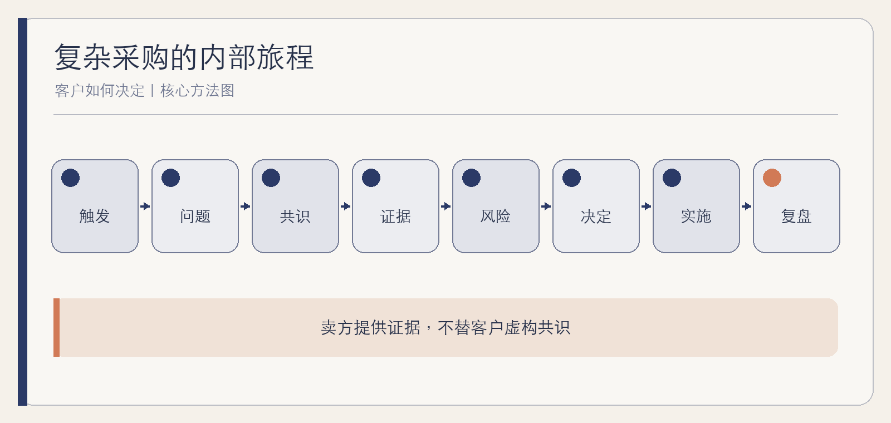

# 客户如何决定

复杂采购的内部旅程

作者：李钊  
日期：2026 年 11 月 11 日  
增订：2026 年 11 月 19 日（新增买方工作方法与记录表）

---

## 前言　签约之前，客户已经走了很长一段路

卖方看到的是一连串活动：初次交流、需求会议、产品演示、方案汇报、测试、报价和谈判。客户内部经历的却可能是另一件事：有人发现问题，有人认为时机不对，有人担心实施失败，有人需要向财务解释，有人只想让这场争论尽快结束。

复杂采购包含一段组织学习、协商和承担风险的过程，不能只用卖方漏斗描述。本书把视角移到买方内部，讨论为什么改变被提出、问题怎样获得共同定义、证据如何跨角色流动，以及为什么“暂不决定”经常比竞争对手更难战胜。

本书不采用未经核实的“平均有多少决策人”等数字，也不提供赢单保证。书中的买方地图和访谈问题，旨在帮助读者减少猜测，尊重客户真实决策过程。

## 第一章　走出卖方视角

### 客户不是一个人，也不是一台采购机器

同一项采购，对业务负责人是结果，对技术人员是架构与维护，对财务是预算和现金流，对采购是条件与程序，对最终用户则可能是每天多一步还是少一步。把他们统称为“客户有需求”，会掩盖真正需要协调的差异。

Jobs to Be Done 的视角提醒人们理解特定情境中希望取得的进展，而不只看客户属性与产品功能。[Christensen Institute](https://www.christenseninstitute.org/video/what-is-jobs-to-be-done-theory/) 对组织采购而言，还要加上一层：个人希望的进展，必须变成组织能够共同承担的改变。

### 卖方阶段不等于买方阶段

卖方完成演示，不代表客户完成评估；卖方发出报价，不代表客户形成预算；卖方把项目标为“决策中”，客户可能还在争论问题是否值得解决。错误判断阶段，会让团队在错误时间施加压力。

**综合案例｜一场过早的汇报。** 供应商精心准备高管汇报，客户业务团队却尚未确认现状数据。高管追问损失口径，现场无人能答。客户的问题定义尚未成为共同事实，方案汇报因此失去基础。

### 一张买方地图

记录当前触发、问题定义、参与者、各自证据、未解决风险、内部下一步。不要只画权力关系，也要画信息如何流动和冲突在哪里。

## 第二章　触发：为什么是现在

### 长期问题不等于当前项目

许多问题存在多年，真正让组织行动的是触发事件：成本压力、客户投诉、系统到期、监管变化、新业务、人员更替，或原有方式已经无法维持。触发让“应该改善”变成“现在需要处理”。

但触发也可能只是临时情绪。一次事故后，组织迅速采购，随后发现没人愿意改变流程。卖方需要理解事件背后的持续条件，而不是把紧迫感直接当项目成熟度。

### 维持现状也有成本

不行动并非没有代价，但代价必须与客户确认。不能由供应商替客户编写损失数字。可追问：现在谁额外承担什么工作，哪些风险正在被接受，如果不处理会影响哪个目标，谁最有切身感受。

**综合案例｜系统到期之外。** 一家企业的旧系统即将停止维护，看似明确触发。访谈后发现，真正让业务愿意参与的是新门店无法按旧流程复制。若只围绕“换系统”讨论，项目会被技术部门理解为迁移；围绕“支持扩张”讨论，才会形成跨部门任务。

### 判断触发的持续性

问三个问题：事件过去后，问题是否仍然重要；谁已经把改变纳入自己的目标；是否有具体时间窗口和资源约束。答案比客户口头说“很重视”更能说明项目条件。

## 第三章　问题定义：先统一要改变的现实

### 同义词背后可能是不同问题

“数据不通”可能指系统接口缺失，也可能指各部门口径不同；“效率低”可能指等待时间长，也可能指重复返工。若不还原工作流程，客户和供应商很容易用同一个词讨论不同事情。

SPIN 等提问方法可以帮助从背景走向问题和影响，但不应变成审问或把客户引向预设答案。[Huthwaite](https://www.huthwaiteinternational.com/hubfs/Whitepapers%20-%202025/Whitepaper%20PDFs/The%20Science%20behind%20SPIN%20Selling.pdf) 买方内部同样需要这种澄清，而且要让不同角色提供各自证据。

### 把事实、判断和假设分开

客户原话、系统数据和正式文件是证据材料，但它们也可能不完整、过期或互相冲突，需要核对口径、时间与来源。“主要瓶颈在审批”是判断，需要证据支持；“上线后可以减少一半人工”是待验证假设，需要测试。把三者混在一份需求里，后续方案会把假设当成已批准的现实。

**综合案例｜报表慢的两种原因。** 业务认为系统慢，技术检查后发现计算只需几分钟，真正耗时是各部门反复确认口径。项目从购买更快服务器改为先统一指标和数据责任。技术仍可能更新，但核心问题已经不同。

### 形成共同问题陈述

一份合格陈述包含当前工作、可观察影响、受影响角色、已知原因、未知条件和期望变化。它不要求所有人立刻同意方案，只要求大家承认正在讨论同一件事。

## 第四章　购买群体：共识不是把人说服一遍

### 每个角色都在保护自己的合理目标

技术部门担心维护，不一定是阻碍创新；财务追问收益，不一定是短视；一线反对额外录入，也不等于不配合。把阻力都解释为“保守”，会让团队错过真实风险。

共识体现为关键角色知道要做什么、自己承担什么、哪些担忧已有处理、哪些仍待验证；他们不必表现得同样热情。有些人需要批准，有些人需要不再反对，有些人只需要知道如何获得支持。

### 内部推动者不是传声筒

真正有效的推动者能解释问题、组织讨论、暴露分歧并帮助获得资源。只替供应商转发材料的人，未必能推动内部决定。供应商应帮助其形成内部可用的证据，而不是要求不断安排会议。

**综合案例｜被遗漏的最终用户。** 项目获得业务与技术认可，试点时却遭一线抵制。原来新流程把数据补录工作全部转给门店。团队重新设计输入和责任，才让用户从被动接受者变成方案评审者。

### 用“承诺”观察进展

客户愿意提供数据、让关键角色参加、安排试点资源、确认问题陈述，通常比“方案不错”更能说明共识正在形成。但承诺也要结合具体组织，不能机械换算成赢率。

MEDDICC 等卖方框架可以帮助整理决策角色、指标、流程和内部推动者等待核信息，但框架中的空格不是事实。凡是没有得到客户材料或行为支持的内容，都应标为“待确认”，而不是为了填全模板替客户作答。[MEDDICC](https://meddicc.com/meddpicc-sales-methodology-and-process)

## 第五章　方案比较：证据怎样进入内部讨论

### 客户比较的不只是供应商

备选路径包括维持现状、改造旧流程、内部开发、分阶段实施和购买产品。BATNA 的思维提醒我们理解真实替代方案，而不是把比较简化成两家报价。[Harvard PON](https://www.pon.harvard.edu/daily/batna/translate-your-batna-to-the-current-deal/)

不同角色需要不同证据，但证据应能互相连接。业务价值要能追到当前工作，技术验证要覆盖真实约束，实施计划要说明谁投入时间。单份面向所有人的长方案，往往让每个人都找不到自己的判断依据。

### POC 与 POV 回答不同问题

概念可行性验证关注“能不能做到”，业务价值验证关注“这样做是否值得”。两者可以相连，但不能用技术跑通自动证明业务价值，也不能用漂亮收益测算掩盖关键功能未验证。

**综合案例｜演示数据与真实数据。** 演示环境效果很好，客户仍不愿扩大试点。原因不是不相信技术，而是真实数据缺少必要字段。下一轮试点改为先验证数据准备成本，避免把价值讨论建立在不可获得的输入上。

### 建立证据包

问题陈述、验证范围、样例与口径、实际结果、未通过项、限制、投入、下一步。证据包要能让未参加会议的人复核，而不是只有一张成功截图。

## 第六章　风险、采购与合规：为什么不能只讲价值

### 采购是在安排后果

合同、数据、信息安全、服务连续性、供应商锁定和退出机制，都决定错误发生后由谁承担。价值很高并不自动使这些风险消失。成熟买方会把风险前置，而不是等签约后才发现无法上线。

采购程序也有公共和组织理性：比较、审批、留痕和职责分离能够减少任意决定。卖方把程序只当阻碍，容易忽略客户必须履行的责任。

### 把风险写成可处理的问题

不要只列“安全、合规、稳定”，而要写：什么事件、影响谁、当前控制、还需证据、谁接受剩余风险。对无法消除的风险，讨论限制范围、人工复核、退出和补救。

**综合案例｜低价并未降低风险。** 两个方案价格接近，便宜方案却要求全部数据长期锁定在专有格式。客户把迁移与退出成本纳入比较，最终选择可分阶段退出的路径。决定依据从采购价格扩展到整个使用周期。

### 让采购更早参与

在方案后期才介绍采购与法务，往往意味着重新讨论范围和责任。提前了解正式程序、必要材料和不可接受条款，可以减少双方无效工作。

## 第七章　不决定：最常被忽略的竞争者

### 不决定可能是理性结果

当问题不够重要、共识不足、风险过高、资源不够或替代路径更好，不决定不是失败，而是组织在当前条件下较合理的选择。卖方如果只会加压，可能推动一个最终无法实施的项目。

也有些不决定来自无人承担下一步：会议不断，问题始终没人拥有；试点结束，没有标准判断继续还是停止。此时需要明确决策权和停止条件，继续堆材料很难奏效。

### 区分四种停滞

问题停滞：没有共同定义；证据停滞：关键假设未验证；权力停滞：没人能批准或协调；资源停滞：愿意做但没有人、钱或时间。四种停滞不能用同一种“跟进”解决。

**综合案例｜主动结束一次机会。** 供应商发现客户没有实施负责人，试点需要的一线资源也无法保证。双方把项目缩为问题诊断，暂缓采购。短期没有订单，却避免了一场注定失败的上线，也保留了未来重新启动的清晰条件。

### 给“不决定”一个体面出口

写清当前结论、未满足条件、保留资料和重新评估时间。好的退出比无限期“还在推进”更节省组织成本。

## 第八章　上线与价值复盘：决定并没有在签约时结束

### 签约把争论变成共同交付

采购决定之后，真实用户、数据、流程和旧系统开始进入项目。此前未暴露的问题会出现。双方需要确认谁负责采用、培训、数据准备、异常处理和最终验收，合同签署本身并不代表价值已经实现。

PDSA 的学习循环适合用于上线后的验证：研究结果，再决定扩大、调整或停止，而不是机械宣布按计划完成。[Deming Institute](https://deming.org/explore/pdsa/)

### 回到最初的问题与口径

价值复盘要对照客户确认的起点，而不是临时选择最好看的数字。除了效率，也检查质量、风险、用户负担和未预见后果。若没有可靠基线，就如实说明证据限制。

**综合案例｜使用率背后的闲置。** 上线率很高，但核心团队仍保留旧表格，因为新系统无法处理例外。复盘没有把高登录量当成功，而是追踪哪些任务仍需要双轨，并决定补功能、改流程或缩回范围。

### 一次完整决定形成组织记忆

保存问题陈述、关键假设、未通过验证、剩余风险和复盘结论。它们不仅服务续约，也帮助客户下一次更好地决定。对供应商而言，真正长期的信任来自帮助客户做出可检验的决定，而不是让每次采购都显得非买不可。

## 第九章　角色访谈：听懂各自的损失与约束

### 访谈前先约定用途

说明访谈用于理解现状、分歧与验证条件，取得对方同意后再记录。受访者可以跳过不便回答的内容，涉及个人信息、商业秘密或内部评价时限制传播。供应商不能把一次友好交流自动视为全公司的正式承诺。

每次访谈围绕一条真实工作链展开：任务从哪里开始，经过谁，在哪里等待，出错后怎样补救。少用“您对我们的方案怎么看”作为开场，因为对方可能还没有看过方案，也可能把礼貌评价误传成采购意向。

### 四种角色，四种证据

**业务负责人**需要说明目标、基线与取舍。记录当前结果由谁统计，什么变化值得投入，哪些部门会因此增加工作。**最终用户**需要展示实际操作、例外和负担。观察比抽象态度更有价值。**技术与安全角色**需要数据流、权限、故障与维护边界。**财务、采购和法务**需要程序、条件、责任及退出安排。

同一件事在不同访谈中出现矛盾时，保留原话、时间和材料来源，不急于选择一个听起来最权威的版本。下一步可以是共同看一份报表、跟一次流程或请双方确认口径。

**综合案例｜“已经自动化”的两份答案。** 管理者认为门店日报自动生成，一线却展示每天手工复制五个字段。两份回答都描述了局部现实：系统能生成汇总，数据准备仍靠人工。项目范围由此增加了输入责任与核对成本，避免只演示最后的报表。

### 访谈记录的五个格子

| 格子 | 应记录的内容 | 容易出现的误读 |
| --- | --- | --- |
| 任务 | 对方实际要完成的工作 | 把产品功能当任务 |
| 证据 | 文件、操作、数据及出处 | 把个人印象当全量事实 |
| 影响 | 谁承担时间、风险或返工 | 只记录发言人自己的影响 |
| 约束 | 权限、预算、时间与程序 | 把约束视为反对态度 |
| 下一步 | 谁提供什么，何时复核 | 用“保持联系”代替承诺 |

访谈结束只确认三项：哪些内容理解准确，哪些还需他人补充，哪项材料可以共享。不要把记录包装成对方未认可的“痛点总结”。

## 第十章　问题定义工作坊：让分歧可以工作

### 用一件具体工作开始

选择一个近期发生的任务实例，例如一次门店补货、一份月度报表或一次客户投诉。请参与者按顺序放置步骤、输入、决定与交接。实例能把“系统不好用”转成可检查的具体时刻。

主持人先区分四类便签：观察到的事实、参与者的解释、尚待验证的假设、希望采取的动作。颜色或栏位可以帮助分类，关键是任何动作都能回到它要解决的问题。

### 九十分钟的安排

前十分钟确认范围和记录规则；接着二十分钟还原实例；再用二十分钟标注影响与例外；随后二十分钟比较不同角色的定义；最后二十分钟形成问题陈述、待核事项和负责人。若参与者无法出席同一会议，可以分别预审，但分歧不能由主持人私下抹平。

**模拟工作坊｜报表慢。** 业务贴出“月末等待两天”，技术贴出“计算十分钟”，财务贴出“口径确认三轮”。共同陈述变成：“月末报表需要跨部门确认，现有口径与责任造成等待和返工；计算性能是否构成瓶颈仍需抽样。”这句话保留了未知，也改变了验证方向。

### 形成可签字的问题陈述

问题陈述包括发生场景、当前步骤、可观察影响、涉及角色、已知事实、未知条件和预期变化。签字表示同意以此为评估起点，不代表已经选择供应商或批准预算。

分歧另列，不写进笼统的“双方一致认为”。例如，“业务希望覆盖全部门店，技术只接受先接两家”正是需要带入方案比较的范围分歧。

## 第十一章　预算、权限与正式程序

### 把三种决定分开

愿意尝试、能够批准、可以签署是不同动作。项目需要知道谁提出、谁使用预算、谁做技术与合规审核、谁接受剩余风险、谁有权签合同。具体名称因组织而异，记录职责与正式程序，比套用“经济决策人”标签更可靠。

可以请客户内部推动者描述上一次类似采购的路径：先经过哪些评审，什么材料被退回，谁最终签字，紧急采购是否有不同条件。该案例用于理解程序，不据此假定这次一定相同。

### 权限地图

| 决定事项 | 提议者 | 必须会签或审核 | 最终批准 | 所需材料 | 当前状态 |
| --- | --- | --- | --- | --- | --- |
| 问题与范围 |  |  |  |  |  |
| 试点数据使用 |  |  |  |  |  |
| 预算与付款 |  |  |  |  |  |
| 安全与合同例外 |  |  |  |  |  |
| 上线与验收 |  |  |  |  |  |

“当前状态”区分已确认、待确认与不适用。未经客户确认的审批人不能从组织架构图猜出。会议中某位高职级人员支持，也不代表其他法定或内部程序可以省略。

### 让采购与法务更早看到真实范围

提前提供数据流、部署边界、服务责任、分包依赖、许可计量与退出需求，让专业人员审查真实事项。具体合同结论由客户及合格专业人士作出，本书的清单只用于准备讨论。

若流程需要比较、招标、留痕或职责分离，双方将其写入时间表。绕过程序换来的速度可能在验收、付款或审计时变成更大的延迟。

## 第十二章　总成本、退出与一笔算得清的账

### 成本要落到同一周期与口径

比较方案时，至少列出许可或订阅、实施、集成、数据准备、培训、内部人力、运行维护、停机迁移和退出。内部人力也应说明小时数与估算单价来源。税费、折扣与付款节奏按客户财务口径处理，不用卖方默认假设替代。

**模拟计算｜三种方案的第一年。** 某方案许可十二万元，实施六万元，培训两万元，内部投入四百小时、估算每小时一百五十元，数据迁移三万元。第一年可识别投入为二十九万元。第二年许可十二万元、内部二百小时、运行维护三万六千元，合计十八万六千元。这个计算只展示口径，货币与单价均为练习假设，不代表市场报价。

退出另列导出两万元、迁移八万元、双轨四万元，共十四万元。它不能直接加到每一年，但应在不可逆承诺前说明何时可能发生、哪些工作可以避免专有锁定。

### 收益只写客户能确认的变化

若希望减少人工整理，先记录任务频次、每次耗时、参与人数和实际转移的工作。系统减少一步操作可能同时增加审核，净变化要按完整流程计算。效率释放的时间能否转成现金或其他成果，也由客户确认，不能自动乘出“节省金额”。

| 价值假设 | 基线与出处 | 预期机制 | 验证指标 | 可能的反作用 | 复核日期 |
| --- | --- | --- | --- | --- | --- |
| 减少重复录入 |  |  |  |  |  |
| 缩短等待 |  |  |  |  |  |
| 降低错误返工 |  |  |  |  |  |

### 退出是一项设计条件

在签约前确认数据能否导出、格式是否可用、配置和日志是否包含、服务终止后保存多久、迁移由谁协助、费用怎样计算。实际条款以合同和供应商正式说明为准。一次小样本导出比“支持开放接口”更能说明退出可行性。

## 第十三章　证据包：让未参会的人也能复核

### 证据包的最小目录

一份可复核材料包含问题陈述、范围、参与者、样例来源、基线、操作步骤、原始结果、未通过项、限制、投入和下一步。截图可以辅助说明，不能取代数据口径与测试条件。

每个结论标记状态：已观察、客户确认、供应商估算、尚待验证。状态混用会让未参会者把预测当事实。若数据经过脱敏或合成，也要注明，以免把模拟表现外推到生产环境。

### 一次测试的完整记录

**模拟练习｜跨系统查询。** 测试问题是能否在权限范围内查到指定合同及审批状态。样本包含正常记录、缺失字段、无权限记录和已撤回记录。通过标准包括结果正确、无越权返回、异常有说明、操作日志可追溯。记录失败样本的输入和输出，不只保存成功截图。

| 测试编号 | 场景与样本 | 预期 | 实际 | 证据位置 | 处理结论 |
| --- | --- | --- | --- | --- | --- |
| 01 | 正常记录 | 查到合同与状态 |  |  |  |
| 02 | 缺失字段 | 给出可理解提示 |  |  |  |
| 03 | 无权限 | 拒绝且不泄露内容 |  |  |  |
| 04 | 已撤回 | 不当作有效记录 |  |  |  |

### 反方评审

请一位未参与演示的人尝试推翻结论：样本是否过于理想，权限是否简化，成本是否漏算，失败是否被排除，指标是否回答了原问题。反方评审的价值在于暴露适用边界，不需要为了显得客观而制造无关怀疑。

## 第十四章　主动不采购与暂停

### 给决定设置四个出口

继续采购、缩小验证、维持现状、停止项目都应有明确条件。问题价值不足、关键证据失败、资源不到位、风险不可接受或替代路径更优时，停止可以保护组织注意力。销售人员也可以据此结束无效跟进。

**综合案例｜试点之后没有扩大。** 技术测试达到预定功能，但一线需要额外录入，客户又无法安排流程负责人。双方记录功能可行、采用条件未满足，决定暂不采购。重新启动的条件是明确负责人并验证新输入流程。结论保留了已完成工作的价值。

### 暂停单

| 项目 | 内容 |
| --- | --- |
| 当前共同问题 |  |
| 已验证与未通过事项 |  |
| 维持现状的影响 |  |
| 未满足的启动条件 |  |
| 资料、账号与样本如何处置 |  |
| 何时由谁重新评估 |  |

暂停后清理测试账号、临时权限和不再需要的敏感样本。双方对资料保存和删除达成明确约定，避免项目停了，测试数据却长期留在无人负责的位置。

### 不追究“谁让项目失败”

复盘关注决定条件是否清楚、哪些信息何时出现、下一次怎样更早发现。问题不足或风险过高本就是有效结论。把每次不采购都归为销售执行失败，会鼓励团队隐瞒不利证据。

## 第十五章　上线采用：把承诺变成日常工作

### 上线前确认五个拥有者

业务结果、数据准备、技术运行、用户支持和验收分别需要明确负责人。一个人可以兼任多项，但不能让某项只剩“项目组”。负责人应有时间与权限完成工作，并把无法解决的分歧带到既定升级路径。

最终用户参与的节点包括流程评审、例外样本、试用和反馈处理。培训不能只讲正常路径，还要演示输入错误、权限不足、服务中断和求助入口。

### 采用观察表

| 观察 | 证据 | 可能原因 | 处理动作 | 负责人 |
| --- | --- | --- | --- | --- |
| 哪些目标任务已在新流程完成 | 实际案例与记录 |  |  |  |
| 哪些步骤仍靠旧表格或人工补录 | 工作样本 |  |  |  |
| 哪些角色登录却很少完成关键任务 | 任务链而非登录量 |  |  |  |
| 哪些异常没有合适出口 | 异常与求助记录 |  |  |  |

登录率可以说明访问，却不能替代任务完成。相反，登录人数少也可能源于自动化减少操作。指标要结合业务设计解释。

### 缩小、调整或回退

上线出现影响安全、合规、关键业务或数据正确性的重大问题时，按预先批准的条件暂停或回退。普通体验问题进入改进清单，避免所有问题都触发同样的紧急响应。

回退需要旧流程可用、数据有去处、用户收到说明、临时新增记录不丢失。回退不是一句“切回旧系统”，同样需要演练和负责人。

## 第十六章　价值复盘：把结论交回下一次决定

### 在约定时间回到基线

复盘选取与原问题一致的周期和样本，说明季节性、业务量和组织变化。没有可靠基线时，可以报告观察到的流程变化和证据限制，不补造一个看似精确的改善比例。

同时查看业务结果、质量、风险、用户负担和例外。一个指标改善可能把成本转移到其他角色，复盘需要让承担者进入讨论。

**模拟复盘｜报表周期缩短。** 上线后报表生成从两天缩短到半天，但财务仍保留一张核对表，因为两个字段口径未统一。项目结论写成“计算与分发改善，口径核对仍需双轨”，下一步由数据负责人完成定义。没有把所有收益归给系统，也没有因遗留问题否定全部价值。

### 复盘会议的四页材料

第一页放原问题与基线，第二页放实际采用与成本，第三页放结果和反作用，第四页放继续、调整、缩小或退出的决定。每页标出数据时间和来源。未参加会议的人应能理解结论如何从材料产生。

### 留下可检索的决策记录

保存关键分歧、验证失败、风险接受人、合同例外和复盘结论，同时按组织规则限制敏感信息访问。下一次续约、扩容或采购时，先读旧记录再提出新假设。组织因此积累的是判断能力，而非一叠只记录成功的汇报。

## 第十七章　风险评审：把担忧分到具体事件

### 从名词走向事件

“数据有风险”“项目可能失败”很难直接处理。风险评审需要写成：由什么原因触发什么事件，影响哪项任务与谁，现有控制能否发现或限制，发生后怎样恢复。对于不同业务部门，同一技术事件的影响可能完全不同。

邀请实际承担后果的人参与，而非只让方案设计者自评。一线能指出绕行的操作，技术能说明故障传播，财务能判断付款与现金影响，采购和法务能提示责任与程序缺口。

| 风险事件 | 受影响任务 | 现有控制 | 仍需验证 | 剩余风险由谁接受 |
| --- | --- | --- | --- | --- |
| 错误数据进入月结 | 财务汇总与决策 |  |  |  |
| 无权限人员看到合同 | 合同管理 |  |  |  |
| 关键供应商服务中断 | 门店日报 |  |  |  |
| 一线增加重复录入 | 日常补录 |  |  |  |

### 接受风险是一项明示决定

有些风险可以通过缩小范围、人工复核或限制数据降低，有些无法完全消除。继续项目意味着某位有权者理解并接纳剩余部分。记录控制、条件和复核时间，避免“已知晓”成为没有内容的签字。

**综合案例｜人工复核也有容量。** 团队决定用人工检查弥补自动识别不稳定，却没有估算高峰期数量。试点暴露复核积压后，买方缩小使用范围，并增加超时升级条件。风险控制的本身也需要验证可用性。

## 第十八章　合同与范围变更：保存决定的边界

### 签约前把承诺落到材料

产品说明、测试结论、实施范围、双方投入、验收方式、服务支持、数据处理和退出安排应能相互对应。演示中的设想若未进入正式承诺，不应在验收时默认它已包含。具体法律效力由合同及合格专业意见判断。

双方可建立承诺索引：每项承诺对应正式文件位置、责任人、验收证据与例外。销售人员口头说的“后续可以支持”应转为明确的范围或待评估事项。

### 变更不能只改交付日期

新增门店、字段、接口或用户角色后，同时检查价格、时间、数据、权限、培训、测试和退出。一个看似很小的字段可能改变口径和审批链。变更单记录原范围、新需求、原因、影响、批准人和生效日期。

| 变更内容 | 起因 | 成本与进度影响 | 需重测事项 | 批准与生效 |
| --- | --- | --- | --- | --- |
| 新增一类门店 |  |  |  |  |
| 新增外部接口 |  |  |  |  |
| 调整验收指标 |  |  |  |  |

**综合案例｜临时增加一个导出。** 项目临近验收时，财务提出新的历史数据导出。团队先检查字段权限、数据量和审核责任，再决定纳入本期还是另开任务。日期压力没有替代必要评审。

## 第十九章　内部汇报：帮助推动者说清未知

### 汇报材料服务内部决定

内部推动者常需向没有参加演示的人解释项目。材料应从客户的问题和证据出发，不用供应商宣传页替代。第一页说明为什么讨论，第二页呈现分歧与选项，第三页列出验证及失败，第四页给出所需决定和资源。

每份外发材料确认可见范围。测试数据、员工评价、系统拓扑和报价可能适合不同受众，不应因汇报方便合并成一份不受限文件。本书建议按组织权限制作必要视图。

### 会前预审三类挑战

事实挑战关注数据出处和口径；方案挑战关注替代路径与遗漏成本；责任挑战关注谁投入、谁接受风险、谁处理失败。推动者不必独自回答所有问题，可以安排相应角色参加或承诺何时补充。

**模拟练习｜五分钟的财务汇报。** “系统先进、市场领先”无法帮助财务判断。更有效的陈述是：“本次只申请两家门店验证，首年估算口径在附件；两个失败项尚未解决，因此不申请全面推广；若复核通过，再由业务与数据负责人共同验收。”范围、证据和请求都清楚。

## 第二十章　续约、扩容与退出：再次作出决定

### 续约需要新的证据

合同到期前，回到最初问题和当前实际使用，检查成本、例外、用户负担、服务记录与替代路径。过去的采购批准不自动证明今天仍应续约，新增功能也不自动等于客户需要。

扩容还要检查基线是否改变。更多门店意味着数据、培训、权限和支持的新组合，小范围经验未必能直接放大。必要时选取不同条件的新样本复测。

### 退出验收的完整链条

| 环节 | 需要确认 | 验收证据 | 负责人 |
| --- | --- | --- | --- |
| 数据与配置导出 | 范围、格式、完整性、可读性 | 抽样打开及数量核对 |  |
| 新流程接续 | 未完成任务与历史记录有去处 | 真实任务走查 |  |
| 账号与接口 | 临时和长期权限按计划撤销 | 权限清单与日志 |  |
| 双方资料 | 保存、返还或删除符合约定 | 交接与处理记录 |  |
| 财务与支持 | 最后账单、支持截止、争议出口 | 正式确认材料 |  |

退出不应以无法读取全部历史资料为代价。若某些数据因合法保留要求仍需保存，按相应规则限制用途与访问，具体判断交给客户合格专业人员。

### 留下最后一份决定记录

记录继续、缩小、转移或退出的理由，哪些假设得到验证，哪些仍未解决，下次遇到相似问题时应该提前做什么。供应商更换并不抹去组织已经获得的经验，项目结束也不应让未解决责任失去负责人。

## 附录　买方访谈与决策地图

### 买方访谈十二问

1. 这件事为什么现在被提出？
2. 触发之前，问题以什么方式存在？
3. 当前流程中谁承担最多额外成本？
4. 各角色对问题的定义有何不同？
5. 哪些事实已经确认，哪些仍是假设？
6. 谁需要批准，谁需要实际改变工作？
7. 维持现状是否是一个可接受选项？
8. 哪个担忧一旦不处理，就会阻止上线？
9. 什么证据能让未参会者复核？
10. 哪个结果会让我们主动停止？
11. 签约后谁负责采用与异常？
12. 复盘时用什么口径判断价值？

### 决策地图字段

触发；共同问题；参与角色；各自目标；证据材料与待核假设；替代路径；验证计划；决策与批准方式；正式程序；剩余风险；内部下一步；停止条件；上线与复盘责任。

## 附录二　六张决策工作台

### 台一：访谈约定与记录

在访谈开始前填写用途、记录方式、可见范围和可引用的内容。对方若不同意录音，就改用笔记；不同意转发原话，就只保留经确认的主题。任何敏感材料按客户规则处理。

| 项目 | 本次约定 |
| --- | --- |
| 访谈对应的任务实例 |  |
| 参与者及其与任务的关系 |  |
| 记录人与记录方式 |  |
| 可以分享的原始材料 |  |
| 需要回避或脱敏的信息 |  |
| 会后由谁确认记录 |  |

会后整理三段内容：一段实际操作，一条支持材料，一项尚未理解的分歧。请受访者确认总结准确，不要求其为采购进度表态。若不同部门看到记录的范围不同，分别制作视图。

### 台二：分歧登记簿

| 议题 | 各方表述 | 共同承认的事实 | 待核材料 | 谁能解决 | 复核时间 |
| --- | --- | --- | --- | --- | --- |
| 问题范围 |  |  |  |  |  |
| 指标口径 |  |  |  |  |  |
| 数据与权限 |  |  |  |  |  |
| 实施投入 |  |  |  |  |  |
| 风险接受 |  |  |  |  |  |

登记簿不用于给分歧双方计分。解决方式可以是补一份材料、做一次观察、缩小范围或由有权者作出取舍。复核后仍无共识的议题应进入决定记录，不能在方案里悄悄消失。

### 台三：方案同口径比较

| 路径 | 能解决的问题 | 客户投入 | 验证结果 | 主要风险 | 退出方式 |
| --- | --- | --- | --- | --- | --- |
| 维持现状 |  |  |  |  |  |
| 改造现有流程 |  |  |  |  |  |
| 内部开发 |  |  |  |  |  |
| 分阶段采购 |  |  |  |  |  |
| 一次性完整采购 |  |  |  |  |  |

每行只写本组织实际拥有的路径，删掉不可行的凑数项。客户投入包含人员时间和变更成本，验证结果标明样本，退出方式写明数据和后续责任。某路径在某项空白很多时，先补证据，不直接用主观评分掩盖未知。

### 台四：验证前的停止约定

在测试开始前约定成功、失败和无法判断分别怎样处理。指标不宜只有平均值，还要包含关键失败样本和不可接受后果。

| 验证假设 | 样本与条件 | 通过标准 | 停止信号 | 证据保管人 |
| --- | --- | --- | --- | --- |
| 功能能完成目标任务 |  |  |  |  |
| 权限与合规满足要求 |  |  |  |  |
| 一线工作负担可接受 |  |  |  |  |
| 实施资源能够到位 |  |  |  |  |

出现数据越权、关键业务受损或其他不可接受后果时立即停止相关测试。一般功能未通过可按约定缩小或修正，不能为了不让项目失败而临时改掉原有标准。

### 台五：一页决定简报

**问题。** 用一段经过相关角色确认的话描述当前工作、影响和边界。

**选项。** 列出真实比较过的路径，包含维持现状。每条附一处证据或未知。

**建议。** 说明选择、范围、预算与人员投入，以及建议者承担的责任。

**风险。** 写出事件、影响、控制、剩余风险和接受人。合同或合规结论引用正式审核材料。

**复核。** 写明上线验收、价值复盘时间、回退条件与重新评估触发。

决定简报把事实与建议放在同一页，但用状态标签区分。批准的是哪一版范围、哪一项例外，也应在会议记录中明确。

### 台六：上线九十日回顾

| 时间 | 要看的工作 | 参与角色 | 需要的证据 | 可作的决定 |
| --- | --- | --- | --- | --- |
| 上线前 | 数据、培训、异常与回退准备 |  |  | 是否进入上线 |
| 第一个月 | 真实任务、例外与支持负担 |  |  | 修正、缩小或暂停 |
| 第二个月 | 采用稳定性与跨角色影响 |  |  | 调整流程或资源 |
| 第三个月 | 原问题、总成本与价值证据 |  |  | 继续、扩大或退出 |

九十日是本书提供的练习节奏，实际时间按业务周期确定。某些收益需要更长观察，某些安全风险则必须立即处理。报告应保存未达预期的部分，并写出由谁继续跟进。

## 附录三　贯穿练习：一次跨部门报表采购

以下人物、数字与组织均为模拟。练习展示买方内部怎样改变决定，不对应真实客户，也不构成供应商评价或采购收益承诺。

### 第一次会议：同一个“慢”字

一家有多家门店的组织认为月末报表太慢，希望采购新系统。业务提出两天内无法获得汇总，技术展示计算任务只需十分钟，财务说明口径确认要经历三轮，门店则指出部分数据仍靠手工补录。

第一次会议结束时，团队没有选定产品。他们把问题写成：“月末报表涉及门店补录和跨部门口径确认，等待与返工影响月结；计算性能和数据字段仍待检查。”这一步让性能、流程和数据责任进入同一张地图。

### 第二次会议：比较四条路径

维持现状无需新采购，但月结等待继续。改造现有流程可以减少确认轮次，却需要数据负责人投入。内部开发能贴合字段，但维护人力尚未落实。分阶段采购可以先覆盖两类门店，仍要验证导出与权限。

团队发现“买或不买”过于粗略，于是给流程改造保留预算，同时用小范围验证检验系统是否真能减少补录。每条路径都写明负责人和退出，而不是只列优点。

### 验证：通过一项，失败两项

功能测试能生成目标报表；无权限样本的访问控制符合预期。缺失字段样本却没有得到可理解提示，一线补录时间还因新增审核步骤上升。测试报告保留这两个失败项，供应商演示中的平均速度没有被当成最终结论。

买方决定暂停扩大范围，先补字段和重新设计输入。若修订后一线负担仍不可接受，就停止采购并继续流程改造。停止条件在测试前已经约定，因此这次暂停不需要互相指责。

### 成本：把看不见的工作写回来

练习假设方案首年许可十二万元、实施六万元、培训两万元、迁移三万元，内部投入四百小时、每小时估算一百五十元，可识别首年投入二十九万元。由于一线测试出现新增审核，团队另开一项待测成本，不能仍按最初的“无需增加人力”计算。

退出一栏记录导出、迁移和双轨需求，实际价格需正式报价确认。计算表保存假设日期和提供人，下一轮修改时保留变更原因。

### 决定：缩小范围，附带条件

买方最终选择两家门店继续验证，暂不签署全量推广。条件是统一两个关键字段、补录负担回到原基线以内、权限复测通过、数据导出由未参与实施的人复核。客户指定业务负责人和数据负责人共同验收。

供应商接受较短的验证周期和明确出口。这个决定对双方都有限制：供应商不能把小试点宣传成全面成功，买方也不能无限增加试点范围而不承担资源。

### 复盘：结果与证据限制一起保存

后续观察假设显示，报表分发时间缩短，门店仍需保留一张例外核对表。复盘将结论限定在已观察的两家门店，不外推整个组织。团队决定先处理例外字段，再讨论扩大。

资料包最终包含原问题、四次关键分歧、失败样本、成本假设、暂停决定、剩余风险和复盘口径。下一次采购可以从这些记录开始，无需重新把“报表慢”当作完整需求。

## 附录四　决策信号的核对练习

### 证据状态标签

同一份材料里的句子可以带有不同状态。给关键句加标签，读者才知道下一步该相信、复核还是试验。

| 标签 | 使用条件 | 示例 | 可以支持的动作 |
| --- | --- | --- | --- |
| 已观察 | 有条件、样本和原始结果 | 两家测试门店的三份报表均可生成 | 复测、限定范围讨论 |
| 客户确认 | 有相应角色认可的材料或记录 | 财务确认基线口径与统计周期 | 作为价值复盘起点 |
| 供应商估算 | 假设、单价和计算由供应商提供 | 预计实施需要四周 | 要求客户资源核对 |
| 待验证 | 尚无足够材料或存在冲突 | 老门店字段能否完整迁移 | 设计测试，不作既成事实 |
| 已失效 | 条件、版本或范围已变化 | 旧接口文档对应的测试结论 | 保留历史，重新验证 |

标签可以随证据改变，改变时保留日期与原因。客户确认某个口径也不等于全组织同意采购，供应商估算更不应通过反复引用变成客户事实。

### 反例一：高管说“很有价值”

这句话可以说明关注度，不能替代范围、预算与实施条件。团队继续确认高管支持哪项结果，谁负责跨部门协调，愿意投入什么资源，以及正式批准还需哪些步骤。会后记录只写实际发生的承诺。

若随后无人提供数据、安排用户或确认评审，项目地图应显示承诺不足。继续制作更大的汇报材料通常无法补上这些缺口。

### 反例二：测试全部通过

先检查测试集由谁选择，是否包含缺失、异常、越权与高负荷样本，失败如何定义。全部通过可能说明目标实现，也可能说明测试只覆盖最容易的部分。

请未参与实施的人按步骤复现一项，并查看原始结果。无法复现的“通过”需要补证据，不能用销售汇报中的绿色状态代替。

### 反例三：客户反复要求报价

报价可能用于比较、预算估计或内部讨论，不必然表示采购即将发生。先确认报价对应的范围、期限、许可计量、税费和服务边界，避免因低价版本被当成完整方案。

同时问清内部下一步是预算测算、正式比较还是合同审核。客户没有义务向供应商公开全部内部信息，卖方也不应凭一次询价虚构成交概率。

### 反例四：上线后登录很多

登录量需要连接到关键任务。检查用户是否完成工作，是否仍保留双轨，是否由少数人员替大家录入，以及异常能否被处理。某些自动化还会减少必要登录，单看次数可能误判。

复盘把登录与业务样本、例外记录和用户负担放在一起。发现高登录低完成时，先还原实际流程，再决定培训、改功能或缩范围。

### 反例五：没有人公开反对

沉默可能来自同意，也可能来自信息不足、时间不够或不便在会上表达。会后用适当方式邀请关键承担者核对，尤其是一线、数据和安全角色。给分歧留下不改变立场的空间，才能听到真实限制。

决定记录区分“已评审无异议”“尚未评审”和“保留意见仍继续”。不要把没有收到回复自动标成批准。

## 附录五　材料交接索引

采购过程中，材料常散落于邮件、聊天、测试环境与个人电脑。以下索引帮助团队找到依据，访问权限仍按客户规则设置。索引记录位置与责任，不要求把敏感正文复制到同一份文件。

| 材料 | 至少注明的字段 | 主要使用场景 |
| --- | --- | --- |
| 问题陈述 | 版本、确认角色、日期 | 范围与价值复核 |
| 分歧登记 | 各方表述、待核证据、负责人 | 工作坊与决定前检查 |
| 权限地图 | 提议、审核、批准及程序出处 | 预算与正式审批 |
| 样例说明 | 来源、脱敏、时间、限制 | 测试复现 |
| 原始结果 | 输入、输出、失败项、环境 | 证据评审 |
| 成本假设 | 单价、周期、人力、提供人 | 同口径比较 |
| 风险接受 | 控制、剩余风险、接受人 | 上线与续约 |
| 变更记录 | 原范围、影响、批准、生效日 | 交付与验收 |
| 验收结论 | 标准、证据、例外、责任人 | 上线与付款讨论 |
| 暂停或退出记录 | 资料处置、权限、后续条件 | 项目收尾 |
| 价值复盘 | 基线、结果、反作用、限制 | 续约与下一次采购 |

交接时由接收者抽查三项材料，确认能够找到并读懂。失效版本按组织规则归档，避免旧结论继续被引用。

## 参考资料

1. Christensen 等：[Know Your Customers’ Jobs to Be Done](https://hbr.org/2016/09/know-your-customers-jobs-to-be-done)，2016。
2. Clayton Christensen Institute：[What is Jobs to Be Done Theory?](https://www.christenseninstitute.org/video/what-is-jobs-to-be-done-theory/)。
3. Huthwaite International：[The Science behind SPIN Selling](https://www.huthwaiteinternational.com/hubfs/Whitepapers%20-%202025/Whitepaper%20PDFs/The%20Science%20behind%20SPIN%20Selling.pdf)。
4. MEDDICC：[MEDDPICC Sales Methodology and Process](https://meddicc.com/meddpicc-sales-methodology-and-process)。
5. Harvard Program on Negotiation：[What is BATNA?](https://www.pon.harvard.edu/daily/batna/translate-your-batna-to-the-current-deal/)。
6. W. Edwards Deming Institute：[PDSA Cycle](https://deming.org/explore/pdsa/)。
7. 李钊：《销售与售前分析工具全书》，2026。

资料收集截至 2026 年 11 月 11 日。采购框架、机构材料与具体流程在后续使用时应重新核对。
