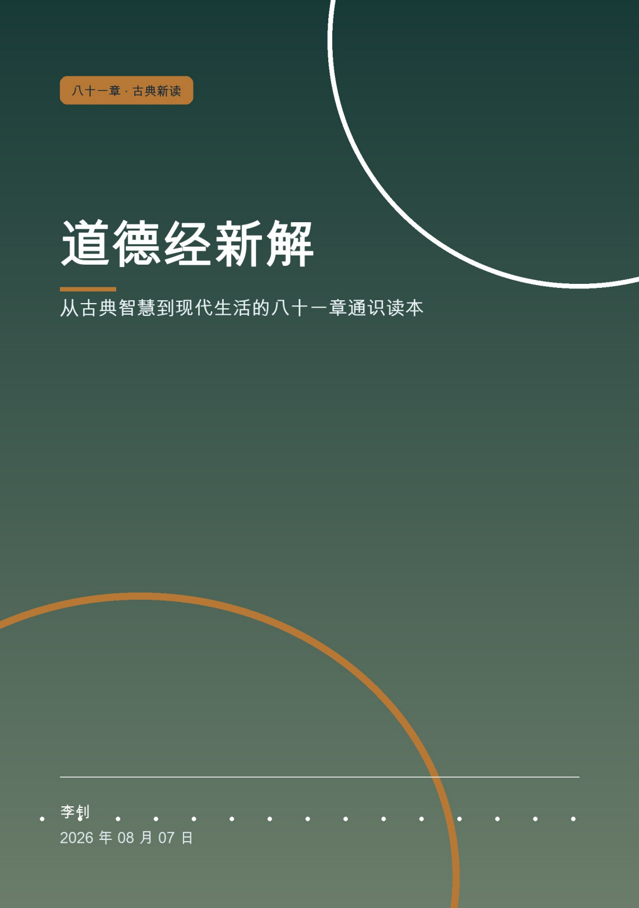
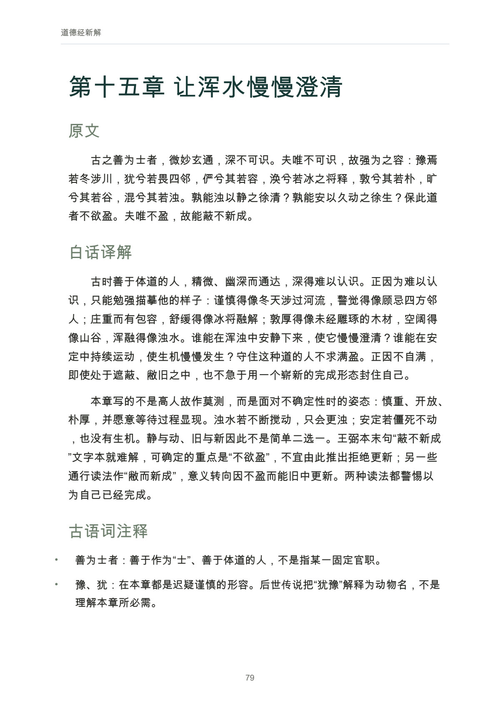
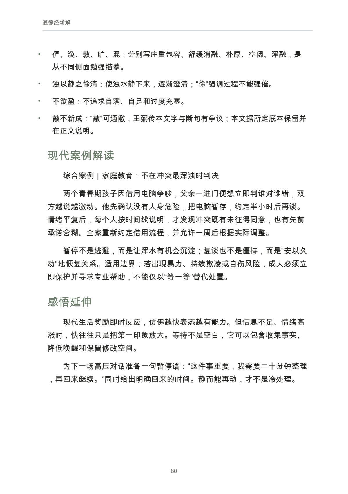
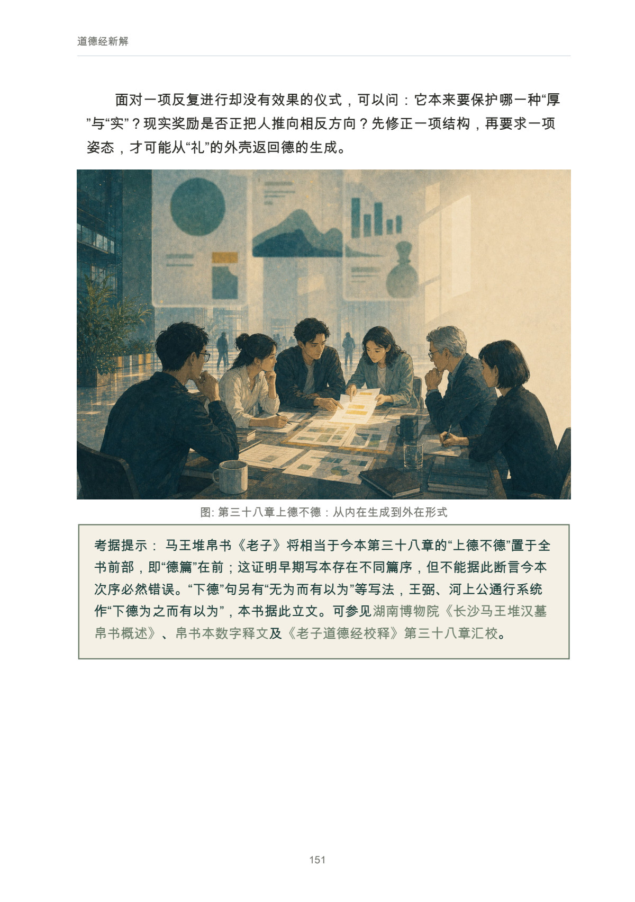

# 道德经新解

从古典智慧到现代生活的八十一章通识读本

**快速导航：** [完整目录](#user-content-完整目录) · [正文预览](#user-content-内页预览) · [阅读与下载](#user-content-阅读与下载)

## 基本信息与定位

| 项目 | 内容 |
| --- | --- |
| 作者 | 李钊 |
| 出版者 | FDE工作室 |
| 版本 | 第一版 |
| 篇幅与配图 | 八十一章，81 幅正文插图，PDF 291 页 |
| 原书日期 | 2026-08-07 |
| 最近修订与检查补记 | 2026-08-09 |
| 书房整理日期 | 2026-11-08 |
| 联系邮箱 | lizhao086@126.com |

这是一本面向现代读者的逐章通识读本：先读懂原句及其解释分歧，再将问题带回工作、家庭与个人生活。每章依次呈现原文、白话译解、古语词注释、现代案例解读和感悟延伸，必要处另设考据提示。

## 全书讲什么

全书以通行八十一章为阅读坐标，从“道与名”“有与无”进入无为、自然、柔弱、知足与不争等概念。前置导读交代老子其人、成书背景、王弼与河上公的解释视角，以及帛书、楚简等材料对阅读的影响；分章正文把翻译、注释和当代发挥分开，遇到会改变章义的异文或断句时保留不同读法，让读者看见解释怎样形成。

现代部分围绕商业管理、科技产品、职场协作、家庭教育与个人成长展开。例如，推荐系统怎样被用户标签束缚，交付团队怎样看见被忽略的接口，家庭争执为何需要暂停后再谈，组织怎样给流程和权力留下余地。书中标为“综合案例”或“示例”的情境用于说明判断方法，不是对特定企业或个人的真实事件报道。81 幅当代情境插图已经实装，帮助读者把抽象章义与具体处境联系起来；索引则支持按概念、语句、场景和版本线索回查。

## 适合谁与阅读路线

| 阅读需要 | 建议路线 |
| --- | --- |
| 第一次完整阅读《道德经》 | 先读序言、导读与成书背景，再按八十一章次序读原文和白话译解，逐步加入词注与考据。 |
| 希望理解“无为”怎样落实为行动 | 连读第 2、3、10、37、48、57 章，比较减少妨碍、授权和自发秩序的不同处境。 |
| 关心柔弱、不争与关系中的力量 | 连读第 8、22、36、43、76、78 章，留意各章如何说明行动的边界。 |
| 正在面对比较、欲望与过度投入 | 连读第 9、33、44、46、67 章，结合自己的任务辨认知足、知止与不可牺牲之物。 |
| 想从工作或家庭问题进入经典 | 从全书索引寻找关键词，阅读对应现代案例，再回到该章原文、词注与相邻章节。 |

## 读者可以获得什么

- 一套逐章阅读方法：把原句、翻译、注释、案例和自己的判断分开，再检查它们之间的联系。
- 对无为、自然、柔弱、不争、知足等常见概念更具体的理解，辨认一句格言在不同情境中的适用条件。
- 八十一组现代情境与插图，可用于个人阅读笔记、读书讨论和日常问题反思。
- 以章号定位的索引，便于沿概念、关键词句、版本与注家线索反复查阅。

## 完整目录

前置导读：

- 序言　让古老的句子重新进入生活
- 导读　如何读懂八十一章
- 老子其人与《道德经》的成书背景

上篇　道经｜第一章至第三十七章（展开完整章名）

- 第一章　名字之外，经验之中
- 第二章　相反相成，功成不居
- 第三章　治理欲望，而非压制心智
- 第四章　以空纳物，和光同尘
- 第五章　无偏的天地与有责的人
- 第六章　柔性的生成之门
- 第七章　不自生，故能长生
- 第八章　像水一样选择位置
- 第九章　知道何时停手
- 第十章　抱一而不占有
- 第十一章　有形之利，无形之用
- 第十二章　感官繁盛之后
- 第十三章　不被荣辱牵走
- 第十四章　在不可见处辨认秩序
- 第十五章　让浑水慢慢澄清
- 第十六章　在循环中认识恒常
- 第十七章　最好的领导留下能力
- 第十八章　当美德成为警报
- 第十九章　让价值回到朴素生活
- 第二十章　在人群之外守住根源
- 第二十一章　从结果反观那不可见者
- 第二十二章　弯曲不是放弃方向
- 第二十三章　暴风不会持续整日
- 第二十四章　踮脚的人站不久
- 第二十五章　自然不是任性
- 第二十六章　轻快必须有沉着的根
- 第二十七章　没有不可用的人与物
- 第二十八章　知雄守雌：有力量而不炫耀
- 第二十九章　天下神器：不可强作，不可执持
- 第三十章　果而不强：止兵之后更难
- 第三十一章　胜而不美：给伤害留下哀悼的位置
- 第三十二章　无名之朴：规则要有，也要知止
- 第三十三章　自知者明：把力量用回自己
- 第三十四章　功成不有：像基础设施一样成就万物
- 第三十五章　淡乎无味：长久价值未必刺激
- 第三十六章　微明与藏器：看见转折，不炫耀底牌
- 第三十七章　无为而化：在欲望初起处复归于静

下篇　德经｜第三十八章至第八十一章（展开完整章名）

- 第三十八章上德不德：从内在生成到外在形式
- 第三十九章　得一与守基：高位要记得从哪里站起
- 第四十章　反与弱：成长也包含返回
- 第四十一章　大器晚成：真正的尺度常显得反常
- 第四十二章　负阴抱阳：和不是抹去差异
- 第四十三章　至柔驰坚：不言之教如何发生
- 第四十四章　名身之辨：先确定什么不能拿去交换
- 第四十五章　若缺若拙：给系统保留余地
- 第四十六章　知足之足：把奔马还给田野
- 第四十七章　不出户而知：少奔逐，多看规律
- 第四十八章　为道日损：组织也需要停止清单
- 第四十九章　以百姓心为心：信任先从理解差异开始
- 第五十章　善摄生：少把自己推入死地
- 第五十一章　生而不有：养育不是占有
- 第五十二章　守母见小：关掉过量入口
- 第五十三章　大道甚夷：警惕华服下的荒田
- 第五十四章　善建不拔：从一身到天下的同心圆
- 第五十五章　守住生命的柔和
- 第五十六章　真正的通达不靠炫耀
- 第五十七章　少扰动，才有真正的治理
- 第五十八章　在祸福转换处保持清醒
- 第五十九章　把资源留给长期
- 第六十章　治理复杂系统，忌反复翻动
- 第六十一章　居下，才能成为汇流之处
- 第六十二章　道不放弃犯错的人
- 第六十三章　大事从细处着手
- 第六十四章　慎终如始
- 第六十五章　少用机巧操纵人
- 第六十六章　领导力首先是降低重量
- 第六十七章　慈、俭、不敢为先
- 第六十八章　不争的专业力量
- 第六十九章　最危险的是轻敌
- 第七十章　朴素的道理为什么最难实行
- 第七十一章　知道自己不知道
- 第七十二章　权威若逼得人不再害怕
- 第七十三章　不逞强的勇气
- 第七十四章　不可轻率代替规则行刑
- 第七十五章　当生存负担吞没生活
- 第七十六章　柔弱是仍能变化
- 第七十七章　有余者应当补不足
- 第七十八章　像水一样承受并改变
- 第七十九章　修复关系不能只靠追责
- 第八十章　小而自足的生活想象
- 第八十一章　给予使人更加丰盛

后附内容：

- 全书索引：核心概念、关键词句、现代场景、版本与注家等线索，采用章号定位。
- 参考文献：古籍、通行注本、整理本与现代研究资料。
- 出版信息。

[进入完整 Markdown 正文](output/markdown/道德经新解.md)

## 内页预览

以下均为本书正式 PDF 的实际页面；页码从 PDF 文件第一页起算，包含封面。

**01｜原文、译解与词注 · PDF 第 79 页**

第十五章“让浑水慢慢澄清”，展示原文、白话译解与古语词注释如何相互配合，也包含“若谷书房”名字的来处。

**02｜现代情境中的判断 · PDF 第 80 页**

第十五章的家庭教育综合案例与感悟延伸，讨论情绪高涨时怎样暂停、整理事实并恢复对话。案例为教学情境，不是特定家庭的真实事件报道。

**03｜插图与考据提示 · PDF 第 151 页**

第三十八章的当代情境插图与版本提示，展示图像、章义和传本差异如何共同参与阅读。

## 阅读与下载

- [Markdown 在线阅读](output/markdown/道德经新解.md)
- [PDF 下载 · 291 页](https://github.com/njxshr/ruogu-books/releases/download/v2026.11.08/dao-de-jing.pdf)
- [EPUB 下载](https://github.com/njxshr/ruogu-books/releases/download/v2026.11.08/dao-de-jing.epub)
- [Markdown 离线包 · 含配图](https://github.com/njxshr/ruogu-books/releases/download/v2026.11.08/dao-de-jing-markdown.zip)

本次提供 81 幅正文插图全部实装的版本，PDF 共 291 页。修订记录中插图实装之前的旧页数不用于本次书目。在线查阅适合使用 Markdown；保留固定版式可下载 PDF；需要调整字号或在电子书阅读器中阅读可下载 EPUB。离线使用 Markdown 时应保留配图目录。

## 来源与维护

[来源台账](SOURCES.md) · [修订记录](REVISION_LOG.md) · [写作主稿](manuscript/book.md) · [出版配置](book.json)

本次上架保持既有成品内容不变，介绍页与预览帮助读者选择阅读路径。原有修订记录记载了 AI 代理参与分组起草、交叉审校及逐章插图制作。经典原文、古注、现代译解与研究资料在书中区分使用；现代情境中标为“综合案例”或“示例”的内容，不作为真实事件报道。

后续正文修订以 `manuscript/book.md` 为唯一主稿，并同步制作、检查和更新相关阅读版本。读者可通过[仓库议题](https://github.com/njxshr/ruogu-books/issues)反馈错字、来源或解释上的问题，附章号与具体语句便于核对。

© 2026 李钊。保留所有权利。第三方材料的权利归相应权利人，书房未对本书另行授予开放许可。

[返回书籍目录](../../目录.md) · [若谷书房](../../README.md)
