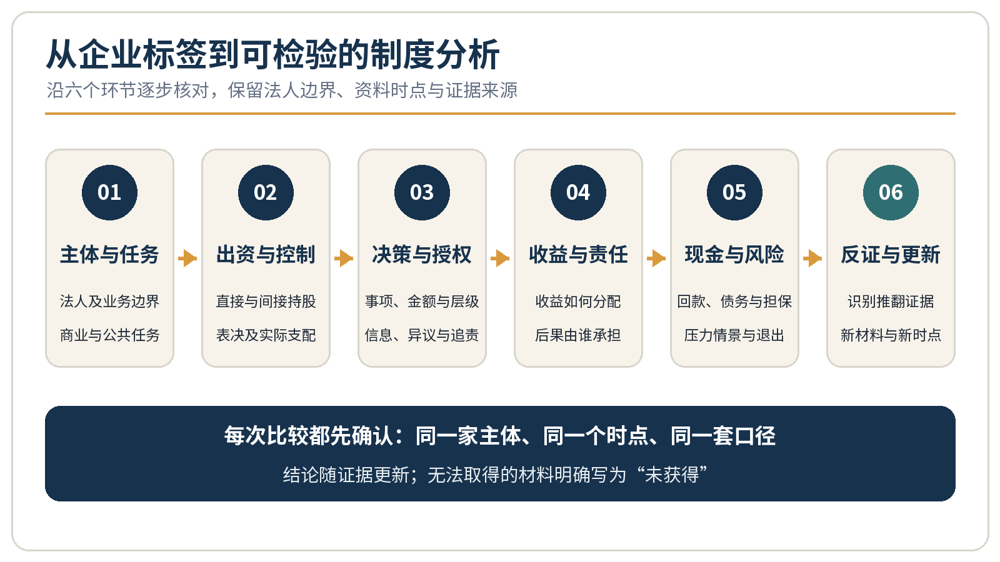
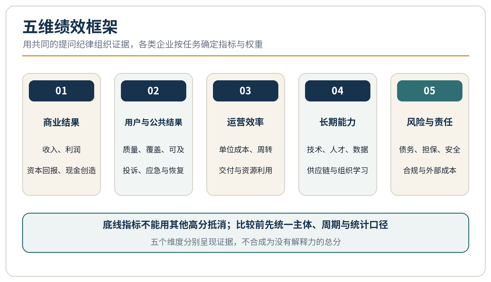

# 企业的制度剖面

央企、国企、混合所有制与私企

作者：李钊  
日期：2026 年 11 月 17 日  
版本：第一版 · 1.0  
工作室与出版单位：若谷书房

---

## 前言　从企业标签进入制度分析

一家企业在重大投资上反复论证，另一家企业迅速拍板；一家企业利润不高，却维持着不能中断的公共服务；一家企业引入众多知名股东，决策反而更加困难；还有一家企业由创始人绝对控制，却把日常经营交给职业经理团队。只看“央企”“国企”“混合所有制”“私企”这些标签，我们很容易给它们编出一个过于整齐的故事。

真实的企业更复杂。央企属于国有企业范畴，但国有企业并不只有央企；混合所有制描述资本组合及其治理安排，与央企、私企并不构成同一层级的企业分类；私企内部也包含多种组织，从一人工作室到全球化上市公司，差异可能远大于某些国企与私企之间的差异。

本书沿着出资、控制、日常决策、收益与损失承担展开，同时考察企业目标、目标设定者和检验指标。信息不完整、合同写不尽未来、决策涉及多个角色时，组织如何行动，是贯穿全书的另一条线索。

沿着这条分析路径，我们可以判断一家具体企业为何这样运行，识别其优势来源、代价归属和被标签遮住的风险。企业之间的比较由此落到可核验的制度与经营事实上。

### 本书怎样展开

第一篇建立概念与制度地图，先分清分类层级、控制权和企业所处环境。第二篇分别剖析央企、地方国企、混合所有制企业与私企，但不把它们写成四种性格。第三篇把企业放在同一把尺上，比较目标、治理、融资、用人与创新。第四篇进入合作和改革场景，最后形成一套可重复使用的企业分析方法。

读者可以顺序阅读，也可以按任务选择：

| 使用场景 | 建议先读 | 需要带走的工具 |
| --- | --- | --- |
| 求职和合作前 | 第二、八、九、十、十五章 | 主体、授权、现金与反证清单 |
| 参与混改、合资或并购 | 第六、十三、十四章 | 控制权、合同接口与整合记录 |
| 研究公共事业和地方政府相关企业 | 第四、五、八章 | 任务、成本、资金与公共结果 |

### 证据、案例与使用边界

本书使用三类材料。法律政策和机构指引用于说明制度边界；上市公司公告和年报用于还原特定时点的控制关系与业务安排；经济学理论用于解释机制，中国企业证据仍需另行核对。

书中的“真实案例”均有可追溯来源。公告里的改革目标不等于已经实现的结果，年报里的企业自述也不等于独立评价。“综合案例”由常见问题组合而成，人物和企业均为虚构；“示意情境”只用于解释概念。两者都不对应真实企业，不使用可能被误认为真实结果的精确经营数据。

法律、政策、任职与股权信息以 2026 年 11 月 16 日核验的资料为限。本书提供通识分析，不替代法律、审计、税务、投资或人力资源专业意见。判断具体企业时，应继续核对最新章程、公告、合同、监管文件和实际执行记录。

## 第一篇　概念与制度地图

分类帮助我们找到正确的观察起点，无需把企业装进固定格子。本篇先处理三个常见误区：把不同层级的概念并排比较，把持股比例等同于全部控制，把所有制当成解释行业、规模和生命周期差异的唯一变量。

## 第一章　央企、国企、混合所有制与私企：不在同一层级的四个词

### 分类依据先于定义口号

判断一家企业属于哪一类，首先要看分类所依据的标准。四个常用词的标准并不相同：央企与地方国企主要看国家出资及履行出资人职责的层级；国有独资、国有控股和国有参股看资本与控制程度；混合所有制看不同性质资本是否交叉持股、相互融合；私企或民企则涉及民间资本、个人控制及统计、法律等不同口径。

因此，一家中央国有企业可以通过上市或增资形成多元股东，一家地方国有资本参股企业也可能由民间实际控制人控制。它们可以同时拥有多个描述，无需在四张卡片中只选一张。

### 央企与国企：层级关系先于名称判断

《企业国有资产法》第五条把国家出资企业界定为国家出资的国有独资企业、国有独资公司，以及国有资本控股公司、国有资本参股公司。该法第四条同时规定，国务院和地方人民政府依照法律、行政法规分别代表国家对国家出资企业履行出资人职责。[《企业国有资产法》](https://www.samr.gov.cn/zw/zfxxgk/fdzdgknr/bgt/art/2023/art_6a3dd482326441218db10e2fff8af13b.html)

《公司法》第七章所称“国家出资公司”，则是国家出资的国有独资公司、国有资本控股公司，包括国家出资的有限责任公司和股份有限公司。国务院或者地方人民政府可以授权国有资产监督管理机构或者其他部门、机构代表本级政府履行出资人职责。[《公司法》](https://www.samr.gov.cn/djzcj/zcfg/fl/art/2026/art_9b4263a169cf43c2aba950cfc9ac1af2.html)

这两个法律概念的范围并不完全相同，不能互相替换。日常语言中的“国有企业”还可能使用更宽或更窄的统计、监管口径。本书把“央企”理解为中央层面国家出资并形成控制关系的企业，把“地方国企”理解为地方层面对应的企业；遇到具体主体，再核实由谁履行出资人职责、控制链如何延伸。

国务院国资委公布的“央企名录”是其履行出资人职责的企业名录。[国务院国资委央企名录](https://wap.sasac.gov.cn/n2588045/n27271785/n27271792/c14159097/content.html) 由于法律允许授权其他部门、机构履行出资人职责，不能把这一份名录等同于所有中央层面国家出资企业的完整集合，也不能仅凭企业名称中是否有“中国”“国家”来判定。

### 混合所有制：资本组合与控制权需要分别核对

国务院关于国有企业发展混合所有制经济的意见，把国有资本、集体资本、非公有资本等交叉持股、相互融合作为混合所有制经济的重要特征，并强调把“引资本”与“转机制”结合起来。[混合所有制经济意见](https://www.mof.gov.cn/zhengwuxinxi/zhengcefabu/201509/t20150925_1475838.htm)

这说明混合所有制首先描述股东构成是否多元，控制关系仍需另行判断。国有资本可以绝对控股、相对控股，也可以参股；民间资本同样可以处于不同位置。企业还可能出现没有控股股东、没有实际控制人的结构。

所以，“完成了混改”不等于“变成私企”，“引入民营股东”不等于“经营权已经市场化”，“国有股东仍控股”也不等于其他股东没有影响。判断时必须继续阅读章程、表决权安排、董事提名、经理授权和实际业务协同。

### 私企与民企：日常语言和法律口径要分开

“私企”是高频日常用语，可能指个人创办、家族控制、民间资本控制或非国有控制企业，也可能被笼统用于所有非国有企业。“民营企业”在政策与商业讨论中更常见，但不同历史文件、统计分类和研究样本也可能采用不同口径。

2025 年施行的《民营经济促进法》第七十七条给出了该法所称“民营经济组织”的具体范围：在中国境内依法设立、由中国公民控股或者实际控制的营利法人、非法人组织和个体工商户，以及前述组织控股或者实际控制的相关组织；涉及外商投资的，同时适用外商投资法律法规。[《民营经济促进法》](https://www.samr.gov.cn/zw/zfxxgk/fdzdgknr/bgt/art/2026/art_6bcebfe258864b21a44e1f7170c594a2.html)

本书在讨论这一法律时使用其法定口径，在一般商业分析中使用“民营企业”作为便于阅读的通称，并尽量说明实际控制与组织形态。不能因为一家企业注册为股份有限公司、已经上市或股东中有国有资本，就直接排除其民营属性；也不能仅凭创始人是自然人，就忽略股权和控制关系后来发生的变化。

### 用五层信息替代单标签

| 层次 | 要核对的问题 | 不能直接推出的结论 |
| --- | --- | --- |
| 出资层级 | 哪一级政府或哪类主体出资，谁履行出资人职责？ | 名称带“中国”就是央企 |
| 资本结构 | 国有、集体、个人、外资等股东如何持股？ | 股东多元就一定是私企 |
| 控制关系 | 控股股东、实际控制人、表决权与一致行动安排是什么？ | 第一大股东就是实际控制者 |
| 组织形态 | 是有限责任公司、股份有限公司、非法人组织还是集团成员？是否上市？ | 上市就是私有化，股份公司就是混改完成 |
| 法律与统计口径 | 当前讨论使用哪部法律、哪套统计或研究定义？ | 一个通称可以覆盖所有场景 |

这五层信息通常比“企业性质”一栏更有解释力。它们也可能随增资、股权转让、上市、合并和章程修订而变化，需要注明时点。

遇到集团成员或上市平台时，先写下法人全称，再分别记录集团归属和该主体的控制关系。集团层面的标签不能直接替代对签约、用工、借款或投资主体的核验。

### 本章小结

央企、国企、混合所有制与私企分属不同分类层级，也可能同时用于一家企业。正确的分析顺序是：先明确使用口径，再核对出资层级、资本结构、控制关系、组织形态和时点。标签可以保留，但只能作为索引，不能代替结论。

## 第二章　从出资到控制：股权、经营权、收益权与风险承担

### 把“拥有企业”拆成一束权利

日常语言说“某家企业是谁的”，实际混合了几种不同权利：出资人享有资产收益、参与重大决策和选择管理者等权利；董事会和经理层依据法律、章程和授权处理经营事项；员工、供应商、债权人和监管者虽然不拥有企业，也可能通过合同和法律影响企业行动。

《公司法》第三至五条规定了公司独立法人财产、股东责任边界、股东基本权利和公司章程的约束力。第二百六十五条进一步区分控股股东与实际控制人：后者是通过投资关系、协议或者其他安排，能够实际支配公司行为的人。[《公司法》](https://www.samr.gov.cn/djzcj/zcfg/fl/art/2026/art_9b4263a169cf43c2aba950cfc9ac1af2.html)

由此可以得到本书的第一条分析原则：出资比例很重要，但只是控制权分析的起点。还需要看表决权、董事席位、章程特别条款、股东协议、关键岗位任免和实际信息优势。

### 控制权不只在股东名册里

判断控制关系，至少要完成六次核对。

1. **直接持股**：谁直接持有多少股权或股份，是否存在不同类别股份？
2. **间接持股**：股权向上穿透到哪里，中间是否有持股平台、基金或多层子公司？
3. **表决安排**：是否存在一致行动、表决权委托、放弃表决、特殊表决权或否决事项？
4. **组织控制**：谁提名董事，谁任免经理和财务负责人，哪些事项必须上收批准？
5. **实际支配**：谁掌握战略、预算、客户、技术、印章、资金和关键信息系统？
6. **动态变化**：增资、减持、质押、继承、合并或协议到期后，控制关系是否改变？

其中第五项不能机械替代法律判断。一个人“很有影响力”不必然就是实际控制人，但只看工商登记的持股比例，也可能漏掉协议和实际执行。法律认定与商业分析需要相互印证。

### 集团、母公司、子公司和上市平台各有法人边界

大型企业集团常见多层结构：履行出资人职责的机构位于上层，集团母公司持有若干业务公司，某家上市平台又拥有具体项目公司。讨论“这家企业”时，如果主体不清，后面的财务、债务、控制与责任分析都会错位。

例如，集团承担的战略任务不一定全部落在上市平台；母公司提供的担保或资金支持，也不能自动当作子公司的法定义务；上市公司披露的控制关系，不一定完整展示集团其他非上市业务。分析合同和债务时，要找到签约、用款、资产和现金流所在的法人；分析控制时，则要向上穿透。

**示意情境｜一笔项目贷款该看谁。** 某大型集团下属项目公司申请贷款。集团知名度很高，但借款合同只由项目公司签署，资产和收费权也在项目公司。若只根据集团品牌推断偿还能力，就会漏掉项目现金流、股东支持是否具备法律约束、其他债权人权利和项目公司治理安排。

### 收益与风险不会自动按同一比例分配

股东分红、剩余财产分配、工资、利息、服务费、资产增值和公共资源收益，属于不同性质的回报。风险也不只是股权亏损，还包括债务违约、担保、供应中断、劳动争议、环境责任、数据风险和公共责任。

有限责任并不意味着股东、董事和经理在任何情况下都不承担额外责任。违法出资、抽逃出资、违规担保、人格与财产混同、违反忠实勤勉义务等情形，需要依据具体法律事实判断。对合作方而言，看到“大型企业”“国有背景”或“创始人实力强”，都不能代替对责任主体和追索路径的核查。

**真实案例｜无控股股东不等于无人治理。** 格力电器《2025 年年度报告》披露，公司无控股股东和实际控制人。[格力电器年报](https://static.cninfo.com.cn/finalpage/2026-04-29/1225250396.PDF) 这一事实只能说明其披露时点的控制结构，不能推出公司没有股东会、董事会和经理层，也不能推出任何人都不需要负责。分析重点应转向董事提名与选举、表决分布、管理层授权、监督机制和重大决策如何形成。

### 一张“权—责—利”对照表

| 观察对象 | 核心问题 | 优先材料 |
| --- | --- | --- |
| 出资人 | 谁投入资本，享有何种股东权利？ | 股权结构、章程、出资文件 |
| 控制者 | 谁能实际支配重大行动？ | 控制链、协议、董事提名与表决记录 |
| 经营者 | 谁制定并执行日常计划？ | 授权清单、岗位职责、经营会议记录 |
| 受益者 | 收益通过什么合同和制度流向谁？ | 分红政策、薪酬、利息、服务合同 |
| 风险承担者 | 损失、债务和外部责任最终落在谁身上？ | 财报、担保、合同、保险与监管记录 |

这张表的价值在于发现错位：决策权与后果承担是否匹配，风险承担者是否拥有足够信息和谈判权，收益归属是否与长期责任一致。

### 本章小结

企业由一组权利、授权、合同与责任构成，无法用一个所有者姓名概括。先看主体，再穿透控制，随后核对经营、收益和风险。只有完成这条链，所有制标签才会转化为可检验的制度分析。

## 第三章　企业运行的制度环境：所有制之外的比较条件

### 同行业比较，往往比跨行业排名更有意义

一家公共水务企业与一家消费软件企业，即使利润、周转和决策速度不同，也不能据此给两种所有制排定效率高下。前者可能承担连续服务、质量安全和价格程序要求，资产专用性强、回收周期长；后者更依赖人才、产品迭代和市场需求，失败项目可以更频繁地退出。

合理的比较应尽量控制行业、规模、区域、监管条件、企业年龄和业务结构。条件无法完全一致时，要公开差异，避免把差异藏在“企业性质”之后。

2015 年深化国有企业改革的指导意见提出，根据国有资本战略定位、企业发展目标和实际作用，将国有企业分为商业类和公益类，并实行分类改革、分类发展、分类监管、分类定责和分类考核。[国企改革指导意见](https://www.mof.gov.cn/zhengwuxinxi/zhengcefabu/201509/t20150914_1458154.htm) 这一分类思路提醒我们：即使同属国有企业，目标函数和评价口径也不能只有一套。

### 企业目标是一组相互约束的条件

企业通常同时面对商业回报、现金安全、产品与服务、员工、合规、创新和长期能力。公共事业企业还可能承担普遍服务、应急保障和区域发展目标。把这些目标全部压成当期利润，会遗漏必要成本；把一切支出都解释为长期使命，又会失去约束。

更可行的办法是把目标分成四层：

- **必须守住的底线**：安全、合法、持续服务和债务履约；
- **需要交付的结果**：收入、利润、服务质量、项目进度和用户结果；
- **需要积累的能力**：技术、人才、数据、供应链和组织学习；
- **需要说明的公共价值**：覆盖、可及、应急、区域发展和环境影响。

不同层级之间可能冲突。需要明确谁有权取舍、成本如何补偿、结果如何复盘，避免目标冲突长期停留在口头层面。

### 市场与企业边界：所有制之外的组织选择

科斯在《企业的性质》中讨论了企业组织与市场价格两种协调方式。[Coase，1937](https://doi.org/10.1111/j.1468-0335.1937.tb00002.x) 对本书而言，这一视角提醒我们：内部协调和外部交易各有成本，不能据此直接给内部整合或外部采购排出抽象优劣。

当资产专用性强、服务质量难以写进合同、协同频繁且出错代价高时，企业可能倾向于内部整合；当任务标准化、供应充分、结果容易验收时，外部采购可能更灵活。所有制会影响决策和约束，却不能替代对交易本身的分析。

### 生命周期会改变同一家企业的制度需求

创业期需要快速试验和创始人判断，扩张期需要授权、预算和供应链，成熟期需要防止层级惯性，转型期需要处理旧资产、旧合同和既得利益，危机期则需要现金、责任和退出机制。

同一家企业在不同阶段可能引入股东、上市、混改、并购、分拆或更换管理层。制度没有一次设计就永远有效的状态。今天帮助快速决策的集中权力，明天可能成为大规模组织的信息瓶颈；今天防止风险的审批，明天可能使新业务错失窗口。

**综合案例｜两份看似鲜明的比较。** 甲企业是地方国有公用事业公司，乙企业是民营软件公司。比较者发现甲企业审批环节更多、利润增长更慢，于是得出“民企效率更高”。进一步核查后发现，甲企业的大部分投资涉及跨区域管网和多年回收，乙企业主要支出是人员与云服务。真正可比较的是：甲企业同类项目的单位建设与运维成本是否改善，乙企业同类产品的研发周期和续费是否改善；两者各自的重大决策是否都保留了证据与责任记录。

### 可比性分析的六个维度

| 核对项 | 需要记录的内容 |
| --- | --- |
| 行业 | 收入来自哪里，监管和竞争结构怎样？ |
| 任务 | 商业经营、公共服务、战略保障如何组合？ |
| 规模 | 收入、资产、人员、区域和层级是否接近？ |
| 周期 | 企业处于创业、扩张、成熟、转型还是危机阶段？ |
| 时间 | 比较覆盖景气、衰退还是完整周期？ |
| 口径 | 财务、服务、创新和公共价值指标如何定义？ |

如果这六项无法回答，所有制比较通常只是印象比较。

### 本章小结

所有制是重要变量，解释力仍有边界。行业任务、竞争环境、组织边界和生命周期共同塑造企业行为。先建立可比性，再讨论制度差异；先明确目标与约束，再评价结果。

## 第二篇　分类型运行剖析

分类型分析的价值，在于看清不同制度位置带来的典型任务和约束，避免给每类企业分配固定性格。本篇每一章都同时讨论优势来源、失效方式和核对方法。

## 第四章　央企：战略使命、多层级治理与规模化经营

### 从“规模很大”转向“任务很复杂”

央企最容易被观察到的是规模、资源和知名度，真正值得分析的却是任务组合。一些企业同时承担商业经营、产业安全、基础设施、重大科技、应急保障或国际经营等任务。不同任务的时间尺度、风险容忍和评价方法并不相同：商业项目要求可持续回报，基础网络要求长期可靠，重大攻关允许多路径探索，应急任务则强调响应与兜底。

任务多元不能成为低效率的免责理由，也不能证明所有投入都天然合理。它要求企业把任务分解清楚：哪些属于市场化经营，哪些具有明确公共或战略要求，谁提出目标，谁提供资源，怎样计算成本，出现冲突时谁决定优先级。

《企业国有资产法》要求政企分开、社会公共管理职能与国有资产出资人职能分开，并强调不干预企业依法自主经营；同时，履行出资人职责的机构依法享有资产收益、参与重大决策和选择管理者等权利。[《企业国有资产法》](https://www.samr.gov.cn/zw/zfxxgk/fdzdgknr/bgt/art/2023/art_6a3dd482326441218db10e2fff8af13b.html) 分析央企治理，需要同时看到出资人权利与企业法人经营边界，在“行政命令”和“完全放任”之外核对真实授权与责任。

### 多层级结构中的信息与责任

大型央企集团通常包含总部、业务板块、区域机构和项目公司。层级可以沉淀专业能力、统一管理标准、集中配置资源，也会延长信息路径。基层知道现场变化，总部掌握全局风险；如果只强调一种信息，决策就会失真。

多层级治理至少要核对四类安排：集团与业务单位的决策边界，上报信息是否被压缩成好看的指标，项目法人的责任是否匹配其权力，以及跨单位协同的成本与收益结算。

“集团统一部署”并不天然意味着每个合同都由集团承担，“基层自主经营”也不意味着风险可以完全留在一级项目公司。要把战略控制、资本配置、经营授权和法律责任分别核对。

### 规模优势的成立条件与成本

央企的规模可能带来长期投资能力、复杂工程组织、跨区域网络、供应链动员和研发平台。但规模优势只有在协调成本低于协同收益时才成立。

以下信号值得警惕：内部单位重复建设相似能力，共享平台反而增加填报；集中采购只追求低价，忽略全生命周期成本；统一指标无法覆盖不同业务；成员单位为了争取内部资源夸大项目；集团品牌成为下级公司放松风险审查的理由。

反过来，不能仅以审批层级多就断言缺乏效率。对安全、重大资本支出和系统性风险而言，适度复核本身具有价值。应比较的是复核能否发现新问题、责任是否更清晰、所需时间是否与风险相称。

### 战略任务需要四本相互衔接的账

第一本账是**任务账**，写清任务由谁提出、服务谁、何时验收；第二本账是**资源账**，记录资本、资产、人员、数据和外部支持；第三本账是**结果账**，分别呈现商业交付、公共结果与能力积累；第四本账是**风险账**，列出债务、担保、安全、合规和退出责任。

四本账不能各说各话。例如，一项战略工程的“完成”不能只记投资额和建设进度，还要同时说明实际功能、运营成本、技术验证和后续维护。若任务需要跨法人承担，还应明确内部结算与外部责任，避免总部获得任务成果、基层只留下成本。

当企业战略调整时，也要回头修改四本账。旧任务是否终止，已形成的资产和人员怎样处理，尚未履行的公共责任由谁接续，都是战略本身的一部分。

### 综合案例：跨业务投资的失真过程

某大型集团计划建设共享数字平台。总部希望统一数据和能力，业务公司担心影响既有系统，项目团队则把“覆盖多少单位”作为主要成果。立项后，平台接入数量迅速增加，但不同单位仍保留旧流程，重复录入没有减少。

失真的起点是任务被写成了技术覆盖，业务结果没有得到明确；各单位的迁移成本没有进入预算，旧系统退出责任没有落实，共享收益与本地成本也没有匹配。把所有制当成原因，会遮住这些可以修正的制度缺口。

如果重新设计，集团应先选定少数跨单位流程，明确谁改变工作、谁承担迁移、谁验收结果；技术部门负责平台，业务部门对流程结果负责，旧系统保留期与退出条件写入计划。治理结构要围绕结果和实际责任设置，项目级别本身不能替代这些安排。

### 分析央企的五个入口

1. **使命清单**：公开文件和实际预算分别显示哪些任务？
2. **法人地图**：集团、上市公司、业务公司和项目公司的边界在哪里？
3. **授权地图**：投资、用人、采购、担保和风险事项由谁决定？
4. **协同账本**：共享资源带来的收益与内部协调成本各是什么？
5. **周期证据**：重大投资是否经受完整建设、运营和退出周期检验？

OECD 2024 年国有企业治理指引建议披露企业目标及其完成情况，并在相关时披露公共服务义务的成本与资金安排。[OECD，2024](https://doi.org/10.1787/18a24f43-en) 这为分析提供了方向：评价企业时应把公共任务、成本和结果放在同一张表上，完整呈现公共任务对经营的影响。

### 本章小结

央企分析应聚焦战略任务、多层级授权和复杂协同如何组合，企业规模或表面稳定性都不足以概括这些机制。规模既能支持长期能力，也能放大信息与协调成本。判断时必须把任务、法人、授权、协同和周期放在一起。

## 第五章　地方国企：公共服务、区域发展与经营约束

### 地方目标进入企业经营的路径

地方国企常与城市基础设施、公用事业、交通、园区、文旅、环保和区域产业发展相连。它们既可能面对市场竞争，也可能承担保障服务、价格约束、应急任务和地方公共目标。

这种位置带来三类典型矛盾：服务覆盖与商业可持续之间的矛盾，长期建设周期与年度考核之间的矛盾，区域整体收益与企业法人现金流之间的矛盾。化解这些矛盾，需要把责任、成本和补偿机制说清楚，既不能只靠强调奉献，也不能简单把所有公共任务都视为经营包袱。

地方国企之间差异同样很大。一家竞争性地方制造企业与一家供水企业，不宜共享一套评价指标；同一城市的不同企业，也可能因资产质量、特许经营权和历史任务而具有完全不同的风险。

### 真实案例：重庆水务披露的业务与控制结构

重庆水务《2025 年年度报告》披露，公司实际控制人为重庆市国资委；其供水业务涉及政府授予的特许经营区域，水费价格调整需要按照程序经政府价格管理部门批准。污水处理业务则包括在政府授予的特许经营区域内提供服务，并在满足充分、连续和合格服务等条件时，按照相关安排收取服务费用，部分业务采取政府购买服务并支付费用的方式。[重庆水务年报](https://big5.sse.com.cn/site/cht/www.sse.com.cn/disclosure/listedinfo/announcement/c/new/2026-04-02/601158_20260402_UXWJ.pdf)

这一案例展示了地方国企分析的几个真实维度：控制链、特许经营、服务质量、价格程序、政府购买服务和长期资产运营可以同时存在。企业经营同时受到价格程序和公共服务约束，又具有真实经营收入与长期资产责任。

案例本身不能证明所有地方国企都有相同结构，也不能仅依据特许经营权推断绩效高低。它提醒我们，评价时应检查服务是否达标、成本是否合理、价格或服务费如何核定、应收账款是否及时回收，以及少数股东和其他利益相关方如何获得信息。

### 公共服务成本不能藏在一句“担当”里

当企业承担明显公共任务时，至少需要公开或内部记录四项内容：任务是什么，成本怎样计算，资金从哪里来，结果由谁验收。没有这些记录，企业可能用商业收益长期补贴不明任务，管理者也难以解释亏损究竟来自经营失效还是公共责任。

成本补偿可以来自使用者付费、政府购买服务、预算安排、交叉补贴或其他合规机制。每种方式都有约束：使用者付费要考虑可负担性，政府购买要有预算与验收，交叉补贴要防止效率低下的业务被长期遮蔽。

OECD 指引同样强调公共服务义务相关成本和资金安排的披露。[OECD，2024](https://doi.org/10.1787/18a24f43-en) 对读者而言，应重点判断公共任务是否可辨认、可计量、可审计，无须执着于寻找某个通用的“合理补贴率”。

### 不要把地方政府信用直接装进企业资产负债表

地方国企与政府存在出资和业务联系，但具体企业的债务仍应依据法人、合同、现金流和法律安排分析。不能因为企业具有地方国有背景，就默认所有债务都会由地方财政兜底；也不能因为某项业务具有公共属性，就忽略回款、成本超支和资产闲置风险。

债权人和供应商应重点核对：合同主体是谁，付款义务是否有预算或经营现金流支持，担保是否合法有效，特许经营是否稳定，项目收益是否过度依赖单一政策或单一客户。对企业管理者而言，把隐性支持预期当成融资依据，会推迟必要的资产和业务调整。

### 综合案例：一条亏损线路的评价分歧

某地方交通企业运营一条客流较少的线路。业务部门认为应取消，公共管理部门认为线路保障偏远区域出行，不能只看票款。双方争论不休，是因为一张经营报表同时承担了两种没有拆开的任务。

重新评价时，企业把线路拆成两部分：一是车辆、人员和维护等可核对成本，二是覆盖、可达性和应急等公共结果。随后比较几种方案：保留原有班次、调整为小型车辆、采用预约服务或与其他线路整合。最终选择不在这里预设；需要比较的是各方案以何种成本交付何种公共结果。

### 本章小结

地方国企的核心问题是公共目标与企业经营如何衔接。特许经营、价格程序、政府购买服务和区域任务需要进入同一套成本与责任分析。既不能把所有亏损都解释为公共担当，也不能忽略公共服务价值；既不能迷信地方背景，也不能忽视真实合同与现金流。

## 第六章　混合所有制企业：资本组合后的治理变化

### 混改需要资本与机制共同变化

引入非国有资本、集体资本或其他国有资本，可能带来资金、技术、渠道、治理约束和产业协同，也可能增加目标冲突、谈判成本和关联关系。混改是否有效，取决于资本进入之后权利、信息和经营机制怎样改变。

2015 年混改意见强调政府引导、市场运作，保护各类出资人产权，严格规范程序，并提出“宜独则独、宜控则控、宜参则参”“一企一策”。[混合所有制经济意见](https://www.mof.gov.cn/zhengwuxinxi/zhengcefabu/201509/t20150925_1475838.htm) 这些原则本身就否定了把混改当成统一比例、统一进度或统一形式的做法。

分析混改应把三件事分开：交易是否合规完成，治理是否发生实质变化，经营结果是否能够在合理周期内归因于这些变化。三件事不能相互替代。

### 真实案例：中国联通 2017 年混改公告的披露边界

中国联通 2017 年发布的混改专项公告提出，通过非公开发行和老股转让等方式引入其他国有资本和非国有资本，并把健全公司治理、完善市场化激励约束、推动业务重组整合和协同发展写入方案目标。[中国联通混改公告](https://static.cninfo.com.cn/finalpage/2017-08-21/1203829685.PDF)

公告能够证明的是当时的改革设计和公开目标。它没有单独证明这些目标后来全部实现，更不能据此把后续经营变化全部归因于股东结构变化。

对分析者而言，这个案例的后续材料应覆盖：投资者进入后获得的治理权利，董事会与经理层授权调整，协同业务负责人，跨组织合作核算，以及区分市场周期、公司战略和混改机制影响的指标。

### 控制权设计比“占多少股”更需要读细

混合所有制企业可能保持国有控股，也可能形成民间资本控制或相对分散的结构。判断其治理，需要同时阅读公司章程、股东协议、董事提名规则、保留事项、关联交易制度和经理层授权。

特别要关注否决权。合理的否决安排可以保护少数股东、防止重大利益输送；范围过宽或事项不清，则可能使日常经营陷入僵持。董事会席位多也不等于有效参与，如果信息来得太晚、议案缺少备选方案或专业支持不足，形式参与很难转化为治理质量。

格力电器披露无控股股东和实际控制人的例子还提示我们：股权分散时，应进一步观察表决分布、董事选举、管理层稳定与监督机制，用证据检验“无主”或“必然被管理层控制”等判断。[格力电器年报](https://static.cninfo.com.cn/finalpage/2026-04-29/1225250396.PDF)

### 协同收益需要一张经营责任表

战略投资者的品牌和客户名单不等于企业可以自动使用的资源。协同需要落实到产品、渠道、数据、技术、采购或资本场景，并回答五个问题：谁提供资源，谁承担成本，谁拥有客户和数据，收益怎样分配，合作不成怎样退出。

**综合案例｜股东很知名，项目却没有进展。** 某制造企业引入一家渠道型投资者后，双方宣布开展联合销售。半年内会议很多，实际订单很少。复盘发现，投资者提供的只是合作意向，企业没有可适配的产品，双方也未确定渠道费用、售后责任和客户归属。把协同写成“资源共享”，掩盖了真实交易成本。

调整后的做法聚焦一个产品和一个区域，明确报价、线索分配、交付、售后、数据和退出规则，无须再签一份更宏大的协议。小规模验证之后，再决定是否扩大协同。

### 混改前、中、后的评价清单

| 阶段 | 关键问题 | 常见误判 |
| --- | --- | --- |
| 交易前 | 为什么要引资本，真正缺少的是钱、能力还是机制？ | 把引入知名股东当成改革目标 |
| 交易设计 | 估值、控制权、否决权、关联交易和退出怎样安排？ | 只看持股比例，不看章程和协议 |
| 交割之后 | 董事、经理和信息系统是否真正参与治理？ | 用股东名单替代治理变化 |
| 经营整合 | 协同任务、成本、收益与责任是否落实？ | 把签约、会议和试点当成最终成效 |
| 周期复盘 | 结果能否排除行业周期、一次性因素和其他改革影响？ | 把所有改善都归因于混改 |

### 本章小结

混合所有制是一种资本与治理安排，本身不提供绩效保证。混改分析要穿过股东名单，进入控制权、信息权、经营授权和协同责任；要区分改革意图、交易完成、机制变化和经营结果。

## 第七章　私企：创业激励、组织成长与职业化边界

### 民营企业的多种组织形态

民营企业可以是个体工商户、创始人控制的小公司、家族企业、员工持股企业、风险资本支持的成长公司，也可以是股东分散的全球上市公司。它们在资本、管理、继承、治理和风险上的差异，不能被“灵活”“短视”“敢冒险”等几个词概括。

《民营经济促进法》为民营经济组织规定了公平竞争、投资融资、科技创新、规范经营、服务保障和权益保护等制度安排，并明确其与其他各类经济组织享有平等的法律地位、市场机会和发展权利。[《民营经济促进法》](https://www.samr.gov.cn/zw/zfxxgk/fdzdgknr/bgt/art/2026/art_6bcebfe258864b21a44e1f7170c594a2.html) 这些制度保障不等于单个企业必然获得订单、融资或成功，也不降低企业自身的合规与经营责任。

### 所有者与经营者重合的优势和代价

创业早期，创始人往往同时承担资本投入、产品判断、客户开拓和最终责任。决策链短、利益一致、信息集中，可以提高行动速度。但同样结构也可能造成关键人依赖、个人与公司财产边界模糊、授权不足和错误难以被纠正。

随着员工、客户和资本增加，企业需要从“创始人能看清一切”转向“组织能够重复交付”。这一转变将个人判断转化为产品标准、财务纪律、人才机制和风险边界，企业家精神则更多体现为方向选择与组织建设。

职业化也不能简化为从外部招聘几位经理。真正的职业化包括职责、授权、信息、激励、监督和退出共同变化。创始人仍然控制企业，并不意味着必须亲自处理全部经营事项。

### 真实案例：美的集团披露的控制与经营分工

美的集团《2025 年年度报告》披露，何享健为公司实际控制人；方洪波任公司董事长、执行董事兼总裁。年报所列经历显示，方洪波 1992 年加入公司，曾任多个业务管理职务，并自 2012 年 8 月起担任公司董事长、总裁。[美的集团年报](https://static.cninfo.com.cn/finalpage/2026-03-30/1225063589.PDF)

这一案例说明，最终控制与日常经营可以区分，长期内部培养也可以成为职业化路径。它不能证明所有家族控制企业都适合同一种安排，更不能只用这一个案例解释企业绩效。

值得借鉴的是分析方法：分别观察实际控制人的权利、董事会作用、经理层经历与授权、管理者持股和激励、关联交易及独立性承诺。这样比“家族企业管理”或“职业经理人治理”的标签更接近真实运行。

### 融资约束与成长方式相互塑造

民营企业的融资既可能来自经营积累、创始人资本、银行、供应链、债券和股权，也可能受可抵押资产、财务透明度、客户集中和现金流波动影响。轻资产并不等于低价值，但缺乏可验证合同、知识产权、经常性收入和规范记录时，外部资本更难评估风险。

融资选择也反过来影响治理。经营积累给予较大自主性，却可能限制扩张速度；银行贷款保留股权，但要求偿债和抵押安排；股权资本可以分担风险，却会改变表决、董事席位和退出要求。评价融资不能只看“拿到了多少钱”，还要看期限、成本、控制权与最坏情景。

法律提出支持符合条件的民营经济组织通过股票、债券等方式平等获得直接融资，并鼓励金融机构开发与民营特点相适配的产品。[《民营经济促进法》](https://www.samr.gov.cn/zw/zfxxgk/fdzdgknr/bgt/art/2026/art_6bcebfe258864b21a44e1f7170c594a2.html) 对企业而言，政策可及性仍需要通过真实资信、透明记录和可持续经营来承接。

### 传承涉及股权、控制权与经营安排的连续过渡

家族企业的传承至少包含四个层面：股权如何安排，控制权如何过渡，经营岗位由谁胜任，家庭与公司规则怎样衔接。只把股权交给下一代，可能留下治理真空；只聘请职业经理人，却不调整授权和监督，也难以完成转型。

**综合案例｜创始人退居二线之后。** 某民营设备企业创始人宣布不再负责日常经营，但重要客户仍只接受他的承诺，财务付款仍需他私下确认，新任总经理无法获得完整信息。组织图已经职业化，实际运行却没有。

改进需要从关键事项开始：客户承诺进入公司合同，授权与额度公开，财务数据统一，创始人的例外审批设置期限和复核。接班人或经理人是否胜任，要用实际结果检验，职位公告本身不能证明传承完成。

### 本章小结

民营企业的优势常来自利益一致、试验速度和企业家责任，风险则可能来自关键人依赖、融资约束、治理滞后和代际过渡。职业化不等于去创始人化，规范化也不等于失去灵活性。真正要分析的是控制、授权、信息和责任能否随企业成长一起升级。

## 第三篇　放在同一把尺上比较

“同一把尺”指共同的提问纪律，并不要求所有企业共用一套指标：目标是否清楚，口径是否一致，成本是否完整，时间是否足够，反事实是否被考虑。本篇把不同类型的企业放到共同的分析过程中。

## 第八章　目标与绩效：利润之外的多维评价

### 先确认企业需要交付的结果

评价企业最常见的方法，是先拿收入和利润排名，再解释所有制。这个顺序容易遗漏任务差异。更稳妥的顺序是：先确认企业被要求交付什么，再评价它用了多少资源、承担了什么风险、形成了什么长期能力。

商业回报当然重要。没有可持续收入、利润和现金流，许多目标难以长期维持。但利润也会受会计口径、资产处置、补贴、价格周期和投资阶段影响。公共服务、创新投入和安全能力同样可能被短期数字掩盖。

本书建议使用五维绩效框架：

| 维度 | 代表问题 | 可能的证据 |
| --- | --- | --- |
| 商业结果 | 收入、利润、资本回报和现金创造是否可持续？ | 多年财务数据、分业务现金流 |
| 用户与公共结果 | 产品、覆盖、质量、可及性和应急是否达标？ | 服务记录、第三方检测、投诉与恢复 |
| 运营效率 | 单位成本、周转、交付和资源利用是否改善？ | 同口径成本、周期和产能数据 |
| 长期能力 | 技术、人才、数据、供应链与组织学习是否增强？ | 项目复盘、核心团队、知识产权与系统记录 |
| 风险与责任 | 债务、担保、安全、合规和外部成本是否受控？ | 审计、监管、风险清单、事件与整改 |

五维之间不能简单相加成一个漂亮总分。底线指标未达成时，其他高分不应自动抵消；不同任务的权重需要由有权主体公开或明确。

### 指标必须带口径、基线和对照

“效率提升”“服务改善”“创新领先”都需要具体口径。效率可以指单位产出成本，也可能被误算为人均文书数量；服务改善可以体现为覆盖增加或投诉减少；创新领先则要看研发投入、专利数量与新产品解决真实问题的关系。

合格指标通常包含定义、基线、目标、时间、数据来源和责任人。跨企业比较还需要统一合并范围、价格时点、一次性因素和业务结构。不能拿一家企业的集团合并收入与另一家上市平台比较，也不能拿一家企业景气高点的利润与另一家企业转型低点的利润直接下结论。

**示意情境｜两个“成本下降”。** 甲公司通过减少预防性维护使当期成本下降，乙公司通过工艺改进使单位能耗下降。报表都显示成本改善，但前者可能增加未来故障，后者才形成可持续能力。没有设备故障、寿命和质量的后续数据，就不能把两者视为同一种效率。

### 将公共目标纳入绩效表

公共任务的处理有三种常见失误：只计算任务成本，不计算公共结果；只讲公共价值，不计算企业成本；把补贴直接当成效率，而不检查服务是否达标。

更好的做法是把“任务—成本—资金—结果”连成一条链。重庆水务年报中关于特许经营、服务质量和费用结算的披露，说明这些要素可以被放入具体业务描述。[重庆水务年报](https://big5.sse.com.cn/site/cht/www.sse.com.cn/disclosure/listedinfo/announcement/c/new/2026-04-02/601158_20260402_UXWJ.pdf) OECD 指引也建议披露公共政策目标的完成情况以及相关成本与资金安排。[OECD，2024](https://doi.org/10.1787/18a24f43-en)

分析者仍要核对实际执行，不能把披露本身等同于完成。但它至少为拆解盈利或亏损的原因提供了基础。

### 综合案例：利润相近，评价相反

甲、乙两家企业年度利润相近。甲企业减少研发、推迟设备更新并延长供应商账期，短期现金和利润得到维护；乙企业利润中包含稳定服务收入，同时增加了设备可靠性和关键人才投入。若只看当期利润，两者接近；拉长周期后，风险与能力并不相同。

反过来，乙企业也不能因为“重视长期”就免于检验。研发投入需要里程碑，设备更新需要可靠性和全生命周期成本证据，人才投入需要观察关键岗位与组织能力。长期投入同样要接受当期约束，未来影响应纳入今天的记录。

### 做五项绩效复核

1. 企业最重要的三项任务是什么，谁正式确认？
2. 当前指标分别衡量结果、活动还是投入，能否被操纵？
3. 是否存在表外成本、递延维护、担保、环境或员工风险？
4. 结果来自管理能力，还是行业价格、一次性处置和外部救助？
5. 如果延长到完整投资或产品周期，结论是否改变？

### 本章小结

绩效评价应分别呈现商业、服务、效率、能力和风险，底线与权重需要明确，不能把多元价值混成口号。先统一任务和口径，再比较结果；先排除外部因素，再讨论制度与管理的贡献。

## 第九章　决策与监督：治理结构从图纸到行动

### 法人治理取决于实际运行

股东会、董事会、经理层和监督机制在法律上有各自位置，但企业真正的治理质量取决于议案怎样形成、信息是否充分、异议能否保留、授权是否被执行、错误能否被追责。

《公司法》规定公司股东依法享有资产收益、参与重大决策和选择管理者等权利，并对股东会、董事会、经理和监督机制作出制度安排。国家出资公司还有专章规定，其中第一百七十条明确国家出资公司中中国共产党的组织按照党章规定发挥领导作用，研究讨论公司重大经营管理事项，支持公司的组织机构依法行使职权。[《公司法》](https://www.samr.gov.cn/djzcj/zcfg/fl/art/2026/art_9b4263a169cf43c2aba950cfc9ac1af2.html)

因此，分析国家出资公司时，应把党组织、出资人、股东会、董事会、经理层和监督机制的实际职责放在具体制度与流程中理解，不能用一套抽象的公司治理图替代。分析其他企业时，也不能因为不存在同样的结构，就假设权力自然受到制衡。

### 决策权要具体到事项和边界

“董事会定战略、经理层管经营”只是起点。真正可执行的授权需要具体到事项、金额、风险、时间和信息条件。例如，年度预算内的产品迭代由谁决定，超预算投资由谁复核，重大安全事项是否可以越过常规层级，紧急决定事后怎样补审。

授权不足会导致所有问题上移，授权过宽则可能使风险长期留在基层。好的授权应让有权作决定的人获得必要信息并承担相应后果，细致程度要服从事项风险与信息条件。

可以使用一张决策记录表：

| 事项 | 提议者 | 决定者 | 必须会签或复核者 | 所需证据 | 事后责任 |
| --- | --- | --- | --- | --- | --- |
| 常规经营 | 业务负责人 | 被授权经理 | 财务或法务按需参与 | 预算、客户与交付条件 | 结果复盘 |
| 重大投资 | 业务与投资团队 | 章程规定的机构 | 风险、财务及法定程序参与者 | 情景、现金流、退出与反方意见 | 投后评价 |
| 紧急处置 | 现场与应急负责人 | 应急授权主体 | 安全、法务及相关管理角色 | 风险等级、处置边界 | 补审与事件调查 |

表中内容是分析模板，不代替企业依法制定自己的权限体系。

### 董事会有效性取决于信息和异议

董事会开得多，不等于治理强。需要观察材料是否提前送达，是否包含关键假设和替代方案，董事是否具备专业能力，管理层是否只汇报顺利情景，反对意见是否进入记录并影响后续行动。

詹森和麦克林的代理理论帮助解释所有者、管理者和其他主体之间目标与信息不一致所产生的成本。[Jensen & Meckling，1976](https://doi.org/10.1016/0304-405X%2876%2990026-X) 这种问题并不专属于国有企业或民营企业。创始人控制的企业可能出现大股东与中小股东、管理层之间的代理问题；多层国有企业也可能出现出资人、集团和经营单位之间的信息与目标差异。

监督不能只依赖一个职位。外部审计、内部审计、财务与合规、职工参与、监管、信息披露和债权人约束，都可能提供补充信息。关键是它们能否独立接触事实，并将问题送到有权处理的位置。

### 把一次会议当作治理样本

观察会议，比阅读制度汇编更容易发现治理的真实状态。会前要看议题是否属于该机构权限，材料是否提供事实、假设、备选方案和风险，避免只有推荐结论；会中要看专业意见和异议是否被讨论，利益冲突是否回避，紧急事项是否有人主动说明信息缺口；会后要看决议是否转化为负责人、期限和资源，异议和附条件通过的事项是否被跟踪。

还可以连续观察同一事项的三次会议：最初立项、中期检查和事后复盘。若三次材料中的关键假设不断变化却无人解释，或所有结果都被写成“符合预期”，制度再完整也难以提供真实约束。

会议留痕让后来的人知道当时掌握了什么、争论了什么、谁作出了什么决定，无需把意见一致当成会议有效的证明。

一份够用的会议记录可以采用以下字段：

| 字段 | 记录重点 |
| --- | --- |
| 事项与权限 | 议题名称、决定主体、授权依据与回避情况 |
| 事实与假设 | 已核验事实、关键假设、资料日期与信息缺口 |
| 方案与异议 | 备选路径、主要风险、不同意见及处理结果 |
| 决议与行动 | 决定内容、负责人、资源、期限与验收口径 |
| 复查与修正 | 触发复查的条件、实际结果与需要修正的判断 |

### 审计委员会与监督机制要按最新章程核对

2023 年修订、2024 年施行的《公司法》允许符合条件的有限责任公司和股份有限公司按照法律规定在董事会中设置审计委员会，行使监事会职权并不再设监事会或监事；国有独资公司也有相应特别规定。上市公司还另有审计委员会和独立董事等要求。[《公司法》](https://www.samr.gov.cn/djzcj/zcfg/fl/art/2026/art_9b4263a169cf43c2aba950cfc9ac1af2.html)

这意味着，看到一家企业“没有监事会”不能直接得出监督缺失，也不能看到“设有审计委员会”就认定监督充分。应核对组织形态、章程、成员构成、专业能力、信息渠道和实际履职。

**综合案例｜人人都在审批，仍然无人负责。** 某企业重大项目需要多个部门会签。各部门只检查自己是否被合规咨询，没人对商业假设负责。项目失败后，所有签字者都能证明自己完成了程序。这个案例暴露出决策责任被切成无法拼合的碎片，单纯增加监督数量无法修复。改进应明确一个对整体结果负责的决定主体，同时保留专业部门对底线的独立意见。

### 本章小结

治理质量取决于决策、信息、异议、授权和追责能否闭环，机构数量本身不能提供答案。分析企业时，应把法定结构与实际流程对照，把监督职位与真实信息对照，把“参与审批”与“对结果负责”区分开。

## 第十章　融资与风险：信用来源、预算约束与损失承担

### 融资分析不能停在利率和额度

一笔融资是否合适，取决于金额、期限、币种、偿还安排、担保、控制权、用途和最坏情景。低利率如果长期资金被投入无法产生现金的资产，仍会积累风险；高成本资金如果用于可验证、短周期的订单，也可能有合理性，但必须有明确偿还路径。

企业常见融资渠道包括经营现金流、股东资本、银行贷款、债券、融资租赁、供应链信用和资产证券化等。不同渠道对企业信息透明度、抵押资产、治理和退出提出不同要求。所有制可能影响外部主体的信任与风险评估，却不能代替具体资信。

对民营企业，不能把“缺抵押”简单等同于“没有偿还能力”；对国有企业，也不能把股东背景等同于对全部债务的担保。判断应回到借款法人、现金来源、合同权利与法律责任。

### 软预算约束的形成机制与适用边界

科尔奈讨论的软预算约束，关注支出与收入之间的严格关系被外部救助预期放松后形成的行为影响。[Kornai，1986](https://doi.org/10.1111/j.1467-6435.1986.tb01252.x) 这一概念可以帮助分析企业为什么在投资失败后仍不断追加资源，但不能被机械用于所有国有企业。

当企业预期亏损总会由股东、关联单位、金融机构或其他主体兜底时，项目负责人可能降低前期审查和退出意愿。类似机制也可能出现在大型民营企业对创始人项目的持续输血、母公司对明星子公司的无限担保，或投资者为维护估值而拒绝确认失败。

相反，承担公共任务的企业获得合规、透明、与结果挂钩的资金安排，不应自动被视为软预算约束。关键是资金是否对应明确任务，成本是否可核验，失败是否有调整和退出。

### 现金流比“项目很有价值”更早暴露风险

利润、资产估值和合同金额都不能直接替代现金。企业需要把经营回款、资本开支、债务到期、担保和或有负债放在同一张时间表里。快速增长可能先消耗现金，公共项目也可能因结算周期长而形成回款压力。

至少应做三种情景：基准情景检验正常经营，压力情景检验收入下降、回款延迟和融资收缩，极端情景检验关键客户流失、资产无法处置或主要股东停止支持。每种情景都要写明可采取行动，缺口数字本身不足以支持处置。

| 情景 | 变量选择 | 需要提前写明的行动 |
| --- | --- | --- |
| 基准 | 已签合同、合理账期、既定预算与融资安排 | 常规付款、资本开支和债务接续顺序 |
| 压力 | 选取最敏感的回款、成本或续贷变量作合理不利调整 | 催收、支出排序、备用融资与暂停条件 |
| 极端 | 关键客户流失、主要股东停止支持或资产无法处置 | 止损、资产处置、利益相关方沟通与依法处理 |

**综合案例｜利润增长与付款危机同时发生。** 某企业订单增长很快，报表利润改善，但客户验收不断延后，企业又需要提前支付设备和人员费用。管理层以“国有大客户不会拖欠”或“知名创始人会继续投资”为理由推迟压力测试。真正的风险在于企业已经把现金安全建立在未经合同确认的假设上，客户或股东声誉无法替代这些安排。

### 用财务与业务证据交叉验证

财务风险不能只在财务报表里寻找。收入确认要与合同、交付和验收对照，应收账款要与客户结算和争议对照，存货要与订单、库龄和退货对照，资本开支要与项目进度和实际产能对照，预计负债与担保要与诉讼、承诺和历史履约对照。

反向核验同样重要。业务上出现频繁延期、核心人员离职、设备停机或客户投诉时，即使财务指标尚未恶化，也应检查成本是否被延后、风险是否尚未进入报表。财务与业务不一致不一定意味着造假，也可能是口径和时点不同，但必须留下解释。

压力测试还要避免“所有不利因素同时发生才叫压力”的极端形式。更有用的是找到最敏感的两三个变量，例如主要客户回款、原材料价格或续贷时间，观察它们在合理不利变化下是否触发连锁反应，并提前确定可执行的处置顺序。

### 风险承担要画出最终路径

| 风险 | 第一承担者 | 可能传导对象 | 需要核对的保护 |
| --- | --- | --- | --- |
| 项目现金流不足 | 项目公司 | 股东、贷款人、供应商 | 股东支持是否有约束，偿债顺序与担保 |
| 重大投资失败 | 企业与股东 | 债权人、员工、其他业务 | 止损条件、资本隔离、投后复盘 |
| 供应链中断 | 采购与生产单位 | 客户、渠道、终端用户 | 替代供应、库存、合同与应急 |
| 公共事件或安全事故 | 企业及直接责任主体 | 用户、社区、监管与保险 | 预防、报告、保险、应急和整改 |
| 关键人失能或退出 | 经营组织 | 股东、客户、员工 | 继任、授权、数据和知识留存 |

风险表用于防止“大家最终都会负责”变成事前无人约束，并明确损失在各主体之间的传导，无需把所有损失推给某一个主体。

### 本章小结

融资与风险分析要回到具体法人、现金时间、支持合同和损失路径。所有制背景可以影响信用判断，却不能代替担保和现金流。预算约束是否真实，取决于任务、资金、止损和责任是否透明，与企业名称无关。

## 第十一章　用人与激励：选聘、薪酬、容错与退出

### 激励要连接目标与后果

薪酬、奖金、股权、晋升、荣誉和职业发展，都是激励工具。工具是否有效，取决于员工能否影响被考核结果、指标是否难以操纵、时间是否匹配任务，以及失败之后是否有公平复盘。

短周期指标适合部分销售和运营任务，却不一定适合基础研究、公共设施和长期建设。把所有岗位都压到年度收入或利润，可能促使员工推迟维护、选择容易客户或隐藏问题；只强调长期使命，则可能让当期责任变得模糊。

激励设计需要同时明确组织所需结果、个人可控部分、团队协作计价方式，以及不能用业绩抵消的底线。

### 选聘机制影响进入组织的信息

不同企业在负责人任免、市场化招聘、内部培养和任期管理上有不同约束。评价重点不应只是“是否公开招聘”，还包括岗位标准是否清楚、候选人是否真正比较、任免者是否对后续结果负责、关键岗位是否存在长期无人监督的封闭圈。

内部培养可以保留业务知识和组织信任，外部引进可以带来新经验与打破惯性。两者都需要真实授权和可验证目标。把外部经理人当成变革符号，却不给予预算、用人和信息权，往往只会制造责任错位。

美的集团案例中，实际控制人与长期内部培养的经营管理者可以同时存在。[美的集团年报](https://static.cninfo.com.cn/finalpage/2026-03-30/1225063589.PDF) 这提醒我们把选聘渠道与实际能力分开，把控制关系与经营授权分开，依据实际机制检验“内部人”或“外部人”的治理结果。

### 指标会改变人的行为

销售人员如果只按合同额奖励，可能忽略回款和交付；研发人员如果只按专利数量奖励，可能追求容易申请而低价值的成果；公共项目如果只按建设进度奖励，可能忽略运营维护；负责人如果只按短期利润考核，可能削减必要能力。

解决方式应聚焦少量能够互相校验的证据，避免指标层层加码。销售同时看回款与交付，研发同时看技术里程碑与用户验证，建设同时看全生命周期成本，负责人同时看当期结果与风险变化。

**综合案例｜两个部门都完成了指标。** 某企业采购部门完成降价目标，生产部门却因材料不稳定增加返工。采购被认为表现优秀，生产承担全部质量压力。若把指标改为合格交付成本、供应稳定和质量问题共同复盘，两个部门才会讨论同一项企业结果。这个案例说明制度奖励了局部最优，不能简单归咎于员工缺乏大局观。

### 容错与问责必须放在同一份决策记录里

创新需要允许经过合理审查的失败，公共与战略任务也可能面对高不确定性。但容错不等于结果失败后自动免责，问责也不能只找最后签字的人。

合理容错至少需要事前边界、真实信息、合规程序、可逆或限额试验和及时报告。问责则需要还原当时可获得的信息，区分故意违规、重大过失、判断失误和不可预见变化，不能用事后知道的结果反推当时一定应当知道。

退出机制同样重要。岗位调整、项目终止、股权退出和管理者更换如果无法执行，激励会逐渐只保留奖励而没有约束。退出不应被污名化，它是组织重新配置资源的一种方式。

### 不同岗位需要不同的证据组合

| 岗位或任务 | 容易失真的单一指标 | 更合理的组合证据 |
| --- | --- | --- |
| 销售与客户拓展 | 合同额、客户数量 | 回款、交付质量、续约、客户集中与合规 |
| 研发与产品 | 专利、功能数量、上线次数 | 技术里程碑、用户验证、可靠性、可维护性 |
| 生产与运维 | 产量、当期成本 | 良率、停机、能耗、安全和全生命周期成本 |
| 公共与战略项目 | 投资完成、覆盖数量 | 实际使用、服务结果、单位成本与持续资金 |
| 职能与支持部门 | 制度数量、审批数量、填报完成 | 问题发现、处理周期、业务结果与内部客户证据 |

指标组合应保留少量能够互相校验的证据，数量服从实际决策需要，避免让每个人困在更多考核里。能够由团队共同影响的指标，应明确协作规则；出现偏差时，还要检查目标、权限和资源配置，避免只处罚最容易被看到的岗位。

### 程序公平会影响激励是否可信

员工不仅关心奖励多少，也关心目标是否在执行中被改变、数据是否可复核、相似情况是否使用相似规则、申诉能否得到独立处理。尤其在创新和公共任务中，结果受外部条件影响较大，如果评价过程缺乏透明，高奖励也可能无法形成长期信任。

组织可以保留三类记录：目标及调整理由，结果及证据来源，奖励、容错或问责的决定依据。记录应服务于复盘和公平，避免成为额外文书负担。对管理者而言，一次有争议的失败尚可复盘，员工一旦认为“结果好坏并不重要，重要的是是否会解释”，激励信任就很难修复。

### 本章小结

用人与激励的核心是结果、能力、权限和后果相匹配。选聘要看真实授权，薪酬要看指标行为，容错要看事前边界，问责要看当时信息，退出要看组织能否真正调整。不同所有制企业可以学习同一套纪律。

## 第十二章　创新与效率：研发投入之外的组织学习

### 创新贯穿问题、验证与交付

研发投入、实验室、专利和数字平台都可能有价值，但最终仍要看问题、方案、验证与交付结果。创新包括发现值得解决的问题、形成技术或服务方案、通过验证、规模交付，并在反馈中修正。

国有企业可能拥有长期研发、重大工程和复杂场景优势，民营企业可能在细分需求、快速试验和商业模式上具有优势；这些只是可能的能力来源，仍需结合具体企业验证。大型民企也能长期投入，小型国企也可能在特定场景快速试验。

真正需要比较的是：谁提出问题，谁承担失败成本，谁有权停止项目，用户何时参与，技术成果怎样进入生产，失败经验是否留在组织。

### 探索与利用需要不同管理节奏

探索阶段面对高不确定性，应使用小额、分阶段和可复核的试验；规模化阶段则强调标准、质量、供应链和成本。如果用规模化指标评价早期探索，团队会选择看似可靠但缺乏新意的项目；如果用探索叙事管理规模化交付，则容易反复改变方向、忽略质量和成本。

**示意情境｜试点成功的两种含义。** 一个项目在理想环境中完成演示，证明技术可以运行；另一个项目在真实客户、完整流程和异常条件下运行，证明方案可以交付。两者都可以叫试点，但证据强度不同。创新评审必须说明验证覆盖范围，成功截图本身不足以证明交付能力。

| 验证阶段 | 可以支持的判断 | 仍需补充的证据 |
| --- | --- | --- |
| 技术演示 | 核心技术在设定条件下可以运行 | 真实数据、异常条件、使用者与完整流程 |
| 真实流程试点 | 方案在限定客户和业务范围内可以交付 | 成本、稳定性、维护责任与规模条件 |
| 规模交付 | 多场景下的质量、成本与供应能力得到检验 | 长期运行、跨周期维护与退出安排 |
| 持续运营 | 实际使用、服务与改进机制可以持续 | 能力迭代、关键人变化与外部环境变化 |

### 内部研发、联合开发与采购的选择依据

企业可以选择内部研发、与高校或供应商联合开发、投资并购、采购成熟产品等方式。选择取决于技术专用性、知识保护、协同频率、供应市场、验收难度和长期能力。

科斯的组织边界视角帮助比较内部协调与外部交易成本；格罗斯曼和哈特关于所有权与剩余控制的研究，则提醒我们在合同无法写尽未来时，谁拥有剩余决策权会影响投入激励。[Coase，1937](https://doi.org/10.1111/j.1468-0335.1937.tb00002.x) [Grossman & Hart，1986](https://scholar.harvard.edu/files/hart/files/jpe_1986a_0.pdf)

核心能力未必要全部内部化，外包也无法转移全部风险。企业需要保留足够的问题定义、架构、验收和供应管理能力，否则即使购买先进技术，也可能无法转化为自己的结果。

### 采购流程可以保护创新，也可以消灭创新

采购如果只接受成熟案例和固定规格，新方案很难获得第一次验证；如果没有预算、试用边界和退出条件，创新采购又可能变成随意选择。合理做法是区分探索性验证与规模采购，明确测试场景、数据权限、安全要求、验收证据、费用和后续路径。

《民营经济促进法》支持民营经济组织参与国家科技攻关、科研设施开放、数字化智能化共性技术研发和标准制定等。[《民营经济促进法》](https://www.samr.gov.cn/zw/zfxxgk/fdzdgknr/bgt/art/2026/art_6bcebfe258864b21a44e1f7170c594a2.html) 对各类企业而言，开放机会能否转化为创新，仍取决于真实能力、合作规则和知识产权安排。

### 组织学习需要留下可检索的反证

很多组织保存成功汇报，却难以找到当初的关键假设、反对意见和失败原因。没有这些记录，同一批人可能反复购买相似方案，新项目也无法知道旧项目为什么调整。

一份有效的创新复盘至少包含：最初问题、备选路径、关键假设、验证范围、失败或调整、未解决风险、可复用资产和下一阶段停止条件。复盘不应只由项目负责人完成，用户、交付、风险和维护角色需要提供不同证据。

**综合案例｜数字化项目越建越多。** 某企业连续购买多个智能系统，每个项目都有新功能，却没有减少人工核对。复盘发现，各系统围绕局部功能立项，基础数据责任和流程所有者始终缺位。改进应从少数关键流程入手，形成统一数据、异常处理和持续改进机制，无须再增加一个平台来证明创新。

### 本章小结

创新能力来自问题选择、验证、交付和组织学习，投入标签只能提供部分线索。探索与规模化需要不同节奏，内部与外部合作需要匹配控制权和交易成本，采购与复盘需要允许真实证据进入。所有制可以影响条件，但不能替代这些机制。

## 第四篇　进入真实场景

制度分析最终要服务于行动：选择合作方、设计合同、推进改革、评价转型，或在求职和投资前识别风险。本篇把前面的框架转化为可执行步骤，同时保留法律与证据边界。

## 第十三章　竞争与合作：供应链、招投标、合资与产业生态

### 选择合作方需要核验实际资信

与央企、地方国企、混合所有制企业或私企合作，基本问题相同：对方是否有权签约，是否具备履约能力，决策是否稳定，验收与付款由谁负责，出现争议时能否找到有效救济。

差异更多体现在内部授权、预算与采购程序、决策周期、信息透明、客户集中和实际履约资源上。大型国企可能有多层审批和严格验收，民营成长企业可能决策快但关键人依赖强；两者都可能可靠，也都可能产生风险。

合作前应形成一张主体地图，逐项写下签约法人、实际使用方、付款方、验收方、项目受益方和最终控制者。同一法人兼任多项角色时也要分别填写；角色不一致时，要把协调责任、指令传递和合同路径写清楚。

### 公平竞争需要看规则，也需要看执行

《公平竞争审查条例》要求对涉及经营者经济活动的政策措施开展公平竞争审查，并对市场准入、商品和要素流动、生产经营成本及行为等提出审查标准，同时规定特定情形下的例外条件。[《公平竞争审查条例》](https://xzfg.moj.gov.cn/front/law/detail?LawID=1725) 《民营经济促进法》也明确市场准入负面清单以外领域各类经济组织可以依法平等进入，并对招标投标、政府采购中的限制或排斥设置责任条款。[《民营经济促进法》](https://www.samr.gov.cn/zw/zfxxgk/fdzdgknr/bgt/art/2026/art_6bcebfe258864b21a44e1f7170c594a2.html)

对企业而言，公平竞争要求资格、技术、价格与履约评价具有合理依据，并不要求所有投标者获得相同结果。分析具体项目时，应区分正当的质量、安全、履约要求与和项目无关的所有制、地域或规模门槛；遇到争议，需要保留公告、澄清、评分和沟通证据，并寻求专业处理。

### 招投标与采购需要核算全生命周期成本

采购方需要比较全生命周期成本，包括实施、迁移、培训、维护、供应中断、退出和数据处置。供应商则要评估合同金额之外的现金投入、验收不确定、责任上限和客户内部变化。

**综合案例｜中标之后的真正成本。** 某服务商以较低价格中标大型组织项目，随后发现客户使用、验收和付款分属不同单位，需求变更需要多层批准，但合同没有明确变更程序。项目虽然最终上线，服务商却因持续垫资和返工陷入现金压力。

问题不能简单归因于“某类客户流程慢”。签约前没有画清主体和授权，双方把价格谈判代替了交付治理。更合理的合同应明确需求基线、变更、验收期限、付款条件、双方投入、争议升级和暂停权。

### 款项支付规则与合同核验

2025 年修订的《保障中小企业款项支付条例》适用于机关、事业单位和大型企业采购货物、工程、服务支付中小企业款项的情形。条例第九条对付款期限作出规定：机关、事业单位原则上自交付之日起 30 日内支付，合同另有约定的最长不得超过 60 日；大型企业原则上自交付之日起 60 日内支付，合同另有约定的，应按行业规范和交易习惯合理约定并及时支付，且不得约定以收到第三方付款作为向中小企业付款的条件，或按第三方付款进度比例支付。法律、行政法规或国家有关规定另有规定的，从其规定。[《保障中小企业款项支付条例》](https://www.samr.gov.cn/zw/zfxxgk/fdzdgknr/bgt/art/2023/art_1dec471c11084d128a63d746383b6139.html)

条例还规定验收期限应明确合理，拖延验收时付款期限的起算规则，以及国有大型企业拖欠款项的相关责任。具体交易需要核对中小企业身份告知、合同条款、结算方式、验收证据和适用例外，不能把一般规则机械套到所有合同。

这些条款提供法律底线，企业仍应尽早安排验收与付款，不应把期限最后一天当成默认选择。健康的产业生态需要采购方把验收、预算和付款责任前置，供应商则应提供合格交付并保存完整证据。

### 合资与产业协同：把最困难的问题写在合作之前

合资或战略合作前，双方通常容易讨论愿景、资源和增长，较少讨论意见不一致时怎么办。恰恰以下问题最值得提前写清：

- 谁提名董事和关键管理人员，哪些事项需要特别表决？
- 技术、品牌、客户、数据和渠道由谁提供，权利边界是什么？
- 关联交易如何定价，怎样防止一方通过其他合同转移利益？
- 追加投资、预算不足、项目延期和业绩不达预期怎样处理？
- 一方退出、控制权变化或合作终止时，资产、人员、数据和客户怎样分割？

格罗斯曼和哈特的剩余控制视角在这里非常实用：未来无法全部写入合同，因此除条款外，还要看未约定事项由谁决定，以及这种安排是否让关键投入方愿意长期投入。[Grossman & Hart，1986](https://scholar.harvard.edu/files/hart/files/jpe_1986a_0.pdf)

### 本章小结

合作分析要从“对方是谁”进入“对方怎样履约”。主体、授权、验收、付款、变更和退出必须形成闭环。公平竞争要求合理规则，健康合作则要求双方把最难的风险和失败情景提前写清。

## 第十四章　改革与转型：混改、上市、并购与治理改造的条件和代价

### 先确认改革问题，再选择工具

企业启动混改、上市、并购、分拆或职业经理人改革时，最容易出现的问题是工具先行：因为其他企业上市，所以自己也要上市；因为需要活力，所以引入股东；因为业务增长慢，所以并购一家热门公司。

不同工具解决的是不同问题。股权融资可以改善资本结构并改变股东约束，上市可以提高信息披露和流动性要求，并购可能获得能力与规模，治理改造可以调整授权与监督，业务重组则处理资产和流程。它们可能相互配合，但不能互相替代。

改革立项应先形成问题陈述，明确当前最需要改变的机制：资本不足、目标冲突、激励失真、业务老化、层级过多，或信息与责任断裂。问题未经证实，改革后的结果也无法评价。

### 上市、混改和私有化的不同含义

上市是股票在证券交易所交易，混改强调不同性质资本融合，私有化在不同语境下可能指国有产权转为非国有，也可能指上市公司退市或由公众公司转为非公众公司。三者的法律、财务和治理含义不同。

国有控股企业可以上市并保持国有控制，民营企业也可以上市并接受公众股东和监管约束；企业完成股权多元化后，仍需继续检查董事会、经理层和激励是否改变。不能用“已经上市”证明治理现代化，也不能用“引入民营资本”概括控制权的全部变化。

2015 年混改意见强调分类推进、保护产权、规范操作和一企一策，正是为了避免把复杂改革变成形式指标。[混合所有制经济意见](https://www.mof.gov.cn/zhengwuxinxi/zhengcefabu/201509/t20150925_1475838.htm)

### 改革需要同时设计交易、组织和利益相关方

一项改革至少有五张图纸：

| 图纸 | 需要核对的内容 |
| --- | --- |
| 交易图 | 资产与股权怎样定价、转让、增资、上市或合并？法定程序是什么？ |
| 控制图 | 改革前后出资人、实际控制人、董事与关键授权怎样变化？ |
| 业务图 | 哪些业务、资产、合同、人员和系统进入或退出？ |
| 利益相关方图 | 职工、债权人、少数股东、客户、供应商和公共任务如何安排？ |
| 评价图 | 以什么基线、周期和指标判断改革是否解决问题？ |

只完成交易图，其他问题往往会在交割后集中爆发。特别是公共任务、历史债务、人员安置、数据与知识产权、关联交易和旧合同，需要尽早进入尽职调查，避免拖到整合阶段再补。

### 综合案例：并购完成，协同却为负

某企业收购一家技术公司，理由是补足创新能力。交割后，收购方要求被收购团队全面使用原有采购和汇报流程，同时把短期收入作为主要考核。核心人员陆续离开，原有客户也担心服务变化。收购方最终获得了财务报表上的业务，却失去了最想获得的能力。

失败不一定说明并购工具错误，而可能是整合方式与收购目的冲突。若目标是保留技术团队，就应设计不同的授权、激励和客户连续性；若目标是吸收技术与客户，则需要明确知识转移和人员安排。把所有企业都整合成同一种样子，可能消灭交易原本要获得的价值。

### 交割后前一百天的业务连续性保护

改革或并购交割后，最容易被忽略的是业务连续性。前一百天不宜只安排组织改名和制度并轨，还应列出必须保护的对象：关键客户与服务、核心人员、供应商与付款、生产安全、数据与系统、法定许可和公共任务。

可以把行动分成三组：

| 行动组别 | 典型事项 | 处理原则 |
| --- | --- | --- |
| 立即统一的红线 | 财务资金、合规、安全和重大授权 | 先守住经营与责任底线 |
| 诊断后整合的能力 | 采购、研发、绩效和信息系统 | 核对收益、迁移成本与副作用后再并轨 |
| 必须保留的差异 | 创新方式、特定客户服务和有效的地方经验 | 保护交易本来要获得的能力 |

整合节奏应由收购或改革目的决定，不能只为“统一管理”的便利服务。每次并轨都要记录拟解决的问题、可能损失的能力和副作用观察责任。证据不足时，暂缓并轨可能比快速整齐更负责任。

### 改革后的归因要克制

中国联通混改公告把治理、激励和业务协同同时列为目标，说明改革设计往往包含多项机制。[中国联通混改公告](https://static.cninfo.com.cn/finalpage/2017-08-21/1203829685.PDF) 后续评价就不能只选一个容易展示的指标，也不能把行业环境变化全部记到改革名下。

更可靠的评价需要改革前基线、分阶段目标、可比业务、关键机制是否落实的证据，以及未达预期的解释。对于公共任务，还要比较服务结果；对于员工和供应商，要观察成本是否被转嫁；对于长期创新，要等待合理验证周期。

改革也可能需要停止或逆转。发现控制僵局、协同不成立、关键人才流失或风险超过边界时，应启动预先设计的调整与退出，避免为了维护改革形象继续投入。

### 本章小结

改革会同时调整目标、控制、业务、利益相关方和评价方式，股权和名称变化只是其中可见的一部分。工具要服从问题，交易要与组织整合同步，结果要接受反事实和长期证据检验。能够调整与退出，也是改革能力的一部分。

## 第十五章　企业制度分析：分析清单与反面检验

### 十步完成一份基本制度分析

面对一家具体企业，可以按以下顺序工作。顺序的意义是减少先入为主：先知道分析哪个主体，再解释它的行为。

1. **确定主体**：集团、母公司、上市平台、子公司还是项目公司？分析时点是什么？
2. **识别任务**：主要收入、公共服务、战略任务和监管责任分别是什么？
3. **穿透出资**：直接和间接股东是谁，使用哪一种法律或研究口径？
4. **核对控制**：控股股东、实际控制人、表决安排、董事提名和关键授权是什么？
5. **还原决策**：重大投资、预算、采购、用人和风险事项实际由谁决定？
6. **评价结果**：商业、服务、效率、能力和风险五维证据分别怎样？
7. **检查现金**：现金流、债务、担保、回款和最坏情景能否支持持续经营？
8. **观察激励**：管理者和关键员工能否影响指标，奖励是否诱发局部最优？
9. **验证能力**：技术、人才、供应链和组织学习是否可持续，是否依赖关键人？
10. **写出反证**：哪些事实可能推翻当前判断，还需要什么材料？

前六步用于理解企业的运行机制，后四步用于检验持续性与行动路径。不能只看完公司宣传材料就跳到第十步。

### 证据要分级，也要允许相互冲突

企业官网和访谈可以说明自我定位，年报和公告可以提供依法披露的信息，审计、监管、司法与第三方研究可以补充外部视角，合同与现场记录则更接近具体交易。没有一种材料在所有问题上都天然优先。

分析时应给重要结论标注来源、日期和适用范围。遇到冲突，不要急于选择符合自己观点的一项：先核对主体是否相同、时点是否一致、口径是否不同，再判断哪一项需要进一步验证。

**示意情境｜“集团实力强”的三种材料。** 官网展示集团总收入，借款主体却是其中一家项目公司；年报披露集团资产，项目公司的现金却受到合同限制；新闻提到股东支持，正式文件却没有无条件担保。三份材料都可能真实，但不能共同推出“这笔借款没有风险”。

### 八种需要主动反驳的捷径

| 常见捷径 | 需要补充的核验 |
| --- | --- |
| 央企一定安全 | 哪个法人、哪笔债务、何种支持与压力情景？ |
| 国企必然低效 | 与谁相比，任务和成本口径是否一致？ |
| 混改必然增效 | 哪些治理和经营机制改变，证据能否归因？ |
| 私企一定灵活 | 规模、关键人、股权和授权是否支持快速行动？ |
| 股权集中必然控制好 | 集中权力是否有信息和监督，其他股东怎样保护？ |
| 股权分散必然民主 | 表决怎样形成，管理者是否受到有效约束？ |
| 审批多等于治理好 | 审批是否发现风险，谁对整体结果负责？ |
| 利润高等于绩效好 | 公共结果、长期能力、外部成本和风险如何？ |

反面检验用于防止框架变成新的标签。每形成一个判断，都尝试写出至少一个可能推翻它的事实。

### 四类读者的使用重点

**求职者**应重点看直接雇主、业务稳定性、经理授权、现金与薪酬保障、关键岗位成长和决策文化。集团名气不等于所在业务单元的发展机会，稳定也不等于没有组织变化。

**投资者与债权人**应重点看控制链、关联交易、现金与债务、担保、信息披露、资本配置和退出条件。所有制背景只能作为风险变量之一，不能代替估值与法律文件。

**供应商与合作方**应重点看签约、使用、验收、付款和变更主体，核对付款规则、责任上限、数据与知识产权，以及项目停止时的结算。不要把大客户关系当作唯一回款保障。

**管理者与改革参与者**应重点看任务、授权、指标和复盘。先选择能够验证的机制变化，再逐步扩大，不要把组织改名、制度上墙和股东名单当成最终结果。

### 企业分析结论的基本要素

一份可用的企业分析结论，应超越“值得看好”或“效率较低”这类一句话判断，至少包括：

- 分析主体和时点；
- 三项最重要的制度特征；
- 两项能够支持当前运行的优势；
- 两项最需要验证的风险；
- 尚未获得的关键材料；
- 哪些新事实会改变判断。

这种写法保留不确定性，也使后续跟踪有明确方向。制度分析建立一个能够被新证据修正的判断，不给企业永久定型。

### 本章小结

判断一家企业，要从主体、任务、出资和控制出发，经过决策、结果、现金、激励和能力，最后回到反证。所有制可以提供线索，却不能跳过证据。真正可靠的分析，既能说明自己的理由，也能说明自己可能错在哪里。

## 结语　从“谁的企业”走向组织运行

央企、国企、混合所有制与私企的讨论之所以容易陷入争论，是因为人们常把价值立场、个案经验和制度分析混在一起。支持某种所有制，不等于可以忽略其治理失效；指出某类企业的问题，也不等于另一类企业天然拥有答案。

本书把争论还原为一组可以核验的事实：企业承担的任务，决策权与信息分布，收益与损失归属，以及纠错权。所有权会影响这些事实，行业、规模、生命周期、法律、合同和管理同样重要。

当我们把企业看成一个持续作出选择、配置资源并承担后果的组织，评价标准就会落到具体的制度质量上：任务与能力相匹配，权力与责任相对称，公共价值有成本记录，创新可以接受失败证据，各类参与者能够获得合理保护。

这也是阅读具体企业的起点。先放下标签，画出主体与控制；再恢复任务，核对现金与治理；最后保留反证，让判断接受时间检验。

## 附录 A　企业制度分析工作表

本工作表可用于求职、合作、投资、供应商准入或改革前讨论。它是信息整理工具，不替代专业尽职调查。无法获得的信息应写“未获得”，不要根据所有制标签补写。

### A.1 主体与任务

| 项目 | 记录内容 | 证据与日期 |
| --- | --- | --- |
| 分析主体 | 法人全称、集团归属、上市或非上市、分析时点 |  |
| 主营业务 | 收入来源、客户、区域、核心资产与关键流程 |  |
| 公共或战略任务 | 任务提出者、服务结果、成本与资金安排 |  |
| 行业与周期 | 竞争结构、监管、资产周期、企业生命周期 |  |
| 比较对象 | 为什么可比，行业、规模、周期和口径差异 |  |

### A.2 出资、控制与治理

| 项目 | 记录内容 | 证据与日期 |
| --- | --- | --- |
| 直接与间接股东 | 持股比例、类别、主要变化 |  |
| 控股股东与实际控制人 | 穿透路径、协议和其他安排 |  |
| 股东权利 | 表决、分红、否决、知情权与退出 |  |
| 董事与经理 | 提名、任免、经历、授权和实际分工 |  |
| 重大事项流程 | 投资、担保、采购、预算和紧急事项 |  |
| 监督与审计 | 监督机构、审计委员会、内外部审计与整改 |  |
| 国家出资公司特别机制 | 出资人职责、党组织及其他法定程序，按主体适用核对 |  |
| 关联交易 | 交易对象、定价、审批、披露和利益冲突处理 |  |

### A.3 结果、现金与风险

| 维度 | 至少一项核心证据 | 需要防止的误读 |
| --- | --- | --- |
| 商业结果 | 多年收入、利润、资本回报或分业务现金 | 用单年或一次性收益代替持续能力 |
| 用户与公共结果 | 质量、覆盖、投诉、应急、第三方验收 | 只记录活动量，不记录实际结果 |
| 运营效率 | 同口径单位成本、交付周期、周转和利用率 | 把延后维护当成效率提升 |
| 长期能力 | 核心人员、技术、数据、供应链和复盘 | 把采购和专利数量直接当成能力 |
| 现金与债务 | 回款、到期债务、担保、资本开支和压力情景 | 把股东背景当成无条件担保 |
| 合规与外部成本 | 安全、环保、劳动、数据、诉讼和整改 | 只看罚款，不看持续风险与修复 |

### A.4 合作或改革前的十个必答题

| 核验 | 必答事项 |
| --- | --- |
| □ | 谁有权作出对我们最重要的承诺？ |
| □ | 承诺是否进入具有约束力的合同、章程或正式决议？ |
| □ | 如果对方更换负责人，原有承诺怎样继续执行？ |
| □ | 谁负责交付、验收、付款和变更，四方是否一致？ |
| □ | 最坏情景下，损失、债务和外部责任由谁承担？ |
| □ | 哪些事项需要特别表决或多方同意，是否可能形成僵局？ |
| □ | 数据、技术、客户和知识产权在合作前后分别属于谁？ |
| □ | 公共任务的成本、资金和结果怎样核验？ |
| □ | 项目停止、合作退出或改革未达预期时，怎样结算与恢复？ |
| □ | 哪三项新事实最可能推翻我们目前的合作或投资判断？ |

### A.5 证据记录字段

每项重要判断旁边都可以附一条证据记录。资料发生更新时新增记录，保留原日期和旧判断的变化原因。

| 字段 | 填写内容 |
| --- | --- |
| 结论编号 | 对应哪一项制度或经营判断 |
| 资料名称 | 文件、公告、合同、访谈或现场记录的具体名称 |
| 主体与日期 | 资料对应的法人、业务、形成日期与获取日期 |
| 支持范围 | 能够支持的事实，以及无法支持的外部推论 |
| 冲突与缺口 | 与其他材料的差异、尚未取得的信息 |
| 下次复核 | 触发更新的日期、事件或责任角色 |

## 附录 B　常见概念速查

| 概念 | 本书中的使用方式 | 主要边界 |
| --- | --- | --- |
| 国家出资企业 | 《企业国有资产法》规定的国有独资企业、国有独资公司、国有资本控股与参股公司 | 不等于《公司法》“国家出资公司”的完全相同范围 |
| 国家出资公司 | 《公司法》规定的国家出资的国有独资公司、国有资本控股公司 | 用于该法第七章特别规定 |
| 央企 | 本书用于中央层面国家出资并形成控制关系企业的通称 | 具体主体需核对履行出资人职责机构，不只看名称 |
| 地方国企 | 地方层面对应的国家出资并控制企业的通称 | 不同地区、行业和业务差异很大 |
| 国有独资公司 | 按《公司法》适用特别治理规定的公司形态之一 | 不与其他国有控股或参股公司混同 |
| 混合所有制 | 不同性质资本交叉持股、相互融合及其相应治理安排 | 不自动说明谁控制，也不证明绩效改善 |
| 民营经济组织 | 本书引用《民营经济促进法》时采用其第77条口径 | 与日常“私企”和不同统计口径可能不同 |
| 控股股东 | 按《公司法》第265条等规则识别的控制股东 | 持股不足半数也可能因表决权产生重大影响 |
| 实际控制人 | 通过投资关系、协议或其他安排能够实际支配公司行为的人 | 不等于第一大股东、法定代表人或董事长 |
| 股东会 | 公司法定权力机构，具体职权依法律与章程 | 不直接代替经理层处理全部日常经营 |
| 董事会 | 依法和章程行使职权、参与重大经营治理的机构 | 有效性取决于信息、能力、异议和追责 |
| 经理层 | 依据法律、章程和授权处理经营管理的团队 | 有职位不等于获得真实授权 |
| 审计委员会 | 依法可承担相关监督或专门职责的董事会委员会 | 是否存在、能否替代监事会需按组织形态与章程核对 |
| 关联交易 | 与关联主体之间发生的交易或安排 | 不必然违规，重点是定价、冲突、程序与披露 |
| 公共政策目标 | 企业被要求承担的公共或战略任务 | 需要任务、成本、资金和结果记录 |
| 委托代理 | 目标与信息不一致时产生的治理问题及成本 | 不存在于单一所有制，表现形式不同 |
| 剩余控制 | 合同未能穷尽未来事项时，谁拥有后续决定权 | 合资与长期合作中尤其重要 |
| 软预算约束 | 外部救助预期放松收入与支出约束的机制 | 不能作为所有国企或受支持企业的默认属性 |
| 全生命周期成本 | 采购、实施、维护、迁移、故障、退出等综合成本 | 不等于最低报价或当期采购价 |
| 反事实 | 如果没有某项改革或决策，结果可能怎样 | 单家企业前后变化不能自动证明因果 |

## 附录 C　综合示例：同一行业，三种制度组合

以下三家企业均为虚构，用于演示比较方法，不对应真实主体，也不提供虚构的财务成效。它们都从事工业节能服务，需要为客户完成诊断、改造和持续运维。选择同一行业，是为了减少业务差异对所有制比较的干扰。

甲企业是央企集团下属区域公司，能够承接大型综合项目，但重大投资需要多级授权；乙企业是地方国有资本与民营产业资本共同投资的混合所有制企业，股东分别提供公共场景和专业技术；丙企业是创始人控制的民营专业公司，擅长快速定制，关键客户与技术仍依赖少数人员。

### 先用同一张任务表观察

| 维度 | 甲：央企区域公司 | 乙：混合所有制企业 | 丙：民营专业公司 |
| --- | --- | --- | --- |
| 主要机会 | 复杂项目、跨区域协调、长期服务 | 场景与技术结合、共同拓展客户 | 细分需求、快速试验与定制 |
| 关键治理问题 | 区域公司实际授权多大，项目责任落在哪级法人 | 股东场景与技术如何计价，保留事项是否造成僵局 | 创始人退出日常决策后，组织能否独立交付 |
| 主要现金问题 | 大项目验收与内部结算周期 | 股东资源是否及时到位，追加投资如何决定 | 前期垫资、客户集中与回款波动 |
| 能力证据 | 复杂项目验收、运维记录、跨区域复用 | 联合产品真实交付、知识产权与收益分配 | 标准化程度、关键人才梯队、可重复交付 |
| 需要反证的印象 | “大型央企项目一定没有回款风险” | “两种股东优势天然能够相加” | “创始人决策快，所以组织必然高效” |

这张表只形成机制假设，尚不足以支持企业优劣排序。下一步应针对三家企业使用相同口径，收集项目交付周期、节能效果验收、全生命周期成本、回款、重大变更和客户持续使用情况。

### 同一组问题会导向不同的补证

对甲企业，应优先取得区域公司的授权清单、项目法人、实际验收和集团内外结算资料，避免用集团整体实力替代区域主体。对乙企业，应阅读股东协议、董事提名、保留事项、联合研发与关联交易安排，确认协同能否转化为具体项目。对丙企业，应观察创始人不参与时的一次完整交付，并核对关键客户、技术文档和继任安排。

如果比较结果显示甲企业项目周期更长，还要继续分解：时间用于安全和风险复核，还是消耗在重复填报与责任不清；如果丙企业决策更快，也要检查速度是否来自更高信息质量，还是省略了必要验证。乙企业若项目进展缓慢，则应区分技术不适配、股东僵局和客户需求变化，而不能只归因于“混改”。

### 结论随证据变化，标签不能替代核验

若后续材料证明甲企业的复核显著减少重大变更并降低全生命周期成本，较长前期时间可能具有价值；若乙企业建立了明确的协同产品和退出规则，混合资本可能形成真实能力；若丙企业把个人经验沉淀为标准与团队，灵活就可能转化为可持续组织优势。

相反，如果甲企业的审批只留下签字、乙企业的协同停留在会议、丙企业的快速交付依赖透支人员，原先的优势判断就需要修正。这个示例展示了本书最重要的方法：制度特征先形成待验证假设，经营证据再决定结论。

### 练习输出限定为三页

完成这一示例时，可以形成三项成果：一页主体与任务图，一页使用共同口径的证据表，一页反证与材料缺口。缺少的数据保留空白并注明“未获得”，不用推测数字填满表格。三项成果分别回答企业怎样运行、现有证据支持什么、后续怎样修正判断。

## 参考资料

以下资料均为正文实际使用或明确延伸阅读，访问与内容核验日期为 2026 年 11 月 16 日。详细支持章节和边界见项目 `SOURCES.md`。

1. [《中华人民共和国公司法》](https://www.samr.gov.cn/djzcj/zcfg/fl/art/2026/art_9b4263a169cf43c2aba950cfc9ac1af2.html)，2023 年修订，2024 年 7 月 1 日施行。
2. [《中华人民共和国企业国有资产法》](https://www.samr.gov.cn/zw/zfxxgk/fdzdgknr/bgt/art/2023/art_6a3dd482326441218db10e2fff8af13b.html)，2008 年通过。
3. [《中华人民共和国民营经济促进法》](https://www.samr.gov.cn/zw/zfxxgk/fdzdgknr/bgt/art/2026/art_6bcebfe258864b21a44e1f7170c594a2.html)，2025 年 5 月 20 日施行。
4. [《关于深化国有企业改革的指导意见》](https://www.mof.gov.cn/zhengwuxinxi/zhengcefabu/201509/t20150914_1458154.htm)，2015 年。
5. [《关于国有企业发展混合所有制经济的意见》](https://www.mof.gov.cn/zhengwuxinxi/zhengcefabu/201509/t20150925_1475838.htm)，2015 年。
6. [国务院国资委“央企名录”](https://wap.sasac.gov.cn/n2588045/n27271785/n27271792/c14159097/content.html)，动态页面。
7. [OECD Guidelines on Corporate Governance of State-Owned Enterprises 2024](https://doi.org/10.1787/18a24f43-en)。
8. [Ronald H. Coase, “The Nature of the Firm”](https://doi.org/10.1111/j.1468-0335.1937.tb00002.x)，1937。
9. [Michael C. Jensen and William H. Meckling, “Theory of the Firm”](https://doi.org/10.1016/0304-405X%2876%2990026-X)，1976。
10. [Sanford J. Grossman and Oliver D. Hart, “The Costs and Benefits of Ownership”](https://scholar.harvard.edu/files/hart/files/jpe_1986a_0.pdf)，1986。
11. [János Kornai, “The Soft Budget Constraint”](https://doi.org/10.1111/j.1467-6435.1986.tb01252.x)，1986。
12. [中国联通《关于混合所有制改革有关情况的专项公告》](https://static.cninfo.com.cn/finalpage/2017-08-21/1203829685.PDF)，2017 年。
13. [重庆水务集团股份有限公司《2025 年年度报告》](https://big5.sse.com.cn/site/cht/www.sse.com.cn/disclosure/listedinfo/announcement/c/new/2026-04-02/601158_20260402_UXWJ.pdf)，2026 年披露。
14. [珠海格力电器股份有限公司《2025 年年度报告》](https://static.cninfo.com.cn/finalpage/2026-04-29/1225250396.PDF)，2026 年披露。
15. [美的集团股份有限公司《2025 年年度报告》](https://static.cninfo.com.cn/finalpage/2026-03-30/1225063589.PDF)，2026 年披露。
16. [《公平竞争审查条例》](https://xzfg.moj.gov.cn/front/law/detail?LawID=1725)，2024 年 8 月 1 日施行。
17. [《保障中小企业款项支付条例》](https://www.samr.gov.cn/zw/zfxxgk/fdzdgknr/bgt/art/2023/art_1dec471c11084d128a63d746383b6139.html)，2025 年修订，2025 年 6 月 1 日施行。
