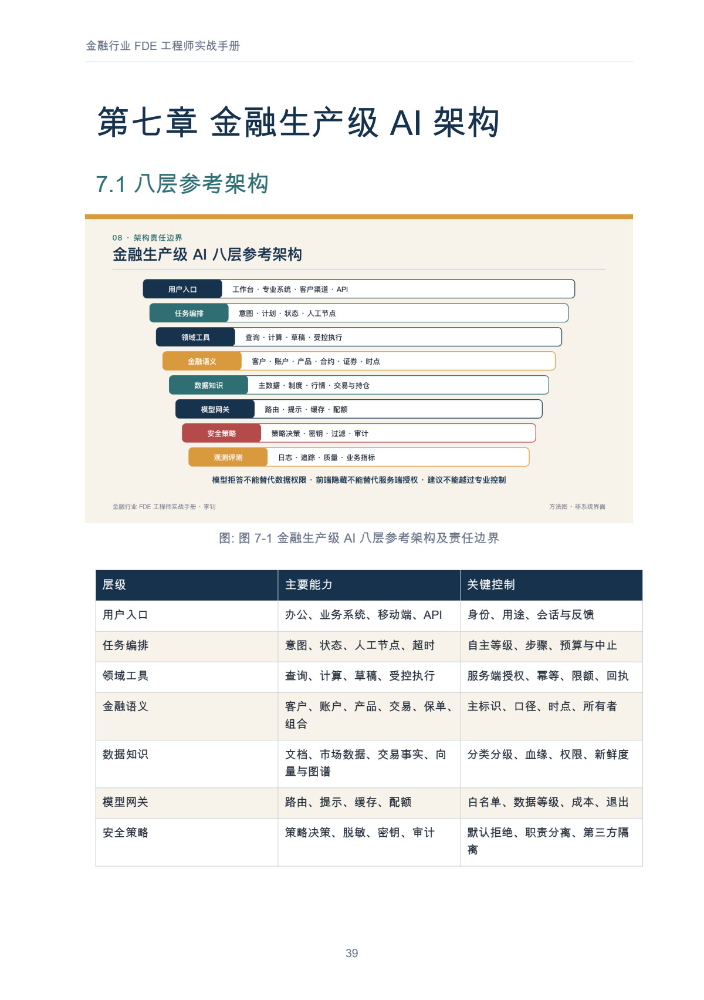
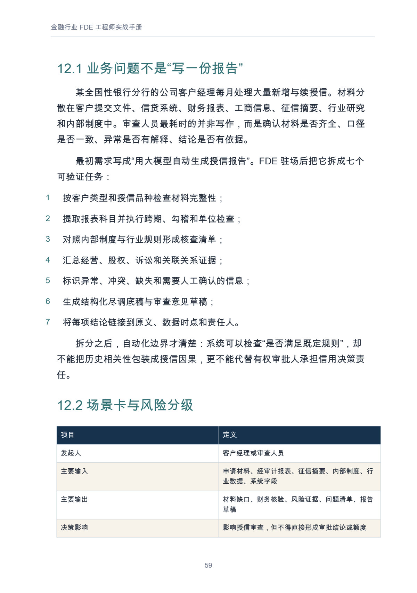
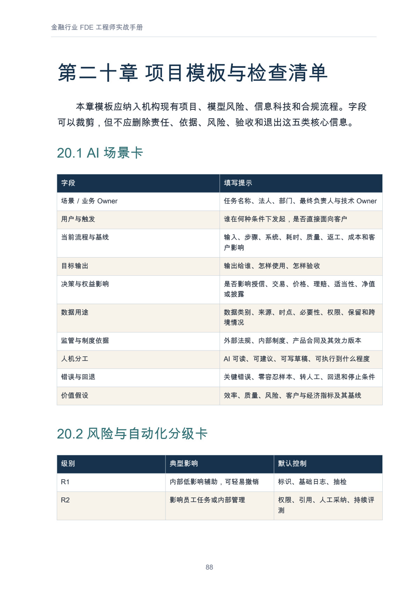

# 金融行业 FDE 工程师实战手册

从 AI 战略到合规生产落地：银行、证券、保险、基金与资产管理

**快速导航：** [完整目录](#全书目录) · [正文预览](#正文预览) · [阅读与下载](#阅读与下载)

作者：李钊  
版本：第一版·金融行业增订（2026-08-24）  
原书日期：2026-07-25 · 增订修订记录：2026-08-24  
书房整理日期：2026-11-08

金融机构将 AI 接入真实工作，需要同时处理业务目标、数据口径、专业系统、模型风险、客户权益和责任分工。本书围绕这条落地链路，介绍 FDE（Forward Deployed Engineer，前线部署工程师）如何观察业务、定义任务、连接数据与工具、组织评测，并把灰度运行、监测、回退和退出纳入项目设计。它为业务、科技与风险治理的参与者提供一套讨论任务、证据和责任的共同框架。

全书 21 章，含 23 幅正文配图。从金融转型诉求、场景选择与角色定位出发，逐步进入生产架构、数据知识、模型评测、安全治理和持续运营，再通过银行授信、证券投研、保险理赔、基金与资管协作四类脱敏复合案例展开。后半部分介绍 WPS Comate 的装配思路、九十天启动节奏、混编团队与能力成长，并附项目模板、检查清单和术语表，便于读者结合本机构的制度、系统与真实样本继续细化。

## 阅读与下载

- [Markdown 在线阅读](output/markdown/金融行业%20FDE%20工程师实战手册.md)
- [PDF 下载 · 97 页](https://github.com/njxshr/ruogu-books/releases/download/v2026.11.08/finance-fde-handbook.pdf)
- [EPUB 下载](https://github.com/njxshr/ruogu-books/releases/download/v2026.11.08/finance-fde-handbook.epub)
- [Markdown 离线包 · 含配图](https://github.com/njxshr/ruogu-books/releases/download/v2026.11.08/finance-fde-handbook-markdown.zip)

文件和书内元数据保留原书日期 2026-07-25，金融行业增订记录为 2026-08-24，两者分别保留。

## 适合哪些读者

| 读者 | 可以重点关注的内容 |
| --- | --- |
| 金融项目中的 FDE、售前、架构师和项目经理 | 场景定界、端到端方法、跨角色协作，以及从试点到灰度运行的交付证据。 |
| 金融机构业务与科技负责人 | 任务选择、责任边界、价值台账、组织采纳和推广或退出的判断依据。 |
| 数据、模型、集成与运维工程人员 | 主数据与时间语义、知识检索权限、工具契约、评测、观测与回退设计。 |
| 模型风险、合规、消保、审计与安全人员 | 用途与风险分级、人工责任、客户影响、独立验证和审计证据。 |
| 正在建设金融 AI 项目团队的管理者与学习者 | FDE 的职责、能力模型、混编小队分工，以及可复用的项目资产。 |

## 建议阅读路线

| 当前需要 | 阅读顺序 |
| --- | --- |
| 先建立全局认识 | 阅读指南 → 第 1—4 章 → 第 17 章，先了解任务、角色、障碍和启动节奏。 |
| 正在启动或推进项目 | 第 5—11 章 → 第 20 章，用工作方法、架构与治理要求逐项检查场景和交付物。 |
| 按行业寻找参考 | 银行读第 12 章，证券读第 13 章，保险读第 14 章，基金与资产管理读第 15 章；再回看第 8—10 章的数据、评测与责任安排。 |
| 已有 WPS 365 或 Comate 使用条件 | 第 16 章 → 第 7—11 章 → 第 20 章，对照入口、专业系统、权限和运营要求细化方案。 |
| 关注团队建设或排查常见困惑 | 第 18—19 章 → 第 21 章，再按问题回到相应的方法或案例章节。 |

## 可以从书中获得什么

- **场景选择与定界的方法**：从真实任务出发，记录基线、决策影响、风险等级、验收条件和停止条件。
- **生产能力的架构视图**：将用户入口、任务编排、领域工具、金融语义、数据知识、模型网关、安全策略和观测评测放在同一张图中讨论。
- **评测与运行的检查框架**：围绕场景、模型与证据建立台账，结合真实样本、发布门、影子运行、灰度和持续监测检验方案。
- **四类金融复合案例的拆解**：观察授信尽调、投研合规、理赔辅助和资管协作如何组织证据、人工节点、禁止动作与异常路径。
- **启动节奏与协作分工的参考**：对照九十天计划、混编小队和责任矩阵，安排阶段交付与复盘。
- **可按机构流程调整的模板**：包括场景卡、风险与自动化分级卡、数据与知识卡、模型与联合版本卡、工具契约、评测矩阵、上线评审清单、审计证据包目录和周报。

## 全书目录

下列为 21 个编号章节；书中另有前言、阅读指南、结语和参考资料。完整正文及小节可在 [Markdown 阅读版](output/markdown/金融行业%20FDE%20工程师实战手册.md)中查看。

### 转型、场景与角色

| 章节 | 真实章名 | 本章回答的读者问题 |
| --- | --- | --- |
| 第一章 | AI 时代的金融转型命题 | 五类金融机构的 AI 转型有哪些共同诉求与责任差异？ |
| 第二章 | 高价值场景不是“AI 能做什么” | 如何结合任务价值、生产就绪度和风险影响选择试点？ |
| 第三章 | 金融机构 AI 落地的三大障碍 | 员工抵触、系统复杂和入口竞争应怎样共同处理？ |
| 第四章 | 金融 FDE 工程师到底做什么 | FDE 承担哪些职责，与相邻角色如何分工？ |

### 工作方法与需求发现

| 章节 | 真实章名 | 本章回答的读者问题 |
| --- | --- | --- |
| 第五章 | 金融 FDE 的端到端工作方法 | 如何从观察真实业务推进到评测、发布、运营与复用？ |
| 第六章 | 金融场景发现与需求工程 | 如何把访谈中的诉求写成可评测、包含客户权益约束的需求？ |

### 架构、证据与生产治理

| 章节 | 真实章名 | 本章回答的读者问题 |
| --- | --- | --- |
| 第七章 | 金融生产级 AI 架构 | 工作流、模型、工具、专业系统和控制要求怎样分层配合？ |
| 第八章 | 金融数据、知识与系统集成 | 如何保持数据用途、口径、时点、知识效力与权限的一致性？ |
| 第九章 | 模型风险、评测与价值证明 | 怎样组织真实样本、独立验证、发布门和价值证据？ |
| 第十章 | 安全、合规与负责任金融 AI | 如何把制度适用、专业责任、客户权益和退出要求纳入设计？ |
| 第十一章 | 上线运营与规模复制 | 上线后追踪什么，如何处置事件并判断复制条件？ |

### 四类金融复合案例

| 章节 | 真实章名 | 本章回答的读者问题 |
| --- | --- | --- |
| 第十二章 | 银行案例：对公授信尽调与审查助手 | 如何把授信辅助拆成有来源、可核查且保留审批责任的任务？ |
| 第十三章 | 证券案例：投研证据链与合规审查 | 如何让研究证据贯穿草稿、专业复核与发布流程？ |
| 第十四章 | 保险案例：理赔材料预审与欺诈线索辅助 | 如何组织材料核验与风险线索，并保留授权人员的结论责任？ |
| 第十五章 | 基金与资产管理案例：研究、组合风控与信披协作 | 研究、组合控制和信披怎样共享证据，同时保留专业系统的控制职责？ |

### 平台装配、启动与团队成长

| 章节 | 真实章名 | 本章回答的读者问题 |
| --- | --- | --- |
| 第十六章 | 借助 WPS Comate 推动金融机构 AI 生产落地 | 横向办公入口、专业系统与 FDE 如何围绕场景装配能力？ |
| 第十七章 | 九十天启动手册 | 每个阶段应交付哪些证据，何时进入灰度、评审或复制？ |
| 第十八章 | 团队、组织与人才成长 | 如何配置混编小队、建设 FDE 能力并维护协作边界？ |

### 问题索引与项目工具

| 章节 | 真实章名 | 本章回答的读者问题 |
| --- | --- | --- |
| 第十九章 | 常见问题 | 遇到战略、数据、自动化、合规和推广困惑时，可以怎样定位问题？ |
| 第二十章 | 项目模板与检查清单 | 场景、数据、模型、工具、评测和审计应留下哪些记录？ |
| 第二十一章 | 术语表 | 如何统一跨业务、技术与治理团队使用的关键术语？ |

## 正文预览

以下页码按 PDF 文件顺序从 1 起算，包含封面；点击图片可查看大图。

### 八层架构与责任边界 · PDF 第 39 页

第七章以架构图连接入口、编排、工具、金融语义、数据知识、模型、安全与观测，并逐层对照主要能力和关键控制。图下的对照表续见 PDF 第 40 页。

### 把银行需求拆成可验证任务 · PDF 第 59 页

第十二章的脱敏复合案例将授信材料处理拆为完整性检查、财务核验、规则对照、证据汇总、异常标识、底稿草拟和来源追溯七项任务；页面下方开始列出场景卡与风险分级信息。

### 项目场景卡与风险分级模板 · PDF 第 88 页

第二十章提供场景卡，提示读者填写责任人、当前流程、目标输出、客户权益影响、数据用途、制度依据、人机分工、回退条件和价值假设。本页同时展示风险与自动化分级卡的开头，续表见 PDF 第 89 页。

## 来源与维护

[来源台账](SOURCES.md) · [修订记录](REVISION_LOG.md) · [写作主稿](manuscript/book.md) · [出版配置](book.json)

本次整理保留既有成品内容。来源核验记录截至 2026-08-24；有关规则与产品能力应在实际项目中核验最新版本。案例中的工期、质量、效率与收益均为教学示意，不作为销售承诺。

原书用途说明：本书仅供学习与项目实践参考；案例均为脱敏复合案例，不对应特定真实金融机构，不构成法律、监管、投资、授信、核保或理赔意见。各项材料的权利以原有说明为准，书房未对本书另行授予开放许可。

[返回书籍目录](../../目录.md) · [若谷书房](../../README.md)
