# 金融行业 FDE 工程师实战手册

从 AI 战略到合规生产落地：银行、证券、保险、基金与资产管理

作者：李钊  
日期：2026 年 07 月 25 日  
版本：第一版·金融行业增订（2026 年 08 月 24 日）

---

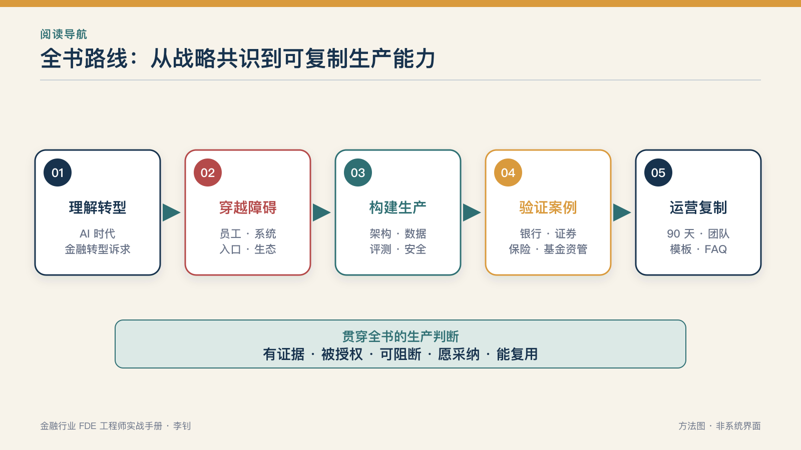

## 前言　把 AI 从演示环境带进金融生产

金融机构不缺 AI 演示。知识助手可以解释制度，模型可以摘要财报，智能体可以调用几个查询接口，会议现场也容易呈现“未来感”。但真正的分水岭发生在演示之后：系统是否只读取获批目的下的数据，是否区分账务事实与模型推断，是否尊重适当性和客户权益，是否在交易、授信、核保、理赔、估值与披露之前保留实质人工责任，是否能在模型漂移或依赖故障时回到可运行的人工流程。

FDE，Forward Deployed Engineer，常译为前线部署工程师或前沿部署工程师，正是为解决这段“最后一公里”而出现的复合型角色。它不是驻场开发的新名称，也不是售前、实施、算法和项目管理的机械相加。金融 FDE 站在业务价值、数据与模型、专业系统、风险治理和组织变革的交界处，对“进入真实工作并产生可验证、可审计的结果”负责。

金融行业的难点不仅是监管严格。银行、证券、保险、基金与资产管理机构都运行在高密度责任网络里：一次建议可能影响客户权益，一项操作可能改变账户或交易状态，一份材料可能进入监管报送或公开披露，一次错误又可能通过高频渠道迅速放大。概率性模型进入这样的环境，不能只追求“更聪明”，还要同时满足用途正当、数据最小、结果公平、过程留痕、人工可接管和退出可执行。

本书沿用一条务实主线：从任务闭环出发，以分层架构、模型风险与评测体系为底座，以合规、消保和运营韧性为护栏，把一个原型逐步变成可持续的生产能力。全书还正面处理三类中大型金融机构普遍面对的阻力：员工对岗位与责任变化的抵触；核心、信贷、交易、保单、估值、CRM 等系统的复杂整合；横向 AI 办公入口与专业业务入口之间的控制权竞争。

书中案例均为多个常见项目模式抽象而成的脱敏复合案例，不对应任何真实金融机构；工期、质量、效率与收益数字均为教学示意，不能作为销售承诺。书中内容用于建立工程检查框架，不构成法律、监管、投资、授信、核保或理赔意见；正式项目应由机构业务、科技、数据、模型风险、合规、法务、消保、审计和安全责任人共同确认。

## 阅读指南

本书面向五类读者：进入金融机构项目的 FDE；承担 AI 方案与交付的售前、架构师和项目经理；负责数字金融转型的业务和科技管理者；参与数据、模型、集成和运维的工程人员；以及需要判断 AI 项目风险与价值的模型风险、合规、消保、审计和安全人员。

读完本书，你应能独立组织一个金融 AI 场景从发现、定界、风险分级、数据接入、模型与工具评测到灰度运营的最小闭环，并知道何时扩大、何时降级、何时停止。它不是某个模型或产品的使用说明，也不替代金融机构内部制度。

如果你正在启动项目，可先读第一至第四章，统一目标与角色；再按第五至第十一章完成方法、架构、数据、评测、合规与运营设计；随后从第十二至第十五章选择最接近的行业案例。已使用 WPS 365、希望让 AI 进入文档与协作工作的机构，可重点读第十六章。项目陷入困境时，可从第三章“三大障碍”和第十九章“常见问题”定位；第二十章提供可直接复用的金融项目模板。

全书采用以下标记习惯：

- “生产”指真实人员在真实工作中使用，具有身份、权限、证据、监控、支持、事件和退出机制，不等同于把服务部署到服务器。
- “高风险决策”包括但不限于授信审批、客户或投资者适当性结论、交易与调仓、核保与拒赔、估值与净值、重大合规判断和对外披露。
- “人工在环”不是页面上的确认按钮，而是授权人员有时间、有证据、有能力拒绝，并对最终动作承担相应责任。
- “模型”既包括大语言模型，也包括分类、评分、预测、规则组合等可能影响业务结果的算法能力。
- “示意指标”只用于讲解设计方法，正式项目必须用本机构基线、风险偏好和制度重新设定。

图表采用统一阅读语法：深蓝表示机构主责与稳定事实，青绿表示协同与可演进能力，金色表示价值节点或人工确认，红色表示风险边界。图表解释关系和决策，不代表具体软件界面。

## 第一章　AI 时代的金融转型命题

### 1.1 从数字金融走向可信智能

金融机构的 AI 转型不是一次模型采购。人民银行等部门发布的数字金融相关行动强调金融机构数字化转型、数据治理、数字运营、风险防范和金融消费者保护；金融监管总局 2026 年发布《关于银行业保险业人工智能安全开发应用的指导意见》，提出合规、透明、可信赖、分类分级管理，并强调“谁使用谁负责”、自主可控、务实高效与安全发展。参见[银行业保险业人工智能安全开发应用指导意见](https://www.nfra.gov.cn/cn/view/pages/governmentDetail.html?docId=1261784&generaltype=1&itemId=)。

这意味着金融 AI 不能只回答“模型能做什么”，还要同时回答三组问题。

第一，是否服务真实金融任务。通用写作和会议摘要能够改善办公体验，但信用审查、客户服务、投研合规、理赔运营、反洗钱辅助、风险监测和监管材料等任务更接近价值与责任。

第二，是否形成系统能力。生产效果取决于客户与产品主数据、市场与交易数据、知识时效、身份权限、工具接口、模型路由、评测、监控和员工使用。模型越强，系统工程越重要。

第三，是否同时守住发展与安全。金融机构不仅要问“能不能自动做”，还要问“是否允许用这些数据、会不会影响客户权益、是否需要解释、谁作最终决定、结果如何复核、错误如何止损”。

### 1.2 大模型改变的是责任链，不只是界面

传统金融软件要求用户在固定菜单、字段和规则中工作；大模型把自然语言变成新的交互层，并能处理研报、合同、保单、影像、录音和制度等非结构化内容。它带来三项变化：

- 用户从“找功能”转向“说目标”，但模糊意图必须被约束为明确的业务任务和用途。
- 自动化对象从字段计算扩展到语义理解与生成，但输出具有概率性，不能直接等同于事实。
- 软件可以规划和调用工具，但权限半径、交易半径和故障半径同时扩大。

因此，传统“功能按需求实现”的验收不够。金融 AI 还要验证样本覆盖、证据质量、拒答与升级、数据使用目的、客户公平、工具调用、业务连续性、模型漂移、投诉和人员采纳。上线不再是项目终点，而是持续验证的开始。

### 1.3 五类金融机构的共同与差异

| 行业 | 高价值任务 | 核心事实系统 | 特别责任边界 |
|---|---|---|---|
| 银行 | 授信尽调、运营审核、客服与反洗钱辅助 | 核心、信贷、客户、支付、风险系统 | 账务正确、授信责任、客户权益 |
| 证券 | 投研、经纪服务、适当性、合规监测 | 交易、账户、行情、研究与合规系统 | 交易指令、信息隔离、投资者保护 |
| 保险 | 核保辅助、理赔预审、客服与代理人支持 | 保单、理赔、影像、渠道与反欺诈系统 | 公平销售、理赔权益、敏感健康信息 |
| 基金 | 研究、产品材料、估值复核、信披协作 | 投研、组合、交易、估值、TA 与信披系统 | 受托责任、净值准确、信息披露 |
| 资产管理 | 尽调、投后、组合风险与报告 | 资产、组合、风险、合同与估值系统 | 委托约定、穿透管理、利益冲突 |

五类机构的共性是数据敏感、专业规则复杂、审计要求高；差异在于最终业务对象和责任主体。FDE 可以复用身份、工具、评测和治理方法，却不能把银行授信规则复制到基金投资，把证券适当性流程替代保险需求分析。

### 1.4 从“模型可用”到“业务有效”

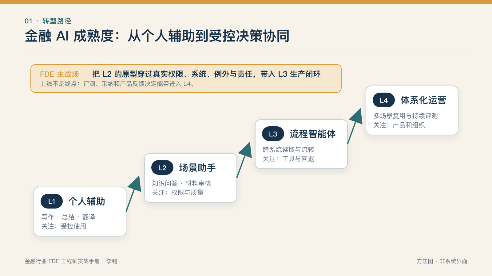

| 层级 | 主要表现 | 常见误区 | 升级关键 |
|---|---|---|---|
| L1 个人辅助 | 摘要、写作、翻译、代码辅助 | 只统计账号与调用量 | 受控入口与基础使用规则 |
| L2 专业助手 | 制度问答、材料核对、研究支持 | 把检索命中当作业务价值 | 证据、权限与岗位评测 |
| L3 流程协同 | 跨系统查询、草稿流转、风险提示 | 把“有人确认”当作万能免责 | 工具契约、实质复核与回退 |
| L4 体系运营 | 多场景复用、模型风险与持续评测 | 只建设统一平台 | 产品经营、三道防线与资产治理 |

多数问题集中暴露在 L2 到 L3：原型回答不错，一旦进入真实客户、账户、交易和产品权限，数据不一致、接口异常、审批拥堵和责任冲突就出现。FDE 的主战场正是把专业助手穿过这些约束，变成有限、可靠、可审计的流程能力。

### 1.5 从项目交付走向能力共建

金融机构常见三种建设形态：业务条线发起的单场景项目；科技或数字化部门建设底座、条线申报场景的平台共建；业务、科技、数据、模型风险、合规、消保与外部 FDE 组成的联合运营小队。

| 组织形态 | 优势 | 常见失效 | FDE 重点 |
|---|---|---|---|
| 单项目交付 | 合同和目标清晰 | 验收即离场，模型与知识无人维护 | 从第一天设计台账、移交和退出 |
| 平台与场景共建 | 身份、模型、评测可复用 | 平台先行，场景长期没有业务结果 | 用真实任务验证共享能力 |
| 联合运营 | 学习快，风险与价值同步判断 | 角色模糊，外部团队长期兜底 | 固化 Owner、三道防线和版本责任 |

能力是否真正转移，可用一个问题检验：FDE 退出护航后，机构团队能否独立更新知识、验证模型、处理告警、解释关键输出并决定发布或下线？如果不能，项目仍是外部能力租赁，不是机构能力。

## 第二章　高价值场景不是“AI 能做什么”

### 2.1 用任务闭环替代功能清单

“建设信贷智能体”无法指导工程。更可执行的描述是：

> 当客户经理发起某类对公流动资金贷款调查时，系统在其获批客户权限和明确用途下，汇总客户主档、财务报表、征信摘要、存量授信、担保关系、行业政策和现场材料，标出矛盾与缺失，生成带来源的调查报告草稿；客户经理确认事实，审查人员独立判断，AI 不写入最终评级和审批结论。

这句话暴露了真正的问题：客户标识如何统一，数据是否可用于该目的，财报口径怎样对齐，缺失数据如何表达，关系图谱是否构成敏感画像，谁能看哪些字段，报告如何进入信贷系统，模型结果是否影响客户权益，以及最终责任如何保留。

### 2.2 金融场景评分法

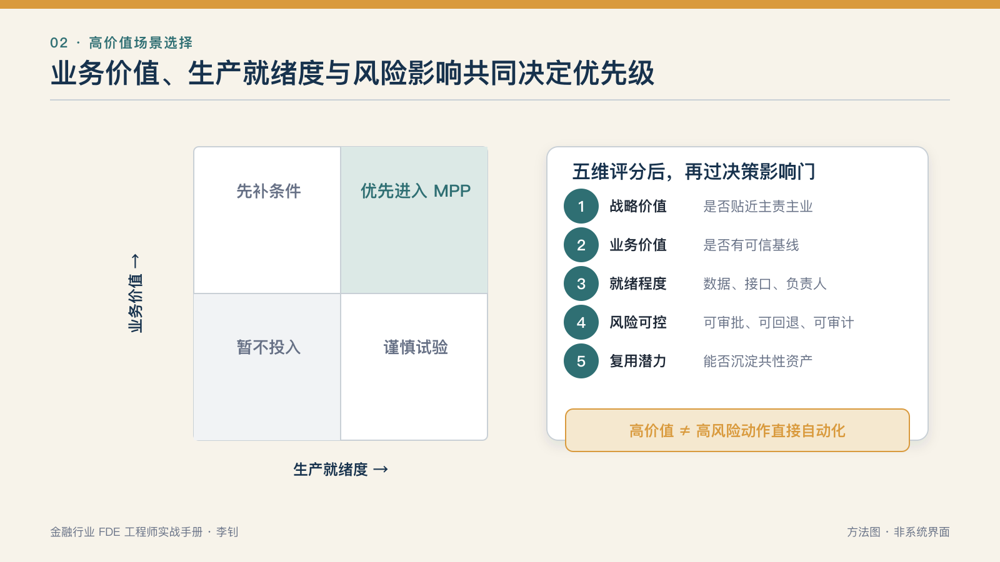

| 维度 | 关键问题 | 高分特征 |
|---|---|---|
| 战略价值 | 是否服务数字金融、风控或客户经营重点 | 高层关注且能形成条线标杆 |
| 业务价值 | 频次、积压、损失、响应或收入影响多大 | 有可信基线和明确受益人 |
| 生产就绪 | 数据、流程、接口、样本和 Owner 是否具备 | 真实约束可获得、可测试 |
| 风险可控 | 是否影响客户权益、交易、账务或披露 | 可解释、可复核、可阻断、可回退 |
| 复用潜力 | 能否迁移到分支机构、产品或策略 | 共性对象和标准接口占比高 |

示意评分可采用加权和，但任何触发红线的场景都不能靠总分“抵消风险”。例如，一个自动营销场景收益很高，却无法证明客户同意、适当性匹配与公平性，就应先缩为内部客群分析或人工审阅建议；一个交易场景即使技术准确，也不应从无保护试点直接跨到自动下单。

### 2.3 先做任务风险分级

建议在价值评分之前给任务分级：

| 风险级 | 对业务和客户的影响 | 默认自主等级 | 例子 |
|---|---|---|---|
| R1 低 | 内部辅助，可轻易纠正 | 可受控自动 | 格式整理、会议行动项 |
| R2 中 | 影响专业效率或内部判断 | AI 建议，岗位人员确认 | 制度问答、研究资料摘要 |
| R3 高 | 影响客户权益、重要报告或业务状态 | 草稿与证据，双重或独立复核 | 授信报告、理赔预审、信披草稿 |
| R4 极高 | 直接改变资金、交易、定价、拒赔或最终决策 | 原则上不由生成式 AI 自动决定 | 下单、放款、拒赔、最终评级、净值发布 |

任务风险按“动作”而不是按“智能体名称”划分。同一助手可以自动整理材料，却不能自动批准额度；可以提醒组合触碰预警线，却不能绕过投资经理和交易控制直接调仓。

### 2.4 五类价值证据

- 效率：材料准备、等待、补录、复核和全流程用时。
- 质量：事实完整率、引用覆盖、漏项、返工、专家一致性。
- 风险：越权、错误写入、误导性建议、不公平影响、未遂事件。
- 客户与投资者：投诉、转人工、解释充分性、适当性偏差、服务可达性。
- 采纳与经济性：有效任务、复用、人工接管、单个合格成果总成本。

“准确率 95%”不是充分证据。若剩余 5% 集中在高额客户、老年客户、特殊病种、复杂产品或市场极端情形，平均分会掩盖真正风险。金融验收必须分层报告关键少数。

### 2.5 最小可行生产证明

MPP，Minimum Production Proof，最小可行生产证明，不是功能较少的演示。它至少包含真实岗位、真实或等价脱敏数据、明确用途、身份权限、有限闭环、代表性评测、日志告警、实质人工复核、业务连续性、责任人和退出条件。

一个 MPP 可以只覆盖一家分行、一类产品或一种理赔案件，但不能绕过最关键的权限、审批和审计约束。只有穿过真实约束，团队获得的证据才足以支持扩大。

## 第三章　金融机构 AI 落地的三大障碍

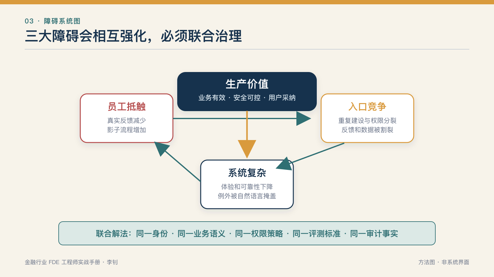

三大障碍不是三个独立问题。员工担心责任与岗位，便减少真实纠正；缺少纠正，系统只能在干净样本上优化；复杂系统降低体验和证据一致性，又加深员工不信任；入口竞争则造成重复保存客户数据、权限分裂和反馈孤岛。FDE 要把它们视为一个联合治理问题。

### 3.1 障碍一：员工抵触与责任焦虑

金融员工的抵触往往是理性反应。客户经理担心 AI 建议被视为个人承诺，合规人员担心模型漏检却由自己背责，研究员担心知识被吸收后岗位价值下降，运营人员担心效率提升变成更高指标，审核人员担心“人工在环”变成机械点确认。

可把威胁感拆成四项：

> 目标不透明 + 责任向下转移 + 经验贡献无回报 + 技能迁移无路径

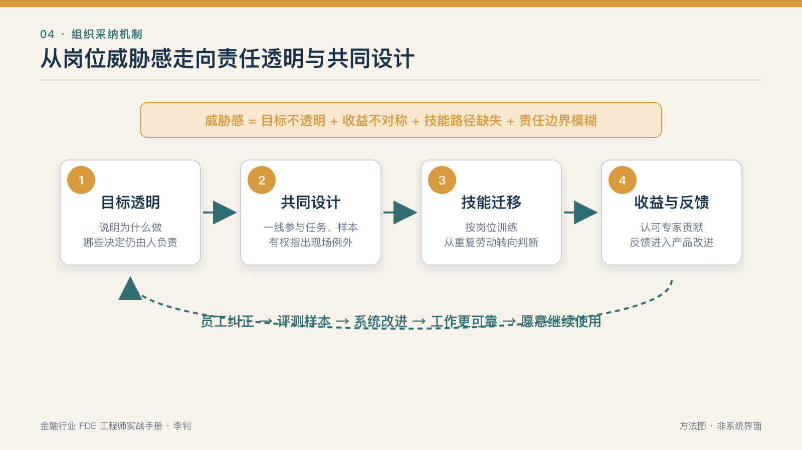

#### 把岗位替代改写为任务重构

| 任务类型 | 建议模式 | 金融示例 |
|---|---|---|
| 重复、低风险 | 自动执行，抽样复核 | 报告格式、材料目录、会议行动项 |
| 高频、需判断 | AI 建议，人确认 | 工单分类、条款差异、资料缺口 |
| 低频、高风险 | 专家主导，AI 供证据 | 重大授信、可疑线索、拒赔争议 |
| 关系与责任密集 | 人主导，AI 准备 | 客户沟通、投资决策、监管沟通 |

项目公告至少回答：AI 改变哪些任务；哪些决定仍由人负责；效率收益如何使用；员工怎样训练、反馈和申诉。若业务、科技、人力和合规分别发出不同口径，FDE 应推动形成一份一致、可执行的责任说明。

#### 让一线成为共同设计者

- 每个场景配置一名一线流程教练和一名风险或合规教练。
- 记录员工为何修改输出，将原因分到数据、规则、模型、权限或流程队列。
- 培训围绕真实任务和失败案例，不用通用提示词课替代岗位演练。
- 采纳指标与质量、客户权益、复核负担和风险联合观察。
- 专家贡献进入知识所有权、岗位绩效或专业认证，而不是被无声抽取。

#### 一个反例

某机构上线营销文案助手，用调用量考核客户经理，却未说明适当性、宣传口径和责任边界。员工为了避责，只生成无关紧要的内部文字，真正对客材料仍在个人工具中处理。项目组将指标改为“在受控流程中完成、经合规规则与人工复核的有效材料”，补上产品白名单、客户范围、禁用表达、版本引用和申诉通道后，采纳才开始有业务意义。

### 3.2 障碍二：系统复杂与业务事实分裂

一个“解释客户风险并准备下一步行动”的任务，可能跨越客户信息平台、核心系统、信贷、征信、反洗钱、CRM、影像、合同、呼叫中心和统一身份；证券与基金还涉及账户、行情、交易、组合、估值和信披；保险涉及保单、理赔、影像、渠道、医疗或维修合作网络。系统数量只是表象，真正难点是五种不一致：

- 身份不一致：客户、账户、企业、受益所有人和产品在各系统标识不同。
- 语义不一致：余额、敞口、有效保单、持仓、已成交等口径随系统与时点变化。
- 权限不一致：页面可见不等于可用于模型，读取许可不等于自动决策许可。
- 流程不一致：正式制度、分支机构做法、线下补录和历史路径并存。
- 生命周期不一致：市场数据、制度、模型、接口和产品规则更新频率不同。

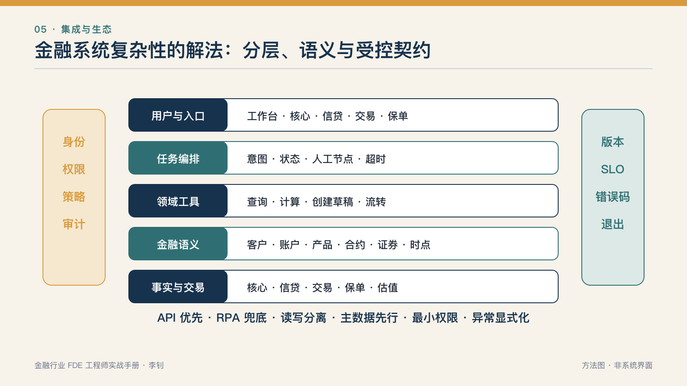

#### 分层解耦，不让智能体直连核心

智能体应调用经过治理的业务工具，而不是获得任意数据库或接口权力。每个工具定义输入、输出、目的、身份、权限、幂等、时点、错误码、审计和回滚。生产接入坚持 API 优先、读写分离、主数据先行、最小权限、异常显式化和源系统对账。

例如，工具应叫 `get_customer_exposure_snapshot` 或 `create_credit_memo_draft`，并返回数据时点、口径、来源和权限结果；不应提供 `execute_sql`。空结果必须区分“确实无记录”“无权限”“数据延迟”和“系统故障”，不能让自然语言把它们都写成“无风险”。

#### 生态共建交付可测试契约

机构、核心系统厂商、AI 平台、数据供应商和实施伙伴之间，至少要交付统一身份映射、数据词汇、工具说明、服务等级、版本兼容、审计字段、事件升级、数据删除和退出迁移。契约要用正常、空值、超时、重复、越权和部分失败样本验证；不能执行的“开放生态”只是宣传语。

### 3.3 障碍三：横向办公入口与专业入口之争

WPS Comate 等横向 AI 办公平台接近文档、表格、演示、会议与协作；核心银行、信贷、交易、保单、组合与估值系统则掌握专业对象、实时状态、交易权限和法定记录。真正的选择不是“谁拥有聊天框”，而是：谁接收用户意图，谁保存客户或投资者上下文，谁执行专业规则，谁承担错误责任，谁拥有反馈和可迁移资产。

| 入口策略 | 适用任务 | 优势 | 主要风险 |
|---|---|---|---|
| 横向办公入口 | 跨文档、跨系统、材料协作 | 触达广、协作顺畅 | 容易复制专业规则或扩大数据范围 |
| 专业系统入口 | 高频交易、账务、审批和专业操作 | 语义完整、责任清晰 | 跨域体验弱、重复建设助手 |
| 联邦双入口 | 大型机构、多系统长期共存 | 兼顾体验和控制 | 需要统一身份、策略和审计 |

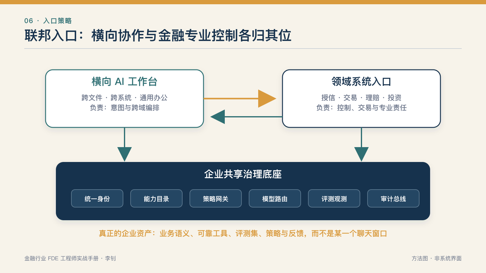

本书推荐“入口共存、能力复用、责任归位”：横向工作台承接材料理解、协作和跨域任务；专业系统保留账务事实、交易规则和最终动作；两者共享机构身份、能力目录、模型网关、数据分级、策略决策、评测与审计。

#### 入口决策七问

- 用户是否每天在该入口完成这一类专业任务？
- 任务是否影响资金、交易、适当性、授信、理赔、估值或披露？
- 专业语义是否只能由领域系统准确解释？
- 是否必须跨多个系统和文档才能完成？
- 数据等级、部署和保存要求能否被入口满足？
- 底层能力能否以受控工具被多个入口复用？
- 更换入口或模型后，知识、规则、评测和日志能否迁移？

### 3.4 三大障碍的联合解法

| 障碍 | 错误解法 | FDE 联合解法 | 证据 |
|---|---|---|---|
| 员工抵触 | 强制调用、机械培训 | 任务重构、责任透明、共同设计 | 有效任务、纠正、复核负担 |
| 系统复杂 | 直连核心、先建万能中台 | 场景牵引、工具契约、事实归位 | 接口成功、对账、复用率 |
| 入口竞争 | 唯一入口包打天下 | 联邦入口、统一控制面、资产可迁移 | 跨入口一致、迁移与审计能力 |

联合解法的核心是“同一套生产事实”：同一身份、同一业务定义、同一权限策略、同一评测口径、同一审计追踪。没有这套共同事实，员工不信、系统不通、厂商也无法清晰担责。

## 第四章　金融 FDE 工程师到底做什么


### 4.1 一个面向结果与责任的定义

OpenAI 对 FDE 岗位的公开描述强调与客户共同发现、定界、设计、构建和生产发布，并以生产采纳、可衡量的工作流影响和评测反馈判断成功。参见[Forward Deployed Engineer 职位说明](https://openai.com/careers/forward-deployed-engineer-%28fde%29-sf-san-francisco/)。结合金融环境，本书定义：

> 金融 FDE 是深入真实业务现场，以合规生产效果为责任边界，把机构目标翻译为 AI 任务闭环，并完成架构、数据、模型与工具集成、评测、安全、上线、采纳和产品反馈的复合型工程师。

“对结果负责”不等于无限责任。项目应明确：FDE 对端到端技术闭环、证据和风险透明负责；业务 Owner 对流程目标、专业规则和价值负责；数据与系统 Owner 对源事实、接口和权限负责；模型风险、合规、消保、安全与审计对其专业审查和监督职责负责。FDE 连接缝隙，不代替法定或管理责任人。

### 4.2 与相邻角色的区别

| 角色 | 主要关注 | 与 FDE 的关系 |
|---|---|---|
| 业务产品负责人 | 客户、流程与经营结果 | 定义价值、规则和最终业务责任 |
| 解决方案架构师 | 总体架构与技术选型 | FDE 在真实约束中实现并校正 |
| 数据/模型工程师 | 数据产品、模型与推理效果 | FDE 将能力嵌入完整工作流 |
| 模型风险与验证 | 模型分级、独立验证、持续监测 | FDE 提供台账、样本、版本和整改证据 |
| 合规、法务与消保 | 规则、客户权益与行为边界 | FDE 把原则转为控制和测试 |
| 项目经理 | 范围、进度、资源与风险 | FDE 对跨域技术业务闭环负责 |
| SRE、安全与业务连续性 | 稳定、韧性与事件响应 | FDE 将其前置到设计和验收 |

### 4.3 九项核心责任

1. 发现：观察真实任务、例外、影子流程与责任链。
2. 定界：定义业务目标、风险等级、范围外和停止条件。
3. 取证：建立基线、代表性样本和监管/制度依据。
4. 架构：设计入口、编排、工具、数据、模型、策略与观测。
5. 构建：快速实现可验证原型，保留通向生产的路径。
6. 评测：覆盖业务、模型、工程、安全、公平和客户权益。
7. 发布：完成容量、回退、业务连续性、文档和移交。
8. 采纳：与一线共同设计，降低复核负担与责任焦虑。
9. 沉淀：把工具、语义、评测、控制和案例反馈给平台与产品。

### 4.4 FDE 不应该做什么

- 不以未经验证的模型能力换取立项或合同。
- 不绕开合规、模型风险、数据、安全、消保和业务 Owner 上线。
- 不让模型替授权人员作出授信、交易、拒赔、估值或披露决定。
- 不以“私有化”或“人工确认”掩盖数据用途、权限和复核失效。
- 不把所有例外塞进一个无边界智能体。
- 不用总体平均分掩盖关键客户、产品或市场状态的失败。
- 不把机构环境做成只有个人能维护的黑盒。

### 4.5 金融 FDE 的梳子型能力

| 能力域 | 必备能力 | 进阶表现 |
|---|---|---|
| 金融业务 | 任务、产品、客户、流程与价值分析 | 能区分银行、证券、保险、基金资管责任 |
| 软件与集成 | API、事件、数据、部署和遗留系统 | 在核心与外围系统间设计可演进架构 |
| AI 工程 | 提示、RAG、工具调用、智能体 | 评测、路由、漂移与失败诊断 |
| 模型风险 | 模型台账、分级、验证与监测 | 将版本、样本、阈值和退出连成闭环 |
| 安全合规 | 身份、数据分级、适当性、消保、审计 | 把政策转成机器可执行控制 |
| 交付运营 | 测试、容量、发布、事件与成本 | 多条线运营和规模复制 |
| 沟通变革 | 访谈、共创、书面表达与冲突处理 | 在前中后台间建立共同事实 |

### 4.6 FDE 的一天：围绕证据而不是会议

典型驻场日不是连续编码八小时。早晨先看夜间批任务、评测回归、漂移指标、工具失败和用户反馈；短站会确认当天要证伪的假设；上午处理数据、检索、接口或缺陷；下午进行争议样本评审、跨部门对齐、成块开发和小范围试用；离场前更新决策、模型、风险和问题台账。

成熟节奏让两类活动交替：一类增加认知，如跟岗观察、审批争议和投诉复盘；一类形成可验证产出，如数据契约、工具版本、评测报告和发布记录。只有认知没有产出会变成长调研；只有产出没有认知会高速建设错误系统。

## 第五章　金融 FDE 的端到端工作方法

### 5.1 八阶段闭环

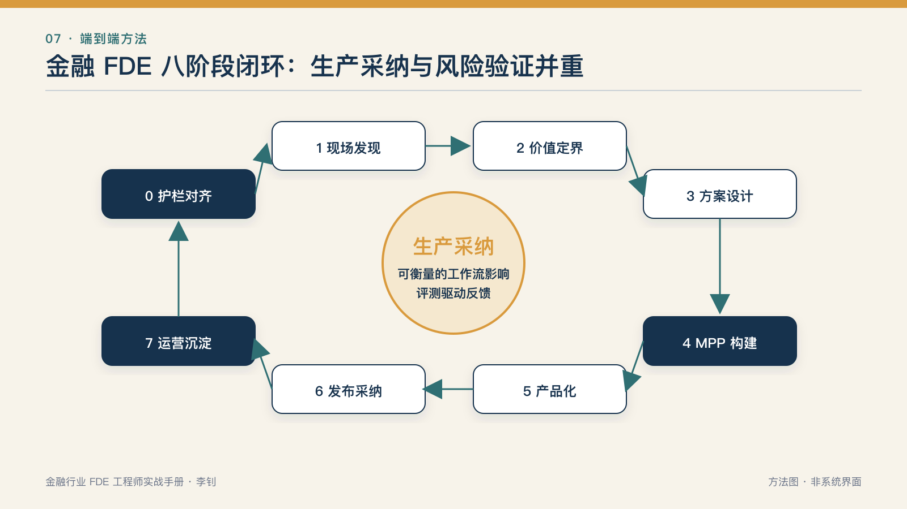

| 阶段 | 核心问题 | 关键产物 | 出口条件 |
|---|---|---|---|
| 0 护栏对齐 | 什么可做、谁负责 | 章程、风险分级、红线 | Owner 与禁区明确 |
| 1 现场发现 | 人员实际怎样完成任务 | 任务、系统、数据与责任地图 | 普通和例外被看见 |
| 2 价值定界 | 为什么做、做到哪 | 场景一页纸、基线、退出条件 | 价值与影响可验证 |
| 3 方案设计 | 如何安全、合规实现 | 架构、数据用途、威胁与模型风险 | 关键依赖有负责人 |
| 4 MPP 构建 | 最小生产闭环能否跑通 | 原型、黄金集、窄工具 | 真实约束下可验证 |
| 5 产品化 | 能否稳定、可解释、可维护 | 测试、监控、手册、验证报告 | 达到四道发布门 |
| 6 灰度采纳 | 用户能否正确使用 | 培训、影子/建议模式、支持台 | 有效使用且复核有效 |
| 7 运营沉淀 | 是否持续改善和复制 | 复盘、台账、资产包、路线图 | 价值与剩余风险受控 |

### 5.2 阶段 0：先画红线

启动会至少包括业务 Owner、科技、数据、模型风险、合规、法务、消保、安全、运维和主要供应商。需要确认：服务对象、任务风险级、数据用途、模型与部署边界、禁止动作、人工节点、验收、事件升级、监管沟通和退出条件。

红线要写成可测试陈述。“不得泄露客户信息”过于笼统；“未具备该客户关系和任务授权的人员不得检索客户材料；提示、输出与日志不得出现未经批准的身份证件、账户和健康信息明文；外部模型调用不得包含未获准数据；任何跨客户缓存复用均被禁止”才可执行。

### 5.3 阶段 1：观察一笔真实业务

请用户从真实触发开始，演示一笔普通业务和一笔异常业务：信息从哪里来，谁校验，哪里等待，哪些口径靠经验，哪些数据不可信，哪些节点需要双人复核，最后事实写到哪里。特别寻找影子流程：个人表格、共享盘、聊天截图、电话确认、线下清单和系统外审批。

金融现场还要追问三件事：该步骤是否影响客户或投资者权益；记录是否构成法定或监管留痕；人员是在确认 AI 建议，还是在独立完成应有判断。最后一个问题决定“人工在环”是否真实。

### 5.4 阶段 2：把承诺写进场景一页纸

一页纸至少包含：岗位和任务、当前基线、目标指标、客户或业务影响、输入输出、系统数据、风险级别、监管与制度依据、人机分工、范围内外、评测样本、业务连续性、里程碑、Owner 和三道防线参与人。

同时写“不做清单”。例如首期不直接向客户发送，不写入最终评级，不自动触发交易，不形成拒赔结论，不生成未经复核的公开披露，不覆盖跨境数据。边界清晰比宏大愿景更能建立信任。

### 5.5 阶段 3 至 5：快速，但不跳过生产问题

MPP 可以按周迭代：第一周跑通数据与引用，第二周加入工具与评测，第三周进入影子任务，第四周修复高风险失败。但每轮都要回答：哪些假设被证伪；错误来自数据、模型、工具、规则还是流程；风险能否消除，还是必须通过权限和人工边界控制。

产品化前至少完成：

- 独立开发测试环境、配置、密钥和供应链管理。
- 身份透传、最小权限、职责分离和工具级授权。
- 数据用途、字段最小化、保留删除和第三方处理记录。
- 黄金集、关键少数集、对抗集和回归流程。
- 模型台账、风险分级、验证结论、适用范围与已知限制。
- 单元、集成、端到端、容量、安全、公平和恢复测试。
- 日志、质量、漂移、成本、客户权益和业务看板。
- 熔断、只读降级、人工流程、备份恢复和退出演练。

### 5.6 阶段 6 至 7：发布不是剪彩

灰度应选愿意共同改进、又能代表真实复杂度的岗位和机构。高风险场景先采用影子模式，再进入建议或草稿模式；保留原流程并比较结果。每周运营会审查有效任务、失败分布、人工接管、复核时间、客户影响、投诉、漂移、成本和待验证假设，而不是只汇报“完成百分比”。

通过验证的工具、数据映射、知识版本、模型卡、评测集、提示模板、培训材料、控制策略和事件预案，应组成可复制资产包。

## 第六章　金融场景发现与需求工程

### 6.1 四层访谈法

金融流程至少访谈四层人员：管理者说明目标与风险偏好；一线人员演示真实任务；系统与数据人员解释事实和技术约束；合规、模型风险或消保人员说明控制与监督。四层叙述不一致很正常，差异本身就是需求。

| 访谈对象 | 重点问题 | 容易遗漏 |
|---|---|---|
| 管理者 | 为什么现在做，哪个指标会改变决策 | 只谈战略，不给退出条件 |
| 一线岗位 | 普通与异常怎样处理，何时不敢采纳 | 正式流程图之外的补录与电话确认 |
| 系统数据 | 数据源、时点、口径、权限、接口和容量 | 页面权限与接口权限不一致 |
| 风险合规 | 客户影响、模型分级、适当性、留痕与报告 | 原则要求没有转成测试用例 |

### 6.2 把需求写成可评测故事

传统用户故事“作为理赔人员，我希望获得案件建议”仍然太宽。可改为：

> 当授权理赔人员打开一笔车险案件时，系统在十秒内核对保单有效期、责任范围、报案信息、影像完整性和历史赔案，标出缺失或矛盾，逐项给出来源；不得自动认定欺诈、拒赔或定损；遇到无权限、保单状态冲突或关键影像缺失时必须停止结论并转人工。

这段话可直接拆成权限、时延、保单时点、影像完整性、引用、冲突、拒答、人工升级和写入控制测试。

### 6.3 将客户权益写进需求

金融需求不能只写内部效率。涉及自然人、投资者或投保人的场景，应增加：处理目的是否明确；数据是否最小；自动化是否对权益有重大影响；客户能否获得解释、纠正与人工服务；特殊群体是否受到不合理排斥；不同渠道是否执行一致规则；生成内容是否需要标识或人工审核。

《个人信息保护法》对自动化决策、公平透明和个人权益保护提出要求；金融监管总局的适当性、消保与数据安全规定又把这些原则带入金融业务。FDE 不自行解释适用性，但必须让项目回答这些工程问题。参见[个人信息保护法](https://www.miit.gov.cn/jgsj/zfs/fl/art/2022/art_515a4b20c12f430eab54bb4f56d89f56.html)与[金融机构产品适当性管理办法](https://www.nfra.gov.cn/cn/view/pages/governmentDetail.html?docId=1217183&generaltype=1&itemId=)。

### 6.4 P0、P1、P2 与风险分级联动

- P0 是生产必要条件：身份、用途、来源、权限、人工节点、日志、回退、关键样本和模型台账。
- P1 是显著提升价值的能力：跨系统联动、个性化模板、争议样本学习、解释与反馈。
- P2 是体验增强：更多模型、丰富视觉、低频长尾功能。

P0 不能被当作“非功能需求”延后。对 R3/R4 任务，独立复核、职责分离和业务连续性就是核心功能；对 R1 任务，也不能省略数据用途和访问控制。

### 6.5 需求冻结与监管变更

AI 项目可以采用双轨需求：承诺轨记录当前版本必须交付和验收的能力；探索轨验证模型、数据和交互假设。目标、红线、风险级、数据用途和版本边界必须冻结；模型或法规变化进入正式变更，不得在生产后台悄然替换。

每项需求还应标注“证据类型”：监管或制度依据、业务基线、历史样本、系统能力或待验证假设。这样，团队能区分必须遵守的约束与可以实验的设计。

## 第七章　金融生产级 AI 架构

### 7.1 八层参考架构

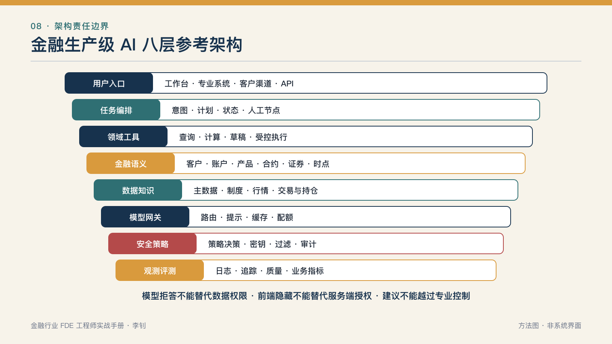

| 层级 | 主要能力 | 关键控制 |
|---|---|---|
| 用户入口 | 办公、业务系统、移动端、API | 身份、用途、会话与反馈 |
| 任务编排 | 意图、状态、人工节点、超时 | 自主等级、步骤、预算与中止 |
| 领域工具 | 查询、计算、草稿、受控执行 | 服务端授权、幂等、限额、回执 |
| 金融语义 | 客户、账户、产品、交易、保单、组合 | 主标识、口径、时点、所有者 |
| 数据知识 | 文档、市场数据、交易事实、向量与图谱 | 分类分级、血缘、权限、新鲜度 |
| 模型网关 | 路由、提示、缓存、配额 | 白名单、数据等级、成本、退出 |
| 安全策略 | 策略决策、脱敏、密钥、审计 | 默认拒绝、职责分离、第三方隔离 |
| 观测评测 | 日志、质量、漂移、业务与客户指标 | 联合版本、告警、回归与报告 |

八层可以由不同产品实现，但逻辑责任不能混淆。模型拒答不能替代数据层权限；前端隐藏按钮不能替代工具层授权；推荐理由不能替代账务事实；系统日志不能替代业务证据与审批留痕。

### 7.2 工作流优先，智能体按需

金融流程多有明确节点、审批和异常路径。只有当步骤需要根据上下文动态选择、信息不完整且工具组合变化时，才适合智能体；稳定流程通常更适合确定性工作流，在局部节点加入 AI 理解或生成。

| 自主等级 | AI 权力 | 适用任务 | 默认控制 |
|---|---|---|---|
| A0 检索 | 只提供受控事实和来源 | 制度、产品、研究资料 | 权限过滤与版本有效性 |
| A1 建议 | 形成分析或提醒 | 高风险决策辅助 | 专业人员独立判断 |
| A2 草稿 | 创建报告、待办或业务草稿 | 授信报告、理赔预审、信披准备 | 逐项确认与差异展示 |
| A3 受控执行 | 在低风险规则内调用工具 | 内部通知、材料归档、低风险任务 | 限额、幂等、抽检、回滚 |

R4 动作不因模型能力提高就自然进入 A3。自主程度由业务责任、客户影响和可恢复性决定，而非模型参数。

### 7.3 工具契约决定风险半径

合格工具包含：稳定名称、明确目的、结构化参数、调用者身份、客户或业务范围、数据时点、权限、输入校验、确定性状态、错误码、超时重试、幂等、审计、版本和责任人。

不要向模型提供任意 SQL、任意交易接口或通用文件导出。应提供窄工具，如 `get_policy_coverage_snapshot`、`compare_portfolio_limit`、`create_research_review_draft`。工具说明同时写明“何时不得调用”。

写操作采用“预览—确认—执行—回执”：展示将要改变的对象和差异；由有权人员确认；携带幂等键执行；返回源系统编号和审计编号。状态不明时先对账，不能让模型猜测是否成功。

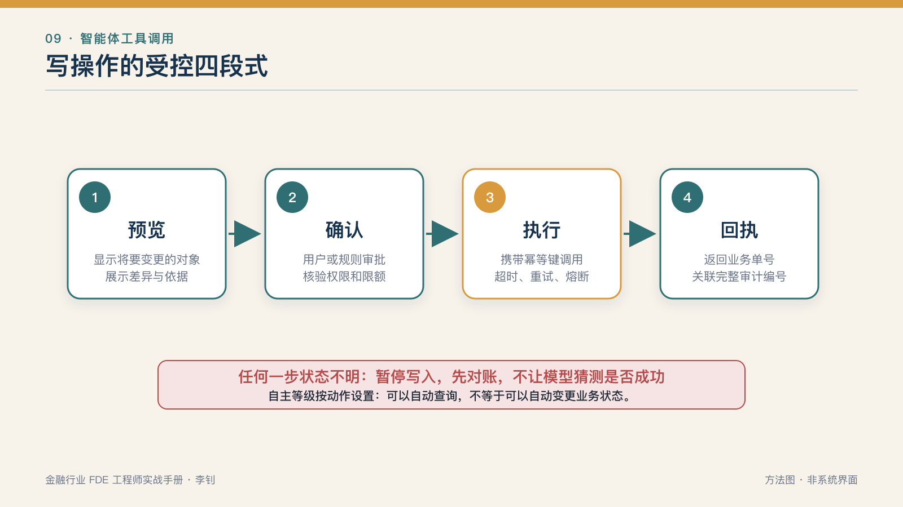

### 7.4 模型路由与机构可控

模型网关按数据等级、任务类型、风险、质量、时延、成本和可用性路由。复杂分析可用能力更强的获批模型，高频分类可用小模型，敏感任务进入受控环境。核心资产不被单一模型吞没：提示和规则版本化；工具协议独立；知识保留原文与元数据；评测集由机构掌握；会话与审计采用中立格式；关键业务规则放在策略或代码中。

模型切换不是简单替换接口。候选模型需要在同一黄金集、同一工具模拟、同一安全与公平样本上比较，并评估输出风格变化对人工复核和客户沟通的影响。

### 7.5 与专业系统的联邦控制面

横向工作台、信贷系统、交易系统、保单理赔、组合管理和估值系统并存时，应共享：机构身份与组织目录；工具与数据产品注册表；策略决策点；模型网关；评测观测平台；审计总线；事件与退出控制。

专业系统定义业务对象、时点、状态和最终动作；横向工作台负责任务编排与材料协作，不复制交易规则。工具始终以终端用户身份和明确目的鉴权，不能用平台高权限服务账号代替用户授权。

### 7.6 非功能目标必须可测试

至少定义可用性、P95 时延、峰值并发、RTO、RPO、单任务成本、日志保存、漂移检查、依赖降级、人工支持和关键时段冻结窗口。对金融场景还要定义开市、估值、日终、月末或监管报送窗口的特殊 SLO。

例如：“交易日 9:00—15:30，研究资料问答 P95 小于 8 秒；模型不可用时切换批准的只读检索模式；任何组合或交易工具异常均停止写入；日终估值窗口禁止未经审批的模型、规则和知识变更。”这才可验收。

## 第八章　金融数据、知识与系统集成

### 8.1 先建立用途—数据—责任三联单

每项数据使用都应关联业务目的、允许字段、处理位置、使用角色、保存期限、第三方和删除方式。数据可获得不等于可以用于该模型；业务认为有价值不等于用途正当；合规批准某类使用也不代表技术系统已实施最小权限。

建议为每个场景维护三联单：

| 维度 | 必填内容 |
|---|---|
| 用途 | 任务、客户影响、允许推断、范围外 |
| 数据 | 来源、字段、等级、时点、质量、血缘、保留 |
| 责任 | 业务、数据、系统、模型、合规和运维 Owner |

银行保险机构的数据安全规则对自动化决策、模型算法统一管理、准入、可验证可审核可追溯、数据安全审查、解释和退出提出要求。FDE 应把这些要求转为台账、网关、评测、日志和演练，而不是只写进制度。参见[银行保险机构数据安全管理办法](https://www.nfra.gov.cn/cn/view/pages/ItemDetail.html?docId=1192311&itemId=928)。

### 8.2 金融主数据与时间语义

跨系统最先统一的对象通常包括客户、账户、产品、合同、企业、受益所有人、保单、标的、证券、组合、机构和员工。每个对象定义机构主标识、源系统映射、关键属性、状态含义、数据时点和 Owner。

金融语义离不开时间。余额是哪个时点，持仓是交易日还是结算日，产品风险等级何时生效，保单在出险时是否有效，征信与财报的有效期如何计算。工具返回值必须包含 `as_of_time`、口径和来源；模型不得用最新数据回写历史判断，也不得用过期事实解释当前决策。

### 8.3 RAG 是效力与权限工程

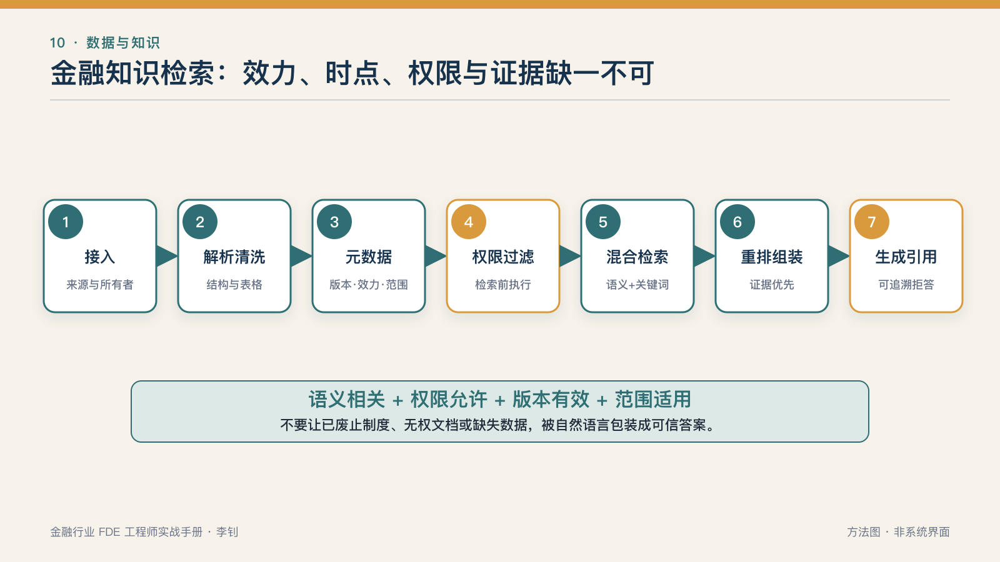

金融知识至少保留：发布机构、文号或制度编号、版本、效力状态、生效与失效日期、适用法人和条线、产品与客户范围、数据等级、附件关系和替代文件。纯文本相似会把征求意见稿、旧制度、培训材料和现行规则混在一起。

正确性来自“语义相关 + 权限允许 + 版本有效 + 范围适用 + 时点一致”。同步失败时，系统应明确提示知识可能过期并限制高风险结论；不能继续无提示回答。

### 8.4 权限过滤在检索和工具之前

系统先将用户映射为法人、机构、部门、岗位、客户关系、产品与数据域，再查询数据和检索文档。索引可以共享，结果必须按 ACL 或属性策略过滤；缓存键包含权限与用途上下文；临时上传默认不进入公共知识库，也不用于训练。

客户、账户、财产、健康、交易和位置等信息可能具有较高敏感性。提示、输出、日志、追踪、缓存、评测与备份必须分别定义是否保存、保存什么和谁可访问，不能把“正文脱敏”当作全链路完成。

### 8.5 典型系统与接入方式

| 行业 | 关键系统 | 首选接入 | 不宜做法 |
|---|---|---|---|
| 银行 | 核心、信贷、客户、支付、AML、影像 | 受控 API、事件、数据产品 | 直连核心账务库、共享高权账号 |
| 证券 | 账户、交易、行情、研究、合规、清算 | 只读快照、事件、专业工具 | 让生成式模型直接提交交易指令 |
| 保险 | 保单、理赔、影像、渠道、反欺诈 | 保单快照、影像服务、草稿接口 | 将拒赔结论交给黑盒评分 |
| 基金资管 | 投研、组合、交易、估值、TA、信披 | 市场数据快照、限额工具、草稿流 | 绕过投资指令和交易控制 |

API 适合实时查询和稳定写入；事件适合状态变化触发；批量文件适合老系统周期对账；RPA 只作为有退出日期的过渡层。所有写入都要在源系统对账，所有市场和估值数据都要带供应商、授权和时点。

### 8.6 数据质量闭环

把“客户映射失败”“财报口径冲突”“行情延迟”“保单状态不一致”“规则版本缺失”“员工纠正”结构化记录，按源系统、对象、产品与责任团队聚合。数据修复后，相关评测样本自动回归。AI 项目不仅消费数据，也应把“数据很乱”转成可分派、可衡量、可验证的治理需求。

## 第九章　模型风险、评测与价值证明

### 9.1 三本账：场景、模型与证据

没有台账，就无法回答“谁批准了哪个模型在什么场景使用”。

- 场景账：任务、风险级、客户影响、Owner、自主等级和上线范围。
- 模型账：模型与版本、来源、用途、数据等级、验证状态、限制和退出方案。
- 证据账：样本、指标、失败、审批、线上表现、漂移、投诉和整改。

模型风险管理不只覆盖传统评分卡。只要算法输出会实质影响业务判断、客户权益或重要流程，就应按机构制度进入相应台账和治理；“只是大模型助手”不能成为豁免理由。

### 9.2 黄金集必须来自真实任务

样本覆盖常见、困难、边界、异常、对抗和关键少数。每个样本包含输入、必要上下文、数据时点、期望行为、禁止行为、评分标准、客户影响和专业解释。对争议样本先统一业务规则，不要强迫模型学习尚未达成共识的答案。

评测集由机构掌握。供应商可协助构建，但应能导出、版本化并跨模型运行，否则平台切换后无法判断能力退化。

### 9.3 七维评测体系

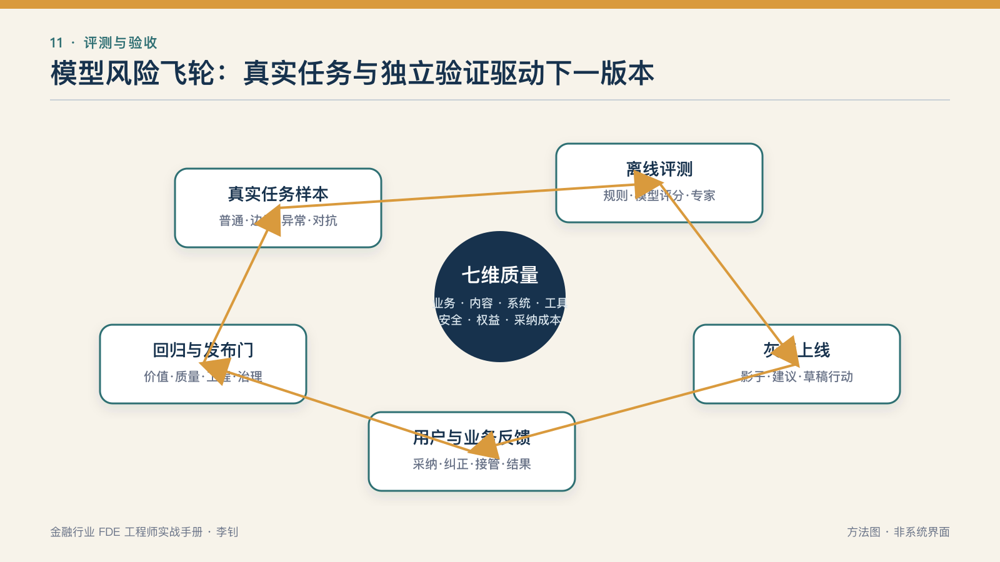

| 维度 | 关注问题 | 示例指标 |
|---|---|---|
| 业务结果 | 是否改善完整任务 | 周期、积压、返工、损失避免 |
| 内容证据 | 是否正确、完整、可追溯 | 专家评分、引用覆盖、时点一致 |
| 模型行为 | 是否稳定、可解释、无异常漂移 | 分层效果、拒答、漂移、鲁棒性 |
| 工具执行 | 是否选对工具并正确调用 | 参数、授权、重复写入、对账 |
| 安全合规 | 是否守住数据、权限和内容边界 | 越权、泄露、注入、禁用动作 |
| 公平与客户 | 是否造成不合理差异或误导 | 群体差异、解释、投诉、转人工 |
| 采纳经济性 | 是否进入工作且值得运行 | 有效任务、复核负担、单任务总成本 |

关键少数采用门槛而非平均分。例如未经授权客户数据暴露、错误交易、错误放款、自动拒赔、错误净值发布应为零；一般内部摘要可以容忍可纠正的表达差异。

### 9.4 规则、模型评分、专家与独立验证

规则适合检查格式、字段、引用、工具参数和禁止动作；模型评分适合大规模比较相关性和完整性，但必须以人工样本校准；业务专家判断专业可用性；模型风险或独立验证人员检查设计、样本、方法、局限和剩余风险。

推荐顺序：规则筛硬失败；经校准的模型评分扩大覆盖；专家评审高风险语义；独立验证挑战开发团队假设。若专家一致性低，先修正流程与评分标准，不能把分歧平均成一个漂亮分数。

中国人民银行现行推荐性行业标准包括《人工智能算法金融应用评价规范》和《金融领域科技伦理指引》，可作为机构设计评价与伦理治理框架的参考。参见[JR/T 0221—2021](https://cfstc.pbc.gov.cn/bzgk/detail/?bzId=1912&id=0)与[JR/T 0258—2022](https://cfstc.pbc.gov.cn/bzgk/detail/?bzId=1983&id=3)。

### 9.5 离线、影子、灰度与持续监测

离线评测比较模型和版本；影子模式在不影响真实决策的情况下生成结果；建议模式由用户独立判断；草稿模式允许进入待审流程；受控执行只用于低风险规则范围。每次升级必须有清晰证据，不从演示直接跨级。

上线后监测数据分布、检索命中、拒答、工具选择、人工修改、群体差异、投诉、市场状态和业务结果。漂移可能来自模型，也可能来自产品、政策、客户结构、市场行情或源系统口径变化。

### 9.6 价值台账与归因

价值台账包括任务量、原工时、新工时、复核工时、返工、系统与模型成本、实施维护、培训、投诉、风险事件和产能用途。节省时间不自动等于裁员收益，更可信的表达是积压减少、响应加快、覆盖扩大、专家时间释放或损失避免。

示意：某流程月均 1500 笔，原资料准备 45 分钟，AI 整理 5 分钟、人工复核 20 分钟，净节省 20 分钟，月释放约 500 小时。只有质量、客户权益和风险未恶化，且这些时间被用于更高价值工作，才构成业务价值。

### 9.7 四道发布门

- 价值门：业务 Owner 确认问题仍重要，真实任务显示改善。
- 质量与模型门：黄金集、关键少数、独立验证和已知限制可接受。
- 工程与韧性门：容量、权限、监控、对账、回退和人工流程可运行。
- 治理门：数据、合规、消保、安全、模型风险和业务责任完成确认。

任一门未通过，应缩小范围、降低自主等级或延后；不能用会议纪要把风险改名为“后续优化”。

## 第十章　安全、合规与负责任金融 AI

### 10.1 先画监管与制度适用地图

金融 AI 同时受到网络与数据、个人信息、行业监管、客户或投资者保护、模型和科技治理、业务连续性、第三方外包以及机构内部制度约束。FDE 不自行下法律结论，而是在章程中列出服务对象、机构类型、业务动作、数据、模型来源、部署、内容去向和客户影响，请责任部门判断，并将结论转成控制和测试。

| 领域 | 银行/保险重点 | 证券/基金重点 | 工程落点 |
|---|---|---|---|
| 数据与隐私 | 数据分类、自动决策、个人信息 | 客户与经营数据、最小权限 | 用途、字段、权限、日志、删除 |
| 信息科技 | 操作风险、韧性、外包 | IT 治理、重要系统、网络信息安全 | 环境隔离、变更、审计、应急 |
| 客户权益 | 消保、产品适当性、保险销售 | 投资者适当性、基金销售 | 解释、匹配、人工服务、留痕 |
| 专业业务 | 授信、支付、理赔、反洗钱 | 交易、研究、估值、信披 | 最终动作归专业系统和授权人 |
| 生成内容 | 公众服务、内容标识、备案判断 | 对外材料与传播 | 标识、审核、元数据与发布控制 |

### 10.2 数据与自动化决策底线

项目至少对照《个人信息保护法》《数据安全法》和行业数据规则，回答：数据属于何种等级；处理目的是否合法、明确、最小；是否涉及敏感个人信息或自动化决策；谁能查看原文、提示、输出、参数和追踪；第三方是否留存或训练；到期如何删除；个人或客户如何获得解释、纠正和人工渠道。

银行保险机构数据安全规则明确要求模型算法统一管理、外部引入准入、可验证可审核可追溯、投用前数据安全审查、人工智能应用解释与风险缓释，并要求准备退出替代方案和安全演练。FDE 应在系统里提供模型台账、数据使用记录、解释材料、实时监测、停止按钮和人工替代流程。

### 10.3 适当性、消保与专业责任

金融机构产品适当性管理强调了解产品、了解客户和适当匹配；证券期货投资者适当性制度强调经营机构义务与投资者保护；保险销售也有分类分级、需求和支付能力等要求。AI 可以核对信息、提示缺失和生成说明草稿，但不能把复杂责任压缩为一个不可解释分数，更不能诱导用户绕过风险评估。

高风险界面至少展示：事实来源、规则版本、模型建议、不确定项、人工修改、最终决定人和时间。对客户输出要区分事实、一般说明和个性化建议，并提供转人工与纠错途径。

### 10.4 模型与生成内容治理

若服务面向境内公众，应核验《生成式人工智能服务管理暂行办法》等规定的适用性；《人工智能生成合成内容标识办法》自 2025 年 9 月 1 日起施行，对适用服务的显式、隐式标识和传播提出要求。金融机构内部材料一旦进入对客、营销、研究发布或公开披露链路，也要由主管人员判断标识、审核、备案或登记要求。参见[生成式人工智能服务管理暂行办法](https://www.cac.gov.cn/2023-07/13/c_1690898327029107.htm)与[生成合成内容标识办法](https://www.cac.gov.cn/2025-03/14/c_1743654684782215.htm)。

### 10.5 AI 特有威胁与纵深防御

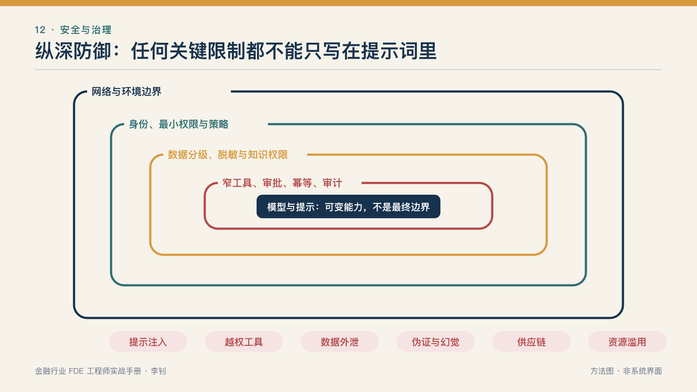

| 威胁 | 金融表现 | 主要控制 |
|---|---|---|
| 提示注入 | 文档诱导泄露客户或绕过规则 | 内容隔离、指令分层、工具授权 |
| 数据外泄 | 提示、缓存、日志、批量导出泄露 | 分级、最小化、脱敏、异常检测 |
| 越权工具 | 读取他行/他客数据或错误写入 | 服务端鉴权、客户范围、审批与限额 |
| 幻觉与伪证 | 编造法规、行情、客户事实或引用 | 证据约束、时点、拒答、人工复核 |
| 偏差与不公平 | 对特定群体产生系统性不利影响 | 分层评测、原因分析、人工申诉 |
| 资源与供应链 | 无限循环、依赖污染、模型暗更 | 配额、签名、白名单、版本冻结 |

任何关键限制都不能只写在提示词里。每个生产能力必须有可演练的停止按钮：撤销凭证、关闭写操作、切换只读、停用模型或知识源、终止长任务，并确认止损生效。

### 10.6 第三方与退出

合同与技术方案至少约定数据用途、位置、留存删除、是否训练、分包商、漏洞和事件通知、监管和审计配合、模型与接口变更、服务水平、资产导出、业务连续性和终止处理。机构自有资产包括场景、规则、知识原文、工具协议、评测集、反馈、审计和运维手册。

退出不是合同末尾一句话。项目应实际演练：替换模型；停用连接器；导出专家、Skill、知识和评测；吊销凭证；验证备份与派生索引删除；回到人工流程。没有演练的退出条款不可证明。

### 10.7 金融生产地形：三道防线、信创、韧性与监管检查

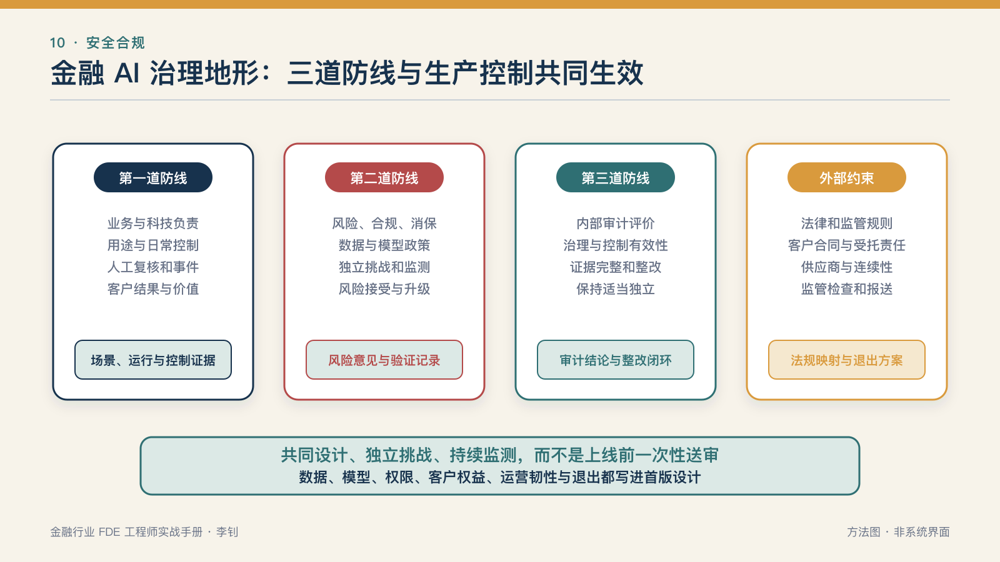

金融项目从首版方案就要纳入：一线业务与科技的日常控制；模型风险、合规、消保和安全的第二道监督；内审的独立检查；信创或目标基础设施适配；生产与测试隔离；关键时段容量；业务连续性；外包和监管延伸检查。

对证券基金经营机构，信息技术治理、重要系统上线变更、开发测试隔离、可审计、数据分类和最小权限等要求直接影响 AI 工程。参见[证券基金经营机构信息技术管理办法](https://www.csrc.gov.cn/csrc/c106256/c1653896/content.shtml)与[证券期货业网络和信息安全管理办法](https://www.csrc.gov.cn/csrc/c100028/c7202729/content.shtml)。

成熟方案不是给通用蓝图贴“金融合规”标签，而是从责任体系、目标环境、业务窗口和监管证据中生长出来。

## 第十一章　上线运营与规模复制

### 11.1 五条生产观测链

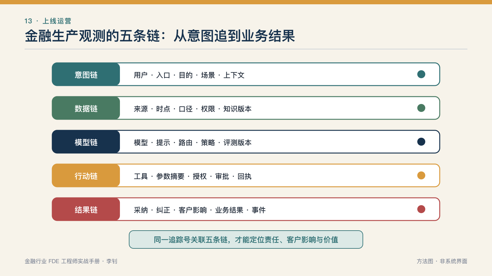

- 意图链：用户、入口、客户或业务对象、目标和用途。
- 数据链：来源、字段、时点、权限、检索与数据质量。
- 模型链：模型、提示、知识、参数、策略和验证版本。
- 行动链：工具、参数摘要、授权、人工审批和业务回执。
- 结果链：采纳、修改、客户影响、业务结果、投诉和风险事件。

不要求记录模型私有思维过程，但必须保留足以复现业务结果的输入摘要、证据、版本、策略和动作。日志也遵循最小化，不能以可观测为名无节制保存客户正文。

### 11.2 运营看板不只看调用量

| 类别 | 关键指标 |
|---|---|
| 可用与韧性 | 成功率、P95、依赖失败、RTO、人工回退时间 |
| 内容与模型 | 任务完成、引用、关键样本、漂移、专家抽检 |
| 工具与数据 | 授权失败、空值、延迟、重复写入、对账差异 |
| 安全合规 | 越权、敏感命中、注入、异常导出、红队结果 |
| 客户权益 | 解释、转人工、投诉、适当性偏差、群体差异 |
| 采纳成本 | 有效任务、修正、接管、复核时间、单任务成本 |
| 业务价值 | 周期、积压、服务量、损失避免、质量改善 |

调用量上升可能说明价值，也可能说明用户反复重试。必须与任务完成、人工复核和业务结果关联。

### 11.3 事件分级与止损

P0 可包括大规模客户数据泄露、错误资金或交易动作、错误放款、错误拒赔、错误净值或公开披露；P1 包括关键业务窗口不可用、关键样本显著退化或大量错误建议；P2 包括局部功能与体验问题。每一级明确通知、报告、止损、证据保存、客户沟通与复盘。

回退可能是关闭写工具、切只读、停用模型、恢复人工、撤销策略或暂停入口。事件演练要覆盖模型不可用、知识过期、市场数据延迟、源系统部分成功、批任务重复和审批堆积。

### 11.4 联合版本与变更控制

一次结果同时受模型、提示、知识快照、检索配置、工具、数据口径和策略影响。发布记录把它们绑定为联合版本。模型或供应商后台策略变化也属于业务变更；高风险场景不得无评测自动跟随。

标准变更具有自动回归和低风险窗口；正常变更需要评审、灰度与回退；紧急变更用于止损，事后补齐证据。市场开盘、估值和监管报送等关键窗口应设变更冻结规则。

### 11.5 从一个场景复制到五类机构

规模复制不是复制代码，而是复制经验证资产：

- 场景包：任务、风险级、流程、人机分工与价值模型。
- 工程包：架构、工具、数据语义、部署和监控。
- 模型质量包：模型卡、黄金集、独立验证、红队和发布门。
- 合规运营包：用途、权限、培训、事件、客户权益和退出。

复制前区分不变量与本地变量。引用、鉴权、工具契约和评测方法可能通用；法人、产品、客户范围、规则、组织权限、市场时点和监管口径必须本地化。

### 11.6 FDE 如何反哺产品

有效反馈不是“客户希望更智能”，而是：哪个岗位在何种任务中，因为哪条数据、权限、工具、模型或制度约束失败；频次和影响多大；临时方案是什么；哪些机构重复出现；适合产品化为连接器、策略、评测、界面还是文档。

当多个项目重复实现客户权限、来源引用、双人复核、模型台账或生成内容标识时，FDE 应推动它们进入平台能力。长期价值是让下一次交付不再从零开始。

## 第十二章　银行案例：对公授信尽调与审查助手

银行场景最能检验 FDE 是否真正理解“辅助判断”和“替代决策”的区别。对公授信包含材料收集、主体核验、财务分析、行业研究、关联关系识别、风险提示、审查审批和贷后管理。它知识密集、数据密集，也直接影响客户权益与银行资产质量。因此，本章案例把 AI 限定为**尽调与审查辅助**：负责找、读、比、算、引和提示，不决定是否授信，不生成不可解释的额度，不绕过审查审批。

> **案例说明**　本章为多个项目经验抽象而成的脱敏复合案例，数字用于说明验收方法，不代表特定银行的实际表现。


### 12.1 业务问题不是“写一份报告”

某全国性银行分行的公司客户经理每月处理大量新增与续授信。材料分散在客户提交文件、信贷系统、财务报表、工商信息、征信摘要、行业研究和内部制度中。审查人员最耗时的并非写作，而是确认材料是否齐全、口径是否一致、异常是否有解释、结论是否有依据。

最初需求写成“用大模型自动生成授信报告”。FDE 驻场后把它拆成七个可验证任务：

1. 按客户类型和授信品种检查材料完整性；
2. 提取报表科目并执行跨期、勾稽和单位检查；
3. 对照内部制度与行业规则形成核查清单；
4. 汇总经营、股权、诉讼和关联关系证据；
5. 标识异常、冲突、缺失和需要人工确认的信息；
6. 生成结构化尽调底稿与审查意见草稿；
7. 将每项结论链接到原文、数据时点和责任人。

拆分之后，自动化边界才清楚：系统可以检查“是否满足既定规则”，却不能把历史相关性包装成授信因果，更不能代替有权审批人承担信用决策责任。

### 12.2 场景卡与风险分级

| 项目 | 定义 |
|---|---|
| 发起人 | 客户经理或审查人员 |
| 主要输入 | 申请材料、经审计报表、征信摘要、内部制度、行业数据、系统字段 |
| 主要输出 | 材料缺口、财务核验、风险证据、问题清单、报告草稿 |
| 决策影响 | 影响授信审查，但不得直接形成审批结论或额度 |
| 风险级别 | 通常为 R3；涉及自动拒绝、额度或价格则提升为 R4 并默认禁止 |
| 人工控制 | 客户经理确认事实，审查人复核分析，有权审批人作最终决定 |
| 追溯要求 | 输入版本、数据时点、规则版本、引用片段、人工修改与审批完整留痕 |
| 回退路径 | 关闭生成与工具调用，恢复原信贷流程和人工模板 |

适当性与公平性也不能被忽略。即使对公客户并非个人消费者，模型使用区域、规模、行业等变量时仍可能形成不合理代理变量。FDE 应组织风险、合规和业务团队检查特征用途，避免将可疑相关性固化为差别待遇。

### 12.3 生产方案：证据先于文本

生产流程采用“读取—核验—计算—提示—成稿—复核”六步：

1. **受控读取。** 通过服务身份读取已授权客户与授信任务，禁止用户在通用对话中任意拼接客户号。
2. **文档解析。** 对扫描件执行版面识别、表格定位和页码锚定；低置信字段进入人工校正队列。
3. **事实核验。** 统一币种、单位、会计期间与合并口径，执行报表勾稽和跨源一致性检查。
4. **规则检索。** 先按机构、产品、客户类型、效力时间和权限过滤制度，再生成核查清单。
5. **受控生成。** 事实、推断和建议分栏；缺少证据时输出“待补材料”，不自动补全。
6. **双人复核。** 客户经理确认材料和事实，审查人员确认风险解释；审批仍在信贷系统完成。

写入信贷系统时仅允许保存草稿、问题项和引用索引。工具契约要求 `case_id`、`customer_id`、`source_version`、`operator`、`idempotency_key` 和审批状态；若源材料发生变化，旧草稿自动标记为过期。

### 12.4 黄金集与验收门槛

试点黄金集不应只收“标准好案例”。建议至少覆盖：正常续授信、首次授信、集团客户、跨期口径变化、报表单位错误、扫描质量差、同名主体、制度版本冲突、材料缺页、经营异常、人工结论争议和系统超时。

| 验收维度 | 代表性指标 | 建议门槛 |
|---|---|---|
| 材料完整性 | 必需项召回率、误报率 | 关键材料漏检为零，其他按基线改善 |
| 财务核验 | 金额、单位、期间与勾稽准确率 | 关键字段接近确定性规则水平 |
| 证据质量 | 关键结论可引用率、引用一致性 | 100% 有证据要求的结论可追溯 |
| 风险提示 | 专家确认的召回率与精确率 | 分层设门槛，不以单一平均数替代 |
| 客户权益 | 不当代理变量、无依据负面判断 | 零容忍样本不得失败 |
| 运营价值 | 单案复核时间、退补次数、返工率 | 与试点基线比较并计入人工复核成本 |

### 12.5 一个失败样本如何变成资产

试点中，系统曾把“应收账款增长”直接解释为回款恶化。专家指出，客户处于项目集中验收期，且合同负债与现金流变化提供了另一种解释。团队没有只修改提示词，而是完成四项修正：新增行业与合同阶段字段；要求生成多个解释并列出证据；把单指标负面定性列为禁用模式；将该案加入反事实黄金集。

这体现了金融 FDE 的基本纪律：错误不是一句“幻觉”，而要定位到数据语义、规则、检索、模型推理、工具或人工流程中的具体环节。

### 12.6 试点结果应怎样表达

可信的复盘可以写成：“在 60 个影子任务中，关键材料漏检为零；审查人首轮可采纳的风险提示占比由基线提升；单案机械核对时间下降；未发生自动审批、越权读取或无证据写回。”不应写“准确率 98%”而不说明样本、任务和错误后果。

上线后继续监测行业分布、材料模板、报表期间和制度变化。银行真正获得的不是一台“自动授信机器”，而是一套更一致、更可追溯、能持续学习的审查协作能力。

## 第十三章　证券案例：投研证据链与合规审查

证券机构同时面对时效与审慎两种压力：研究观点需要快速吸收公告、财报、调研纪要和市场数据，公开材料又必须控制事实、利益冲突、适当性、敏感信息和传播范围。FDE 的目标不是让模型“预测涨跌”，而是让研究与合规围绕同一证据包协同。

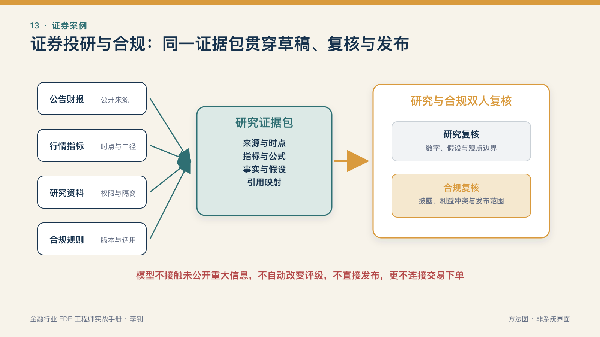

### 13.1 从万能研究助手改成四个受控任务

某证券研究团队希望自动形成公司点评。FDE 将需求拆为：

- 公告与财报差异提取：只处理授权来源，保留发布日期、报告期和页码；
- 指标归一与同业对比：明确复权、币种、会计口径和数据时点；
- 观点草稿：把事实、公司口径、分析师假设和情景推演分开；
- 合规预检：核对必备披露、禁限用表达、利益冲突和发布范围。

模型不接触未公开重大信息，不自动改变评级，不直接发布，不连接交易下单。若素材被标记为墙内、限制名单或权限不明，流程立即停止并转人工。

### 13.2 研究证据包

每份草稿绑定一个研究证据包：

| 资产 | 关键字段 |
|---|---|
| 来源清单 | 来源类型、发布主体、时间、链接或文档哈希、访问权限 |
| 指标表 | 指标定义、期间、币种、单位、计算公式、供应商时点 |
| 假设表 | 假设提出人、依据、敏感性、有效期、审批状态 |
| 引用映射 | 段落—结论—证据的双向关系 |
| 合规检查 | 规则版本、命中项、处置、复核人和豁免依据 |
| 发布记录 | 版本、受众、渠道、时间、审批链和撤回方式 |

“来源存在”不等于“结论成立”。FDE 要分别测量检索正确、数字一致、上下文支持和表达忠实。对于计算结果，优先由确定性代码执行并回传公式；模型负责解释，而非心算。

### 13.3 合规规则的工程化

合规规则不能只是一篇长提示词。应分成可版本化的策略：强制披露字段、敏感词与上下文、数字引用、评级变化审批、利益冲突声明、客户分类、传播渠道和生成内容标识。规则命中需要说明“哪条规则、哪段文本、为什么、怎样处理”。

高风险检查采用“规则引擎兜底 + 模型语义识别 + 人工审批”。确定性规则负责必备字段和禁止动作；模型识别隐含承诺、模糊事实与可能误导；合规人员处理语境和例外。模型不得自行放行自己的结果。

### 13.4 评测与时间一致性

证券场景必须防止未来信息泄漏。黄金集按历史时点冻结可用材料，评测时只能看到当时已经公开且有权访问的信息。数据集记录交易日、公告时间、市场开闭市状态和修订版本，避免把盘后公告用于盘中结论。

重点样本包括同名证券、复权差异、财报更正、口径调整、停复牌、非交易日、传闻、来源冲突、研究墙权限、图表数值不一致和撤稿。上线门槛单列：无来源数字、虚构引文、权限越界、自动发布和自动交易均为零容忍。

### 13.5 生产运行

每日开盘前冻结关键配置，盘中只允许经审批的紧急变更。数据延迟时界面显著显示时点；外部数据服务失败时不以缓存冒充实时值。发布后保留证据包、审批、收件范围和撤回能力，并对数字更正与规则更新触发回溯检查。

该案例的价值通常来自资料整理、数字核对与合规返工减少，而不是“提高预测准确率”。最可靠的产品定位是研究生产线的证据与质量控制层。

## 第十四章　保险案例：理赔材料预审与欺诈线索辅助

理赔连接客户最脆弱的时刻，也是金融 AI 最容易伤害信任的场景之一。材料复杂、条款专业、案件量波动和欺诈风险使其具备 AI 价值；错误拒赔、隐性歧视、隐私泄露和不可解释定性又使其必须保持严格人控。

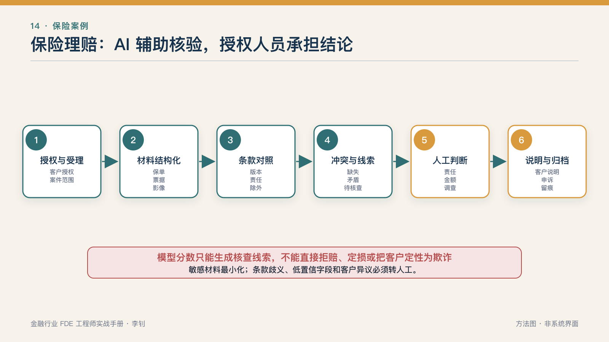

### 14.1 场景边界

一个稳健的理赔助手可以：识别材料种类与缺口；提取保单、事故、票据和医疗文书字段；对照责任、等待期、免赔额和除外责任；检查跨材料冲突；形成调查问题；为理赔人员生成带引用的案件摘要。

它不可以：仅凭模型分数拒赔；将相关性直接定性为欺诈；自动改变赔付金额；使用未告知用途的敏感信息；绕过客户申诉和人工复核；向不相关岗位展示健康或生物识别信息。

### 14.2 复合案例流程

某财产险机构选择“车险小额案件材料预审”作为首批试点。旧流程中，客服、查勘、理赔与反欺诈团队反复核对照片、发票、事故描述和保单责任。FDE 将流程设计为：

1. 受理时校验客户授权、案件与材料范围；
2. OCR 与多模态抽取生成字段置信度和原页锚点；
3. 确定性规则检查材料完整、保单状态和基础金额关系；
4. 检索与事故时点相匹配的条款版本；
5. 模型生成冲突项和调查建议，不生成欺诈结论；
6. 理赔人员确认责任和金额，特殊案件转调查或医学审核；
7. 客户收到可理解的补件或处理说明，并保留申诉入口。

### 14.3 欺诈线索的正确位置

欺诈模型输出应称为“线索”或“待核查信号”，不得成为自动拒赔理由。线索卡需要展示信号来源、数据时点、已知局限、相似但合理的解释和建议核查动作。高分不等于欺诈，低分也不代表无风险。

FDE 应重点检查代理变量：地区、设备、医院、职业或行为习惯可能与受保护或敏感特征相关。需要按产品、渠道、地区和客户群监测误报与转人工差异，并由合规、消保和业务共同评估是否构成不合理差别待遇。

### 14.4 条款与医学知识治理

保险知识检索首先解决效力：承保日期对应哪一版条款，批单是否覆盖主合同，特别约定是否优先，疾病定义采用何时标准。不同产品、地区和渠道的条款不得混检。医疗材料还要区分临床事实、编码、费用与模型推断；模型不得创造诊断。

关键结论至少引用保单或条款原文、案件材料与系统事实。若条款存在歧义或材料冲突，应生成“需授权人员判断”，而非选择对机构有利的解释。

### 14.5 验收与运营指标

| 类别 | 重点指标 |
|---|---|
| 抽取 | 关键字段准确率、低置信转人工率、页码锚点正确率 |
| 规则 | 材料缺口召回、条款版本匹配、金额计算一致性 |
| 权益 | 错误拒赔、无解释补件、申诉路径缺失、群体误报差异 |
| 效率 | 首次处理时长、补件轮次、积压、人工复核时间 |
| 风险 | 越权访问、敏感数据泄露、自动定性、重复赔付写入 |

事故发生率、产品结构和欺诈手法会变，模型与规则需要漂移监测。运营复盘既看发现多少异常，也看给客户带来多少不必要补件、等待和投诉。金融价值与客户权益必须在同一张看板上。

## 第十五章　基金与资产管理案例：研究、组合风控与信披协作

基金和资产管理机构的核心对象是产品与组合，核心约束是受托责任、投资范围、交易控制、估值核算、公平交易和信息披露。FDE 应把 AI 放在“研究与控制协作层”，让事实与限制更及时地到达人，而不是让模型直接下单或解释自己的违规。

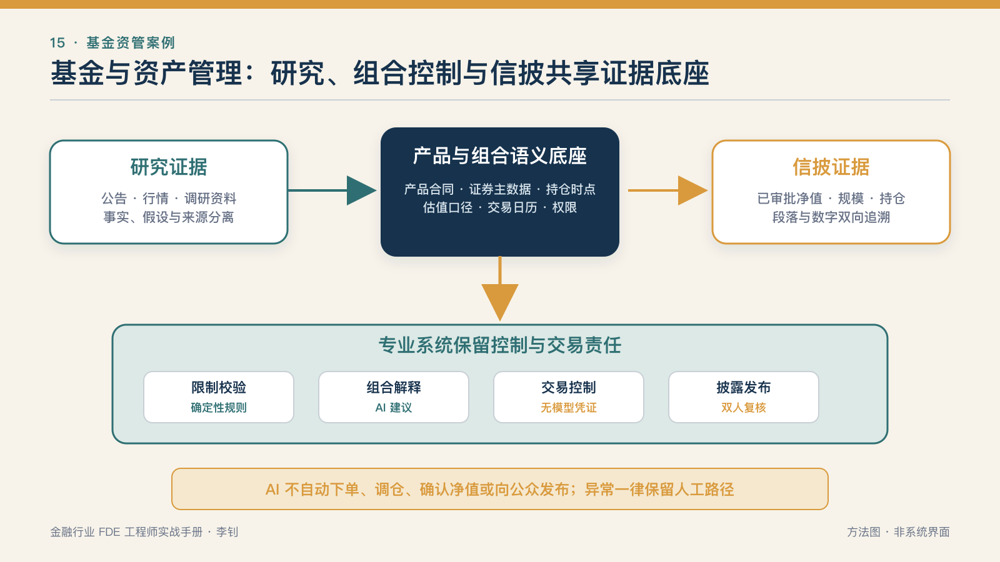

### 15.1 三条工作流、一个证据底座

第一条是研究：读取授权公告、调研资料与市场数据，形成公司、行业和主题研究底稿。第二条是组合风控：解释集中度、流动性、久期、杠杆、信用暴露和投资范围异常。第三条是信披协作：核对定期报告、临时公告和营销材料中的数据、时点与口径。

三条工作流共享证券主数据、产品合同、投资限制、估值口径、持仓快照、交易日历和来源索引，但权限不同。研究员不能因为 AI 入口而看到不应访问的组合；销售人员不能查询未公开持仓；外部模型不得接收限制数据。

### 15.2 投资限制必须由确定性控制执行

模型可以把合同条款翻译为候选规则并解释命中原因，但投资限制的生产执行应由经验证的规则或风控系统完成。规则至少包含对象、阈值、计算口径、生效时间、例外、处置和审批。AI 若发现文本与系统规则不一致，应创建核查任务，不能自行修改限额。

交易动作遵循最小权限：AI 无下单凭证；建议与指令分离；盘前、盘中和盘后控制归位到现有交易与风控系统；任何模拟结果清晰标识数据时点和假设。无法取得实时数据时，系统不得用昨日快照伪装当前状态。

### 15.3 净值与信披的证据链

净值、收益、规模和持仓相关文本必须以经确认的估值与核算结果为事实源。生成流程读取已封账或已审批版本，记录估值日期、币种、复权、费用和四舍五入口径。若源数据后续更正，系统能定位受影响段落和图表。

信披助手的输出分为三层：确定性数字与表格、带来源的事实叙述、需要投资经理或合规确认的解释。生成式模型不得自行创造业绩归因，不得将模拟收益表述为实际业绩，也不得自动向公众渠道发布。

### 15.4 代表性评测集

黄金集应覆盖：产品合同不同版本、跨市场节假日、停牌与估值调整、公司行动、债券违约与展期、衍生品名义本金、穿透计算、流动性压力、份额变化、净值更正、同名证券、公告更正和营销材料夸大表达。

评测不仅问“解释是否像专家”，还要问：使用的持仓是否属于该产品和时点；限制口径是否正确；数据是否已审批；是否暴露未公开信息；是否清楚区分事实、假设与建议；是否有安全的人工处理路径。

### 15.5 案例复盘

试点曾出现一条“单一发行人集中度偏高”提示。根因不是组合真实超限，而是主体映射没有处理基金穿透层级，且债券发行人与担保人关系被错误合并。团队修正主数据映射、为穿透深度加版本字段、把计算交给风控服务，并将该样本加入跨层级回归集。

这再次说明：金融 AI 的高质量来自语义、数据、规则、模型和人工职责共同正确，而非仅靠更大的模型。

## 第十六章　借助 WPS Comate 推动金融机构 AI 生产落地

WPS Comate 可以作为金融机构的横向业务入口与 AI 运行载体，由 FDE 把业务知识、系统数据、岗位 SOP、权限规则和评价标准装配成可使用、可考核、可运营的 AI 工作流。它适合靠近文档、表格、演示、会议纪要与团队协作；核心账务、信贷审批、交易、保单、估值和支付仍由专业系统掌握事实与交易。

> **目标架构**　专业系统负责事实、控制与不可逆交易；WPS Comate 负责理解、生成、协作和人机交互；FDE 负责把两者在权限、证据和运营约束下可靠连接。

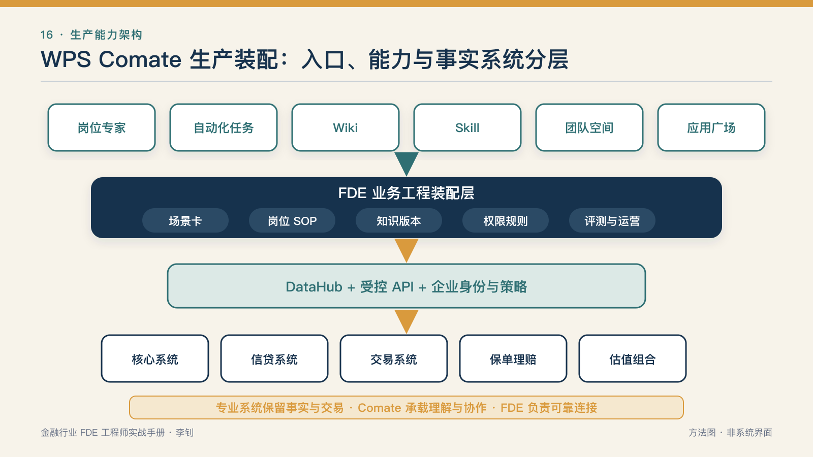

### 16.1 为什么 FDE 与 WPS Comate 互补

| 金融机构常见问题 | FDE 的作用 | WPS Comate 承载方式 |
|---|---|---|
| 业务人员说不清 AI 需求 | 驻场观察并拆解岗位任务 | 对话与原型应用 |
| 专家经验停留在人脑 | 抽取 SOP、规则与例外 | Skill、岗位专家 |
| 制度、产品和项目资料版本混乱 | 建立效力、权限与更新机制 | Wiki 知识库 |
| AI 读不到真实业务数据 | 定义口径、接口、用途和权限 | DataHub 与受控连接 |
| 演示能跑、生产不能持续 | 增加调度、复核、异常和回退 | 自动化任务 |
| 个人会用、组织不能复制 | 建立认证、模板和运营 | 团队空间与应用广场 |
| 模型成本与合规分散 | 设计模型路由、发布与下线 | Studio、模型和权限管理 |

Comate 解决产品载体与协作入口，FDE 解决最后一公里业务工程。平台能力仍应通过真实版本 PoC、部署方案与合同技术条款验收，不能仅依据宣传描述判断连接器、模型、数据边界和权限颗粒度。

### 16.2 What：交付六类生产资产

FDE 不应只交付提示词或聊天机器人，而应交付：场景与风险清单；带效力和权限的企业知识；固定输入、规则、输出与质量要求的 Skill；面向客户经理、研究、理赔、合规、运营等岗位的专家；带调度、通知、复核和异常处理的工作流；覆盖质量、采纳、成本、客户权益和风险事件的运营体系。

换句话说，交付对象从“一个模型”变为“一个可运营的 AI 岗位能力”。每项能力都有业务负责人、适用人群、数据用途、评测集、权限边界、联合版本、回退和下线条件。

### 16.3 Why：为什么不全部自研

若机构已经使用 WPS 365，Comate 靠近文档与协作，适合从一次性对话逐步升级为 Skill、岗位专家、Wiki 和自动化；团队可以共享经认证资产，避免经验停留在个人电脑；Studio、DataHub 与模型管理有助于统一发布、数据连接和模型策略。

但“少自研”不等于“少治理”。FDE 仍需验证身份映射、数据是否离开指定环境、知识检索前鉴权、日志能否满足审计、供应商变更如何通知、服务不可用如何退出。对于核心控制，更合理的是复用原有领域服务，而非在办公入口复制一套影子规则。

### 16.4 Who：责任矩阵

| 角色 | 主要责任 |
|---|---|
| 业务负责人 | 对业务规则、结果和资源投入最终负责 |
| FDE | 场景发现、流程建模、连接、评测、上线与运营 |
| 业务专家 | 提供 SOP、案例、例外与验收标准 |
| 科技与数据团队 | 接口、数据口径、身份、运行和韧性 |
| 风险、合规与消保 | 决策边界、客户权益、模型与内容规则 |
| 信息安全与法务 | 数据分级、供应商、审计和合同边界 |
| WPS 或实施团队 | 产品能力、部署、版本适配与疑难处理 |
| 一线用户 | 试用、反馈、标记错误并确认采纳 |
| AI 治理机构 | 决定高风险场景上线、自动化等级与退出 |

每个场景必须有业务 Owner，也必须有技术 Owner。前者承担价值与规则，后者承担运行与控制；任何一方缺席，项目都容易停在演示。

### 16.5 Where：优先场景

| 场景 | 推荐组合 | FDE 重点工作 |
|---|---|---|
| 制度与产品问答 | Wiki + 岗位专家 | 效力时间、产品范围、来源与权限隔离 |
| 授信尽调辅助 | Wiki + Skill + 专家 | 材料清单、财务核验、引用和审查分工 |
| 投研资料整理 | Wiki + Skill | 来源时间、数字口径、墙内墙外权限 |
| 理赔材料预审 | Skill + 岗位专家 | 条款版本、字段置信、转人工和客户说明 |
| 经营分析问数 | DataHub + 专家 | 指标口径、行列权限、查询验证和导出限制 |
| 合规审查 | Wiki + Skill + 自动化 | 规则版本、命中说明、审批与证据包 |
| 监管报送协作 | DataHub + Skill | 已审批数据、口径、差异检查和双人复核 |
| 汇报材料生产 | Skill + WPS 文档／演示 | 固定结构、引用、版式、审批和发布范围 |

首批场景优先选择文档密集、规则较稳定、可人工验证、错误可恢复的工作。付款、放款、交易、定价、拒赔、净值确认和正式披露等不可逆或高影响动作，默认只给建议并保留人工授权。

### 16.6 When：按成熟度选择模块

| 任务状态 | 推荐能力 |
|---|---|
| 临时探索、单次使用 | AI 对话 |
| 重复发生、规则基本稳定 | Skill |
| 依赖大量制度、产品和案例 | Wiki |
| 需要完整岗位工作台 | 岗位专家 |
| 读取核心、信贷、交易、保单或估值数据 | DataHub／受控 API + 专家 |
| 每日、每周、月末固定执行 | 自动化任务 |
| 多人接力与资产共享 | 团队空间 |
| 需要可视化操作和明确入口 | 应用 |
| 统一模型、权限、发布与下线 | Studio + 模型管理 |

正式启动前，流程要基本稳定，有真实代表样本，输出可由业务验收，负责人愿意投入，能够测量上线前后基线，且权限与安全边界可以定义。若数据口径混乱、流程每天变化、系统无可靠出口或无法定义“怎样算对”，应先治理流程与数据。

### 16.7 How：四阶段、十二周

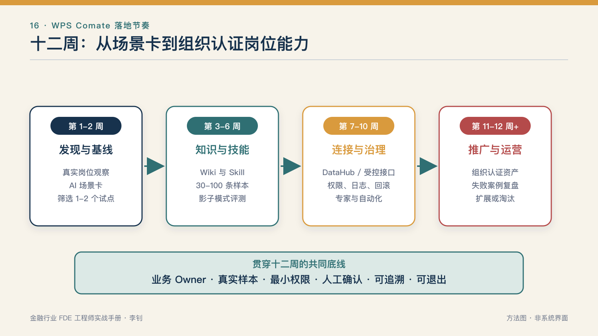

**第 1—2 周：场景发现与基线。** FDE 跟岗观察真实任务，形成 AI 场景卡，记录输入、步骤、专家判断、输出、错误后果、可自动环节和现有工时；用价值、可行性、风险与最小生产路径筛选一至两个试点。

**第 3—6 周：知识与技能试点。** 清洗制度、产品、模板和案例，建立带权限的 Wiki；把 SOP 写成 Skill；建立 30—100 条代表性样本；用影子模式生成结果，由业务专家评价事实、完整、引用、客户影响和可用性。

**第 7—10 周：连接与生产治理。** 通过 DataHub 或受控接口连接业务数据；配置部门、法人、产品和岗位权限；对敏感字段最小化；为关键输出加引用；对写回、发送和审批加人工确认；完善日志、联合版本、异常、幂等、回滚和退出。

**第 11—12 周及以后：推广与运营。** 认证合格 Skill，在团队空间共享；培训用户选择正确能力和承担复核责任；每周复盘失败案例，每月检查知识时效、模型成本、权限和客户影响；淘汰低价值能力，扩展高价值场景。

### 16.8 怎样判断真正进入生产

建议设置六类上线门槛：效率有可重复改善；首轮可采纳率达到业务约定；严重事实错误、越权和错误写回为零；关键结论有来源；试点用户形成稳定使用；单个合格成果的综合成本低于旧流程。具体数值必须依据机构基线、风险级别和任务类型设定。

只有同时具备“有人用、结果对、过程可控、经济上值得”，才能称为生产落地。调用次数、生成字数和演示效果都不能单独证明价值。

### 16.9 FDE 应坚持的三条原则

第一，先改造流程，再配置 AI。混乱流程接入 AI，只会更快地产生混乱。第二，先辅助判断，再逐步自动执行，按照问答、草稿、建议、人工确认执行、有限自动化逐级放权。第三，把每次失败转成评测样本、知识修订、Skill 规则、工具约束或权限限制。

最理想的结果不是一个“大而全的金融智能体”，而是一组小而可靠的岗位能力：每个能力解决明确问题，有确定输入、标准输出、业务负责人、评测集、权限边界和持续运营机制。

## 第十七章　九十天启动手册

九十天不是承诺完成全机构 AI 转型，而是验证一个受控场景能否稳定创造价值，并把方法固化为下一场景可复用的生产底座。周期从业务问题开始，以生产评审和下一阶段投资决定结束。

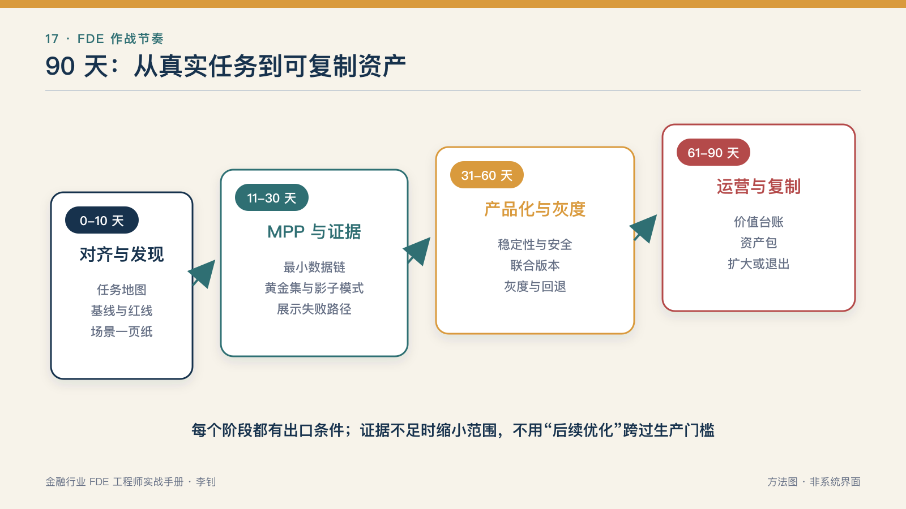

### 17.1 第 0—10 天：建立共同事实

第一周完成发起人与责任人确认、监管与内部制度初筛、数据用途说明、访问审批和当前流程观察。FDE 至少跟踪五个真实任务，记录等待、返工、交接、判断和异常，不用访谈印象代替事实。

第十天评审四项输出：一页场景卡、当前基线、风险初筛、最小生产路径。若业务 Owner 缺位、样本无法取得、任务结果无法验收或默认要求 AI 自动作高影响决定，应暂停而不是伪造进度。

### 17.2 第 11—30 天：做可否证的影子试点

建立第一版知识、工具契约和 30—100 条黄金集；在隔离环境运行影子任务。每次输出由专家评价，失败按数据、知识、检索、模型、工具、权限或流程分类。每周展示失败样本与修复证据，不用精选演示替代整体分布。

第三十天的退出问题是：“即使模型表现改善，这个场景是否仍值得做？”如果人工复核成本高于节省、数据长期不可得、错误后果无法控制或用户没有采纳意愿，应调整范围或停止。

### 17.3 第 31—60 天：接入生产约束

这一阶段把原型放进真实身份、权限、数据时点、制度效力和异常条件中。工作包括：服务身份与最小权限；检索前鉴权；字段最小化与脱敏；确定性计算服务；工具幂等、预览与确认；联合版本；监控、回退和退出；独立验证与安全测试。

第六十天评审三道门：模型质量是否越过门槛，工程与韧性是否可运行，风险与客户权益是否可接受。任何零容忍样本失败都应阻止进入灰度。

### 17.4 第 61—80 天：小范围灰度

选择经过培训且任务分布有代表性的用户，明确 AI 标识、复核责任和反馈渠道。灰度采用人机双轨：AI 结果与原流程并行，关键动作仍由原系统和授权人员完成。每日查看异常，至少每周召开业务、科技、风险与运营联合复盘。

灰度指标同时覆盖质量、周期、返工、采纳、复核、客户影响、成本和可用性。某项效率提升若以更多客户补件或合规复核为代价，不应计为净价值。

### 17.5 第 81—90 天：生产评审与复制决定

最终评审包应含场景与风险卡、架构、数据与模型台账、黄金集与独立验证、权限矩阵、工具契约、联合版本、监控阈值、事件与回退手册、用户培训、价值账和未关闭风险。

决策只有三类：满足门槛后受控上线；缩小范围继续验证；退出并沉淀资产。退出不是失败，它避免机构为无价值或不可控场景持续付费。

### 17.6 周节奏与可见交付

| 周 | 可见交付 |
|---|---|
| 1 | 利益相关方图、流程观察、数据与监管初筛 |
| 2 | 场景卡、风险级、基线、最小生产路径 |
| 3—4 | 知识样本、工具契约、黄金集、影子结果 |
| 5—6 | 错误分类、规则和语义修订、价值初测 |
| 7—8 | 权限、连接、日志、联合版本与异常演练 |
| 9 | 独立验证、安全测试、上线门评审 |
| 10—11 | 小范围灰度、用户培训、每日监控 |
| 12—13 | 价值账、风险接受、生产或退出决定 |

进度报告应以可验收资产为单位，而非“完成 80%”。金融项目的真正进展，是未知风险变少、责任更清楚、证据更完整。

## 第十八章　团队、组织与人才成长

金融 AI 生产落地无法由“懂模型的一小组人”单独完成。团队必须覆盖业务、工程、数据、模型风险、合规、消保、安全、运营和内审，并让前台、中台、后台对同一场景使用共同语言。

### 18.1 最小混编小队

一个首批试点的最小团队通常包括：业务 Owner、FDE、业务专家、数据／集成工程师、AI 工程师、模型验证或风险代表、合规／消保代表、安全代表和运营负责人。高风险场景增加法务、内审、隐私、精算、医学、信用审批或投资风控人员。

RACI 示例：

| 事项 | 业务 Owner | FDE | 科技数据 | 风险合规 | 运营内审 |
|---|---|---|---|---|---|
| 场景价值与规则 | A | R | C | C | C |
| 数据与接口 | C | C | A/R | C | I |
| 模型与评测 | C | R | R | A/C | I |
| 客户权益和上线边界 | C | C | I | A/R | C |
| 生产运行与事件 | C | C | R | C | A/R |
| 价值复盘与退出 | A | R | C | C | C |

R 表示执行，A 表示最终负责，C 表示协商，I 表示知会。实际矩阵应按机构三道防线和制度调整，尤其要保持独立验证与独立审计的客观性。

### 18.2 FDE 能力模型

金融 FDE 需要“梳子型”能力：一条横梁连接业务建模、系统工程、模型质量、风险治理和变更推动；若干齿深入一个或多个专业领域，例如授信、交易、理赔、合规或资管。

建议分四级成长：

- L1 能在指导下完成流程观察、样本整理、提示与基础评测；
- L2 能独立负责低至中风险场景，完成连接、权限、监控和灰度；
- L3 能主持跨部门高风险场景，设计控制、独立验证和退出；
- L4 能建立机构级平台与方法，推动标准化、人才梯队和投资组合治理。

晋升证据不是模型调用量，而是交付的业务结果、控制质量、事故与复盘、可复制资产和组织信任。

### 18.3 驻场的职业边界

FDE 靠近一线，但不能成为绕过制度的“万能特批”。不得共享个人账号、携出客户数据、把真实敏感材料送入未批准服务、代替有权人员审批，或为了演示关闭审计。遇到业务负责人要求越权时，应记录需求、解释后果、提供受控替代，并按机构治理路径升级。

### 18.4 培训不只教提示词

一线培训应回答五件事：哪些任务可以交给 AI；输出里哪些内容必须核验；哪里看来源和时点；什么情况下立即转人工；怎样反馈错误。管理者还需要理解价值基线、剩余风险、权限责任和停止条件。

技能认证可采用真实任务实操：给一份带陷阱的案例，要求用户发现过期制度、数据时点、无来源结论和越权动作。只有能正确接管，才算具备生产使用能力。

### 18.5 建立实践共同体

机构可设 FDE／AI 实践共同体，月度分享失败案例、评测资产、连接器、策略和监管变化。共同体不替代正式治理，而是让跨场景经验快速流动。优秀资产进入认证目录；重复问题进入平台路线图；过期 Skill 和知识明确下线。

## 第十九章　常见问题

### 19.1 战略与场景

**1．金融机构是否应该先建设一个统一大模型平台？** 先定义场景组合、风险分层和控制面，再决定平台范围。没有任务与责任的平台容易成为昂贵的模型入口。

**2．怎样选择第一个场景？** 优先文档密集、重复频繁、规则相对稳定、结果可人工验证、错误可恢复且有业务 Owner 的任务。

**3．客服问答是不是最容易？** 未必。它直接面向客户，涉及产品效力、适当性、隐私、营销表达和投诉，风险常高于内部辅助。

**4．能否用“节省人力”作为唯一目标？** 不宜。还要计入复核、异常、治理、模型和供应商成本，并同时观察质量、风险和客户权益。

**5．小模型还是大模型？** 按任务路由。分类、抽取和固定规则可用更小或确定性能力；复杂解释可用更强模型。选择需要由黄金集、成本、延迟与部署边界验证。

### 19.2 数据、知识与模型

**6．上传内部制度到知识库就完成 RAG 了吗？** 没有。还需清洗、切分、效力时间、产品与法人范围、权限、引用、更新、撤回和评测。

**7．为什么模型回答正确，仍不能上线？** 生产还要求身份、权限、时点、日志、韧性、人工接管、客户权益和退出机制正确。

**8．金融数据是否都不能进入外部模型？** 应按法律、监管、合同、数据分级、用途与批准部署判断。默认最小化，未经批准不得发送敏感或重要数据。

**9．怎样处理模型版本升级？** 将模型、提示、知识、规则、工具和数据口径绑定成联合版本，执行回归、灰度和回退；高风险场景不自动跟随。

**10．准确率达到 95% 可以上线吗？** 单一平均值不够。要看任务定义、样本覆盖、关键错误、群体差异、人工控制和业务后果。

**11．模型能解释就等于可解释吗？** 不等于。自然语言说明可能是事后编造。可解释性应来自数据、规则、来源、版本、行动与审批证据。

**12．如何避免知识过期？** 给文档设置 Owner、效力起止、复审日期和替代关系；源变更触发索引与回归，过期内容自动退出生产检索。

### 19.3 自动化与责任

**13．AI 能直接审批授信吗？** 本手册建议默认不能。若机构探索自动决策，需满足更严格的法律、监管、模型风险、公平性、解释、申诉和人工复核要求。

**14．AI 能自动下单或调仓吗？** 生成式模型不应持有交易凭证。投资限制、交易控制和授权继续由经验证的专业系统与有权人员执行。

**15．AI 能自动拒赔吗？** 不应仅凭模型建议拒赔或定性欺诈。应由授权理赔人员依据条款、事实和流程作出结论，并给客户解释与申诉路径。

**16．哪些动作一定需要人工确认？** 资金、交易、授信、价格、合同、拒赔、净值、正式披露、外发客户内容和高权限数据导出等高影响或不可逆动作。

**17．人工确认会不会抵消效率？** 好的设计把人工放在高价值判断和例外，而非逐字复核。若复核仍与原流程一样重，说明场景或控制设计需要调整。

**18．发生错误谁负责？** 业务、技术和治理责任不能转给模型。场景卡、RACI、审批、日志和事件机制应在上线前明确责任链。

### 19.4 合规、安全与监管

**19．怎样准备监管或内审检查？** 维护用途、数据、模型、规则、权限、评测、发布、事件、客户影响和供应商证据包，并能按一次结果回放。

**20．提示词注入只是技术问题吗？** 不是。它可能导致越权检索、错误工具调用和敏感导出，需要内容隔离、权限校验、工具白名单和监控共同防御。

**21．是否必须标识 AI 生成内容？** 面向公众或客户的内容应结合适用法规、渠道和机构政策落实显式或隐式标识；内部内容也应提示 AI 参与和复核责任。

**22．第三方供应商承诺不训练数据就够了吗？** 不够。还要核查处理地点、分包、保留、访问、加密、日志、事件通知、模型变化、删除证明、连续性和退出迁移。

**23．怎样处理个人信息最小化？** 从任务必要性反推字段，减少读取、展示、存储与传输；用途变化重新评审；日志也要避免记录完整敏感值。

**24．如何防止不公平或差别待遇？** 审查特征与代理变量，按客户群监测错误和转人工差异，设置申诉与复核，并让合规、消保和业务参与决策。

### 19.5 运营与推广

**25．试点很好，推广后为什么退化？** 真实用户、产品、渠道、时点和异常更复杂。应分层采样、灰度扩围、监测漂移并保留回退。

**26．用户抵触怎么解决？** 公开哪些职责不变、哪些任务会改变；让一线参与共创；把 AI 贡献显性化；提供技能迁移和清晰申诉，而非只做宣讲。

**27．入口应该统一还是专业化？** 采用联邦入口：统一身份、政策、目录和审计；专业系统保留领域上下文、控制与交易。

**28．如何衡量采纳？** 不只看登录或调用，要看任务完成、有效采纳、修正与接管、复核时长、质量和业务结果。

**29．何时应该停掉一个场景？** 价值长期不成立、风险无法降到容忍范围、数据无合法稳定来源、用户不采纳、复核成本过高或供应商无法满足退出要求时。

**30．FDE 如何避免成为长期人肉接口？** 把重复工作产品化为连接器、策略、评测、模板和运维手册；明确移交与服务边界，持续减少一次性定制。

## 第二十章　项目模板与检查清单

本章模板应纳入机构现有项目、模型风险、信息科技和合规流程。字段可以裁剪，但不应删除责任、依据、风险、验收和退出这五类核心信息。

### 20.1 AI 场景卡

| 字段 | 填写提示 |
|---|---|
| 场景／业务 Owner | 任务名称、法人、部门、最终负责人与技术 Owner |
| 用户与触发 | 谁在何种条件下发起，是否直接面向客户 |
| 当前流程与基线 | 输入、步骤、系统、耗时、质量、返工、成本和客户影响 |
| 目标输出 | 输出给谁、怎样使用、怎样验收 |
| 决策与权益影响 | 是否影响授信、交易、价格、理赔、适当性、净值或披露 |
| 数据用途 | 数据类别、来源、时点、必要性、权限、保留和跨境情况 |
| 监管与制度依据 | 外部法规、内部制度、产品合同及其效力版本 |
| 人机分工 | AI 可读、可建议、可写草稿、可执行到什么程度 |
| 错误与回退 | 关键错误、零容忍样本、转人工、回退和停止条件 |
| 价值假设 | 效率、质量、风险、客户与经济指标及其基线 |

### 20.2 风险与自动化分级卡

| 级别 | 典型影响 | 默认控制 |
|---|---|---|
| R1 | 内部低影响辅助，可轻易撤销 | 标识、基础日志、抽检 |
| R2 | 影响员工任务或内部管理 | 权限、引用、人工采纳、持续评测 |
| R3 | 影响客户、合规或重要经营判断 | 独立验证、强制复核、分层监测、事件与退出 |
| R4 | 资金、交易、授信、拒赔、净值或正式披露等重大影响 | 默认禁止生成式模型自主执行；需最高级治理批准与确定性控制 |

自动化级别另行记录：A0 只读问答，A1 生成草稿，A2 人工确认后执行，A3 在明确边界内有限自动。风险级与自动化级不能混为一谈，高风险场景即使是 A1 也需要严格治理。

### 20.3 数据卡与知识卡

```text
资产名称／Owner：
业务用途与合法性依据：
数据类别与敏感级别：
来源系统／接口／更新频率：
主体、产品、账户、时点与口径：
允许的用户、场景、模型与环境：
最小化、脱敏、保留和删除：
质量规则与异常处置：
知识效力起止／替代关系／复审日：
对外共享、分包与跨境情况：
审计日志与退出方案：
```

### 20.4 模型卡与联合版本卡

```text
模型／供应商／部署位置／版本：
批准用途与禁止用途：
输入输出数据边界：
训练或微调数据说明：
已知局限与高风险群体：
黄金集、指标、阈值与独立验证：
安全测试、压力测试与漂移监控：
解释、人工复核和客户申诉：
提示／知识／规则／工具／口径联合版本：
发布、回退、下线与替代方案：
责任人与复审日期：
```

### 20.5 工具契约

```text
工具名称与业务动作：
读取／写入对象：
调用身份与授权范围：
必填输入、类型、时点与校验：
返回值与错误码：
幂等键、重复调用和部分成功处理：
预览、人工确认与双人复核：
超时、重试、熔断与补偿：
审计字段与敏感日志处理：
速率、金额、客户或产品限额：
禁用、回退与应急联系人：
```

### 20.6 评测矩阵

| 样本 ID | 机构／产品／客户群 | 时点与版本 | 预期事实 | 预期引用 | 允许建议 | 禁止动作 | 客户影响 | 专家结果 |
|---|---|---|---|---|---|---|---|---|
| 示例 | 银行／公司授信／续授信 | T 日制度 V3 | 缺少审计报告 | 材料清单第 4 条 | 提示补件 | 自动拒绝 | 中 | 专家确认：通过 |

评测报告应同时呈现总体、关键样本、分群、失败类型和人工成本。每次生产事故与有效投诉都应转为新的回归样本。

### 20.7 上线评审清单

- [ ] 业务 Owner、技术 Owner 和三道防线职责明确；
- [ ] 场景风险与自动化级别获批，禁止用途已固化；
- [ ] 数据用途、最小权限、保留和第三方边界通过评审；
- [ ] 知识效力、引用和撤回机制可验证；
- [ ] 黄金集、独立验证、安全测试与关键门槛通过；
- [ ] 工具契约、幂等、人工确认和账务对账通过演练；
- [ ] 监控、事件、客户沟通、回退与退出经过演练；
- [ ] 用户知道 AI 边界、核验方法和转人工路径；
- [ ] 价值基线与综合成本可计算；
- [ ] 联合版本、审批证据和剩余风险完整归档。

### 20.8 监管与审计证据包目录

建议目录包括：场景用途；法律监管映射；数据流与权限；模型与供应商；知识与规则版本；评测与验证；发布与变更；客户告知、解释与申诉；运行日志与事件；价值与退出。一次结果应能从证据包反查到输入、来源、模型、工具、人工和业务结果。

### 20.9 周报模板

```text
本周已验收资产：
关键指标与基线变化：
新增失败样本及根因：
数据／模型／工具／权限变更：
客户权益与合规观察：
事件、近失和回退演练：
待决策风险（Owner／期限）：
下周验收目标：
```

## 第二十一章　术语表

**AML（反洗钱）**　识别、监测和报告洗钱及相关风险的制度、流程与技术体系。AI 可辅助线索整理，但处置责任仍归授权人员。

**AI 场景卡**　描述任务、责任、输入输出、风险、数据、验收、价值和退出的项目基准文件。

**A0—A3 自动化等级**　从只读问答、生成草稿、人工确认后执行到有限自主执行的分级。

**DataHub**　本书语境中指 WPS Comate 用于连接与使用组织数据的相关能力；具体范围以实际版本和部署验收为准。

**FDE（Forward Deployed Engineer）**　深入客户现场，把业务问题、数据、系统、模型和治理约束装配为生产能力的工程角色。

**KYC（了解你的客户）**　金融机构识别和持续了解客户身份、目的与风险的过程。

**RAG（检索增强生成）**　先检索受控知识或数据，再由模型基于证据生成结果的方法。

**R1—R4 风险级别**　按错误后果和决策影响对 AI 场景进行的分级；数字越高，控制越严格。

**Skill**　把固定输入、步骤、规则、工具、输出格式和质量要求封装成可复用任务能力。

**WPS Comate**　面向组织的 AI 办公与协作平台。本书将其定位为横向入口和运行载体，不替代金融核心专业系统。

**操作风险**　由不完善或有问题的内部程序、员工、信息科技系统以及外部事件造成损失的风险。

**穿透式权限**　在检索、生成和工具调用的每一层执行主体、法人、部门、产品、客户和字段权限，而非只在入口登录一次。

**独立验证**　由与模型开发和使用保持适当独立的人员，对用途、数据、性能、局限、控制和监测进行挑战与确认。

**风险提示／线索**　供授权人员核查的信息，不等于信用、欺诈、违规或投资结论。

**工具契约**　规范模型可调用动作的输入、身份、授权、校验、幂等、错误、审计、回退与限额。

**黄金集**　经业务专家确认、覆盖正常与异常分布、用于发布门和回归测试的代表性样本集合。

**回退（Rollback）**　在故障或风险上升时恢复到上一个稳定版本或人工流程。

**模型漂移**　输入、业务或模型行为随时间变化，导致生产表现偏离验证结果。

**模型风险**　模型设计、实现、使用或解释不当，或对模型理解不足而造成不利后果的风险。

**模型台账**　记录模型、用途、Owner、版本、数据、验证、风险、依赖、状态和退出的信息资产。

**目的限定**　个人信息或其他数据仅用于明确、合理、必要且获批的业务目的。

**适当性**　把合适的金融产品或服务通过合适渠道提供给合适的客户，并履行了解客户、了解产品、匹配、告知和留痕等义务。

**三道防线**　业务经营与科技运行承担第一线责任；风险、合规等履行第二线监督；内审履行第三线独立评价。

**生成内容标识**　按照适用规则与机构政策，对 AI 生成或合成内容添加显式或隐式标识。

**受控写入**　通过预览、授权、确认、幂等、回执和审计，将 AI 建议安全地写入业务系统。

**数据时点**　数据所代表的业务时刻、获取时刻与可用时刻。金融结论必须明确时点，避免未来信息或过期数据混用。

**消费者权益保护**　保护金融消费者知情、自主选择、公平交易、财产安全、信息安全、依法求偿等权益的体系。

**信披（信息披露）**　依法或依约向监管、投资者或公众披露信息的活动，强调真实、准确、完整、及时和一致。

**影子模式**　AI 在真实或近真实任务上运行，但结果不进入正式决策或交易，用于比较和验证。

**证据链**　连接输入、来源、规则、模型、工具、人工动作与业务结果的可回放记录。

**止损开关**　在达到风险阈值时迅速关闭某个模型、工具、写操作或入口的控制。

**质量门**　场景进入下一环境或自动化级别前必须满足的客观条件，包括关键失败的零容忍规则。

**组合**　基金或资产管理产品持有的资产与风险暴露集合。

## 结语　把 AI 建成一项受托能力

金融机构经营的基础是信任。客户把资金、信息和重要决定托付给机构，监管要求责任不能因为技术外包或模型黑箱而消失。因此，金融 FDE 的工作不是让 AI 在更多地方出现，而是让每一项 AI 能力都配得上这份信任。

这要求 FDE 同时尊重三种事实：业务事实来自核心与专业系统，制度事实来自有效规则与合同，技术事实来自真实评测和生产运行。只有三者在同一证据链上对齐，模型的语言能力才会变成可用的生产能力。

最成熟的金融 AI 并不显得无所不能。它知道哪些资料可读，哪些结论需引用，哪些动作要确认，何时转人工，怎样解释、回退和退出。它把人从机械劳动中释放出来，也让人的责任更加清晰。

FDE 的长期成果不是一个永远依赖驻场团队的项目，而是一套机构能够自己运营的能力：可复用的场景、可信的数据与知识、受控的工具、可验证的模型、稳定的运行机制和持续学习的组织。每完成一个闭环，下一次落地就更快、更稳、更值得。

## 参考资料与延伸阅读

以下链接以 2026 年 8 月 24 日核验结果为准。法规、标准和产品更新较快，正式项目应以届时有效版本、监管解释、机构制度与合同技术条款为准。

### 金融监管与行业规则

1. 国家金融监督管理总局：《[关于银行业保险业人工智能安全开发应用的指导意见](https://www.nfra.gov.cn/cn/view/pages/governmentDetail.html?docId=1261784&generaltype=1&itemId=)》。
2. 国家金融监督管理总局：《[银行保险机构数据安全管理办法](https://www.nfra.gov.cn/cn/view/pages/ItemDetail.html?docId=1192311&itemId=928)》。
3. 国家金融监督管理总局：《[金融机构产品适当性管理办法](https://www.nfra.gov.cn/cn/view/pages/governmentDetail.html?docId=1217183&generaltype=1&itemId=)》。
4. 国家金融监督管理总局：《[银行保险机构操作风险管理办法](https://www.nfra.gov.cn/cn/view/pages/rulesDetail.html?docId=1144382)》。
5. 国家金融监督管理总局：《[银行保险机构消费者权益保护管理办法](https://www.nfra.gov.cn/cn/view/pages/rulesDetail.html?docId=1087524)》。
6. 国家金融监督管理总局：《[保险销售行为管理办法](https://www.nfra.gov.cn/cn/view/pages/governmentDetail.html?docId=1129945&generaltype=1&itemId=)》。
7. 中国人民银行：金融行业标准《[人工智能算法金融应用评价规范（JR/T 0221—2021）](https://cfstc.pbc.gov.cn/bzgk/detail/?bzId=1912&id=0)》。
8. 中国人民银行：金融行业标准《[金融领域科技伦理指引（JR/T 0258—2022）](https://cfstc.pbc.gov.cn/bzgk/detail/?bzId=1983&id=3)》。
9. 中国人民银行：《[中国人民银行业务领域数据安全管理办法](https://www.pbc.gov.cn/zhengwugongkai/attachDir/2025/11/2025111915275027791.pdf)》。
10. 中国证券监督管理委员会：《[证券基金经营机构信息技术管理办法](https://www.csrc.gov.cn/csrc/c106256/c1653896/content.shtml)》。
11. 中国证券监督管理委员会：《[证券期货业网络和信息安全管理办法](https://www.csrc.gov.cn/csrc/c100028/c7202729/content.shtml)》。
12. 中国证券监督管理委员会：《[证券期货投资者适当性管理办法](https://www.csrc.gov.cn/csrc/c101953/c5359211/5359211/files/%E9%99%84%E4%BB%B61.1%EF%BC%9A%E4%B8%AD%E5%9B%BD%E8%AF%81%E7%9B%91%E4%BC%9A%E5%86%B3%E5%AE%9A%E4%BF%AE%E6%94%B9%E7%9A%84%E8%A7%84%E7%AB%A0.pdf)》。
13. 中国证券监督管理委员会：《[公开募集证券投资基金销售机构监督管理办法](https://www.csrc.gov.cn/csrc/c106256/c1653806/content.shtml)》。

### 数据、个人信息与生成式 AI

14. 全国人民代表大会：《[中华人民共和国个人信息保护法](https://www.gov.cn/xinwen/2021-08/20/content_5632486.htm)》。
15. 全国人民代表大会：《[中华人民共和国数据安全法](https://www.gov.cn/xinwen/2021-06/11/content_5616919.htm)》。
16. 国家互联网信息办公室等：《[生成式人工智能服务管理暂行办法](https://www.cac.gov.cn/2023-07/13/c_1690898327029107.htm)》。
17. 国家互联网信息办公室等：《[人工智能生成合成内容标识办法](https://www.cac.gov.cn/2025-03/14/c_1743654684782215.htm)》。

### WPS Comate 与 FDE

18. WPS Comate：《[组织级 AI 办公平台](https://comate.wps.cn/)》。
19. WPS 365：《[团队协作能力介绍](https://plus.wps.cn/blog/p108404.html)》。
20. WPS 365：《[专家、DataHub 与 Studio 介绍](https://plus.wps.cn/blog/p108379.html)》。
21. WPS 365：《[模型管理介绍](https://plus.wps.cn/blog/p108194.html)》。
22. WPS 365：《[WPS Comate Wiki 介绍](https://plus.wps.cn/blog/p108775.html)》。
23. WPS 365：《[自动化任务介绍](https://plus.wps.cn/blog/p108418.html)》。
24. OpenAI：《[Forward Deployed Engineering](https://openai.com/index/introducing-forward-deployed-engineering/)》。

### 项目使用提示

本书提供工程方法，不替代法律、监管、会计、精算、投资、授信、核保、理赔或审计意见。案例均为脱敏复合案例；指标阈值须由具体机构依据业务、风险偏好与有效制度确认。涉及客户、资金、交易和正式披露的应用，应在专业人员与治理机构批准下运行。
