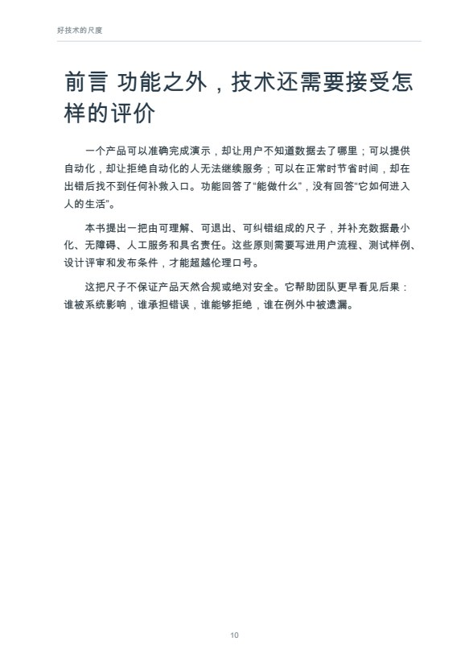
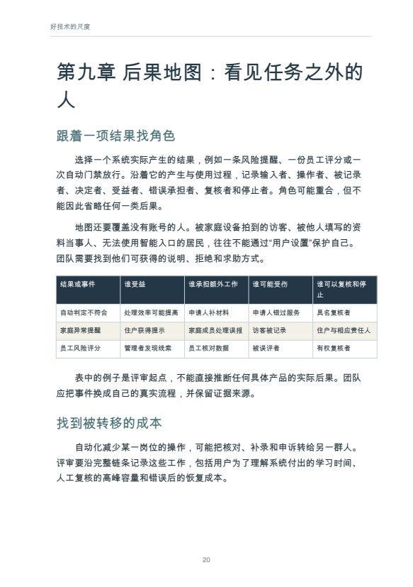

# 好技术的尺度

可理解、可退出、可纠错

作者：李钊 · 出版单位：晓翊工作室  
增订版 1.1 · 原书日期：2026-11-11 · 增订日期：2026-11-19 · PDF 50 页

把抽象伦理转化为可评审、可测试、可验收的产品与服务标准。

## 阅读导引

本次增订保留原书基础内容、署名和出版记录，23章、6份附录。新增实践方法、综合案例或模拟练习及可直接使用的工作表。案例的材料性质以正文标注为准，不构成真实客户成效或专业结果保证。

读者可先浏览前言与原八章建立共同概念，再按当前任务选读新增章节和附录。表格需结合自己的资料填写，动态规则、产品能力和专业事项仍按当前正式来源核实。

## 完整目录

展开全书目录

- 前言　功能之外，技术还需要接受怎样的评价
- 第一章　从功能数量转向实际后果
- 第二章　可理解：让人知道系统在做什么
- 第三章　可退出：拒绝不应付出过高代价
- 第四章　可纠错：错误之后谁能够补救
- 第五章　数据最小化：少一点采集，多一点余地
- 第六章　无障碍与人工服务：不要让智能成为门槛
- 第七章　风险分级与具名责任
- 第八章　把原则写进设计评审和验收
- 第九章　后果地图：看见任务之外的人
- 第十章　默认值评审：产品替人作了什么选择
- 第十一章　可理解测试：观察用户怎样行动
- 第十二章　非用户退出与替代渠道
- 第十三章　无障碍实测：把核心任务走通
- 第十四章　申诉与纠错：让结果能够改变
- 第十五章　停机与恢复：演练人工接管
- 第十六章　供应商证据与采购验收
- 第十七章　迁移与退役：好技术也包括好好结束
- 第十八章　持续评审：让纠正进入下一版
- 附录　产品与服务评审表
- 附录二　一次完整的评审会议
- 附录三　十二个测试样例卡
- 附录四　证据可信度的边界检查
- 第十九章　场景练习一：儿童与家庭产品
- 第二十章　场景练习二：工作场所自动化
- 第二十一章　场景练习三：公共服务与例外处理
- 第二十二章　场景练习四：生成式 AI 进入工作流程
- 第二十三章　小团队的轻量评审节奏
- 附录五　六份失败复盘示例
- 附录六　发布决定的一页底稿
- 参考资料

## 实际内页预览

页码包含封面，从 1 起算。样页由本次 50 页 PDF 重新生成。

PDF 文件第 10 页：前言。

PDF 文件第 20 页：新增实践章节。

## 阅读与下载

- [Markdown 在线阅读](output/markdown/好技术的尺度_李钊_20261111.md)
- [PDF · 50 页](https://github.com/njxshr/ruogu-books/releases/download/expanded-books-20261119-v1.1/good-technology.pdf)
- [EPUB](https://github.com/njxshr/ruogu-books/releases/download/expanded-books-20261119-v1.1/good-technology.epub)
- [Markdown 离线包（含配图）](https://github.com/njxshr/ruogu-books/releases/download/expanded-books-20261119-v1.1/good-technology-markdown.zip)

## 增订与检查

[20 轮增订记录](REVISION_LOG.md) · [实际检查报告](QA_REPORT.md)

本次重新生成 Markdown、PDF 和 EPUB。PDF 全部 50 页已渲染并逐张查看总览；EPUB 解包读取封面、前中后章节，117 个导航目标与本地资源检查通过。具体范围与限制见报告。

## 来源与权利

[来源记录](SOURCES.md) · [主稿](manuscript/book.md) · [出版配置](book.json)

来源记录保留原有核查范围。本次扩充没有借综合案例或模拟推演新增真实访谈、客户成效和统计证据。

版权所有 © 2026 李钊。保留所有权利。第三方资料权利归原权利人。公开阅读与下载不另行授予开放许可。

[返回书目](../../目录.md)
