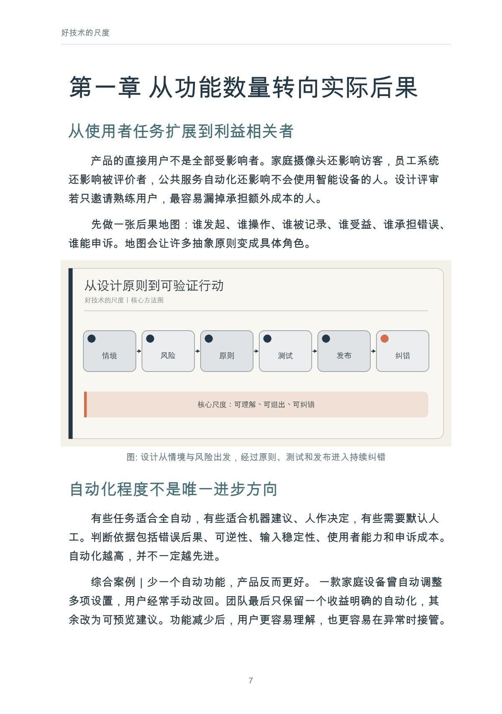
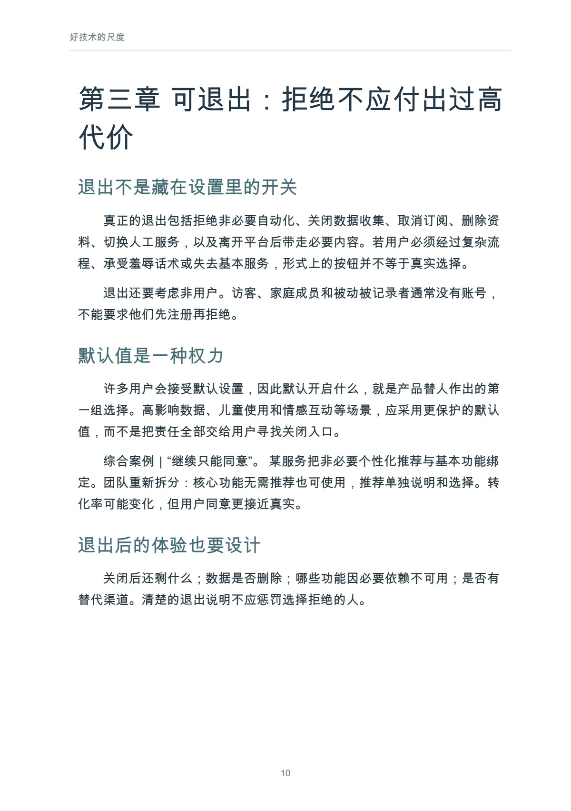

# 好技术的尺度

可理解、可退出、可纠错

作者：李钊 · 出版单位：晓翊工作室  
第一版 · 原书日期：2026-11-11 · 上架日期：2026-11-11 · PDF 17 页

把抽象伦理转化为可评审、可测试、可验收的产品与服务标准。

## 阅读导引

一个产品可以准确完成演示，却让用户不知道数据去了哪里；可以提供自动化，却让拒绝自动化的人无法继续服务；可以在正常时节省时间，却在出错后找不到任何补救入口。功能回答了“能做什么”，没有回答“它如何进入人的生活”。

本书提出一把由可理解、可退出、可纠错组成的尺子，并补充数据最小化、无障碍、人工服务和具名责任。它们不是几句伦理口号，而应被写进用户流程、测试样例、设计评审和发布条件。

这把尺子不保证产品天然合规或绝对安全。它帮助团队更早看见后果：谁被系统影响，谁承担错误，谁能够拒绝，谁在例外中被遗漏。

建议先读前言与前两章，理解问题和基本方法；再结合当前问题选择后续章节，使用附录整理自己的记录。

## 完整目录

展开全书目录

- 前言　功能之外，技术还需要接受怎样的评价
- 第一章　从功能数量转向实际后果
- 第二章　可理解：让人知道系统在做什么
- 第三章　可退出：拒绝不应付出过高代价
- 第四章　可纠错：错误之后谁能够补救
- 第五章　数据最小化：少一点采集，多一点余地
- 第六章　无障碍与人工服务：不要让智能成为门槛
- 第七章　风险分级与具名责任
- 第八章　把原则写进设计评审和验收
- 附录　产品与服务评审表
- 参考资料

## 实际内页预览

页码为包含封面的 PDF 文件页码，从 1 起算。

PDF 文件第 7 页：好技术的尺度 7 第一章 从功能数量转向实际后果 从使用者任务扩展到利益相关者 产品的直接用户不是全部受影响者。家庭摄像头还影响访

PDF 文件第 10 页：好技术的尺度 10 第三章 可退出：拒绝不应付出过高 代价 退出不是藏在设置里的开关 真正的退出包括拒绝非必要自动化、关闭数据收集

## 阅读与下载

- [Markdown 在线阅读](output/markdown/好技术的尺度_李钊_20261111.md)
- [PDF · 17 页](https://github.com/njxshr/ruogu-books/releases/download/new-books-20261111-v1.0/good-technology.pdf)
- [EPUB](https://github.com/njxshr/ruogu-books/releases/download/new-books-20261111-v1.0/good-technology.epub)
- [Markdown 离线包（含配图）](https://github.com/njxshr/ruogu-books/releases/download/new-books-20261111-v1.0/good-technology-markdown.zip)

## 来源与权利

[来源记录](SOURCES.md) · [主稿](manuscript/book.md) · [出版配置](book.json)

书中的综合案例、模拟情境和作者建议按正文标注理解，不作为真实客户成效承诺。来源记录保留原有核查范围，本次上架不代表重新核查全部外部来源。

版权所有 © 2026 李钊。保留所有权利。 第三方资料权利归原权利人。公开阅读与下载不另行授予开放许可。

[返回书目](../../目录.md)
