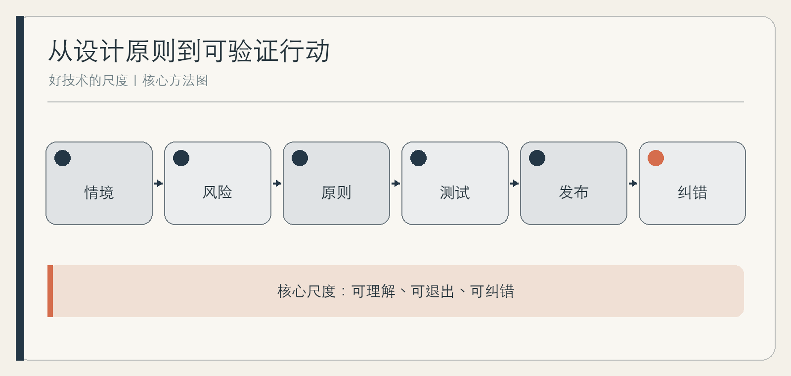

# 好技术的尺度

可理解、可退出、可纠错

作者：李钊  
日期：2026 年 11 月 11 日  
增订：2026 年 11 月 19 日（新增评审、测试与退役方法）

---

## 前言　功能之外，技术还需要接受怎样的评价

一个产品可以准确完成演示，却让用户不知道数据去了哪里；可以提供自动化，却让拒绝自动化的人无法继续服务；可以在正常时节省时间，却在出错后找不到任何补救入口。功能回答了“能做什么”，没有回答“它如何进入人的生活”。

本书提出一把由可理解、可退出、可纠错组成的尺子，并补充数据最小化、无障碍、人工服务和具名责任。这些原则需要写进用户流程、测试样例、设计评审和发布条件，才能超越伦理口号。

这把尺子不保证产品天然合规或绝对安全。它帮助团队更早看见后果：谁被系统影响，谁承担错误，谁能够拒绝，谁在例外中被遗漏。

## 第一章　从功能数量转向实际后果

### 从使用者任务扩展到利益相关者

产品的直接用户不是全部受影响者。家庭摄像头还影响访客，员工系统还影响被评价者，公共服务自动化还影响不会使用智能设备的人。设计评审若只邀请熟练用户，最容易漏掉承担额外成本的人。

先做一张后果地图：谁发起、谁操作、谁被记录、谁受益、谁承担错误、谁能申诉。地图会让许多抽象原则变成具体角色。

### 自动化程度不是唯一进步方向

有些任务适合全自动，有些适合机器建议、人作决定，有些需要默认人工。判断依据包括错误后果、可逆性、输入稳定性、使用者能力和申诉成本。自动化越高，并不一定越先进。

**综合案例｜少一个自动功能，产品反而更好。** 一款家庭设备曾自动调整多项设置，用户经常手动改回。团队最后只保留一个收益明确的自动化，其余改为可预览建议。功能减少后，用户更容易理解，也更容易在异常时接管。

### 先问是否值得做

在讨论怎么做之前，先问问题是否真实、技术是否必要、是否已有更简单方案。好技术的第一步有时意味着拒绝一个不必要的功能。

## 第二章　可理解：让人知道系统在做什么

### 透明要服务具体判断

一篇很长的说明不等于可理解。用户在不同节点需要不同信息：自动化前知道将发生什么，授权前知道数据用途，结果后知道主要依据，错误时知道怎样处理。信息应与当前决定相关。

NIST AI 风险管理框架把透明、问责、可解释与有效可靠、安全、隐私、公平等特征并列，并提醒透明本身不保证准确或公平。[NIST AI RMF](https://airc.nist.gov/airmf-resources/airmf/3-sec-characteristics/)

可理解也不要求每位用户读懂模型内部结构，或要求企业公开全部专有细节。它要求受影响者获得与当前决定相称的信息：知道系统参与了什么、依据有何限制、自己还能怎样选择。

### 解释系统的边界，而不只展示信心

“系统可能出错”太笼统。更有用的是：“在输入缺少购买日期时，系统可能误判保修状态；请核对原始票据。”解释应帮助用户形成正确行动，而不是把责任推给用户。

**综合案例｜一个可操作的提示。** 原提示写“结果仅供参考”，用户不知道参考到什么程度。改为“此建议只根据最近三次记录，未包含线下维修；涉及安全问题时请停止使用并联系检修”。提示变长不多，行动边界却清楚。

### 测试理解，而不是测试阅读

让目标用户看完说明后复述：系统做了什么、没有做什么、接下来能怎么选。若用户能读每句话却仍形成错误预期，说明设计还未完成。

## 第三章　可退出：拒绝不应付出过高代价

### 退出不是藏在设置里的开关

真正的退出包括拒绝非必要自动化、关闭数据收集、取消订阅、删除资料、切换人工服务，以及离开平台后带走必要内容。若用户必须经过复杂流程、承受羞辱话术或失去基本服务，形式上的按钮并不等于真实选择。

退出还要考虑非用户。访客、家庭成员和被动被记录者通常没有账号，不能要求他们先注册再拒绝。

### 默认值是一种权力

许多用户会接受默认设置，因此默认开启什么，就是产品替人作出的第一组选择。高影响数据、儿童使用和情感互动等场景，应采用更保护的默认值，而不是把责任全部交给用户寻找关闭入口。

**综合案例｜“继续只能同意”。** 某服务把非必要个性化推荐与基本功能绑定。团队重新拆分：核心功能无需推荐也可使用，推荐单独说明和选择。转化率可能变化，但用户同意更接近真实。

### 退出后的体验也要设计

关闭后还剩什么；数据是否删除；哪些功能因必要依赖不可用；是否有替代渠道。清楚的退出说明不应惩罚选择拒绝的人。

## 第四章　可纠错：错误之后谁能够补救

### 纠错不是反馈按钮

完整纠错链包括发现问题、停止影响、联系责任人、复核依据、修正结果、补救受影响者，以及把教训写回系统。只收集意见而无人处理，不会形成纠错。

高影响场景需要停止与人工覆盖。自动执行前明确谁有权限暂停、何时必须暂停、暂停后业务如何继续。没有恢复路径的“人工负责”，往往只是名义负责。

### 测试错误，而不是只测试成功

**综合案例｜错误资格判断。** 一项服务把特殊情况自动判为不符合。用户提交申诉后，系统只重复原结论。团队增加具名复核、处理时限和结果通知，并保留对原决定的纠正记录。验收不只检查申诉能提交，还检查真的能改变结果。

### 纠错需要指标

记录错误发现渠道、响应时间、实际纠正、重复发生和补救完成，而不是只统计工单关闭。指标用于发现问题，不应鼓励团队把复杂申诉提前关闭。

## 第五章　数据最小化：少一点采集，多一点余地

### 每项数据都要回答用途

收集前写清：为了什么任务，是否必需，保存多久，谁能访问，是否能用更少数据实现。若目的模糊，“以后可能有用”不应成为默认理由。

数据最小化也减少错误后果。没有收集的敏感信息，不会因系统漏洞、错误共享或权限误配而暴露。它同时服务安全与自主，超出合规字段本身。

### 本地、匿名与聚合需要具体验证

“在本地处理”“匿名化”“只用于改进”都应有技术和产品含义。检查是否仍上传、是否可重新识别、是否进入模型训练、是否与第三方共享。不能用宣传词代替数据流图。

**综合案例｜不需要原片的提醒。** 一款家庭提醒产品原本上传完整视频。团队评估后，改为只传输必要事件状态，敏感画面默认本地处理，并提供保存期限。方案仍需安全评估，但不必要的数据暴露已经减少。

### 删除是设计能力

用户能否删除单条、全部和备份中的数据，各取决于系统和法律要求。团队应说明真实行为，不承诺技术上无法做到的“立即彻底消失”。

## 第六章　无障碍与人工服务：不要让智能成为门槛

### 可及性是基本质量

W3C 的 WCAG 以可感知、可操作、可理解和稳健为四项原则，并提供可测试的成功标准。[WCAG 2.2](https://www.w3.org/TR/WCAG22/) 它不是只给专业人员看的清单，而应进入设计、开发和采购验收。

键盘操作、清晰标签、足够目标尺寸、错误提示、辅助技术兼容，都会影响人能否完成任务。适老化也不是简单放大字体，隐藏必要功能反而可能增加困难。

### 人工服务是系统的一部分

当服务只提供一种智能入口，不会用、用不起或不愿用的人就被排除。人工渠道不必然解决所有问题，但对高风险、例外和公共性质服务，它提供必要的进入与救济。

**综合案例｜简化之后更难用。** 某应用为老人隐藏“复杂功能”，却也隐藏了修改资料和人工求助。团队恢复清晰入口，减少无关信息，并用真实老人完成任务测试，而不是由年轻设计师想象需求。

### 让不同人参与验收

除自动检测外，邀请不同身体条件、年龄、语言和设备能力的人完成核心任务。记录他们在哪里等待、误解或被迫求助。平均完成时间不能掩盖有人完全无法完成。

## 第七章　风险分级与具名责任

### 同一把尺子，不同严格程度

推荐一首歌与决定保险资格，错误后果不同。团队可从影响程度、可逆性、脆弱人群、自动化权限、数据敏感度和实际使用环境评估风险。风险越高，验证、人工复核和救济越不能省略。

NIST AI RMF 强调按使用情境平衡可信特征，而不是一张清单保证全部场景。[NIST](https://nvlpubs.nist.gov/nistpubs/ai/nist.ai.100-1.pdf) 这意味着原则必须转化为本项目的具体证据。

### 责任需要权限和资源

具名负责人若没有暂停权、预算、时间和专业支持，只是出事后承担压力的人。责任表要写清谁批准、谁监测、谁处理、谁有权停止、谁向受影响者沟通。

**综合案例｜名义上的负责人。** 产品经理被写为自动系统负责人，却无法要求工程暂停上线。组织随后把发布批准和紧急停机分别赋予明确角色，并安排替补。责任终于不只存在于表格里。

### 采购者也要问后果

采购不仅比较功能与价格，还应索取测试范围、数据流、退出、纠错、无障碍和服务连续性证据。供应商自述只能证明其公开承诺，不能替代实际验收。

## 第八章　把原则写进设计评审和验收

### 每个原则都要有测试样例

可理解对应用户复述与错误预期测试；可退出对应关闭、删除、迁移和人工替代；可纠错对应错误注入、申诉和恢复；最小化对应数据流检查；无障碍对应不同用户任务；责任对应停机演练。

评审不能只问“是否有功能”，还要问“证据是什么”。一张截图、一篇政策和供应商承诺各有边界，最好结合实际任务与记录。

### 发布条件包含停止条件

若儿童保护无效、适用的无障碍要求未满足、错误无法人工纠正、敏感数据流向不明，项目应暂停，而不是上线后再看。对需要键盘路径的数字界面，核心流程必须能够用键盘完成；对其他产品，则应把相应的操作与可达性要求写成具体样例。停止条件需要在发布前获得批准，否则压力之下很容易被重新解释。

### 上线后继续评审

模型、依赖、用户和规则都会变化。建立事件反馈、定期抽查、版本复核和退出维护。好技术需要持续评审，在错误出现后仍有能力变得更好。

**综合案例｜从清单到证据包。** 团队原先用一页伦理清单自查，后来改为每个高风险结论附测试样例、负责人、未解决项和复查日期。清单没有变长，评审却第一次能影响发布决定。

## 第九章　后果地图：看见任务之外的人

### 跟着一项结果找角色

选择一个系统实际产生的结果，例如一条风险提醒、一份员工评分或一次自动门禁放行。沿着它的产生与使用过程，记录输入者、操作者、被记录者、决定者、受益者、错误承担者、复核者和停止者。角色可能重合，但不能因此省略任何一类后果。

地图还要覆盖没有账号的人。被家庭设备拍到的访客、被他人填写的资料当事人、无法使用智能入口的居民，往往不能通过“用户设置”保护自己。团队需要找到他们可获得的说明、拒绝和求助方式。

| 结果或事件 | 谁受益 | 谁承担额外工作 | 谁可能受伤 | 谁可以复核和停止 |
| --- | --- | --- | --- | --- |
| 自动判定不符合 | 处理效率可能提高 | 申请人补材料 | 申请人错过服务 | 具名复核者 |
| 家庭异常提醒 | 住户获得提示 | 家庭成员处理误报 | 访客被记录 | 住户与相应责任人 |
| 员工风险评分 | 管理者发现线索 | 员工核对数据 | 被误评者 | 有权复核者 |

表中的例子是评审起点，不能直接推断任何具体产品的实际后果。团队应把事件换成自己的真实流程，并保留证据来源。

### 找到被转移的成本

自动化减少某一岗位的操作，可能把核对、补录和申诉转给另一群人。评审要沿完整链条记录这些工作，包括用户为了理解系统付出的学习时间、人工复核的高峰容量和错误后的恢复成本。

**综合案例｜节省时间之后。** 某报销工具自动读取票据，财务处理速度提高，员工却需要反复修改识别错误的日期。团队把识别失败后的修改时间纳入评估，并增加批量确认和错误反馈。评价从财务单一环节扩展到完整任务。

## 第十章　默认值评审：产品替人作了什么选择

### 逐项列出首次使用状态

记录系统首次启动时的采集、共享、通知、自动执行、可见范围和保存期限。对每项默认值说明理由、受影响者和改变方式。团队若无法解释一项高影响默认值，就不能把责任推给“用户可以自己关”。

默认值评审同时看路径。关闭入口需要几步，是否使用与同意不同的措辞，关闭后是否保留核心服务，未作出选择的用户会怎样。涉及高影响数据、儿童或自动执行时，保护性默认应成为发布条件的一部分。

**综合案例｜默认共享的家庭列表。** 某家庭应用默认向所有成员展示访客记录。评审发现临时照护者和儿童也在成员列表中，团队改为按角色最小可见，并让新成员加入时先看到权限说明。调整涉及的不只是一个开关，还有成员模型和通知流程。

### 默认值变更要保护既有选择

产品更新可能重置开关、扩大数据用途或引入新的自动化。发布前核对旧选择是否继续有效，需要重新同意的事项是否明确，拒绝后是否仍可使用原有核心功能。重大变更按适用规则处理，不能用一次笼统更新覆盖所有旧授权。

| 默认项目 | 当前状态 | 影响对象 | 改变入口 | 更新后是否保留选择 | 验收证据 |
| --- | --- | --- | --- | --- | --- |
| 非必要数据采集 |  |  |  |  |  |
| 内容与成员可见 |  |  |  |  |  |
| 自动执行与通知 |  |  |  |  |  |
| 保存与删除 |  |  |  |  |  |

## 第十一章　可理解测试：观察用户怎样行动

### 设计三种理解任务

第一次使用前，请目标用户说明系统将要做什么；授权前，请他指出哪些数据用于什么目的；结果出现后，请他说出依据的限制和可选动作。测试尽量不先教答案，否则测到的是短期记忆，而不是界面能否支持判断。

记录错误预期及其来源。用户可能把图标理解为已保存，把“建议”理解为正式决定，或把人工客服入口当作即时救援。修正应落到文字、顺序、默认和反馈，不能只在末尾追加一句免责。

### 一份五人测试记录

人数由项目风险与资源决定，这里没有通用的合格样本量。哪怕只测试少数人，也要保留每个人的任务与困难，不把结果转换成没有依据的百分比。

| 参与者与相关能力 | 测试任务 | 实际复述或操作 | 错误预期 | 设计修改 | 复测结果 |
| --- | --- | --- | --- | --- | --- |
| 首次使用者 | 判断系统参与环节 |  |  |  |  |
| 使用辅助技术者 | 找到授权与退出 |  |  |  |  |
| 非专业使用者 | 处理异常结果 |  |  |  |  |

**综合案例｜读懂文字，误解状态。** 参与者都能读出“建议已生成”，却有人以为建议已经自动执行。团队在结果旁增加“尚未执行”的状态和明确的预览按钮，再测试用户能否预测下一步。这次修改针对行动后果，不只润色文案。

## 第十二章　非用户退出与替代渠道

### 没有账号的人怎样拒绝

先识别系统如何影响非用户，再提供与其关系相称的渠道。访客可能需要现场说明与不进入记录区域的选择，家庭成员可能需要本人可见的共享状态，被他人提交资料的当事人可能需要更正和异议入口。

要求非用户下载应用、注册账号或交出更多身份信息才能拒绝，可能制造新的负担与采集。身份核实确有必要时，应说明为何需要、如何最小化以及由谁处理，具体流程按适用规则设计。

### 替代渠道要真正完成任务

人工电话、线下窗口或纸质表格的存在不足以证明可及。测试服务时间、接通、身份核验、处理时限和结果通知。人工渠道也不能成为低优先级通道，让拒绝自动化的人承担明显不合理的等待。

**综合案例｜只接受应用申诉。** 一项社区服务要求居民通过应用对自动结果提出异议。部分居民没有兼容设备，线下工作人员又无权受理。调整后，线下可登记异议并获得编号，复核仍在同一责任链中流转。渠道改变没有改变申请人应有的处理结果。

### 退出后的必要依赖

某些功能确实依赖数据或自动化才能提供，团队应解释失去的是哪项增值能力，保留哪些基本服务，是否已有历史资料需要导出或删除。将所有服务绑定到一个非必要授权，不能用“技术必需”一笔带过。

## 第十三章　无障碍实测：把核心任务走通

### 从任务到操作路径

依据产品类型与适用要求选择测试。数字界面可检查键盘顺序、焦点可见、控件名称、错误提示、缩放与辅助技术；实体设备还需考虑可达位置、操作力量、触觉和听觉替代。WCAG 的具体成功标准与适用级别由团队按当前正式文本判断，本书不替代完整合规评估。

测试记录包含设备、系统、辅助技术和版本，避免“支持读屏”这样的笼统结论。自动检查可以帮助发现部分问题，却不能证明完整任务可完成。

**模拟验收｜只用键盘提交申请。** 测试者从登录开始，依次填写资料、修正错误、阅读结果并提交。若焦点陷入弹窗、某个按钮没有名称或错误只以颜色表示，记录发生位置与后果。修复后重新走完整路径，避免只验证单个组件。

### 邀请不同用户参与

不同年龄、身体条件、语言、设备与网络条件的人可能遇到不同障碍。参与者应获得合理说明、同意与报酬安排，测试材料保护其个人信息。团队不能把参与者的一次困难描述成某类人群的统一特征。

| 核心任务 | 操作条件 | 阻塞点 | 对任务的影响 | 修复与复测 |
| --- | --- | --- | --- | --- |
| 创建并完成申请 | 仅键盘 |  |  |  |
| 找到错误并修改 | 屏幕阅读辅助 |  |  |  |
| 阅读结果并求助 | 页面放大 |  |  |  |
| 退出非必要功能 | 低带宽或旧设备 |  |  |  |

## 第十四章　申诉与纠错：让结果能够改变

### 申诉要有对象与时限

申诉入口应说明受理事项、所需材料、处理人、预计反馈和进一步渠道。用户提交后获得可追踪编号，能够补充证据和了解状态。对高影响决定，复核者应有权限查看原依据并改变结果。

系统可以给出材料清单，但不应要求用户证明一个无法获知的内部原因。团队需要保存必要依据，使复核能够检查数据错误、规则误用和例外情境。

### 从纠错回到产品修改

**综合案例｜重复出现的地址错误。** 多名用户因同一地址格式被判定不符合。团队逐单修正后，又回溯输入校验与提示，减少同类问题再次进入申诉。评价因此包含实际纠正与重复发生，而不只看工单是否关闭。

| 申诉编号 | 原结果与依据 | 新证据 | 复核者与结论 | 补救是否完成 | 是否修改系统 |
| --- | --- | --- | --- | --- | --- |
|  |  |  |  |  |  |

纠正结果之后还要处理连锁影响：错误信息是否已通知第三方，旧结果是否仍在其他流程使用，受影响者是否得到必要补救。涉及法律权利或正式程序时，依适用规则并由合格人员处理。

## 第十五章　停机与恢复：演练人工接管

### 先写停止条件

明确哪些信号必须停止自动执行，例如数据越权、错误影响关键服务、监测失效或版本未经确认。停止权限要落到当班角色和替补，不依赖某位负责人恰好在线。普通用户如何触发紧急人工复核，也应在界面中可找到。

**模拟演练｜异常结果持续增加。** 值班人员发现系统对同一类申请给出相互矛盾的结果。他按约定暂停该范围的自动决定，保留待处理队列，通知复核负责人，并启用人工受理。演练记录包括发现、停止、通知和恢复的时间，不真正影响用户。

### 降级模式要有容量

停机后人工能处理多少任务，哪些可以等待，哪些必须优先，待处理数据怎样保存，都需要估算与测试。若人工渠道平时无人维护，纸面接管不会自动变成能力。

恢复前检查问题原因、影响范围、待处理队列和重新执行的去重。恢复后向受影响者说明当前状态，并保存事件复盘。

| 阶段 | 必做动作 | 完成证据 | 负责人 |
| --- | --- | --- | --- |
| 停止 | 限定范围，阻止新增影响 | 自动任务状态与日志 |  |
| 降级 | 保留关键服务与人工入口 | 实际任务样本 |  |
| 恢复 | 核对版本、积压和重复执行 | 小范围验证记录 |  |
| 复盘 | 修正流程并通知相关者 | 整改与复查日期 |  |

## 第十六章　供应商证据与采购验收

### 把自述分成四类材料

政策说明能证明公开承诺，产品截图能展示某个界面，测试报告能支持特定条件下的结果，客户自己的实测能检验真实环境。四类材料互相补充，任何一类都不应被当作全场景保证。

索取数据流、分包依赖、保存与删除、人工覆盖、无障碍、事件通报、导出和退出材料。涉及秘密时可以采用适当保密方式，但“保密”不应成为拒绝所有验证的通用理由。

| 采购要求 | 供应商材料 | 买方实测 | 未解决项 | 发布或验收决定 |
| --- | --- | --- | --- | --- |
| 无权限者不能看到敏感内容 | 权限说明 | 越权样本测试 |  |  |
| 错误可以人工纠正 | 流程与时限 | 改变一条测试结果 |  |  |
| 核心任务可及 | 无障碍材料 | 目标任务实测 |  |  |
| 服务结束可迁移 | 导出说明 | 抽样导出并打开 |  |  |

### 验收版本必须一致

测试环境、供应商演示和实际发布可能版本不同。记录版本、配置、模型或规则更新及依赖变化，关键变更后复测。只测试演示账号，容易漏掉真实权限、数据量与第三方依赖。

**综合案例｜政策齐全，导出不可用。** 供应商提供了完整的隐私和退出政策，买方抽样导出时却发现文件需要专有工具，且缺少历史备注。双方把可读格式和字段完整性加入验收。证据从文本承诺前移到实际操作。

## 第十七章　迁移与退役：好技术也包括好好结束

### 退役前找到仍在依赖它的人

列出当前用户、被记录者、自动流程、接口、报告和法定或业务保存责任。提前公布时间表与替代渠道，给受影响者足够准备。服务流量很低不等于无人依赖，少数关键任务仍可能需要专门交接。

迁移样本要包含正常、异常、历史、无权限和撤回记录。验收不仅看数量，还看字段、时间、关系、附件与可读性。无法迁移的内容明确范围和补救。

### 删除与保留分别验收

服务结束后，某些数据删除，某些因合法或必要原因保留。分别记录依据、期限、访问与最终处置，避免“系统已关闭”掩盖备份、日志或第三方副本仍存在。具体保存要求由组织按适用规则确认。

| 对象 | 迁移或保留方式 | 抽样验收 | 后续责任 | 完成时间 |
| --- | --- | --- | --- | --- |
| 用户主动创建的资料 |  |  |  |  |
| 历史操作与审计记录 |  |  |  |  |
| 自动流程与接口 |  |  |  |  |
| 备份与第三方副本 |  |  |  |  |

**综合案例｜关闭页面前的最后一项任务。** 某团队准备停用旧申请系统，发现每月仍有人下载历史证明。退役计划增加批量导出、新入口通知和一段并行支持期。旧系统最终关闭时，历史证明仍有可读的获取方式。

## 第十八章　持续评审：让纠正进入下一版

### 事件、抽查与变更共用一张表

把用户申诉、运行异常、定期抽查和版本变更放进同一评审节奏。不同事件风险不同，紧急事项立即处理，普通问题进入定期评审。表中保留原决定、证据、责任人和复查日期，避免整改只存在于会议纪要。

每季度或按项目节奏选择一个旧假设重测。例如用户是否仍能理解自动化状态，人工渠道是否仍能接通，导出格式是否在新版本变化。没有变化的证据也需记录检查时间。

### 一页持续评审记录

| 触发 | 受影响原则 | 本次事实 | 修改与负责人 | 复查结果 |
| --- | --- | --- | --- | --- |
| 用户申诉 | 可纠错 |  |  |  |
| 版本更新 | 默认值与可理解 |  |  |  |
| 无障碍抽查 | 任务可及 |  |  |  |
| 服务或供应商变化 | 连续与退出 |  |  |  |

团队可以用发布条件结束讨论：哪些问题必须停止，哪些可以带限制继续，哪些需要后续观察。持续评审的成果是更清楚的行动与责任，不是不断增加无人阅读的表格。

## 附录　产品与服务评审表

### 后果地图

使用者；被记录者；受益者；被排除者；错误承担者；复核者；停机者；申诉处理者。

### 七项验收

| 原则 | 最小测试 | 不合格信号 |
| --- | --- | --- |
| 可理解 | 用户复述系统作用与边界 | 只读免责声明仍形成错误预期 |
| 可退出 | 关闭、删除、迁移、人工替代 | 退出藏得深或牺牲基本权利 |
| 可纠错 | 提交错误并实际改变结果 | 反馈无人处理、决定不可复议 |
| 数据最小化 | 核对数据流与保存期限 | 目的模糊、默认过度采集 |
| 无障碍 | 不同用户完成核心任务 | 只有自动检测，无人真实使用 |
| 风险与责任 | 停机、替补、沟通演练 | 负责人无权限与资源 |
| 持续维护 | 复查版本与事件 | 上线后无人拥有问题 |

### 发布前停止条件

高风险错误没有补救；核心用户无法完成关键任务；敏感数据流向不清；儿童或脆弱人群保护不足；人工服务只是无法接通的摆设；已验证版本与发布版本不一致。

## 附录二　一次完整的评审会议

以下流程适合在产品决定前使用。会议时长和参与范围按风险调整，高影响项目需要更充分的材料与专业参与。

### 会前材料包

主持人提前发出当前流程、后果地图、数据流、默认值、测试记录、失败样本、退出与停机方案。每项注明版本和负责人。缺少的关键材料登记为未知，不用一句“符合相关要求”跳过。

参会者包括实际用户或代表、被影响角色的适当声音、产品与工程、数据或安全、无障碍、运营和有权停止发布的人。法律及其他专业判断由相应合格人员负责。

### 九十分钟评审节奏

前十五分钟确认要发布的功能和范围；接着二十分钟走正常任务；再用二十分钟走错误、退出和申诉；随后二十分钟检查证据与未解决项；最后十五分钟形成决定和整改。每个结论明确是接受、限制、补证还是停止。

**模拟记录｜有条件继续。** 一项内部报销工具只在桌面端试点。评审发现键盘路径存在阻断，修复前不得扩大；自动识别仅用于建议，员工可修改；财务指定两人处理异常，并在一周后复核。决定带有范围、责任与日期，而非笼统“原则通过”。

### 会议结论表

| 议题 | 证据位置 | 未解决后果 | 决定 | 负责人和复查日 |
| --- | --- | --- | --- | --- |
| 理解与默认 |  |  |  |  |
| 退出与替代 |  |  |  |  |
| 申诉与纠错 |  |  |  |  |
| 无障碍 |  |  |  |  |
| 停机与恢复 |  |  |  |  |
| 数据与退出迁移 |  |  |  |  |

## 附录三　十二个测试样例卡

这些样例是测试设计提示，不是已经执行的产品测试。团队需替换为自己的任务与通过标准，并保存实际结果。

### 样例一：第一次打开系统

**条件。** 用户未阅读帮助文档，没有管理员协助。

**观察。** 能否识别自动化状态、主要任务、数据用途与退出位置；哪些图标或术语产生错误预期。

**证据。** 操作记录、复述要点、具体误解和修正后的复测。

### 样例二：拒绝非必要采集

**条件。** 用户在授权页选择拒绝。

**观察。** 核心功能是否继续，拒绝是否被反复打断，界面是否清楚说明失去的必要依赖。

**证据。** 拒绝前后的流程与数据流，不只保存按钮截图。

### 样例三：非用户提出异议

**条件。** 被记录者没有账号，也无法使用原应用。

**观察。** 能否获得说明、提出拒绝或更正、收到处理结果；身份核实是否收集过量信息。

**证据。** 替代渠道完整走查和受理编号。

### 样例四：输入缺少关键字段

**条件。** 构造缺失日期、地址或必要票据的样本。

**观察。** 系统是否说明无法判断，还是输出过度确定的结果；用户能否补正。

**证据。** 输入、输出、提示和后续路径。

### 样例五：用户无权限

**条件。** 使用真实权限模型的测试账号访问受限内容。

**观察。** 是否拒绝访问，错误提示是否泄露敏感信息，日志能否支持核查。

**证据。** 权限配置、实际返回和日志，注意保护测试数据。

### 样例六：只使用键盘

**条件。** 从进入页面到完成核心任务不使用指针设备。

**观察。** 焦点顺序、可见性、弹窗退出、控件操作和错误修正。

**证据。** 环境与版本、阻塞步骤和修复后完整复测。

### 样例七：人工纠正一条错误

**条件。** 让测试样本产生可纠正的错误结果。

**观察。** 申诉能否被受理，复核者能否看到依据，结果能否真正改变并同步下游。

**证据。** 原结果、新材料、复核结论、通知和补救记录。

### 样例八：暂停自动执行

**条件。** 在隔离或模拟环境触发约定停机信号。

**观察。** 当班人员和替补能否停止，停止范围是否正确，关键服务怎样降级。

**证据。** 时间线、状态、通知、待处理队列，不在真实用户身上制造事故。

### 样例九：恢复服务

**条件。** 在停机演练后恢复限定范围。

**观察。** 版本是否确认，积压是否重复执行，监测是否恢复，受影响者是否收到状态。

**证据。** 小范围验证和恢复批准。

### 样例十：导出并离开

**条件。** 导出一个包含文字、附件、时间和关系的样本。

**观察.** 文件是否可读，字段是否完整，专有依赖是否说明，账户关闭后如何获取帮助。

**证据.** 在独立工具打开导出文件并核对内容。

### 样例十一：版本更新保留选择

**条件。** 预先设置拒绝和限制权限，再应用待发布更新。

**观察.** 旧选择是否被重置，新功能是否自动启用，变化是否被清楚告知。

**证据.** 更新前后设置、通知与必要复测。

### 样例十二：服务退役

**条件。** 选择一项历史任务和一份旧记录。

**观察.** 用户能否在新路径完成任务，历史资料能否读取，保留与删除是否按约定处理。

**证据.** 任务走查、导出样本、权限和处置记录。

## 附录四　证据可信度的边界检查

### 四种常见误用

**把政策当实测。** 政策说明组织意图，实际行为仍需配置、日志和任务验证。

**把平均当人人。** 平均完成时间可能掩盖有人无法完成。保留失败个案和阻塞原因。

**把单点当链路。** 一个按钮可点击不代表退出完成，一个工单关闭不代表结果已纠正。

**把一次当持续。** 上次测试通过不覆盖新版本、新数据和新用户。记录版本与复查日期。

### 证据包索引

| 结论 | 支持材料 | 适用版本与范围 | 不能证明什么 | 下次复核 |
| --- | --- | --- | --- | --- |
| 核心流程可理解 |  |  |  |  |
| 非必要功能可退出 |  |  |  |  |
| 高影响错误可纠正 |  |  |  |  |
| 关键任务可及 |  |  |  |  |
| 停机与退出可执行 |  |  |  |  |

“不能证明什么”迫使团队保留适用边界。例如三名参与者完成任务，不能证明所有用户都没有障碍；一次导出成功，也不能证明所有历史字段均完整。写出限制不会削弱证据，反而让决定更可靠。

## 第十九章　场景练习一：儿童与家庭产品

### 先描绘家庭中的不同关系

儿童可能直接使用产品，也可能只是被家长设备记录。家长、监护者、兄弟姐妹、访客和临时照护者的权限各不相同。评审需要说明谁能开启功能、谁能查看记录、儿童怎样理解系统参与，以及家庭意见不一致时怎样处理。

本练习不给出适用于所有年龄的统一设置。团队应结合产品目的、实际使用者、适用规则和儿童发展特点取得适当专业意见。保护设计不能靠一行“请在家长陪同下使用”替代。

**模拟评审｜会讲故事的设备。** 设备默认保存语音，以便家长回看使用历史。评审发现孩子并不理解保存意味着家人可以重听，临时照护者也能看到记录。团队重新评估保存必要性、可见范围和非人身份提示，并设计删除与关闭后的实际体验。是否上线还需相应测试和正式评审。

### 把保护和自主放在同一张表

| 设计事项 | 需要理解的后果 | 最小验证 | 停止信号 |
| --- | --- | --- | --- |
| 语音或图像保存 | 家庭其他成员与访客的影响 | 数据流、可见范围、删除实测 | 流向不清或无法删除 |
| 个性化与连续互动 | 依赖、误导或过度使用 | 默认与提醒的可理解测试 | 诱导无法关闭 |
| 家长控制 | 监护责任与儿童合理自主 | 不同角色完成设置与撤销 | 权限超出声明范围 |
| 求助与异常 | 儿童能否找到可信成年人 | 儿童可理解的求助路径 | 危急情境只给自动回答 |

遇到人身安全、自伤或其他紧急风险时，产品应清楚引导至可获得的正式帮助，通用互动系统不能承担诊断、治疗或危机处置角色。

## 第二十章　场景练习二：工作场所自动化

### 权力差异改变“自愿”的含义

员工可能担心拒绝系统会影响评价，即使界面上有退出按钮。评审要检查谁可以看到数据、是否用于绩效、是否允许更正、拒绝后是否承担额外惩罚。管理者不应把员工沉默当作充分同意。

**模拟评审｜自动生成工作评分。** 系统根据工单记录给员工排名。员工发现复杂任务耗时更长，分数反而较低；申诉只能联系直接主管。团队需要检验指标是否测到目标工作，是否遗漏情境，复核者能否独立改变结果，以及原始数据保存多久。排名功能在这些条件未解决前不宜直接用于高影响决定。

### 同时测量管理与员工成本

| 观察点 | 管理者看到的收益 | 员工承担的可能成本 | 需要的证据 |
| --- | --- | --- | --- |
| 自动分派 | 分配速度提高 | 任务难度与情境被压缩 | 任务样本与例外记录 |
| 工作评分 | 比较容易 | 数据错误与行为博弈 | 指标口径与申诉结果 |
| 在线监测 | 状态可见 | 隐私与持续压力 | 必要性、最小化与关闭 |
| 自动建议 | 经验可复用 | 错误建议仍需核对 | 实际修改与责任链 |

评审应让员工代表或实际承担者安全地提供反例，避免只在管理流程中评价系统。涉及劳动规则、正式处分和员工权利时，按适用要求取得专业意见。

## 第二十一章　场景练习三：公共服务与例外处理

### 正常路径之外仍要提供服务

公共服务的使用者具有不同设备、语言、身体条件和文件情况。自动化若只接受标准材料，特殊情况可能被系统反复退回。团队需要明确线下或人工渠道、例外复核和结果通知，避免让居民在多个入口之间往返。

**模拟评审｜缺少标准地址证明。** 某申请流程要求上传特定证明，部分居民因居住情况无法提供。系统若只显示“材料不符合”，申请人无法知道替代方式。评审增加可理解的原因、可接受的替代材料说明和人工复核入口，并测试这些入口是否能实际改变处理状态。具体材料要求仍以相应机构正式规则为准。

### 用任务完成而不是提交量验收

| 角色与情境 | 要完成的事 | 可能阻塞 | 验收证据 |
| --- | --- | --- | --- |
| 没有智能设备的人 | 提交申请并查询结果 | 只有应用入口 | 线下全流程走查 |
| 使用辅助技术的人 | 阅读要求并修正材料 | 标签或焦点问题 | 实际任务测试 |
| 材料有特殊情况的人 | 说明例外并获得复核 | 只有固定选项 | 复核改变结果的样本 |
| 不熟悉专业术语的人 | 理解决定与下一步 | 只给规则编号 | 复述与行动测试 |

高影响服务还需保留错误通知、补救和具名责任。上线时间压力不能成为省略救济的理由。

## 第二十二章　场景练习四：生成式 AI 进入工作流程

### 从生成内容到实际决定

生成式工具可以起草、归类或总结，使用者却可能把流畅表达当成可靠事实。评审要标明哪些输出供参考，哪些会进入正式记录，谁负责核对，哪些任务禁止直接使用未经复核的结果。模型与数据来源的版本变化也应进入复测。

**模拟评审｜自动生成会议纪要。** 工具把讨论中的建议写成已批准决定，参会者若只检查文字通顺，就可能遗漏责任变化。团队将发言、建议、决定和待核事项分栏，要求决定由具名负责人确认，并保留修改记录。自动摘要仍可提供便利，但不能自行赋予事项批准状态。

### 测试失败，不只展示好例子

| 测试样本 | 主要风险 | 检查点 | 不合格处理 |
| --- | --- | --- | --- |
| 来源相互冲突 | 拼接成无依据结论 | 是否保留冲突与出处 | 回到人工核查 |
| 输入缺少关键事实 | 补造细节 | 是否标明未知 | 禁止进入正式记录 |
| 含敏感个人信息 | 超范围披露 | 最小化、权限和日志 | 停止并评估影响 |
| 语气过度确定 | 用户误信 | 边界是否可操作 | 修改提示与流程 |
| 模型或规则更新 | 旧结论失效 | 版本与复测 | 暂缓高风险使用 |

生成内容涉及专业判断时，需要相应合格人员审查。系统没有承担责任的资格，具名责任仍属于实际组织和人员。

## 第二十三章　小团队的轻量评审节奏

### 资源有限时先抓高影响事项

小团队未必能同时建立完整评审体系，可以先选一项高影响流程，完成后果地图、失败样本、退出、人工责任与恢复五项工作。明确无法覆盖的部分，不用一页清单制造全面合规的错觉。

评审可以嵌入已有工作：需求评审加入受影响者，设计评审加入默认值与理解，测试加入错误和退出，发布前加入停机，复盘加入申诉。每次记录只保留能支持决定的材料。

### 一次两小时的纸面演练

前二十分钟选择任务并列出角色；接着二十分钟画数据与决定；再用三十分钟检查正常和失败路径；随后二十分钟走退出、申诉和停机；最后二十分钟确定三个整改。参会者中至少有一位能指出实际操作困难，一位有权停止或升级风险。

**模拟练习｜只有四个人的团队。** 团队为社区活动开发报名工具。他们发现管理员能看到全部联系方式，导出权限过宽，取消报名后又无法撤回邮件提醒。当天整改是缩小管理员权限、验证取消后的通知状态和指定异常联系人。更完整的无障碍与保存评估被排入发布前工作，不写成已经完成。

### 下周可以检查的三件事

| 整改 | 完成定义 | 验证人 | 未完成时的决定 |
| --- | --- | --- | --- |
| 修正一个高影响默认值 | 新用户和既有用户选择均符合设计 | 非设置者实测 | 暂停相关功能 |
| 走通一条纠错路径 | 错误结果被复核并实际改变 | 受影响角色参与 | 限制自动决定 |
| 验证一个退出版本 | 数据导出可打开，权限按约定撤销 | 独立复核者 | 推迟迁移或停用 |

下一轮先看整改证据，再讨论新功能。团队规模可以小，停止高风险问题的能力不能缺席。

## 附录五　六份失败复盘示例

以下均为模拟复盘，展示证据和决定怎样连接。数字、界面与组织不代表真实产品，也不能作为行业情况推断。

### 复盘一：说明很长，用户仍然误操作

**原决定。** 团队以“用户协议已披露”认定知情完成。

**反例。** 首次使用者以为自动同步已经关闭，因为开关只显示“增强体验”。

**修正。** 在相关动作旁使用具体名称，显示当前状态和数据去向，并让未参加设计的人预测操作后果。

**验收。** 用户能说明同步何时发生、怎样停止，操作后的真实数据流与说明一致。

### 复盘二：有关闭按钮，核心服务却被绑定

**原决定。** 设置中存在“关闭个性化”，团队判定可退出。

**反例。** 关闭后用户无法查看自己过去提交的记录，而这些记录并不需要个性化才能提供。

**修正。** 拆分必要记录与非必要推荐，分别说明依赖；退出后保留历史记录的查看和导出。

**验收。** 拒绝者完成核心任务，不再被反复要求重新授权。

### 复盘三：人工复核成为新的瓶颈

**原决定。** 所有异常转人工，团队认为风险已受控。

**反例。** 高峰期积压增加，申请人不知道等待时间，值班人员又无权处理部分例外。

**修正。** 估算容量、限定自动范围、补充授权与升级路径，向申请者显示状态和预期反馈。

**验收。** 模拟峰值下关键任务得到优先处理，超时能够升级，恢复后没有重复决定。

### 复盘四：平均测试成绩掩盖阻断

**原决定。** 多数参与者完成申请，平均耗时达到预期。

**反例。** 一名只使用键盘的参与者无法离开弹窗，任务完全失败。

**修正.** 将关键任务不可完成列为独立停止条件，修复焦点管理并完整复测，不用平均值抵消阻断。

**验收。** 规定操作条件下的核心路径全部可走通，测试记录保留版本与环境。

### 复盘五：导出成功，历史关系却丢失

**原决定.** 系统能下载 CSV，团队认定用户可迁移。

**反例。** CSV 有主记录，却没有附件、修改历史和条目之间的关系。

**修正.** 明确迁移所需数据模型，提供适当格式和字段说明，无法导出的部分提前告知。

**验收。** 在独立工具中抽样重建一段历史，核对记录、附件与关系。

### 复盘六：负责人知道风险，却无法停止

**原决定.** 风险表写了产品经理负责。

**反例。** 出现异常时，产品经理没有停止权限，值班工程也不知道需要谁批准。

**修正.** 将停止权和替补写进运行流程，进行隔离演练，明确先停止哪些影响再讨论责任。

**验收。** 当班角色在约定时间内停止限定范围，通知与降级路径有效，恢复有独立检查。

## 附录六　发布决定的一页底稿

### 决定前

写明本次发布的功能、版本、适用对象、已知限制和验证环境。列出仍未解决的风险及具体停止条件，避免“基本可控”这类无法验收的表达。

### 决定中

记录谁批准、谁负责运行、谁处理申诉、谁可以停机、谁向受影响者沟通。若允许带限制继续，写清限制范围和到期复核，不把临时例外无限延长。

### 决定后

保存实际发布版本、监测与反馈入口、回退方式、下次评审日期。发生变更时更新对应证据，旧结论只适用于旧范围。

| 字段 | 本次内容 |
| --- | --- |
| 发布范围与版本 |  |
| 已验证的正常和失败样例 |  |
| 未解决问题与限制 |  |
| 停止和回退条件 |  |
| 具名责任与替补 |  |
| 用户说明与求助入口 |  |
| 复查日期与触发事件 |  |

这页底稿汇集全书方法。它的完成标准不是每一栏都写得漂亮，而是另一位责任人能据此复核证据、执行停止并找到需要帮助的人。

## 参考资料

1. NIST：[AI Risk Management Framework 1.0](https://nvlpubs.nist.gov/nistpubs/ai/nist.ai.100-1.pdf)，2023；[可信特征](https://airc.nist.gov/airmf-resources/airmf/3-sec-characteristics/)。
2. NIST：[Generative AI Profile](https://nvlpubs.nist.gov/nistpubs/ai/NIST.AI.600-1.pdf)，2024。
3. W3C：[WCAG 2.2](https://www.w3.org/TR/WCAG22/)，2024；[无障碍四原则](https://www.w3.org/WAI/WCAG21/Understanding/intro)。
4. UNICEF：[Guidance on AI and Children 3.0](https://www.unicef.org/innocenti/media/11991/file/UNICEF-Innocenti-Guidance-on-AI-and-Children-3-2025.pdf)，2025。
5. CISA：[Back Up Business Data](https://www.cisa.gov/audiences/small-and-medium-businesses/secure-your-business/back-up-business-data)。
6. 李钊：《智能生活》与《Neo Lab：AI 原生组织的崛起》，2026。

资料收集截至 2026 年 11 月 11 日。标准版本、法律要求与产品功能在后续使用时应重新核对。
