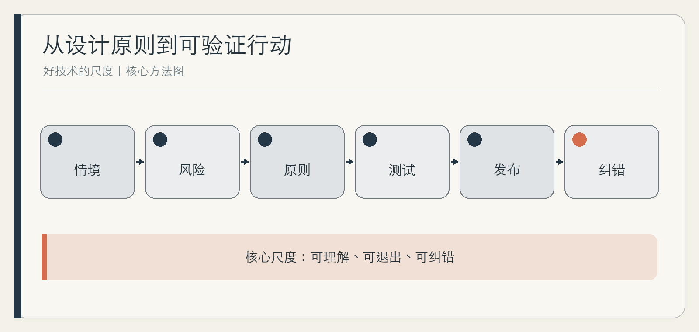

# 好技术的尺度

可理解、可退出、可纠错

作者：李钊  
日期：2026 年 11 月 11 日

---

## 前言　功能之外，技术还需要接受怎样的评价

一个产品可以准确完成演示，却让用户不知道数据去了哪里；可以提供自动化，却让拒绝自动化的人无法继续服务；可以在正常时节省时间，却在出错后找不到任何补救入口。功能回答了“能做什么”，没有回答“它如何进入人的生活”。

本书提出一把由可理解、可退出、可纠错组成的尺子，并补充数据最小化、无障碍、人工服务和具名责任。它们不是几句伦理口号，而应被写进用户流程、测试样例、设计评审和发布条件。

这把尺子不保证产品天然合规或绝对安全。它帮助团队更早看见后果：谁被系统影响，谁承担错误，谁能够拒绝，谁在例外中被遗漏。

## 第一章　从功能数量转向实际后果

### 从使用者任务扩展到利益相关者

产品的直接用户不是全部受影响者。家庭摄像头还影响访客，员工系统还影响被评价者，公共服务自动化还影响不会使用智能设备的人。设计评审若只邀请熟练用户，最容易漏掉承担额外成本的人。

先做一张后果地图：谁发起、谁操作、谁被记录、谁受益、谁承担错误、谁能申诉。地图会让许多抽象原则变成具体角色。

### 自动化程度不是唯一进步方向

有些任务适合全自动，有些适合机器建议、人作决定，有些需要默认人工。判断依据包括错误后果、可逆性、输入稳定性、使用者能力和申诉成本。自动化越高，并不一定越先进。

**综合案例｜少一个自动功能，产品反而更好。** 一款家庭设备曾自动调整多项设置，用户经常手动改回。团队最后只保留一个收益明确的自动化，其余改为可预览建议。功能减少后，用户更容易理解，也更容易在异常时接管。

### 先问是否值得做

在讨论怎么做之前，先问问题是否真实、技术是否必要、是否已有更简单方案。好技术的第一步有时不是增加智能，而是拒绝一个不必要的功能。

## 第二章　可理解：让人知道系统在做什么

### 透明要服务具体判断

一篇很长的说明不等于可理解。用户在不同节点需要不同信息：自动化前知道将发生什么，授权前知道数据用途，结果后知道主要依据，错误时知道怎样处理。信息应与当前决定相关。

NIST AI 风险管理框架把透明、问责、可解释与有效可靠、安全、隐私、公平等特征并列，并提醒透明本身不保证准确或公平。[NIST AI RMF](https://airc.nist.gov/airmf-resources/airmf/3-sec-characteristics/)

可理解也不要求每位用户读懂模型内部结构，或要求企业公开全部专有细节。它要求受影响者获得与当前决定相称的信息：知道系统参与了什么、依据有何限制、自己还能怎样选择。

### 解释系统的边界，而不只展示信心

“系统可能出错”太笼统。更有用的是：“在输入缺少购买日期时，系统可能误判保修状态；请核对原始票据。”解释应帮助用户形成正确行动，而不是把责任推给用户。

**综合案例｜一个可操作的提示。** 原提示写“结果仅供参考”，用户不知道参考到什么程度。改为“此建议只根据最近三次记录，未包含线下维修；涉及安全问题时请停止使用并联系检修”。提示变长不多，行动边界却清楚。

### 测试理解，而不是测试阅读

让目标用户看完说明后复述：系统做了什么、没有做什么、接下来能怎么选。若用户能读每句话却仍形成错误预期，说明设计还未完成。

## 第三章　可退出：拒绝不应付出过高代价

### 退出不是藏在设置里的开关

真正的退出包括拒绝非必要自动化、关闭数据收集、取消订阅、删除资料、切换人工服务，以及离开平台后带走必要内容。若用户必须经过复杂流程、承受羞辱话术或失去基本服务，形式上的按钮并不等于真实选择。

退出还要考虑非用户。访客、家庭成员和被动被记录者通常没有账号，不能要求他们先注册再拒绝。

### 默认值是一种权力

许多用户会接受默认设置，因此默认开启什么，就是产品替人作出的第一组选择。高影响数据、儿童使用和情感互动等场景，应采用更保护的默认值，而不是把责任全部交给用户寻找关闭入口。

**综合案例｜“继续只能同意”。** 某服务把非必要个性化推荐与基本功能绑定。团队重新拆分：核心功能无需推荐也可使用，推荐单独说明和选择。转化率可能变化，但用户同意更接近真实。

### 退出后的体验也要设计

关闭后还剩什么；数据是否删除；哪些功能因必要依赖不可用；是否有替代渠道。清楚的退出说明不应惩罚选择拒绝的人。

## 第四章　可纠错：错误之后谁能够补救

### 纠错不是反馈按钮

完整纠错链包括发现问题、停止影响、联系责任人、复核依据、修正结果、补救受影响者，以及把教训写回系统。只收集意见而无人处理，不会形成纠错。

高影响场景需要停止与人工覆盖。自动执行前明确谁有权限暂停、何时必须暂停、暂停后业务如何继续。没有恢复路径的“人工负责”，往往只是名义负责。

### 测试错误，而不是只测试成功

**综合案例｜错误资格判断。** 一项服务把特殊情况自动判为不符合。用户提交申诉后，系统只重复原结论。团队增加具名复核、处理时限和结果通知，并保留对原决定的纠正记录。验收不只检查申诉能提交，还检查真的能改变结果。

### 纠错需要指标

记录错误发现渠道、响应时间、实际纠正、重复发生和补救完成，而不是只统计工单关闭。指标用于发现问题，不应鼓励团队把复杂申诉提前关闭。

## 第五章　数据最小化：少一点采集，多一点余地

### 每项数据都要回答用途

收集前写清：为了什么任务，是否必需，保存多久，谁能访问，是否能用更少数据实现。若目的模糊，“以后可能有用”不应成为默认理由。

数据最小化也减少错误后果。没有收集的敏感信息，不会因系统漏洞、错误共享或权限误配而暴露。它是安全与自主的共同基础，而不只是合规字段。

### 本地、匿名与聚合需要具体验证

“在本地处理”“匿名化”“只用于改进”都应有技术和产品含义。检查是否仍上传、是否可重新识别、是否进入模型训练、是否与第三方共享。不能用宣传词代替数据流图。

**综合案例｜不需要原片的提醒。** 一款家庭提醒产品原本上传完整视频。团队评估后，改为只传输必要事件状态，敏感画面默认本地处理，并提供保存期限。方案仍需安全评估，但不必要的数据暴露已经减少。

### 删除是设计能力

用户能否删除单条、全部和备份中的数据，各取决于系统和法律要求。团队应说明真实行为，不承诺技术上无法做到的“立即彻底消失”。

## 第六章　无障碍与人工服务：不要让智能成为门槛

### 可及性是基本质量

W3C 的 WCAG 以可感知、可操作、可理解和稳健为四项原则，并提供可测试的成功标准。[WCAG 2.2](https://www.w3.org/TR/WCAG22/) 它不是只给专业人员看的清单，而应进入设计、开发和采购验收。

键盘操作、清晰标签、足够目标尺寸、错误提示、辅助技术兼容，都会影响人能否完成任务。适老化也不是简单放大字体，隐藏必要功能反而可能增加困难。

### 人工服务是系统的一部分

当服务只提供一种智能入口，不会用、用不起或不愿用的人就被排除。人工渠道不必然解决所有问题，但对高风险、例外和公共性质服务，它提供必要的进入与救济。

**综合案例｜简化之后更难用。** 某应用为老人隐藏“复杂功能”，却也隐藏了修改资料和人工求助。团队恢复清晰入口，减少无关信息，并用真实老人完成任务测试，而不是由年轻设计师想象需求。

### 让不同人参与验收

除自动检测外，邀请不同身体条件、年龄、语言和设备能力的人完成核心任务。记录他们在哪里等待、误解或被迫求助。平均完成时间不能掩盖有人完全无法完成。

## 第七章　风险分级与具名责任

### 同一把尺子，不同严格程度

推荐一首歌与决定保险资格，错误后果不同。团队可从影响程度、可逆性、脆弱人群、自动化权限、数据敏感度和实际使用环境评估风险。风险越高，验证、人工复核和救济越不能省略。

NIST AI RMF 强调按使用情境平衡可信特征，而不是一张清单保证全部场景。[NIST](https://nvlpubs.nist.gov/nistpubs/ai/nist.ai.100-1.pdf) 这意味着原则必须转化为本项目的具体证据。

### 责任需要权限和资源

具名负责人若没有暂停权、预算、时间和专业支持，只是出事后承担压力的人。责任表要写清谁批准、谁监测、谁处理、谁有权停止、谁向受影响者沟通。

**综合案例｜名义上的负责人。** 产品经理被写为自动系统负责人，却无法要求工程暂停上线。组织随后把发布批准和紧急停机分别赋予明确角色，并安排替补。责任终于不只存在于表格里。

### 采购者也要问后果

采购不仅比较功能与价格，还应索取测试范围、数据流、退出、纠错、无障碍和服务连续性证据。供应商自述只能证明其公开承诺，不能替代实际验收。

## 第八章　把原则写进设计评审和验收

### 每个原则都要有测试样例

可理解对应用户复述与错误预期测试；可退出对应关闭、删除、迁移和人工替代；可纠错对应错误注入、申诉和恢复；最小化对应数据流检查；无障碍对应不同用户任务；责任对应停机演练。

评审不能只问“是否有功能”，还要问“证据是什么”。一张截图、一篇政策和供应商承诺各有边界，最好结合实际任务与记录。

### 发布条件包含停止条件

若儿童保护无效、适用的无障碍要求未满足、错误无法人工纠正、敏感数据流向不明，项目应暂停，而不是上线后再看。对需要键盘路径的数字界面，核心流程必须能够用键盘完成；对其他产品，则应把相应的操作与可达性要求写成具体样例。停止条件需要在发布前获得批准，否则压力之下很容易被重新解释。

### 上线后继续评审

模型、依赖、用户和规则都会变化。建立事件反馈、定期抽查、版本复核和退出维护。好技术不是一次通过评审，而是错误出现后仍有能力变得更好。

**综合案例｜从清单到证据包。** 团队原先用一页伦理清单自查，后来改为每个高风险结论附测试样例、负责人、未解决项和复查日期。清单没有变长，评审却第一次能影响发布决定。

## 附录　产品与服务评审表

### 后果地图

使用者；被记录者；受益者；被排除者；错误承担者；复核者；停机者；申诉处理者。

### 七项验收

| 原则 | 最小测试 | 不合格信号 |
| --- | --- | --- |
| 可理解 | 用户复述系统作用与边界 | 只读免责声明仍形成错误预期 |
| 可退出 | 关闭、删除、迁移、人工替代 | 退出藏得深或牺牲基本权利 |
| 可纠错 | 提交错误并实际改变结果 | 反馈无人处理、决定不可复议 |
| 数据最小化 | 核对数据流与保存期限 | 目的模糊、默认过度采集 |
| 无障碍 | 不同用户完成核心任务 | 只有自动检测，无人真实使用 |
| 风险与责任 | 停机、替补、沟通演练 | 负责人无权限与资源 |
| 持续维护 | 复查版本与事件 | 上线后无人拥有问题 |

### 发布前停止条件

高风险错误没有补救；核心用户无法完成关键任务；敏感数据流向不清；儿童或脆弱人群保护不足；人工服务只是无法接通的摆设；已验证版本与发布版本不一致。

## 参考资料

1. NIST：[AI Risk Management Framework 1.0](https://nvlpubs.nist.gov/nistpubs/ai/nist.ai.100-1.pdf)，2023；[可信特征](https://airc.nist.gov/airmf-resources/airmf/3-sec-characteristics/)。
2. NIST：[Generative AI Profile](https://nvlpubs.nist.gov/nistpubs/ai/NIST.AI.600-1.pdf)，2024。
3. W3C：[WCAG 2.2](https://www.w3.org/TR/WCAG22/)，2024；[无障碍四原则](https://www.w3.org/WAI/WCAG21/Understanding/intro)。
4. UNICEF：[Guidance on AI and Children 3.0](https://www.unicef.org/innocenti/media/11991/file/UNICEF-Innocenti-Guidance-on-AI-and-Children-3-2025.pdf)，2025。
5. CISA：[Back Up Business Data](https://www.cisa.gov/audiences/small-and-medium-businesses/secure-your-business/back-up-business-data)。
6. 李钊：《智能生活》与《Neo Lab：AI 原生组织的崛起》，2026。

资料收集截至 2026 年 11 月 11 日。标准版本、法律要求与产品功能在后续使用时应重新核对。
