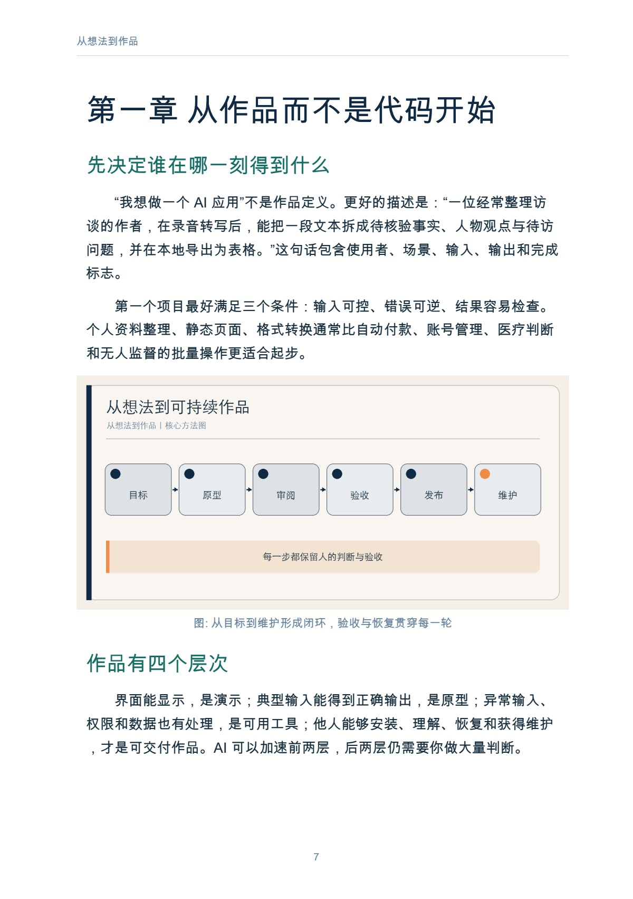
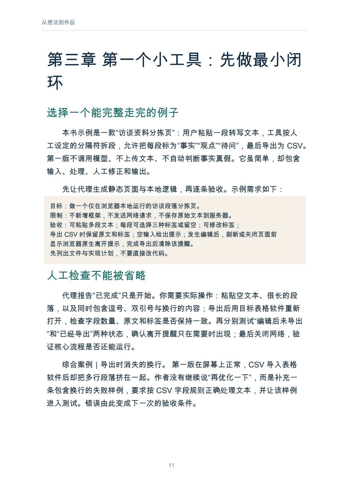

# 从想法到作品

普通人的 Vibe Coding

作者：李钊 · 出版单位：晓翊工作室  
第一版 · 原书日期：2026-11-11 · 上架日期：2026-11-11 · PDF 19 页

让读者能完成从需求、原型、审阅、测试到发布维护的完整低风险项目。

## 阅读导引

AI 把“做一个工具”的门槛降低了。你可以用自然语言描述想法，让编码代理生成页面、脚本和测试，再不断修改。然而，代码更容易生成，不等于作品更容易交付。需求含糊、依赖失控、错误数据、权限过大和无法维护，仍然会让一个看起来能运行的演示在真实使用中失败。

本书把 Vibe Coding 理解为一种以自然语言驱动、快速迭代的人机开发方式，而不是“不用理解就能安全开发”。你不必先掌握所有语法，但必须逐步学会描述目标、限定改动、审阅结果、设计验收和保留恢复路径。

全书以一个最小工具为主线，并用现有 Apple TV 遥控器教程说明硬件、语音和自动化之间的边界。涉及具体软件的内容会过期，目标、限制、验收和恢复这些基本方法不会。

建议先读前言与前两章，理解问题和基本方法；再结合当前问题选择后续章节，使用附录整理自己的记录。

## 完整目录

展开全书目录

- 前言　你不必先成为程序员，但必须成为验收者
- 第一章　从作品而不是代码开始
- 第二章　把需求说清：目标、限制与验收
- 第三章　第一个小工具：先做最小闭环
- 第四章　让代理读懂项目，再允许它修改
- 第五章　测试：能运行不等于能交付
- 第六章　数据、权限、依赖与安全
- 第七章　完整案例：遥控器成为创作控制器
- 第八章　发布、维护与有尊严地停止
- 附录　项目卡与发布检查表
- 参考资料

## 实际内页预览

页码为包含封面的 PDF 文件页码，从 1 起算。

PDF 文件第 7 页：从想法到作品 7 第一章 从作品而不是代码开始 先决定谁在哪一刻得到什么 “我想做一个 AI 应用”不是作品定义。更好的描述是：“

PDF 文件第 11 页：从想法到作品 11 第三章 第一个小工具：先做最小闭 环 选择一个能完整走完的例子 本书示例是一款“访谈资料分拣页”：用户粘贴一段

## 阅读与下载

- [Markdown 在线阅读](output/markdown/从想法到作品_李钊_20261111.md)
- [PDF · 19 页](https://github.com/njxshr/ruogu-books/releases/download/new-books-20261111-v1.0/idea-to-work.pdf)
- [EPUB](https://github.com/njxshr/ruogu-books/releases/download/new-books-20261111-v1.0/idea-to-work.epub)
- [Markdown 离线包（含配图）](https://github.com/njxshr/ruogu-books/releases/download/new-books-20261111-v1.0/idea-to-work-markdown.zip)

## 来源与权利

[来源记录](SOURCES.md) · [主稿](manuscript/book.md) · [出版配置](book.json)

书中的综合案例、模拟情境和作者建议按正文标注理解，不作为真实客户成效承诺。来源记录保留原有核查范围，本次上架不代表重新核查全部外部来源。

版权所有 © 2026 李钊。保留所有权利。 第三方资料权利归原权利人。公开阅读与下载不另行授予开放许可。

[返回书目](../../目录.md)
