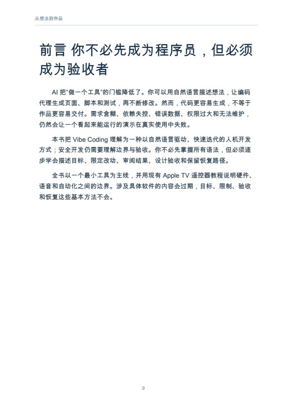
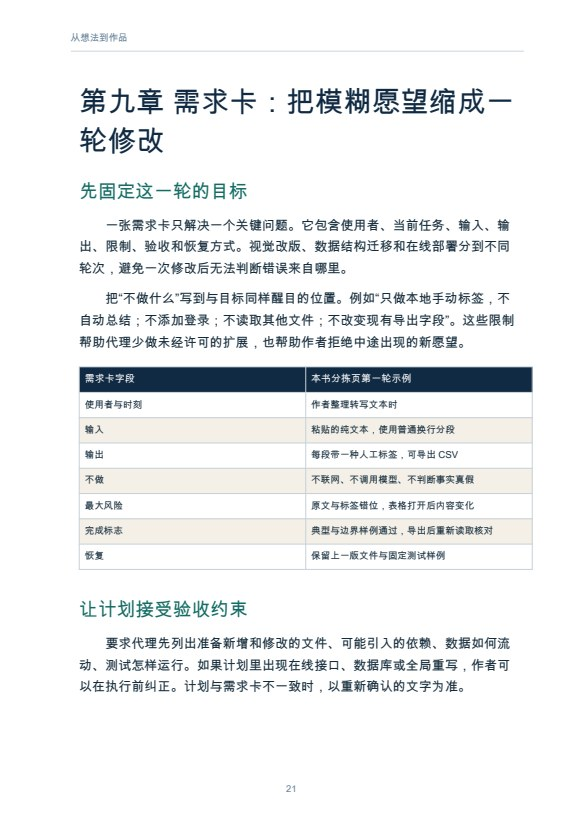

# 从想法到作品

普通人的 Vibe Coding

作者：李钊 · 出版单位：晓翊工作室  
增订版 1.1 · 原书日期：2026-11-11 · 增订日期：2026-11-19 · PDF 51 页

让读者能完成从需求、原型、审阅、测试到发布维护的完整低风险项目。

## 阅读导引

本次增订保留原书基础内容、署名和出版记录，21章、7份附录。新增实践方法、综合案例或模拟练习及可直接使用的工作表。案例的材料性质以正文标注为准，不构成真实客户成效或专业结果保证。

读者可先浏览前言与原八章建立共同概念，再按当前任务选读新增章节和附录。表格需结合自己的资料填写，动态规则、产品能力和专业事项仍按当前正式来源核实。

## 完整目录

展开全书目录

- 前言　你不必先成为程序员，但必须成为验收者
- 第一章　从作品而不是代码开始
- 第二章　把需求说清：目标、限制与验收
- 第三章　第一个小工具：先做最小闭环
- 第四章　让代理读懂项目，再允许它修改
- 第五章　测试：能运行不等于能交付
- 第六章　数据、权限、依赖与安全
- 第七章　完整案例：遥控器成为创作控制器
- 第八章　发布、维护与有尊严地停止
- 第九章　需求卡：把模糊愿望缩成一轮修改
- 第十章　验收夹具：让错误可以重复出现
- 第十一章　测试集：把通过条件写成证据
- 第十二章　差异审阅：看清这一轮究竟改了什么
- 第十三章　权限、密钥与依赖的最低边界
- 第十四章　备份与回滚：在修改前留下出口
- 第十五章　调试：一次只改变一个变量
- 第十六章　发布说明：让下一位使用者能够开始
- 第十七章　维护、交接与停止
- 第十八章　一次完整的周末项目演练
- 第十九章　让别人验收：离开作者的电脑
- 第二十章　生成内容的事实核查
- 第二十一章　发布后的第一次事故
- 附录　项目卡与发布检查表
- 附录二　可运行的 CSV 测试与固定样例
- 附录三　一页 README 示例
- 附录四　六张项目记录表
- 附录五　不必开发的情况
- 附录六　常见故障的排查入口
- 附录七　交付证据索引与一次完整交接
- 参考资料

## 实际内页预览

页码包含封面，从 1 起算。样页由本次 51 页 PDF 重新生成。

PDF 文件第 9 页：前言。

PDF 文件第 21 页：新增实践章节。

## 阅读与下载

- [Markdown 在线阅读](output/markdown/从想法到作品_李钊_20261111.md)
- [PDF · 51 页](https://github.com/njxshr/ruogu-books/releases/download/expanded-books-20261119-v1.1/idea-to-work.pdf)
- [EPUB](https://github.com/njxshr/ruogu-books/releases/download/expanded-books-20261119-v1.1/idea-to-work.epub)
- [Markdown 离线包（含配图）](https://github.com/njxshr/ruogu-books/releases/download/expanded-books-20261119-v1.1/idea-to-work-markdown.zip)

## 增订与检查

[20 轮增订记录](REVISION_LOG.md) · [实际检查报告](QA_REPORT.md)

本次重新生成 Markdown、PDF 和 EPUB。PDF 全部 51 页已渲染并逐张查看总览；EPUB 解包读取封面、前中后章节，104 个导航目标与本地资源检查通过。具体范围与限制见报告。

## 来源与权利

[来源记录](SOURCES.md) · [主稿](manuscript/book.md) · [出版配置](book.json)

来源记录保留原有核查范围。本次扩充没有借综合案例或模拟推演新增真实访谈、客户成效和统计证据。

版权所有 © 2026 李钊。保留所有权利。第三方资料权利归原权利人。公开阅读与下载不另行授予开放许可。

[返回书目](../../目录.md)
