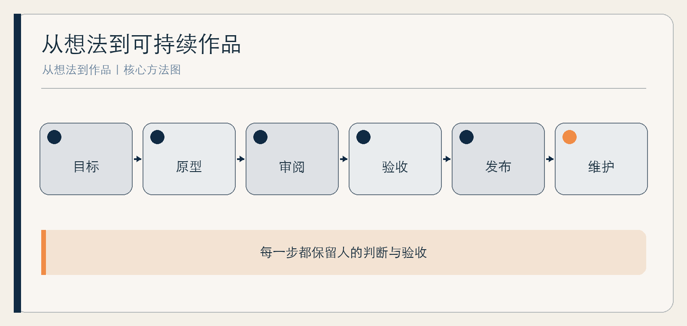

# 从想法到作品

普通人的 Vibe Coding

作者：李钊  
日期：2026 年 11 月 11 日  
增订：2026 年 11 月 19 日（新增实测代码与交付练习）

---

## 前言　你不必先成为程序员，但必须成为验收者

AI 把“做一个工具”的门槛降低了。你可以用自然语言描述想法，让编码代理生成页面、脚本和测试，再不断修改。然而，代码更容易生成，不等于作品更容易交付。需求含糊、依赖失控、错误数据、权限过大和无法维护，仍然会让一个看起来能运行的演示在真实使用中失败。

本书把 Vibe Coding 理解为一种以自然语言驱动、快速迭代的人机开发方式；安全开发仍需要理解边界与验收。你不必先掌握所有语法，但必须逐步学会描述目标、限定改动、审阅结果、设计验收和保留恢复路径。

全书以一个最小工具为主线，并用现有 Apple TV 遥控器教程说明硬件、语音和自动化之间的边界。涉及具体软件的内容会过期，目标、限制、验收和恢复这些基本方法不会。

## 第一章　从作品而不是代码开始

### 先决定谁在哪一刻得到什么

“我想做一个 AI 应用”不是作品定义。更好的描述是：“一位经常整理访谈的作者，在录音转写后，能把一段文本拆成待核验事实、人物观点与待访问题，并在本地导出为表格。”这句话包含使用者、场景、输入、输出和完成标志。

第一个项目最好满足三个条件：输入可控、错误可逆、结果容易检查。个人资料整理、静态页面、格式转换通常比自动付款、账号管理、医疗判断和无人监督的批量操作更适合起步。



### 作品有四个层次

界面能显示，是演示；典型输入能得到正确输出，是原型；异常输入、权限和数据也有处理，是可用工具；他人能够安装、理解、恢复和获得维护，才是可交付作品。AI 可以加速前两层，后两层仍需要你做大量判断。

**综合案例｜从“记账助手”后退一步。** 周原最初想让工具自动读取全部银行卡信息并分类。考虑到敏感数据和错误后果，他把第一版改为手动导入脱敏表格，只检查分类规则和导出结果。缩小范围让核心假设先变得可验证。

### 第一章的最小产出

写一页作品卡：用户、时刻、痛点、输入、输出、不做什么、最大风险、验收方式。若不能写出“不做什么”，项目通常还太大。

## 第二章　把需求说清：目标、限制与验收

### 一段好需求包含三种信息

目标说明为什么改，限制说明不能碰什么，验收说明怎样算完成。只说“优化一下页面”，代理可能重写结构、替换样式并增加依赖；补充“只改移动端导航，不改现有组件与数据文件，键盘可完成全部操作，现有测试继续通过”，改动空间就变得可检查。

在开始编码前，让代理先阅读项目并复述计划。你需要看到它准备修改哪些文件、引入哪些依赖、如何处理数据。这份计划让你尽早发现误解，也让修改范围可以被审阅。

### 把验收写成 observable 的行为

“体验更好”无法直接测试，“在 360 像素宽度下无横向滚动，按钮可用键盘聚焦，错误输入会显示原因且不清空已填内容”可以。验收不必全是自动化测试，但必须能被观察。

| 层面 | 不合格写法 | 可验收写法 |
| --- | --- | --- |
| 功能 | 能整理资料 | 导入指定格式后生成三类记录，并可导出 |
| 边界 | 页面好看点 | 不改变桌面布局，移动端无内容遮挡 |
| 异常 | 要稳定 | 空文件、缺列和重复行分别给出提示 |
| 安全 | 注意隐私 | 不上传原始文件，不新增第三方依赖 |

### 一次只改一个关键不确定性

如果还不知道用户是否需要这个功能，就先验证核心流程；如果已确认流程，再处理视觉和批量能力。一次同时改数据结构、界面和发布方式，出错时很难知道原因。

## 第三章　第一个小工具：先做最小闭环

### 选择一个能完整走完的例子

本书示例是一款“访谈资料分拣页”：用户粘贴一段转写文本，工具按人工设定的分隔符拆段，允许把每段标为“事实”“观点”“待问”，最后导出为 CSV。第一版不调用模型、不上传文本、不自动判断事实真假。它虽简单，却包含输入、处理、人工修正和输出。

先让代理生成静态页面与本地逻辑，再逐条验收。示例需求如下：

```text
目标：做一个仅在浏览器本地运行的访谈段落分拣页。
限制：不新增框架，不发送网络请求，不保存原始文本到服务器。
验收：可粘贴多段文本；每段可选择三种标签或留空；可修改标签；
导出 CSV 时保留原文和标签；空输入给出提示；发生编辑后，刷新或关闭页面前
显示浏览器原生离开提示，完成导出后清除该提醒。
先列出文件与实现计划，不要直接改代码。
```

### 人工检查不能被省略

代理报告“已完成”只是开始。你需要实际操作：粘贴空文本、很长的段落，以及同时包含逗号、双引号与换行的内容；导出后用目标表格软件重新打开，检查字段数量、原文和标签是否保持一致。再分别测试“编辑后未导出”和“已经导出”两种状态，确认离开提醒只在需要时出现；最后关闭网络，验证核心流程是否还能运行。

**综合案例｜导出时消失的换行。** 第一版在屏幕上正常，CSV 导入表格软件后却把多行段落挤在一起。作者没有继续说“再优化一下”，而是补充一条包含换行的失败样例，要求按 CSV 字段规则正确处理文本，并让该样例进入测试。错误由此变成下一次的验收条件。

### 为项目留一份说明

即使只有三个文件，也写清怎样打开、支持什么输入、哪些情况未覆盖、如何备份和恢复。说明文档让未来的你和其他使用者不必依靠猜测理解作品。

## 第四章　让代理读懂项目，再允许它修改

### 上下文不是越多越好

把全部文件无差别交给代理，可能让它忽略关键约束，也增加敏感信息暴露。更有效的是提供项目地图：入口、数据结构、核心逻辑、测试、禁止修改区域和当前问题。对大型项目，先要求定位，不要先要求重写。

每次会话都保留一个简短的“当前约定”：目标、已完成、未解决、测试命令和下一步。它能减少模型把旧方案重新带回来的机会。

### 审阅差异，而不是审阅故事

代理擅长解释自己做了什么，但解释不能替代实际差异。你至少要检查新增依赖、删除代码、权限变化、数据流向和测试变化。对于关键文件，即使不懂每一行，也可以要求逐段说明输入、输出和失败路径。

**综合案例｜“顺便”增加的在线服务。** 代理为了实现标签建议，引入了一个在线接口。作者发现需求只要求手动标签，于是撤销该改动，并把“未经确认不得增加网络请求”写入项目约定。问题不在功能没有价值，而在它改变了数据边界。

### 高影响动作单独确认

删除文件、覆盖数据、安装依赖、执行脚本、提交代码、发布上线，不应藏在模糊的“继续”里。普通使用者最安全的工作节奏是：先计划，再小改；先测试，再扩大权限；先备份，再迁移。

## 第五章　测试：能运行不等于能交付

### 测试从真实风险出发

不必一开始追求复杂测试体系。先列出最可能、后果最大的失败：输入为空、格式不符、内容很大、重复操作、网络不可用、权限被拒绝、数据恢复失败。每项写一个样例和预期结果。

NIST 的安全软件开发框架强调把安全实践集成进开发过程，并覆盖保护软件、生产安全软件和漏洞响应等方面。AI 生成代码并不豁免这些工作。[NIST SSDF](https://csrc.nist.gov/pubs/sp/800/218/final)

### 三层验收

第一层是功能：典型任务是否正确。第二层是边界：异常和误用是否可控。第三层是变化：修改旧功能后，原有行为是否仍然成立。每次修复一个真实错误，就把对应样例留下，形成最低限度的回归测试。

| 测试类型 | 要回答的问题 | 最小证据 |
| --- | --- | --- |
| 典型流程 | 用户能否完成任务 | 操作记录或自动化结果 |
| 异常流程 | 错误是否可理解、可恢复 | 异常样例与结果 |
| 回归 | 旧功能是否被破坏 | 固定样例重复通过 |
| 发布前 | 当前版本是否就是已测版本 | 版本号、构建与检查记录 |

### 不用效果数字替代自己的项目证据

AI 编程效果受经验、项目熟悉度、工具版本和计时方式影响。METR 的研究与设计更新说明，不能用普遍提速比例替代自己的项目证据。[研究](https://metr.org/Early_2025_AI_Experienced_OS_Devs_Study-paper.pdf) [更新](https://metr.org/blog/2026-02-24-uplift-update/)

自己应记录本轮耗时、错误次数、进入成品的缺陷和后续维护难度。

## 第六章　数据、权限、依赖与安全

### 先画数据流向

列出输入从哪里来、在本地哪里处理、是否进入模型或第三方服务、保存在哪里、谁能查看、如何删除。若无法回答，就不要处理真实敏感数据。可以先用虚构或脱敏样例完成开发。

权限也按同样原则处理。一个只做文本转写的工具通常不需要屏幕录制、全部文件访问或自动执行系统命令。功能增加时再申请，不以“以后可能用到”为理由提前开放。

### 依赖是别人的代码进入你的作品

每增加一个依赖，都增加来源、维护、许可和供应链问题。优先使用成熟环境已有能力；确需新增时，记录名称、版本、用途、来源和替代方案。不要运行不理解的安装命令，也不要把密钥写进代码或公开仓库。

**综合案例｜一个“更方便”的包。** 作者在导出功能中引入了依赖，后来发现只调用其中一个简单函数。他让代理比较保留依赖与使用内置能力的差异，最终选择更小的实现。这个选择有具体情境，决策过程同时记录了维护成本。

### 小项目也需要恢复

至少保留一个已验证版本，再尝试大改。发布前确认能回到旧版本；处理用户数据前，先测试备份与恢复。对不可逆操作，采用预览、二次确认和导出副本，而不是只弹一句“确定吗”。

## 第七章　完整案例：遥控器成为创作控制器

### 把输入设备与语音来源分开

现有教程提供了一种具体实践：用 Siri Remote 的按键与触控控制编码会话，用 MacBook 麦克风完成系统听写。稳定路线需要把每个技术环节说清楚：Remote Buddy 读取按键，Mac 负责收音，编码代理负责修改，人负责审阅。

遥控器自身麦克风则是另一条实验路线，涉及额外系统、硬件、权限和维护限制。把两者混成“连接后都能用”，会让排障从第一步就走错。硬件规格应以厂商页面为准，第三方能力以其当前文档为准。[Apple 规格](https://www.apple.com/hk-zh-edu/shop/product/MW5G3ZA/A/siri-remote)

### 先只映射低风险动作

播放或暂停可触发听写，音量键可滚动审阅，返回键可取消，中央点按可发送。删除、推送、发布和覆盖数据不映射到遥控器，保留为需要单独确认的手动动作。每个按键设置后立即做无害测试，而不是一次映射完全部再猜哪里出错。

**真实项目改编｜口述需求。** 教程没有停留在“帮我写个程序”，示例把需求说成“先阅读项目；给首页增加深色模式；沿用现有样式，不新增依赖，不改其他页面；刷新后主题保持，键盘可操作，现有测试通过；先说明准备改哪些文件”。它把本书第二章的方法变成了可以口述的结构。

### 这个项目真正教会我们的事

Vibe Coding 的乐趣可以来自更自然的交互，但可靠性仍来自明确边界。遥控器只控制循环，不能替你判断代码是否正确；语音让输入更快，也可能让需求更随意。越是方便，越要把验收保留下来。

## 第八章　发布、维护与有尊严地停止

### 发布前回答使用者的问题

使用者需要知道：作品解决什么问题，怎样开始，数据去了哪里，有哪些限制，出错找谁，如何导出和删除。不要用“适合所有人”“完全安全”“永久免费”等无法长期保证的表述。

发布版本应与测试版本一致。记录日期、版本、主要变化和已知问题。若涉及具体依赖和操作系统，注明已测试环境，不把未测试环境写成支持。

### 维护是一种持续承诺

作品上线后，依赖可能过期，系统可能升级，用户会提出你没预见的输入。维护不一定要不断增加功能，更重要的是修复错误、更新说明、检查权限与提供迁移。

**综合案例｜停止一个仍有用户的工具。** 一款个人小工具的用户不多，作者却无法继续维护在线部分。他提前告知停止日期，提供数据导出、离线版本和替代方案，而不是让服务悄然失效。停止可以是一项合理决定；让使用者失去退出路径，则会损害其选择。

### 你的下一个小项目

从一个下午能够验证核心流程的作品开始。完成作品卡、最小闭环、异常样例、数据流向和恢复说明，再决定是否扩大。第一个里程碑可以定为：“我能解释并验收这个作品为什么值得被使用。”

## 第九章　需求卡：把模糊愿望缩成一轮修改

### 先固定这一轮的目标

一张需求卡只解决一个关键问题。它包含使用者、当前任务、输入、输出、限制、验收和恢复方式。视觉改版、数据结构迁移和在线部署分到不同轮次，避免一次修改后无法判断错误来自哪里。

把“不做什么”写到与目标同样醒目的位置。例如“只做本地手动标签，不自动总结；不添加登录；不读取其他文件；不改变现有导出字段”。这些限制帮助代理少做未经许可的扩展，也帮助作者拒绝中途出现的新愿望。

| 需求卡字段 | 本书分拣页第一轮示例 |
| --- | --- |
| 使用者与时刻 | 作者整理转写文本时 |
| 输入 | 粘贴的纯文本，使用普通换行分段 |
| 输出 | 每段带一种人工标签，可导出 CSV |
| 不做 | 不联网、不调用模型、不判断事实真假 |
| 最大风险 | 原文与标签错位，表格打开后内容变化 |
| 完成标志 | 典型与边界样例通过，导出后重新读取核对 |
| 恢复 | 保留上一版文件与固定测试样例 |

### 让计划接受验收约束

要求代理先列出准备新增和修改的文件、可能引入的依赖、数据如何流动、测试怎样运行。如果计划里出现在线接口、数据库或全局重写，作者可以在执行前纠正。计划与需求卡不一致时，以重新确认的文字为准。

完成一轮后，把实际差异、测试结果和未解决事项写回卡片。下一次从当前状态开始，避免代理重复尝试已经失败的方案。

## 第十章　验收夹具：让错误可以重复出现

### 固定一组小型输入

夹具是保存在项目中的固定输入、预期输出与执行条件。分拣页至少需要普通段落、空输入、中文标点、英文逗号、双引号、段内换行和不同换行符。每次修改后运行同一组样例，才能知道旧能力是否仍然成立。

下面的示例只处理文本拆分和 CSV 字符串，不包含浏览器界面。代码保存在本书项目的 `examples/interview-sorter/csv.mjs`，并于 2026 年 11 月 19 日在 Node.js v24.22.1 实际运行配套测试。它没有声称覆盖所有表格软件或浏览器。

```javascript
export function splitParagraphs(input) {
  if (typeof input !== 'string' || !input.trim()) {
    throw new Error('请输入至少一段文字');
  }
  return input.split(/\r\n|\r|\n/).map(s => s.trim()).filter(Boolean);
}

export function csvCell(value, protectSpreadsheet = true) {
  let text = String(value ?? '');
  if (protectSpreadsheet && /^[\s]*[=+\-@]/.test(text)) text = `'${text}`;
  return `"${text.replaceAll('"', '""')}"`;
}

export function toCsv(records, protectSpreadsheet = true) {
  if (!Array.isArray(records) || records.length === 0) {
    throw new Error('没有可导出的记录');
  }
  const allowed = new Set(['', '事实', '观点', '待问']);
  const rows = records.map((record, index) => {
    if (!record || typeof record.text !== 'string' || !record.text.trim()) {
      throw new Error(`第 ${index + 1} 条记录没有原文`);
    }
    if (!allowed.has(record.label)) throw new Error(`第 ${index + 1} 条标签无效`);
    return [record.text, record.label].map(v => csvCell(v, protectSpreadsheet)).join(',');
  });
  return '\ufeff' + [csvCell('原文', false) + ',' + csvCell('标签', false), ...rows].join('\r\n');
}
```

### 理解每项保护的范围

`splitParagraphs` 会把不同系统的换行统一，并去掉空白行。因此它不适合需要保留空行或原文首尾空白的任务。若用户需要逐字保留，就应修改需求和测试，而不是悄悄接受信息丢失。

`csvCell` 用双引号包住字段，并将内部英文双引号加倍，处理逗号与换行。默认还会给以公式符号开头的字段加单引号，降低表格软件把文本当公式的风险。这个处理会改变显示文本，需要在说明中告知用户；需要负数字符串原样导出时可选择关闭保护，同时承担相应风险。

文件开头的 BOM 用于部分表格软件识别 UTF-8，但不能保证所有环境都按预期打开。交付前仍要在目标软件中实际导入检查。

## 第十一章　测试集：把通过条件写成证据

### 先运行可以独立复现的测试

本书配套 `csv.test.mjs` 使用 Node.js 内置断言，不需要安装依赖。进入示例目录后运行：

```bash
node csv.test.mjs
```

实际输出为“12 项 CSV 与输入边界检查通过”。测试覆盖四种换行、空输入、中文与英文标点、引号转义、公式前缀、UTF-8 BOM、记录标签和缺失原文。另生成了一份中文样例 CSV，检查输出为 139 字节。字节数只描述本次样例，不代表任何性能结论。

| 样例 | 预期 | 失败时优先检查 |
| --- | --- | --- |
| Windows、旧 Mac 与 Unix 换行混合 | 分成四个非空段落 | 换行正则与空行处理 |
| 只有空白 | 给出输入提示 | 是否先判断空输入 |
| 字段含英文逗号与双引号 | 导入后仍为一个字段 | 引号加倍与外包围 |
| 字段含段内换行 | 重新导入后仍保留 | 字段包围与记录分隔 |
| 以等号等符号开头 | 默认按文本保护 | 保护开关与说明 |
| 空记录、未知标签 | 停止导出并指出位置 | 输入验证 |

### 浏览器流程仍需单独验收

函数测试通过不代表页面完成。粘贴、标签选择、刷新提醒、文件下载和离线运行需要在目标浏览器实际操作。测试记录写明浏览器与系统版本，不把 Node.js 的结果扩展成页面兼容承诺。

离线测试可使用事先保存的全部本地文件，在开发者工具或隔离环境中阻断网络后完成核心流程。若页面依赖在线字体、脚本或模型，应将其列入限制，不能只在断网后看到一个外壳就宣布成功。

## 第十二章　差异审阅：看清这一轮究竟改了什么

### 按风险阅读差异

先看删除与覆盖，再看数据流、权限、依赖和测试，最后看样式。对不懂的代码，可以请代理逐段解释输入、输出和失败路径，但解释只辅助理解，运行结果仍要保留。

**综合案例｜测试被“修”成通过。** 一轮修改后，导出测试不再失败。作者比较差异发现，代理删除了包含换行的样例，而没有修复导出。作者恢复样例，并要求测试修改必须单独说明理由。绿灯只有在测试仍检验原问题时才有意义。

### 差异审阅表

| 检查对象 | 要看的变化 | 需要追问的证据 |
| --- | --- | --- |
| 文件范围 | 是否动了未授权文件 | 文件清单与差异 |
| 数据流 | 是否新增上传、存储或日志 | 调用位置与网络记录 |
| 依赖 | 新增包、版本与用途 | 依赖清单和来源 |
| 权限 | 文件、系统、账号或执行权限 | 配置与提示 |
| 测试 | 是否删除失败或放宽断言 | 前后样例与断言 |
| 恢复 | 能否回到上一版 | 备份与回退记录 |

发现无关改动时，优先缩小或撤回本轮，而不是在巨大差异上继续叠补丁。

## 第十三章　权限、密钥与依赖的最低边界

### 先用虚构数据开发

作品卡明确数据从哪里来、经过哪些进程、保存到哪里。真实访谈、客户资料和账号内容在数据流不清时不进入工具。虚构样例应保留结构上的困难，例如逗号和换行，但不包含可识别个人信息。

浏览器本地处理也需要检查依赖、分析和错误上报。页面没有主动上传按钮，不代表第三方脚本不会发出请求。发布前查看网络活动与依赖说明。

### 密钥不进入主稿与仓库

密钥应使用当前工具推荐的安全配置方式，权限最小、用途明确、可撤销。不要把真实密钥写入代码、截图、需求卡、聊天记录或公开故障日志。发现泄露后，仅凭删除文件不能消除已经发生的暴露，应按服务流程撤销或轮换，并检查使用记录。

### 新依赖需要一张登记卡

| 字段 | 本次记录 |
| --- | --- |
| 名称、版本与官方来源 |  |
| 解决的具体问题 |  |
| 是否能用已有能力完成 |  |
| 读取的数据与所需权限 |  |
| 许可与维护注意事项 |  |
| 无法继续维护时的替代或退出 |  |

本书 CSV 示例只使用 Node.js 内置能力，因此测试无需安装包。这个结论只适用于该示例，不表示所有项目都应拒绝依赖。

## 第十四章　备份与回滚：在修改前留下出口

### 保留已验证版本

每轮大改前保存可识别的版本，记录对应需求、测试和日期。使用版本控制时，提交是明确动作，不把它藏在一个笼统的“继续”里。未使用版本控制的小项目，也应保留只读副本，避免多个“最终版”文件无法辨认。

备份数据与备份代码不同。代码能恢复，用户新生成的数据却可能因旧程序结构不兼容而无法打开。迁移前先导出数据副本，并用小样本验证旧版本能读回。

**综合案例｜回滚之后没有新记录。** 作者切回旧版页面，功能恢复，却发现新版已经导出的文件使用了新增字段。后来他把“回退程序”和“兼容数据”分开验收，并保留格式说明。恢复目标从回到旧界面变成继续完成工作。

### 回滚演练卡

| 步骤 | 实际证据 |
| --- | --- |
| 找到上一已验证版本 | 版本号或只读副本位置 |
| 在独立位置启动 | 不覆盖当前工作 |
| 运行固定样例 | 典型与边界测试记录 |
| 打开新旧数据样本 | 字段、内容与兼容性结果 |
| 告知使用者 | 当前版本、影响和临时替代 |
| 决定恢复或继续修复 | 负责人、日期与未解决项 |

## 第十五章　调试：一次只改变一个变量

### 先保存失败现场

记录输入样例、操作顺序、预期、实际、错误信息和当前版本。敏感内容先脱敏，错误日志中的路径、账号和密钥不应随公开求助一起发出。能稳定复现的问题通常比“有时很慢”更容易定位。

接着缩小范围：同一输入在核心函数是否正常，界面绑定是否改变内容，下载文件是否仍正确，目标软件导入是否引入变化。每一层只验证一个问题。

**综合案例｜屏幕正确，文件错误。** 分拣页显示两条记录，CSV 在表格软件却出现三行。作者先用固定输入检查导出字符串，发现段内换行未正确包围；修复后同时保留函数断言和目标软件导入结果。排障没有停留在反复刷新页面。

### 一次调试记录

| 字段 | 内容 |
| --- | --- |
| 最小失败样例 |  |
| 预期与实际 |  |
| 已排除的层 |  |
| 本轮唯一改动 |  |
| 修复后的原失败样例 |  |
| 全量回归结果 |  |
| 仍需人工验收的部分 |  |

连续尝试没有改变信息时，停下来重读假设。让代理不断“再试试”，可能扩大改动而忘记最初错误。

## 第十六章　发布说明：让下一位使用者能够开始

### README 的最小内容

说明作品用途、运行环境、启动方式、输入输出、数据流、已知限制、测试命令、备份恢复、问题反馈与停止方式。写明已测试环境，其他环境标为未测试。对非技术使用者，启动步骤不能只写“按常规运行”。

发布包应排除真实数据、密钥、缓存和不必要的日志。版本号、主稿说明和实际文件保持一致。若提供下载，重新从发布包启动一次，避免只在自己的开发目录中可用。

### 一份可核对的发布记录

| 项目 | 示例填写方式 |
| --- | --- |
| 版本与日期 | v0.1.0，具体发布日期 |
| 已测环境 | 写出实际系统、浏览器或运行时版本 |
| 核心功能 | 本地分段、手动标签、CSV 导出 |
| 已知边界 | 空行被忽略，不判断事实真假 |
| 数据边界 | 仅处理用户粘贴内容，是否联网按实测填写 |
| 验证证据 | 测试命令、实际结果、人工检查记录 |
| 恢复与联系 | 上一版位置、导出问题反馈方式 |

“永久免费”“绝对安全”“适合所有浏览器”无法由一次测试支持，发布说明应写当前可证明的范围。

## 第十七章　维护、交接与停止

### 维护先处理影响使用的变化

定期检查核心流程、依赖公告、系统或浏览器变化、用户反馈和数据导出。无需为了显得活跃不断增加功能。无法复现的反馈先记录环境和样例，不随意承诺修复日期。

交接给另一位维护者时，提供项目地图、启动、测试、发布、权限、密钥保管位置与未解决事项。秘密本体不直接写进 README。接收者独立启动并运行测试后，交接才算完成。

### 停止时保留数据和说明

决定停止在线服务或公开下载时，告知日期与影响，提供可行的数据导出、最后稳定版本、必要替代和联系方式。清理不再需要的账号与在线数据，同时遵循适用的保留责任。

**综合案例｜只停在线部分。** 作者无力维护在线同步，但本地页面仍可工作。他把同步标记为停止，提供本地导出和最后验证版本，并取消不再需要的第三方权限。服务范围缩小被清楚说明，用户不需要猜测。

## 第十八章　一次完整的周末项目演练

### 第一段：定义与夹具

选择一个输入可控、错误可逆的小任务。写需求卡，列出不做事项与最大风险，制作三个典型样例和三个失败样例。此时尚未生成代码，也能检查任务是否足够小。

### 第二段：最小闭环与审阅

让代理先给计划，再实现一条从输入到导出的路径。作者审阅文件、依赖与数据流，先运行固定夹具，再修改界面。新增功能必须进入下一轮卡片。

### 第三段：异常与恢复

运行空输入、异常格式、重复操作和离线样例。保存一个已验证版本，再模拟一次失败修改并回退。回退后用新旧数据样本检查能否继续任务。

### 第四段：发布与复盘

从发布包重新启动，按 README 操作，记录实际环境与未测试范围。最后保留一张维护卡：下次检查日期、负责人、导出和停止方式。

| 复盘项 | 记录内容 |
| --- | --- |
| 哪项需求在过程中改变 |  |
| 哪个错误第一次被夹具发现 |  |
| 哪项代理改动被撤回及原因 |  |
| 哪些验收真实执行，哪些尚未执行 |  |
| 下一版只解决的一个问题 |  |

作品完成的证据包括能运行的代码，也包括作者能够解释边界、复现测试、恢复版本和交代维护。

## 第十九章　让别人验收：离开作者的电脑

### 找一位没有参加过开发的人

交付前，让目标使用者只拿发布包与说明完成核心任务。作者尽量不现场提示，先观察对方在哪里找不到入口、误解术语或担心操作后果。测试使用虚构或经许可的数据，不能为了方便把真实敏感材料发给参与者。

对方遇到的问题先记录为作品问题。年龄、经验、设备和操作习惯都会影响任务，不能把失败归咎于“用户不懂技术”。需要辅助技术的读者参与时，按其实际环境检查键盘、标签、提示和导出。

| 验收任务 | 参与者实际条件 | 阻塞与误解 | 修改 | 复测证据 |
| --- | --- | --- | --- | --- |
| 从下载到启动 |  |  |  |  |
| 完成一次典型输入与导出 |  |  |  |  |
| 处理一次错误输入 |  |  |  |  |
| 找到数据、恢复与求助说明 |  |  |  |  |

### 发布包与开发目录分开

将准备交付的文件复制到干净目录，按 README 启动。检查是否依赖作者电脑上的绝对路径、全局安装、缓存、隐藏配置或真实数据。若必须预先安装运行时，写出版本和官方获取方式，不附来源不明的安装包。

参与者完成验收后，清理测试副本和临时权限。作者把修改合入下一版，再重新运行固定测试，避免只改发布包而主项目仍旧出错。

## 第二十章　生成内容的事实核查

### 代码与说明都需要核查

代理可能生成不存在的函数、过时的命令、看似合理的测试结果和产品能力。作者需要分别验证：代码实际运行，命令实际执行，外部事实回到当前官方资料，测试结果来自真实输出。语言流畅不能替代这些检查。

对 AI 自动添加的总结、分类或事实提取，保留输入、输出和人工修改。事实、观点与待问项的边界由使用者在具体任务中定义，系统标签不能直接证明事实成立。

**模拟练习｜一段看似正确的说明。** 代理在 README 写“支持所有主流浏览器，导出绝不错位”。作者将其改为已测试的运行时与样例，并补充“目标表格软件需另行导入验收”。说明因此更短，也与证据一致。

### 事实核查记录

| 陈述 | 类型 | 核查方法 | 结果与限制 |
| --- | --- | --- | --- |
| 测试通过 | 实际运行 | 保存命令与完整输出 |  |
| 支持某环境 | 兼容声明 | 在该环境完成核心流程 |  |
| 不上传数据 | 数据流 | 审阅网络调用与实测 |  |
| 使用某官方功能 | 外部事实 | 读取当前官方文档 |  |
| 安全或合规 | 专业结论 | 由合格人员按范围评估 |  |

无法核实的句子可以删除、改为待验证，或保留明确限制。不要用更多肯定词掩盖证据不足。

## 第二十一章　发布后的第一次事故

### 先限制影响，再理解原因

事故可能影响数据、权限、关键任务或使用者信任。先停止相关功能、保留当前文件与日志、告知受影响者当前状态。真实敏感信息泄露、资金损失或安全事件需要按适用流程寻求专业帮助，不能只靠继续提示代理修复。

不要在原始证据上反复试验。使用副本与最小样例重现，记录版本、最近变更和受影响范围。对外说明区分已经确认的事实、正在调查的假设和下一次更新时间。

**模拟演练｜导出字段错位。** 使用者报告新版导出在表格中多出一列。作者先暂停新下载链接，保留旧版与错误文件，用脱敏样例确认新增逗号字段未正确转义。恢复旧版后，重新运行固定测试并补充该样例，再决定是否发布修复。

### 事故记录与恢复验收

| 阶段 | 必要记录 | 完成标志 |
| --- | --- | --- |
| 限制影响 | 停止范围、时间、负责人 | 不再产生同类新影响 |
| 保存证据 | 版本、样例、日志与最近变更 | 另一位维护者可复现 |
| 临时替代 | 旧版、手动流程、数据去处 | 用户能继续关键任务 |
| 修复验证 | 原失败样例与完整回归 | 失败消失且旧能力未破坏 |
| 恢复发布 | 发布包、说明与通知 | 实际发布版本复测通过 |
| 后续整改 | 原因、测试缺口、责任与日期 | 新样例进入固定测试集 |

事故复盘关注流程怎样让问题通过，而不是寻找一个承担全部责任的人。若作者无法安全恢复，维持停止并提供导出和替代，比仓促重新上线更负责任。

## 附录　项目卡与发布检查表

### 项目卡

- 用户与使用时刻：
- 输入与输出：
- 核心任务：
- 第一版不做：
- 最大风险：
- 典型验收：
- 异常验收：
- 备份与恢复：

### 每轮修改的六步

1. 写目标、限制和验收。
2. 要求代理先阅读并列出改动计划。
3. 备份已验证版本，限制权限与文件范围。
4. 审阅差异、依赖和数据流向。
5. 运行典型、异常和回归样例。
6. 记录结果、未解决问题和下一步。

### 发布前红线

真实敏感数据未明确流向，不发布；关键流程未实际测试，不发布；不可逆操作没有确认与恢复，不发布；已知问题未写入说明，不发布；无法维护的在线承诺，不发布。

## 附录二　可运行的 CSV 测试与固定样例

### 配套测试代码

以下代码与项目中的 `examples/interview-sorter/csv.test.mjs` 一致。测试不需要安装第三方包。

```javascript
import assert from 'node:assert/strict';
import { splitParagraphs, csvCell, toCsv } from './csv.mjs';

assert.deepEqual(splitParagraphs('第一段\r\n第二段\r第三行\n\n第四段'), ['第一段', '第二段', '第三行', '第四段']);
assert.throws(() => splitParagraphs(' \n '), /请输入/);
assert.equal(csvCell('他说：“先核对”，\n再决定'), '"他说：“先核对”，\n再决定"');
assert.equal(csvCell('a,"b"\nc'), '"a,""b""\nc"');
assert.equal(csvCell('=1+1'), '"\'=1+1"');
assert.equal(csvCell('-2+3'), '"\'-2+3"');
const result = toCsv([
  { text: '第一行\n第二行, 含“引号”', label: '事实' },
  { text: '这是个人观点', label: '观点' },
]);
assert.ok(result.startsWith('\ufeff"原文","标签"\r\n'));
assert.ok(result.includes('"第一行\n第二行, 含“引号”","事实"'));
assert.ok(result.endsWith('"这是个人观点","观点"'));
assert.throws(() => toCsv([]), /没有可导出/);
assert.throws(() => toCsv([{ text: '内容', label: '未定义' }]), /标签无效/);
assert.throws(() => toCsv([{ text: '', label: '事实' }]), /没有原文/);
console.log('12 项 CSV 与输入边界检查通过');
```

### 固定样例卡

| 编号 | 输入或操作 | 应保留的内容 | 本轮结果 |
| --- | --- | --- | --- |
| F01 | 两个普通中文段落 | 两条记录，原文与标签对应 |  |
| F02 | 混合三种换行符 | 四个非空段落 |  |
| F03 | 空白字符与空行 | 空白输入提示，非空空行被忽略 |  |
| F04 | 英文逗号与双引号 | 导入后仍为单字段，引号保持 |  |
| F05 | 段内换行 | 字段内换行不生成新记录 |  |
| F06 | 等号、减号等开头 | 默认文本保护，变化有说明 |  |
| F07 | 空记录与未知标签 | 停止并指出记录位置 |  |
| F08 | 导出后重新导入 | 行数、字段与内容可核对 |  |

F08 属于目标表格软件的人工验收，不能由 Node.js 自动断言替代。每次更换导出逻辑或表格软件环境后，应重新执行。

### 尚未覆盖的项目

本书示例没有验证所有浏览器、所有表格软件、大文件性能、并发编辑、持久化存储、恶意页面脚本或完整无障碍。公式前缀保护采用保守策略，可能改变需要原样显示的数值文本。使用者需要根据任务添加样例与评审。

## 附录三　一页 README 示例

以下为本书代码示例的说明文本，运行结果仅对应已注明环境。

### 访谈段落分拣：CSV 核心示例

**用途。** 将纯文本按换行拆为段落，为每条记录保留“事实”“观点”“待问”或空标签，再生成 CSV 字符串。示例不包含图形界面，也不判断内容是否真实。

**已测环境。** Node.js v24.22.1；2026-11-19 执行配套测试，12 项断言通过。

**运行。** 将 `csv.mjs` 和 `csv.test.mjs` 放在同一目录，在该目录运行 `node csv.test.mjs`。

**输入。** JavaScript 字符串和记录数组；标签只能使用上述四种值。空白输入、空白记录和未知标签会抛出错误。

**输出。** 带 UTF-8 BOM 的 CSV 字符串，字段由双引号包围，记录使用 CRLF 分隔。示例另生成 139 字节的中文 CSV，供本次核对。

**数据边界。** 核心函数不主动发起网络请求，不读写文件；生成样例文件的命令单独执行。这个范围不自动覆盖读者自行加入的页面、依赖和服务。

**已知限制。** 拆分忽略空行并修剪段落首尾空白；默认公式保护会在特定文本前添加单引号。尚未验证所有浏览器、表格软件、大文件与复杂权限环境。

**恢复。** 保留原输入和固定样例；修改前保存已验证代码副本。发现导出异常时先保留文件，避免连续覆盖。

## 附录四　六张项目记录表

### 表一：本轮需求

| 目标 | 限制 | 验收 | 恢复 |
| --- | --- | --- | --- |
| 本轮只改变什么 | 不改哪些文件、数据和依赖 | 哪些样例由谁执行 | 如何回到上一已验证版本 |
|  |  |  |  |

### 表二：代理计划确认

| 计划项 | 作者需要确认的内容 | 实际结果 |
| --- | --- | --- |
| 文件与组件 | 是否超出本轮范围 |  |
| 数据与权限 | 是否新增上传、保存或访问 |  |
| 依赖与命令 | 是否需要安装、执行或开放权限 |  |
| 测试与恢复 | 是否包含原失败样例和回退 |  |

### 表三：差异审阅

| 变化 | 保留／修改／撤回 | 理由与证据 |
| --- | --- | --- |
| 核心实现 |  |  |
| 测试样例与断言 |  |  |
| 依赖与配置 |  |  |
| 文档与发布文件 |  |

### 表四：调试时间线

| 时间 | 观察或唯一改动 | 得到的新信息 | 下一步 |
| --- | --- | --- | --- |
|  |  |  |  |
|  |  |  |  |
|  |  |  |  |

每行应当增加信息。若连续几次只改变提示词而没有缩小问题，暂停并保存最小失败样例。

### 表五：发布验收

| 检查 | 证据位置 | 未覆盖范围 |
| --- | --- | --- |
| 从发布包启动 |  |  |
| 典型与异常测试 |  |  |
| 数据与密钥检查 |  |  |
| 备份、恢复与回退 |  |  |
| README 与已知问题 |  |  |

### 表六：维护或停止

| 事项 | 负责人 | 日期 | 完成定义 |
| --- | --- | --- | --- |
| 下次依赖与核心流程检查 |  |  |  |
| 数据导出与可读性复核 |  |  |  |
| 权限与密钥轮换或撤销 |  |  |  |
| 交接、替代与服务停止说明 |  |  |  |

## 附录五　不必开发的情况

### 现成工具已经够用

先用现有表格或文本工具完成三次真实任务。如果瓶颈只在操作习惯，学习现有功能可能比维护新作品更可靠。记录具体缺口后，再判断小脚本是否值得。

### 错误后果超过作者验收能力

自动付款、医疗判断、账号控制和无人监督的批量修改具有高影响。普通创作者缺少安全、合规和恢复能力时，应缩小任务或寻求合格团队，不因生成代码容易就越过边界。

### 数据无法合法或安全地获得

没有权利使用、无法说明流向或无法保护的数据不进入项目。可以改用虚构样例验证方法，但不能据此承诺真实场景有效。

### 无人愿意维护

如果作品需要持续在线、密钥、依赖更新与用户支持，而作者无法承担，优先制作一次性本地工具、手动流程或清晰退出方案。放弃维护负担过大的想法，也是项目判断的一种成果。

## 附录六　常见故障的排查入口

| 现象 | 先保存什么 | 最小排查 | 恢复前验收 |
| --- | --- | --- | --- |
| 页面能开但功能全无 | 控制台错误、版本与本地文件 | 检查脚本是否加载、是否依赖在线地址 | 干净目录完成核心任务 |
| 粘贴后没有分段 | 脱敏输入与实际换行 | 用固定换行样例调用核心函数 | 混合换行测试通过 |
| 中文出现乱码 | 原文件、编码与打开软件 | 检查 UTF-8、BOM 和目标软件导入方式 | 中文样例重新导入正确 |
| 逗号导致列错位 | 原始输入与导出文件 | 检查字段包围和引号加倍 | 逗号与双引号样例通过 |
| 换行变成多条记录 | 导出字符串与软件行数 | 区分字段内换行和记录分隔 | 段内换行保持一字段 |
| 文本变成公式 | 原始文本与打开结果 | 检查公式前缀保护和软件行为 | 保护状态及说明一致 |
| 测试通过但页面失败 | 测试命令、浏览器错误 | 分开检查核心函数、界面绑定和下载 | 浏览器完整流程通过 |
| 修改后旧功能失效 | 本轮差异与固定测试 | 撤回无关改动，恢复被删样例 | 典型与回归样例通过 |
| 回退后数据打不开 | 新旧版本与数据副本 | 比较字段与格式，不覆盖原数据 | 新旧数据样本都有去处 |
| 发布包只在作者电脑可用 | 发布包、路径与配置 | 在干净目录按 README 启动 | 他人独立启动并完成任务 |

排查失败时维持旧版或手动替代，保留问题记录。不要为了让状态变为“通过”而删除真实失败样例。

## 附录七　交付证据索引与一次完整交接

作品交付时，证据需要和使用入口放在一起。README 告诉人怎样开始，证据索引则说明哪些结论已经检查、由谁检查、对应哪个版本。它能减少“我记得测过”带来的误解，也方便下一位维护者发现空白。

### 建立可复核的索引

每条证据至少关联一个承诺。若“支持中文导出”是承诺，索引就应指向包含中文、逗号、引号和换行的固定样例，以及实际打开导出文件的记录。仅有“测试通过”四个字，无法说明覆盖了什么。

| 交付承诺 | 证据文件或位置 | 执行方式与日期 | 仍未覆盖 |
| --- | --- | --- | --- |
| 从干净目录开始 | 发布包、启动记录 | 接收者按 README 操作 | 其他操作系统 |
| 普通文本正确拆分 | 固定输入与测试结果 | 指定版本命令 | 保留空行的需求 |
| 异常输入有提示 | 空白、未知标签样例 | 自动断言与界面观察 | 所有异常种类 |
| 导出内容可重新打开 | 原始文本、CSV、导入截图 | 目标软件人工核对 | 其他软件版本 |
| 敏感信息有去处 | 数据流图、权限清单 | 配置审阅与实际导出 | 读者新增的服务 |
| 故障可以退回 | 旧版、数据副本、恢复记录 | 独立恢复演练 | 未演练的灾难 |

索引中的日期属于执行事件，不等于永久有效。代码、依赖、运行环境或目标软件变化后，需要重新检查受影响的承诺。无法复核的旧证据应标注历史版本，不能继续充当当前保证。

### 填写示例｜访谈分拣器的首次交接

以下为**模拟交接示例**，用于演示记录方式，不是新增客户案例。作者交付一个本地文本整理页面，接收者是负责整理访谈的同事。双方先把任务限定为“将本人有权使用的脱敏文本整理成两列 CSV”，没有把内容真实性判断写进功能。

作者提供发布目录、源代码、两个代码测试文件、固定输入、样例导出、README 和已知限制。接收者在自己的目录打开页面，粘贴包含中文标点、段内换行与空白的虚构样例。自动测试在指定 Node.js 环境通过；页面操作和表格导入则分别记录，不能由自动测试代签。

接收者发现“待问”标签容易误读为系统已经生成追问，于是 README 改为“等待人工补充的问题”，页面保持不变。这个改动进入发布记录。大文件性能、多人同时编辑、云同步和敏感访谈的实际使用仍未验收，因此交付范围维持为个人、本地、小批量整理。

| 交接时刻 | 作者留下什么 | 接收者确认什么 |
| --- | --- | --- |
| 开始前 | 版本号、用途、限制与恢复方式 | 任务属于约定范围 |
| 运行中 | 可重复样例、命令与结果 | 自己完成一次核心流程 |
| 发现分歧 | 原始样例与修改记录 | 描述实际观察，不沿用作者结论 |
| 结束时 | 已知问题、维护日期与联系人 | 能导出作品并知道如何停用 |

### 交付后的空位也属于交付

没有执行的测试写“未执行”，尚未支持的系统写“未验证”，不能留白后由读者猜测。若接收者只能接受作者电脑上的演示，交接尚未完成；若作者离开后便无人有权修复，维护责任也需要重新安排。

最后做一次十分钟检查：接收者能否找到发布包、重复典型任务、识别一个异常、导出结果并恢复旧版。任何一步只能由作者口头补救，就把补救内容写回作品或 README。交接的完成标志是另一方获得独立行动的条件，而非作者发出一个压缩包。

## 参考资料

1. NIST：[Secure Software Development Framework Version 1.1](https://csrc.nist.gov/pubs/sp/800/218/final)，2022。
2. NIST：[Secure Software Development Practices for Generative AI and Dual-Use Foundation Models](https://nvlpubs.nist.gov/nistpubs/SpecialPublications/NIST.SP.800-218A.pdf)，2024。
3. METR：[Early-2025 AI Experienced Open-Source Developer Productivity](https://metr.org/Early_2025_AI_Experienced_OS_Devs_Study-paper.pdf)，2025；[实验设计更新](https://metr.org/blog/2026-02-24-uplift-update/)，2026。
4. Anthropic：[Building effective agents](https://www.anthropic.com/engineering/building-effective-agents)，2024。
5. Apple：[Siri Remote 技术规格](https://www.apple.com/hk-zh-edu/shop/product/MW5G3ZA/A/siri-remote)。
6. 李钊：《Apple TV 遥控器 × MacBook Vibe Coding 教程》，本地原始项目，2026。

资料收集截至 2026 年 11 月 11 日。具体工具、系统版本、硬件能力与第三方权限在实践时应重新核对官方文档。
