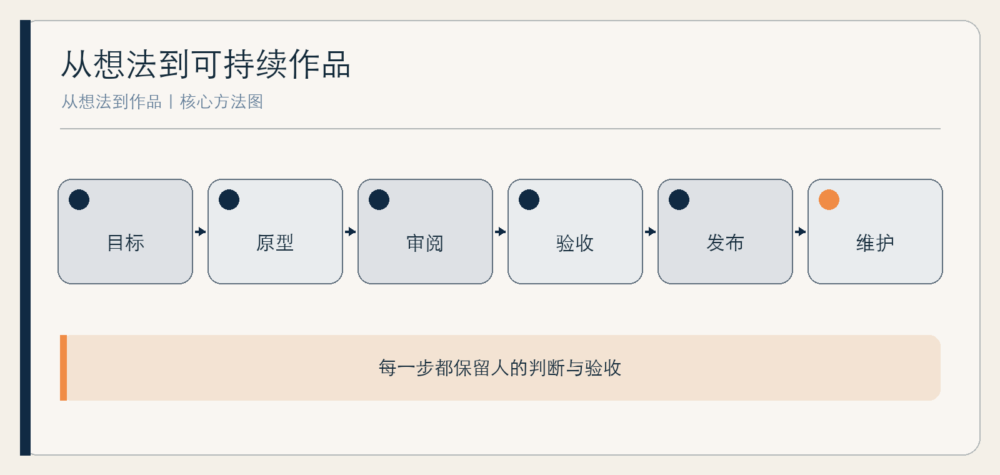

# 从想法到作品

普通人的 Vibe Coding

作者：李钊  
日期：2026 年 11 月 11 日

---

## 前言　你不必先成为程序员，但必须成为验收者

AI 把“做一个工具”的门槛降低了。你可以用自然语言描述想法，让编码代理生成页面、脚本和测试，再不断修改。然而，代码更容易生成，不等于作品更容易交付。需求含糊、依赖失控、错误数据、权限过大和无法维护，仍然会让一个看起来能运行的演示在真实使用中失败。

本书把 Vibe Coding 理解为一种以自然语言驱动、快速迭代的人机开发方式，而不是“不用理解就能安全开发”。你不必先掌握所有语法，但必须逐步学会描述目标、限定改动、审阅结果、设计验收和保留恢复路径。

全书以一个最小工具为主线，并用现有 Apple TV 遥控器教程说明硬件、语音和自动化之间的边界。涉及具体软件的内容会过期，目标、限制、验收和恢复这些基本方法不会。

## 第一章　从作品而不是代码开始

### 先决定谁在哪一刻得到什么

“我想做一个 AI 应用”不是作品定义。更好的描述是：“一位经常整理访谈的作者，在录音转写后，能把一段文本拆成待核验事实、人物观点与待访问题，并在本地导出为表格。”这句话包含使用者、场景、输入、输出和完成标志。

第一个项目最好满足三个条件：输入可控、错误可逆、结果容易检查。个人资料整理、静态页面、格式转换通常比自动付款、账号管理、医疗判断和无人监督的批量操作更适合起步。



### 作品有四个层次

界面能显示，是演示；典型输入能得到正确输出，是原型；异常输入、权限和数据也有处理，是可用工具；他人能够安装、理解、恢复和获得维护，才是可交付作品。AI 可以加速前两层，后两层仍需要你做大量判断。

**综合案例｜从“记账助手”后退一步。** 周原最初想让工具自动读取全部银行卡信息并分类。考虑到敏感数据和错误后果，他把第一版改为手动导入脱敏表格，只检查分类规则和导出结果。缩小范围不是缺乏想象力，而是先让核心假设可验证。

### 第一章的最小产出

写一页作品卡：用户、时刻、痛点、输入、输出、不做什么、最大风险、验收方式。若不能写出“不做什么”，项目通常还太大。

## 第二章　把需求说清：目标、限制与验收

### 一段好需求包含三种信息

目标说明为什么改，限制说明不能碰什么，验收说明怎样算完成。只说“优化一下页面”，代理可能重写结构、替换样式并增加依赖；补充“只改移动端导航，不改现有组件与数据文件，键盘可完成全部操作，现有测试继续通过”，改动空间就变得可检查。

在开始编码前，让代理先阅读项目并复述计划。你需要看到它准备修改哪些文件、引入哪些依赖、如何处理数据。计划不是形式，而是你发现误解的第一次机会。

### 把验收写成 observable 的行为

“体验更好”无法直接测试，“在 360 像素宽度下无横向滚动，按钮可用键盘聚焦，错误输入会显示原因且不清空已填内容”可以。验收不必全是自动化测试，但必须能被观察。

| 层面 | 不合格写法 | 可验收写法 |
| --- | --- | --- |
| 功能 | 能整理资料 | 导入指定格式后生成三类记录，并可导出 |
| 边界 | 页面好看点 | 不改变桌面布局，移动端无内容遮挡 |
| 异常 | 要稳定 | 空文件、缺列和重复行分别给出提示 |
| 安全 | 注意隐私 | 不上传原始文件，不新增第三方依赖 |

### 一次只改一个关键不确定性

如果还不知道用户是否需要这个功能，就先验证核心流程；如果已确认流程，再处理视觉和批量能力。一次同时改数据结构、界面和发布方式，出错时很难知道原因。

## 第三章　第一个小工具：先做最小闭环

### 选择一个能完整走完的例子

本书示例是一款“访谈资料分拣页”：用户粘贴一段转写文本，工具按人工设定的分隔符拆段，允许把每段标为“事实”“观点”“待问”，最后导出为 CSV。第一版不调用模型、不上传文本、不自动判断事实真假。它虽简单，却包含输入、处理、人工修正和输出。

先让代理生成静态页面与本地逻辑，再逐条验收。示例需求如下：

```text
目标：做一个仅在浏览器本地运行的访谈段落分拣页。
限制：不新增框架，不发送网络请求，不保存原始文本到服务器。
验收：可粘贴多段文本；每段可选择三种标签或留空；可修改标签；
导出 CSV 时保留原文和标签；空输入给出提示；发生编辑后，刷新或关闭页面前
显示浏览器原生离开提示，完成导出后清除该提醒。
先列出文件与实现计划，不要直接改代码。
```

### 人工检查不能被省略

代理报告“已完成”只是开始。你需要实际操作：粘贴空文本、很长的段落，以及同时包含逗号、双引号与换行的内容；导出后用目标表格软件重新打开，检查字段数量、原文和标签是否保持一致。再分别测试“编辑后未导出”和“已经导出”两种状态，确认离开提醒只在需要时出现；最后关闭网络，验证核心流程是否还能运行。

**综合案例｜导出时消失的换行。** 第一版在屏幕上正常，CSV 导入表格软件后却把多行段落挤在一起。作者没有继续说“再优化一下”，而是补充一条包含换行的失败样例，要求按 CSV 字段规则正确处理文本，并让该样例进入测试。错误由此变成下一次的验收条件。

### 为项目留一份说明

即使只有三个文件，也写清怎样打开、支持什么输入、哪些情况未覆盖、如何备份和恢复。说明文档不是额外包装，而是未来的你和其他使用者理解作品的入口。

## 第四章　让代理读懂项目，再允许它修改

### 上下文不是越多越好

把全部文件无差别交给代理，可能让它忽略关键约束，也增加敏感信息暴露。更有效的是提供项目地图：入口、数据结构、核心逻辑、测试、禁止修改区域和当前问题。对大型项目，先要求定位，不要先要求重写。

每次会话都保留一个简短的“当前约定”：目标、已完成、未解决、测试命令和下一步。它能减少模型把旧方案重新带回来的机会。

### 审阅差异，而不是审阅故事

代理擅长解释自己做了什么，但解释不能替代实际差异。你至少要检查新增依赖、删除代码、权限变化、数据流向和测试变化。对于关键文件，即使不懂每一行，也可以要求逐段说明输入、输出和失败路径。

**综合案例｜“顺便”增加的在线服务。** 代理为了实现标签建议，引入了一个在线接口。作者发现需求只要求手动标签，于是撤销该改动，并把“未经确认不得增加网络请求”写入项目约定。问题不在功能没有价值，而在它改变了数据边界。

### 高影响动作单独确认

删除文件、覆盖数据、安装依赖、执行脚本、提交代码、发布上线，不应藏在模糊的“继续”里。普通使用者最安全的工作节奏是：先计划，再小改；先测试，再扩大权限；先备份，再迁移。

## 第五章　测试：能运行不等于能交付

### 测试从真实风险出发

不必一开始追求复杂测试体系。先列出最可能、后果最大的失败：输入为空、格式不符、内容很大、重复操作、网络不可用、权限被拒绝、数据恢复失败。每项写一个样例和预期结果。

NIST 的安全软件开发框架强调把安全实践集成进开发过程，并覆盖保护软件、生产安全软件和漏洞响应等方面。AI 生成代码并不豁免这些工作。[NIST SSDF](https://csrc.nist.gov/pubs/sp/800/218/final)

### 三层验收

第一层是功能：典型任务是否正确。第二层是边界：异常和误用是否可控。第三层是变化：修改旧功能后，原有行为是否仍然成立。每次修复一个真实错误，就把对应样例留下，形成最低限度的回归测试。

| 测试类型 | 要回答的问题 | 最小证据 |
| --- | --- | --- |
| 典型流程 | 用户能否完成任务 | 操作记录或自动化结果 |
| 异常流程 | 错误是否可理解、可恢复 | 异常样例与结果 |
| 回归 | 旧功能是否被破坏 | 固定样例重复通过 |
| 发布前 | 当前版本是否就是已测版本 | 版本号、构建与检查记录 |

### 不用效果数字替代自己的项目证据

AI 编程效果受经验、项目熟悉度、工具版本和计时方式影响。METR 的研究与设计更新说明，不能用普遍提速比例替代自己的项目证据。[研究](https://metr.org/Early_2025_AI_Experienced_OS_Devs_Study-paper.pdf) [更新](https://metr.org/blog/2026-02-24-uplift-update/)

自己应记录本轮耗时、错误次数、进入成品的缺陷和后续维护难度。

## 第六章　数据、权限、依赖与安全

### 先画数据流向

列出输入从哪里来、在本地哪里处理、是否进入模型或第三方服务、保存在哪里、谁能查看、如何删除。若无法回答，就不要处理真实敏感数据。可以先用虚构或脱敏样例完成开发。

权限也按同样原则处理。一个只做文本转写的工具通常不需要屏幕录制、全部文件访问或自动执行系统命令。功能增加时再申请，不以“以后可能用到”为理由提前开放。

### 依赖是别人的代码进入你的作品

每增加一个依赖，都增加来源、维护、许可和供应链问题。优先使用成熟环境已有能力；确需新增时，记录名称、版本、用途、来源和替代方案。不要运行不理解的安装命令，也不要把密钥写进代码或公开仓库。

**综合案例｜一个“更方便”的包。** 作者在导出功能中引入了依赖，后来发现只调用其中一个简单函数。他让代理比较保留依赖与使用内置能力的差异，最终选择更小的实现。这个选择不是永远正确，但决策过程记录了维护成本。

### 小项目也需要恢复

至少保留一个已验证版本，再尝试大改。发布前确认能回到旧版本；处理用户数据前，先测试备份与恢复。对不可逆操作，采用预览、二次确认和导出副本，而不是只弹一句“确定吗”。

## 第七章　完整案例：遥控器成为创作控制器

### 把输入设备与语音来源分开

现有教程提供了一种具体实践：用 Siri Remote 的按键与触控控制编码会话，用 MacBook 麦克风完成系统听写。稳定路线的关键不是遥控器能做什么营销演示，而是把每个技术环节说清楚——Remote Buddy 读取按键，Mac 负责收音，编码代理负责修改，人负责审阅。

遥控器自身麦克风则是另一条实验路线，涉及额外系统、硬件、权限和维护限制。把两者混成“连接后都能用”，会让排障从第一步就走错。硬件规格应以厂商页面为准，第三方能力以其当前文档为准。[Apple 规格](https://www.apple.com/hk-zh-edu/shop/product/MW5G3ZA/A/siri-remote)

### 先只映射低风险动作

播放或暂停可触发听写，音量键可滚动审阅，返回键可取消，中央点按可发送。删除、推送、发布和覆盖数据不映射到遥控器，保留为需要单独确认的手动动作。每个按键设置后立即做无害测试，而不是一次映射完全部再猜哪里出错。

**真实项目改编｜口述需求。** 教程中的示例不是“帮我写个程序”，而是“先阅读项目；给首页增加深色模式；沿用现有样式，不新增依赖，不改其他页面；刷新后主题保持，键盘可操作，现有测试通过；先说明准备改哪些文件”。它把本书第二章的方法变成了可以口述的结构。

### 这个项目真正教会我们的事

Vibe Coding 的乐趣可以来自更自然的交互，但可靠性仍来自明确边界。遥控器只控制循环，不能替你判断代码是否正确；语音让输入更快，也可能让需求更随意。越是方便，越要把验收保留下来。

## 第八章　发布、维护与有尊严地停止

### 发布前回答使用者的问题

使用者需要知道：作品解决什么问题，怎样开始，数据去了哪里，有哪些限制，出错找谁，如何导出和删除。不要用“适合所有人”“完全安全”“永久免费”等无法长期保证的表述。

发布版本应与测试版本一致。记录日期、版本、主要变化和已知问题。若涉及具体依赖和操作系统，注明已测试环境，不把未测试环境写成支持。

### 维护是一种持续承诺

作品上线后，依赖可能过期，系统可能升级，用户会提出你没预见的输入。维护不一定要不断增加功能，更重要的是修复错误、更新说明、检查权限与提供迁移。

**综合案例｜停止一个仍有用户的工具。** 一款个人小工具的用户不多，作者却无法继续维护在线部分。他提前告知停止日期，提供数据导出、离线版本和替代方案，而不是让服务悄然失效。停止并不必然意味着失败，失去退出路径才是对使用者的不尊重。

### 你的下一个小项目

从一个下午能够验证核心流程的作品开始。完成作品卡、最小闭环、异常样例、数据流向和恢复说明，再决定是否扩大。最好的第一个里程碑不是“我用 AI 写了多少代码”，而是“我能解释并验收这个作品为什么值得被使用”。

## 附录　项目卡与发布检查表

### 项目卡

- 用户与使用时刻：
- 输入与输出：
- 核心任务：
- 第一版不做：
- 最大风险：
- 典型验收：
- 异常验收：
- 备份与恢复：

### 每轮修改的六步

1. 写目标、限制和验收。
2. 要求代理先阅读并列出改动计划。
3. 备份已验证版本，限制权限与文件范围。
4. 审阅差异、依赖和数据流向。
5. 运行典型、异常和回归样例。
6. 记录结果、未解决问题和下一步。

### 发布前红线

真实敏感数据未明确流向，不发布；关键流程未实际测试，不发布；不可逆操作没有确认与恢复，不发布；已知问题未写入说明，不发布；无法维护的在线承诺，不发布。

## 参考资料

1. NIST：[Secure Software Development Framework Version 1.1](https://csrc.nist.gov/pubs/sp/800/218/final)，2022。
2. NIST：[Secure Software Development Practices for Generative AI and Dual-Use Foundation Models](https://nvlpubs.nist.gov/nistpubs/SpecialPublications/NIST.SP.800-218A.pdf)，2024。
3. METR：[Early-2025 AI Experienced Open-Source Developer Productivity](https://metr.org/Early_2025_AI_Experienced_OS_Devs_Study-paper.pdf)，2025；[实验设计更新](https://metr.org/blog/2026-02-24-uplift-update/)，2026。
4. Anthropic：[Building effective agents](https://www.anthropic.com/engineering/building-effective-agents)，2024。
5. Apple：[Siri Remote 技术规格](https://www.apple.com/hk-zh-edu/shop/product/MW5G3ZA/A/siri-remote)。
6. 李钊：《Apple TV 遥控器 × MacBook Vibe Coding 教程》，本地原始项目，2026。

资料收集截至 2026 年 11 月 11 日。具体工具、系统版本、硬件能力与第三方权限在实践时应重新核对官方文档。
