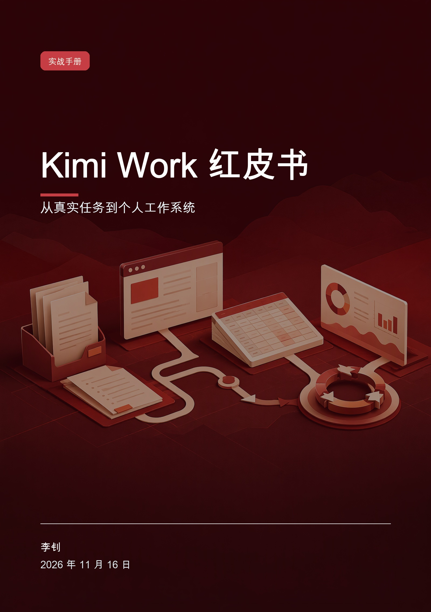

# Kimi Work 红皮书

**从真实任务到个人工作系统**

**李钊著 · 若谷书房 · 第一版 · 1.0 · 2026-11-16 · PDF 55 页**

从一项边界清楚的本地任务开始，把材料、委托、执行、交付和验收连成完整流程，再逐步扩展到网页调研、长任务、技能、插件、小组件、看板与定时任务。

[在线阅读全文](output/markdown/Kimi_Work_红皮书.md) · [下载 PDF](https://github.com/njxshr/ruogu-books/releases/download/kimi-work-redbook-v1.0/kimi-work-redbook.pdf) · [下载 EPUB](https://github.com/njxshr/ruogu-books/releases/download/kimi-work-redbook-v1.0/kimi-work-redbook.epub) · [Markdown 离线包](https://github.com/njxshr/ruogu-books/releases/download/kimi-work-redbook-v1.0/kimi-work-redbook-markdown.zip)

## 这本书讲什么

全书九章，围绕“岚桥设备”原创模拟案例展开。许宁从一份内部周报开始，逐步处理多份材料、来源冲突、局部修订、网页调研、长任务汇总和周期性执行。每一阶段都保留输入材料、执行边界、交付成果与人工责任。

书中提供通用任务委托模板、交付验收清单、常见问题排查表和四阶段练习路径。产品功能按 2026-11-16 核对到的官方资料整理，四本绿皮书仅作为实战体例参考。

## 怎样阅读

| 当前需要 | 建议阅读 |
| --- | --- |
| 第一次使用 Kimi Work | 前言与第 1—3 章，完成一项可以人工核对的小任务 |
| 处理网页调研与长任务 | 第 4—5 章，重点看来源账本、检查点和停止条件 |
| 沉淀个人工作流程 | 第 6—8 章，结合附录 A、B 整理模板与验收口径 |
| 评估团队试用 | 第 9 章，结合权限、成本、试点和退出条件设计检查表 |

## 完整目录

1. 第 1 章　认识与准备
2. 第 2 章　把任务说清楚
3. 第 3 章　交付与验收
4. 第 4 章　网页调研与专业数据
5. 第 5 章　长任务与 Agent 集群
6. 第 6 章　技能与插件
7. 第 7 章　小组件与看板
8. 第 8 章　定时任务与个人工作系统
9. 第 9 章　团队采用与责任边界

附录 A 为通用任务委托模板，附录 B 为交付验收清单，附录 C 为常见问题排查表，附录 D 为四阶段练习路径。书末列有 11 项官方资料和四本绿皮书参考体例。

## 案例与资料边界

“岚桥设备”、许宁及书中的项目材料与交付结果均为原创模拟，不代表作者经历、真实客户或产品实测。本书没有据此计算提效比例，也没有虚构使用评价。

Kimi Work 仍处于 Beta 阶段，界面、模型、套餐、配额和功能范围可能调整，实际操作以当前界面与官方说明为准。本书为独立整理的学习资料，官方文档拥有优先效力。

## 阅读、制作与检查

- [Markdown 阅读版](output/markdown/Kimi_Work_红皮书.md)
- [PDF · A5 · 55 页](https://github.com/njxshr/ruogu-books/releases/download/kimi-work-redbook-v1.0/kimi-work-redbook.pdf)
- [EPUB · 可重排阅读](https://github.com/njxshr/ruogu-books/releases/download/kimi-work-redbook-v1.0/kimi-work-redbook.epub)
- [附件校验和](release/SHA256SUMS.txt)
- [唯一主稿](manuscript/book.md) · [编辑立项](BOOK_BRIEF.md) · [20 轮审校与美化记录](REVISION_LOG.md) · [成书检查](QA_REPORT.md)

第一版于 2026-11-16 完成本地制作，2026-11-17 完成 20 轮专项审校与美化。新增工作流程闭环图、个人工作系统五层图，优化阅读路线、状态表、表格列宽、代码块、打印清单与封面。最终检查覆盖 PDF 全部 55 页、重点原页和 EPUB 封面、目录、含图章节、代码块与末章；具体范围和限制见检查记录。

Markdown 离线包包含完整书稿与两张正文配图，图片使用相对路径。后续修订从唯一主稿或本书构建脚本出发，再重新生成、检查和打包。

© 2026 李钊 / 若谷书房。引用资料保留原有署名与来源，公开阅读不另外授予统一的转载、改编或再发行许可。
