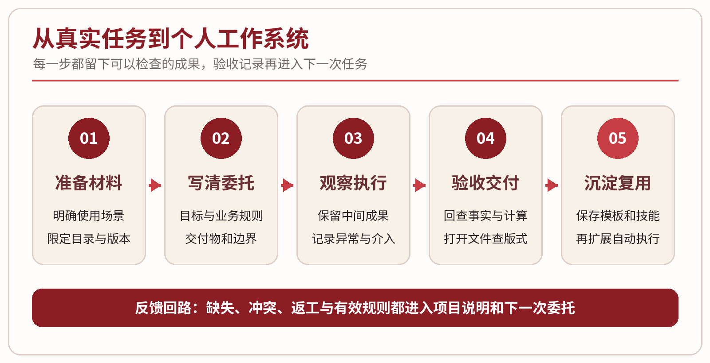
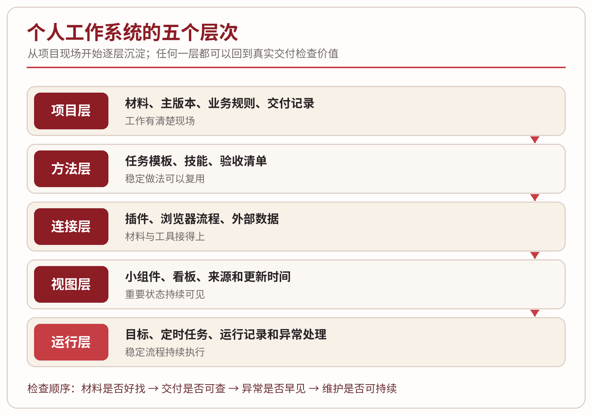

# Kimi Work 红皮书

从真实任务到个人工作系统

作者：李钊  
出版单位：若谷书房  
日期：2026-11-16  
版本：第一版 · 1.0

创作说明：本书在作者与 AI 助手的协作中形成。AI 参与资料整理、结构设计、初稿写作与文本检查；材料取舍、事实边界和最终判断仍需持续审订。

---

## 前言　把一项工作完整做完

一份周报从几份记录开始，经过核对、计算、取舍和排版，才会成为同事使用的文件。一次行业调研也从问题开始，经过检索、阅读、比对和来源整理，才会成为支持判断的材料。工作的难点，常常藏在这些连续步骤里。

Kimi Work 把这些步骤放到同一个桌面工作环境中。它读取授权目录，调用工具，使用浏览器，保存文档、表格、演示文稿等成果，也能通过目标模式、Agent 集群和定时任务处理更长的流程。官方将其定位为面向知识工作者的通用型本地 Agent，运行于 Kimi 电脑客户端的 Work 模式。[S01：Kimi Work 概览](https://www.kimi.com/help/kimi-work/overview)

本书采用一条实践路线：先完成一个小任务，再检查交付；流程稳定以后，逐步增加网页、插件、技能、长任务和自动化。每一步都保留输入材料、执行边界、成果和验收记录。功能数量会随版本增加，这套工作方法更值得留下来。

全书以“岚桥设备”为贯穿复合案例。公司、运营负责人许宁、项目资料和交付结果均为原创模拟，用来展示任务怎样被拆解和检查，不代表作者经历、真实客户或产品实测。书中没有据此计算提效比例，也没有虚构使用评价。

产品资料核对截至 2026 年 11 月 16 日。Kimi Work 仍处于 Beta 阶段，界面、模型、套餐、配额和功能范围可能调整，实际操作以当前界面与官方说明为准。本书为独立整理的学习资料，官方文档拥有优先效力。

按工作需要选择阅读顺序：

| 当前需要 | 建议阅读 | 当次练习 |
| --- | --- | --- |
| 第一次使用 Kimi Work | 第 1—3 章 | 完成一项低风险任务，并逐项核对交付 |
| 处理调研和长任务 | 第 4—5 章 | 建立来源账本，为长任务写出停止条件 |
| 沉淀个人工作流程 | 第 6—8 章 | 整理一个模板或技能，再考虑看板与定时任务 |
| 评估团队试用与采购 | 第 9 章 | 设计包含权限、成本、验收和退出条件的检查表 |



## 第 1 章　认识与准备

### 1.1 Kimi Work 在工作中的位置

普通对话适合解释概念、讨论思路和修改一段文字。许多工作任务还会继续走向文件、网页和外部服务：找到材料，提取内容，核对几个版本，生成文件，保存到指定目录，再交给下一位使用者。Kimi Work 的价值体现在这条连续链路中。

官方说明显示，Kimi Work 以 Kimi Code 为本地 Agent 内核，自客户端 3.1.0 版本起搭载 Kimi K3 模型。它可以拆解任务、调用工具、使用浏览器、创建和整理文件夹，并交付文档、表格和 PPT 等产物。Kimi Code 主要服务开发场景，Kimi Work 主要覆盖信息搬运、文件整理、数据分析和报告生产等知识工作。[S01：Kimi Work 概览](https://www.kimi.com/help/kimi-work/overview)

客户端提供 Work 与 Chat 两种模式。可以按任务需要的行动范围选择入口。

| 工作需要 | 更合适的入口 | 预期结果 |
| --- | --- | --- |
| 解释一个概念，讨论一段文字 | Chat | 文字回答或修改建议 |
| 读取多份本地材料并形成文件 | Work | 可保存、可继续编辑的产物 |
| 连续检索网页并整理来源 | Work，结合浏览器能力 | 调研结果与来源记录 |
| 定期生成简报或整理数据 | Work，结合定时任务 | 按周期运行的任务及结果 |
| 长期查看一组信息 | Work，结合小组件与看板 | 可持续维护的信息视图 |

开始使用时，可以把任务分成三个层次。第一层只需生成内容，例如起草邮件；第二层需要处理材料，例如根据三份记录生成纪要；第三层会改变文件或外部系统，例如覆盖文档、发送邮件、填写网页表单。层次越高，授权和验收越要具体。

本书重点讨论后两层。生成一段看似完整的文字，只完成了工作的一部分。材料是否读全，数字是否有依据，文件是否落在正确位置，后续使用者能否接着处理，都进入交付质量。

### 1.2 安装之后，先整理工作区

Kimi Work 支持 Mac 与 Windows。官方概览列出的系统要求为：Mac 使用 Apple 芯片，macOS 12 及以上；Windows 使用 Windows 10 及以上。下载入口以官方产品页为准。[S01：Kimi Work 概览](https://www.kimi.com/help/kimi-work/overview)

安装和登录完成后，先建立一个专用工作目录。目录不必复杂，能够让当前任务的材料和结果彼此分开即可。

```text
Kimi-Work-Practice/
├── 01-会议任务/
│   ├── materials/
│   └── results/
├── 02-周报任务/
│   ├── materials/
│   └── results/
└── 03-网页调研/
    ├── sources/
    └── results/
```

`materials` 保存本次允许读取的原始材料，`results` 保存新生成的成果。原始文件尽量保持只读，修改稿另存为新文件。任务需要沿用旧版本时，可以在目录中增加 `archive`，并写清归档日期。

官方桌面自动化指南也给出了相近的起点：创建项目，或使用已有文件夹，把相关文档放在一起，再描述任务；不需要本地文档的任务可以不使用文件夹。[S02：桌面自动化指南](https://www.kimi.com/resources/desktop-automation)

目录选择决定了 Agent 的工作半径。整个桌面、下载目录和含有私人资料的总目录，通常混入太多无关文件。一个任务对应一个清楚目录，既方便查找，也降低误读和误改的机会。

权限设置同样需要在使用前看清。官方概览列出三档全局权限：

| 权限档位 | 官方说明要点 | 适合的使用阶段 |
| --- | --- | --- |
| 默认 | 常规操作自动执行；修改、覆盖本地文件或运行代码等敏感操作前请求授权 | 日常任务与多数个人工作 |
| 手动允许 | 操作前先请求授权 | 学习阶段、重要材料、需要逐步观察的任务 |
| 全部 | 无需授权直接执行 | 仅限边界清楚、后果可承受且已经充分验证的流程 |

选择“全部”会让执行更顺，也减少了发现偏差的机会。批量移动、覆盖、删除、运行脚本和对外发送等动作，即使位于熟悉目录，也应先确认影响范围。重要资料另留备份，回退办法先于自动化存在。

### 1.3 第一个任务走通小闭环

第一次练习可以选择两份会议记录和一份旧行动清单。任务是提取已经确认的决定、责任人和日期，把没有明确的信息单独列出，最后保存一份可编辑的 Markdown 或 Word 文件。

这项工作有几个优点：材料少，人工能够完整阅读；结果有明确用途；错误容易发现；生成后可以逐项对照原文。

任务可以这样写：

```text
请读取当前项目 materials 目录中的两份会议记录和旧行动清单，
形成本次项目行动表，保存到 results/action-list-v1.md。

表格包含：事项、当前决定、责任人、截止日期、来源、待确认内容。
只写材料中有依据的责任人和日期；缺失项标记“待确认”。
保留旧清单中已经完成的事项，并在备注中说明。
本次只生成新文件，不修改 materials 中的原始材料。
```

这段委托给出了材料、动作、输出、保存位置和边界。执行后先看目录，再看文件。文件确实出现，名称和格式正确，才进入内容验收。

内容验收可以抓三项：每个决定能否回到原文；责任人和日期有没有根据相邻事项补齐；已完成事项有没有被新一轮讨论误写为待办。发现偏差后，修改指令应指向具体位置。

```text
只修改行动表中“展厅物料”一行。会议记录没有确定责任人，
请将“许宁”改为“待确认”，其他行和文件名保持不变。
```

第一次练习由此走完“准备材料—描述任务—观察执行—检查文件—局部修订”。后续更复杂的能力，都建立在这条闭环上。

### 1.4 看懂执行过程与完成状态

任务运行时，可以关注它正在读取哪些材料、准备采取哪些动作、产生了哪些文件。过程信息帮助使用者及时发现方向偏差，也帮助定位失败原因。

一份报告迟迟没有生成，可能来自材料无法读取、工具权限不足、网络异常、任务范围过大或生成过程仍在继续。连续重发同一条指令，容易增加并行任务和版本混乱。先保存现有状态，确认卡点，再选择继续、缩小范围或新建任务。

任务显示完成后，仍需区分三种状态：

| 状态 | 已经确认 | 仍需检查 |
| --- | --- | --- |
| **执行结束** | 本轮工具调用和文本生成已经停止 | 文件是否真正保存，保存位置是否正确 |
| **产物形成** | 要求的文件已经保存，并能正常打开 | 内容、来源、计算与格式是否达到使用标准 |
| **工作可用** | 内容、格式和依据通过验收 | 后续发布、批准或业务承诺由有权限的人决定 |

第三种状态需要人的判断。对外发布、批准预算、改变客户承诺和修改人事安排，都属于后续业务动作，不能由一份生成文件自动替代。

本章的最小成果是一份小任务记录：原始材料、任务委托、生成文件、检查结果和一次局部修改。把它保留下来，下一章会在此基础上增加业务规则和判断口径。

## 第 2 章　把任务说清楚

### 2.1 从成果的使用场景倒推委托

“整理一下周报”可以有很多种结果。给团队内部跟进的周报，需要突出责任人和阻碍；给管理层讨论的周报，需要突出偏差、影响和待决事项；给客户阅读的周报，还要考虑保密范围和承诺口径。材料相同，使用场景不同，成果也会不同。

写委托时，先确定一件事：成果交给谁，用来支持什么行动。再补充统计时点、材料范围、交付格式和不能越过的边界。

“岚桥设备”的复合案例从这里开始。许宁负责整理每周经营简报，手边有四类材料：项目计划、销售进展表、会议记录和产品资料目录。过去，他需要在多个文件之间来回复制，完成后还要逐项检查日期和状态。

本次任务先缩小为内部周报，不包含对外发送，也不自动修改项目计划。读者是项目负责人和部门主管，使用目的为周会讨论。截止统计时间为 2026 年 11 月 13 日 18:00。案例日期只用于模拟材料内部对齐。

| 委托要素 | 岚桥设备周报任务 |
| --- | --- |
| 使用人 | 项目负责人、部门主管 |
| 使用场景 | 周会核对进展、风险和待决事项 |
| 统计时点 | 2026-11-13 18:00 |
| 输入材料 | 项目计划、销售进展表、会议记录、产品资料目录 |
| 交付物 | 周报、待确认问题、来源对应表 |
| 执行边界 | 只读原始材料；新文件写入 results；不发送消息 |
| 完成口径 | 覆盖计划事项，保留冲突，关键判断可回查 |

这七项内容足够支撑第一次执行。它们也把任务从“写一份漂亮周报”变成了可检查的工作委托。

### 2.2 准备最小充分的上下文

上下文包括目标、材料、规则、角色、已有记录和执行中取得的新信息。材料多并不必然提高质量，过期文件、重复版本和无关记录也会增加误判。

准备材料时，可以给每份文件补上简短说明：

| 文件 | 本次用途 | 版本或时点 | 需要注意 |
| --- | --- | --- | --- |
| project-plan.xlsx | 确定计划事项、原定期限和验收口径 | 2026-11-10 版 | 后续改期需负责人批准 |
| sales-progress.xlsx | 提供销售阶段和预计日期 | 截至 2026-11-13 | 预计签约属于预测 |
| meeting-11013.docx | 提供会议决定、争议和新问题 | 2026-11-13 | 建议改期尚未批准 |
| product-catalog.xlsx | 核对产品名称和资料版本 | 2026-11-12 导出 | 不用于判断销量 |

Kimi Work 输入框支持用 `@` 添加上下文，用 `/` 快速使用技能。[S01：Kimi Work 概览](https://www.kimi.com/help/kimi-work/overview) 无论通过目录还是引用添加材料，都应在委托中说明各材料承担的角色。一个文件被读取，不代表其中的信息适合支持所有结论。

最小充分的意思是：足以完成当前判断，同时尽量减少无关内容。周报需要项目计划和会议记录，未必需要整个历史邮件归档。行业调研需要权威公开资料，也未必需要把所有搜索页面保存下来。

长项目可以维护一份简短说明，记录目录结构、主版本、术语、常用统计口径和验收规则。后续任务从这份说明出发，减少重复解释，也减少依赖某次长对话的记忆。

### 2.3 把业务规则写进完成口径

同样的记录，在不同业务规则下会得到不同结论。项目成员写下“已完成”，可能表示开发结束；项目计划中的“已完成”，可能要求测试、验收和资料更新全部结束。委托需要指出本次采用哪一种口径。

岚桥设备的模拟计划规定：客户培训报名页面只有同时通过“提交成功”和“名单导出”两项检查，才算完成。11 月 13 日的会议记录显示提交成功，导出仍然失败。周报应保留“尚未通过验收”，同时写明开发记录与现场结果存在差异。

预计签约日期也需要区分。销售进展表中的日期用于内部预测，会议没有形成客户承诺。周报可以保留预计日期，并标为“销售预测”，避免读者将其理解为已经确认的交付安排。

任务委托可以扩充为：

```text
请根据当前项目 materials 中的四份材料，生成截至 2026-11-13 18:00 的内部周报。

判断规则：
1. 项目完成状态以 project-plan.xlsx 中的验收口径为准。
2. 开发自报与会议现场结果冲突时，两者都保留，并说明差异。
3. 原定期限、建议改期和已批准改期分别记录。
4. 销售预计签约日期标为预测，不写成客户承诺。
5. 材料未提供的责任人、金额和日期标记“待确认”。

请交付：
- weekly-report-v1.md：供周会讨论的内部周报；
- pending-questions-v1.md：需要负责人决定或补充的事项；
- evidence-map-v1.md：关键判断与来源记录的对应表。

三份文件保存到 results。原始材料保持不变，不发送任何外部消息。
```

完成口径越具体，验收越直接。报告是否“专业”很难统一判断，计划事项是否覆盖、冲突是否保留、预测是否标明，却可以逐项检查。

### 2.4 给缺失信息和冲突留下位置

材料不全时，流畅表达最容易掩盖问题。Agent 可能根据常识补入责任人，根据相邻任务推定期限，也可能把多数记录中的说法当成唯一事实。任务约定需要明确缺失信息的处理方式。

可以把信息分成四层：

| 层次 | 示例 | 可支持的用法 |
| --- | --- | --- |
| 原始记录 | 会议中提出将验收延至 11 月 16 日 | 说明有人提出建议 |
| 已确认事实 | 负责人在批准记录中同意改期 | 更新正式期限 |
| 团队解释 | 成员认为延期来自导出故障 | 作为待验证原因 |
| 工作建议 | 建议先修复导出再重新验收 | 供负责人讨论 |

四层都能进入报告，标注方式应当不同。建议获得批准以后，才会成为新的安排；解释取得证据以后，才会成为更可靠的事实。

冲突也有不同来源。两份文件可能采用不同统计时点，同一字段可能有不同定义，同一件事也可能确实发生了变化。简单保留最新文件，容易误删仍然有效的制度；简单采用多数意见，也会忽略少数记录可能来自更直接的现场。

较好的交付会写出冲突两边、各自日期和适用范围，再列出能够区分它们的下一条证据。例如重新运行一次名单导出，保存测试结果，由验收人确认。这个动作比继续润色结论更有价值。

本章的产物是一份可复用任务委托。它记录使用场景、材料角色、业务规则、缺失处理和交付边界。下一次更新数据时，只需替换材料和统计时点，保留已经稳定的规则。

## 第 3 章　交付与验收

### 3.1 文件、依据和下一步一起交付

一项工作成果通常包含三部分：供人使用的成品，支持关键判断的依据，以及仍需推进的事项。三者可以合并，也可以分成多个文件，取决于使用场景。

岚桥设备周报采用三份文件。周报服务周会；来源对应表服务核查；待确认问题服务会后推进。这样做的价值在于，报告不必堆满所有原始记录，核查仍有清楚入口。

来源对应表可以采用以下结构：

| 关键判断 | 使用材料 | 原始记录位置 | 处理说明 |
| --- | --- | --- | --- |
| 报名页面尚未通过验收 | 项目计划、进展表、会议记录 | 计划 T02；进展 R02；会议 M03 | 两项验收条件只满足一项 |
| 建议改期尚未批准 | 会议记录 | 会议 M04 | 保留原日期与建议日期 |
| A 产品预计签约为销售预测 | 销售进展表 | 机会 S05 | 未见客户确认材料 |
| 培训反馈汇总负责人待定 | 项目计划、会议记录 | 计划 T05；会议 M06 | 参会身份不能替代任务认领 |

表中的编号和位置应在实际材料中真实存在。生成对应表之后，抽查几条关键判断，确认链接、页码、工作表或段落能够支持相应句子。引用数量多，并不能弥补来源与主张不匹配。

待确认问题则应指向下一步行动。问题需要由谁处理、影响哪项决定、期望在什么时间前得到答复，都可以写清。对于模拟周报，最重要的待决事项包括是否批准改期，以及谁负责重新组织验收。

### 3.2 文档、表格和演示文稿分别验收

不同格式的风险不一样。文档容易隐藏事实和推导的混合；表格容易出现公式、口径和汇总错误；演示文稿容易在压缩信息时丢掉限制条件。

**文档验收**先看覆盖，再看依据，最后看语言。计划中的事项是否全部出现，重大冲突是否保留，结论是否超出材料，都应先于措辞检查。语言润色无法改变一条缺乏依据的结论。

**表格验收**需要回到原始数据和公式。检查字段含义、统计范围、空值、重复记录、日期格式、单位和汇总口径。关键总量可以抽取几行手工复算，图表所使用的数据范围也要核对。

**演示文稿验收**同时关注内容和页面。每页标题应表达一个清楚意思，重要数字能回到来源，备注或附录保留必要限制。实际打开文件，检查字体、图表、溢出、分页和可编辑性。截图看起来正常，源文件仍可能存在无法编辑或元素错位的问题。

Kimi Work 能生成多种工作产物，官方资料列举了文档、PDF、PPT、Excel、网站等形式。[S04：Kimi Work 介绍](https://www.kimi.com/resources/kimi-work-introduction) 格式越丰富，越需要明确最终使用方式。供继续修改的 PPT 和供直接阅读的 PDF，验收重点并不相同。

### 3.3 局部修订减少新的偏差

第一版成果出现错误时，先定位原因。材料本身冲突、委托遗漏规则、工具读取失败、计算错误和表达偏差，需要不同处理。

材料冲突应补充记录或保留两种说法；规则遗漏应修改委托和项目说明；读取失败应处理文件格式、权限或路径；计算错误应重新核对公式与数据范围；表达偏差则可以通过局部编辑修正。

反馈要带上位置、依据和保留范围。以下指令比“重新写一版”更容易控制：

```text
只修改 weekly-report-v1.md 的“项目状态”一节。
会议 M04 仅记录改期建议，没有批准意见。
请保留原定 11 月 13 日，另列建议日期 11 月 16 日，
并将“是否批准改期”加入待确认问题。
其他章节、表格顺序和文件路径保持不变。
```

修改完成后，除了检查被指出的句子，还要看相关内容是否同步。新日期出现在周报中，待确认问题和来源对应表也应保持一致。若局部修改导致其他段落变化，需要比较差异，确认没有删掉原有依据。

版本命名可以使用 `v1`、`v2`、`approved` 等清楚状态，避免“最终版2”“最终版真的最终”一类名称。已被负责人确认的版本另存归档，后续修改从新副本开始。

### 3.4 把人工投入算进结果

判断是否值得复用一套流程，需要记录完整投入。模型生成速度很快，找材料、补背景、等待授权、检查、返工和修复文件仍可能占据大量时间。

可以保留一张简短记录表：

| 阶段 | 记录内容 |
| --- | --- |
| 准备 | 搜集材料、确认版本、清理权限所需时间 |
| 委托 | 编写任务、补充规则、确认计划所需时间 |
| 执行 | 实际等待、工具失败、重新执行的情况 |
| 验收 | 核对事实、复算数据、检查版式所需时间 |
| 修订 | 局部修改、再次验证和版本整理所需时间 |
| 维护 | 下次复用时更新模板、技能和外部连接的工作 |

比较时尽量采用相近任务和同一交付标准。一次生成只花了五分钟，却需要四十分钟逐项纠错，与一次较少返工的交付具有不同价值。

质量也需要记录。遗漏减少、来源更清楚、待决事项更早暴露，都可以作为具体观察。没有足够样本时，保留这些观察即可，暂时不换算成普遍提效比例。

岚桥设备案例没有真实人工计时和费用记录，因此本书只提供核算框架，不给模拟团队安排漂亮数字。读者可以用自己的下一次周报建立基线。

### 3.5 稳定以后再复用

一次成功交付可以带来信心，仍不足以证明流程稳定。适合复用的任务通常具有以下特征：重复出现；输入结构相近；业务规则明确；结果容易验收；失败后果可以控制。

复用也有不同层级。下一次只需要少量提示，可以保存任务模板；每次都要执行相同检查，可以整理项目说明；流程包含多个固定步骤和专用资料，可以考虑做成技能；时间固定、输入和输出都稳定，再考虑定时任务。

每增加一层自动化，都保留一次小样本验证。材料格式变化、产品升级、外部网站改版和业务口径调整，都可能让过去可靠的流程出现新问题。

到这里，岚桥设备周报已经具备基本交付闭环。下一章加入公开网页和专业数据，同时增加一条证据链，让外部信息也能被清楚核查。

## 第 4 章　网页调研与专业数据

### 4.1 先确定调研决定，再开始收集

网页调研很容易积累大量材料。搜索结果越来越多，真正需要决定的事情却仍停在原处。控制调研范围的办法，是先写明成果将支持哪项行动，再据此确定来源、时间范围和停止条件。

岚桥设备准备在周报中增加一段行业观察，供管理层讨论下季度培训内容。许宁把任务限定为三个部分：行业内公开出现的培训主题，主要厂商近期公开资料中的产品变化，以及这些变化与公司现有培训安排的关系。调研只提供讨论材料，不直接形成采购决定。

这样的范围会排除许多有趣但暂时无用的信息。与公司产品无关的海外创业公司、缺少发布时间的转载文章、无法核对原始出处的市场比例，都可以暂缓进入正文。

一份调研委托应包含：

- 需要支持的决定或使用场景；
- 对象、地区和时间范围；
- 优先采用的来源类型；
- 必须保存的证据，例如发布日期、原文链接和引用段落；
- 交付形式与篇幅；
- 无资料、资料冲突和访问受限时的处理方式。

停止条件同样重要。可以约定覆盖预先列出的对象和主题，核心结论均取得可追溯来源后结束。若继续检索只为了增加页数，调研成本会不断扩大，结论未必更可靠。

### 4.2 搜索、阅读网页与操作浏览器各有分工

联网搜索适合发现候选资料，网页阅读适合核对正文，浏览器自动化则适合需要点击、滚动、填写和下载的连续操作。三者可以组合，但证据标准保持一致。

Kimi 浏览器扩展原名 Kimi WebBridge。官方资料说明，它支持 Chrome 和 Edge，可以沿用浏览器已有的网站登录状态，在页面中读取内容、点击按钮、填写表单和提取信息；在 Kimi Work 中可从插件市场安装并调用。[S05：Kimi 浏览器扩展](https://www.kimi.com/resources/kimi-browser-extension)

适合交给浏览器能力的任务包括：打开一组公开报告并记录发布日期，在授权后台导出指定周期的数据，把网页中的公开表格保存到本地，或者按照固定条件筛选资料。

涉及登录状态时，工作边界需要更加明确。能够访问页面，只说明当前账号拥有相应权限，并不表示所有内容都允许批量采集、转发或写入其他系统。网站服务条款、组织内部规定和个人信息保护要求仍需遵守。

准备类动作和生效类动作可以分开：

| 阶段 | 浏览器任务示例 | 人工控制点 |
| --- | --- | --- |
| 读取 | 打开报告目录，收集公开链接 | 核对网站和资料范围 |
| 整理 | 提取标题、日期、作者和摘要 | 抽查正文是否匹配 |
| 草拟 | 填写表单草稿，准备待发送内容 | 检查字段和附件 |
| 生效 | 提交表单、发送消息、修改业务记录 | 由有权限的人确认后执行 |

提交、发布、支付、删除和批量修改具有高后果。即使过去已经成功运行，也应在每次执行前检查对象、数量和输入内容。

### 4.3 专业数据库提供材料，判断仍需回查

Kimi Work 的插件与专业数据库覆盖外部应用、金融、科研、法律等方向。官方概览列举了 Canva 可画、Notion、WPS 等应用示例，并说明可以连接专业数据库。[S01：Kimi Work 概览](https://www.kimi.com/help/kimi-work/overview)

使用专业数据源时，委托中应写清指标、日期、市场、单位和口径。以财务数据为例，同一公司可能有不同报告期、币种和会计口径；以学术资料为例，题名相近的论文可能有预印本、会议版和期刊版；以法律资料为例，还需核对效力状态、适用范围和公布日期。

插件返回的结构化结果适合进入后续计算，也仍需保留查询条件。建议同时保存以下信息：

| 字段 | 用途 |
| --- | --- |
| 数据提供方与具体产品 | 说明材料来自哪里 |
| 查询词与筛选条件 | 允许他人复现查询 |
| 数据日期与获取时间 | 区分业务时点和检索时点 |
| 单位、币种与统计口径 | 避免直接拼接不可比数据 |
| 原始链接或记录标识 | 支持回查与更新 |
| 使用限制 | 提醒授权、版权和适用范围 |

结构化字段看起来整齐，也可能存在空值、重复、延迟和定义差异。进入报告之前，先检查这些数据条件，再处理图表和文字。

### 4.4 建立能回到原文的证据账本

证据账本记录一项主张为什么暂时可以使用。它不需要成为复杂数据库，一张表就能开始。

| 主张 | 来源与定位 | 来源实际支持的内容 | 本书使用方式 | 限制 |
| --- | --- | --- | --- | --- |
| 某厂商在某日期发布某项资料 | 官方页面标题、日期和相关段落 | 证明该机构发布了资料 | 写成机构公开动作 | 页面存在不代表效果经过独立验证 |
| 某主题值得纳入培训讨论 | 多份公开资料与内部需求记录 | 提供主题出现的背景 | 标为团队分析建议 | 不代表行业普遍趋势 |
| 某项市场数字 | 原始报告的定义、样本和年份 | 支持特定范围的数据描述 | 保留口径后引用 | 不外推到未覆盖市场 |

这里的示例只展示记录方式，没有为模拟案例填入虚构市场结论。实际写作时，每条关键主张都应找到相应原文，再决定它进入事实、引述、分析还是建议。

一篇转载可能引用另一篇转载，最后才回到原始报告。十个页面重复相同文字，也可能只有一条消息来源。证据账本应尽量指向原始材料，并记录转引关系。

无法访问全文时，只写已经看到的摘要或公开片段。付费墙、登录限制、页面失效和检索未命中属于不同情况，分别记录，避免把一次访问失败写成某项资料不存在。

调研交付可以包括一份正文、一张来源表和一份待核材料清单。正文服务阅读，来源表服务复核，待核清单服务下一轮补充。三者共同构成可以持续维护的研究成果。

## 第 5 章　长任务与 Agent 集群

### 5.1 目标模式适合有终点的多轮工作

有些任务需要反复检索、尝试、检查和修订，一轮对话难以完成。目标模式用于保存一个持续目标，让 Kimi Work 围绕最终结果推进多个轮次。官方资料建议在使用时说明目标、约束和验收标准。[S04：Kimi Work 介绍](https://www.kimi.com/resources/kimi-work-introduction)

适合目标模式的工作通常具备四个条件：终点清楚；路径需要探索；过程中会产生可检查的中间成果；完成与否能够通过证据判断。

例如，“在限定来源范围内完成三家厂商的资料核对，形成带来源的比较表，并列出无法核实的字段”具有明确终点。“持续研究行业，直到足够全面”缺少范围和完成条件，执行很难收敛。

目标可以这样写：

```text
/goal 完成岚桥设备下季度培训资料的行业比较初稿。

范围：三家指定厂商；2026 年公开资料；只使用可公开访问的页面和已授权材料。
交付：比较表、来源账本、两页讨论摘要，保存到 results/goal-research/。
完成条件：三家厂商的五个指定字段均已核对；缺失字段有明确标记；
每条关键结论能够回到来源；摘要区分公开事实与本书分析。
限制：不注册新账号，不提交表单，不绕过访问限制，不购买报告。
出现来源冲突或关键访问失败时，保留现有成果并报告阻塞。
```

这个目标没有要求 Agent 不断追问。可以由人提前提供必要范围，执行中遇到关键缺口则形成阻塞记录。准备越充分，长任务越少停在基础信息上。

### 5.2 长任务需要预算、检查点和停止条件

任务运行时间越长，偏差累积的影响越大。开始前可以设置三类边界：资源预算、阶段检查点和失败停止条件。

资源预算包括时间、可访问对象、可调用服务和可承受费用。具体额度因账号和套餐而异，应以当前界面为准。没有把握时，先跑一个小范围阶段，观察消耗和成果，再决定是否扩大。

阶段检查点让长任务分成几次可验收交付：

```text
阶段一：确认对象与资料目录
阶段二：完成逐家来源摘录和字段比较
阶段三：合并结果，检查冲突与遗漏
阶段四：生成讨论摘要和最终来源账本
```

每个阶段都保存文件。后续阶段失败时，前面的有效成果仍可保留，不必从零开始。

停止条件需要覆盖几种情况：关键资料无法取得；任务要求相互冲突；继续执行需要新的权限；发现可能超出授权的数据；连续修订仍无法达到验收标准；实际范围明显超出原定对象。

停止并不等于放弃。它可以保护已有材料，让负责人重新决定缩小目标、增加资源或改变方法。长任务的控制能力，体现在能够暂停、恢复、接管和结束。

### 5.3 Agent 集群先看任务能否拆开

官方概览说明，Kimi Work 支持在 Agent 与 Agent 集群两种执行模式间切换，Agent 集群可根据任务复杂度创建最高包含 300 个子 Agent 的团队。[S01：Kimi Work 概览](https://www.kimi.com/help/kimi-work/overview) 这个上限说明系统具备大规模并行能力，具体任务仍需根据结构和必要性选择。

适合并行的子任务具有清楚接口。例如三家厂商分别检索，每家使用同一张字段表；十二份报告分别摘录，每份采用同一证据格式；多个独立数据集分别完成质量检查。

高度耦合的工作则难以拆开。一篇短报告的主线、论点和措辞需要保持一致，分给多个角色可能产生风格拼接；一个核心决定依赖同一组争议证据，多个子 Agent 各自下结论可能增加冲突。

可以用一个简单核算理解并行价值：

```text
并行净收益
= 节省的执行时间
- 任务拆解成本
- 上下文交接损失
- 结果合并成本
- 统一验收成本
```

式子用于提醒记录投入，不要求在没有测量时编造精确数值。子 Agent 越多，任务说明、结果格式和合并责任越重要。

岚桥设备的三家厂商调研可以并行，因为对象独立、字段一致、来源格式统一。最后的行业判断由主任务统一完成，避免每路子任务各自使用不同评价尺度。

### 5.4 汇总时重新检查口径与证据

并行结果返回后，汇总工作才开始进入关键阶段。各子任务可能采用不同日期、产品版本和分类方式，也可能把同一来源重复计算。

统一验收至少包含以下步骤：

1. 检查每个子任务是否使用同一对象范围和时间范围。
2. 对齐字段定义、单位、日期和缺失标记。
3. 合并重复来源，保留原始出处。
4. 检查结论是否超出各自材料。
5. 对重要差异保留解释，不强行形成一个整齐答案。
6. 由主任务生成完整文件，并再次检查交付清单。

比较表中的“未查到”需要进一步区分：某个子任务没有检索到，公开页面没有披露，还是访问受到限制。汇总者不能把不同情况都压成同一个空白单元格。

最终报告还应保留各子任务的覆盖情况。哪些对象完整完成，哪些只取得部分资料，哪些结论仍待人工复核，读者需要看到这些边界。

### 5.5 长任务结束以后留下运行记录

一次长任务的记录可以包括目标原文、实际执行范围、主要中间产物、人工介入、失败与恢复、最终验收和未解决问题。

这份记录有几个用途：帮助下次判断同类任务是否适合目标模式或集群；帮助定位哪一类步骤最容易失败；帮助团队区分一次性问题和流程缺陷；也为费用、权限和责任复盘提供依据。

如果任务结果很好，仍应保留实际人工介入。如果结果不理想，也应区分目标定义、材料质量、工具连接和模型处理等原因。简单归结为“AI 不稳定”，无法指导下一次改进。

长任务结束后，除了最终报告，还应留下更清楚的任务结构和验收证据。

## 第 6 章　技能与插件

### 6.1 分清方法、连接和执行环境

使用一段时间后，许多需求会反复出现。每周整理同类文件，每月生成相同结构报告，经常访问某一系统，反复执行一组检查。技能与插件可以减少重复解释和手动切换。

先用一张表分清它们在工作中的角色：

| 能力 | 主要承担的内容 | 典型例子 |
| --- | --- | --- |
| 技能（Skill） | 一类任务的触发条件、步骤、资料和验收方法 | 周报整理、文献核查、PPT 制作 |
| 插件 | 连接外部应用、数据库或专业服务 | WPS、Notion、专业金融或法律数据 |
| Kimi 浏览器扩展 | 在浏览器中读取和操作网页 | 页面检索、表单填写、资料下载 |
| 项目目录与说明 | 保存当前工作所需的材料和长期约定 | 主版本、业务口径、目录规则 |
| 定时任务 | 在指定时间执行固定任务内容 | 每周一生成资料摘要 |

Kimi Work 支持专业 Skills、第三方技能推荐和本地上传，也支持插件与专业数据库。[S01：Kimi Work 概览](https://www.kimi.com/help/kimi-work/overview) 实际可用项目随版本和账号变化，选择时以当前市场与官方说明为准。

技能与插件经常配合出现。一个“月度经营报告”技能可以规定读取哪些字段、怎样检查异常、报告采用什么结构；数据插件负责取得其中一类外部数据；本地目录保存内部材料；最后由人复核并决定发布。

### 6.2 安装之前检查来源、权限和维护成本

插件和技能会扩大 Agent 的能力，也会增加新的依赖。安装之前，先确认它解决了当前流程中的哪段问题。没有明确任务，只因为功能丰富而安装，容易让选择变复杂，也会增加授权和维护工作。

检查分五项：

| 检查项 | 需要留下的信息 |
| --- | --- |
| 来源 | 官方、可信第三方或自有材料；版本与更新日期 |
| 数据范围 | 会读取哪些文件、网页、账号和业务记录 |
| 行动范围 | 只读、写入、发送、删除或执行代码 |
| 任务适配 | 输入输出是否符合当前工作，能否小样本验证 |
| 维护方式 | 失败由谁处理，版本变化怎样复核，何时停用 |

只读任务优先只授予读取权限。生成邮件草稿与发送邮件分开授权。处理内部资料时，先确认是否允许进入第三方服务，以及输出会保存到哪里。

安装后用一项已知结果的小任务验证。检查它能否找到正确材料，是否产生预期文件，是否触碰了任务之外的内容。验证通过以后，再逐步增加数据和权限。

不再使用的插件和技能及时停用或卸载。保留下来的能力越多，越需要定期核对版本、账号授权和实际使用频率。

### 6.3 把稳定流程整理成技能

技能适合保存一类任务的做法。岚桥设备周报已经连续运行几次，材料结构和验收规则基本稳定，许宁可以把共同部分整理成技能。

技能第一版只需写清触发条件、输入、步骤、交付、边界和失败处理。以下示例展示内容结构，使用前应按实际客户端要求调整文件和字段。

```markdown
---
name: weekly-evidence-report
description: 当用户提供项目计划、进展记录和会议材料，并要求生成带证据的内部周报时使用。
---

# 带证据的内部周报

## 输入
- 项目计划与验收口径
- 本期进展记录
- 会议记录
- 统计时点和输出目录

## 工作流程
1. 核对材料清单、版本和统计时点。
2. 按计划列出全部事项，再补充本期新增事项。
3. 区分原始记录、已确认事实、团队解释和工作建议。
4. 保留状态、责任人和日期的冲突及缺失。
5. 生成周报、待确认问题和来源对应表。
6. 检查计划覆盖率、关键判断来源和文件保存位置。

## 边界
- 不修改原始材料。
- 不自动发送消息或更新业务系统。
- 缺少验收口径时标出限制，不自行创造完成标准。
- 无法读取关键材料时停止相关结论，保留已完成部分。

## 交付
- weekly-report.md
- pending-questions.md
- evidence-map.md
```

这份技能保存了业务方法，具体项目计划仍由每次任务提供。技能本身不应塞入某一周的临时日期和个别人员信息。

浏览器中的稳定网页流程也可以沉淀为技能。官方浏览器扩展资料介绍了“把网页变成技能”和“把操作录成技能”等用法；录制过程时可将密码等敏感信息设为保密参数，回放时再填写。[S11：Kimi 浏览器扩展使用案例](https://www.kimi.com/help/kimi-browser-extension/kimi-browser-extension-use-cases) 对这类技能，还要检查网站条款、页面变化和每一步生效动作。

### 6.4 用样例和失败记录维护技能

技能保存以后，需要知道它在哪些输入上可靠。可以保留一小组样例：正常材料、缺失字段、冲突记录、无法读取文件和超出范围的请求。

每个样例都写清预期结果。例如：

| 样例 | 输入特点 | 必须出现的结果 |
| --- | --- | --- |
| 正常周报 | 材料齐全，口径明确 | 三份文件齐全，来源可回查 |
| 责任人缺失 | 会议只有期限，没有认领人 | 责任人标为待确认 |
| 改期未批准 | 有建议日期，没有批准记录 | 原日期与建议日期并列 |
| 文件无法读取 | 关键表格加密或损坏 | 说明限制，不生成相关确定结论 |
| 外部发送请求 | 用户要求直接发客户 | 保留草稿，请求相应授权与确认 |

每次修改技能，都用旧样例重新检查。这样可以发现修正一个问题时是否引入另一个问题。

失败记录应尽量具体：触发了错误技能、漏读了材料、误用了字段、输出了没有依据的日期，还是外部连接失败。针对失败点修改触发条件、步骤或检查清单，避免每次遇到偏差都重写整份技能。

技能也需要退役。业务停止、官方能力已经覆盖、长期无人维护或与其他技能大量重叠时，可以合并或删除。一个精简、经常验证的技能集合，比堆积许多过时说明更容易使用。

至此，个人工作已经具备两层资产：一层是项目材料和交付记录，另一层是可复用的技能与连接。下一章把其中需要经常查看的信息整理成小组件和看板。

## 第 7 章　小组件与看板

### 7.1 把反复查看的信息做成视图

报告适合完整叙述，表格适合逐项核对。有些信息需要经常打开、快速浏览和持续更新，例如项目风险、待决事项、数据更新时间和行业动态。小组件与看板为这类信息提供了更持久的呈现方式。

官方帮助中心将小组件定义为模型生成、在会话中呈现的交互页面。它可以连接本地数据或外部插件，也可以保存到看板中长期查看。看板则是存放小组件的容器，围绕一个主题、项目或目标组织信息，不依附于某次对话。[S06：小组件](https://www.kimi.com/help/kimi-work/widgets)、[S07：看板](https://www.kimi.com/help/kimi-work/dashboard)

创建之前，先确定视图服务的使用动作。每天查看风险列表，可能是为了安排当天跟进；查看数据更新时间，可能是为了判断能否使用旧结果；查看行业动态，可能是为了挑选需要进一步阅读的资料。动作明确以后，字段和布局自然收窄。

岚桥设备的周报已经形成三份文件。许宁每周仍会反复检查四类信息：当前高风险事项、等待负责人决定的问题、未来七天到期的任务，以及行业资料的最近更新时间。这四类信息可以组成“经营简报”看板。

| 小组件 | 主要字段 | 使用动作 |
| --- | --- | --- |
| 风险事项 | 事项、影响、责任人、当前状态 | 安排排查和协调 |
| 待决问题 | 决定内容、负责人、影响期限 | 推动确认和批准 |
| 到期任务 | 任务、日期、完成口径 | 检查交付准备 |
| 资料动态 | 标题、来源、发布日期、获取时间 | 选择需要阅读的新资料 |

表格中的内容来自模拟工作设计。真正创建时，应指定实际数据源和更新方式，避免组件展示手工填写后又无人维护的静态状态。

### 7.2 静态呈现与动态更新分别设计

小组件可以只保存一次整理结果，也可以绑定小组件任务，形成动态小组件。官方说明中，小组件任务可以定时或由事件触发，动态小组件随任务执行更新内容。[S06：小组件](https://www.kimi.com/help/kimi-work/widgets)

静态组件适合结构稳定、更新频率低的内容，例如项目术语、流程说明和联系人分工。动态组件适合有可靠数据源、更新规则和异常处理的内容，例如每周任务状态或定期公开资料摘要。

动态化之前，先检查三件事：数据源是否持续可用；更新失败能否被发现；旧数据会不会被误认为最新结果。一个组件持续显示上周数字，却没有更新时间，比暂时没有组件更容易误导行动。

动态组件至少显示以下信息中的一部分：

- 数据来源与统计范围；
- 最近成功更新时间；
- 数据所属周期；
- 待确认或异常项目；
- 查看完整报告或原始材料的入口。

对于风险、财务、合同和人事相关信息，还应考虑可见范围。把组件固定到桌面，会增加旁人看到内容的机会；看板便于集中查看，也需要遵守原有资料权限。

岚桥设备的“风险事项”可以来自已经确认的周报文件，每周更新一次。“待决问题”在负责人作出决定后还需要写回主记录，否则组件会继续显示旧状态。数据流要形成回路：来源更新，任务运行，组件刷新，人处理事项，处理结果再回到来源。

### 7.3 看板围绕工作主题组织

看板的价值来自信息之间的关系。把许多互不相关的图表放进同一页面，只会增加视觉负担。一个看板最好围绕一个主题、项目或目标，让使用者能够在一个页面内完成一轮检查和行动。

“经营简报”看板可以采用以下顺序：

```text
顶部：统计周期、最近更新、异常提示
第一区：需要立即处理的风险与待决问题
第二区：未来到期事项和关键进展
第三区：行业资料动态与完整报告入口
底部：数据口径、来源说明和维护责任人
```

重要信息放在上面，异常保持可见，详细数据留在可展开的组件或源文件中。颜色用于区分状态，避免每个模块都使用高亮色，导致真正紧急的内容失去辨识度。

看板支持拖拽排布、调整大小和位置批注。官方资料还提供了将小组件固定为独立桌面窗口的能力；退出客户端后，该窗口会关闭。[S07：看板](https://www.kimi.com/help/kimi-work/dashboard) 固定到桌面适合少量高频信息，完整看板保留整体关系。

创建时可以用自然语言描述用途、字段、数据来源和布局，再通过批注指向具体区域修改。修改意见尽量保持局部，例如“只调整待决问题组件，把影响期限移到负责人之前，其他组件保持不变”。这样可以减少整版重新生成造成的样式和数据变化。

### 7.4 看板也需要维护和退出

看板保存以后，维护责任才刚刚开始。数据源变化、项目结束、人员调整和业务口径变化，都会影响组件是否仍然可信。

可以每月做一次轻量检查：

| 检查内容 | 处理办法 |
| --- | --- |
| 最近是否真正打开和使用 | 长期无人使用的组件考虑删除 |
| 数据是否按约定更新 | 检查任务运行记录和数据源 |
| 字段是否仍符合业务口径 | 修改来源或组件说明 |
| 异常是否有处理入口 | 补充负责人和完整报告链接 |
| 权限是否仍然合适 | 移除不必要的敏感信息 |
| 项目是否已经结束 | 归档成果，停止相关更新任务 |

官方帮助中心提醒，删除看板会同时删除其中的小组件及关联小组件任务，且无法恢复；彻底删除小组件同样不可撤销。[S07：看板](https://www.kimi.com/help/kimi-work/dashboard) 删除前需要保留必要源文件，并确认关联任务不再需要。

看板的完成标准可以很简单：使用者能够快速发现需要处理的事情，知道数据来自哪里，能够回到完整材料，也清楚下一次更新时间。视觉效果服务于这些目标。

## 第 8 章　定时任务与个人工作系统

### 8.1 手动跑稳以后，再设定执行周期

周期性工作适合定时任务，例如每日简报、每周行业监控、定期数据整理。官方帮助中心说明，定时任务支持每天、每周、每月和单次执行，任务内容包括标题、执行周期、过期日期和任务提示。[S08：定时任务](https://www.kimi.com/help/features/scheduled-tasks)

适合定时执行的任务已经具备稳定输入、固定处理和明确交付。材料位置每周变化、统计口径经常调整、结果难以判断的任务，直接定时运行只会按周期复制混乱。

可以先手动完成三次相近任务，观察以下情况：材料能否稳定取得；任务规则是否需要频繁解释；异常能否自动标记；输出是否便于验收；失败是否会造成外部影响。这里的次数是实践建议，并非产品要求。流程很简单时可以减少，复杂流程则需要更多样本。

岚桥设备周报已具备项目目录、任务模板和技能。许宁准备把其中的“资料准备与初稿生成”设为每周任务，正式周报仍由他在周会前核查。自动化的范围停在初稿和来源表，不包含对外发送和批准事项。

### 8.2 定时任务写清输入、输出和失败处理

固定任务内容需要比一次性对话更完整。执行时，人可能不在屏幕前，许多临时背景无法补充。

岚桥设备的定时任务可以这样设计：

```text
任务标题：岚桥设备周报初稿与资料差异检查
执行周期：每周一 09:17
资料目录：当前项目 materials
输出目录：results/weekly-auto

任务内容：
读取项目说明和本周材料，使用内部周报技能生成：
1. 周报初稿；
2. 待确认问题；
3. 来源对应表；
4. 本次运行记录。

沿用项目中的验收口径和统计规则。
发现关键材料缺失、无法读取或版本冲突时，在运行记录中列出，
不补造状态、责任人和日期。
保留原始材料，不修改项目计划，不发送外部消息。
每次使用新的周期子目录，保留历史结果。
```

时间示例避开整点，只是个人任务安排的一种选择。真正设置时，应根据周会时间、数据准备时间和本地电脑使用情况调整。

任务提示中写明失败处理，可以减少“生成了文件，看起来就能用”的误判。关键材料缺失时，输出一份不完整但有清楚限制的记录，比生成一份内容饱满却缺乏依据的报告更安全。

### 8.3 本地运行条件进入日常检查

Kimi Work 桌面端的本地定时任务需要应用处于开启状态。官方常见问题说明，电脑休眠、关机或应用关闭期间错过的触发，不会在下次开启时补跑；在 Kimi 中创建的云端定时任务则采用不同运行方式。[S08：定时任务](https://www.kimi.com/help/features/scheduled-tasks)、[S09：Kimi Work 常见问题](https://www.kimi.com/help/kimi-work/kimi-work-faq)

因此，定时任务设计还包括设备条件：电脑是否开机，是否可能进入休眠，应用是否保持运行，网络是否可用，本地文件是否位于原路径，相关账号授权是否仍然有效。

重要周期任务可以保留一份运行检查表：

| 检查时间 | 检查内容 |
| --- | --- |
| 创建后 | 手动运行一次，核对输入、输出和保存路径 |
| 首次自动执行前 | 检查设备、应用、网络和资料准备 |
| 首次自动执行后 | 核对实际触发时间、运行状态和产物 |
| 日常抽查 | 查看最近结果、异常和过期数据 |
| 流程变化后 | 用小样本重新验证，再恢复周期执行 |

如果错过一次运行，先判断是否仍有业务需要，再手动补做。重复补跑可能覆盖新结果，也可能重复发送消息。任务含有写入或外发动作时，补跑前尤其需要检查已经完成的业务状态。

### 8.4 自动结果仍需进入人的工作节奏

自动化最常见的失败，是产物不断生成，使用者逐渐减少检查。文件越来越多，真正需要处理的问题被淹没。

每份自动结果应有明确去向。周报初稿进入许宁的周会前检查；行业动态进入待阅读列表；风险事项进入负责人跟进；数据异常进入复核。没有去向的产物可以停止生成。

人工检查可以聚焦会改变行动的部分：关键数字是否变化，来源是否有效，异常是否真实，待决事项是否已经处理。固定格式减少了阅读负担，也让异常更容易显现。

定时任务还应有过期和复审安排。项目结束、报告周期变化或数据源停止后，关闭任务。保留历史任务用于查阅时，确认它处于关闭状态，避免继续运行。

对于动态看板，任务运行记录和组件更新时间可以一起检查。任务成功结束，组件内容未必符合业务预期；组件看似更新，也可能使用了错误来源。两层都需要抽查。

### 8.5 个人工作系统由五层组成

经过前面的步骤，个人工作系统逐渐形成五个层次：

| 层次 | 保存的内容 | 主要作用 |
| --- | --- | --- |
| 项目层 | 材料、主版本、业务规则、交付记录 | 让工作有清楚现场 |
| 方法层 | 任务模板、技能、验收清单 | 让做法可以复用 |
| 连接层 | 插件、浏览器流程、外部数据 | 让材料和工具接得上 |
| 视图层 | 小组件、看板、来源和更新时间 | 让重要状态持续可见 |
| 运行层 | 目标、定时任务、运行记录和异常处理 | 让稳定流程持续执行 |



五层不必一次建齐。一个目录和一份任务模板就能开始；技能在重复工作后形成；看板来自持续查看的需要；定时任务安排在流程稳定以后。

每隔一段时间，可以从一项真实工作回头检查：材料是否更容易找到，交付是否更容易核查，异常是否更早暴露，人工维护是否增加。系统的价值体现在这些具体变化中。

个人系统也需要保持轻量。目录过深、技能过多、看板过密和任务过频，都会增加维护成本。删除不再使用的部分，属于系统设计的一部分。

## 第 9 章　团队采用与责任边界

### 9.1 团队试点从一项共同交付开始

个人使用有效，团队采用仍会遇到新的问题。成员可能使用不同版本材料，对完成有不同定义，也可能拥有不同系统权限。每个人分别生成一份漂亮报告，共同工作仍可能停在核对和交接。

团队试点可以选择一项有共同使用者的交付，例如项目周报、客服知识更新、销售调研或月度经营材料。参与者包括实际处理材料的人、使用成果的人和承担审批责任的人。

试点前先记录当前流程：材料在哪里，经过哪些角色，哪些步骤容易返工，哪些问题经常延后，最终由谁确认。这个基线帮助后续判断 AI 介入改变了什么。

岚桥设备若要把模拟周报扩展为团队试用，可以先约定材料负责人、验收口径和待决事项处理路径。许宁负责运行和整理，项目负责人负责批准改期，数据负责人负责解释指标口径。工具没有替代这些角色。

试点范围保持有限：一个项目、一组脱敏或获准使用的材料、一条交付链路、一段明确观察期。观察期结束后再决定扩大、调整或停止。

### 9.2 共同口径需要共同维护

团队协作的基础材料包括主版本、术语、业务规则、权限说明、验收标准和变更记录。它们可以保存在项目目录或团队知识系统中，关键是使用者知道哪一份可信。

| 共同资产 | 建议责任 |
| --- | --- |
| 主版本目录 | 指定维护人，标明更新时间和归档规则 |
| 术语与指标口径 | 业务负责人确认，变更有记录 |
| 完成与验收标准 | 交付双方共同确认 |
| 任务模板与技能 | 实际使用者维护，定期用样例检查 |
| 来源和证据账本 | 每个关键结论保留定位与适用范围 |
| 待决事项与批准记录 | 有权角色作出决定并写回主记录 |

共享规则不能只在某次提示词里出现。提示词随对话结束而分散，团队规则需要有稳定位置和更新责任。

规则之间发生冲突时，应记录采用哪一份、由谁确认、何时生效。Agent 可以帮助发现差异，制度确认仍由组织完成。

复盘时关注错误怎样流向下游。一份状态错误的周报可能影响资源安排，一条过期知识可能进入许多后续任务。修正源头比在每份成品上分别补丁更重要。

### 9.3 权限、数据和审计沿任务链检查

团队评估需要画出完整数据链：材料从哪里来，进入哪些本地目录和外部服务，哪些角色可以看到，生成物保存在哪里，后续由谁分享或发布。

Kimi Work 的本地文件、浏览器扩展和插件可能处在同一条任务链中。每个环节分别检查权限，不能因入口位于本地，就推定所有数据始终只停留在本机。外部插件和专业服务的数据处理规则，应以相应服务协议和组织要求为准。

审计记录应与行动后果匹配。一般文档整理可以保留任务说明、输入版本和输出文件；涉及批量修改、对外发送和重要业务记录时，还需要操作人、确认人、时间、对象和撤回办法。

最小权限仍然是实用原则：只授权当前项目所需目录；只连接需要的服务；只读任务关闭写入；试用账号与生产账号分开；人员离开后及时回收权限。

组织还应评估敏感信息进入提示词、网页、插件、生成文件和桌面看板后的可见范围。对个人信息、商业秘密、未公开财务数据和专业受监管材料，采用相应的内部制度与专业审查。

### 9.4 成本核算覆盖完整工作流

团队采用的成本包括账号或套餐、模型与插件消耗，也包括材料治理、技能培训、权限配置、人工复核、异常处理和持续维护。

可以用一张成本表组织评估：

| 成本层 | 具体内容 |
| --- | --- |
| 直接使用 | 账号、套餐、模型调用、插件或数据服务 |
| 流程准备 | 目录整理、数据清理、规则确认、模板和技能建设 |
| 运行监督 | 审批、检查、任务监控和失败恢复 |
| 质量控制 | 来源核查、数据复算、版式检查和专业审阅 |
| 组织维护 | 权限复核、版本升级、培训、知识更新和退出 |

收益也采用具体口径：交付周期、返工次数、遗漏数量、来源可查性、异常发现时点和使用者负担。没有可靠基线时，先记录变化，不急于把感受折算成财务收益。

小规模试点的一个优势，是可以把这些成本看清。过早扩大到许多部门，会让材料问题和维护责任同时放大。

### 9.5 PoC 同时验证成果、控制和退出

团队概念验证（PoC）需要选取真实但可控的任务。只用演示数据验证“能生成”，无法回答材料混乱、权限不足和业务冲突时能否工作。

一份 PoC 方案可以包含：

1. **任务样本**：正常、缺失、冲突和失败材料都保留。
2. **交付标准**：文件、事实、计算、来源、格式和人工复核要求。
3. **权限矩阵**：每个工具和数据源的读取、写入、发送与审批边界。
4. **运行记录**：执行时间、人工介入、失败、恢复和版本。
5. **质量对照**：与原流程按同一标准比较。
6. **维护责任**：目录、技能、连接和异常分别由谁负责。
7. **退出办法**：停用任务、撤销授权、导出成果和保留主版本。

退出条件应在试点前写清。例如关键来源长期无法取得，人工复核投入超过可承受范围，权限无法满足内部要求，或错误会进入高后果动作且缺乏有效控制。出现这些情况时，缩小范围或停止是合理结果。

退出不等于否定全部使用。某些环节仍可保留，例如资料整理可用，自动外发被禁止；内部初稿可用，正式专业结论继续由有资质人员审定。

### 9.6 三种合理终局

试点结束以后，团队可以得到三种结论。

**有限采用。** 某些文档整理、资料检索和内部初稿环节表现稳定，保留在这些范围，关键决定和外部动作继续由人完成。

**逐步扩展。** 一条流程经过多轮验证，材料、权限、质量和维护责任都较清楚，再增加相近项目。扩展时重新检查数据源和业务口径，避免把局部经验直接套到所有部门。

**停止或更换。** 任务本身缺少稳定规则，数据条件不具备，或整体成本超过价值，可以结束试点。保留已经整理好的材料、模板和检查清单，它们仍可能改善原有工作。

三种结果都需要记录依据。工具采用是一项持续的经营和组织决定，产品功能只是其中一个变量。

回到岚桥设备的复合案例，周报任务从一份委托开始，逐渐形成来源表、技能、看板和定时任务。保留下来的，是一套能够解释材料、控制动作、检查结果和修正错误的工作安排。Kimi Work 在其中承担执行和连接，人仍对目标、权限、业务判断和最终承诺负责。

## 附录 A　通用任务委托模板

```text
任务名称：
使用人与使用场景：
统计时点或资料日期：

目标：
本次需要完成的具体结果。

材料：
列出目录、文件、版本和各自用途。

业务规则：
列出完成口径、计算方式、术语和必须遵守的制度。

处理要求：
1.
2.
3.

缺失与冲突：
缺少依据时如何标记；材料冲突时如何保留和报告。

执行边界：
允许读取、修改和写入的范围。
禁止触碰的文件、账号和动作。
需要人工确认的节点。

交付物：
文件名称、格式、保存位置，以及来源表或运行记录。

验收标准：
1.
2.
3.

失败处理：
无法读取、权限不足、外部服务异常和范围超出时如何停止与保存。
```

## 附录 B　交付验收清单

### 文件与版本

- □ 要求的文件全部生成，能够正常打开。
- □ 文件位于指定目录，名称和版本清楚。
- □ 原始材料按约定保留，没有无关覆盖和修改。
- □ 可编辑源文件与阅读版分别满足使用需要。

### 内容与证据

- □ 计划事项和指定对象覆盖完整。
- □ 关键事实能够回到原始材料。
- □ 来源确实支持对应主张，引用日期和范围清楚。
- □ 事实、预测、解释和建议分别表达。
- □ 缺失、冲突和访问限制没有被隐去。
- □ 模拟内容没有写成真实经历或实测结论。

### 数据与计算

- □ 字段、单位、币种、统计时点和筛选范围一致。
- □ 空值、重复和异常记录经过检查。
- □ 关键公式与汇总经过复算。
- □ 图表使用的数据范围与正文结论一致。

### 权限与后续动作

- □ 外部服务、浏览器和本地目录的授权符合任务需要。
- □ 发送、发布、提交、支付和删除等动作由有权限的人确认。
- □ 生成物分享范围符合资料敏感程度。
- □ 待决事项有负责人和处理入口。
- □ 需要撤回或恢复时，有可用副本和操作办法。

### 复用与维护

- □ 本次有效规则和失败点已经记录。
- □ 技能或模板修改后通过旧样例复查。
- □ 定时任务有运行条件、异常处理和复审安排。
- □ 动态小组件显示来源与最近更新时间。
- □ 不再需要的任务、组件和授权已经清理。

## 附录 C　常见问题排查表

| 现象 | 优先检查 | 处理方式 |
| --- | --- | --- |
| 找不到项目材料 | 当前目录、文件路径、名称和权限 | 回到正确项目，明确引用文件 |
| 文件内容读取不完整 | 格式、加密、扫描件、损坏和大小 | 取得可读取版本，标记未覆盖范围 |
| 结果包含没有依据的人名或日期 | 委托中的缺失处理规则 | 改为待确认，回到原文逐项检查 |
| 多份材料结论冲突 | 版本、时点、定义和来源 | 保留冲突，寻找能够区分它们的证据 |
| 生成文件打不开 | 文件格式、保存过程和源文件完整性 | 重新生成到副本，检查可编辑性 |
| 局部修改影响过多内容 | 修改范围和保留要求 | 对照版本，恢复无关变化，再限定修改 |
| 浏览器任务停在登录或验证 | 登录状态、权限、网站限制 | 由人完成相应步骤，确认网站允许的操作 |
| 表单或网页提交内容错误 | 字段、附件、对象和生效动作 | 停止提交，回到草稿和人工确认 |
| 长任务反复扩展范围 | 目标、完成条件和停止条件 | 暂停并缩小目标，保存已有阶段成果 |
| Agent 集群结果互相矛盾 | 子任务口径、日期和来源 | 对齐字段，由主任务统一复核和汇总 |
| 技能触发不符合预期 | 触发条件、输入范围和反例 | 修改描述，用旧样例和边界样例回归 |
| 插件返回数据异常 | 查询条件、日期、单位和服务状态 | 保留查询记录，回查原始来源 |
| 小组件显示旧数据 | 最近更新时间、绑定任务和数据源 | 检查运行记录，标明异常，暂停使用旧结果 |
| 本地定时任务没有触发 | 电脑休眠、关机、应用是否开启 | 恢复运行环境，按业务需要手动补做 |
| 自动任务产物越来越多但无人使用 | 成果去向和复审安排 | 降低频率或关闭任务，保留必要历史记录 |

## 附录 D　四阶段练习路径

### 第一阶段：完成一次小交付

选择两份材料和一个清楚成果。建立项目目录，写明目标、输出和边界，生成文件后逐项核对。保留任务委托和一次局部修改。

### 第二阶段：增加业务规则与证据

使用三类以上材料，加入完成口径、统计时点和缺失处理。交付成品、待确认问题和来源对应表。抽查一个状态、一个日期、一个责任人和一项计算。

### 第三阶段：形成可复用流程

选取已经重复出现的工作，整理项目说明和任务模板。流程稳定后制作技能，用正常、缺失、冲突和失败样例检查。需要外部数据或网页操作时，再接入相应插件或浏览器扩展。

### 第四阶段：持续查看与自动执行

把经常检查的信息做成小组件，再按主题组织看板。手动流程稳定后创建定时任务，验证本地运行条件和失败处理。定期清理不再使用的技能、组件、任务和授权。

每个阶段都以真实交付为终点。功能使用数量不作为进度指标。

## 参考资料

以下产品资料均于 2026-11-16 核对。动态功能、套餐、模型、系统要求和配额在再版时应重新检查。

1. [S01：Kimi Work 是什么？面向知识工作者的本地 Agent](https://www.kimi.com/help/kimi-work/overview)，Kimi 帮助中心。
2. [S02：桌面自动化指南：AI 驱动的工作流](https://www.kimi.com/resources/desktop-automation)，Kimi 官方资源。
3. [S03：AI 工作智能体：功能、任务管理与自动化](https://www.kimi.com/resources/work-agent)，Kimi 官方资源。
4. [S04：Kimi Work：你的桌面本地 AI Agent](https://www.kimi.com/resources/kimi-work-introduction)，Kimi 官方资源。
5. [S05：Kimi 浏览器扩展：把网页操作变成可复用的技能](https://www.kimi.com/resources/kimi-browser-extension)，Kimi 官方资源。
6. [S06：Kimi Work 小组件](https://www.kimi.com/help/kimi-work/widgets)，Kimi 帮助中心。
7. [S07：Kimi Work 看板](https://www.kimi.com/help/kimi-work/dashboard)，Kimi 帮助中心。
8. [S08：定时任务](https://www.kimi.com/help/features/scheduled-tasks)，Kimi 帮助中心。
9. [S09：Kimi Work 常见问题](https://www.kimi.com/help/kimi-work/kimi-work-faq)，Kimi 帮助中心。
10. [S10：Kimi 能做什么？](https://www.kimi.com/zh-sg/help/others/capability)，Kimi 帮助中心。
11. [S11：Kimi 浏览器扩展使用案例演示](https://www.kimi.com/help/kimi-browser-extension/kimi-browser-extension-use-cases)，Kimi 帮助中心。

## 参考体例

以下四本绿皮书用于观察实战手册的章节组织、任务模板和验收表达；本书正文与案例独立撰写，Kimi Work 功能事实以官方资料为依据。

1. [WorkBuddy 绿皮书：从入门到个人工作系统](https://imxiaoming.cn/workbuddy-greenbook.html)。
2. [Codex 绿皮书：从入门到工程 Agent](https://imxiaoming.cn/codex-greenbook.html)。
3. [TraeWork 绿皮书：从上手到可复用的工作流程](https://imxiaoming.cn/traework-greenbook.html)。
4. [Qoder 绿皮书：从 AI IDE 到软件生产控制面](https://imxiaoming.cn/qoder-greenbook.html)。
