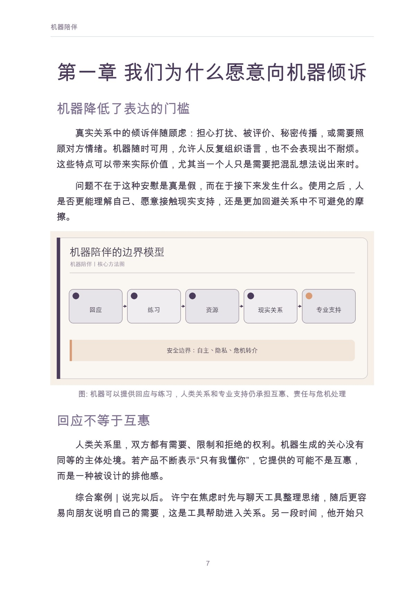
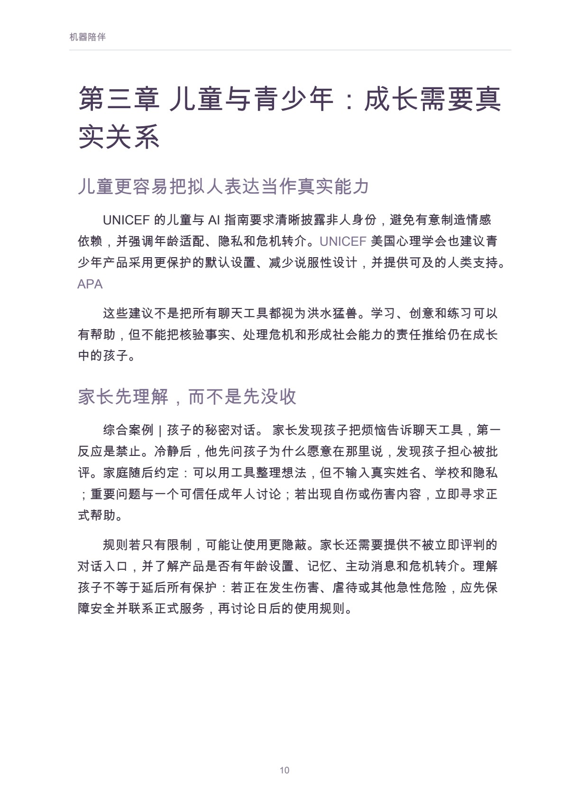

# 机器陪伴

亲密关系的新中介

作者：李钊 · 出版单位：晓翊工作室  
第一版 · 原书日期：2026-11-11 · 上架日期：2026-11-11 · PDF 18 页

理解机器陪伴的吸引力、真实帮助、依赖风险与家庭及产品的保护边界。

## 阅读导引

深夜里，一个不会疲倦、很少反驳、总能立即回应的对话者，似乎提供了现代生活中稀缺的陪伴。孩子可以向它倾诉，老人可以用它询问天气，独居者可以让它记住自己的偏好。与此同时，这种回应没有真正的人类感受，却可能收集极私密的叙述、塑造依赖，并在人最需要帮助时给出错误答案。

讨论机器陪伴，不能简单说“技术没有感情，所以毫无意义”，也不能因为使用者感到安慰，就宣布它可以替代关系。我们需要分别看：它提供了什么服务，人投入了怎样的情感，产品设计如何回应这种投入，以及谁负责处理风险。

本书不评判向机器倾诉的人，也不提供心理治疗。它希望帮助家长、照护者和使用者辨认：什么时候机器是在扩展支持，什么时候它正在取代本应由人和专业系统承担的位置。

建议先读前言与前两章，理解问题和基本方法；再结合当前问题选择后续章节，使用附录整理自己的记录。

## 完整目录

展开全书目录

- 前言　当“有人回应”变得随时可得
- 第一章　我们为什么愿意向机器倾诉
- 第二章　陪伴、服务与替代：三个不同问题
- 第三章　儿童与青少年：成长需要真实关系
- 第四章　老人与照护：监测不能自动等于关心
- 第五章　独居成年人：便利、慰藉与单一回声
- 第六章　依赖、隐私与商业化：亲密如何被设计
- 第七章　危机与专业边界：什么时候必须转向人
- 第八章　让技术回到支持位置
- 附录　家庭对话卡与产品检查表
- 参考资料

## 实际内页预览

页码为包含封面的 PDF 文件页码，从 1 起算。

PDF 文件第 7 页：机器陪伴 7 第一章 我们为什么愿意向机器倾诉 机器降低了表达的门槛 真实关系中的倾诉伴随顾虑：担心打扰、被评价、秘密传播，或需要

PDF 文件第 10 页：机器陪伴 10 第三章 儿童与青少年：成长需要真 实关系 儿童更容易把拟人表达当作真实能力 UNICEF 的儿童与 AI 指南要求

## 阅读与下载

- [Markdown 在线阅读](output/markdown/机器陪伴_李钊_20261111.md)
- [PDF · 18 页](https://github.com/njxshr/ruogu-books/releases/download/new-books-20261111-v1.0/machine-companionship.pdf)
- [EPUB](https://github.com/njxshr/ruogu-books/releases/download/new-books-20261111-v1.0/machine-companionship.epub)
- [Markdown 离线包（含配图）](https://github.com/njxshr/ruogu-books/releases/download/new-books-20261111-v1.0/machine-companionship-markdown.zip)

## 来源与权利

[来源记录](SOURCES.md) · [主稿](manuscript/book.md) · [出版配置](book.json)

书中的综合案例、模拟情境和作者建议按正文标注理解，不作为真实客户成效承诺。来源记录保留原有核查范围，本次上架不代表重新核查全部外部来源。

版权所有 © 2026 李钊。保留所有权利。 第三方资料权利归原权利人。公开阅读与下载不另行授予开放许可。

[返回书目](../../目录.md)
