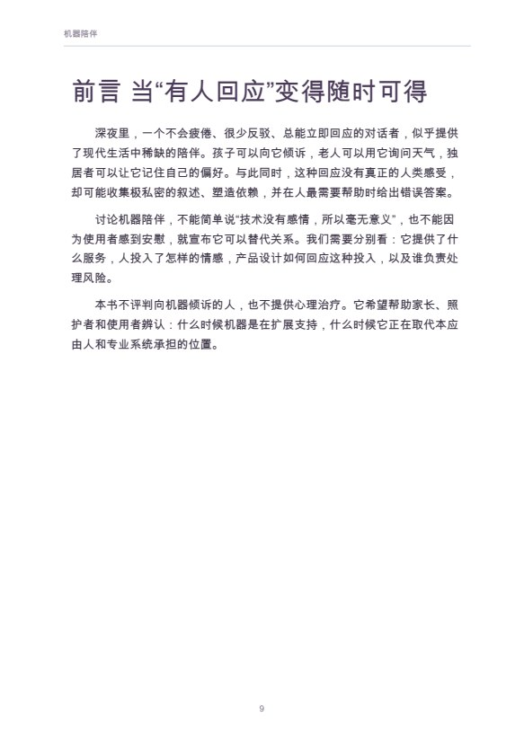
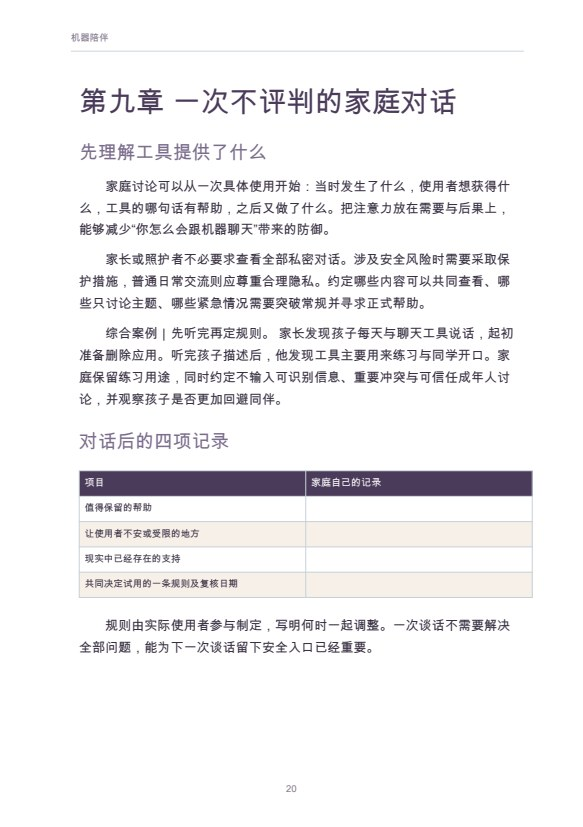

# 机器陪伴

亲密关系的新中介

作者：李钊 · 出版单位：晓翊工作室  
增订版 1.1 · 原书日期：2026-11-11 · 增订日期：2026-11-19 · PDF 51 页

理解机器陪伴的吸引力、真实帮助、依赖风险与家庭及产品的保护边界。

## 阅读导引

本次增订保留原书基础内容、署名和出版记录，25章、8份附录。新增实践方法、综合案例或模拟练习及可直接使用的工作表。案例的材料性质以正文标注为准，不构成真实客户成效或专业结果保证。

读者可先浏览前言与原八章建立共同概念，再按当前任务选读新增章节和附录。表格需结合自己的资料填写，动态规则、产品能力和专业事项仍按当前正式来源核实。

## 完整目录

展开全书目录

- 前言　当“有人回应”变得随时可得
- 第一章　我们为什么愿意向机器倾诉
- 第二章　陪伴、服务与替代：三个不同问题
- 第三章　儿童与青少年：成长需要真实关系
- 第四章　老人与照护：监测不能自动等于关心
- 第五章　独居成年人：便利、慰藉与单一回声
- 第六章　依赖、隐私与商业化：亲密如何被设计
- 第七章　危机与专业边界：什么时候必须转向人
- 第八章　让技术回到支持位置
- 第九章　一次不评判的家庭对话
- 第十章　个人使用约定：给陪伴一个结束
- 第十一章　年龄、同意与家庭权限
- 第十二章　照护中的尊严与主动联络
- 第十三章　依赖设计审查：温柔也可以成为压力
- 第十四章　隐私、删除与他人的秘密
- 第十五章　付费、召回与体面退出
- 第十六章　危机转介：从提示语到实际帮助
- 第十七章　更换或停用陪伴工具
- 第十八章　学校与教育场景中的使用边界
- 第十九章　记忆、悼念与数字再现
- 第二十章　一次家庭与产品的双重评审
- 第二十一章　亲密与恋爱话术：识别关系承诺
- 第二十二章　健康叙述与专业责任
- 第二十三章　低带宽、辅助技术与不同使用方式
- 第二十四章　职场与团队中的陪伴使用
- 第二十五章　一个月后的退出与继续复核
- 附录　家庭对话卡与产品检查表
- 附录二　一次家庭会议的完整记录
- 附录三　依赖与召回设计审查表
- 附录四　隐私、记忆与删除工作台
- 附录五　危机与正式支持资源卡
- 附录六　缩小使用、停用与交接
- 附录七　一个月复核与填写示例
- 附录八　产品版本变化后的复测卡
- 参考资料

## 实际内页预览

页码包含封面，从 1 起算。样页由本次 51 页 PDF 重新生成。

PDF 文件第 9 页：前言。

PDF 文件第 20 页：新增实践章节。

## 阅读与下载

- [Markdown 在线阅读](output/markdown/机器陪伴_李钊_20261111.md)
- [PDF · 51 页](https://github.com/njxshr/ruogu-books/releases/download/expanded-books-20261119-v1.1/machine-companionship.pdf)
- [EPUB](https://github.com/njxshr/ruogu-books/releases/download/expanded-books-20261119-v1.1/machine-companionship.epub)
- [Markdown 离线包（含配图）](https://github.com/njxshr/ruogu-books/releases/download/expanded-books-20261119-v1.1/machine-companionship-markdown.zip)

## 增订与检查

[20 轮增订记录](REVISION_LOG.md) · [实际检查报告](QA_REPORT.md)

本次重新生成 Markdown、PDF 和 EPUB。PDF 全部 51 页已渲染并逐张查看总览；EPUB 解包读取封面、前中后章节，110 个导航目标与本地资源检查通过。具体范围与限制见报告。

## 来源与权利

[来源记录](SOURCES.md) · [主稿](manuscript/book.md) · [出版配置](book.json)

来源记录保留原有核查范围。本次扩充没有借综合案例或模拟推演新增真实访谈、客户成效和统计证据。

版权所有 © 2026 李钊。保留所有权利。第三方资料权利归原权利人。公开阅读与下载不另行授予开放许可。

[返回书目](../../目录.md)
