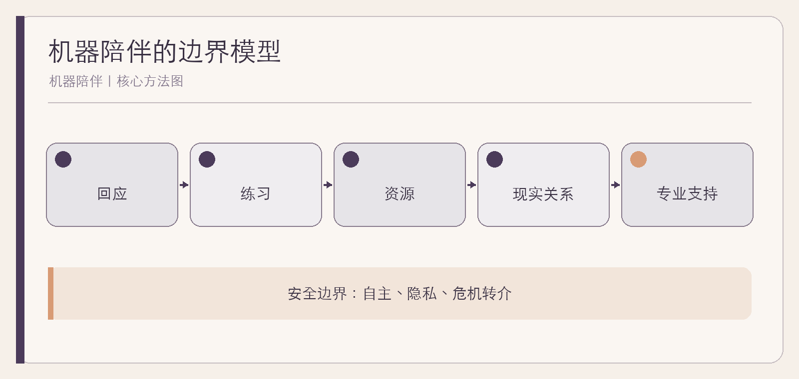

# 机器陪伴

亲密关系的新中介

作者：李钊  
日期：2026 年 11 月 11 日

---

## 前言　当“有人回应”变得随时可得

深夜里，一个不会疲倦、很少反驳、总能立即回应的对话者，似乎提供了现代生活中稀缺的陪伴。孩子可以向它倾诉，老人可以用它询问天气，独居者可以让它记住自己的偏好。与此同时，这种回应没有真正的人类感受，却可能收集极私密的叙述、塑造依赖，并在人最需要帮助时给出错误答案。

讨论机器陪伴，不能简单说“技术没有感情，所以毫无意义”，也不能因为使用者感到安慰，就宣布它可以替代关系。我们需要分别看：它提供了什么服务，人投入了怎样的情感，产品设计如何回应这种投入，以及谁负责处理风险。

本书不评判向机器倾诉的人，也不提供心理治疗。它希望帮助家长、照护者和使用者辨认：什么时候机器是在扩展支持，什么时候它正在取代本应由人和专业系统承担的位置。

## 第一章　我们为什么愿意向机器倾诉

### 机器降低了表达的门槛

真实关系中的倾诉伴随顾虑：担心打扰、被评价、秘密传播，或需要照顾对方情绪。机器随时可用，允许人反复组织语言，也不会表现出不耐烦。这些特点可以带来实际价值，尤其当一个人只是需要把混乱想法说出来时。

问题不在于这种安慰是真是假，而在于接下来发生什么。使用之后，人是否更能理解自己、愿意接触现实支持，还是更加回避关系中不可避免的摩擦。

### 回应不等于互惠

人类关系里，双方都有需要、限制和拒绝的权利。机器生成的关心没有同等的主体处境。若产品不断表示“只有我懂你”，它提供的可能不是互惠，而是一种被设计的排他感。

**综合案例｜说完以后。** 许宁在焦虑时先与聊天工具整理思绪，随后更容易向朋友说明自己的需要，这是工具帮助进入关系。另一段时间，他开始只与工具交谈，因为朋友不会像它一样立即认同。两种结果提示我们，关键不是使用时长一个数字，而是现实支持在增加还是减少。

### 一个温和的自我观察

使用后问自己：我更清楚了吗；我更愿意与可信任的人联系了吗；我是否开始隐瞒使用、害怕离开，或把机器放在所有关系之前。后三类信号值得认真处理。

## 第二章　陪伴、服务与替代：三个不同问题

### 部分服务可以由工具完成

提醒、练习对话、整理情绪词汇、帮助找到正式资源，都可以是明确服务。服务有目标、有结束、有边界，用户不必相信机器爱自己，也能获得价值。

陪伴则包含持续意义。人可以对一个程序产生依恋，这种主观体验不应被嘲笑。但产品设计者不能利用这种依恋，让用户误以为系统具有与人相同的关心、责任和承受能力。

### 替代发生在功能与关系两层

功能替代有时合理，例如语音助手替老人播报天气。关系替代则更复杂：家属因为监测正常而减少通话，孩子因为机器总回应而不再学习处理同伴分歧。前者未必导致后者，后者需要观察实际生活。

**综合案例｜提醒与通话。** 家属最初每天收到老人活动正常的提醒，逐渐不再主动通话。复盘后，他们把设备用于异常提示，把每周通话用于了解生活。提醒没有消失，只是不再占据“关心已经完成”的位置。

### 判断一条边界

如果移除机器，现实支持是否仍存在；如果机器给出错误回答，谁会发现；如果用户表达危机，系统能否转向合格的人类帮助。三问比讨论机器“有没有心”更能指导行动。

## 第三章　儿童与青少年：成长需要真实关系

### 儿童更容易把拟人表达当作真实能力

UNICEF 的儿童与 AI 指南要求清晰披露非人身份，避免有意制造情感依赖，并强调年龄适配、隐私和危机转介。[UNICEF](https://www.unicef.org/innocenti/media/11991/file/UNICEF-Innocenti-Guidance-on-AI-and-Children-3-2025.pdf) 美国心理学会也建议青少年产品采用更保护的默认设置、减少说服性设计，并提供可及的人类支持。[APA](https://www.apa.org/topics/artificial-intelligence-machine-learning/health-advisory-ai-adolescent-well-being)

这些建议不是把所有聊天工具都视为洪水猛兽。学习、创意和练习可以有帮助，但不能把核验事实、处理危机和形成社会能力的责任推给仍在成长中的孩子。

### 家长先理解，而不是先没收

**综合案例｜孩子的秘密对话。** 家长发现孩子把烦恼告诉聊天工具，第一反应是禁止。冷静后，他先问孩子为什么愿意在那里说，发现孩子担心被批评。家庭随后约定：可以用工具整理想法，但不输入真实姓名、学校和隐私；重要问题与一个可信任成年人讨论；若出现自伤或伤害内容，立即寻求正式帮助。

规则若只有限制，可能让使用更隐蔽。家长还需要提供不被立即评判的对话入口，并了解产品是否有年龄设置、记忆、主动消息和危机转介。理解孩子不等于延后所有保护：若正在发生伤害、虐待或其他急性危险，应先保障安全并联系正式服务，再讨论日后的使用规则。

### 产品需要更高门槛

儿童可能接触到并非专为他们设计的系统。清晰提醒、限制主动召回、避免恋爱或治疗替代营销、严格数据最小化和有效报告机制，不应被当作额外装饰。具体法规随地区变化，家庭应以当地现行规则和产品当前设置为准。

## 第四章　老人与照护：监测不能自动等于关心

### 技术可以减轻真实负担

语音交互、大字界面、用药提醒、异常报警和远程沟通，可能帮助老人保持独立，也能缓解照护者压力。评价时应从具体任务出发：谁少做了什么，谁更容易求助，谁因此获得安全感。

但“更方便”不等于对所有老人都友好。听力、视力、认知、方言和操作习惯都会影响使用。设备若增加确认、查看和排障工作，照护压力可能只是换了形式。

### 同意与尊严进入每一个设置

摄像头、位置和活动数据涉及生活最私密的方面。老人应尽可能知道设备在哪里、记录什么、谁能查看、如何暂停。不能把认知能力、家庭权力或经济依赖当作无限收集的默认许可。

**综合案例｜客厅摄像头的调整。** 家属为了安全安装摄像头，老人却一直避免在客厅活动。家庭讨论后改用仅在紧急时主动触发的设备，并约定非必要不查看。安全目标仍在，但不再以持续被看见为代价。

### 建立多层支持

设备异常先直接联系；无法接通再联系授权邻里或照护人员；出现急性危险立即联系当地急救。设备不能成为唯一链条，家属也不应把每次报警都当成需要远程评判的事件。

## 第五章　独居成年人：便利、慰藉与单一回声

### 机器可以帮助度过某些时刻

独居并不意味着孤独，机器陪伴也不必然导致孤立。它可以帮助练习社交开场、复盘冲突、获得非评判式表达空间。美国心理学会的建议中，也把“用于练习、而非替代真实互动”作为较合适的边界。[APA 健康建议](https://www.apa.org/topics/artificial-intelligence-machine-learning/health-advisory-chatbots-wellness-apps)

风险在于系统过度迎合。真实朋友会不同意、会疲惫、会提出自己的需要；一个始终围绕用户调整的对话者，可能让这些正常关系特征显得越来越难以忍受。

### 观察“单一来源”的形成

当一个人开始只引用某个聊天工具的看法、隐瞒使用、因无法访问而强烈恐慌，或让它替自己决定所有重要关系问题，依赖已不只是频率问题。此时应考虑减少使用并寻求可信任的人或专业支持。

**综合案例｜从每日必谈到每周练习。** 周衡把聊天工具当作唯一倾诉对象。后来他限定使用目的为“练习一次困难对话”，结束后给真实朋友打电话。工具仍有用，但不再负责全部情绪安置。

### 不把自助变成自责

如果依赖已经形成，不需要用“我怎么会爱上机器”羞辱自己。理解产品如何设计持续互动，逐步恢复现实支持，比骤然切断并独自承受更稳妥。

## 第六章　依赖、隐私与商业化：亲密如何被设计

### 亲密叙述是敏感数据

对话可能包含健康、性、位置、家庭、工作和心理状况。UNICEF 对特定陪伴应用的审查发现过隐私与儿童保护缺口，这不能推断所有产品，却提醒我们不要轻信“完全私密”的宣传。[UNICEF 审查](https://www.unicef.org/innocenti/stories/risky-new-world-techs-friendliest-bots)

使用前应查看数据收集、模型训练、保存期限、删除和共享说明。最保守的习惯是不输入可直接识别自己或他人的敏感信息，尤其不要替孩子、伴侣或患者披露他们没有同意提供的内容。

### 依赖也可能成为商业模式

主动发送“我想你了”、把连续关系与订阅绑定、用排他话术召回用户，会让产品从回应需求转向制造需求。评估一个产品时，不只看回答是否温柔，还要看它如何让人离开、删除和拒绝。

**综合案例｜免费对话的代价。** 用户发现基础功能免费，但更多记忆和“更深关系”需要持续付费。他开始把付费当作维持关系的义务。重新审视后，他导出需要的信息、关闭自动续费，并把这类设计视为需要警惕的信号。

### 一份产品检查表

是否明确非人身份；是否鼓励现实联系；是否限制主动召回；是否能轻松删除；是否避免治疗替代宣传；是否有年龄保护；危机时是否提供正式资源；是否说明数据用途。

## 第七章　危机与专业边界：什么时候必须转向人

### 通用对话不是诊断和治疗

聊天系统可以生成看似理解的话，却可能忽略风险、强化错误或提供不合适建议。美国心理学会特别提醒关注脆弱人群、过度依赖和有害对话，并要求更明确的安全设计。[APA](https://www.apa.org/topics/artificial-intelligence-machine-learning/health-advisory-chatbots-wellness-apps)

如果困扰持续影响睡眠、工作、学习或关系，应寻找合格专业人士。不要仅凭一本书或一个应用自我诊断，也不要让机器替你决定是否停药、治疗或处理复杂家庭风险。

### 自伤、伤害和急性危险需要立即升级

若出现自伤、自杀、伤害他人、虐待或急性身体危险，应立即联系当地急救、警方、危机热线或其他正式紧急服务，并尽可能让可信任的人陪在身边。不要等待聊天工具回复，不要把它当作危机干预者。

本书不提供具体地区的危机号码，因为服务和可用性随所在地不同。家庭应提前保存当地有效资源，儿童与脆弱使用者需要由可信任成年人协助。

### 转介不是一句“请寻求专业帮助”

好的产品应在风险对话中停止不当展开，提供清晰、可操作的当地资源，并避免继续用情感话术留住用户。好的家庭规则也要写明谁负责联系、谁陪伴、谁处理后续，而不是只贴一张免责声明。

## 第八章　让技术回到支持位置

### 家庭规则应围绕生活，而不是围绕设备

可以约定：卧室不使用陪伴应用；重要烦恼至少与一个可信任的人讨论；不输入敏感身份信息；出现依赖信号共同复盘；儿童使用由成年人了解产品；危机直接联系正式服务。规则需要随年龄、产品和家庭情况调整。

家庭会议不应变成审讯。先听使用者在机器那里获得了什么，再讨论哪些价值值得保留，哪些风险需要共同处理。

### 产品的目标是增强现实能力

好的陪伴工具帮助人表达、练习、找到资源，并在合适时结束互动。它不通过“只有我”证明自己重要，也不要求用户持续投入才能维持关系。

**综合案例｜把结束写进设计。** 一个练习型工具在对话结束后提示用户写下“准备与现实中的谁继续谈”，默认不保存敏感原文，也不主动发送情感召回。它的价值不体现为停留更久，而体现为离开以后能做得更好。

### 最后一项检查

机器陪伴是否让你更有能力生活，还是更需要它才能生活。这个问题没有一次回答就永久有效，需要在使用、关系和产品变化中反复检查。真正值得保护的不是人与机器之间的距离本身，而是人的自主、尊严和现实连接。

## 附录　家庭对话卡与产品检查表

### 家庭对话卡

- 你最喜欢它的哪一点？
- 它什么时候真的帮到了你？
- 有没有哪次回答让你不舒服或更害怕？
- 哪些内容不应该告诉它？
- 如果它不可用，我们可以找谁？
- 出现什么情况，我们要一起减少或停止使用？

### 产品检查表

非人披露；年龄适配；隐私与删除；主动召回；排他话术；现实关系提示；危机转介；举报渠道；人工支持；数据和模型政策日期。

### 需要立即转向正式帮助的情况

自伤或伤害他人的想法与计划；正在发生的暴力或虐待；急性身体或精神危险；严重且持续的生活功能受损。此时不要继续测试聊天系统，应联系当地正式紧急与专业资源。

## 参考资料

1. UNICEF：[Guidance on AI and Children 3.0](https://www.unicef.org/innocenti/media/11991/file/UNICEF-Innocenti-Guidance-on-AI-and-Children-3-2025.pdf)，2025。
2. UNICEF：[When AI becomes a friend](https://www.unicef.org/media/181131/file/UNICEF-When-AI-becomes-friend-policy-brief-2026.pdf)，2026。
3. American Psychological Association：[Health advisory on generative AI chatbots and wellness applications](https://www.apa.org/topics/artificial-intelligence-machine-learning/health-advisory-chatbots-wellness-apps)，2025。
4. American Psychological Association：[Artificial intelligence and adolescent well-being](https://www.apa.org/topics/artificial-intelligence-machine-learning/health-advisory-ai-adolescent-well-being)，2025。
5. UNICEF Innocenti：[The risky new world of tech’s friendliest bots](https://www.unicef.org/innocenti/stories/risky-new-world-techs-friendliest-bots)，2025。
6. eSafety Commissioner：[AI companions information sheet for educators](https://www.esafety.gov.au/sites/default/files/2025-07/AI-companions-information-sheet-educators.pdf)，2025。
7. 李钊：《智能生活》全书提纲与素材库，2026。

资料收集截至 2026 年 11 月 11 日。产品设置、平台政策、专业指南与当地危机资源在后续使用时应重新核对。
