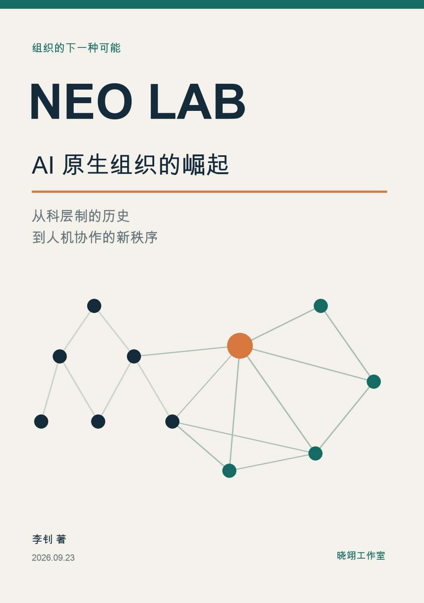
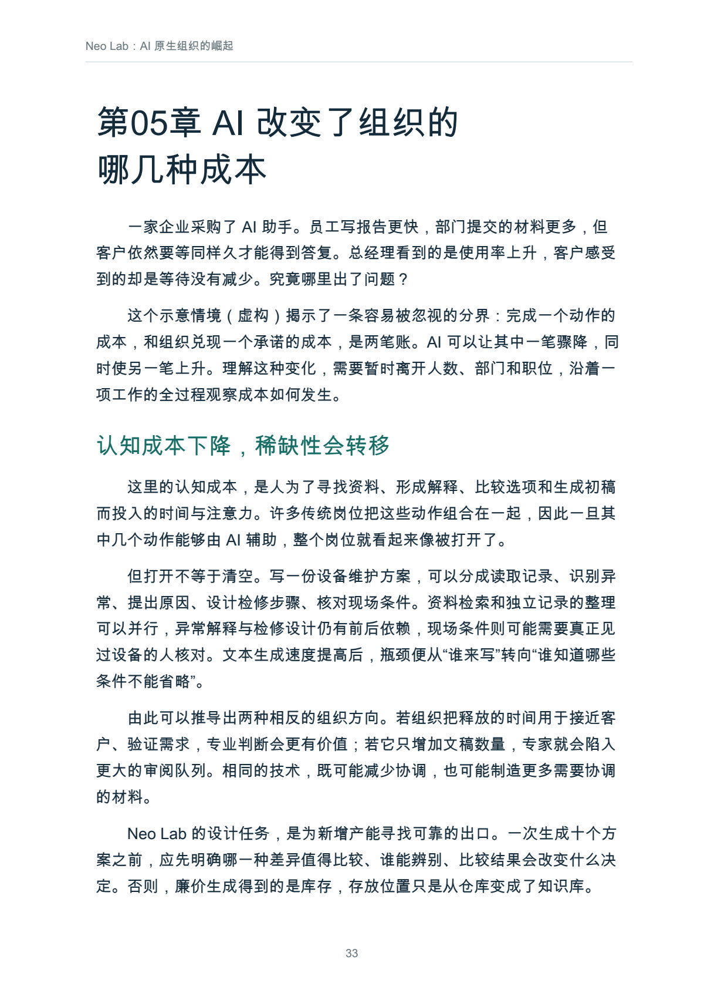
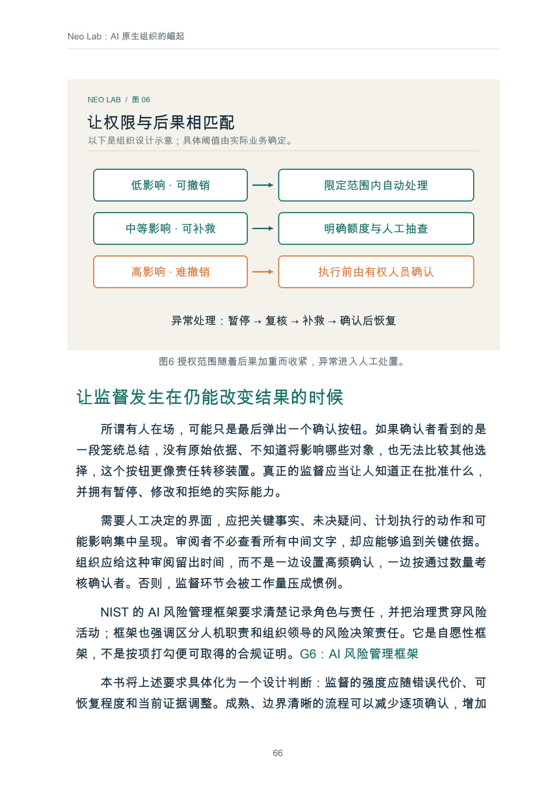
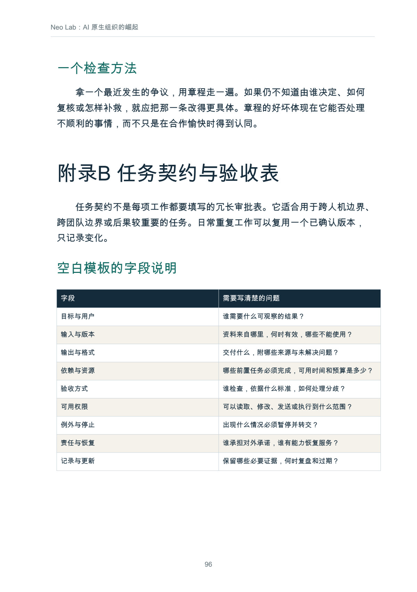

# Neo Lab：AI 原生组织的崛起

从科层制的历史到人机协作的新秩序

**快速导航：** [完整目录](#user-content-完整目录) · [正文预览](#user-content-正文预览) · [阅读与下载](#user-content-阅读与下载)

作者：李钊 · 出版者：晓翊工作室  
版本：第一版 · 2026年9月  
原书日期与最近修订记录：2026-09-23  
书房整理日期：2026-11-08

一本把组织史、AI 证据与试验方法连起来的书：当知识更容易进入行动，怎样重新安排工作、权力与责任？全书 16 章，含 8 幅正文配图，PDF 共 105 页。

## 这本书讲什么

书从一个常见困境出发：个人生成材料更快，组织交付为什么仍在等待？前四章追溯科层制、职业管理、企业边界和知识层级，说明规则、档案与职位曾经解决什么问题；随后区分认知、协调、验证和责任成本，对照客服、咨询、产品创新和软件开发研究，讨论任务提速怎样才能转化为组织改善。

后半部转向具体设计：把岗位图改写为有验收标准的任务网络，让知识保留来源与有效期，明确谁能授权、暂停、复核和补救，再讨论商业机会、员工成长、收益分配与平台依赖。书中以明确标注的虚构案例串联服务承诺、单位经济和九十天试验，并提供任务契约等附录模板。Neo Lab 在这里既介绍产业用法，也是一套由作者提出、需要接受检验的组织设计框架。

## 适合谁，怎样阅读

- **团队负责人、企业管理者**：先读第 01—06 章，建立评价尺度，再用第 14—15 章设计有边界的试点。
- **创业者与专业服务团队**：重点读第 07—08 章和第 15 章，检查需求、验收、交付成本与付费信号。
- **知识、数字化与 AI 建设参与者**：重点读第 09—11 章，连接任务接口、组织记忆、权限和实质监督。
- **关心职业与组织变化的读者**：顺读历史与证据部分，再读第 12—13、16 章，比较不同治理条件下的走向。

已经在做试点，可以先看第 15 章和附录 B，写出一项具体交付，再回到对应原理。九十天是书中便于安排工作的设计周期，不是经验证明的最佳期限。

## 能从书中获得什么

- 一组检查组织的提问：成果、验收、知识积累、实验权限和最终责任分别由谁承担。
- 一套核算完整交付成本的视角，把等待、复核、返工和维护放回账本。
- 任务网络、知识有效期、授权边界与停止机制的设计线索。
- 从影子运行到有限真实服务的试验路径，以及扩大、修改或停止的判断依据。
- 最小章程、任务契约、复盘记录和知识权限检查模板。

## 完整目录

以下保留原文章名，并简述每章要回答的问题；正文见 [Markdown 全书](output/markdown/Neo_Lab_AI原生组织.md)。

| 章节 | 本章讨论的问题 |
| --- | --- |
| 前言　当知识更容易进入行动 | 技术能力变化与组织制度变化之间，还缺哪些连接？ |
| 第01章　Neo Lab 究竟是什么 | 怎样区分产业中的 NeoLab 与本书的组织工作定义？ |
| 第02章　科层制从哪里来 | 职位、档案和规则怎样让组织超越个人记忆与关系？ |
| 第03章　大企业为何需要金字塔 | 连续生产、企业边界与稀缺知识为什么会形成中间层？ |
| 第04章　科层制的成就、代价与生存条件 | 怎样判断一项控制仍有价值，还是已经变成形式主义？ |
| 第05章　AI 改变了组织的哪几种成本 | 认知、协调、验证与责任成本怎样相互影响？ |
| 第06章　效率革命的证据与反证 | 怎样读 AI 实证研究，避免把任务效果直接外推到企业？ |
| 第07章　机会从哪里出现 | 怎样从未完成的客户工作、验收与反馈周期识别机会？ |
| 第08章　小团队怎样成为可持续企业 | 服务承诺、单位经济、渠道、信任与必要冗余怎样配合？ |
| 第09章　从岗位图到任务网络 | 人、程序与智能体怎样通过明确接口和依赖关系协作？ |
| 第10章　组织记忆如何成为生产资料 | 文件怎样成为有来源、有效期、维护人和使用边界的知识？ |
| 第11章　没有层层审批，谁承担责任 | 授权、监督、审计、停止权、恢复与申诉怎样连接？ |
| 第12章　人的新位置：职业、激励与共同体 | 怎样培养判断、评价维护劳动，并安排贡献与退出？ |
| 第13章　新秩序的权力与公共问题 | 谁定义工作、分享收益，又由谁维护公共协作条件？ |
| 第14章　大组织如何长出 Neo Lab | 怎样连接任务边界、资源授权、双轨试验与日常运行？ |
| 第15章　从零启动的九十天 | 怎样用有限服务验证质量、完整成本、需求和可重复性？ |
| 第16章　未来不是一个终点 | 不同技术与治理条件下，组织可能走向哪些情景？ |
| 结语　组织是一项持续的共同创作 | 怎样把一次试验变成能够继续讨论和修正的安排？ |
| 附录A　Neo Lab 最小章程 | 使命、验收、决策、知识、报酬、纠错与退出的七项约定。 |
| 附录B　任务契约与验收表 | 目标、输入、输出、依赖、验收、权限、停止与恢复字段及填写示例。 |
| 附录C　试验记录与复盘问题 | 试验前记录、六个复盘问题和诚实的试验结论。 |
| 附录D　知识条目与权限检查 | 最小知识条目、来源关联及权限变化前的检查。 |
| 附录E　术语与主题索引 | 按章节定位核心概念与主题。 |
| 资料与阅读说明 | 历史与组织理论、AI 实证研究与生产率、治理与工程实践、概念与公共问题。 |

## 正文预览

页码按 PDF 文件从第 1 页起计，包含封面；点击图片可查看大图。

**成本分析：为什么个人生成更快，组织交付却未必更快（PDF 文件第 33 页）**

**授权与监督：动作后果、人工处置与实际停止权（PDF 文件第 66 页）**

**任务契约模板：目标、输入、验收、权限与恢复（PDF 文件第 96 页）**

## 阅读与下载

- [Markdown 在线阅读](output/markdown/Neo_Lab_AI原生组织.md)
- [PDF 下载 · 105 页](https://github.com/njxshr/ruogu-books/releases/download/v2026.11.08/neo-lab.pdf)
- [EPUB 下载](https://github.com/njxshr/ruogu-books/releases/download/v2026.11.08/neo-lab.epub)
- [Markdown 离线包 · 含配图](https://github.com/njxshr/ruogu-books/releases/download/v2026.11.08/neo-lab-markdown.zip)

## 来源与维护

[来源台账](SOURCES.md) · [修订记录](REVISION_LOG.md) · [写作主稿](manuscript/book.md) · [出版配置](book.json) · [构建说明](BUILD.md)

本书保留自定义出版脚本，后续重建请按构建说明操作，以保留既有中文标题与附录版式。

本次上架保持既有成品内容不变。来源台账保留各项核查范围；不能将核查书目或摘要概括为已阅读全部原文。“澄页工作室”等示意案例为虚构，研究证据、工作定义、设计建议与未来情景在书中分别说明。

原版权说明：正文含 AI 辅助创作与研究核验；示意案例和原创方法已作区分。引用资料权利归原权利人。书房未对本书另行授予开放许可。

[返回书籍目录](../../目录.md) · [若谷书房](../../README.md)
