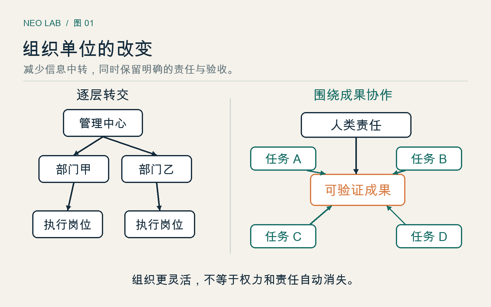
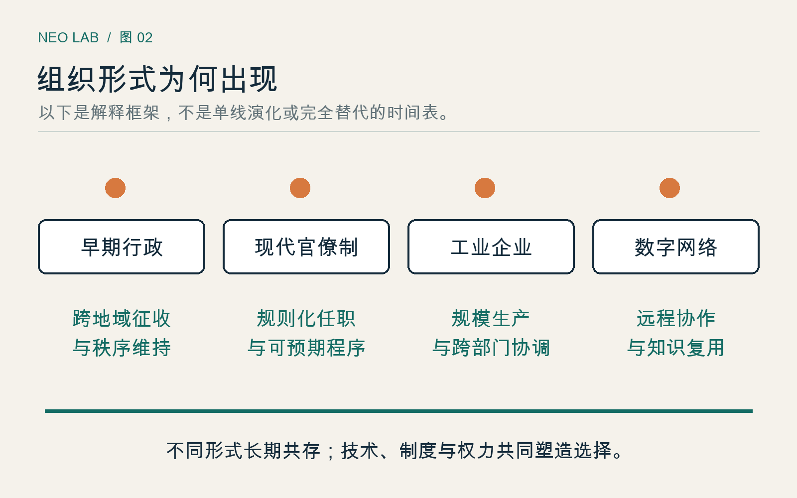
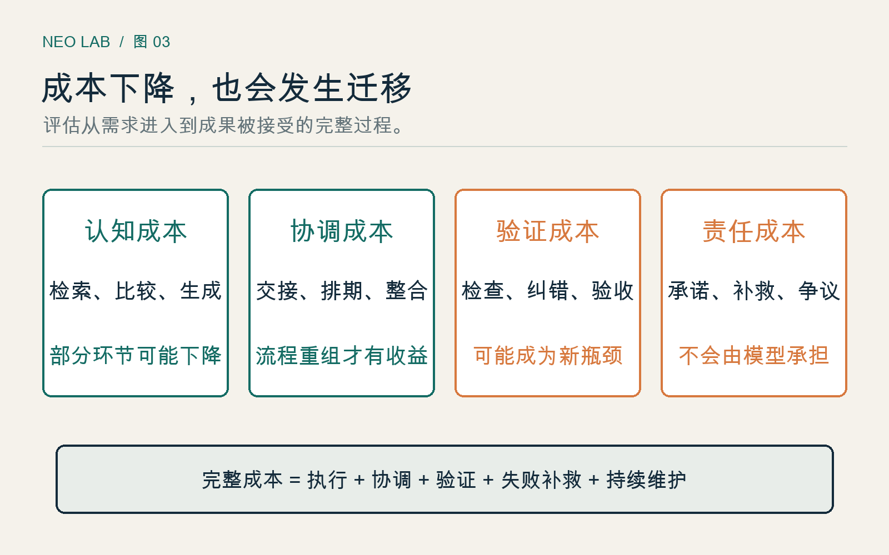
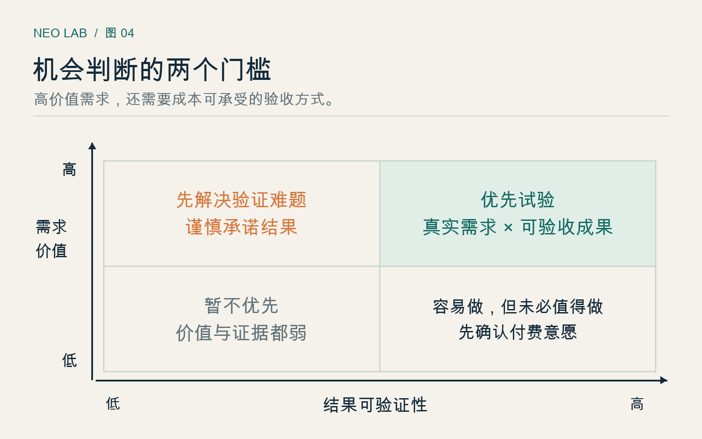
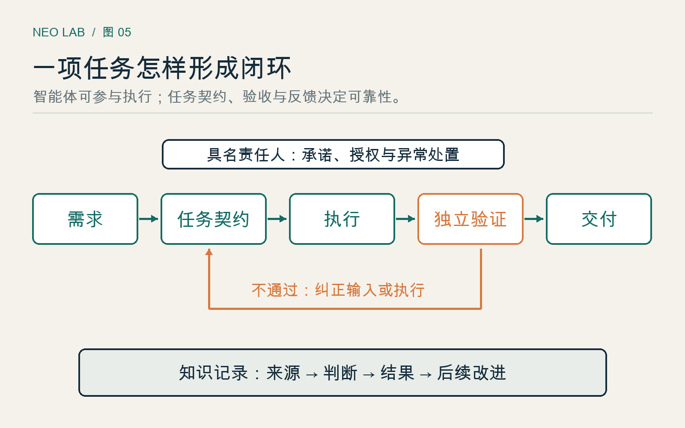
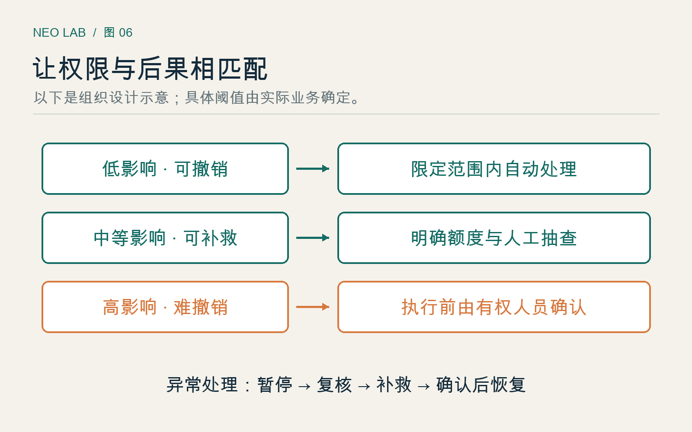
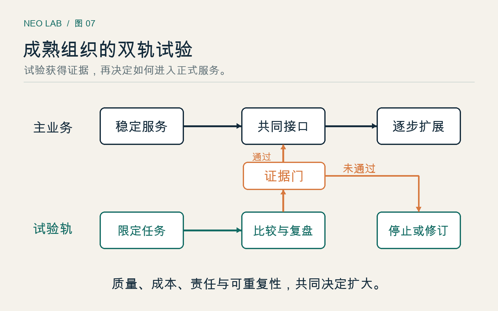
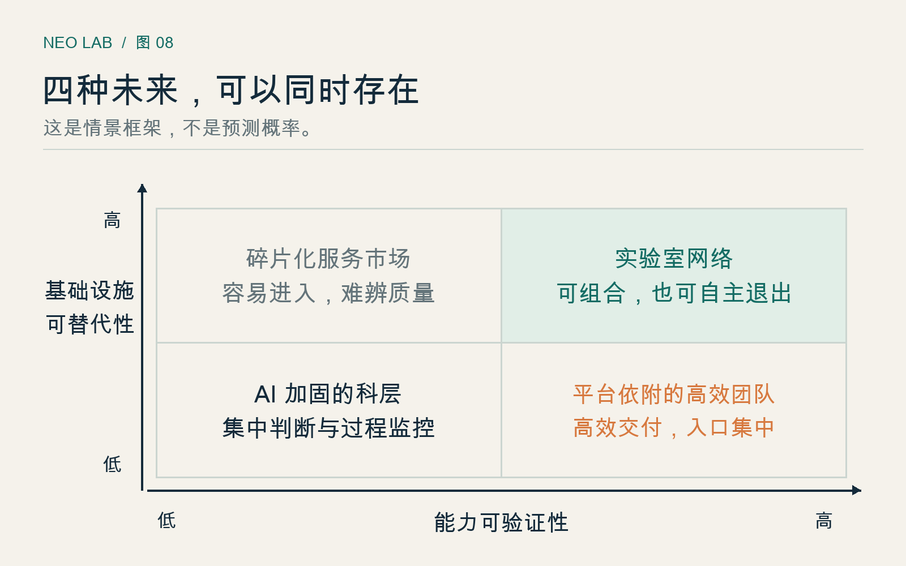

# Neo Lab：AI 原生组织的崛起

从科层制的历史到人机协作的新秩序

作者：李钊  
邮箱：lizhao086@126.com  
出版社：晓翊工作室  
日期：2026 年 09 月 23 日

---

## 前言　当知识更容易进入行动

设想这样一个工作日上午。客户的要求已经进入系统，资料也并不缺少，但事情仍在等待。一个人等另一个人转发文件，一个部门等另一个部门确认口径，主管等团队整理汇报，团队等主管决定下一次会议的时间。与此同时，每个人都很忙。

这个示意情境没有特指任何公司。它提出的问题却很具体：我们究竟是在完成工作，还是在维持完成工作的组织方式？过去，许多等待有其合理性。知识分散在个人经验里，信息需要汇总，跨部门的承诺需要有人担保。没有这些环节，事情可能更快地出错。档案、书籍和数据库早已使知识超越个人记忆。今天，AI 开始进一步参与检索、解释、生成、比较和执行，原本必须由人逐层转运的工作，出现了另一种安排的可能。

于是，一个诱人的判断浮现出来：科层制将要消失，小团队加智能体将取代大公司。然而，从工具能力的变化，直接跳到组织制度的消亡，中间隔着几座桥。谁来确认结果是真的？谁对外承担承诺？谁能够改变目标？谁得到效率增长带来的收益？谁可以拒绝被系统错误地评价？如果这些问题没有答案，少几层管理，可能只是让权力更难被看见。

本书要建这些桥。它赞成认真探索 AI 原生组织，也拒绝把希望当作已经发生的事实。

### 本书所说的 Neo Lab

近年的产业讨论已经使用 NeoLab 描述一批研究驱动的 AI 实验室企业。这个用法关注研究人才、技术路径、资本和科研成果。本书在介绍这一现实用法后，进一步提出一个组织设计上的工作定义：Neo Lab 是围绕可验证成果，由人类承担最终责任，以人和 AI 智能体的任务网络持续实验、积累知识并交付价值的 AI 原生组织。

这是本书的概念框架，不是某个已经被普遍接受的学术分类，也不意味着所有自称 Lab 的企业都具有这些特征。它可以表现为一家创业公司、一个成熟企业里的业务单元，或多个组织之间的协作网络。“Lab”强调的是实验与学习的制度，不要求成员都穿实验服，也不要求组织自己训练基础模型。

### 为什么先谈科层制

不理解旧组织解决过什么问题，就很难知道新组织必须继承什么。我们将从古代行政、现代国家与工业企业谈起，解释分工、规则、档案和职位权威如何把陌生人连接成能够长期合作的集体。科层制的历史，不只是效率史，也是权力从个人关系走向公共程序、再不断产生新控制方式的历史。

随后，本书把视线转向 AI。我们不以演示视频判断组织的未来，而是检查具体任务的证据、信息流动的路径和完成一项承诺的总成本。一个人在某次实验中表现得像一个团队，不等于所有团队都可以解散；一个流程需要更少的人工操作，也不等于其责任已经消失。

最后，我们讨论机会和秩序。机会来自过去服务不起的需求、无法及时利用的知识，以及被协调成本阻塞的业务。秩序来自目标、责任、权限、知识、激励与申诉之间可以被解释的关系。只有把两者放在一起，Neo Lab 才能从一个漂亮名称变成一种可检验的组织方案。

### 怎样阅读这本书

第01—04章建立概念与历史基础，第05—08章检验证据并分析商业机会，第09—13章设计组织内部和外部的秩序，第14—16章讨论转型、试验与不同未来。读者可以顺序阅读；正在做试点的管理者也可以先看第15章，再回到相关原理。

书中的“真实案例”有可追溯来源；“机构自述”只代表该机构公开表达的做法或主张；“综合案例（虚构）”与“示意情境（虚构）”用于解释机制，不是采访记录。数字只在有来源或明确说明为演算假设时出现。方法、判断框架和未来情景属于本书的推演，不是已经验证的普遍规律。资料核验截至 2026 年 9 月 23 日；动态网页仅代表访问时的内容。

这本书不要求你相信一种必胜的组织形态。它邀请你追问一件更有用的事：当技术改变以后，我们还能否说明，为什么要让这些人，以这样的权力关系、工作流程和收益安排，共同做这件事？

## 第01章　Neo Lab 究竟是什么

一家公司让所有员工使用 AI 写周报，另一家公司让一个跨专业小组从客户问题出发，安排人和智能体完成调查、试制与验证。这两家公司都可以说自己拥抱了 AI，但它们改变的东西并不相同。前者主要改变工具，后者正在改变工作的组织单位。

为了讨论后者，我们需要一个名称；为了不被名称误导，我们更需要一组可以观察的区别。

### 一个词的两种含义

在现实产业语境中，NeoLab 常被用来称呼研究驱动的新一代 AI 实验室公司。投资机构 NEA 在 2026 年的文章中，把它与面向特定领域的研究、数据及验证能力相联系。这是一种产业参与者的分类和投资观点，不能据此认定“NeoLab”已经具有统一定义，更不能把其商业预期当作实证结论。[R1：NEA 的 NeoLab 讨论](https://www.nea.com/blog/the-ai-neolab-wild-west)

**机构自述：两种研究取向。** Safe Superintelligence 将安全超级智能设为集中目标；Thinking Machines Lab 的公开介绍则强调人机协作、可定制性以及研究与产品共同演进。它们说明新实验室可以有不同任务取向。公开宣言并不足以证明其内部已经去科层化，也不能证明任何一条路径必然成功。[R2：SSI](https://ssi.inc/) [R3：Thinking Machines Lab](https://thinkingmachines.ai/)

如果本书只沿用这个狭义用法，讨论就会集中在少数前沿科研企业。用户服务、专业知识、教育和工业协作中的组织变化反而难以进入视野。因此，以下章节使用广义工作定义：**Neo Lab 是围绕可验证成果，由人类承担最终责任，以人和 AI 智能体的任务网络持续实验、积累知识并交付价值的 AI 原生组织。**

两个含义不能互换。研究驱动的 AI 公司可能保留严格等级；一家不训练模型的服务机构，也可能围绕人机协作重新设计任务和权力。本书关心后者的组织原理，同时保留前者作为产业背景。

### “原生”意味着设计前提改变了

“原生”不是购买时间早，也不是采用某家最新模型。它意味着组织在设计工作时，就把 AI 作为具有能力边界、运行成本和失效方式的参与者来考虑。

传统流程常先设岗位，再给每个岗位配工具。原生设计先追问成果是什么、怎样验收、哪些部分可以独立完成、谁有权执行，再决定需要哪些人员、模型和系统。一个有用的诊断是：撤去 AI 之后，是否必须重新安排任务边界、信息接口或验收，而不只是延长原有岗位的操作时间？如果是，它就更可能已经进入组织设计。变化可以体现为质量、可追溯性或服务范围，并不以提速为唯一标准。

这不要求推倒所有既有流程。自动化程度较低、物理约束较强的环节，仍然可以依赖固定岗位与标准程序。“原生”是一种设计方法，不是必须全公司同时达到的纯度标准。它可以从一个售后知识单元开始，再向前连接产品、向后连接客户结果。

同样需要区分自动化和智能体。自动化可以是固定规则下的连续操作；智能体通常能够根据目标和环境反馈选择下一步行动。选择范围扩大，监督与纠错也更重要。给系统取一个拟人的名字，并不会让它获得承担责任的资格；把若干模型接在一起，也不会自然产生一个有效团队。

### 用五个问题识别一种组织

本书建议用五个问题判断组织是否正在接近这一形态。

第一，目标是否表达为外部可确认的成果？“本周调用了一万次模型”说明使用量，“客户拿到可复核的维修判断”才说明工作价值。指标必须能识别完成与伪完成，而不是只计算活动。

第二，任务能否在接口清楚的条件下重新组合？一个任务至少需要输入、预期输出、验收方式、可用权限和责任人。它可以被人完成，也可以由机器先做、人复核。任务网络并非所有人随时互相聊天，而是协作关系可以依据问题重新安排。

第三，知识是否能够跨越个人而积累？若每次成功都依赖同一个人临时补充背景，组织拥有的仍主要是个人能力。能够进入下一次工作的知识，应包含来源、适用条件、失效时间以及失败经验。保存聊天记录不等于形成组织记忆。

第四，实验是否能影响资源配置？如果试点失败后流程不变、预算不变、目标不变，所谓实验只是表演。允许停止一个假设，才有条件真正探索另一个假设。

第五，后果是否能够追到有能力处理它的人？发生错单时，有人能暂停系统、联系客户、安排补救并修改规则。这是责任存在的表现。写在名册上的“负责人”如果没有权限与时间，只是一个替系统承担压力的人。

这五个问题没有统一的分数线。它们是诊断工具，防止我们用人数少、办公室开放或模型调用多等表象，替代对组织机制的观察。

### 一个具体的对比

**综合案例（虚构）：工业设备资料服务。** 两支团队都帮助设备商维护安装说明。甲团队让写作者用 AI 起草，编辑用 AI 润色，部门主管仍按原顺序逐份批准。材料错误依然在最后的客户投诉中暴露。AI 加快了段落生产，却没有改变知识如何被确认。

我们把乙团队的方案命名为“澄页工作室”，作为贯穿第07、08、15章的虚构案例：依次讨论机会、经营和起步试验。这不是一家已经取得成功的真实企业。乙团队把任务定义为“让指定型号的安装说明与当前零部件配置一致”。一名领域负责人界定适用型号，系统只读取批准的变更记录，智能体提取差异并生成候选修改，另一套规则检查编号与参数，人类工程师核对重要条件。任务结果包括修订文本、变更来源和未解决疑点。资料发布有指定负责人，客户反馈进入下一次评测。

乙团队并没有证明自己更先进。假如变更记录本来就错误，智能体会更快传播错误；假如工程师成为所有任务的单一瓶颈，规模增长仍会失败。这个案例只说明：改造工作关系，与给原有岗位加工具，是两件不同的事。乙团队的优势要用返工、漏改、交付时间与成本证明，不能由它自称 Neo Lab 来证明。

还要注意，乙团队并不一定更小。它可能减少文字加工，增加知识维护和独立复核；也可能因为能服务更多型号而扩大人员。组织创新改变的首先是能力的组合，人数是后续结果之一。

### 不要把实验室浪漫化

“Lab”让人想到自由讨论、少量天才和快速创造。但现实中的实验需要稳定设备、可靠记录和重复验证；长期研究需要可以承受失败的资源安排；团队成员也需要收入、成长与可预期的生活。把一切固定安排视为官僚主义，会破坏实验赖以发生的条件。

Neo Lab 尤其需要防范三种伪装。第一种是廉价外包：把原来有保障的工作拆成碎片，把风险交给个人，却称之为自由协作。第二种是创始人集权：取消中间层之后，所有决定都集中到一个人，团队更扁平，权力却更陡峭。第三种是自动化崇拜：为了提高机器完成率，不断缩窄服务范围，让难以处理的人和问题从报表中消失。

因此，本书不把“少人”“无经理”或者“全自动”列为必要条件。真正需要变化的是，人必须经过多少无助于判断的环节，才能获取知识、采取行动和修正错误。某些层级会消退；另一些清晰、有限且可问责的权威反而更重要。

也不存在一种所有组织都必须追求的状态。救灾指挥可能需要临时集中，公共服务需要平等程序，大型制造需要统一标准。讨论 Neo Lab 的价值，在于扩大可选择的组织方式，而不是发明一个新的单一答案。下一章将从旧组织的来路开始，寻找那些不能随金字塔一起丢弃的制度能力。

### 本章结论与行动

Neo Lab 在本书中是一个可以被实践检验的组织框架，而非对某一类企业的赞美。它的核心是成果、任务网络、可积累知识、实验反馈与人类责任之间的关系。

选一项真实工作，画出从需求进入到结果被使用的路径。标出 AI 出现的位置，再分别圈出知识被确认、权限被授予、后果被承担的地方。如果你只能标出“生成文本”，说明当前主要是工具升级；这已经可能有价值，但下一步组织设计的任务仍在眼前。

## 第02章　科层制从哪里来

一个人离职之后，组织是否还知道自己承诺过什么？一个负责人换了，普通人是否需要重新证明自己有资格得到服务？这些问题比会议太多、流程太长更接近科层制的起点。一个规模超出熟人圈的集体，要维持行动，就得设法让职责、记忆和权威活得比个人更久。

今天谈论科层制，常常直接想到迟钝、推诿和盖章。可是，如果历史上只有坏处，它就很难成为如此普遍的组织形式。理解 Neo Lab，需要先看见旧制度曾经完成的工作；否则，新组织很容易取消一张表，却重新制造那张表原本要解决的混乱。

### 古老的行政，不等于现代的组织模型

官僚行政并不是工业革命的产物。秦汉时期，中央集权的官僚君主制得到建立和巩固，地方行政也依赖官员与地方精英的合作。它说明，跨越广阔地域组织税赋、劳役和公共事务的需求，早已推动了复杂行政体系的发展。[H1：秦汉官僚帝国](https://www.cambridge.org/highereducation/books/the-cambridge-illustrated-history-of-china/B8415BCABB0218ABC80F4EFEEA9F5B2B/the-creation-of-the-bureaucratic-empire-the-qin-and-han-dynasties/CF561DCB42844178C1AECDB98E31B6FD)

但“古代有官员”和“古代已经拥有完整的现代科层制”不是同一句话。权力来自谁，官员如何被选拔，个人财产与公共资源是否分开，哪些命令可以被质疑，这些差异会改变同一张层级图的实际意义。仅凭上下级关系，无法辨认组织究竟按职位运行，还是按与统治者的亲疏运行。

历史也不是一场依次淘汰旧形式的接力赛。私人信任、亲缘纽带、职业规范和正式制度可以同时存在。正式组织里仍有人情网络，依赖熟人的团体也可能保存严密账簿。比较组织时，最有用的做法是追问具体事务由哪套规则支配，而不是为整段历史贴上单一标签。

因此，本书把三条线索分开：古代国家如何治理远距离事务，现代组织如何使权威依附于职位和规则，工业企业如何协调大规模生产。它们互相影响，却不是同一个问题，也没有一个共同的发明日期。

### 从忠于某个人，到履行一个职位

韦伯分析的现代官僚制，强调固定职权、分级监督、书面档案、专业训练和一般规则，也强调公务与私人事务的分离。这些特征可以出现在国家机关，也可以出现在私人企业。[H2：韦伯的官僚制选段](https://www.d.umn.edu/cla/faculty/jhamlin/4111/2111-home/CD/TheoryClass/Weber_Lec_Readings/Weber%20-%20Bureaucracy.htm)

这里最关键的变化，是把“这个人有权决定”改写成“这个职位在一定范围内有权决定”。前一种说法依赖个人地位，后一种说法允许我们继续追问：范围在哪里，依据是什么，谁可以纠正？这并不能保证权力温和，却为限制任意性提供了一种语言。

职位的稳定还使组织能够培养专业人员。一个人不必亲自认识最高负责人，也能知道自己该向哪里提交材料。继任者原则上接手前任的职责，而不是先重建一切私人关系。组织由此获得连续性，人也获得某种可以预期的职业路径。

“合法理性”在这里描述一种权威成立的方式：人们认可有规则的职权秩序，并据此服从在权限内作出的决定。它不保证每条规则都合理，更不保证权力不会滥用。韦伯的理想类型是用来比较现实的分析构造；把它理解成一份完美企业说明书，会丢掉其分析价值。

同样需要区分的是，权威有明确来源与权威得到充分监督并非一回事。一个组织可以分工严整，却没有有效申诉。规则化解决了谁能做什么的一部分问题，未必解决谁来制定规则、谁被规则排除的问题。

对于接受服务的人，这一区分非常实际。他需要知道的不只是窗口工作人员是否态度友善，还包括换一个工作人员后结论会不会改变，以及被拒绝时能否得到理由。可预期的规则使人能够安排自己的行动，却也可能把不合理的分类长期固定下来。因此，对制度的评价要保留两种视角：它是否稳定运行，它所稳定维持的东西是否值得维护。效率只能回答前一个问题的一部分。

### 档案让组织拥有外部记忆

不妨把档案理解为一种承诺的载体。今天是谁接待了谁，依据什么作出处理，哪些事项尚未完成，都不应只留在某个人脑中。只有记录能够被另一位合格的人理解，组织才可能在人员更替后继续工作。

这种安排会引入成本。事实要被翻译成表格，连续的生活经历要被切分为若干类别。有些信息因此变得容易传递，有些信息则被挤出表格之外。记录越标准，横向比较越方便；但个体处境越特殊，越可能需要额外解释。标准化的力量和盲点从一开始就相伴而生。

例如，证明文件可以帮助工作人员避免凭印象判断，也可能让无法方便取得文件的人处于劣势。合理的改进不是在“全部留痕”和“完全相信个人”之间二选一，而是区分哪些证据必要、哪些证据能够互相替代，以及特殊情况由谁复核。

这也说明，组织记忆不能等同于资料堆积。无人知道怎样检索的旧卷宗，并不会自动形成可靠记忆；所有人都能随意修改的记录，也很难承载承诺。记录的意义来自它和来源、权限、版本、解释责任之间的关系。后来无论使用数据库还是 AI，仍然要面对这些关系。

### 一个公共服务窗口里的两难

综合案例（虚构）：某城市公共服务中心负责一项居民服务资格的复核。最初，工作人员凭经验处理。熟悉当地情况的老员工能迅速识别材料遗漏，但轮岗后，居民常常得到不同答复。主管于是要求使用统一核验表，把可以接受的材料和需要补充的事项写清楚。

新表格帮助新员工理解工作，也让居民知道该准备什么。问题出现在一位居民的经历不符合既有选项时：如果机械地选择“不符合”，可能忽略可解释的特殊情况；如果由接待人员自行放行，其他居民又可能质疑标准不一致。争议不是“有没有爱心”这样简单，而是如何同时保有一致性与判断空间。

这个虚构中心可以设计一条例外通道。接待人员负责说明冲突点，复核人员负责审查，最终决定留下理由。当相同例外反复出现时，再修改一般规则。这样，一次特殊处理既不被掩藏，也不立即变成所有人都能任意援引的先例。

假如中心引入 AI，只让它自动检查表格完整性，可能减少来回补件；如果直接让模型给出资格结论，却没有解释、复核与纠错渠道，技术反而会把旧规则的遗漏放大。这一情境不证明哪种系统必然更好，它揭示了一个应当保留的问题：组织怎样对待未被预先编码的人和事？

这里的“例外”也不应成为另一个隐蔽的熟人入口。谁能提出复核、等待过程是否可见、不同申请是否受到同等对待，都需要检查。灵活性只有能够被解释，才不会悄悄退回个人恩惠。

### 新组织应当继承什么

研究科层制的历史，不是为了给繁琐流程辩护，而是为了分清组织的功能与实现这些功能的形式。连续性是一种功能，纸质卷宗是一种形式；公平处理是一种要求，层层盖章只是一种可能的实现办法。当形式失效时，应当寻找更好的承载方式。

对 Neo Lab 而言，最容易忽视的遗产恰恰是不起眼的制度安排。职责应当能交接，组织资产应当与个人账户分开，外部承诺应当能够追溯，同类事情应当有相近的处理尺度。只有少数人时，这些事情似乎可以靠默契；人员变动、客户增加或者出现争议时，默契的成本才会显现。

可以做一个简单的思想实验：让组织里最熟悉业务的人暂时离开。其他人能否找到当前承诺、理解关键决定、知道何时升级？如果全部工作因此停摆，所谓灵活可能只是把组织装进了一个人的记忆。AI 即便能模仿他的表达，也未必能继承他的授权或补全他从未记录的判断。

更好的继承方式，是保留明确边界和可解释程序，同时定期删除没有贡献的手续。每项规则都应能说清它保护什么；每次删除都应说明由什么机制接替。这样，制度既不会被当成神圣不可改的遗产，也不会因追求新鲜而被整体抛弃。

### 本章结论与行动

科层制不是由某位管理学家突然发明的，它包含跨越不同时代的行政技术，也包含现代组织对职位、专业、记录与规则的特定安排。它让组织能够超越个人，却也可能把复杂处境压进僵硬分类。审视自己的团队时，请选一项持续对外承担的承诺，写出负责职位、有效记录、例外通道和交接办法。缺少哪一项，就先补足哪一项。下一章转向工业企业：当生产和流通的规模不断扩大，这些安排为什么会聚合成高大的金字塔？

## 第03章　大企业为何需要金字塔

一间作坊可以依靠同处一室的人协调。订单变了，大家听得到；工具坏了，负责人看得见。然而，当原料来自不同地区，生产跨越多个地点，产品又要按时交到远方，组织面对的就不只是“让每个人努力工作”。它需要让许多局部正确的行动，在时间上和数量上接得起来。

金字塔之所以具有吸引力，是因为它能把庞大的相互依赖拆成若干可管理的关系。理解它的兴起，需要看到生产规模，也需要看到知识、计划和市场交易的成本。只有把这些条件讲清楚，才能判断 AI 改变之后，哪些层级仍有用。

### 规模扩大之后，流动成为管理对象

钱德勒在《看得见的手》中研究了美国大型管理企业的兴起，重点涉及十九世纪中叶至二十世纪初的运输、通信、生产与分销。他的解释强调：在某些产业，行政协调能够比既有市场安排更有效地组织大量连续流动。[H4：看得见的手](https://www.jstor.org/stable/j.ctvjghwrj)

这个历史命题可以帮助我们理解铁路，但不应被简化成“有了铁路，就必然有大公司”。设想一条线路：车辆、轨道、维护、票务与货运不是相互独立的生意。某一环节耽搁，可能阻塞后续多个环节。即使每个环节都完成了自己的局部指标，整体仍可能失败。

这类相互依赖会创造对统一计划的需求。管理者需要知道哪些资源能够替换，哪些延误必须立刻上报，哪些环节应当保留余量。层级为处理冲突提供一条路径：局部无法解决的问题，交给能够权衡更大范围影响的人。

大企业也可以让不同业务单元承担经营责任，总部协调共同资源与跨单元冲突。把所有专业职能集中到总部，与在共同边界内保留业务单元自主，是不同的安排。由此可见，规模扩大并不只有一种层级结构。

但“统一”不等于每件小事都从顶部发出命令。顶部越想了解全部细节，越容易成为等待的源头。真正困难的设计，是让常规运行留在局部，同时让跨局部的冲突能够被发现并得到处理。金字塔的价值取决于这个分工是否合理，而不是它看起来有多整齐。

### 工作方法为何被搬进管理办公室

泰勒提出科学管理时，主张研究作业方法、选拔并训练工人，让管理者承担更多方法设计责任，并使管理与执行相互配合。这可以理解为把个人掌握的工作经验转变成组织能够研究、教授与监督的知识。[H3：科学管理原理](https://www.gutenberg.org/cache/epub/6435/pg6435-images.html)

这一步具有双重含义。组织不再只能等待一位熟练者自己摸索，也能够把成熟方法教给后来者；与此同时，决定“怎样工作”的权力可能从执行者手中转移出去。效率改进与控制权变化在这里纠缠，不能只讲其中一面。

当任务稳定、输出可观察、动作之间差异有限时，统一方法容易显示价值。可一旦现场条件不断变化，设计者又远离现场，标准就可能来不及更新。员工为了完成真实工作，不得不在正式流程之外补上解释和协调；如果组织只看标准是否被遵守，这部分贡献就可能被误认成不服从。

因此，需要分别追问：什么知识值得标准化，谁有资格修订标准，标准失效时谁可以暂时偏离？把知识从个人经验中提取出来，不应同时取消现场人员发现新问题的资格。否则，组织得到了一本越来越厚的手册，却失去了更新手册的感官。

### 企业为什么不把所有事情交给市场

科斯的回答从一个朴素事实出发：使用市场也需要成本。寻找交易条件、谈判和订约并非免费；但把事情纳入企业也会产生内部组织成本。企业边界取决于两种安排的比较，技术对两者的相对影响可能使企业扩大，也可能使其缩小。[H5：企业的性质](https://onlinelibrary.wiley.com/doi/10.1111/j.1468-0335.1937.tb00002.x)

考虑一家需要不断调整交付方案的制造商。如果每次小改动都必须与外部伙伴重谈价格、责任和排期，内部团队可能更容易适应变化。可若某项工作标准明确、外部专业服务成熟，把它长期保留在内部又可能造成闲置和管理负担。没有一种边界适合所有工作。

由此看，企业不是因为成员聚在一栋楼里才成为企业，而是因为它能够在约定边界内持续调度资源，不必把每个细节都重新变成一次独立交易。办公地点可以分散，调度关系却依然紧密；人员看似坐在一起，也可能只是许多临时契约的集合。

这对 AI 时代有直接启发，但只是理论延伸。假如工具让跨组织交接更容易，专业小团队会获得机会；假如同样的工具让大型企业内部更容易共享知识和安排工作，大企业也会受益。判断谁更有优势，不能只看工具是否强大，还要看它究竟改变了哪一侧的困难。

而且，一项工作留在内部，并不必然要求它经过许多审批。企业边界、部门边界和决策层级是不同维度。公司可以在内部采用有明确接口的小团队，也可以把业务外包之后仍然要求繁密汇报。若不区分这些维度，就会把外包误当成分权，把内部合作误当成僵化。组织设计需要比较具体安排，而不是在“大公司”和“小团队”两个抽象名字之间投票。

### 一个制造网络如何长出中间层

综合案例（虚构）：海岑设备最初只有一个生产点，由负责人同时处理采购、生产与客户沟通。后来它增加了生产点，并为不同客户提供不同配置。客户经理承诺了加急交付，却没有看到另一生产点的维护安排；采购员为降低单价集中订货，却增加了某些零件的库存负担。

每个人都能解释自己的决定，但解释不能自动让产品按时交付。公司于是设置计划负责人，让他协调交期与资源，并设置质量负责人，统一放行标准。新增管理岗位的起点，并非人人突然喜欢控制，而是出现了原来无人完整承担的相互依赖。

问题随之变化。计划负责人需要各部门报送信息，各部门为了保护自身指标，可能把不确定事项说得更乐观。上层拿到的汇总越来越好看，现场却越来越忙。再增加一层汇总者，未必能改善这种信息失真，因为信息是在激励与责任关系中被生产出来的。

一种可行的调整，是把加急承诺视为跨职能决定：提出者必须看到对其他订单的影响，生产端可以提出无法满足的约束，争议交给拥有相应资源权的人处理。这里保留了管理，却减少了无意义的信息转送。案例的关键不是究竟要几层，而是每层是否解决了一类真实冲突。

如果海岑后来把所有冲突都交给创始人，它可能在组织图上更扁平，实际决策却更集中。人们等待同一个人拍板，外部响应速度也受到这个人的注意力限制。减少中层并不能自动消除原来由中层承担的协调工作。

### 管理者也是稀缺知识的分配节点

Garicano 的知识层级模型解释了一种分工：基层学习处理常见问题，少见而困难的问题交给专家，从而节省学习和问题匹配的成本。这是层级存在的一种理论理由，不是所有管理关系的完整解释。[H7：知识在生产中的组织](https://www.journals.uchicago.edu/doi/10.1086/317671)

沿着这一机制看，要求每位员工都学会全部知识可能浪费，也未必做得到。组织可以把稀缺专家的时间留给真正困难的情况。但这套安排只有在问题能够被正确分流时才成立：基层知道什么是常规，也知道什么时候自己已经越界。

如果晋升意味着掌握知识却不再分享，专家就可能成为人为制造的瓶颈。如果上级以所有问题都必须经过自己来显示价值，知识层级就会变成注意力收费站。反过来，如果把所有资料交给基层，却没有训练与反馈，名义授权又可能变成风险下放。

因此，金字塔是否有效，可以沿着一件异常事件往上追踪。每向上一层，是否增加了新的知识、资源或裁决能力？若只有措辞被改写、材料被重新排版、时间被消耗，这一层就需要重新论证存在的理由。这个检查比笼统要求“压缩管理层级”更具体，也更能保护真正必要的专业支持。

### 本章结论与行动

工业企业的金字塔，一部分来自连续生产与流通的协调，一部分来自方法标准化、内部调度和稀缺知识的分工。它不是纯粹的管理欲望，也不是永恒最优解。请选一项跨部门交付，画出它遇到异常时的实际路径，并在每次升级旁写下新增的知识、资源或裁决。没有新增贡献的环节值得改造；贡献明确的环节则需要可靠承接。下一章将用这把尺子审视科层制的成就、代价，以及它在不同条件下能否继续成立。

## 第04章　科层制的成就、代价与生存条件

一份质量检查表挡住了未经确认的产品，组织称它为必要控制；同一份表格因为无关信息遗漏，把已经合格的产品卡在仓库，组织又称它为官僚主义。这种反差提醒我们，不能只根据是否存在流程来评价流程。需要知道它在防范什么，以及防范的收益是否仍然大于付出的代价。

科层制最有力的辩护，不是过去一直这样做，而是它能在特定条件下提供可靠性。对它最有力的批判，也不是人们讨厌约束，而是某些约束已不再完成其原来的任务，甚至开始阻止组织看见现实。

### 可靠性如何从个人品质变成组织能力

如果一家服务机构每次都要靠负责人亲自检查，客户得到的质量就依赖他的体力与注意力。明确职责、稳定标准与复核机制，可以把一部分要求转变为可重复的组织行为。人员变动后，结果仍有机会保持连续。这是科层制的重要成就。

西蒙把组织看作帮助人应对有限理解能力和计算能力的一种安排。面对复杂性，人们通过分工、沟通与有限目标作出决定，而不是先掌握全部事实，再寻找绝对最优的答案。[H6：商业组织中的理性决策](https://www.nobelprize.org/uploads/2018/06/simon-lecture.pdf)

沿着这一思路，程序的作用之一是节省注意力。已有可靠答案的问题，不必每次重新讨论；常见风险可以通过日常步骤被发现。留出来的判断能力，才有机会用于真正陌生的情况。一个组织如果每件事都召开创新讨论，并不一定比遵守成熟标准更聪明。

但注意力并不会因为被节省就自动流向正确地方。如果绩效只奖励表格完整，人员可能把更多精力投入表格；如果承认问题会受到惩罚，制度就会激励人们维持一切正常的外观。可靠性需要真实反馈，单有稳定程序并不足够。

### 手段怎样慢慢变成目的

组织里的规则通常可以追溯到某次失败：遗漏过一项确认，于是新增一个签字；出现过责任争议，于是增加一个会签。逐次看，每项要求似乎都有理由。累积起来，一件简单事务却可能需要许多岗位都表示自己已经看过。

这种膨胀不需要任何人有恶意。取消一项手续的人，要承担取消之后可能出事的责任；保留手续造成的等待，则分散到许多人身上，难以归到一个负责人名下。当风险可归责、等待不可归责时，新增步骤就比删除步骤更容易获得支持。

随后，证据与行为可能倒置。最初，组织用记录证明工作完成；后来，人们用记录是否齐全判断工作是否完成。现场问题没有解决，但报表显示已经关闭；客户仍然困惑，但服务工单已经满足格式要求。问题不在于记录存在，而在于记录失去了与外部结果的联系。

另一个机制是部门指标之间的冲突。采购追求低价，服务追求即时响应，财务追求支付可控；每项指标都有道理，但若没有人对整体结果负责，各部门就会通过增加对方的手续来保护自己。流程因此成为分摊风险的方式，而非解决问题的方式。

诊断这种问题时，首先要恢复代价的可见性。一次等待究竟影响了谁，一项复核实际发现过什么错误，哪些材料只是为免责而重复提交，都应被放进同一张讨论桌。只责怪员工缺乏主动性，可能是在要求个人用额外劳动弥补制度设计的缺口。

### 什么时候规则仍然值得保留

判断一项控制是否合理，可以从三个条件入手：错误的后果有多严重，判断依据是否稳定，以及结果能否在造成外部影响之前被充分验证。它们不直接给出答案，却能防止组织用统一速度要求处理性质不同的事务。

当任务反复出现、正确标准相对清楚、错误代价较高时，稳定程序通常有明显价值。频繁变化且可以低成本撤回的探索，则需要更多试验空间。两者可以在同一家公司共存：试制方案可以大胆比较，正式交付则仍须遵守明确的验收与放行规则。

这里的可撤回不只是技术上能按撤销键。已经让客户作出安排的承诺、已经暴露的敏感资料、已经消耗的信任，未必能靠系统回滚恢复。若只看软件界面，组织容易高估自己的试错余地。判断动作边界的人必须看到其真实影响。

规则还应区分“必须达成的结果”和“过去惯用的方法”。要求产品达到质量标准，与要求每个人按旧顺序填写所有表格，并不完全相同。前者可能是应当坚持的约束，后者可以随着证据和工具变化被替换。把两者绑在一起，会让任何方法改进看上去都像降低标准。

同样，发现一项流程慢，不意味着应该立刻删除它。若它是唯一能识别某类错误的地方，合理做法是先建立新的检查办法，再比较两种办法的表现。组织变革应当说明功能如何迁移，不能只宣布某个岗位不再需要。

评估规则还需要允许“不再适用”成为正常结论。可以由流程负责人定期说明：适用条件是否改变，最近发现的错误是否仍属原来的类型，例外为何反复出现。这样的复核与一线继续遵守现行要求并不冲突。没有规则修订渠道时，组织往往只能在僵硬执行与私下变通之间摆动；把修订本身变成正式工作，才能让经验进入制度。

### 一家设备服务商的质量困局

综合案例（虚构）：一家设备服务商承接客户的维护与校验工作。公司原先要求所有报告都由同一位资深质量负责人签字。这样做曾经有帮助，因为年轻工程师容易遗漏条件限制。但业务增长后，负责人被大量常规报告占满，真正复杂的问题反而只能在一天结束时匆忙处理。

一种看似直接的改革是取消签字，由工程师自行交付。它解决了等待，却可能把责任压到尚未得到足够训练的人身上。另一种办法是增加更多签字人，如果判断标准没有澄清，结果可能只是不同人采用不同尺度，新的返工仍会出现。

这个虚构团队可以先整理最近遇到的问题，把格式完整性、已有标准可判定事项、需要专业解释的异常分开处理。前两类使用明确检查办法，异常则保留专家判断。质量负责人把时间转向定义边界、抽查漏检以及指导困难案例，而不是逐份重复确认常识。

这里可以使用 AI 辅助查找遗漏，但它不应因为表达流畅就被当作最终质量权威。组织要观察被它放过的问题和被它错误拦下的正常报告，同时保留现场工程师质疑自动结论的渠道。改革的验收不能只问签字快了没有，还要问该发现的异常是否仍被发现。

如果抽查显示边界划分失败，就应恢复相应复核，并追查是知识不足、标准模糊还是任务分流错误。恢复控制不必被看作改革失败，它也可能是实验得到的重要答案。真正的失败，是为了证明改革正确而压住不利反馈。

### AI 也可能把金字塔变得更坚硬

技术并不只有分权这一种组织后果。Bloom 等人对欧美制造企业的研究发现，便于本地取得信息的技术与更多自主权相关，而改善通信的技术与较少自主权相关。这项研究针对较早的信息技术，不能直接充当生成式 AI 的效果证明，却提醒我们区分机制。[H8：信息与通信技术的不同组织效应](https://pubsonline.informs.org/doi/10.1287/mnsc.2014.2013)

本书据此提出一个需要观察的可能性：当 AI 帮助一线理解任务时，它可能减少请示；当 AI 帮助中心持续检查所有活动时，它也可能让更多细节被上收。两者甚至能够同时发生。员工生成材料更快，领导也提出更多材料要求，组织表面更忙碌，决定权却没有移动。

更隐蔽的情况是旧流程被自动复制。过去必须经过许多人签字，现在由若干系统依次评分；如果任何人都无法解释评分依据或提出异议，流程虽然缩短，权力却可能更难识别。金字塔不一定消失了，它可能藏进了软件的配置中。

因此，评价 AI 组织改革，需要同时问速度与权力：谁获得了处理问题的能力，谁取得了监督他人的能力，谁可以改变系统规则，谁能让一个错误决定停下来？如果只能回答第一问，就还没有完整理解改革。

### 本章结论与行动

科层制能保存经验、稳定交付，也会在风险与激励安排不当时制造形式主义。它的生存条件应当逐项检验，不能整体赞美或整体废除。请挑选一项最慢的流程，分别记录其防范的错误、等待造成的损失、例外处理方式，以及替代办法能否承接原有功能。还要检查改革后真实决定权是否移动。下一章将更细致地拆开 AI 改变的不同成本，判断哪些节省能够兑现，哪些负担只是换了一个承担者。

## 第05章　AI 改变了组织的哪几种成本

一家企业采购了 AI 助手。员工写报告更快，部门提交的材料更多，但客户依然要等同样久才能得到答复。总经理看到的是使用率上升，客户感受到的却是等待没有减少。究竟哪里出了问题？

这个示意情境（虚构）揭示了一条容易被忽视的分界：完成一个动作的成本，和组织兑现一个承诺的成本，是两笔账。AI 可以让其中一笔骤降，同时使另一笔上升。理解这种变化，需要暂时离开人数、部门和职位，沿着一项工作的全过程观察成本如何发生。

### 认知成本下降，稀缺性会转移

这里的认知成本，是人为了寻找资料、形成解释、比较选项和生成初稿而投入的时间与注意力。许多传统岗位把这些动作组合在一起，因此一旦其中几个动作能够由 AI 辅助，整个岗位就看起来像被打开了。

但打开不等于清空。写一份设备维护方案，可以分成读取记录、识别异常、提出原因、设计检修步骤、核对现场条件。资料检索和独立记录的整理可以并行，异常解释与检修设计仍有前后依赖，现场条件则可能需要真正见过设备的人核对。文本生成速度提高后，瓶颈便从“谁来写”转向“谁知道哪些条件不能省略”。

由此可以推导出两种相反的组织方向。若组织把释放的时间用于接近客户、验证需求，专业判断会更有价值；若它只增加文稿数量，专家就会陷入更大的审阅队列。相同的技术，既可能减少协调，也可能制造更多需要协调的材料。

Neo Lab 的设计任务，是为新增产能寻找可靠的出口。一次生成十个方案之前，应先明确哪一种差异值得比较、谁能辨别、比较结果会改变什么决定。否则，廉价生成得到的是库存，存放位置只是从仓库变成了知识库。

这也改变了对专业能力的理解。记住更多通用知识的优势可能缩小，界定问题、识别不适用条件、发现数据缺口的优势却可能扩大。专业人员不只提供答案，也决定一个答案应当在哪些条件下被接受。

### 协调成本不会随着消息速度一起消失

协调成本来自依赖关系。销售承诺一个交期，需要生产确认能力、采购确认材料、财务确认付款条件。AI 即使立即生成所有会议纪要，也不能让这些约束自动一致。

消息传递和利益协调尤其需要分开。前者可以通过摘要、检索、提醒显著简化；后者涉及谁承担代价。两个部门对交期意见不同，可能是信息不对称，也可能是一个部门承担销售目标、另一个部门承担返工风险。继续加快消息传递，只会让分歧更快地来回运动。

新的成本结构鼓励组织先清理接口：什么信息一旦提供，下游就能行动；什么条件改变，必须重新协商；什么冲突可以在项目范围内裁决。好的接口让协作双方不必理解彼此全部工作，却足以知道承诺的内容及其边界。

设想一个综合案例（虚构）：为酒店集团提供设备维修服务的“桥石服务社”，原本由客服把客户描述转给技术人员，再把追问逐级传回。团队让 AI 将报修信息整理成统一任务单，缺项直接反馈给报修人。技术人员只有在地点、型号、故障表现和现场限制齐备后才接单。

关键变化不是客服少写了一封邮件，而是交接物变得可用。若 AI 错把相似型号混为一谈，快速交接反而放大损失。因此，型号来源和不确定标记也必须随任务单传递。协调改进与验证要求在这里同时出现。

### 验证成本决定自动化可以走多远

验证不是最后“看一眼”。它包括检查事实、核对约束、运行测试、判断表达是否误导，以及确认结果是否适合真正的使用场景。能够生成某种东西，只说明供给端有了能力；能够以合理成本验收，才决定它能否进入稳定的生产。

不同任务的验证结构差别很大。修改一段已定义行为的软件，可以通过部分测试缩小不确定性；判断一项市场机会是否存在，往往需要等待真实交易。前者也不是完全可验证，因为测试可能遗漏问题；后者则不能因为报告写得完整就提前宣告成立。

可以把任务粗略分为两类：结果能在短周期内接受明确检查的任务，以及结果需要较长周期、多个主体共同判断的任务。第一类在验收可靠、授权明确且错误后果可控时，更适合提高自主执行程度；第二类通常需要分阶段承诺。这个划分比“简单工作交给 AI，复杂工作交给人”更有用，因为有些复杂计算容易验证，有些简短承诺却很难撤回。

桥石服务社可以让 AI 自动起草维修建议，但发送给客户前先核对设备身份和服务范围；涉及停机的建议，则交由有相应责任的人员决定。审核强度随着后果改变，而非每一行文字都经过同样长的审批链。

组织因此需要计算总交付成本：产生结果、复核结果、修复错误，加上错误进入客户环境后的处置。只有前一项下降，不能说明交付已经便宜。更有意义的问题是：多少工作能够一次验收通过，未通过时又需要谁投入多少时间？

### 责任成本是不能随意转出的成本

责任成本指组织为承担承诺后果而保留的人员、资源和制度。它不是一项统一的财务科目，而是本书用于讨论组织设计的分析概念。四类成本是观察流程的不同视角，彼此可能交叠；实际记账时，同一项劳动只计一次。值班安排、申诉处理、事故调查、合同履行和补救能力，都与它有关。

一份建议由 AI 生成，客户仍然需要知道找谁解决问题。团队允许智能体修改客户数据，仍然要有人判断权限是否合适、修改是否可恢复。把执行动作委托出去，并不会把承诺的主体同时移走。

这解释了为什么一些中间环节可能消失，组织中的责任节点却需要更加清楚。过去，多层签字有时遮蔽了最终负责的人；精简以后，少数人可能承担更大的决策范围。如果没有相应授权、信息和处置资源，这不是责任清晰，而是责任集中到无力承担的人身上。

责任也限制了规模压缩。某项服务为了连续响应，必须有人能够轮换；为了发现系统性偏差，必须保留独立复核；为了避免知识掌握在一人手里，必须安排交接。这些冗余未必是效率低下，可能是持续交付的组成部分。

判断一个岗位是否必要，应当问它解决哪一种风险。如果答案只是转发状态，可能适合重构；如果它提供独立判断和争议处理，删除后就要解释由什么机制接替。组织图可以更平，但无法通过变平来取消真实的后果。

### 新成本结构需要一段有方向的投入

从旧流程走向新流程，往往要先整理资料、定义验收条件、调整权限，并让员工学习不同的工作方式。Brynjolfsson、Rock 与 Syverson 的生产率 J 曲线研究指出，通用技术依赖难以充分计入常规核算的无形互补投资；这些投入会影响早期生产率的表现与后续收益的显现。这是一种解释机制，不是亏损项目最终都会成功的保证。[E6：生产率 J 曲线](https://www.aeaweb.org/articles?id=10.1257/mac.20180386)

管理者最容易犯的错误，是把所有过渡成本称为学习，却不留下学习成果。有效投入应当沉淀为可再次使用的东西：一个明确的数据入口、一组经过检验的任务规范、一批能区分好坏结果的样例，或者一项可撤回的权限安排。下一次同类任务应该因此更容易完成。

桥石服务社不必一开始就自动处理所有报修。它可以先选择型号相对统一、现场条件明确的一类设备，记录从报修到可派工之间的等待、追问和返工。若任务单质量改善，但派工仍慢，下一步就要检查人员排班，而不是继续优化摘要。

这种做法把组织转型变成可以定位的问题。认知、协调、验证、责任四类成本之间的关系，也就不再停留于概念：谁的时间减少，谁的工作增加，等待移到了哪里，组织承担的风险是否变化，都可以沿同一条交付链观察。

### 本章结论与行动

AI 对组织的冲击，来自成本之间的重新排列。生成与搜索便宜以后，问题定义、可用交接、结果验收和责任承担可能成为新的稀缺资源。Neo Lab 的优势取决于它能否把这些资源组织好。

选择一项真实交付，画出从需求到验收的路径，将认知、协调、验证、责任分别标在发生的位置。先找出客户等待最长、员工反复投入最多的环节，再决定是否引入 AI。下一章将回到实证研究，检验这些改进在什么条件下发生，又在什么条件下落空。

## 第06章　效率革命的证据与反证

如果 AI 让一次任务快了一倍，一家企业是否就可以减少一半员工？这个问题听起来像算术，实际上跨越了任务、工作流程、需求和组织四个层次。少写半小时报告，可能意味着提前交付，也可能意味着多开半小时会议。客户会不会因此购买更多，研究中的任务指标通常无法回答。

本章选择四组能够相互校正的研究。它们不负责证明某种组织形态必胜，而是帮助读者建立一种判断习惯：先看研究到底测到了什么，再决定其中哪一部分值得带回自己的业务。

### 客服研究：能力可以扩散，收益不会均匀

真实案例：Brynjolfsson、Li 与 Raymond 于 2025 年正式发表的研究分析一家企业的 5,172 名客服。AI 助手主要在 2020 年秋至 2021 年初分阶段上线后，每小时解决问题数平均提高 15%，不同经验和能力群体的收益存在差异。研究主要依赖部署时点的准实验比较，测量对象是特定工作流程中的客服绩效。[E1：Generative AI at Work](https://doi.org/10.1093/qje/qjae044)

对组织设计有用的问题是：为什么同一工具的价值因人而异？一种可能的解释是，员工已经掌握的知识越多，工具补齐基础信息的余地越小；新人则可能借助建议更快识别常见问题。这里的管理含义，是要同时观察总体收益和不同群体的处境，而非用一个平均数代表所有人。

假如企业把平均改善直接转换成统一增加的工作量，收益较小的人可能承受更大压力，收益较大的人也可能失去学习和恢复的时间。相反，如果组织允许高经验人员参与维护知识和分析难题，日常处理释放出的资源就有机会反馈到能力系统中。这是本书提出的组织选择，不能由论文中的效率数字自动推导。

另一个边界是任务的连续性。客服交互属于已有工作流程，目标和部分评价指标相对明确。新业务开拓则可能连问题是什么都不确定。把同一种助手用于两者，并不能期待同样的效果。

读这类证据时，最好同时写下两个问题：收益来自普遍提速，还是来自补齐某些人的知识缺口？得到帮助的人，能否在工具不适用时识别情况已经改变？第一个问题影响资源分配，第二个问题影响组织是否正在积累能力。

### 咨询实验：困难程度不是可靠的边界

真实案例：一项在 2023 年首先报告的随机分组实验涉及 758 名咨询人员。在所选的 18 项 AI 能力边界内任务中，使用当时 GPT-4 的参与者平均多完成 12.2% 的任务；完成前17题、进入末题的阶段性用时平均减少25.1%。在一项边界外的复杂策略任务中，正确率却低约 19 个百分点。这是特定工具与任务组合的结果。[E3：曲折的技术能力边界](https://doi.org/10.1287/orsc.2025.21838)

这组结果动摇了一个便利的管理假设：把工作按人类感受到的难度排序，就能依次交给机器。实际上，人很费力的任务可能适合 AI，人一眼就能发现的关键约束，AI 也可能忽略。能力边界因此不能靠职位名称、学历要求或文稿篇幅来判断。

组织的授权方式也应随之改变。不能因为系统完成了十份流畅的分析，就把下一次不同类型的分析自动归入可靠范围。需要识别任务的关键依赖：结果是否建立在完整数据上，是否有隐藏规则，是否要求在相互矛盾的证据之间取舍。

尤其要区分“错误很容易看见”和“错误看起来很像专业判断”。前者可以通过简单检查纠正，后者容易越过复核者的防线。审核人员若只检查句子是否通顺、结构是否完整，就可能给错误增添第二层可信外观。

可执行的改进不是无限增加审查，而是用真实失败样例建立任务边界。保留那些答案流畅却遗漏关键约束的案例，要求新流程在投入使用前通过它们。模型变化以后也重新检查，而非把过去的结论当作永久合格证。实验提示的是边界意识，企业还需要建立自己的边界证据。

### 产品创新：一部分协作可以重组

真实案例：2026 年正式发表的宝洁一天虚拟产品创新实验，分析了 791 名专业人员。使用 AI 的个人所提方案，质量与不使用 AI 的双人组相当，并呈现跨专业知识整合。研究对象是早期产品方案；作者也强调，人类在评估与选择中的判断仍有价值。[E2：The Cybernetic Teammate](https://doi.org/10.1287/orsc.2025.20702)

这个结果对 Neo Lab 很有启发，但容易被压缩成一句不负责任的话：一个人可以代替一个团队。真正可以讨论的是，团队原来承担的哪些功能，现在出现了另一种实现途径。

人们组队，可能为了获取另一领域的视角，也可能为了共同承担风险、争取资源、与客户维持关系。一个工具即使补充了技术或商业观点，也未必接替了其他功能。提出产品概念与推动产品上市，连接着不同的资源和约束，不能视为同一个任务的延长版本。

因此，这项研究支持一种值得试验的重组：让个人在开会前先借助 AI 扩展问题理解，团队把共同时间用于比较关键分歧、识别真实约束和决定承诺。在这种安排下，人类协作没有消失，协作的起点提高了。

还需防止一种新的同质化。假如所有成员先接受同样的建议，再把相似观点带入会议，表面上的共识可能只是共同输入的产物。这是组织设计需要检查的风险，不是该实验已经证明的结果。可以安排一部分成员独立观察客户、寻找反证，再与 AI 辅助的方案交叉比较。

团队价值最终应通过任务需要来定义。有些问题需要更多不同经验，有些需要明确裁决者，有些只需要一个人获得更好的资料。对人数的判断，应当排在对协作功能的判断之后。

### 软件研究：反例必须有时间戳

真实案例：METR 在 2025 年研究了 16 名熟悉各自开源项目的开发者，共涉及 246 项任务。任务随机允许或不允许使用当时的 AI 工具；允许 AI 的任务，完成时间平均增加 19%。主要工具属于 2025 年初的能力水平，因此结论不能直接代表后来的系统。[E4：METR 开发者随机试验](https://metr.org/Early_2025_AI_Experienced_OS_Devs_Study-paper.pdf)

这个反例提醒我们，知道如何完成工作的人，也需要花时间理解、检查和修订机器的工作。AI 产出可以很快，人的接收过程却未必便宜。提示、等待、阅读和纠正都属于工作时间，不应从生产率账本中消失。

但反例也不能凝固成口号。METR 在 2026 年公布后续研究更新时指出，参与者拒绝无 AI 工作、选择提交任务以及并行运行智能体的计时问题，使新数据无法可靠判断当前提速幅度。新研究出现了提速的点估计，作者没有把它当作稳健结论。[E5：METR 后续研究设计更新](https://metr.org/blog/2026-02-24-uplift-update/)

这两份材料放在一起，最有价值的教训是测量也会过时。过去可以按“完成一项任务花了多久”比较，后来一个人可能同时推进多个任务，或者开始尝试原本不会承接的工作。此时，单项耗时依然有意义，却不足以独自描述创造了多少价值。

组织不应因此放弃测量，而应保留多个观察角度：交付是否被接受，完成了多少有价值的任务，人员投入多少注意力，后续返工有没有增加。不同指标冲突时，应先理解冲突来自哪里，再决定扩大使用或重新设计流程。

### 从论文回到企业，需要补上的一座桥

四组研究共同要求我们谨慎跨越层次。任务改善到流程改善之间，有交接和排队；流程改善到企业收益之间，有客户需求、售价和竞争；企业收益到就业变化之间，还有增长目标、服务质量和收益分配。

这些连接没有一条能够用“AI 提效”四个字省略。即使某一任务确实省时，企业也可能把节约用于提高服务覆盖、处理过去放弃的客户，或减少员工过度劳动。相反，即使企业盈利增长，也不意味着每位员工都分享收益。技术效果和治理选择必须分开评价。

一项本地试验的最低要求，是有可比较的任务、固定的验收口径，以及从开始到返工完成的完整记录。条件允许时随机分配相近任务；条件不允许时，至少说明谁主动采用、谁没有采用，任务难度如何不同。不能把最积极的员工与所有其他人直接比较后，就把差异全部归于工具。

还应提前决定什么结果会改变管理层的主张。如果任何改善都算成功，任何失败都算学习，试验便失去了检验作用。一个可被否定的判断，才有资格成为组织扩张的依据。

### 本章结论与行动

现有证据表明，AI 可以提升一些任务和协作形式的表现，也可能增加耗时或降低判断正确率。结果依赖任务、人员、流程和工具时期。它们没有共同证明企业必然缩小，更没有证明责任与判断已经能够自动化。

为正在考虑的业务写下一条可检验的主张：哪类任务、哪些人员、在什么质量标准下得到什么改善。再写出一种会迫使自己修改判断的结果。带着这样的证据标准，下一步才是寻找值得建立新组织的机会。

## 第07章　机会从哪里出现

每当一种通用能力变得便宜，人们都会先把过去昂贵的服务重新做一遍：更便宜的文案、更快的分析、更多的图片。这样的机会真实存在，却很容易拥挤，因为所有竞争者都能看到同一个价格变化。

更值得追问的是：过去有哪些事情确实有人需要，却因为交付成本、协调难度或缺少专业能力，一直没有得到合适的服务？Neo Lab 的机会可能藏在这些未被完成的工作里。不过，“以前做不起”还不是商业成立的充分条件，还要说明谁需要结果、谁有预算，以及结果为什么值得持续获得。

### 从客户没有完成的工作开始

发现机会时，最常见的捷径是先看模型擅长什么，再到处寻找应用。这个顺序容易产生演示，却未必产生客户。更扎实的起点，是观察客户反复拖延、反复求助或勉强接受低质量结果的工作。

贯穿案例（综合案例，虚构）：第01章的“澄页工作室”正在寻找客户，它接触的一家小型工业设备与零部件供应商积累了多年产品说明、邮件答复和技术变更记录。销售人员回答客户问题时，常常先找到旧文件，再问工程师是否仍然适用。客户需要的是准确的选型条件，企业内部却把大量时间花在确认文件版本上。

这里可能存在一种服务机会，但它不是“替企业生成更多说明书”。如果新说明书仍然没有明确适用型号与生效时间，问题只会更严重。客户真正缺少的是一条能把当前问题连接到可靠技术依据的路径。

创业者第一次进入现场，不必先展示系统。可以追踪一个问题从客户提出到最终获得确认的全过程，看看谁查找、谁追问、谁等待、谁不敢决定。最有用的材料往往是返工记录和被放弃的问题，而不是管理层对“数字化”的抽象期待。

然后确认问题是否反复出现。一次历史资料整理可以是项目，持续发生的产品变化和客户问询才可能形成长期服务。若需求只在偶尔的突发事件里出现，就要按项目安排人员与收入，不能把它想象成稳定订阅。

### 找到买方，也找到有权接受结果的人

使用者、付费者和验收者可能是不同的人。销售人员希望快速回复，工程师希望保留技术边界，负责人希望减少纠纷。对其中一方非常方便的产品，可能为另外两方增加工作。

继续看零部件供应商的情境。若销售人员喜欢 AI 生成的答复，但工程师每次都必须从头核对，采用量越高，内部阻力可能越大。创业团队需要把工程师的知识维护和复核时间也计入方案，而不能把这部分视为客户免费提供的资源。

真正可售的成果，可以被定义成“附有出处、明确适用版本、能够由指定人员验收的答复草案”。这种定义比“专业级智能助手”窄，却让各方知道自己得到什么、还需要做什么。成果边界清楚，付费讨论才有基础。

有时，客户并不愿意为更好的内容付费，却愿意为缩短有风险的等待付费；有时，真正稀缺的是随时找到负责人的确定性。要验证这些判断，就应提出一个小范围、可交付、可验收的付费试点。免费体验只能证明愿意尝试，不能独自证明愿意持续采购。

付费也不是一次销售的终点。若预算负责人认可，但验收者不愿使用，服务仍可能停在合同之后。好的机会要求工作收益和责任安排能够同时被接受。

### 行业纵深来自异常，而不只来自术语

创业者经常把加入行业词汇、上传一批文件当作进入行业。真正的纵深通常出现在异常中：同一型号在不同批次是否允许替代，客户现场的连接条件是否满足，旧合同有没有留下特殊承诺，哪些问题必须返回原始记录。

这些知识决定交付能否可靠，也决定一家小团队能否持续服务。它们未必全部需要训练进模型，更可能需要整理成明确的来源、状态和处理规则。对客户而言，能说明什么时候不应使用某个答案，有时比回答更多问题更有价值。

因此，机会判断需要观察两种成本。一种是每增加一个客户都要重新支付的成本，例如资料清理、权限协商、流程适配；另一种是能够跨客户复用的方法，例如识别版本冲突、测试出处是否准确、把异常移交专业人员。

若每个客户都需要完全不同的判断方式，企业可能适合做高质量专业服务；若核心交付和验收机制高度相似，就有机会逐步形成产品。两者都可以成立，但不能用产品公司的定价承接无限定制，也不能用一次性项目的组织方式承诺持续在线服务。

行业越深入，拒绝边界越重要。一个帮助检索技术依据的服务，若被客户当作自动批准所有替代方案的系统，范围就已经改变。创业者需要识别这种变化，并重新设计交付与价格。

### 小市场的机会，是服务颗粒度改变

过去，一些客户规模较小，单独配置专业人员不划算；外部机构提供标准服务，又无法照顾足够细的情境。AI 有可能降低资料整理和初步分析的成本，使更细小的需求具备被服务的可能。

这里的“可能”必须保留。一个小客户也许收入不高，却需要更密集的说明、更多资料修复和更长的付款过程。客户小，不代表交付简单；任务碎，不代表总价值就能累积起来。

Neo Lab 需要找到合适的聚合方式。相同产品体系的一组供应商、使用相似流程的服务企业，或者围绕某项持续义务的客户群，可能共享一部分知识和交付方法。但这种共享应发生在有权使用的范围内，不能把一家客户的专有资料直接变成另一家的答案。

机构自述：Anthropic 的 2026 年《Cadences》报告，把 Claude 使用按产物和界面观察，并将约 9,700 名用户调查同使用记录关联。作者明确指出样本不代表总体，计算机与数学类、管理类职业过度代表。这类材料能帮助提出使用场景假设，不能证明一个细分市场愿意付费。[E7：Anthropic Economic Index](https://www.anthropic.com/research/economic-index-june-2026-report)

真正的市场证据还需要从客户那里获得：现有替代方案是什么，不处理的代价是什么，谁已经为这个问题付出时间或费用。一个热门任务如果没有可识别的买方，仍然只是使用场景。

### 不同机会，需要不同的资金与反馈节奏

本书把机会粗分为四条路径，目的是比较其成立条件，而不是给市场规模排名。并非所有 Neo Lab 都应当从轻资产服务起步，也不是所有研究抱负都能靠早期订单支撑。

|路径|交付对象|关键验证|主要约束|
|---|---|---|---|
|前沿研究实验室|新方法或新模型|独立评测与复现|人才、算力、长期资金|
|科学与工程实验室|发现、设计或候选方案|真实实验与物理反馈|设备、数据、验证周期|
|行业原生服务|客户可接受的业务结果|质量、成本与付费|领域判断、渠道与责任|
|协作基础设施|评测、权限、记忆或接口|多个团队持续采用|兼容性、信任与维护|

前沿研究的机会在于探索尚未成立的能力，需要能够容忍技术假设失败的资源。科学与工程团队可以借助 AI 扩大候选空间，但实验设备、真实环境和领域判断仍可能决定发现速度。模拟中成立的材料、设计或流程，不能未经验证就作为现实成果出售。

行业服务的机会则更贴近第01章的澄页：利用已有能力重组交付，尽早接受客户检验。协作基础设施服务于其他团队，例如维护评测、执行权限或跨系统记录；其价值取决于是否减少实际协调负担，而非是否再次给用户增加一层工具。

这些路径可以逐步连接，但不宜混用承诺。研究团队接过多短期定制任务，可能耗尽探索资源；服务团队若用远期技术愿景掩盖当前交付亏损，也可能失去判断。先说明自己靠哪一种反馈学习、靠哪一种资源继续运行，再谈组织规模，机会才具有可执行的形状。

### 机会筛选要同时看交付与到达

许多小团队可以做出服务，却无法稳定找到合适的客户。机会大小不能只按潜在需求估算，还要看团队有没有合理方式接近买方。专业信誉、行业渠道、已有客户关系，以及能够让用户理解价值的展示方式，都会影响一个机会是否适合自己。

可以比较两种方案。第一种面对所有企业，声称自动处理各种知识工作；第二种只处理特定设备供应商的产品资料与答复协作。前者看似市场更大，实际需要解释的范围也更大；后者需求更窄，却可能找到集中出现的采购时点、相似的验收者和更明确的推荐关系。

但范围窄也不是天然优势。如果客户太少、需求不频繁，或者已有供应商把相关能力免费附送，团队仍可能无法维持。垂直领域只是帮助理解问题的一种方式，不是免于竞争的保护罩。

筛选时，不妨要求每个机会回答同一组问题：客户正在承担哪一种损失，什么成果能减轻它，如何验收，客户为什么会找到我们，收入能否覆盖完整交付。任何一个问题答不清楚，都应缩小试点或继续调查。

还要为机会设置停止条件。资料根本无法获得、权责无法划清、客户不愿为实际结果付费，可能比模型准确率更早决定项目去留。及时停止并不是缺乏想象力，而是把稀缺的团队注意力留给能够兑现的承诺。

调查的结束标志，也不应是已经收集足够多的赞同，而应是已经找到最可能失败的环节，并有办法用较小代价检验它。越早暴露这一环节，越有机会修改服务设计。

### 本章结论与行动

Neo Lab 的机会来自需求、能力和组织方式重新对齐。AI 使一些工作更便宜，行业知识使结果更适用，明确的交付与验收使客户能够购买。三者缺少任何一项，都容易停留在演示阶段。

找一位潜在客户，沿一项反复发生的工作观察完整流程，写出一页成果说明：解决什么问题、需要什么输入、由谁验收、哪些情况不在范围内。再以真实付费试点检验价值。下一章讨论的，就是如何让这样的第一笔交易长成能够持续履约的企业。

## 第08章　小团队怎样成为可持续企业

一支小团队用 AI 做出了客户认可的成果，接下来面临的问题会迅速变化。谁来寻找下一位客户？现有客户修改需求怎么办？负责复核的成员休假以后，服务能不能继续？收入到账以前，算力、外包和工资由谁支付？

这些问题决定了团队是在做一组成功的项目，还是已经形成一家企业。Neo Lab 可以减少一些组织成本，却仍需把承诺、收入、资源和持续履约连接起来。小是一种结构特征，能够反复创造并收回价值才是一种经营能力。

### 把服务卖成一个可以负责的承诺

综合案例（虚构）：沿用上一章的服务机会，“澄页工作室”为工业设备与零部件供应商整理技术资料，维护版本关系，并协助起草附有依据的客户答复。它面临两种定价方向：按生成文本数量收费，或者按约定范围内的资料维护与答复服务收费。

按生成量收费容易计数，却可能奖励不必要的产出。按服务收费更贴近客户需要，但必须定义范围，否则“帮我们处理资料”会变成无限修改、无限补录和随时响应。价格与责任的边界应当一起设计。

澄页可以区分首次整理、日常维护和特殊问题处理。首次整理解决历史资料混乱，日常维护处理约定范围的版本更新，特殊问题则需要另行估计专业投入。在这一案例的初始安排中，团队只交付草案；客户指定人员确认重要技术条件并负责最终发布。若以后扩大权限，需要另行明确承诺、验收和暂停条件。

客户购买的是可理解的承诺，而不是团队内部工具的复杂程度。一个“由多智能体驱动”的服务如果无法按期交付，客户不会因为技术结构新颖而降低验收标准。相反，承诺越简洁，团队越容易知道哪些能力必须建设。

也不要把每一种服务都包装成订阅。只有价值需要持续提供，固定周期收费才有对应的持续责任。若客户只是需要一次清理工作，就把一次性交付做好；后续维护是否成立，需要另一组需求证据。

### 单位经济必须算到验收之后

单位经济，是把一份可销售、可验收的成果作为单位，检查收入与成本的关系。对澄页而言，单位可以是一组完成验收的资料维护服务，而不是一次模型调用。单位选错，经营判断就容易失真。

一份服务的收入，需要覆盖直接交付中的模型调用、人工整理、专业复核、工具资源和外部服务费用，还应计入正常发生的返工与客户支持。剩余的贡献，才有机会负担获客、共用系统和日常经营成本。这里的分类是内部管理方法，正式财务口径应与实际经营安排一致。

创始人的时间尤其容易被漏掉。如果所有困难问题都由创始人夜间处理，账面上的高利润可能只说明没有给关键劳动计价。评估服务能否扩张时，应估计同样工作交由合格人员承担所需的资源，并避免把同一份劳动同时计入交付和共用成本。

平均成本还可能遮住异常。一批资料齐全的客户交付顺利，另一些客户版本冲突严重，需要反复查证。如果统一报价，前者可能在持续补贴后者。团队可以按输入质量、服务范围和响应要求分组观察成本，而不是用“客户难沟通”解释所有偏差。

现金流又是另一回事。项目预计盈利，并不代表今天能够支付开支。预付款、阶段验收、账期与实际资源消耗的时点，要被放在同一张时间线上。小团队没有理由为了看起来像成熟供应商，就接受自己无力承担的资金垫付和无限等待。

### 分销是进入客户工作节奏的能力

一项服务再好，也需要在客户愿意改变现有做法的时刻被看见。对工业资料服务而言，新产品发布、旧资料迁移、关键人员离职或客户投诉，可能触发整理需求。这些只是澄页需要验证的机会假设，不能当作已经存在的稳定渠道。

有效分销不只是增加曝光，而是降低客户理解、评估和采用服务的成本。团队可以用经过授权的示例展示一条问题如何追溯到有效依据，说明验收方式和例外处理，而不只展示一段流畅的生成结果。客户看到的是自己将如何使用与检查。

渠道合作也需要计算真实代价。行业服务商可能带来集中客户，但会影响价格、交付承诺和客户关系。若合作方承诺的服务范围超过团队能力，增长反而会吞噬交付。合作之前应明确谁识别需求、谁签订承诺、谁接收问题，以及服务结束后谁保留客户关系。

客户越少，团队越容易被某一位大客户重新塑造。对方要求专属流程、专用接口和紧急响应，每一项单独看来都能带来收入，加在一起却可能使所有其他客户无法被服务。所谓收入集中风险，往往首先表现为注意力和排期的集中。

所以，稳定获客与稳定交付必须一起设计。每签一个新客户，都要知道相应增加的工作由什么能力承接。增长不能只存在于销售预测里，还要出现在可履行的时间安排中。

### 信任与积累，比提示词更难复制

如果一家公司的优势只是一段能产生不错答案的提示词，竞争者更换一个工具或工作方法，就可能缩小差距。持续优势需要来自反复交付后形成的能力，而非把易变的工具特点当作永久资产。

澄页可以积累的资产包括：识别资料冲突的方法、与实际错误相对应的评测样例、处理版本变更的程序，以及客户能够理解的交付记录。这些积累的共同特征，是让下一次服务更可靠，并能够在工具更换后继续发挥作用。

客户的信任也不是抽象的品牌光环。团队是否在不确定时主动标明，是否承认并修复错误，关键人员不在时是否有人接手，客户能否把资料完整带走，都会进入长期判断。一次漂亮演示建立期待，持续处理麻烦才检验期待。

这里有一个看似矛盾的选择：如果客户越难退出，供应商是否越安全？短期锁定可能降低流失，但也会提高客户在采购前的顾虑，并掩盖服务自身不足。对需要长期信任的 Neo Lab，可迁移的数据、清楚的使用权和可理解的交接，可能更有助于客户愿意把关键工作交过来。

因此，壁垒不应只理解为别人进不来，也可以理解为自己能够持续学得更快、交付得更稳。前者依赖封闭边界，后者依赖每次工作是否留下能够再次使用的改进。

### 小团队需要有选择的冗余

追求极少人数，容易把所有关键功能压在少数人身上。一个人既销售、又执行、又复核自己的成果，表面上省去了交接，却可能失去发现错误的机会。当客户量增加，最早的瓶颈往往不是生成能力，而是有人能够承担判断和异常处理的时间。

澄页至少需要知道哪些工作可以暂缓，哪些不能中断；哪些判断必须由不同的人再检查，哪些可以通过明确规则完成。并非所有岗位都要设两个人，但关键知识和访问权限不能只有一个不可替代的持有人。

扩张时，也不必在“永远保持几个人”和“迅速建立完整部门”之间二选一。团队可以先增加一项明确能力：专业复核、客户实施或服务连续性。人员进入是为了解决观察到的瓶颈，而不是让组织图看起来完整。

工具供应变化同样需要进入经营设计。成本上升、接口变化或临时不可用时，哪些交付能够切换路径，哪些需要通知客户重新安排？团队不必为每种假设都建设昂贵备份，但应当对自己已经承诺的连续性保有合理应对方式。

真正可持续的小团队，通常知道自己在哪些地方必须保留余量。它能区分无效等待与必要准备，区分多余审批与独立复核，也能拒绝超过当前承担能力的业务。组织的轻巧由清楚的边界支撑。

### 本章结论与行动

AI 降低部分交付成本，不会自动带来可持续企业。小团队仍需定义可负责的成果、计算完整成本、安排收款、建立客户到达路径，并在关键判断和连续服务上保留能力。

选取最近一笔实际或拟议交易，从获客到验收后支持重算一遍：谁投入时间，何时发生费用，何时收到款项，出现异常由谁处理。找出最依赖创始人、最容易失去控制的一处承诺。下一章将把这种经营边界转化为任务网络，说明人和智能体应当如何分工与连接。

## 第09章　从岗位图到任务网络

一张组织架构图告诉我们谁向谁汇报，却不一定告诉我们一份订单为什么迟迟交不出去。销售已经确认需求，设计已经发出文件，生产已经排了日程，客户仍然没有收到可用的成品。每个部门都有自己的完成标准，部门之间却缺少一个共同的“完成”。

Neo Lab 要重新绘制的，是价值从提出到交付的路径。岗位仍可保留，专业也不会因为模型能回答问题而失去意义；需要改变的是，工作能否摆脱对层层转交的依赖。本章提出一种设计方法：把任务做成可以理解、接续和验证的单元，再决定哪些由人完成，哪些交给智能体，哪些保持为确定的程序。

### 任务必须以可验收的变化为单位

“负责市场”“支持项目”“完成分析”适合放进岗位说明，却太宽泛，无法指导一个具体协作网络。任务单元应当描述：谁面临什么问题，输入是什么，交付后什么状态发生改变，以及如何判断改变成立。它的大小不以一名员工的工作范围为准，而以能否形成一个有意义的检验点为准。

例如，“研究客户需求”可以收敛成“把客户提供的材料变成经过确认的需求说明”。后者仍然包含阅读、询问、判断和记录，但交付物明确，未解决的疑问也能留在同一个地方。再继续拆成“读第一段”“总结第二段”，通常不会改善管理，只会增加大量局部正确、整体无用的产出。

好的任务说明还要交代边界。允许使用哪些资料，预算或时限如何约束工作，哪些决定必须返回人类，材料不足时应当停止还是提出问题。边界并非写得越多越好。如果一份任务说明比任务本身还难维护，就应该保留较大的专业责任单元，让具备经验的人在其中作判断。

本书建议为每个关键任务保留一张简短任务卡，也就是附录B的任务契约。正文写目标和验收条件，旁边连接输入材料、依赖任务、执行记录与责任人。责任人承担的是把结果交付出去的义务，不必亲手做完全部步骤。这样，人既可以请同事帮忙，也可以调用智能体，却不能把“工具说完成了”当成交付成立的证据。

### 人、程序与智能体，各自承担什么

**机构自述。** Anthropic 的工程文章区分按照预定路径运行的工作流，以及由模型动态决定步骤的智能体；文章建议先采用简单结构，仅在效果支持时增加复杂性，并提醒自主执行可能增加成本和累积错误。这是供应商的工程经验，不是所有组织都适用的实验结论。[G5：智能体架构](https://www.anthropic.com/engineering/building-effective-agents)

把这一区分用于组织设计，可以得到一个朴素的判断顺序。路径稳定、规则明确的事情，先考虑确定程序；需要理解语言、比较材料，但输出容易检查的事情，可以交给受约束的模型；路径难以预先写定的探索工作，才进一步考虑能够选择工具和步骤的智能体。涉及目标取舍、利益冲突和承诺责任的事项，仍需要人类作决定。

这些不是永久的职业分界。同一个人可能上午定义问题，下午核查模型生成的候选方案，晚上维护一个自动流程。同一个智能体也不应因为成功完成了一次任务，就自动得到全部工作权限。能力和授权必须分别判断：它是否做得到，是经验问题；组织是否允许它做，是治理决定。

团队容易在这里追求一种表面完整：安排“销售智能体”“运营智能体”“财务智能体”，仿佛把岗位名称换成软件名称，组织就完成了升级。更有效的问题是：哪些环节正在等待，等待什么信息，哪些信息可以直接获得，哪些判断仍需要负责的人。任务网络应从这些障碍生长，而不是从一套拟人化的角色名单生长。

### 接口比节点的聪明更重要

设想一个**综合案例（虚构）**：名为“纸桥”的小团队为连锁门店制作季节性物料。客户需求常以聊天、旧文件和语音混合传来。团队原本让销售整理一遍，项目经理再转述一遍，设计完成后又因尺寸和门店版本不符而返工。

纸桥没有先购买更多智能体，而是先定义一个共同交接包：确认过的门店清单、物料尺寸、允许使用的品牌素材、交付时间、仍待客户决定的事项。模型帮助从资料中提取候选信息；项目负责人检查矛盾；客户确认后，交接包成为后续制作依据。未经确认的猜测保留为疑问，不能混入正式需求。

在这个设计中，需求整理与素材检查可以并行，设计制作则依赖确认后的尺寸。若客户改动门店清单，受影响的任务需要被标记，已经完成的版本不能继续默认有效。真正节省协调的，是变更能够沿着依赖关系传播，而不是某个节点瞬间生成更多方案。

接口还应包括拒收规则。下游发现输入缺少必要信息，有权将任务退回并说明缺口；上游不能靠“已经发给你了”解除责任。但退回不应变成相互推诿。若双方反复争执，具名的交付负责人必须决定，是补充信息、调整范围，还是在既定权限和组织可接受的风险范围内继续；超出范围则交由有权者重新决定。网络中仍需要裁决，只是裁决发生在真实的依赖冲突上。

### 并行增加速度，也会制造拥堵

智能体可以让多个方案同时展开，但人的注意力、客户反馈和外部执行资源不一定同步增加。当团队把探索成本降下来，验证环节可能成为新的瓶颈：候选稿越积越多，审阅者来不及区分，最后只能凭第一印象选择。局部产能上升，端到端交付反而变慢。

因此，任务网络需要限制同时进行的工作。限制不是对工具能力缺乏信心，而是承认验收容量有限。负责人应当观察任务从进入到被接受的完整时间，以及退回和重复修改发生在哪里。若审阅持续堆积，可以减少候选数量，改进任务输入，或为高风险环节增加审查资源；继续扩张生成端通常无助于解决问题。

也要避免把所有任务都变成竞标。为了找到“最适合的人”，每次都重新说明背景、比选执行者、谈验收条件，会消耗稳定合作积累的默契。频繁协作、边界紧密的工作可以留在固定小组；偶发而边界清晰的工作更适合跨组连接。网络并不意味着成员随时散开，而是允许不同依赖关系采用不同的稳定程度。

对于探索任务，验收也不能伪装成可预测结果。客户是否接受新产品，不由团队保证；团队可以承诺的是完成一项有辨别力的试验，保留反证，给出继续或停止的理由。把探索任务按交付数量考核，会鼓励提交漂亮答案；按决策所需证据考核，才有机会减少无效投入。

### 稳定的基础设施仍需要长期照料

任务结束后，谁维护客户承诺，谁处理安全更新，谁为下一次交付保存知识？如果这些问题没有归属，任务网络可能只是把稳定成本转嫁给少数热心的人。短期项目可以解散，组织信誉和共同资产却不能随项目一起消失。

本书因此主张，把面向成果的任务组与长期维护角色结合起来。任务组推动具体交付；维护角色照料共同工具、资料质量、专业标准和人才成长。二者不必形成新的层层管理链，但应当具有明确预算和时间。没有人愿意为其承担持续成本的“公共能力”，往往会在关键时刻失效。

纸桥的案例中，可以让轮值成员负责把返工原因更新到需求模板，让一位专业负责人维护印刷规范。轮值者有权提出改变，却不能自行降低客户已经确认的标准。每次修改模板，都应检验它能否防止已知错误，是否给简单订单增加过多负担。组织通过这种循环学习，而不是通过不停增加流程显示重视。

重画任务网络时，也必须承认一部分工作暂时难以拆分。复杂谈判、紧急处置和依赖现场经验的操作，可能需要紧密合作的专业团队。此时，强行把连续判断切成离散指令，会损失重要的上下文。Neo Lab 的成熟不在于所有环节都自动化，而在于能够解释每一种协作安排为何存在、何时应当改变。

### 本章结论与行动

挑选一项经常跨部门返工的真实交付，画出它从提出到被接受的路径。给每个关键交接点写下输入、验收条件、未决事项和具名责任人，再决定是否需要智能体。先减少一次不必要的转述，再追求更多自动执行。检查的重点是整条路径能否更可靠地完成，而不是节点是否显得先进。当任务可以被接续、变更可以被追踪时，组织开始拥有网络协作的基础。但每次工作留下的经验若无法进入下一次任务，这张网络仍然会反复从零开始。下一章讨论它必须积累的组织记忆。

## 第10章　组织记忆如何成为生产资料

一名资深员工请假，团队突然发现知识库里有很多文件，却找不到处理眼前问题的依据。搜索能返回相似内容，模型也能组织出流畅答案，但没有人知道那份政策是否仍有效，案例里的客户是否具有同样条件，回答中的承诺是否曾被批准。

当知识只能经由少数人的解释才能使用，组织对这些人既依赖又消耗。AI 可以扩大信息检索与表达的能力，却不会自动把文件变成可靠记忆。Neo Lab 需要经营的，是能够进入行动、接受检验并持续修正的知识，而不是一个越堆越大的资料仓库。

### 从文件存放到可依赖的知识

组织记忆至少要保留事实、决定及其理由、适用规则、失败经验。四者不能混为一谈。会议纪要记录有人提出一种想法，不代表组织已经决定采纳；一次成功处理记录说明某种方法曾起作用，不代表它在所有场景适用；产品说明陈述能力，也不自动构成面向每位客户的承诺。

因此，进入共同知识空间的内容应带着身份。它是正式规则、观察记录、工作假设，还是尚未核验的草稿？由谁负责，何时生效，适用范围是什么，后续版本是否已经替代它？这些信息听来像档案管理，却决定智能体是在使用知识，还是在把不同层级的文字混合成一种伪确定性。

**机构自述。** GitLab 的“手册优先”做法强调，先将方案写入共同手册再传播，通过讨论和修改记录保留来由；成员提出修订与责任人批准修订是分开的。它展示了一种知识协作规则，不能单凭自述证明效率提升的幅度。[G2：手册优先](https://handbook.gitlab.com/handbook/company/culture/all-remote/handbook-first/)

本书从中提出的设计原则是：组织应让当前有效的决定具有明确入口，同时保留可追溯的历史。共同入口不必是一套包办一切的软件，它可以连接专业系统。关键是出现冲突时，使用者知道该以哪个状态为准，而不必在聊天记录里寻找职位最高的人最后说过什么。

### 知识的生命从发布后才真正开始

知识管理最容易被办成一次整理运动：各部门上传资料，统一命名，宣布完成。真正困难的工作随后才出现。客户改变了需求，产品发布了新版本，原来的负责人调岗，旧规则仍能被搜到，模型于是继续认真地执行过时方法。

为此，每类重要知识都需要明确更新触发条件。产品能力随着版本变化检查；客户承诺随合同或确认记录变化检查；实践经验则在新反例出现时重新评估。不同知识的寿命不同，不宜统一规定每月更新一次，也不宜完全依赖作者记得回来看看。

一项知识变更应当像一次小型交付：提出修改，说明依据，核查影响，发布有效版本，并让使用者知道变化。AI 可以协助发现可能矛盾的段落、关联受影响的任务，也可以起草修订；决定什么成为正式依据的责任仍应清晰。把自动生成的总结直接回填成权威资料，会让错误在下一轮获得“内部知识”的外衣。

知识也需要退出机制。过时资料可以留在档案区，但默认不得作为当前行动依据。需要用于历史比较时，应明确标记失效状态，并与现行规则分开呈现，不能只降低检索排序。失去依据的经验应标明不确定，而不必为了保持知识库整洁强行删去争议。保留“我们还不知道”，有时比保留一个肯定答案更有价值，因为它会改变执行者下一步的行动。

### 检索到的答案还需要经过适用性判断

来看一个**综合案例（虚构）**。“远岚设备”向客户提供设备技术支持。团队想用智能体回答常见故障问题，最初把产品手册、维修记录和内部聊天汇总到一个检索系统中。某份旧记录提到临时绕过检测步骤的方法，智能体把它作为常规处理建议发给支持人员。

问题并非那段文字完全虚假，而是它失去了条件。原记录针对旧型号，由专业人员在特定测试环境中使用。进入搜索结果后，型号、权限和环境差异被压缩掉，只留下一个看似有效的解决办法。远岚要修复的不是回答语气，而是知识如何取得行动资格。

团队可以先将适用型号、环境限制、复核要求与资料绑定，再要求输出同时呈现依据和未满足条件。若无法匹配型号，智能体应询问；若资料彼此冲突，应交给专业负责人；若建议可能影响设备安全，则只能提供受批准的检查信息并转入人工处理。以上是案例中的设计方案，不是某家真实企业已经取得的效果。

这一机制表明，来源链接必要，却不充分。回答引用了真实文件，不代表引用正确；引用正确，也不代表结论适用于当前用户。验证至少要追问三件事：材料是否可信，模型是否忠实理解，当前情境是否满足使用条件。把三种判断缩成一个“已附引用”的标记，会产生过早的信任。

### 共享知识需要权利，也需要边界

当员工被要求把经验交给组织，他们会关心这些经验后来怎样使用。客户资料是否会流向无关项目，个人评价是否会被模型当作事实，未成熟的尝试是否会影响绩效，帮助知识沉淀的人是否得到承认？如果这些问题没有答案，形式上的共享可能只得到谨慎的空话。

知识权利应当具体到使用方式：哪些人可以阅读，哪些任务可以检索，能否传给外部服务，谁可以修改，怎样纠正或撤回。员工能够访问某份资料，不意味着他运行的所有智能体也需要获得整份资料；一个任务所需的摘要，也不必包含与目标无关的个人信息。最小必要访问可以减少管理负担，因为组织不用对每次无差别复制承担后续解释成本。

共同可用也不等于向所有人公开。工资争议、尚未披露的客户安排、涉及个人的调查材料，可能需要限制访问。与此同时，限制的理由和申请路径应当可理解，不能让“机密”变成部门垄断知识的万能说辞。透明应当首先体现为规则透明，而不只是文档数量多。

对于经验贡献，记录来源不是为了把每句话变成私人财产，而是为了找到能够纠正它的人，也承认维护劳动。组织可以允许成员在离岗前说明资料局限，要求后来使用者反馈新问题。知识共同体的关键在于责任能够接续，而不是一个人交完文档之后永远为所有后来用途背书。

### 让知识系统接受真实任务的检验

知识库的文件量和搜索次数容易测量，却不能直接说明它帮助了工作。更有意义的观察是：面对一组代表性问题，系统能否找到当前有效依据，能否承认材料不足，能否在权限限制下完成回答，以及错误发生后能否追到原因。

这些问题可以来自已经处理过的真实任务，但评测时应处理敏感内容，并防止模型仅记住标准答案。保留简单问题，也保留容易混淆的版本、缺失前提和相互冲突的资料。需要更新的不只是模型，还有知识本身和验收标准。一旦组织规则改变，曾经正确的回答也可能需要被判为错误。

NIST 的生成式 AI 风险说明讨论了自信产生错误内容与人类过度依赖的风险，并建议在测试和持续监测中核实输出的来源与引用。这些建议支持建立检查机制，并不保证任何系统达到特定可靠水平。[G7：生成式 AI 风险说明](https://www.nist.gov/publications/artificial-intelligence-risk-management-framework-generative-artificial-intelligence)

评测的最终价值是指导行动。如果系统经常在同一类问题上失误，先判断原因属于材料缺失、检索不到、理解错误还是规则冲突，再决定改哪里。如果整个类别都需要昂贵的人工解释，就应缩小自动回答范围。能够识别自己不宜回答什么，是知识系统可靠性的一部分。

维护也需要取舍。并非每条聊天、每份中间稿都值得永久整理。优先保存会反复影响决定、错误代价较高或难以再次取得的知识；临时协调信息可以有明确的保留周期。若不作选择，检索范围扩大所增加的噪声，会反过来消耗使用者的判断力。记忆的质量来自有依据的选择，而不是把遗忘视作绝对失败。

### 本章结论与行动

从最影响交付的一小类知识开始，指定维护者，标明有效版本、适用条件、权限和更新触发点，再用真实问题检验它。不要以全公司资料上传完成作为成功标准。真正的标准是，普通成员能否在需要时取得可用依据，发现疑问时能否找到修正路径，并让修正惠及下一次工作。这样的记忆能减少对个人反复解释的依赖，也会形成新的权力：谁决定哪份材料可信，谁就影响组织如何行动。下一章要把知识的权威与决策、执行和申诉的责任连接起来。

## 第11章　没有层层审批，谁承担责任

如果一个智能体错发了承诺，谁来向客户解释？购买软件的人、提供模型的人、设计任务的人、点击启动的人，还是最后名义上负责的经理？这些角色可能都参与了过程，但“大家都有责任”往往意味着最需要解决问题时，没有人能够作出决定。

减少审批层级的正当理由，是让决定在具备信息和能力的地方及时发生。它不能成为责任退出的理由。Neo Lab 的制度难题，是在行动之前划定权力，在行动过程中保留干预能力，在行动之后让受影响的人能够得到纠正，而不只是得到一份日志。

### 责任不能只写在结果后面

任务需要一名具名的结果负责人，但这并不意味着他拥有所有决定权。至少应区分目标的决定权、行动的执行权、结果的验收权，以及修改共同规则的权力。小团队中，同一个人可以兼任多个角色；角色的区别仍需明确，否则一项临时授权很容易被理解为无限授权。

**机构自述。** GitLab 的 DRI 规则为具体事项指定最终责任人，并要求征询相关方；在重大财务、声誉、业务风险或跨职能事项上，另有审批或决策安排。其启发是责任可以贴近任务，不能据此推断所有决策都应完全下放。[G1：直接责任人](https://handbook.gitlab.com/handbook/people-group/directly-responsible-individuals/)

本书建议，授权时同时写清对象、范围、期限和返回条件。例如，客户支持人员可以按有效政策处理常规请求，但更改政策需要另一个决策过程。处理一笔补偿的权力，不等于改变所有客户待遇的权力。AI 的工具权限也应对应这个边界，不能仅凭一段提示词要求它自觉理解组织章程。

责任还必须配有资源和拒绝权。如果负责人无法取得必要信息、无法停止危险执行、没有时间检查，却要承担最终后果，这种责任安排只是把风险压到个人身上。合理的制度允许负责人报告能力不足，并触发补充资源、缩小范围或更换承担者。责任的意义是能够纠正工作，不是方便事故之后找到一个名字。

### 授权应当跟随后果，而非跟随工具

设想一个**示意情境（虚构）**：一个售后团队让智能体协助处理延期订单。系统可以查询物流、准备解释、推荐补偿，也可以连接发券、退款和公开回复功能。如果这些能力共用一个宽泛账户，最初为了查询数据授出的权限，就可能顺带覆盖对外承诺和资金动作。

团队可以把行动划分为几类。读取必要资料和生成内部草稿，在有限访问范围内运行；按已经明确的规则办理可恢复的常规事项，使用专门权限并保留记录；出现政策冲突、影响范围扩大或不可恢复后果时，转给有权决定的人。分类标准应由真实后果决定，而不是把某一款工具整体标成安全或不安全。

授权还要考虑累计影响。单次动作看似很小，重复执行后也可能改变大量客户的权益。额度、频次和影响范围需要共同约束，不能只检查每一步是否低于阈值。任务拆分不得用来绕过原本针对整体后果设置的权限边界。

在这个情境中，客户来信可以成为判断事实的输入，却不能成为改变内部权限的命令。外部材料无论多像正式通知，都需要与组织自身授权分开处理。这一要求可落实在工具访问控制和执行校验中；仅要求模型“保持警惕”，不足以形成可以依赖的制度。

### 让监督发生在仍能改变结果的时候

所谓有人在场，可能只是最后弹出一个确认按钮。如果确认者看到的是一段笼统总结，没有原始依据、不知道将影响哪些对象，也无法比较其他选择，这个按钮更像责任转移装置。真正的监督应当让人知道正在批准什么，并拥有暂停、修改和拒绝的实际能力。

需要人工决定的界面，应把关键事实、未决疑问、计划执行的动作和可能影响集中呈现。审阅者不必查看所有中间文字，却应能够追到关键依据。组织应给这种审阅留出时间，而不是一边设置高频确认，一边按通过数量考核确认者。否则，监督环节会被工作量压成惯例。

NIST 的 AI 风险管理框架要求清楚记录角色与责任，并把治理贯穿风险活动；框架也强调区分人机职责和组织领导的风险决策责任。它是自愿性框架，不是按项打勾便可取得的合规证明。[G6：AI 风险管理框架](https://www.nist.gov/publications/artificial-intelligence-risk-management-framework-ai-rmf-10)

本书将上述要求具体化为一个设计判断：监督的强度应随错误代价、可恢复程度和当前证据调整。成熟、边界清晰的流程可以减少逐项确认，增加抽查和异常监测；新场景、规则冲突或影响扩大的事项，则需要更密切的审查。拥有相应决定权的人可以依据新证据重新授权，也应能因新问题及时收回权限；系统不能自行扩权。

### 审计记录、停止权与恢复必须连接

记录所有内容并不等于可审计。面对一项错误动作，组织需要知道当时使用了什么规则、什么资料、哪个版本、由谁授权、实际发生了什么。这些关系如果分散在无法连接的系统里，即使保留大量文本，也可能无法解释关键事实。

同时，审计不能无限收集个人信息。任务追溯所需的记录、员工日常交流和私人生活应当区分。设置适当访问范围与保留规则，可以让监督聚焦于工作过程，避免把自动化变成持续观察个人的借口。员工也应知道哪些行为被记录，以及这些记录会用于哪些判断。

停止权需要明确的操作入口和替代安排。任何发现严重异常的人应当知道怎样报告或触发暂停；承担恢复责任的人应当能关闭相关权限，并确认暂停是否生效。若停下智能体之后，团队完全无法继续服务，这项自动化就已经形成了一种实际上的不可撤销依赖。

恢复也不总是撤回一条系统记录那么简单。已经发送的错误承诺可能需要解释，受影响的客户可能需要补救，队列中的后续动作可能需要重新审查。团队可以通过小范围演练检查这些环节：如果今天停用模型，谁接手未完任务，依据在哪里，怎样避免同一动作重复执行。演练不是为了证明不会出错，而是让出错后的组织仍能行动。

### 受影响的人需要一条真正的申诉路径

自动执行扩大之后，最容易被忽略的是那些不在任务网络内部的人。客户可能被错误拒绝，合作方可能发现资料被误用，员工可能不认同系统对自己贡献的归纳。若他们只能向另一个聊天机器人解释，组织就把内部的效率收益建立在外部的申诉成本上。

申诉应当能够进入具名的人类处理路径，并允许提交系统原先没有考虑的事实。审查者需要有修改结果的权力；如果只能转述模型判断，申诉仍然只是换了一种表达方式。对于有明显利益冲突的事项，可以安排未参与原决定的人复核，而不必为所有日常纠纷新增一个庞大部门。

申诉也要反馈到系统。一次错误处理若只在个案中补救，其他相似对象仍可能继续受到影响。团队应当辨别这是孤立的数据问题，还是规则本身不合理，是否需要暂停同类执行并回查此前结果。承认错误的代价应该可承担，否则员工会有动力把系统问题解释成用户误解。

在这里，速度与程序之间确实存在取舍。申诉会占用人力，专业复核也不能无限提供。组织可以按照后果区分处理路径，说明预计进度，保留必要证据；但不能把难以表达、反复询问或使用不同语言的人自动当作无效请求。评价一个新秩序的标准，包括它怎样对待那些最难融入标准任务的人。

### 本章结论与行动

在给智能体增加一项外部执行能力前，写清四个问题：谁有权授权，哪些情况必须返回人类，谁能够停止并恢复服务，受影响的人如何提出异议。再用一次具体错误情境检查这些安排是否真正可用。可靠的自治依赖清楚的责任、适度的权限和有效的纠正，而非所有事项一律无人干预。组织也必须让承担这些工作的人得到资源、能力和公平回报。否则，制度写得再清楚，实际运行仍会退回少数人的加班与沉默。下一章讨论人的成长和共同体如何支持这种秩序。

## 第12章　人的新位置：职业、激励与共同体

如果智能体承担了大量资料整理、初稿编写和常规操作，新人从哪里学会判断？如果一名员工借助工具能完成过去由多人协作的任务，增长的价值应怎样分配？如果组织随任务聚合又解散，人为什么还愿意把长期能力、信誉和关心投入其中？

这些问题不能用“人负责创造力”概括。创造力也需要训练、资源和机会；人还需要可预期的生活、被尊重的工作关系，以及能够理解的职业前景。Neo Lab 若只重新安排任务，不重新安排人的成长与分配，就容易成为效率更高、依附关系却更强的组织。

### 从固定岗位转向可理解的责任成长

在任务网络中，一个人的贡献可能跨越原有岗位：理解客户问题，设计检验方法，照料知识系统，或在多个专业之间处理冲突。组织可以承认这种变化，但不能用“人人都是全能者”取消专业积累。能够生成多类输出，不等于能够判断这些输出是否可靠。

本书建议，把职业成长描述为可承担责任范围的扩大。新人首先能在明确边界内完成工作，随后能处理异常，再进一步设计任务、改进共同规则，并帮助别人形成判断。不同专业可以有不同路径，不必最后都汇入带人和审批。维护关键知识、建立检验方法，也可以构成有价值的长期职业。

责任成长必须有可观察的证据，但不宜变成新的计数竞赛。提示词数量、生成内容总量和在线时间都容易增长，却未必说明能力增加。更有意义的是一个人能否发现不适用的假设，能否解释关键选择，能否在工具失误时恢复工作，以及能否把经验变成别人可以使用的东西。

与此同时，组织应保留成员对自己职业路径的解释权。有些人希望深化专业，有些人适合协调交付，有些人承担阶段性的照护责任而不追求扩大项目范围。把所有差异都归入“适应 AI 的速度”，会掩盖实际的资源和生活条件差异，也让成长制度失去可信度。

### 新的学徒制需要保留判断形成的过程

常规任务往往也是新人接触真实材料的入口。若组织直接把这些任务交给智能体，同时继续要求新人拥有成熟判断，就会出现培养上的断层。这里的风险不是一种已经确定的普遍结局，而是设计自动化时必须检验的假设：被节省的工作里，是否包含未来专家需要经历的学习过程。

来看一个**综合案例（虚构）**。“澄明研究社”由资深分析师和初级研究员共同完成行业研究。引入模型后，资料整理和初稿生成明显变得容易，负责人想让新人直接审查机器初稿。问题在于，未曾自己建立证据链的人，可能只会检查句子是否顺畅，而看不出论证遗漏了什么。

研究社可以重新安排学习任务：让新人先独立写下判断及依据，再与模型结果比较；每次聚焦一种错误，例如材料不支持结论、样本范围被扩大或反例被忽略；最后由有经验的人解释为什么取舍。模型在这里提供练习材料和反馈线索，导师负责识别新人是否真正理解。

并非所有任务都需要从头手工重做。可以选择少量关键能力进行独立练习，把成熟工具用于其他部分。训练的目标是保留诊断与恢复能力，而不是把低效当作认真。新人也应逐步接触客户反馈、项目复盘和失败处理，否则他只看得到被美化的交付物，难以理解组织为何需要这些判断。

培养成本应当公开进入计划。若导师的绩效只看自己的项目产出，带教就会被挤到夜晚；若新人只能承担即时可计费任务，组织便是在借用市场上已有的专家，却不为下一代专业能力付费。小团队未必能够独立提供完整培养体系，但可以明确自己承担哪部分，并与专业共同体合作补足。

### 奖励结果，也要奖励使结果成为可能的劳动

一份成功交付可能来自多个时点的劳动：有人赢得客户信任，有人建立资料标准，有人发现风险，有人维护自动流程，最后一个人完成了提交。如果奖励只围绕最显眼的最后动作，就会鼓励大家争夺可见成果，把维护和帮助他人的工作留在无人负责的角落。

任务网络因此需要区分当期交付、共享资产维护和能力培养。它们都应获得资源，但不必强行换算成一套极细的积分。过于精密的贡献计价会诱发另一种问题：成员花时间证明每一步都是自己的功劳，合作被拆成连续讨价还价，难以量化的善意逐渐退出。

一种可讨论的安排，是用稳定报酬支持角色责任，再用团队成果分享反映共同交付，并单独承认知识维护、带教和重大风险发现。具体比例取决于业务现金流、成员关系和风险承担，不存在适用于所有 Neo Lab 的通用公式。重要的是成员能事先理解规则，知道规则怎样改变，也能质疑明显失衡的结果。

AI 带来的收益也不会自然公平分配。它可能转化为更低价格、更高利润、更高薪酬、更短工作时间，或更多试验机会。这些选择分别影响客户、资本、员工和未来发展。组织应当把选择摆出来讨论，说明约束，而不是把某一种分配方式说成技术必然要求。

在澄明研究社的情境中，若节省的时间全部变成新增交付指标，成员可能没有余力修正知识和培养新人。若全部用于学习，又可能缺乏维持经营的收入。合理决定需要同时看现金流、质量和长期能力，并在一个明确周期后复查。分配不是效率之后的附属话题，它会反过来决定人们愿意把效率用于什么。

### 贡献共同体也需要防止隐形门槛

**机构自述：开放协作的治理。** Apache 软件基金会的官方说明展示了不同贡献角色、异步协作与项目治理的结合：项目管理委员会承担治理职责，正式发布需要表决，基金会也保留董事会结构。这说明开放贡献可以与明确权责并存，但不直接提供企业薪酬公平的答案。[G3：Apache 如何运作](https://apache.org/foundation/how-it-works/)

对 Neo Lab 的启发是，成员可以通过可检查的贡献获得信任，而不必完全依赖资历和头衔。但贡献制度也可能产生隐形门槛：有更多空闲时间的人更容易留下记录，擅长公开表达的人更容易被看见，负责处理琐碎维护的人却难以展示醒目的作品。制度必须主动寻找这些遗漏。

组织可以让成员在复盘中说明看不见的工作，允许同事补充贡献证据，并为承担维护和照护压力的人安排可持续节奏。公开记录能减少记忆偏差，却不能替代对具体处境的理解。更不能把下班后的无偿投入默认为晋升前提，再把缺少投入解释为缺少热情。

共同体还需要保留分歧。成员可以对一个项目的价值提出异议，也可以选择不承担超出其能力或价值边界的任务，并通过明确程序重新安排责任。若任何质疑都会被贴上“不够原生”“不够拥抱变化”的标签，团队就失去了发现自身盲点的重要渠道。

### 信任要体现在工作边界和退出安排中

任务网络使工作不再总与固定时段和地点对应，但人的注意力仍需要休息。如果自动系统随时运行，负责人就被要求随时待命，所谓灵活性会变成没有下班边界。组织必须说明哪些事件需要立即响应，哪些可以等待，以及轮值和休息如何安排。

持续评价也应受到约束。智能体记录工作过程，不意味着所有片段都适合用于绩效判断。一次尝试失败、一次求助或一段未成熟的讨论，如果被脱离情境地永久评分，员工会逐渐隐藏真实问题。允许试错的范围、评价所用证据和纠错程序，应当让成员可以理解和挑战。

信任还体现在离开组织时。成员应当知道如何移交责任，哪些资料需要返还或停止访问，怎样保留可公开展示的成果证明，以及未完成事项由谁接续。这些安排需要结合具体关系制定；本书关注的是制度设计的清晰度，而非提供统一的法律条款。可预期的退出会减少双方对知识共享的防御。

一个值得留下的组织，不只让成员借助 AI 做得更多，也让他们逐步具备更好的判断、获得合理回报，并在需要帮助时有人接住。这些条件不会自动降低所有冲突，但会使冲突能够被讨论，而不是被工具生成的绩效仪表盘掩盖。

### 本章结论与行动

检查一次最近的成功交付，把即时产出、知识维护、风险发现和带教分别找出来，看看哪些劳动获得了回报，哪些只是靠个人热心维持。再挑选一项将要自动化的新手任务，明确它原本培养什么能力，并设计替代学习路径。人的位置应由可承担的责任、持续成长和可理解的分配来支持，而不能只用更高的产出来定义。当组织能够同时保存能力和人的尊严，它才有条件长期运行。然而，团队内部的公平仍会受到平台、资本和公共制度的影响，这将是下一章讨论的新秩序问题。

## 第13章　新秩序的权力与公共问题

**示意情境（虚构）：一家没有中层经理的设计公司。** 它的成员可以自由安排时间，几个智能体负责资料、草案和质量检查。某天，上游平台修改了接口条件，主要客户又要求全部成果进入自己的封闭系统。团队没有收到任何内部命令，却发现自己的选择骤然减少。

组织内部的层级少了，不代表组织所处世界的权力减少了。权力也可能从经理的办公室，移动到模型入口、客户渠道、数据协议和资金安排之中。讨论新秩序，必须走出单个团队。

### 小组织可以依赖更大的基础设施

AI 原生团队通常不可能自己生产所使用的一切。它需要芯片、云服务、模型、身份系统、支付与市场渠道，也可能依赖几家客户提供业务数据。这种分工让创业成为可能，同时形成新的依赖。

真正影响自主性的，不只是使用了几家供应商，而是在关键条件改变时能否转移。一个系统虽然支持更换模型，但知识格式只能被原平台识别、评测集没有导出、客户合同也绑在平台上，就不具备完整的迁移能力。接口开放与组织能够退出，是两个层次的问题。

2024 年，英国竞争与市场管理局在基础模型市场更新中提出，关键投入、市场入口和伙伴关系可能巩固既有企业的力量；它也承认合作能够带来资源和创新。这是当时的竞争风险判断，不能当作对某家企业违法的认定，也不是本书对当前市场集中程度的测量。[R5：CMA 基础模型市场更新](https://www.gov.uk/government/publications/ai-foundation-models-update-paper)

本书由此提出一种组织层面的观察：企业内部可能变得更分散，产业基础设施却可能更加集中。两者完全能够同时发生。小团队的增多，不足以证明经济权力已经分散。

### 谁掌握了定义工作的权力

在传统企业中，职位安排了很多显性的权力。在任务网络中，另一些看起来像技术细节的决定同样重要：什么被记录为成功，什么样的客户可以被排除，哪些知识允许系统读取，谁可以修改评测题。组织减少职位层级之后，更需要让这些影响所有人的决定具有明确的归属。

如果一项服务只按处理速度排名，耐心解释复杂问题的人可能显得低效。如果智能体以已有成功记录学习，新需求可能因为缺少先例而被持续拒绝。如果系统把客户投诉归类为异常噪声，组织可以在指标上不断进步，在现实中不断失去信任。

这些并不是简单的算法缺陷。它们体现了目标的选择，而目标选择意味着利益排序。将规则写成代码，只改变了规则的执行方式，并没有使规则天然中立。

所以，Neo Lab 的治理至少要区分三个权利：参与工作、影响规则、要求纠正。一个人可以在项目中充分自主，却完全不能影响报酬算法；一个客户能够提交反馈，却始终找不到有权撤销错误决定的人。这样的网络虽然灵活，仍可能是高度不对称的制度。

组织可以从一件具体的事开始：为每项重要指标记录“谁受益、谁可能受损、谁有修改权、谁有申诉入口”。这不是给所有技术改动召开全民表决，而是让目标的政治性有一个可以被讨论的落点。

### 生产率的收益由谁获得

AI 让某种工作更便宜，收益并不会自动平均分配。它可能成为客户获得的低价，员工获得的闲暇，投资者获得的利润，也可能被供应商吸收为新的收费。分配取决于竞争、谈判能力、制度和组织选择，不能从技术参数直接推导。

**综合案例（虚构）：研究服务合作组。** 团队共同整理了大量经过授权的行业材料，形成可复用的知识产品。后来，最擅长销售的成员提出按签单额分配收益，负责材料校验的成员则认为，没有长期维护，签单后的交付会很快失效。两个主张各有依据。若组织只计当期收入，维护劳动会被挤压；若所有收益完全平均，承担市场开拓风险的人又可能失去动力。

可行的处理不是寻找一个永久正确的比例，而是区分贡献的性质：履行日常工作的报酬，承担经营风险的收益，建设可复用资产的回报，以及留给共同维护的资金。比例需要协商，分类必须清楚。否则，每一次效率提升都可能重新引发“究竟是谁创造价值”的争执。

这里也有一个容易被掩盖的问题：将员工经验转化为组织知识，可能提高整个团队的能力，也可能削弱提供经验者的议价能力。没有知情参与、贡献认可和成长安排，知识共享就会被理解为一种单向提取。仅靠强调开放文化，无法消除这种合理顾虑。

组织的诚实承诺应当是：说明知识将如何使用，哪些个人材料不应进入系统，贡献如何被看见，以及效率提高后准备改变什么。不能一面要求员工无条件分享，一面把收益分配完全描述为技术的自然结果。

### 网络需要可以共同维护的东西

不同团队之间若能共享一些基础资源，重复建设就可能减少。例如公开术语、可检查的评测方法、互相兼容的数据格式，以及不包含客户秘密的安全经验。这些资源没有必要都由单个公司封闭提供。

但“共同拥有”并不意味着无人负责。需要有人决定谁可以修改、出现争议时如何处理、维护时间由谁承担，以及不贡献只使用是否可以接受。没有维护安排的公共知识，可能变成无人修复的旧文件；没有退出边界的共同体，又可能以集体名义压制成员。

奥斯特罗姆的多中心治理研究提醒我们，不必把制度选择限制为单一中央管理或纯市场交易。她的研究对象并不是 AI 组织；将这个视角用于 Neo Lab，是本书的制度类比，而不是已有实验证明。[R6：奥斯特罗姆诺奖访谈](https://www.nobelprize.org/prizes/economic-sciences/2009/ostrom/164465-ostrom-williamson-interview-transcript/)

对一个行业协作网络而言，多中心可以有很朴素的形式：各团队自己决定交付方法，共同维护一套可互认的记录标准，另有独立机制处理跨团队争议。单个团队不必接受所有细节统一，但不能随意改变别人赖以协作的接口。

这也揭示了开放的代价。公开评测可能让竞争者受益；兼容标准可能减少锁定客户的机会；允许知识迁移可能增加成员离开后的竞争。然而，这些安排也能换来更可信的合作、更广泛的贡献和更低的进入成本。是否值得，要在商业战略和共同规则之间作出明确选择。

### 公共服务不能只按市场速度重建

把一项商业服务的组织经验移植到公共部门，需要额外判断。公共机构不仅交付结果，还要保证类似情形受到相近对待，让决定可以解释，让不被市场偏爱的群体也能获得服务。

**示意情境（虚构）：公共服务申请。** AI 可以帮助整理材料、提醒缺漏和解释办理步骤。如果机构把所有无法被自动理解的申请都视为低优先级，最需要帮助的人可能反而排在最后。平均处理时间变短，并不说明服务变得更好。需要同时观察困难申请是否获得支持、纠错是否容易以及不同人群的等待是否出现系统差异。

在这样的场景中，某些程序看起来缓慢，却承担着抵抗任意决定的作用。改革的方向应当是减少无用重复、改善可理解性和纠错能力，而不是把所有程序压缩为一个最优分数。不能因为机器能够快速生成决定，就让受影响的人承担无法解释它的成本。

同理，市场中的自主也需要基础条件。一个知识工作者若离开平台就失去全部作品记录和客户关系，形式上的自由选择可能十分有限。对组织而言，可携带的工作记录、清楚的客户关系约定、透明的评价和真正可用的争议处理，往往比“我们没有层级”的宣言更能保障自主。

### 本章结论与行动

新秩序的关键并非让权力消失，而是使权力的位置、边界和纠错方式更清楚。内部扁平与外部依附可以并存；技术效率与分配公平也不会自动同步。

为自己的组织画一张依赖地图：模型、云、知识、客户入口、评价规则分别由谁控制。选择其中最难退出的一项，写出可实际执行的替代路径，再检查团队成员和客户是否同样拥有表达异议的路径。只有经营上的可替代性与制度上的可申诉性同时存在，灵活才可能成为多数人的能力，而不只是少数人的权力。

## 第14章　大组织如何长出 Neo Lab

一家大型集团不缺项目，也未必缺少先进工具。它可能已经购买许多系统，建立多个创新团队，年年展示新的应用。但当一个团队要改变客户承诺、调用其他部门资料，或者停止一条过时流程时，仍然发现自己没有相应权力。工具可以迅速上线，组织关系却原地不动。

在大组织内部建设 Neo Lab，难点因此不只是找到能干的人。它要在既有预算、资产、责任和职业秩序中，形成一种能够持续实验并交付成果的工作方式。这个过程不宜被浪漫化为小团队对抗大公司；小团队需要大组织的资源，大组织也有不能随意放弃的承诺。

### 从交付边界开始，而不是先挂牌

综合案例（虚构）：澄川集团经营园区服务和设施维护，旗下业务单位使用不同系统。集团想减少客户报修后的反复解释，并让一线更容易找到既有维修经验。它组建一个试验团队，暂称澄川 Lab。以下情境用于讨论转型选择，不代表任何真实企业的成绩。

如果 Lab 接到的任务只是“推动全集团 AI 应用”，它很难判断哪些需求应当拒绝。每个部门都能提出愿望，却没有一个完整成果由团队负责。最后，Lab 可能变成演示制作部门：负责把各种想法做得看上去可行，但无权改变后续交付。

更清楚的起点是限定一条完整服务链：对某类已获授权的维修工单，帮助接单人员核实已有信息、找到可用经验、形成待确认的处理建议，并观察客户是否得到连贯答复。试验边界由结果和责任共同构成，不由模型或软件名称构成。

同时，要说明哪些条件暂时不能改。涉及现场安全的检查仍按既定要求进行，未经授权的客户承诺不由试验团队代作，业务单位保留应急处置路径。这些边界不是给创新泼冷水，而是让试验有机会进入真实业务，而非永远停在隔离演示中。

### 把授权变成能够执行的安排

澄川 Lab 的成员如果每天仍要回原部门排队申请所有资源，跨职能团队就只是会议名单。真正的授权应当回答：什么资料可以使用，谁能安排业务人员参与，哪些流程可临时调整，出现争议由谁在明确范围内裁决。

集团层面的支持者需要承担一种具体责任：处理 Lab 自己没有权力解决的跨部门冲突。例如，业务单位是否可以提供经过许可的历史工单，质量团队的复核工作如何安排，试验使用哪些现有系统接口。只有转发鼓励邮件，却不解决这些问题的支持，不足以改变团队处境。

同时，Lab 也不能成为不受约束的特区。它应当对试验留下清楚记录，说明哪些动作由人确认，哪些错误被发现，以及哪些假设没有成立。独立空间和可审查性应当一起增加。若成功只向领导展示、失败只由一线消化，其他部门有充分理由不信任这项改革。

授权最好对应具体动作，而不是笼统的“充分赋能”。例如，可以允许团队重排内部信息核对的顺序，却不允许自行扩大对客户的承诺；可以在限定数据范围内比较方案，却不意味着任何成员都能下载全部集团资料。明确的自由比模糊的自由更容易被真正使用。

还有一种检验授权是否真实的方法：假设支持这项试验的领导发生岗位调整，团队是否仍然知道自己有权做什么？如果所有例外都靠口头许诺，Lab 的连续性就依附于个人。应当把已达成的安排沉淀为可交接的项目授权，并说明到期如何复审。这不是要恢复冗长审批，而是避免团队每遇一次人员变化，都得重新证明自己的存在资格。

### 用双轨衔接替代一次性切换

大型组织的旧系统里往往积累着仍在履行的承诺。一次性切断旧流程，可能使新团队不得不同时承担探索与全部运行责任。双轨的意义，是允许新方法与现有交付暂时并行，使其能够比较，并保留必要的恢复路径。

但“双轨”不应意味着让一线永久填两套表。在澄川的情境里，试验初期可以让新方案使用同一份获准输入，生成供人工比较的建议；当某类建议满足事先约定的验收条件后，再让它进入实际流程。原有记录应尽可能被复用，无法复用的差异要明确由谁处理。

这里最容易被忽略的是连接处。新工具给出的建议如何进入旧工单，现场修正如何被带回知识记录，客户补充的信息由谁同步？若这些工作靠一个热心成员私下复制粘贴，试验就把脆弱性藏进了接口之外。扩大规模前，应先让连接处的职责和失败处理可见。

双轨还需要退出条件。如果新方法长期不能承接质量与责任要求，应该缩小范围或停止；如果它已经稳定承担某项功能，就应计划撤除对应的旧步骤。没有退出条件的双轨，容易把改革变成永久叠加，使组织同时承担两套流程的负担。

### 转型政治来自代价分布不一致

对于集团总部，Lab 可能代表新能力；对于业务单位，它也可能意味着抽走骨干、额外整理资料，以及承担客户面前的试错成本。各方不积极配合，不一定是思想保守。人们可能准确看见了自己要支付的代价，却尚未看见对应收益。

在澄川的试验中，资深维修人员掌握大量现场判断。若团队要求他们在原有工作之外无偿整理经验，成功后又只奖励开发人员，知识共享自然难以持续。合理安排应承认整理、解释和校验经验也是生产工作，为参与者留出时间，并在评价中承认贡献。

部门负责人同样面对真实选择。放出一名骨干后，原部门仍按原产出接受考核；允许新流程试运行后，若有问题又由原部门独自负责。这种安排等于要求个人以确定代价换取组织层面的不确定收益。协调机制应明确人员投入怎样计入部门计划，试验风险由谁共同承担。

转型还可能触及身份。某位主管的价值过去体现在亲自审核每份材料，改革后则需要他定义质量边界、培养他人并处理异常。如果组织只宣布减少审批，不提供新的职责与评价，主管很容易通过保留影子审批维持存在感。功能迁移与职业迁移应当一起讨论。

与此同时，不应把所有异议解释成利益防卫。现场人员提出的新流程遗漏、客户不接受或责任不清，都可能是重要信息。真正的共同承担意味着允许批评影响方案，而不是要求每个人先表态支持，再讨论细节。

### 让试验获得扩张权，也保有终止权

一个 Lab 是否值得继续，不应只由演示是否惊艳决定。澄川需要观察完整交付：工作人员是否少做了无效重复，客户信息是否被正确承接，异常是否更容易发现，维持系统需要多少额外劳动。只计算自动生成文本的时间，会遗漏大量整合与验证工作。

扩张也应以可复制的条件为单位。某个业务单位拥有整理良好的知识、稳定任务和愿意参与的专家，另一单位未必具备相同基础。把同一工具复制过去不等于复制了能力。推广之前，应列清依赖条件，允许新的单位先补基础，或者采用更窄的范围。

停止条件同样要在争议发生前明确。持续无法解释的错误、关键资料来源不可靠、成本难以承担，或者试验始终无法融入真实流程，都可以成为缩小或结束项目的理由。停止一个具体方案，并不等于否认 AI；它意味着组织能够区分愿景与当前证据。

还要防止一种相反结局：集团借助新系统更容易看到全部工单，便要求总部审批更多细节。团队名称仍叫 Lab，真实自主权却减少。第四章讨论的信息下沉与控制上收，在这里成为实践选择。评估时应明确记录哪些决定留在现场，哪些决定需要升级，而不是只数系统活跃用户。

推广之前还要明确日常运营的接收负责人、持续预算和应急接续安排。试点结束后，知识维护、模型与接口变更、异常处置仍然需要投入；不能把它们留给原团队凭热心兜底。若接收方既无资源也无相应能力，应先补齐条件或保留较窄范围，不能只因演示成功就宣布推广。

当试验成功进入日常运行，它也不必永远保留特殊身份。有些能力可以成为共享服务，有些适合留在业务团队，有些值得形成新的经营单元。决定形态的依据，应是持续交付需要什么，而不是最初挂牌时采用了哪个时髦名称。

### 本章结论与行动

大组织长出 Neo Lab，需要同时改变任务边界、授权方式、系统衔接和代价分配。仅成立小团队，无法自动改变旧关系；只有自由而没有审查，也难以赢得持续信任。选择一个真实交付问题，写清团队能决定什么、谁提供资源、原流程何时退出，以及什么结果会导致停止。把一线与支持部门的投入一并列入安排。下一章将把这些原则转成一个从零启动的九十天实验，帮助读者用有限承诺检验组织假设。

## 第15章　从零启动的九十天

阅读一种组织理论，最容易产生两种冲动：立刻重画全公司的架构，或等工具完全成熟以后再开始。前者可能把不确定性扩散到所有业务，后者则让组织永远无法积累自己的证据。

本章提出第三种办法：围绕一项足够具体的服务，做一个九十天的有限试验。九十天是便于安排工作的设计周期，不是科学验证过的最佳期限。目标也不是在期限内宣布转型完成，而是获得足以支持扩大、修改或停止的证据。

### 第1—15天：决定究竟验证什么

**贯穿案例：综合案例（虚构）。** 回到第01、07、08章“澄页工作室”的起步阶段，小组计划先向中小设备商提供“技术资料改版与一致性核对”服务。本章所有客户情节、金额和阈值都是设计示例，不代表真实企业业绩。前文提到的客户答复服务是可能的后续方向，本次只检验范围更窄的资料改版。

他们最初把目标写成“用 AI 提升文档效率”。这个目标无法指导验收：写得更多算不算提升？排版变快但参数更容易出错算不算？小组把它改写为一项明确承诺：依据客户批准的版本资料，找出指定产品说明中需要修改的内容，交付带来源的修改建议和未解决差异，发布决定仍由客户负责。

先收集现有流程样本，记录从收到材料到客户接受结果的时间。等待客户补件、专家校验和返工都不能消失在记录之外。同时区分标准更新、版本冲突与资料不足，否则混合平均值会掩盖真正的瓶颈。

然后列出试验要检验的三个假设：系统能否较稳定地定位应改内容；人类复核后的完整成本是否下降；客户是否愿意为这种有明确边界的交付付费。这三个假设相互关联，却不能互相代替。技术表现好，可能没人愿意购买；客户愿意试用，也可能因为费用尚未覆盖交付成本。

第一阶段的产物应当很少：一页服务承诺、一份任务样本清单、一份错误分类、一名有权停止试验的责任人。如果团队在这一步写出了很长的转型愿景，却拿不出客户如何验收的例子，应当继续缩小问题。

### 第16—30天：先让系统在旁边运行

第二阶段采用影子运行：用经过授权的历史或当前材料生成候选结果，原流程继续承担真实交付。这样能观察错误，不让客户在不知情中承担试验成本。试验数据的使用范围要先明确；不能因为数据出现在公司系统里，就假定可以转到任何外部服务。

小组给一部分材料建立人工参考答案，再把其中一部分留作不参与调试的检查集。评测不能只有常见任务，还要包括相似型号、缺失页、相互冲突的版本和看起来可信的错误资料。这些样本不是为了让模型难堪，而是为了知道何时必须停止。

比较时尽量让难度相近的任务进入两种流程。验收者在可行时不预先知道成果来自哪条流程，使用同一标准评判。样本有限，就如实报告数量和任务类型，不把几次顺利完成写成稳定可靠的总体证明。任务被拒绝或退回也要计入工作量，不能只统计系统挑选出来的成功案例。

最低可用实现可能很简单：一个可追溯资料目录，一段提取与比较流程，一张人类复核表，以及一份执行记录。此时并不一定需要多个智能体。只有当现有流程暴露出清楚的分工需要，增加编排才有理由。为了展示技术复杂度而堆叠角色，会让错误更难定位。

阶段结束时，要做一次有意的故障演练。例如给出两个互相矛盾的零件版本，检查系统是否承认无法决定；撤销某项读取权限，检查它是否停止；让负责人暂时不在线，检查工作会不会悄悄越过授权。一次失败演练中发现的问题，往往比十次演示成功更有组织价值。

### 第31—60天：运行一个完整的小闭环

在限定的客户、资料类型和任务量内，试验进入真实服务。小组需要安排四种责任：需求与承诺的负责人，系统与执行的维护者，领域验收者，以及客户反馈和补救的联系人。小团队可以一人兼任多个角色，但重要成果不能只有产出者自我确认；涉及利益冲突时需要引入另一位复核者。

每项任务保存最少但足够的记录：材料版本、所用流程、关键判断、验收结论、最终责任人和外部反馈。没有必要把所有中间输出都永久保存。记录要能解释一次具体失败，且不把客户不需要暴露的信息扩散出去。

每周复盘先看失败分布，再看平均速度。错误来自资料、检索、生成、规则还是人的复核？是否有一种高频问题已经值得修改接口？是否有一类任务根本不该进入自动流程？当团队把所有失败都归因于“模型还不够聪明”，通常也失去了改进自己工作的机会。

这里最需要保护的是报告问题的人。如果发现错误会降低个人绩效，成员就会倾向于把异常留到交付之后。可以把及时发现、准确升级和有效修复纳入贡献，而不只奖励完成量。试点本来就是为了显露不确定性，不能用成熟流水线的产量逻辑惩罚学习。

同时需要真实的商业信号。免费试用可以帮助发现使用问题，却不能单独证明需求。团队应当与合适客户讨论有边界的付费试单：买的具体成果是什么，什么情况视为不合格，修改到什么程度仍属服务范围。产品边界清楚，后面的成本计算才有意义。

### 算一笔包含人的账

以下是一组月度示意数据，用于说明算账方法。假设一个月交付并确认收入的服务单元为100个，每个收费300元；所有金额均为人民币，数字不代表市场行情。

|项目|示意金额|计入方式|
|---|---:|---|
|已验收服务收入|30,000元|100×300元|
|模型与执行资源|1,500元|随交付发生|
|资料整理人工|6,000元|按实际投入核算|
|专家验收人工|4,500元|包括异常复核|
|返工与补偿|2,000元|不藏在售后之外|
|渠道与直接销售支出|3,000元|可归于当期订单|
|固定经营费用|18,000元|不与上列费用重复|

表中五项直接成本合计17,000元，因此贡献额为13,000元，单个交付贡献为130元。再扣18,000元固定费用，示意经营结果为亏损5,000元。这家服务虽然单笔贡献为正，仍未达到整体经营平衡。

若单价、每单直接成本和固定费用保持不变，18,000÷130约为138.46，至少139个交付单元才跨过这个简化模型的平衡点。但不能据此直接承诺“下月做到139单就盈利”：新增任务可能更难，专家工时可能需要扩容，渠道成本也可能上涨。还要把平衡点与专家可提供的验收产能比较；若现有产能达不到139单，就先解决瓶颈或调整定价。这个计算没有模拟税费、折旧、融资和所有现金支出，作用只是暴露关键假设。

再看现金。已确认收入并不等于已经收款。如果客户下月付款，本月仍需支付模型、人工和渠道支出，团队就可能在看似有订单的时候缺少现金。复盘应同时看交付贡献、固定投入和到账节奏。创始人的无薪劳动也必须记录合理的工时成本，否则盈利只是把成本移出报表。

对于前沿研究型实验室，这种按订单核算并不适合直接套用。它需要以研究里程碑、独立复现、现金可持续时间和下一阶段资源条件来评估。两类组织可以分享实验纪律，却不能共享同一套收入时钟。

### 第61—90天：允许结果改变计划

最后一个月的工作是验证可重复性，而不是为汇报制造更漂亮的案例。让另一位成员按照记录完成交付，尝试替换某个供应环节，观察客户再次购买的原因，并检查最忙时质量是否下降。

停止条件应当在扩大试验前商定。以本案例为例，可以约定：未经允许向外部发送材料，或出现涉及关键安全参数的漏检，立即暂停相应流程并回到人工处理。对普通质量和成本问题，则依据记录决定缩小范围、补充知识或继续观察。这是示例规则，实际阈值取决于业务后果，不能跨行业照抄。

扩大也需要条件。客户愿意持续付费、完整质量没有下降、单位贡献合理、关键人员有替补、重要错误能够解释并纠正，才具备扩大范围的理由。任何一个条件尚不成立，都不应由“模型又发布新版本了”来替代。

团队最后可以做出三种同样正当的决定。扩大一个已有证据支持的服务；保留有效环节，改变原来的业务假设；停止投入，整理已获得的知识。如果试验的预算、人员身份和领导承诺都不允许第三种结果，那它从一开始就不是实验，而是为既定决定寻找赞成票。

### 本章结论与行动

九十天试验的成果不是一个 AI 使用率，而是一套能够支持选择的证据：客户价值、完整成本、质量边界、责任安排和可重复能力。组织应该比开始时更清楚自己知道什么、不知道什么，以及下一笔投入准备解决哪个问题。

今天就写下一项范围足够小的交付，填入附录的任务契约。然后选定第一批可合法使用的样本、一个比较流程和一个停止条件。先让一次工作真正闭环，再决定是否需要一张新的组织图。

## 第16章　未来不是一个终点

**未来情景（虚构，设定于2029年）。** 同一天，三位管理者都说自己的组织已经被 AI 改造。第一位带领一支能快速组合专家和智能体的小团队；第二位负责一家大企业，掌握着比过去更密集的实时监控；第三位经营依托平台接单的工作室，交付效率提高了，议价空间却缩小了。

他们可能都说的是实话。相同技术能够进入不同的制度，放大不同的目标。未来并不需要从这些故事中只选一个。

### 决定组织走向的另外两个问题

预测组织变迁，人们习惯先看模型能力。这当然重要，但组织必须对真实结果作出承诺，所以还要看能力是否可验证：能否在具体场景中稳定检查结果，能否识别例外，能否以可承受的成本纠正失败。

另一个问题是基础设施是否可替代：组织能否转移知识和任务，是否存在可用的替代供应者，客户关系能否超出某个平台继续存在。纸面上的多家供应商，不一定构成实际的选择；迁移成本过高时，名义可替代仍可能是事实依附。

本书据此画出四种情景。它们是用于思考的坐标，不是统计预测，也没有被赋予发生概率。现实组织可能同时处在多个位置：常规交付接近高可验证，探索研究仍不可确定；模型可以替换，客户入口却无法转移。

这个坐标的价值在于让战略假设显形。如果你预期形成独立的小型企业网络，就必须说明验证成本为什么会下降，以及基础设施为什么会保持可选择。如果无法回答，只说 AI 会继续进步，论证仍未完成。

### 情景一：实验室网络

在可验证能力较强、基础设施也较易替代的条件下，许多专业团队可以围绕具体问题建立合作。任务接口清楚，结果能够检查，知识能够适度迁移，组织不必为了获得每一种能力都长期雇用一个完整部门。

**未来情景（虚构）。** 一个地方制造项目，由熟悉现场的团队定义问题，另一家团队整理经过授权的技术知识，远程专家负责关键复核，智能体完成常规比较和记录。合作结束后，参与者保留各自的知识和客户关系，公共接口继续被共同维护。

这种世界提供了本书最希望探索的机会，但也有自己的难题。短期任务过多，可能让长期研究、学徒培养和基础维护缺少付费者。跨团队合作一旦失败，也可能互相推责。因此，即使在最开放的情景中，仍需要稳定共同体、争议处理和长期投入。网络不是免除治理的办法，只是治理发生在不同边界上。

### 情景二：平台依附的高效团队

在可验证能力提升、基础设施却难以替代的条件下，小团队也会繁荣，但更像处在平台内部的经营单元。平台提供模型、市场、评价和结算，降低创业的起步难度，同时也有能力影响流量、价格和可接受的工作方式。

**未来情景（虚构）。** 一家专业服务团队可以迅速完成项目，但客户只认平台担保的结果。团队想迁移时发现，历史评分无法带走，客户接触方式有限，知识又深嵌在平台工作空间中。它拥有经营责任，却缺少与责任相称的议价条件。

不能因此断言所有平台都不利于创新。可靠基础设施、统一标准和信用担保也可能使原本无法成交的服务成为可能。关键在于平台创造的便利，是否允许形成持续的竞争与退出。一家小企业是否有自己的客户理解、专业知识和交付记录，将决定它是可以谈判的伙伴，还是随时可被替换的执行节点。

### 情景三：碎片化的服务市场

在基础设施较可替代、能力却难以验证的条件下，生产内容和组织临时团队可能很容易，判断谁值得信赖却很难。市场上出现大量看起来相似的服务，宣传成本下降，客户的甄别成本上升。

**未来情景（虚构）。** 客户收到十份结构精致的方案，每份都提出相近建议，但很难知道哪个团队真正理解现场限制。最后的采购决定又回到品牌、个人关系和可承担后果的承诺。看似技术赋予每个人相似能力，可信交付却仍然稀缺。

这个情景对创业者提出一个相反提醒：工具更易获得时，不一定应该增加产量。能够让客户验证、体验并逐步建立信任的过程，可能比生成能力更有价值。清楚的服务范围、可靠的交付历史和愿意承认不知道的专业判断，会成为更重要的区别。

它也说明，大企业不会因为小团队使用了相同模型就自动失去优势。当质量难以事先判断时，信誉、质量体系与长期责任仍可能支持较大的组织边界。

### 情景四：AI 加固的科层

在能力难以独立验证、基础设施又高度依赖少数中心的情况下，AI 可能首先被用于报告、监控与标准化协调。执行者获得一些工具，但重要判断和资源仍向中心集中。

**未来情景（虚构）。** 企业总部能够即时生成各部门的绩效画像，自动分派任务并追踪处理速度。基层管理者减少了，员工却要响应更多即时指令。因为系统缺少可解释的验收与申诉，组织一旦遇到陌生问题，仍只能向更高层请求判断。

这种制度也未必在所有任务上低效。稳定业务、强统一要求和集中基础设施，可能使它运行良好。问题出现在企业把过程可见误认为结果可靠，把对员工行为的监控误认为对客户价值的理解。科层制由纸面与会议转入软件，并没有因此失去科层性质。

读者应该把这种未来纳入自己的判断。所谓旧组织的“衰亡”，可能只表现为职位减少和流程改名，权力关系却继续存在，甚至更强。若只看管理层数，我们就可能把制度的强化误判为制度的退出。

### 如何让本书的判断接受检验

本书的核心判断可以被反驳。它预期：当知识可以及时取得、任务接口清楚且成果容易验证时，单纯传递信息的管理环节会承受更大压力。检验前应先固定任务范围、质量要求和观察期限，并记录交接次数与等待时间。若知识获取等条件明显改善、又没有新增质量要求，这些信息中转仍未减少，就应下调“AI 会减少信息中转环节”这一判断的适用范围或强度。权力和激励可以作为新的解释接受检验，但不能事后随意加入，使原判断永远免于失败。

它还预期：责任、维护知识和培养判断力不会与常规操作一同消失。如果高自动化组织能够长期保持质量、完成新人的能力成长，并且几乎不需要这些投入，就说明本书可能高估了它们的必要程度。相反，如果质量下降、人才断层或外部补救成本显著增加，压缩组织的账本就需要重新计算。

读者可以连续观察四类变化：同样任务的完整交付成本；处理例外时等待谁的判断；不同贡献者分享收益的方式；更换关键供应者与离开组织的难度。这些观察不需要预测哪家模型公司获胜，却能揭示组织究竟向哪个方向变化。

职业变化也应如此理解。国际劳工组织2025年的任务暴露研究，评估的是工作内容可能受到技术影响的程度，并非实际失业率；它强调，许多职业更可能发生任务重组。书中据此把职业转变与职业消失分开，不把技术暴露指标直接翻译成裁员预测。[R4：ILO 职业暴露研究](https://www.ilo.org/publications/generative-ai-and-jobs-refined-global-index-occupational-exposure)

对个人而言，可以把注意力放在自己是否能形成可迁移的判断、是否拥有解释成果的能力，以及是否参与定义重要问题。对组织而言，应当保护能够修正目标的人，而不只是奖励把既定目标执行得更快的人。

### 本章结论与行动

Neo Lab 不是所有组织终将抵达的终点。它是一种值得探索的可能性：让知识更容易被调用，让任务更容易被组合，同时让责任、学习和共同利益获得新的制度安排。它的前途取决于我们能否把这些条件一起建起来。

请用四种情景检查自己的计划，写下其中最关键的两项假设，再说明什么观察会让你修改它们。把这页纸保留下来，在下一次技术升级之后重新读一遍。能够被现实纠正的组织，比确信自己代表未来的组织，更有机会真正进入未来。

## 结语　组织是一项持续的共同创作

这本书从一个看似技术性的问题开始：当 AI 能做越来越多知识工作，组织将变成什么样？沿着这个问题往前走，我们遇到了历史、成本、权力、职业和公共生活。因为组织从来不只是把任务完成的机器，它也安排人怎样相互依赖、怎样取得承认，以及怎样面对无法独自承担的后果。

科层制曾经把协作从个人关系中部分解放出来。规则、档案、专业职位和稳定程序，使许多陌生人能够长期共同做事。它的代价，是信息与权力可能在传递中僵化，组织逐渐把维持自身当作目的。今天，AI 改变了部分认知和协调条件，也让我们有机会重新思考哪些结构仍然必要。

这个机会并不自动属于小团队，也不自动属于大企业。小团队可能灵活而脆弱，大企业可能迟缓却拥有可靠的信任与维护能力。决定结果的，是谁能够更快地形成真实知识，更清楚地承担责任，更诚实地承认失败，以及更妥当地安排共同创造的收益。

Neo Lab 最有价值的地方，不是对某一种未来的预言，而是提供了一组值得现在就实践的问题。我们能否把任务交到拥有信息和权限的人手中？能否让 AI 生成的内容经过现实检验？能否使一次成功成为组织可复用的能力，而不是某个人下一次仍须重复的劳动？能否在追求效率时，保留学习、尊严和异议的位置？

这些问题不会一次解决。一个组织可能在某条业务线上找到答案，在另一条业务线上仍需要稳定的层级。它也可能在增长中重新变得迟缓，需要再次改造自己。原生并不是出生时获得的身份，而是在技术、需求和成员变化之后，仍愿意重新检视自身设计的能力。

如果这本书能留下一个实践上的要求，那就是：让组织的每一种安排都有可以说明的理由，也有能够改变它的证据。未来的新秩序，将从这些具体而持续的选择中生长出来。

## 附录A　Neo Lab 最小章程

以下是本书提出的讨论模板，不是法律文件。建议由承担工作、管理资源和受到结果影响的人共同审阅。每个条目应形成具体约定，而不是只填写价值观词语。

### 七项需要达成的约定

**使命与服务边界。** 我们为谁完成什么结果？明确不承接的任务以及拒绝理由。任何新业务都要能解释与当前能力、资源和责任的关系。

**结果与验收。** 谁有资格确认完成？证据来自什么地方？验收方法由谁修改？不能把系统自己给出的评分当作唯一质量证明。

**决策与权限。** 明确日常决定、重大资源决定和外部承诺分别由谁作出。谁可以提出建议，谁必须被征询，谁有停止权，应当可以被成员查到。

**知识与数据。** 说明哪些材料可进入系统，知识的来源与更新由谁维护，哪些贡献允许复用，哪些信息必须隔离，成员离开时怎样处理访问权和工作记录。

**报酬与共同投入。** 区分日常劳动、经营风险、公共维护与长期资产的贡献。明确收益分配的讨论周期，避免每次项目成功后才临时争论。

**纠错与申诉。** 员工和客户如何报告错误，谁能改变决定，有利益冲突时交给谁处理，合理提出问题是否会受到惩罚。

**变更与退出。** 章程如何修改，重要变更需要哪些人参与，成员、客户和合作方退出时如何完成交接。便利的加入不应以无法离开为代价。

### 一个检查方法

拿一个最近发生的争议，用章程走一遍。如果仍不知道由谁决定、如何复核或怎样补救，就应把那一条改得更具体。章程的好坏体现在它能否处理不顺利的事情，而不只是在合作愉快时得到认同。

## 附录B　任务契约与验收表

任务契约不是每项工作都要填写的冗长审批表。它适合用于跨人机边界、跨团队边界或后果较重要的任务。日常重复工作可以复用一个已确认版本，只记录变化。

### 空白模板的字段说明

|字段|需要写清楚的问题|
|---|---|
|目标与用户|谁需要什么可观察的结果？|
|输入与版本|资料来自哪里，何时有效，哪些不能使用？|
|输出与格式|交付什么，附哪些来源与未解决问题？|
|依赖与资源|哪些前置任务必须完成，可用时间和预算是多少？|
|验收方式|谁检查，依据什么标准，如何处理分歧？|
|可用权限|可以读取、修改、发送或执行到什么范围？|
|例外与停止|出现什么情况必须暂停并转交？|
|责任与恢复|谁承担对外承诺，谁有能力恢复服务？|
|记录与更新|保留哪些必要证据，何时复盘和过期？|

### 填写示例：设备说明改版

**示意情境（虚构）。** 目标是根据已批准的零部件变更清单，提出某型号说明书的修订建议。输入限定为客户本次授权的清单与原说明；输出包含候选修改、逐项来源及无法确认的差异，不包含自行推定的安全参数。

系统可读取指定目录、生成内部草稿，不可发送客户邮件或修改正式发布文件。领域工程师按清单逐项验收，资料负责人决定是否提交客户。遇到型号不一致、版本冲突或关键参数缺失，任务暂停；记录疑点后由客户确认来源。发布之后发现错误，先通知责任人并冻结受影响版本，再安排补救与规则更新。

这份契约的关键不在字段数量，而在把“会生成建议”与“有权发布建议”分开。

## 附录C　试验记录与复盘问题

### 试验开始前

写出一个能够被否定的假设。例如：“对资料完整、型号明确的改版任务，新流程在同等验收标准下减少总人工时间。”同时说明什么结果会使这一假设不成立，记录原流程，并在看见结果之前确定主要指标。

记录任务如何进入比较组，怎样避免两组难度明显不同，哪些任务被排除，以及排除理由。留下失败、退回和取消的任务。没有这些记录，所谓成功率可能只是挑选方式的结果。

### 每次复盘的六个问题

- 哪些结果获得客户或其他独立验收者确认，哪些只是系统声称完成？
- 人工投入工时、端到端交付历时和总成本分别怎样变化？补件、复核、等待和返工是否被计入？三种指标不能相互替代。
- 错误集中在哪种任务，是否可以通过缩小范围或修改接口解决？
- 有没有人缺少权限却承担责任，或拥有权限却不承担后果？
- 新知识是否进入可维护记录，哪些旧知识应当失效？
- 下一次投入究竟验证哪个尚未解决的问题，停止的条件是否改变？

### 一张诚实的试验结论

结论应分别写“得到支持”“仍不确定”“已被否定”的假设。得到支持只限于实际测试过的人群、任务和工具版本。没有发现错误，不等于错误不存在；短期节省工时，也不等于长期节省人员。若要扩大，应说明扩大的具体范围和仍需保留的限制。

## 附录D　知识条目与权限检查

### 最小知识条目

一条能够进入工作的知识，至少记录：问题或命题、原始来源、适用对象、确认人、有效时间、访问范围、已知反例以及更新入口。对存在争议的内容保留争议状态，不强行合成一个看似确定的结论。

**示意条目（虚构）。** 命题：“B型设备的说明书需要核对紧固件编号。”来源为客户批准的变更单，适用范围仅限指定批次，确认人是该任务的领域工程师。它不能被概括为所有型号需要同一修改；没有确认的扭矩数据也不得从其他型号迁移。

在知识被使用后，保存足够的来源关联，使后来发现的问题能追到受影响的交付。更新一份文件，还要考虑已经使用旧内容的任务是否需要通知和重新检查。

### 权限变化前的检查

先问动作会产生什么后果，再问技术上是否能够完成。读取内部资料、修改草稿、向客户发送结果和执行不可撤销操作，应当分开授权。

授权需要同时限定对象、动作、范围与持续时间。例如“可读取本项目的批准资料，并在项目草稿区生成建议”，比“允许使用知识库”更可控。权限到期、任务完成或成员角色变化时，应有清楚的撤销机制。

还要安排失败路径：接口不可用、模型输出相互冲突、证据缺失或超出成本限额时，系统向谁报告、哪些操作停止、哪些已完成动作需要复查。定期演练比仅保留一份应急文档更能发现问题。

## 附录E　术语与主题索引

索引使用章节而非页码，使纸面排版与可重排电子书能够共用。

|术语或主题|本书使用的含义|主要章节|
|---|---|---|
|NeoLab（产业用法）|研究驱动的新一代AI实验室企业，分类尚不统一|01|
|Neo Lab（本书定义）|围绕可验证成果运转、由人类承担最终责任的AI原生组织|01、09|
|AI 原生|把AI能力、成本与失效方式纳入组织设计|01、05|
|科层制|依靠职位、规则、分工与层级协调的组织形式|02—04|
|交易成本|寻找、协商、监督与调整合作所需的代价|03、05|
|有限理性|人在注意、知识与计算条件下作出决策|04|
|任务网络|以明确接口连接的任务及责任关系|09|
|智能体|能在给定目标和范围内选择行动的软件系统|01、09|
|组织记忆|有来源、权限、时效和维护安排的可复用知识|10|
|具名责任|把判断、权限和后果连接到可实际行动的人|09、11|
|影子运行|原流程交付，试验流程旁路生成可比较结果|15|
|完整成本|包含执行、协调、验证、失败与维护的成本|05、08、15|
|贡献额|收入扣除归于交付的直接成本，仍须覆盖固定投入|15|
|停止权|在约定条件下暂停执行并启动处置的权力|11、15|
|申诉|受影响者获得复核与纠正的实际路径|11、13|
|学徒管道|从受指导实践中形成独立判断的培养机制|12|
|多中心治理|多个有边界的决策中心通过规则协调|13|
|可替代性|更换供应者或合作安排的实际能力|08、13、16|
|双轨试验|稳定业务与有限实验并行，并以证据连接|14|
|职业暴露|任务可能受技术影响的程度，不是实际失业率|16|

## 资料与阅读说明

以下资料为本书的事实锚点与思想参照。H 为历史与组织理论，E 为 AI 实证研究，G 为治理与工程实践，R 为概念、产业及公共问题。正文中的稳定编号与此处对应。动态网页均于 2026 年 9 月 23 日访问；没有标注发布日期的页面以访问版本为准。

研究报告支持的是其具体样本和任务范围；机构手册与宣言只证明公开做法或意图。书中的四类成本、机会判断、任务契约、九十天试验与未来情景，是在这些参照之上提出的组织设计方法，并不冒充来源作者的原结论。

### H　历史与组织理论

**H1** Patricia Buckley Ebrey：《The Cambridge Illustrated History of China》第3版，第3章“The Creation of the Bureaucratic Empire: The Qin and Han Dynasties”，Cambridge University Press，2022年，第64—89页。[出版社章节页面](https://www.cambridge.org/highereducation/books/the-cambridge-illustrated-history-of-china/B8415BCABB0218ABC80F4EFEEA9F5B2B/the-creation-of-the-bureaucratic-empire-the-qin-and-han-dynasties/CF561DCB42844178C1AECDB98E31B6FD)。核对范围为公开摘录与书目信息。

**H2** Max Weber：“Bureaucracy”，《Wirtschaft und Gesellschaft》，原著遗稿于1921—1922年前后编刊；所引大学教学英文选段未注明译本版次。[原文选段](https://www.d.umn.edu/cla/faculty/jhamlin/4111/2111-home/CD/TheoryClass/Weber_Lec_Readings/Weber%20-%20Bureaucracy.htm)。理想类型的解释另参见Fritz Sager、Christian Rosser：“Weberian Bureaucracy”，Oxford Research Encyclopedia，2021年。[学术说明](https://doi.org/10.1093/acrefore/9780190228637.013.166)，核对范围为公开摘要。

**H3** Frederick Winslow Taylor：《The Principles of Scientific Management》，1911年；Project Gutenberg电子版，2004年发布，2011年更新。[原文](https://www.gutenberg.org/cache/epub/6435/pg6435-images.html)。

**H4** Alfred D. Chandler Jr.：《The Visible Hand: The Managerial Revolution in American Business》，Harvard University Press，Belknap Press，1977年。[出版社书目与公开摘录](https://www.jstor.org/stable/j.ctvjghwrj)。本书所用介绍未建立在全书逐页核读之上。

**H5** R. H. Coase：“The Nature of the Firm”，《Economica》4卷16期，1937年，第386—405页。[原文](https://onlinelibrary.wiley.com/doi/10.1111/j.1468-0335.1937.tb00002.x)。

**H6** Herbert A. Simon：“Rational Decision-Making in Business Organizations”，1978年12月8日诺贝尔经济学奖演讲，后收入《Nobel Lectures, Economics 1969–1980》，1992年。[官方页面](https://www.nobelprize.org/prizes/economic-sciences/1978/simon/lecture/)。相关段落通过官方PDF的检索内容核对，未据此宣称通读全文。

**H7** Luis Garicano：“Hierarchies and the Organization of Knowledge in Production”，《Journal of Political Economy》108卷5期，2000年，第874—904页。[期刊原始摘要](https://www.journals.uchicago.edu/doi/10.1086/317671)。

**H8** Nicholas Bloom、Luis Garicano、Raffaella Sadun、John Van Reenen：“The Distinct Effects of Information Technology and Communication Technology on Firm Organization”，《Management Science》60卷12期，2014年，第2859—2885页。[期刊原始摘要](https://pubsonline.informs.org/doi/10.1287/mnsc.2014.2013)。

### E　AI 实证研究与生产率

**E1** Erik Brynjolfsson、Danielle Li、Lindsey Raymond：“Generative AI at Work”，《The Quarterly Journal of Economics》140卷2期，2025年，第889—942页。[正式版](https://doi.org/10.1093/qje/qjae044)；[作者保存的正式版全文](https://danielle.li/assets/docs/GenerativeAIatWork.pdf)。本书采用正式版口径。

**E2** Fabrizio Dell’Acqua等：“The Cybernetic Teammate: A Field Experiment on Generative AI and Teamwork”，《Organization Science》37卷4期，2026年，第1217—1242页。[正式版](https://doi.org/10.1287/orsc.2025.20702)。本书采用2026年正式版分析样本。

**E3** Fabrizio Dell’Acqua等：“Navigating the Jagged Technological Frontier”，《Organization Science》37卷2期，2026年，第403—423页；工作论文最初发表于2023年。[正式版](https://doi.org/10.1287/orsc.2025.21838)。

**E4** Joel Becker、Nate Rush、Beth Barnes、David Rein；METR：《Measuring the Impact of Early-2025 AI on Experienced Open-Source Developer Productivity》，2025年7月10日。[原始论文](https://metr.org/Early_2025_AI_Experienced_OS_Devs_Study-paper.pdf)。

**E5** Joel Becker、Nate Rush、Tom Cunningham、David Rein、Khalid Mahamud；METR：“We are Changing our Developer Productivity Experiment Design”，2026年2月24日。[机构原始更新](https://metr.org/blog/2026-02-24-uplift-update/)。属于研究设计更新，不是同行评议的最终效应估计。

**E6** Erik Brynjolfsson、Daniel Rock、Chad Syverson：“The Productivity J-Curve: How Intangibles Complement General Purpose Technologies”，《American Economic Journal: Macroeconomics》13卷1期，2021年，第333—372页。[期刊页面](https://www.aeaweb.org/articles?id=10.1257/mac.20180386)。核对范围为摘要与正式书目信息。

**E7** Maxim Massenkoff等；Anthropic：《Anthropic Economic Index report: Cadences》，2026年6月26日。[机构原始报告](https://www.anthropic.com/research/economic-index-june-2026-report)。发布方同时为产品供应商。

### G　治理与工程实践

**G1** GitLab：“Directly Responsible Individuals (DRI)”，动态组织手册，2026年9月23日访问版。[官方手册](https://handbook.gitlab.com/handbook/people-group/directly-responsible-individuals/)。机构公开制度说明。

**G2** GitLab：“The importance of a handbook-first approach to communication”，动态组织手册，2026年9月23日访问版。[官方手册](https://handbook.gitlab.com/handbook/company/culture/all-remote/handbook-first/)。机构公开工作方法说明。

**G3** Apache Software Foundation：“How the ASF works”，动态治理说明，2026年9月23日访问版。[官方页面](https://apache.org/foundation/how-it-works/)。

**G5** Erik S.、Barry Zhang；Anthropic：“Building effective agents”，2024年12月19日。[机构原文](https://www.anthropic.com/engineering/building-effective-agents)。属于供应商的工程经验说明。

**G6** Elham Tabassi；National Institute of Standards and Technology：《Artificial Intelligence Risk Management Framework (AI RMF 1.0)》，NIST AI 100-1，2023年1月26日。[官方出版页面](https://www.nist.gov/publications/artificial-intelligence-risk-management-framework-ai-rmf-10)。自愿性风险管理框架。

**G7** Chloe Autio等；National Institute of Standards and Technology：《Artificial Intelligence Risk Management Framework: Generative Artificial Intelligence Profile》，NIST AI 600-1，2024年7月26日。[官方出版页面](https://www.nist.gov/publications/artificial-intelligence-risk-management-framework-generative-artificial-intelligence)。年份指报告发布，而非网页更新。

### R　概念、产业与公共问题

**R1** Thomas Joshi、Madison Faulkner、Lila Tretikov、Andrew Schoen；NEA：“The Neolab Wild West”，2026年6月17日。[机构原文](https://www.nea.com/blog/the-ai-neolab-wild-west)。投资机构的产业观察，用于辨认术语，非独立效果研究。

**R2** Safe Superintelligence Inc.：“Safe Superintelligence Inc.”官方使命页，未署独立发布日期，2026年9月23日访问版。[官方网站](https://ssi.inc/)。机构自述。

**R3** Thinking Machines Lab：“Thinking Machines Lab”官方介绍，未署发布日期，2026年9月23日访问版。[官方网站](https://thinkingmachines.ai/)。机构自述。

**R4** Pawel Gmyrek等：《Generative AI and Jobs: A Refined Global Index of Occupational Exposure》，ILO Working Paper 140，2025年5月20日。[官方出版页面](https://www.ilo.org/publications/generative-ai-and-jobs-refined-global-index-occupational-exposure)。核对范围为官方摘要与方法说明。

**R5** 英国竞争与市场管理局（CMA）：《AI Foundation Models: Update paper》，2024年4月11日。[官方出版页面](https://www.gov.uk/government/publications/ai-foundation-models-update-paper)；[同日官方新闻稿](https://www.gov.uk/government/news/cma-outlines-growing-concerns-in-markets-for-ai-foundation-models)。本书引用其当时提出的竞争风险分析。

**R6** NobelPrize.org：“Transcript from an interview with Elinor Ostrom and Oliver E. Williamson”，2009年诺奖访谈。[官方访谈文字](https://www.nobelprize.org/prizes/economic-sciences/2009/ostrom/164465-ostrom-williamson-interview-transcript/)。所用段落经官方检索正文核对；此条为访谈，非诺奖演讲稿。
