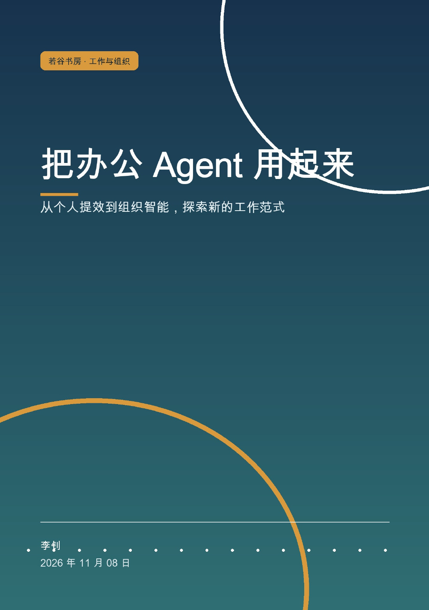
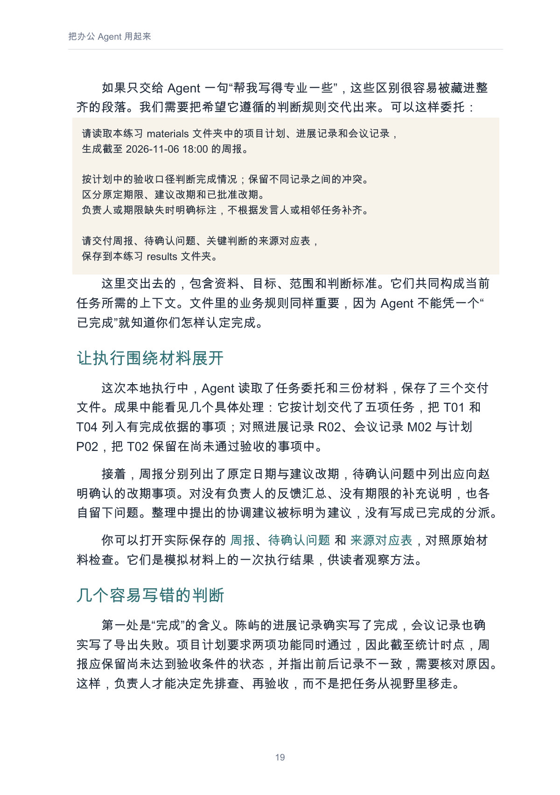
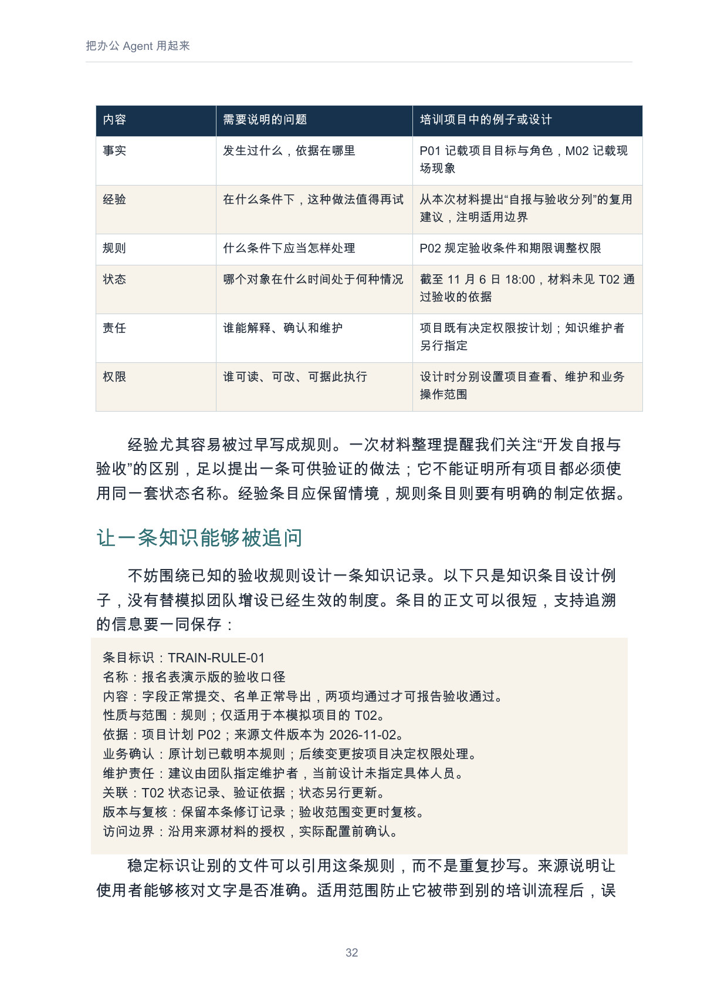
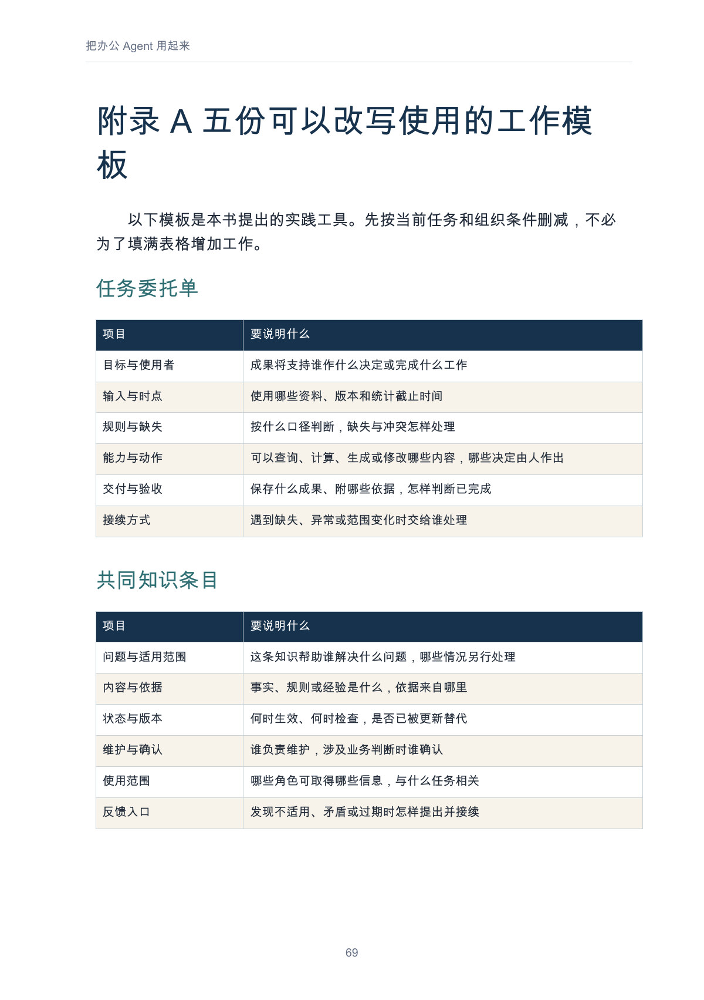

# 把办公 Agent 用起来

**从个人提效到组织智能，探索新的工作范式**

**快速导航：** [完整目录](#user-content-完整目录) · [正文预览](#user-content-正文预览) · [阅读与下载](#user-content-阅读与下载)

作者：李钊 · 出版单位：若谷书房 · 第一版 1.0 · 2026-11-08

从一份能够核查的周报开始，讨论个人怎样用好 Agent，组织又怎样把分散经验变成共同能力。

全书三篇十五章，两份附录，约 3.25 万个中文字。面向希望用好 Agent 的工作者，也供团队负责人、知识建设参与者与企业管理者参考。

## 这本书讲什么

第一篇从会议、文档和周报这些日常工作出发，解释 Agent 怎样依据目标、上下文和工具推进任务，怎样准备材料、约定完成标准，并沿着来源检查成果。第 3 章用原创模拟项目串起计划、进展和会议记录，展示“自报完成与实际验收不一致”“建议改期尚未批准”“负责人或期限缺失”等问题怎样进入周报、待确认问题和来源对应表。随后讨论怎样针对错误修订，把准备、核查与返工计入投入，并留下下次可复用的方法。

第二篇把视线移到团队交接：个人产出更快之后，状态、知识、决定和责任怎样接得起来？内容涵盖共同知识的来源与维护、按任务取得上下文、模型与系统工具的连接、查询与提交的权限、流程分工和组织试点。第三篇再沿集团、经营生产、供应链和知识劳动逐层展开，分析跨单位复用与更大协作的条件，讨论参与者怎样推动改变，并由时间、判断与自主性的选择衔接后续选题《智能生活》（Agent）。

## 适合谁，怎样阅读

| 读者或当前问题 | 建议阅读路线 |
| --- | --- |
| 普通办公人员，想完成第一次可检查的 Agent 任务 | 写在前面 → 第 1—4 章 → 附录 A 的任务委托单；再按可用工具条件试做第 3 章练习。 |
| 团队负责人，发现个人更快而整体交付仍在等待 | 第 5—10 章，沿交接、知识、执行、责任和试点评价检查一段实际流程。 |
| 知识、数字化与 AI 建设参与者 | 第 6—9 章 → 第 10 章 → 附录 A，重点看来源、版本、维护、工具能力和异常接续。 |
| 企业或集团管理者，希望扩大已有实践 | 第 10—13 章，再读第 14—15 章，分别评价组织结果、跨单位条件与劳动影响。 |
| 关心工作与生活变化的读者 | 第 14—15 章提出参与、收益与时间问题；需要了解实现条件时，再回看个人与组织两篇。 |

每次可以先选一项范围清楚的任务、一段能够观察的交接，或一条值得共同维护的知识。书中的方法需要结合自己的材料、权限、业务规则和验收要求调整。

## 能从书中获得什么

- 任务选择、上下文准备和成果验收的提问方法，把“帮我做一下”写成可以检查的委托。
- 一套模拟练习的原始材料和三份实际本地交付结果，能够沿来源观察状态、日期与负责人怎样判断。
- 共建知识条目的参考结构，以及贡献、审核、使用、反馈、更新和旧知识退出的维护思路。
- 把模型、工具、系统记录与人的决定接起来的流程设计线索，明确异常出现后怎样继续工作。
- 组织试点与跨单位推广的观察框架，以及五份可按任务改写的工作模板。

## 完整目录

以下保留主稿的篇章名称，并附各章讨论的问题。完整小节与正文见 [Markdown 阅读版](output/markdown/把办公Agent用起来.md)。

**写在前面**：怎样从一次任务走向共同知识，再讨论更大范围的工作变化？

### 第一篇 从个人任务开始改善工作

| 章节 | 本章讨论的问题 |
| --- | --- |
| 第 1 章 Agent 怎样参与我的工作 | Agent 依据什么推进步骤，模型、上下文、工具与人的判断怎样配合？ |
| 第 2 章 选好任务，准备必要的上下文 | 怎样选出可以判断好坏的成果，准备材料、工具条件与完成标准？ |
| 第 3 章 串起会议、文档与周报 | 怎样保留记录冲突、缺失与待确认事项，并交付有来源的周报？ |
| 第 4 章 检查结果，沉淀自己的工作方法 | 怎样沿重要判断核查依据、针对问题修订，并把投入与有效经验记录下来？ |

### 第二篇 让个人能力成为组织共同能力

| 章节 | 本章讨论的问题 |
| --- | --- |
| 第 5 章 为什么个人更快，组织仍可能更慢 | 等待来自工作依赖、决定还是共同口径，怎样先改善一处连接？ |
| 第 6 章 共建企业的知识基座 | 怎样区分事实、经验、规则、状态、责任与权限，让知识可以被追问？ |
| 第 7 章 让知识在工作中持续生长 | 贡献、审核、反馈、更新与旧知识退出怎样进入日常工作？ |
| 第 8 章 接上模型、系统与工具的能力 | 怎样从取得相关知识走到查询、草拟、提交和接收业务回执？ |
| 第 9 章 重新定义工作、流程与分工 | 任务、决定、异常和验收怎样接续，谁参与设计并承担相应工作？ |
| 第 10 章 把试点变成组织改善 | 怎样保留原有情况、观察完整流程，形成继续、调整、缩小或推广的决定？ |

### 第三篇 从企业集团走向行业与时代

| 章节 | 本章讨论的问题 |
| --- | --- |
| 第 11 章 集团协同，让共同能力跨越部门与地域 | 哪些知识可以共同维护，哪些需要本地适配，谁承担贡献与维护？ |
| 第 12 章 影响经营、生产与战略 | 怎样让事实进入决策，把变化接到计划、采购、质量和后续反馈？ |
| 第 13 章 沿供应链与行业扩展协作 | 合作方怎样共同解释对象、日期与状态，传递有依据的变化并评价收益？ |
| 第 14 章 知识、劳动与价值创造的新可能 | 任务、学习、知识维护与岗位怎样变化，新增价值与工作由谁分享和承担？ |
| 第 15 章 从智能工作走向智能生活 | 效率改善后的时间怎样使用，人怎样保留判断、关系与自主选择？ |

### 两份附录

| 附录 | 内容 |
| --- | --- |
| 附录 A 五份可以改写使用的工作模板 | 任务委托单、共同知识条目、流程与责任对照、组织试点记录、情景分析与行动卡。 |
| 附录 B 术语与进一步阅读 | Agent、上下文、企业知识基座、企业大脑、工具能力与组织效能等术语，以及进一步阅读入口。 |

## 正文预览

页码按 PDF 文件从第 1 页起计，包含封面；点击图片可查看大图。

### 模拟周报练习：把判断规则写进委托 · PDF 第 19 页

第 3 章把验收口径、状态冲突、建议改期和缺失信息写进委托，并说明一次本地执行怎样形成周报、待确认问题与来源对应表。练习使用虚构材料，展示可检查的处理过程。

### 共建知识基座：让一条知识能够被追问 · PDF 第 32 页

第 6 章用表格区分事实、经验、规则、状态、责任与权限，再给出包含来源、适用范围、维护责任和访问边界的知识条目设计例子。

### 工作模板：任务委托单与共同知识条目 · PDF 第 69 页

附录 A 的两张模板提示读者说明目标、输入时点、判断规则、验收和接续方式，并为共同知识保留依据、版本、维护者与反馈入口。

## 阅读与下载

- [Markdown 在线阅读](output/markdown/把办公Agent用起来.md)
- [PDF · A5 · 72 页](https://github.com/njxshr/ruogu-books/releases/download/office-agent-v1.0/office-agent.pdf)
- [EPUB · 可调整字号](https://github.com/njxshr/ruogu-books/releases/download/office-agent-v1.0/office-agent.epub)
- [Markdown 离线包 · 含练习与来源台账](https://github.com/njxshr/ruogu-books/releases/download/office-agent-v1.0/office-agent-markdown.zip)
- [版本发布与附件校验和](https://github.com/njxshr/ruogu-books/releases/tag/office-agent-v1.0)

PDF 适合固定版式阅读与打印；EPUB 适合阅读器与移动设备；Markdown 适合在线阅读、检索和跟随练习。离线包请完整解压，保留 `companion/` 与正文的相对位置。

## 配套练习与来源

第 3 章采用原创模拟材料，已实际完成本地文件交付与检查；这不代表真实企业的效率成效。组织设计与宏观延展分别说明建议、研究范围和推演条件。

配套材料见 [模拟练习](examples/ch03-weekly-report/README.md) 与 [来源台账](sources.md)。本书末章衔接后续选题《智能生活》（Agent）。

## 修订与制作

[主稿](manuscript/book.md)是唯一写作版本。内容经用户确认后，使用 `build-ebook` 制作三种阅读版本；AI 参与结构、资料整理、初稿及检查，作者负责审订。

制作复现见 [BUILD.md](BUILD.md)，检查范围见 [QA.md](QA.md)，变更见 [REVISION_LOG.md](REVISION_LOG.md)。反馈请注明书名、版本、章节或 PDF 页码。

© 2026 李钊。引用资料保留原有署名与来源。公开阅读与下载不另外授予统一的转载、改编或再发行许可。
