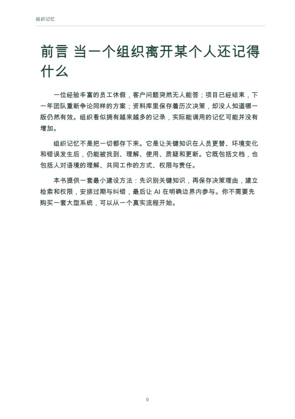
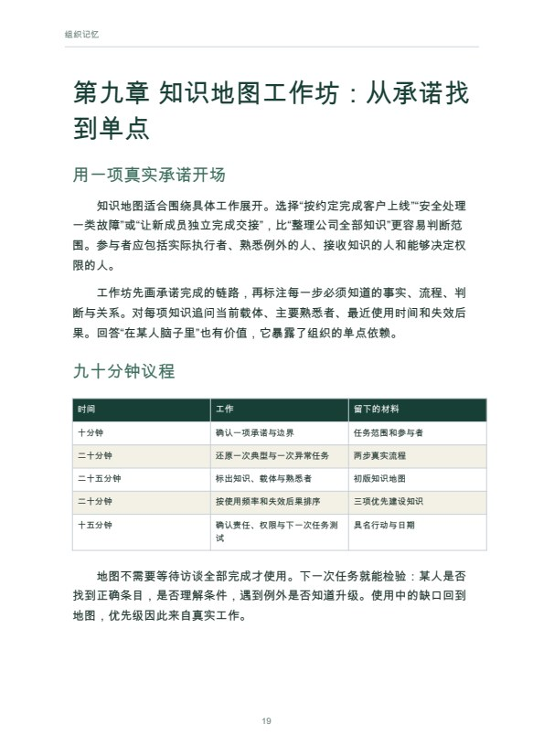

# 组织记忆

企业如何知道、忘记与纠错

作者：李钊 · 出版单位：晓翊工作室  
增订版 1.1 · 原书日期：2026-11-11 · 增订日期：2026-11-19 · PDF 50 页

把分散资料和经验转化为可找到、可使用、可更新、可追责的组织知识。

## 阅读导引

本次增订保留原书基础内容、署名和出版记录，20章、7份附录。新增实践方法、综合案例或模拟练习及可直接使用的工作表。案例的材料性质以正文标注为准，不构成真实客户成效或专业结果保证。

读者可先浏览前言与原八章建立共同概念，再按当前任务选读新增章节和附录。表格需结合自己的资料填写，动态规则、产品能力和专业事项仍按当前正式来源核实。

## 完整目录

展开全书目录

- 前言　当一个组织离开某个人还记得什么
- 第一章　为什么资料很多，记忆却很少
- 第二章　先画关键知识地图
- 第三章　把经验变成可传递的知识
- 第四章　决策记录与复盘：保存当时的理由
- 第五章　检索、共享与权限：可用不等于公开
- 第六章　更新、过期与有选择的遗忘
- 第七章　当 AI 进入组织记忆
- 第八章　九十天建设一个最小记忆系统
- 第九章　知识地图工作坊：从承诺找到单点
- 第十章　专家经验访谈：还原判断发生的时刻
- 第十一章　判断卡：保存常规步骤之外的条件
- 第十二章　决策记录：把当时与后来分开
- 第十三章　权限与可见性：让知识能被安全地使用
- 第十四章　过期、归档与删除：给知识安排去向
- 第十五章　AI 检索评测：用问题检验整条链路
- 第十六章　离岗交接：让工作离开个人仍能继续
- 第十七章　纠错：让一次发现改变后续使用
- 第十八章　衡量记忆：观察任务与风险变化
- 第十九章　敏感知识与沉默：有些空白来自环境
- 第二十章　一次贯穿九十天的模拟建设
- 附录　知识卡与决策记录模板
- 附录二　知识地图与优先级工作表
- 附录三　专家访谈与判断卡证据表
- 附录四　AI 检索评测集与结果页
- 附录五　离岗、纠错与退出合并清单
- 附录六　九十天模拟记录册
- 附录七　知识评审会议记录页
- 参考资料

## 实际内页预览

页码包含封面，从 1 起算。样页由本次 50 页 PDF 重新生成。

PDF 文件第 9 页：前言。

PDF 文件第 19 页：新增实践章节。

## 阅读与下载

- [Markdown 在线阅读](output/markdown/组织记忆_李钊_20261111.md)
- [PDF · 50 页](https://github.com/njxshr/ruogu-books/releases/download/expanded-books-20261119-v1.1/organizational-memory.pdf)
- [EPUB](https://github.com/njxshr/ruogu-books/releases/download/expanded-books-20261119-v1.1/organizational-memory.epub)
- [Markdown 离线包（含配图）](https://github.com/njxshr/ruogu-books/releases/download/expanded-books-20261119-v1.1/organizational-memory-markdown.zip)

## 增订与检查

[20 轮增订记录](REVISION_LOG.md) · [实际检查报告](QA_REPORT.md)

本次重新生成 Markdown、PDF 和 EPUB。PDF 全部 50 页已渲染并逐张查看总览；EPUB 解包读取封面、前中后章节，108 个导航目标与本地资源检查通过。具体范围与限制见报告。

## 来源与权利

[来源记录](SOURCES.md) · [主稿](manuscript/book.md) · [出版配置](book.json)

来源记录保留原有核查范围。本次扩充没有借综合案例或模拟推演新增真实访谈、客户成效和统计证据。

版权所有 © 2026 李钊。保留所有权利。第三方资料权利归原权利人。公开阅读与下载不另行授予开放许可。

[返回书目](../../目录.md)
