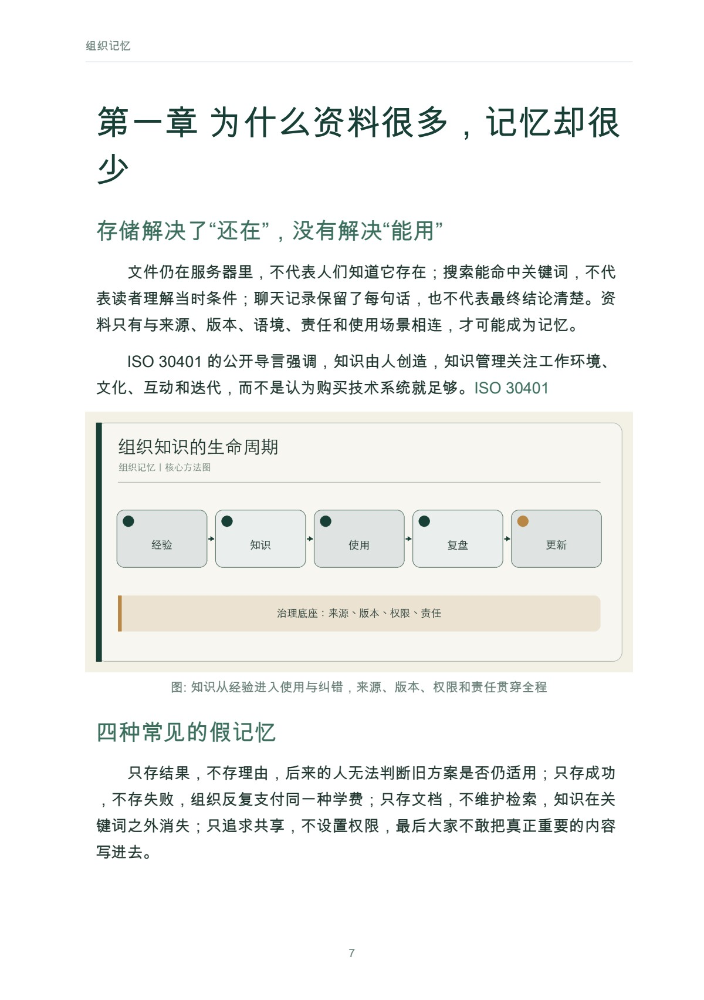
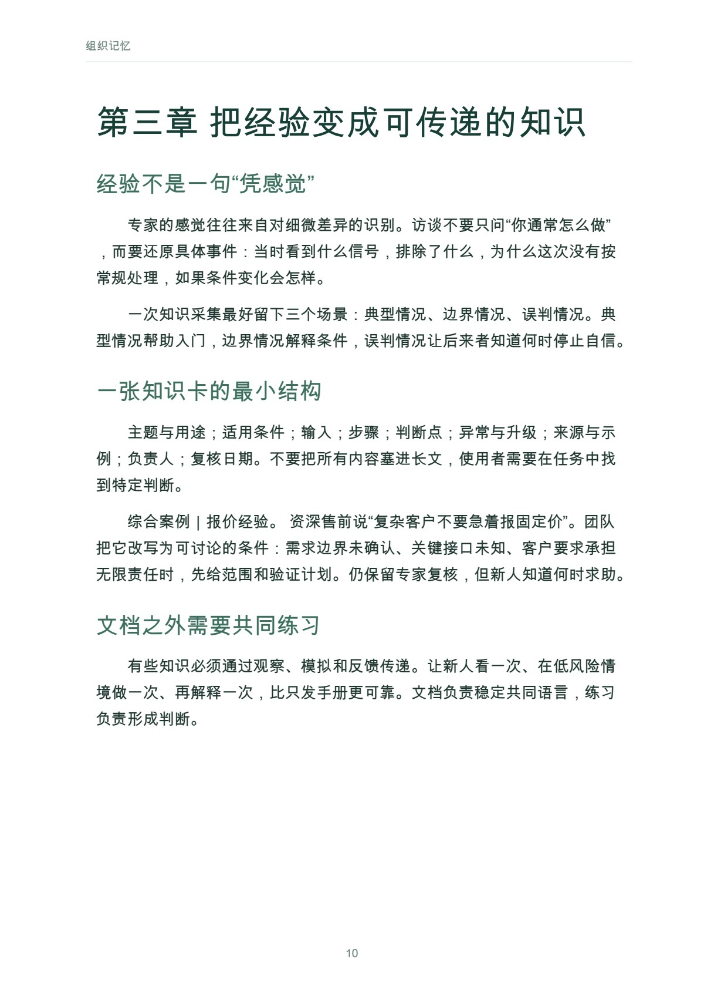

# 组织记忆

企业如何知道、忘记与纠错

作者：李钊 · 出版单位：晓翊工作室  
第一版 · 原书日期：2026-11-11 · 上架日期：2026-11-11 · PDF 17 页

把分散资料和经验转化为可找到、可使用、可更新、可追责的组织知识。

## 阅读导引

一位经验丰富的员工休假，客户问题突然无人能答；项目已经结束，下一年团队重新争论同样的方案；资料库里保存着历次决策，却没人知道哪一版仍然有效。组织看似拥有越来越多的记录，实际能调用的记忆可能并没有增加。

组织记忆不是把一切都存下来。它是让关键知识在人员更替、环境变化和错误发生后，仍能被找到、理解、使用、质疑和更新。它既包括文档，也包括人对语境的理解、共同工作的方式、权限与责任。

本书提供一套最小建设方法：先识别关键知识，再保存决策理由，建立检索和权限，安排过期与纠错，最后让 AI 在明确边界内参与。你不需要先购买一套大型系统，可以从一个真实流程开始。

建议先读前言与前两章，理解问题和基本方法；再结合当前问题选择后续章节，使用附录整理自己的记录。

## 完整目录

展开全书目录

- 前言　当一个组织离开某个人还记得什么
- 第一章　为什么资料很多，记忆却很少
- 第二章　先画关键知识地图
- 第三章　把经验变成可传递的知识
- 第四章　决策记录与复盘：保存当时的理由
- 第五章　检索、共享与权限：可用不等于公开
- 第六章　更新、过期与有选择的遗忘
- 第七章　当 AI 进入组织记忆
- 第八章　九十天建设一个最小记忆系统
- 附录　知识卡与决策记录模板
- 参考资料

## 实际内页预览

页码为包含封面的 PDF 文件页码，从 1 起算。

PDF 文件第 7 页：组织记忆 7 第一章 为什么资料很多，记忆却很 少 存储解决了“还在”，没有解决“能用” 文件仍在服务器里，不代表人们知道它存在；

PDF 文件第 10 页：组织记忆 10 第三章 把经验变成可传递的知识 经验不是一句“凭感觉” 专家的感觉往往来自对细微差异的识别。访谈不要只问“你通常怎

## 阅读与下载

- [Markdown 在线阅读](output/markdown/组织记忆_李钊_20261111.md)
- [PDF · 17 页](https://github.com/njxshr/ruogu-books/releases/download/new-books-20261111-v1.0/organizational-memory.pdf)
- [EPUB](https://github.com/njxshr/ruogu-books/releases/download/new-books-20261111-v1.0/organizational-memory.epub)
- [Markdown 离线包（含配图）](https://github.com/njxshr/ruogu-books/releases/download/new-books-20261111-v1.0/organizational-memory-markdown.zip)

## 来源与权利

[来源记录](SOURCES.md) · [主稿](manuscript/book.md) · [出版配置](book.json)

书中的综合案例、模拟情境和作者建议按正文标注理解，不作为真实客户成效承诺。来源记录保留原有核查范围，本次上架不代表重新核查全部外部来源。

版权所有 © 2026 李钊。保留所有权利。 第三方资料权利归原权利人。公开阅读与下载不另行授予开放许可。

[返回书目](../../目录.md)
