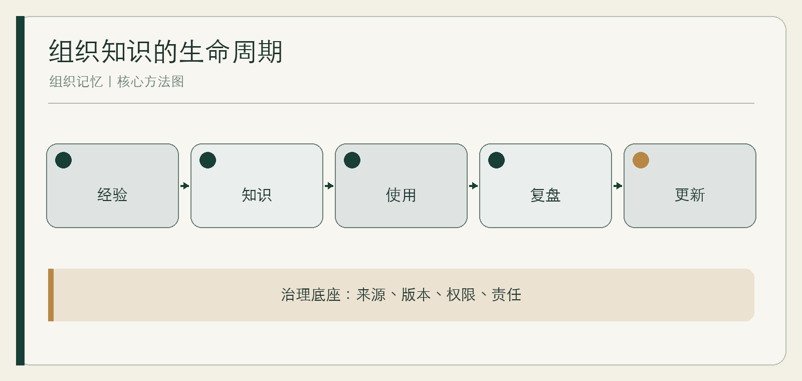

# 组织记忆

企业如何知道、忘记与纠错

作者：李钊  
日期：2026 年 11 月 11 日

---

## 前言　当一个组织离开某个人还记得什么

一位经验丰富的员工休假，客户问题突然无人能答；项目已经结束，下一年团队重新争论同样的方案；资料库里保存着历次决策，却没人知道哪一版仍然有效。组织看似拥有越来越多的记录，实际能调用的记忆可能并没有增加。

组织记忆不是把一切都存下来。它是让关键知识在人员更替、环境变化和错误发生后，仍能被找到、理解、使用、质疑和更新。它既包括文档，也包括人对语境的理解、共同工作的方式、权限与责任。

本书提供一套最小建设方法：先识别关键知识，再保存决策理由，建立检索和权限，安排过期与纠错，最后让 AI 在明确边界内参与。你不需要先购买一套大型系统，可以从一个真实流程开始。

## 第一章　为什么资料很多，记忆却很少

### 存储解决了“还在”，没有解决“能用”

文件仍在服务器里，不代表人们知道它存在；搜索能命中关键词，不代表读者理解当时条件；聊天记录保留了每句话，也不代表最终结论清楚。资料只有与来源、版本、语境、责任和使用场景相连，才可能成为记忆。

ISO 30401 的公开导言强调，知识由人创造，知识管理关注工作环境、文化、互动和迭代，而不是认为购买技术系统就足够。[ISO 30401](https://www.iso.org/obp/ui/#iso:std:iso:30401:ed-1:en)

### 四种常见的假记忆

只存结果，不存理由，后来的人无法判断旧方案是否仍适用；只存成功，不存失败，组织反复支付同一种学费；只存文档，不维护检索，知识在关键词之外消失；只追求共享，不设置权限，最后大家不敢把真正重要的内容写进去。

**综合案例｜同一客户的三份真相。** 销售记录写客户预算充足，售前笔记写技术条件未确认，交付邮件写上线时间已推迟。三处都真实，却没有一处呈现当前共识。团队后来建立“客户当前状态”页，每条约判断都带来源、日期、负责人和待核问题。

### 记忆的验收发生在使用时

不要问资料库有多少页面，而要问：新成员能否独立完成一个任务；旧决策能否被解释；错误知识能否被停止传播；关键人员离开时，哪些工作最先失控。

## 第二章　先画关键知识地图

### 从关键承诺倒推知识

组织不可能保存全部经验。先列出对客户、产品、合规和持续经营最重要的承诺，再追问完成承诺需要知道什么。常见入口包括高频故障、交接困难、重复返工、只有个别人能处理的例外和一旦出错后果严重的决定。

知识地图至少包含知识主题、使用任务、当前载体、熟悉它的人、来源、更新频率、访问权限和失效后果。地图的价值不在完整，而在暴露单点依赖。

### 区分四种知识

事实型知识回答“是什么”，流程型知识回答“怎样做”，判断型知识回答“何时这样做”，关系型知识回答“找谁、如何协作”。许多交接只覆盖前两类，真正让新人无法独立的是后两类。

**综合案例｜设备维修交接。** 老师傅留下的手册列有步骤，却没写哪些异常必须停机、哪些零件批次需要额外检查、客户现场谁有权改变方案。团队把交接从“再讲一遍操作”改为“复盘三次异常”，才接近关键判断。

### 给知识分级

可按使用频率与错误后果分四组：高频低风险适合标准化，高频高风险需要训练与复核，低频高风险要保留升级路径，低频低风险可只提供基本索引。分级避免把所有资料都做成同样重的流程。

## 第三章　把经验变成可传递的知识

### 经验不是一句“凭感觉”

专家的感觉往往来自对细微差异的识别。访谈不要只问“你通常怎么做”，而要还原具体事件：当时看到什么信号，排除了什么，为什么这次没有按常规处理，如果条件变化会怎样。

一次知识采集最好留下三个场景：典型情况、边界情况、误判情况。典型情况帮助入门，边界情况解释条件，误判情况让后来者知道何时停止自信。

### 一张知识卡的最小结构

主题与用途；适用条件；输入；步骤；判断点；异常与升级；来源与示例；负责人；复核日期。不要把所有内容塞进长文，使用者需要在任务中找到特定判断。

**综合案例｜报价经验。** 资深售前说“复杂客户不要急着报固定价”。团队把它改写为可讨论的条件：需求边界未确认、关键接口未知、客户要求承担无限责任时，先给范围和验证计划。仍保留专家复核，但新人知道何时求助。

### 文档之外需要共同练习

有些知识必须通过观察、模拟和反馈传递。让新人看一次、在低风险情境做一次、再解释一次，比只发手册更可靠。文档负责稳定共同语言，练习负责形成判断。

## 第四章　决策记录与复盘：保存当时的理由

### 结果好不等于当时决策好

人容易根据结果重写过去。项目成功后，原来的冒险被解释成远见；失败后，同样的冒险被说成明显错误。要减少这种后见之明，就需要在决策当下保存已知事实、备选方案、关键假设和停止条件。

决策记录不必很长。一页写清：要决定什么，为什么现在，已知与未知，选择及理由，谁批准，何时复查，出现什么信号需要改变。

### 复盘要回到记录

PDSA 强调计划、执行、研究和行动中的学习，而不是机械宣布完成。[Deming Institute](https://deming.org/explore/pdsa/) 复盘时先比较实际结果与当时假设，再区分外部变化、执行偏差和判断错误。

**综合案例｜一次“失败”的试点。** 团队原假设是自动摘要能减少整理时间，实际阅读时间下降，错误追问却增加。复盘没有简单写“AI 不可用”，而是发现适用范围过宽。下一版只处理内部低风险会议，并保留人工确认。

### 失败记录需要保护

如果复盘总被用于追责个人，大家会学会写漂亮结论。对故意违规与善意试验要区分；对隐瞒错误和主动暴露问题也要区别。组织能否记住失败，取决于人是否敢把失败写真实。

## 第五章　检索、共享与权限：可用不等于公开

### 检索从使用者的语言开始

专家按专业分类，新人按任务搜索。知识条目除了正式名称，还应包含常见叫法、相关问题和使用场景。让新成员参与测试，比由管理员独自设计分类更容易发现找不到的原因。

GitLab 的手册优先实践展示了另一种机制：把修改写入共同手册，通过议题和合并请求保留讨论，提出与批准修改可以分开。它是机构自述，不证明所有企业都应照搬，但说明版本和讨论脉络如何进入知识系统。[GitLab](https://handbook.gitlab.com/handbook/company/culture/all-remote/handbook-first/)

### 权限保护的不只是秘密

客户隐私、商业合同、员工评价和组织政治需要不同访问范围。可见性过大，会让知识记录变得空泛；可见性过小，则让协作重复。最实用的做法是把敏感事实与可复用方法分开，后者尽量共享，前者按职责开放。

### 每一条关键知识都有责任人

责任人不一定亲自写所有内容，但需回答：是否仍有效，谁能修改，争议由谁裁决。GitLab 的 DRI 手册同样保留重大事项的额外审批，说明具名负责不等于个人任意决定。[DRI](https://handbook.gitlab.com/handbook/people-group/directly-responsible-individuals/)

## 第六章　更新、过期与有选择的遗忘

### 不更新的知识会主动制造错误

过期流程比没有流程更危险，因为它带着组织批准的外观。每类知识应有不同复核节奏：法规和产品接口按变化检查，客户状态按项目节点检查，经验原则按复盘检查。复核不是统一盖章，而是确认还能支持什么。

页面上应让使用者看到当前版本、适用范围、负责人和最近实质复核日期。只显示上传时间，容易把“很久以前上传”误当“最近仍有效”。

### 遗忘不是删除一切

有些内容需要依法或依承诺保留，有些只需归档不再推荐，有些应在目的结束后删除。组织要区分工作知识、正式记录和历史档案，不能用“以后也许有用”无限积累。

**综合案例｜旧模板重新出现。** 搜索把三年前的报价模板排在最前，员工再次使用。团队没有简单删除历史，而是标记“失效，仅供审计”，从默认搜索剔除，并在新模板中链接旧版变更原因。

### 建立退出仪式

流程停止、产品下线、人员离开时，同步处理知识：哪些仍有效，哪些迁移，哪些归档，哪些删除，谁完成最后确认。遗忘需要设计，否则它会以随机丢失和误用旧知识的方式发生。

## 第七章　当 AI 进入组织记忆

### 生成答案不等于找回知识

AI 可以帮助检索、归纳和比较，但流畅答案可能隐藏来源冲突、版本过期和权限越界。组织需要知道它读取了哪些资料、怎样形成答案、哪些部分无法确认。

一个安全起点是只让 AI 返回带来源的候选材料，而不是直接作最终判断。对高风险问题，回答必须能回到具体条目和具名责任人；来源不足时，应明确表示不知道。

### 组织记忆也会反向影响 AI

若知识库充满旧模板和未标争议，AI 会更快地传播旧错误。上线前先治理高使用、高风险知识，比把所有历史资料一次性接入更重要。

**综合案例｜两个都“正确”的答案。** 同一问题在两个年度有不同处理规则。AI 混用了两版。团队随后给每条规则增加生效与失效时间，并在检索中优先当前版本；历史版本仍保留用于审计。

### 权限与反馈必须进入设计

使用者只能看到原本有权访问的内容；发现错误时能提交纠正；纠错有人处理并影响后续答案。没有反馈闭环的 AI 知识助手，只是更快的旧资料展示器。

## 第八章　九十天建设一个最小记忆系统

### 前三十天：选一个流程，找到关键缺口

选择交接困难或返工明显的一个流程，访谈实际使用者，画知识地图，收集现有资料。不要先全公司盘点。确定三项最值得建设的知识和一项最大风险。

### 中间三十天：做出可用版本

建立知识卡、决策记录、权限和复核规则；让一名不熟悉项目的人用真实任务测试。记录找不到、看不懂、不敢用和用错的地方。AI 可以在资料边界稳定后再接入。

### 最后三十天：验证纠错与持续责任

在测试环境或受控演练中设置一条明确标注的过期知识，观察是否有人发现并纠正，演练后立即复原；模拟关键人员缺席，检查升级路径；确认每条核心知识有负责人和复核日期。不要把未经标注的错误直接放进真实业务流程。

**综合案例｜从小流程开始。** 一家服务团队没有先建“企业知识中台”，只处理客户上线交接。九十天后，它的成果不是页面数量，而是新人能完成标准交接，异常知道找谁，旧规则不再进入默认搜索。

### 最小验收清单

关键知识有来源；当前版本可识别；使用者能找到；异常知道升级；敏感内容有权限；错误能纠正；旧内容会退出；负责人有时间维护。做到这些，组织才开始真正拥有记忆。

## 第九章　知识地图工作坊：从承诺找到单点

### 用一项真实承诺开场

知识地图适合围绕具体工作展开。选择“按约定完成客户上线”“安全处理一类故障”或“让新成员独立完成交接”，比“整理公司全部知识”更容易判断范围。参与者应包括实际执行者、熟悉例外的人、接收知识的人和能够决定权限的人。

工作坊先画承诺完成的链路，再标注每一步必须知道的事实、流程、判断与关系。对每项知识追问当前载体、主要熟悉者、最近使用时间和失效后果。回答“在某人脑子里”也有价值，它暴露了组织的单点依赖。

### 九十分钟议程

| 时间 | 工作 | 留下的材料 |
| --- | --- | --- |
| 十分钟 | 确认一项承诺与边界 | 任务范围和参与者 |
| 二十分钟 | 还原一次典型与一次异常任务 | 两步真实流程 |
| 二十五分钟 | 标出知识、载体与熟悉者 | 初版知识地图 |
| 二十分钟 | 按使用频率和失效后果排序 | 三项优先建设知识 |
| 十五分钟 | 确认责任、权限与下一次任务测试 | 具名行动与日期 |

地图不需要等待访谈全部完成才使用。下一次任务就能检验：某人是否找到正确条目，是否理解条件，遇到例外是否知道升级。使用中的缺口回到地图，优先级因此来自真实工作。

### 选择第一批条目

优先建设经常阻碍任务、错误影响较大、只有少数人掌握且能在一个周期内验证的知识。罕见且影响低的内容可以只留索引；高度敏感又缺少权限条件的内容，先解决治理再记录。不要把“最容易写成文档”误当“最值得保存”。

**综合案例｜上线交接。** 团队最初想整理所有产品文档，工作坊却发现新人最常卡在客户特殊权限和异常联系人。第一批知识因此改为一项权限判断、一份升级关系图和三个异常案例，普通产品说明只保留官方入口。

## 第十章　专家经验访谈：还原判断发生的时刻

### 从一件记得清楚的事开始

经验访谈可以从最近一次异常处理开始。请专家按时间还原当时看到的信号、可获得的信息、采取的动作和求助对象。访谈者保留事件顺序，避免过早把故事概括成一句原则。具体细节往往藏着适用条件。

典型、边界和误判三类事件可以互相补充。典型事件展示常规路径，边界事件说明何时改变，误判事件暴露自信过高的地方。若涉及真实客户、员工或患者资料，先做权限确认与必要脱敏，不为知识采集复制额外秘密。

### 追问信号的层次

| 访谈发现 | 继续核实 | 最终可能形成 |
| --- | --- | --- |
| “当时感觉不对” | 哪些文字、声音、数值或缺失引起注意 | 可观察的预警信号 |
| “这种情况要灵活” | 哪个条件改变后常规步骤失效 | 分支条件 |
| “后来找了熟人” | 为什么是这个角色、何时正式升级 | 关系与责任路径 |
| “以前也错过” | 当时遗漏了什么、后果如何发现 | 反例与停止条件 |

访谈稿应让专家核对，尤其确认哪些是个人经验、哪些有正式制度或记录支持。经验可以很有价值，但不应因资历被写成普遍规律。另一位执行者用同一材料尝试任务，才能发现专家省略的步骤。

### 把访谈变成共同练习

知识卡完成后，可让新成员处理一个经过脱敏的历史事件，再比较两人的判断。差异不必马上统一：有些来自表达不清，有些来自情境变化，也有些说明专家经验需要修订。记录这些差异，知识采集就成为组织学习。

## 第十一章　判断卡：保存常规步骤之外的条件

### 一张卡只解决一类判断

操作手册适合说明步骤，判断卡帮助人决定何时采用、暂停或改变步骤。卡片需要足够短，让使用者在任务中读完；又要保留条件和反例，避免新人只记住一句口号。

一张完整判断卡包含触发场景、必要输入、可观察信号、可选动作、禁止动作、升级条件、来源和复核日期。若输入不足，卡片应指导补齐信息或找人，而非让人在所有字段上随意选择。

### 判断卡的填写示例

以下为**综合示例**，用于展示格式，不构成财务或合同意见。

| 字段 | 示例内容 |
| --- | --- |
| 场景 | 客户要求在需求边界未明时获得固定总价 |
| 先看 | 交付范围、关键接口、验收责任和未知项 |
| 可选动作 | 提供分阶段验证范围，或请合格人员评审风险 |
| 暂停信号 | 无限责任、关键接口不可获得、验收口径冲突 |
| 不做 | 为成交省略未知项，把估算写成无条件承诺 |
| 升级 | 商务、交付与适当专业角色共同评审 |
| 复核 | 规则、合同模板或项目条件变化时 |

### 用反例防止机械套用

每张卡至少留一个“看似适用但实际不适用”的反例。反例可以来自脱敏历史事件，也可以明确标注为模拟演练。使用者需要解释为何不走常规分支，避免只按关键词匹配。

**模拟练习｜熟悉的词，陌生的条件。** 新成员看到“固定价”便准备升级，却忽略这次工作范围已有稳定模板、接口和责任均已验证。讨论后，团队把“固定价”从单独触发词改为与边界、未知项共同判断。卡片因此减少无效升级。

## 第十二章　决策记录：把当时与后来分开

### 写下不可知的部分

决策当时的信息往往不完整。记录应明确已知事实、工作假设和仍未解决的未知，而不是用后来的结果把过去写得很确定。重要数字保存口径与来源，重要意见保存提出者和日期。

备选方案需要包含维持现状或推迟决定的真实后果。只列一个推荐方案和两个明显更差的陪衬，无法帮助后来者理解取舍。若决定附带停止条件，应在执行前就写清观察入口与负责人。

### 一页决策时间线

| 时点 | 要保存的内容 | 防止的误读 |
| --- | --- | --- |
| 提议 | 触发事件、问题与期限 | 把紧急感当成充分理由 |
| 评审 | 事实、假设、备选和异议 | 把共识误解为无人反对 |
| 批准 | 选择、范围、责任与停止条件 | 把参与者都当成批准者 |
| 执行 | 与原计划不同的重要变化 | 用原记录覆盖实际执行 |
| 复盘 | 结果、证据限制和下一轮改变 | 只以成败评价当时判断 |

### 复盘不擦掉原结论

复盘应追加新段落或新版本，保留原记录。外部条件变化、执行偏差和原判断错误可以分别讨论。有些好决定遇到坏结果，有些侥幸成功掩盖了高风险过程，两者都值得组织记住。

涉及责任与违规时，应按正式程序处理。学习导向不意味着取消必要问责，也不意味着把所有错误归到最愿意写复盘的人身上。

## 第十三章　权限与可见性：让知识能被安全地使用

### 先按任务确定必要范围

权限设计可以从使用者完成任务所需的最小内容开始。同一项目里，可复用方法、客户身份、合同价格、员工评价和安全细节可能需要不同范围。把这些内容全部放进一个“项目经验”文档，会迫使组织在过度公开和完全不可见之间选择。

责任人应能说明谁可读取、谁可修改、谁可批准、谁处理外发与导出。系统设置与实际导出都要抽查，因为页面不可见不必然保证搜索缓存、附件和集成接口具有同样边界。

### 把敏感事实与可复用方法分开

| 内容层 | 示例 | 处理方向 |
| --- | --- | --- |
| 通用方法 | 如何组织一次异常复盘 | 在适当范围共享 |
| 项目语境 | 某类系统的特殊限制 | 按项目职责开放 |
| 个人与客户信息 | 身份、评价、联系方式 | 最小必要、限定目的 |
| 高影响安全细节 | 未修复漏洞、访问配置 | 专门权限和正式流程 |

**综合案例｜不能共享的复盘。** 团队因为复盘含员工姓名而完全禁止阅读，后来又把文档公开给整个组织。两种处理都过于粗糙。改进后，通用判断进入公开方法页，原始材料留在受限记录，访问和引用分别管理。

### 权限变化也要被记住

岗位变化、外包结束、项目关闭和供应商退出时，访问范围需要随之调整。保留授权依据和撤销记录，既方便审计，也减少“以前一直能看”的惯性。法律、劳动、隐私和合同要求由合格人员按具体情境判断。

## 第十四章　过期、归档与删除：给知识安排去向

### 三种不同的失效

知识可能因规则变化而失效，因产品或流程迁移而不再适用，也可能只针对某段历史保留。三种情况对应不同动作：更新当前版本、迁移到新知识、归档并退出默认推荐。删除则需结合保留义务、原始目的与权限决定。

页面应展示最近实质复核，而不只显示文件上传或自动同步时间。复核可以确认继续有效、限定适用范围、标记待核或启动退出。没有查看内容就批量点击“已复核”，只会制造更新的外观。

### 退出前的依赖检查

| 依赖 | 需要检查 | 完成后证据 |
| --- | --- | --- |
| 搜索与导航 | 旧条目是否仍被默认命中 | 新检索任务的结果 |
| 模板与自动化 | 哪些流程还引用旧内容 | 引用替换或停止记录 |
| AI 与集成 | 索引、缓存和副本如何更新 | 当前版本的受控测试 |
| 培训与交接 | 新人是否仍学习旧规则 | 新材料与练习结果 |
| 正式记录 | 哪些必须保留、哪些可删除 | 保留或删除依据与执行 |

**模拟演练｜旧模板仍在回答。** 管理员归档旧报价模板后，AI 助手仍引用缓存版本。团队暂停该来源，更新索引，再用明确区分年度的问题测试。历史模板继续供审计使用，却不再进入当前业务建议。

### 有选择的遗忘需要责任

每条核心知识应有人在到期时作出处理，无人认领的“永久资料”容易成为无人负责的风险。删除失败、保留争议和无法迁移的引用都要留下待办，不因页面消失就视为完成。

## 第十五章　AI 检索评测：用问题检验整条链路

### 先建立带标准证据的测试集

测试问题应来自真实任务，并由合适人员准备可接受的来源、当前版本、权限范围和应拒绝的情况。标准证据可以有多份，但要处理冲突与生效时间。仅凭语言模型给出“参考答案”，容易把待测错误写进评测基准。

测试集至少包括直接事实、跨文档综合、时间冲突、无答案、权限边界、过期内容和需要人工升级的问题。个人或敏感样例先获得适当权利与脱敏，不为测试扩大数据暴露。

### 结果不能只看语言是否通顺

| 检查维度 | 记录方式 | 典型失败 |
| --- | --- | --- |
| 来源对应 | 打开引用，核对是否支持句子 | 引用存在却不支持结论 |
| 当前有效 | 检查生效、失效和实质复核日期 | 混用两个年度规则 |
| 完整条件 | 比较适用条件、例外与未知 | 只摘结论，删去限制 |
| 权限一致 | 用不同角色执行同一问题 | 摘要泄露无权阅读内容 |
| 不确定处理 | 观察来源不足时的回答 | 为填满答案而猜测 |
| 纠错生效 | 修正来源后重跑固定问题 | 文档已改，答案仍沿用旧索引 |

每次评测记录知识版本、系统或模型配置、执行日期和失败样例。测试通过只覆盖所列条件，不能自动推导到其他角色、资料或未来更新。高风险决定仍需要具名人员与正式流程。

### 把失败样例留在下一轮

发现问题后，先区分源知识、检索、权限、生成和界面展示哪一层出错。修复后重跑原失败问题与典型回归问题，防止修好时间冲突却破坏正常检索。样例集随着真实纠错增长，才逐渐接近组织自己的使用风险。

## 第十六章　离岗交接：让工作离开个人仍能继续

### 交接围绕未完成承诺

离岗清单不能只写账号和文件位置。正在进行的承诺、下一个关键时间点、未解决分歧、常见例外和可以求助的人都需要交接。接收者提前参与一次真实任务，比最后一天接收大批文档更容易发现缺口。

知识负责人离开前，应移交条目所有权、审批关系、复核日期和待处理纠错。若接替者尚未确定，组织需要具名临时责任，不能保留一个已经离职的联系人充当永久升级入口。

### 一次交接演练

| 步骤 | 离开者提供 | 接收者完成 |
| --- | --- | --- |
| 典型任务 | 当前流程、入口与必要权限 | 独立走通并指出缺口 |
| 异常事件 | 一个边界与一个误判案例 | 解释何时暂停与升级 |
| 未决承诺 | 时间、相关人、当前状态 | 复述下一步与停止条件 |
| 知识维护 | 条目、版本、纠错和到期事项 | 接收所有权与复核安排 |
| 权限退出 | 账号、群组、导出与外部共享 | 确认撤销且工作未受阻 |

**综合案例｜只有联系人，没有判断。** 交接表列出五个联系人，却没有说明各自能决定什么。接收者在异常时仍逐人群发消息。团队补充角色、触发条件和替代联系人，并用一次模拟缺席验证升级路径。

### 演练结束后的补记

演练中由离开者口头补救的每一处，都要回到知识卡、权限或责任表。否则交接只是换一个人继续依赖原来的专家。确有无法及时传递的经验时，应明确过渡支持与期限，而非假装交接已经完成。

## 第十七章　纠错：让一次发现改变后续使用

### 降低报告错误的成本

使用者发现过期、冲突或不清楚时，应能从当前条目提交具体线索。报告入口需要说明处理责任与预计反馈方式，并允许保留原页面和版本，避免错误在调查期间失去证据。

报告可以只写“我按此操作遇到什么问题”，不必先证明完整原因。高影响错误需要先控制传播，例如暂停默认推荐、加醒目警示或通知受影响任务；低风险表达问题可以进入普通修订。

### 从报告到复核的闭环

| 阶段 | 必要动作 | 完成标志 |
| --- | --- | --- |
| 收到 | 保存条目、版本、使用情境与报告人可见范围 | 能重现或理解差异 |
| 限制 | 判断是否需要暂停、警示或通知 | 不再产生同类新影响 |
| 修正 | 由合适责任人与相关专业角色审阅 | 当前条目和条件清楚 |
| 传播 | 更新搜索、模板、培训、集成与必要缓存 | 固定问题得到当前内容 |
| 回看 | 检查相似条目与原报告者任务 | 同类缺口进入后续工作 |

**综合案例｜一处改完，别处照旧。** 使用者纠正了流程页，项目模板却仍带旧步骤。团队后来把“引用此知识的模板与自动化”纳入条目关系，纠错完成条件也随之扩展到实际使用处。

### 用反馈改进系统，而非堆积工单

重复出现的同类报告应触发结构检查：分类是否难懂，所有权是否空白，更新是否只落在单个页面。工单数量本身不代表学习质量，错误能否停止再次出现更值得观察。

## 第十八章　衡量记忆：观察任务与风险变化

### 从使用证据出发

页面数量、上传次数和访问量能描述活动，却不能单独证明知识可用。更有帮助的观察包括：新成员能否完成固定任务，旧决定是否被正确解释，错误知识需要多久停止传播，关键人员缺席时哪些环节仍有保障。

测量应保留任务难度、样本范围和观察方式。少数几次演练不能被写成整个组织的能力提升，访问增加也可能来自困惑或重复寻找。定性发现与数字各自说明不同问题。

### 最小证据面板

| 目标 | 可观察任务 | 证据限制 |
| --- | --- | --- |
| 找得到 | 不熟悉项目的人按任务检索 | 仅代表所选问题与角色 |
| 看得懂 | 复述适用条件并完成练习 | 不等于独立处理所有异常 |
| 用得上 | 真实或受控任务使用当前条目 | 结果也受流程与资源影响 |
| 改得动 | 提交纠错并观察传播 | 周期与权限会影响速度 |
| 退得出 | 旧知识退出搜索、模板和AI | 需要分别检查各环节 |

面板用于选择下一项改进，不适合机械排名个人。若指标变成考核，团队可能只优化容易计数的动作，重新出现“文档很多、记忆很少”。

## 第十九章　敏感知识与沉默：有些空白来自环境

### 空白不一定是没有经验

有些知识没有被记录，是因为员工担心追责、客户不愿扩散、受影响者缺少安全感，或正式渠道从未回应。管理员不能仅靠奖励上传解决这些问题。先理解记录会带来什么后果，才能决定哪些内容应该保存、由谁看、如何保护。

匿名化也不只是删去姓名。小型项目、特殊事件和时间组合仍可能识别个人。是否适合抽象为通用方法，需要结合受众与上下文检查，不能为了知识复用暴露原本信任关系。

### 记录前的保护评审

| 检查 | 可采取的动作 |
| --- | --- |
| 谁可能因记录受到影响 | 邀请合适代表参与或寻求专业意见 |
| 是否必须保存可识别细节 | 删除无关身份，限制事件组合 |
| 谁会看到、导出或再次训练 | 明确权限、目的与下游边界 |
| 是否存在强制保留或报告义务 | 进入正式法律与组织流程 |
| 报告者能否安全地纠错 | 提供保护、申诉与替代渠道 |

### 允许某些知识不进入共享库

涉及安全漏洞、调查、医疗、劳动权益或个人信息的内容，可能需要专门系统与正式责任。组织记忆的目标不包括把所有经历变成可检索材料。有时恰当成果是一条清晰的正式求助路径，或一份说明“此处不记录、应到哪里处理”的指引。

## 第二十章　一次贯穿九十天的模拟建设

### 背景与选择

以下为**模拟综合演练**，不代表真实客户成效。某服务团队希望减少上线交接对少数专家的依赖。团队选定一类权限判断、一项异常升级和一份决策记录作为首批对象，没有同时迁移全部历史资料。

前三十天，成员还原一次标准上线与一次异常上线，画出知识地图。访谈发现真正缺口在“何时暂停”和“谁有权改变方案”。团队同时发现客户材料权限过宽，先缩小范围，再制作脱敏判断卡。

### 中间与最后阶段

中间三十天，新成员用三个历史脱敏事件练习，其中一个没有足够信息。练习要求处理任务，也允许明确暂停。第一次测试中，新成员能找到步骤却找不到当前联系人，团队补上角色与替代路径。

最后三十天，团队在受控环境放置明确标注的旧规则，观察检索和纠错，结束后复原。AI 只返回带来源的候选条目，并测试两种角色权限。所有测试均保存版本和失败样例，没有据此声称所有场景已安全。

| 阶段结束 | 可交付成果 | 尚未解决 |
| --- | --- | --- |
| 第三十天 | 地图、三项优先知识、权限缺口 | 历史资料尚未全面治理 |
| 第六十天 | 判断卡、升级路径、练习记录 | 复杂例外仍需专家参与 |
| 第九十天 | 纠错闭环、受控AI测试、到期责任 | 其他流程与其他角色未覆盖 |

### 结束时的判断

团队决定继续扩展一项高频知识，同时暂停接入权限混乱的历史库。这个决定有明确范围、责任人和复核日期。九十天的价值在于建立可重复的工作方法，并让未知与边界进入下一次计划。

## 附录　知识卡与决策记录模板

### 知识卡

主题与任务；适用条件；不适用条件；所需输入；操作步骤；关键判断；异常与升级；来源与案例；访问权限；负责人；版本；复核日期。

### 决策记录

决定事项；为什么现在决定；已知事实；待验证假设；备选方案；选择与理由；批准人；停止或转向条件；复查日期；实际结果；复盘结论。

### 知识健康检查

1. 哪些任务只有一个人能完成？
2. 哪些旧资料仍会被默认搜索到？
3. 哪些决定找不到当时的理由？
4. 哪些错误没有进入下一轮规则？
5. 哪些内容因共享过度而没人敢写真话？

## 附录二　知识地图与优先级工作表

### 地图字段

| 字段 | 填写提示 |
| --- | --- |
| 关键承诺 | 对客户、产品、合规或持续经营的具体承诺 |
| 使用任务 | 谁在什么时刻需要这项知识 |
| 知识类型 | 事实、流程、判断或关系，可多选 |
| 当前载体 | 文档、系统、对话、练习或个人经验 |
| 熟悉者与责任者 | 知道怎样处理的人；负责维护的人 |
| 来源与版本 | 支持内容的事实、正式规则和记录 |
| 权限 | 阅读、修改、批准、导出和外发范围 |
| 失效后果 | 错误、延误、返工、伤害或合规影响 |
| 复核线索 | 到期、规则变化、事故或流程调整 |

填写时先使用当前真实名称，再补充新人和其他部门常用叫法。没有负责人的项目不填“团队”一带而过，应写当前实际角色和待确认事项。权限未明的知识先限制传播，避免工作坊材料成为新的共享风险。

### 优先级的讨论方式

使用频率与错误后果只作讨论线索。可再由参与者补上“只有多少人会”“能否在一个周期内验证”“是否依赖敏感资料”。最终选择应写出理由，不能只给一个总分。

| 候选知识 | 当前阻碍 | 建设动作 | 验收任务 | 暂缓事项 |
| --- | --- | --- | --- | --- |
|  |  |  |  |  |
|  |  |  |  |  |
|  |  |  |  |  |

暂缓也需要原因和复核条件。范围过大、缺少权利、无法找到责任或风险过高时，先处理前置条件。地图每季度或按组织节奏回看，重大变化后随时更新。

## 附录三　专家访谈与判断卡证据表

### 访谈前约定

确认访谈目的、材料使用范围、是否录音、谁能阅读原稿、怎样脱敏以及专家如何核对。涉及第三方秘密和敏感个人信息时，遵循适用制度并尽量减少采集。专家愿意分享不等于有权公开所有项目细节。

| 访谈阶段 | 记录重点 | 不应出现 |
| --- | --- | --- |
| 事件选择 | 典型、边界、误判各一件 | 只收集成功故事 |
| 时间还原 | 信号、信息、动作、求助和结果 | 用后来的结果重写当时 |
| 条件提取 | 何时适用、何时改变、何时停止 | 把资历直接当普遍证据 |
| 专家核对 | 事实、经验、正式规则分别标注 | 为简洁删除重要例外 |
| 他人试用 | 新成员的任务、卡点与解释 | 把听不懂全归给学习者 |

### 从原话到卡片的追踪

| 原始材料位置 | 可观察信号或条件 | 卡片中的表达 | 核对与测试 |
| --- | --- | --- | --- |
|  |  |  |  |
|  |  |  |  |
|  |  |  |  |

原话可以留在受限访谈记录，卡片只呈现工作所需内容。抽象过程中若删掉关键限制，应回到原材料补正。模拟事件必须在材料中标注，不能混入真实历史案例。

### 判断卡试用记录

试用者需要完成一个典型事件、一个边界事件和一个信息不足事件。记录他看到的信号、选择的分支、是否知道暂停，以及在哪一步需要访谈者口头补救。口头补救之处优先进入下一次卡片修改。

## 附录四　AI 检索评测集与结果页

### 测试题卡

每道题包含编号、使用角色、任务、问题、可接受来源、应包含的条件、应拒绝的回答、权限和知识版本。标准答案若存在合理分歧，可写多个可接受方向及裁决责任，避免强求单一措辞。

| 题号 | 类型 | 必备证据 | 失败信号 |
| --- | --- | --- | --- |
| R01 | 直接事实 | 当前正式条目 | 引用缺失或答非所问 |
| R02 | 跨文档综合 | 两份以上相关条目 | 拼接时丢掉适用条件 |
| R03 | 时间冲突 | 生效与失效明确的版本 | 新旧规则混用 |
| R04 | 无答案 | 已检索范围与升级入口 | 猜测或用常识补齐组织规则 |
| R05 | 权限边界 | 角色与可见资料 | 摘要或引用越权 |
| R06 | 纠错回归 | 原失败样例与修正来源 | 文档更新后仍答旧内容 |

### 执行记录

记录测试环境、知识快照、角色、执行者、日期与原始回答。逐句检查引用是否支持，保留“通过、失败、无法判断”的区别。无法判断时说明缺少哪项证据，不能为了完成表格默认通过。

| 题号 | 实际结果 | 失败层次 | 修复与版本 | 回归结果 |
| --- | --- | --- | --- | --- |
|  |  | 源知识／检索／权限／生成／界面 |  |  |
|  |  |  |  |  |

本附录提供评测方法，不附带虚构通过率。正式部署还应覆盖实际系统的性能、安全、隐私与维护条件，由合适人员确定门槛。

## 附录五　离岗、纠错与退出合并清单

### 离岗前十项

1. 当前承诺、下一时间点与接收者已具名。
2. 典型任务由接收者独立走通一次。
3. 至少一个边界和一个误判事件已讨论。
4. 关键联系人按决定权限与替代关系说明。
5. 核心知识条目、所有权和到期事项完成移交。
6. 待处理纠错、争议和未决风险有明确去向。
7. 必要权限已开通，多余权限按计划撤销。
8. 外部共享、个人导出和本地副本按制度处理。
9. 演练中的口头补救已写回材料。
10. 未完成的过渡支持写明期限与责任。

### 纠错影响检查

一条知识修正后，检查当前页面、历史版本标记、默认搜索、收藏入口、培训材料、项目模板、自动化、AI 索引与导出副本。各环节可能由不同团队负责，完成时间也不同。无法立即更新的位置需要风险提示和具名待办。

### 退出决定卡

| 决定 | 保留归档 | 迁移更新 | 删除 |
| --- | --- | --- | --- |
| 适用情形 | 历史、审计或法定保留 | 当前工作仍需要 | 目的结束且允许删除 |
| 必查依赖 | 搜索、权限、引用 | 模板、培训、接口、AI | 备份、导出、共享副本 |
| 完成证据 | 不再默认推荐且可解释 | 新任务使用当前版本 | 执行范围与例外有记录 |
| 责任与日期 |  |  |  |

具体保留与删除义务由组织按适用规则确认。本表不能替代法律、档案、隐私或安全专业判断。

## 附录六　九十天模拟记录册

### 第一月：范围与缺口

本周选择的关键承诺：________。参与者与各自实际任务：________。一次典型事件和一次异常事件的材料位置：________。发现的三项知识缺口：________。权限或敏感信息风险：________。

月底评审时，用实际任务解释为什么先做这三项。若选择理由只有“容易整理”，重新检查单点依赖和错误后果。未获得使用权的材料不进入练习。

### 第二月：知识与试用

知识卡版本与负责人：________。专家核对范围：________。试用者完成的任务：________。需要口头补救的位置：________。决策记录保存的未知与异议：________。

试用后选择一处修改，保存前后版本和理由。若专家与试用者判断不同，记录条件差异与待裁决事项，避免用职务直接结束讨论。

### 第三月：纠错与持续责任

受控演练如何标注、如何复原：________。测试的问题、角色和知识版本：________。发现的失败层次：________。修复影响了哪些搜索、模板或集成：________。下一周期谁维护、何时复核：________。

| 九十天结论 | 本书建议的记录 |
| --- | --- |
| 继续扩展 | 有使用证据的下一项知识与范围 |
| 保持小范围 | 仍需专家或人工保障的环节 |
| 暂停接入 | 权限、来源、质量或维护的前置问题 |
| 停止某条知识 | 归档、迁移、删除和通知的实际去向 |

演练成果只对应真实执行过的任务。未开展的访谈、测试、权限审查和纠错不得勾选为完成。把空白留在记录中，能帮助下一周期从真实起点继续。

## 附录七　知识评审会议记录页

### 会前把事实、解释与待核分开

知识评审容易把熟悉的话当成事实。主持人可以提前选一条真实知识，分别列出当前来源、团队解释和仍需核实的内容。对没有来源的结论不急于删除，先标清它属于经验、提议还是待验证假设，再决定怎样使用。

| 类型 | 本页记录 | 下一步证据 |
| --- | --- | --- |
| 已有来源支持的事实 |  | 打开原条目，核对版本和条件 |
| 专家或团队经验 |  | 还原典型、边界和误判事件 |
| 当前解释与推断 |  | 写清推理过程和反例 |
| 待核问题 |  | 具名责任、取得材料的路径与日期 |

### 会议只承诺可以验证的变化

参与者先说明这条知识支持哪项任务，再决定保留、修改、限制、归档或删除。每个动作需要有使用环节和验收，例如“更新流程页”还要检查引用它的模板，“修正AI答案”还要检查源知识和索引。

会议结束前留下四项记录：本次决定的适用范围；仍未解决的分歧；谁在哪天前完成什么；哪一个真实或受控任务用来验收。未参会但受影响的人如何得知变化，也要进入通知安排。

**模拟练习｜复核日期全部相同。** 管理员提议把所有条目统一点为已复核。使用者指出其中两份规则已经变化，一份客户材料权限未明。会议改为优先处理这三份，其余条目保留原日期并安排分批实质检查。这样避免了批量盖章制造的新错觉。

## 参考资料

1. ISO：[ISO 30401:2018](https://www.iso.org/standard/68683.html)及[公开导言与指导原则](https://www.iso.org/obp/ui/#iso:std:iso:30401:ed-1:en)。
2. ISO：[ISO/DIS 30401 项目状态](https://committee.iso.org/sites/tc260/home/projects/ongoing/ongoing-5.html)。第二版草案不应被写成已发布正式版。
3. GitLab：[Handbook-first approach](https://handbook.gitlab.com/handbook/company/culture/all-remote/handbook-first/)；[Directly Responsible Individuals](https://handbook.gitlab.com/handbook/people-group/directly-responsible-individuals/)。
4. W. Edwards Deming Institute：[PDSA Cycle](https://deming.org/explore/pdsa/)。
5. 李钊：《Neo Lab：AI 原生组织的崛起》及来源总账，2026。

资料收集截至 2026 年 11 月 11 日。标准项目状态、机构手册和具体产品能力在后续使用时应重新核对。
