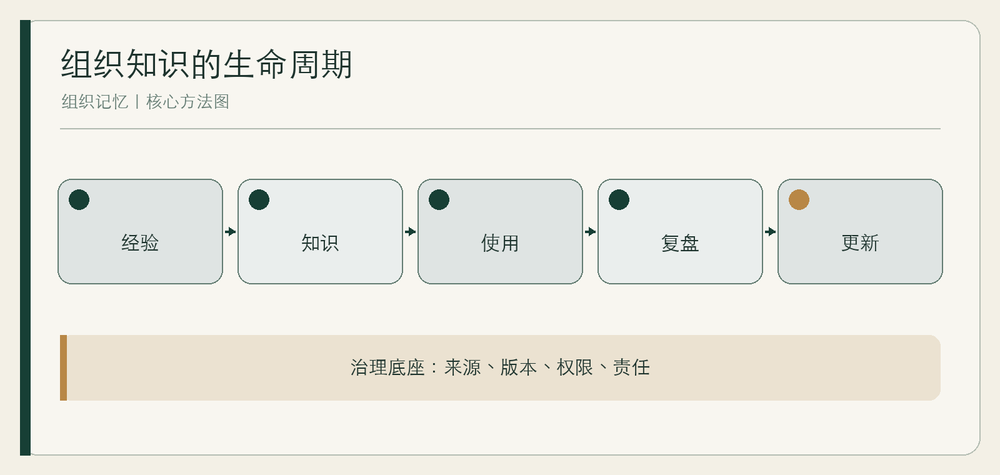

# 组织记忆

企业如何知道、忘记与纠错

作者：李钊  
日期：2026 年 11 月 11 日

---

## 前言　当一个组织离开某个人还记得什么

一位经验丰富的员工休假，客户问题突然无人能答；项目已经结束，下一年团队重新争论同样的方案；资料库里保存着历次决策，却没人知道哪一版仍然有效。组织看似拥有越来越多的记录，实际能调用的记忆可能并没有增加。

组织记忆不是把一切都存下来。它是让关键知识在人员更替、环境变化和错误发生后，仍能被找到、理解、使用、质疑和更新。它既包括文档，也包括人对语境的理解、共同工作的方式、权限与责任。

本书提供一套最小建设方法：先识别关键知识，再保存决策理由，建立检索和权限，安排过期与纠错，最后让 AI 在明确边界内参与。你不需要先购买一套大型系统，可以从一个真实流程开始。

## 第一章　为什么资料很多，记忆却很少

### 存储解决了“还在”，没有解决“能用”

文件仍在服务器里，不代表人们知道它存在；搜索能命中关键词，不代表读者理解当时条件；聊天记录保留了每句话，也不代表最终结论清楚。资料只有与来源、版本、语境、责任和使用场景相连，才可能成为记忆。

ISO 30401 的公开导言强调，知识由人创造，知识管理关注工作环境、文化、互动和迭代，而不是认为购买技术系统就足够。[ISO 30401](https://www.iso.org/obp/ui/#iso:std:iso:30401:ed-1:en)

### 四种常见的假记忆

只存结果，不存理由，后来的人无法判断旧方案是否仍适用；只存成功，不存失败，组织反复支付同一种学费；只存文档，不维护检索，知识在关键词之外消失；只追求共享，不设置权限，最后大家不敢把真正重要的内容写进去。

**综合案例｜同一客户的三份真相。** 销售记录写客户预算充足，售前笔记写技术条件未确认，交付邮件写上线时间已推迟。三处都真实，却没有一处呈现当前共识。团队后来建立“客户当前状态”页，每条约判断都带来源、日期、负责人和待核问题。

### 记忆的验收发生在使用时

不要问资料库有多少页面，而要问：新成员能否独立完成一个任务；旧决策能否被解释；错误知识能否被停止传播；关键人员离开时，哪些工作最先失控。

## 第二章　先画关键知识地图

### 从关键承诺倒推知识

组织不可能保存全部经验。先列出对客户、产品、合规和持续经营最重要的承诺，再追问完成承诺需要知道什么。常见入口包括高频故障、交接困难、重复返工、只有个别人能处理的例外和一旦出错后果严重的决定。

知识地图至少包含知识主题、使用任务、当前载体、熟悉它的人、来源、更新频率、访问权限和失效后果。地图的价值不在完整，而在暴露单点依赖。

### 区分四种知识

事实型知识回答“是什么”，流程型知识回答“怎样做”，判断型知识回答“何时这样做”，关系型知识回答“找谁、如何协作”。许多交接只覆盖前两类，真正让新人无法独立的是后两类。

**综合案例｜设备维修交接。** 老师傅留下的手册列有步骤，却没写哪些异常必须停机、哪些零件批次需要额外检查、客户现场谁有权改变方案。团队把交接从“再讲一遍操作”改为“复盘三次异常”，才接近关键判断。

### 给知识分级

可按使用频率与错误后果分四组：高频低风险适合标准化，高频高风险需要训练与复核，低频高风险要保留升级路径，低频低风险可只提供基本索引。分级避免把所有资料都做成同样重的流程。

## 第三章　把经验变成可传递的知识

### 经验不是一句“凭感觉”

专家的感觉往往来自对细微差异的识别。访谈不要只问“你通常怎么做”，而要还原具体事件：当时看到什么信号，排除了什么，为什么这次没有按常规处理，如果条件变化会怎样。

一次知识采集最好留下三个场景：典型情况、边界情况、误判情况。典型情况帮助入门，边界情况解释条件，误判情况让后来者知道何时停止自信。

### 一张知识卡的最小结构

主题与用途；适用条件；输入；步骤；判断点；异常与升级；来源与示例；负责人；复核日期。不要把所有内容塞进长文，使用者需要在任务中找到特定判断。

**综合案例｜报价经验。** 资深售前说“复杂客户不要急着报固定价”。团队把它改写为可讨论的条件：需求边界未确认、关键接口未知、客户要求承担无限责任时，先给范围和验证计划。仍保留专家复核，但新人知道何时求助。

### 文档之外需要共同练习

有些知识必须通过观察、模拟和反馈传递。让新人看一次、在低风险情境做一次、再解释一次，比只发手册更可靠。文档负责稳定共同语言，练习负责形成判断。

## 第四章　决策记录与复盘：保存当时的理由

### 结果好不等于当时决策好

人容易根据结果重写过去。项目成功后，原来的冒险被解释成远见；失败后，同样的冒险被说成明显错误。要减少这种后见之明，就需要在决策当下保存已知事实、备选方案、关键假设和停止条件。

决策记录不必很长。一页写清：要决定什么，为什么现在，已知与未知，选择及理由，谁批准，何时复查，出现什么信号需要改变。

### 复盘要回到记录

PDSA 强调计划、执行、研究和行动中的学习，而不是机械宣布完成。[Deming Institute](https://deming.org/explore/pdsa/) 复盘时先比较实际结果与当时假设，再区分外部变化、执行偏差和判断错误。

**综合案例｜一次“失败”的试点。** 团队原假设是自动摘要能减少整理时间，实际阅读时间下降，错误追问却增加。复盘没有简单写“AI 不可用”，而是发现适用范围过宽。下一版只处理内部低风险会议，并保留人工确认。

### 失败记录需要保护

如果复盘总被用于追责个人，大家会学会写漂亮结论。对故意违规与善意试验要区分；对隐瞒错误和主动暴露问题也要区别。组织能否记住失败，取决于人是否敢把失败写真实。

## 第五章　检索、共享与权限：可用不等于公开

### 检索从使用者的语言开始

专家按专业分类，新人按任务搜索。知识条目除了正式名称，还应包含常见叫法、相关问题和使用场景。让新成员参与测试，比由管理员独自设计分类更容易发现找不到的原因。

GitLab 的手册优先实践展示了另一种机制：把修改写入共同手册，通过议题和合并请求保留讨论，提出与批准修改可以分开。它是机构自述，不证明所有企业都应照搬，但说明版本和讨论脉络如何进入知识系统。[GitLab](https://handbook.gitlab.com/handbook/company/culture/all-remote/handbook-first/)

### 权限保护的不只是秘密

客户隐私、商业合同、员工评价和组织政治需要不同访问范围。可见性过大，会让知识记录变得空泛；可见性过小，则让协作重复。最实用的做法是把敏感事实与可复用方法分开，后者尽量共享，前者按职责开放。

### 每一条关键知识都有责任人

责任人不一定亲自写所有内容，但需回答：是否仍有效，谁能修改，争议由谁裁决。GitLab 的 DRI 手册同样保留重大事项的额外审批，说明具名负责不等于个人任意决定。[DRI](https://handbook.gitlab.com/handbook/people-group/directly-responsible-individuals/)

## 第六章　更新、过期与有选择的遗忘

### 不更新的知识会主动制造错误

过期流程比没有流程更危险，因为它带着组织批准的外观。每类知识应有不同复核节奏：法规和产品接口按变化检查，客户状态按项目节点检查，经验原则按复盘检查。复核不是统一盖章，而是确认还能支持什么。

页面上应让使用者看到当前版本、适用范围、负责人和最近实质复核日期。只显示上传时间，容易把“很久以前上传”误当“最近仍有效”。

### 遗忘不是删除一切

有些内容需要依法或依承诺保留，有些只需归档不再推荐，有些应在目的结束后删除。组织要区分工作知识、正式记录和历史档案，不能用“以后也许有用”无限积累。

**综合案例｜旧模板重新出现。** 搜索把三年前的报价模板排在最前，员工再次使用。团队没有简单删除历史，而是标记“失效，仅供审计”，从默认搜索剔除，并在新模板中链接旧版变更原因。

### 建立退出仪式

流程停止、产品下线、人员离开时，同步处理知识：哪些仍有效，哪些迁移，哪些归档，哪些删除，谁完成最后确认。遗忘需要设计，否则它会以随机丢失和误用旧知识的方式发生。

## 第七章　当 AI 进入组织记忆

### 生成答案不等于找回知识

AI 可以帮助检索、归纳和比较，但流畅答案可能隐藏来源冲突、版本过期和权限越界。组织需要知道它读取了哪些资料、怎样形成答案、哪些部分无法确认。

一个安全起点是只让 AI 返回带来源的候选材料，而不是直接作最终判断。对高风险问题，回答必须能回到具体条目和具名责任人；来源不足时，应明确表示不知道。

### 组织记忆也会反向影响 AI

若知识库充满旧模板和未标争议，AI 会更快地传播旧错误。上线前先治理高使用、高风险知识，比把所有历史资料一次性接入更重要。

**综合案例｜两个都“正确”的答案。** 同一问题在两个年度有不同处理规则。AI 混用了两版。团队随后给每条规则增加生效与失效时间，并在检索中优先当前版本；历史版本仍保留用于审计。

### 权限与反馈必须进入设计

使用者只能看到原本有权访问的内容；发现错误时能提交纠正；纠错有人处理并影响后续答案。没有反馈闭环的 AI 知识助手，只是更快的旧资料展示器。

## 第八章　九十天建设一个最小记忆系统

### 前三十天：选一个流程，找到关键缺口

选择交接困难或返工明显的一个流程，访谈实际使用者，画知识地图，收集现有资料。不要先全公司盘点。确定三项最值得建设的知识和一项最大风险。

### 中间三十天：做出可用版本

建立知识卡、决策记录、权限和复核规则；让一名不熟悉项目的人用真实任务测试。记录找不到、看不懂、不敢用和用错的地方。AI 可以在资料边界稳定后再接入。

### 最后三十天：验证纠错与持续责任

在测试环境或受控演练中设置一条明确标注的过期知识，观察是否有人发现并纠正，演练后立即复原；模拟关键人员缺席，检查升级路径；确认每条核心知识有负责人和复核日期。不要把未经标注的错误直接放进真实业务流程。

**综合案例｜从小流程开始。** 一家服务团队没有先建“企业知识中台”，只处理客户上线交接。九十天后，它的成果不是页面数量，而是新人能完成标准交接，异常知道找谁，旧规则不再进入默认搜索。

### 最小验收清单

关键知识有来源；当前版本可识别；使用者能找到；异常知道升级；敏感内容有权限；错误能纠正；旧内容会退出；负责人有时间维护。做到这些，组织才开始真正拥有记忆。

## 附录　知识卡与决策记录模板

### 知识卡

主题与任务；适用条件；不适用条件；所需输入；操作步骤；关键判断；异常与升级；来源与案例；访问权限；负责人；版本；复核日期。

### 决策记录

决定事项；为什么现在决定；已知事实；待验证假设；备选方案；选择与理由；批准人；停止或转向条件；复查日期；实际结果；复盘结论。

### 知识健康检查

1. 哪些任务只有一个人能完成？
2. 哪些旧资料仍会被默认搜索到？
3. 哪些决定找不到当时的理由？
4. 哪些错误没有进入下一轮规则？
5. 哪些内容因共享过度而没人敢写真话？

## 参考资料

1. ISO：[ISO 30401:2018](https://www.iso.org/standard/68683.html)及[公开导言与指导原则](https://www.iso.org/obp/ui/#iso:std:iso:30401:ed-1:en)。
2. ISO：[ISO/DIS 30401 项目状态](https://committee.iso.org/sites/tc260/home/projects/ongoing/ongoing-5.html)。第二版草案不应被写成已发布正式版。
3. GitLab：[Handbook-first approach](https://handbook.gitlab.com/handbook/company/culture/all-remote/handbook-first/)；[Directly Responsible Individuals](https://handbook.gitlab.com/handbook/people-group/directly-responsible-individuals/)。
4. W. Edwards Deming Institute：[PDSA Cycle](https://deming.org/explore/pdsa/)。
5. 李钊：《Neo Lab：AI 原生组织的崛起》及来源总账，2026。

资料收集截至 2026 年 11 月 11 日。标准项目状态、机构手册和具体产品能力在后续使用时应重新核对。
