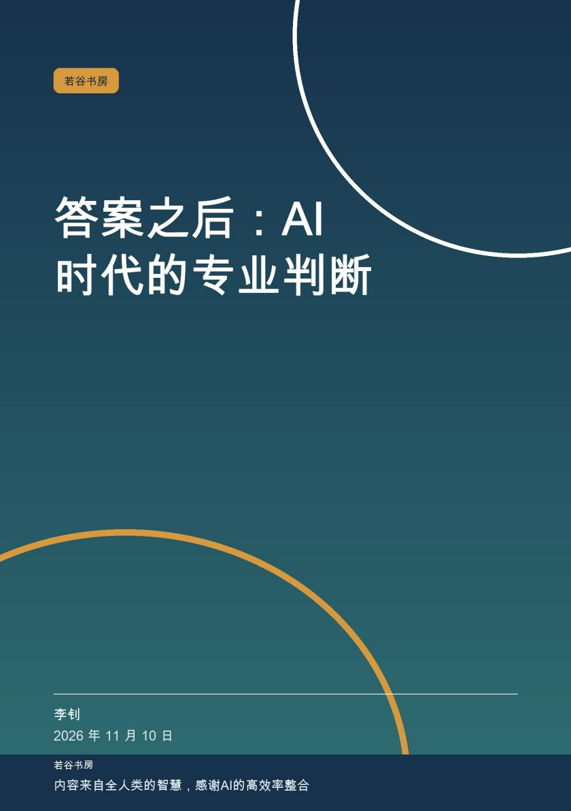
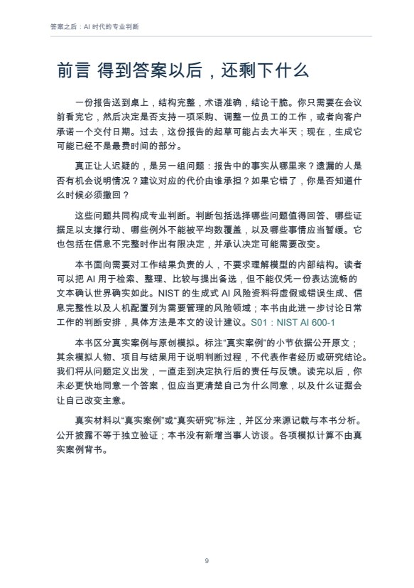
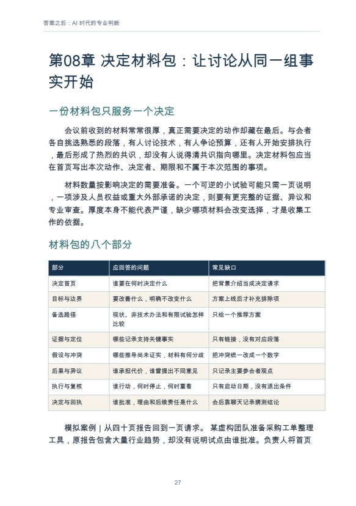

# 答案之后：AI 时代的专业判断

作者：李钊 · 出版单位：若谷书房  
增订版 1.1 · 原书日期：2026-11-10 · 增订日期：2026-11-19 · PDF 52 页

## 阅读导引

本次增订保留原书基础内容、署名和出版记录，形成15章、6份附录。新增实践方法、综合模拟、练习与可直接使用的工作表；模拟人物、数字和结果不构成真实客户成效或专业结果保证。

读者可先浏览前言与原七章建立共同概念，再按当前任务选读新增章节和附录。表格需结合自己的资料填写，动态规则、产品能力和专业事项仍按当前正式来源核实。

## 完整目录

展开全书目录

- 前言　得到答案以后，还剩下什么
- 第01章　先判断，自己在决定什么
- 第02章　事实、解释与愿望之间
- 第03章　沿着来源走回去
- 第04章　让反方真正有机会改变结论
- 第05章　按后果分配谨慎
- 第06章　人工复核怎样才不只是签字
- 第07章　决定之后，责任才真正开始
- 第08章　决定材料包：让讨论从同一组事实开始
- 第09章　证据冲突：把调查动作安排到分歧上
- 第10章　高影响决定：告知、异议与申诉要进入设计
- 第11章　复核负担：给真正的人留出时间与拒绝权
- 第12章　撤回与补救：决定错误以后怎样减少伤害
- 第13章　跨职能综合演练：一项供应商建议怎样经过判断
- 第14章　判断交接：负责人不在场时谁能改变决定
- 第15章　三十天判断实践：把方法变成一组真实记录
- 结语　把“我同意”说得更清楚
- 附录A　一页判断记录
- 附录B　复核会议的六个问题
- 附录C　决定材料包模板
- 附录D　证据冲突与申诉合并记录
- 附录E　撤回、恢复与判断交接包
- 附录F　三十天判断实践记录册
- 来源与方法说明
- 若谷书房

## 实际内页预览

页码包含封面，从 1 起算。样页由本次 52 页 PDF 重新生成。

PDF 文件第 9 页：前言。

PDF 文件第 27 页：新增实践章节。

## 阅读与下载

- [Markdown 在线阅读](output/markdown/professional-judgment.md)
- [PDF · 52 页](https://github.com/njxshr/ruogu-books/releases/download/expanded-books-20261119-v1.1/professional-judgment.pdf)
- [EPUB](https://github.com/njxshr/ruogu-books/releases/download/expanded-books-20261119-v1.1/professional-judgment.epub)
- [Markdown 离线包（正文与实际生成资源）](https://github.com/njxshr/ruogu-books/releases/download/expanded-books-20261119-v1.1/professional-judgment-markdown.zip)

## 增订与检查

[20 轮增订记录](REVISION_LOG.md) · [实际检查报告](QA_REPORT.md)

本次重新生成 Markdown、PDF 和 EPUB。PDF 全部 52 页已渲染并逐张查看总览；EPUB 解包读取封面、前中后章节，98 个导航目标与本地资源检查通过。具体范围与限制见报告。

## 来源与权利

[来源记录](SOURCES.md) · [主稿](manuscript/book.md) · [出版配置](book.json)

来源记录保留原有核查范围。本次扩充没有借综合模拟或练习新增真实访谈、客户成效和统计证据，也没有将重新成书记为全部旧来源的再次独立核验。

© 2026 李钊／若谷书房。第三方资料的权利归原权利人所有。公开阅读与下载不另行授予开放许可。

[返回书目](../../目录.md)
