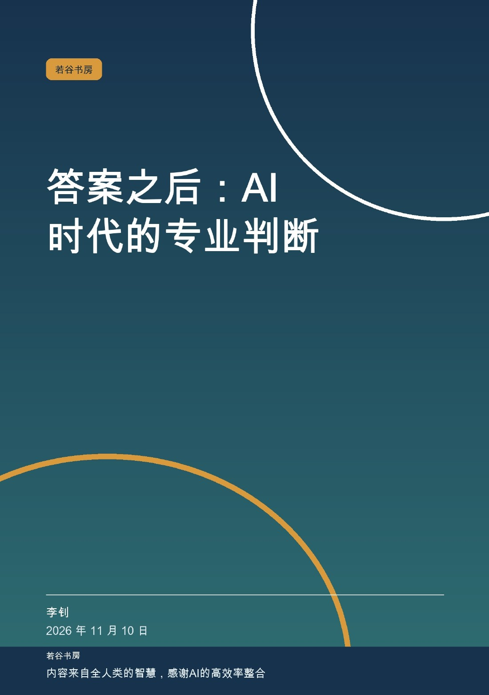
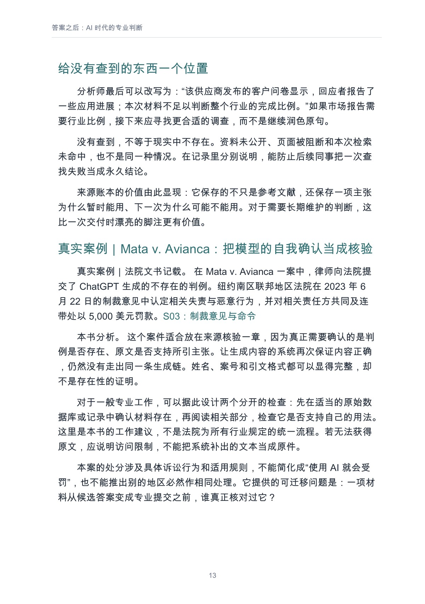
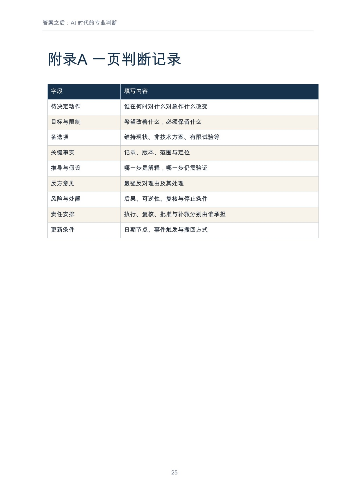

# 答案之后：AI 时代的专业判断

**李钊著 · 若谷书房 · 第一版 1.0 · 2026-11-10 · PDF 28 页**

当 AI 能随时给出答案，专业人士怎样定义问题、核验证据、识别例外，并承担决定的后果？

[在线阅读全文](output/markdown/professional-judgment.md) · [下载 PDF](https://github.com/njxshr/ruogu-books/releases/download/a1-a3-v1.0/professional-judgment.pdf) · [下载 EPUB](https://github.com/njxshr/ruogu-books/releases/download/a1-a3-v1.0/professional-judgment.epub) · [Markdown 离线包](https://github.com/njxshr/ruogu-books/releases/download/a1-a3-v1.0/professional-judgment-markdown.zip)

## 这本书讨论什么

本书沿着一次决定的形成过程展开：先把请求翻译成明确的决定，再区分事实、解释与愿望，沿来源核验关键主张，安排反方检验、风险分级和人工复核，最后把执行、补救与重新判断接起来。

书中用日常工作场景说明判断怎样失效，也讨论证据冲突、紧迫情境与复核资源不足。读者可以带走一页判断记录和复核会议问题，把“我同意”变成能够解释、检查与修正的选择。

## 适合谁读

需要审核报告、作出业务决定或对外承诺的知识工作者、管理者与专业人士；无需编程背景。

## 怎样阅读

| 当前需要 | 建议先读 | 带着什么问题读 |
| --- | --- | --- |
| 先处理一份可疑报告 | [第02章　事实、解释与愿望之间](output/markdown/professional-judgment.md#user-content-第02章事实解释与愿望之间)、[第03章　沿着来源走回去](output/markdown/professional-judgment.md#user-content-第03章沿着来源走回去) | 拆分事实与推断，核对关键来源。 |
| 改进团队复核 | [第04章　让反方真正有机会改变结论](output/markdown/professional-judgment.md#user-content-第04章让反方真正有机会改变结论)、[第05章　按后果分配谨慎](output/markdown/professional-judgment.md#user-content-第05章按后果分配谨慎)、[第06章　人工复核怎样才不只是签字](output/markdown/professional-judgment.md#user-content-第06章人工复核怎样才不只是签字) | 检查反方意见、风险与人工复核是否真的影响行动。 |
| 留下可负责的决定 | [第07章　决定之后，责任才真正开始](output/markdown/professional-judgment.md#user-content-第07章决定之后责任才真正开始) | 连接责任、补救与更新条件，再使用附录 A、B。 |

## 完整目录

展开前言、7 章、结语与附录目录

- [前言　得到答案以后，还剩下什么](output/markdown/professional-judgment.md#user-content-前言得到答案以后还剩下什么)
- [第01章　先判断，自己在决定什么](output/markdown/professional-judgment.md#user-content-第01章先判断自己在决定什么)
- [第02章　事实、解释与愿望之间](output/markdown/professional-judgment.md#user-content-第02章事实解释与愿望之间)
- [第03章　沿着来源走回去](output/markdown/professional-judgment.md#user-content-第03章沿着来源走回去)
- [第04章　让反方真正有机会改变结论](output/markdown/professional-judgment.md#user-content-第04章让反方真正有机会改变结论)
- [第05章　按后果分配谨慎](output/markdown/professional-judgment.md#user-content-第05章按后果分配谨慎)
- [第06章　人工复核怎样才不只是签字](output/markdown/professional-judgment.md#user-content-第06章人工复核怎样才不只是签字)
- [第07章　决定之后，责任才真正开始](output/markdown/professional-judgment.md#user-content-第07章决定之后责任才真正开始)
- [结语　把“我同意”说得更清楚](output/markdown/professional-judgment.md#user-content-结语把我同意说得更清楚)
- [附录A　一页判断记录](output/markdown/professional-judgment.md#user-content-附录a一页判断记录)
- [附录B　复核会议的六个问题](output/markdown/professional-judgment.md#user-content-附录b复核会议的六个问题)
- [来源与方法说明](output/markdown/professional-judgment.md#user-content-来源与方法说明)
- [若谷书房](output/markdown/professional-judgment.md#user-content-若谷书房)

目录名称和顺序取自正式阅读版；以上链接指向 GitHub 正文的实际章节锚点。

## 实际内页预览

下列图片均直接渲染自已发布的正式 PDF，点击可放大。页码为从 1 起算、包含封面的 **PDF 文件页码**。

### 来源核验与 Mata v. Avianca 真实案例节选

PDF 文件第 **13** 页。

### 附录 A：一页判断记录

PDF 文件第 **25** 页。

## 案例与证据边界

Mata v. Avianca 依据法院文书；Knight Capital 依据 SEC 监管材料，后者是传统自动化事故，不是生成式 AI 事故。案例记载与本书分析分别标注，不能据此推断所有行业的法律后果。其余模拟练习不代表作者亲历或实证结果。

## 阅读、下载与来源

- [Markdown 在线阅读](output/markdown/professional-judgment.md)
- [PDF（28 页）](https://github.com/njxshr/ruogu-books/releases/download/a1-a3-v1.0/professional-judgment.pdf)
- [EPUB](https://github.com/njxshr/ruogu-books/releases/download/a1-a3-v1.0/professional-judgment.epub)
- [Markdown 离线 ZIP](https://github.com/njxshr/ruogu-books/releases/download/a1-a3-v1.0/professional-judgment-markdown.zip)
- [第一版 Release](https://github.com/njxshr/ruogu-books/releases/tag/a1-a3-v1.0) · [附件 SHA-256](https://github.com/njxshr/ruogu-books/releases/download/a1-a3-v1.0/SHA256SUMS.txt)
- [来源账本](SOURCES.md) · [修订记录](REVISION_LOG.md) · [成书检查](QA_REPORT.md)
- [唯一主稿](manuscript/book.md) · [制作说明](BUILD.md) · [书房目录](../../目录.md)

## 版本与使用说明

本次仅完善介绍与实际页面预览，正文、第一版阅读成品、Release 标签和下载 URL 保持原样。公开阅读与下载不自动授予新的开放许可；第三方材料权利归原权利人所有，复用请核对书内说明及适用授权。
