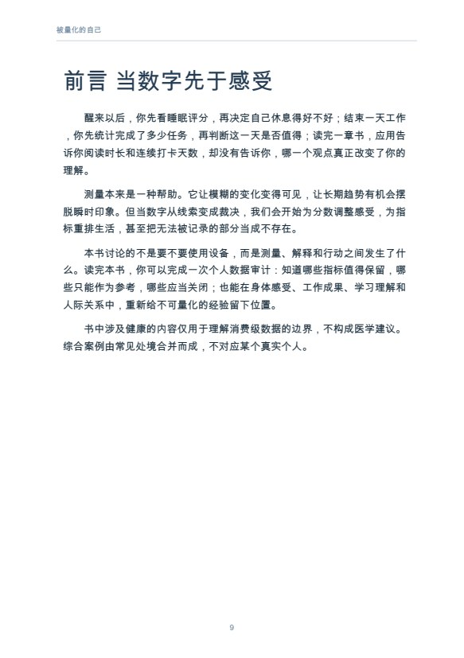
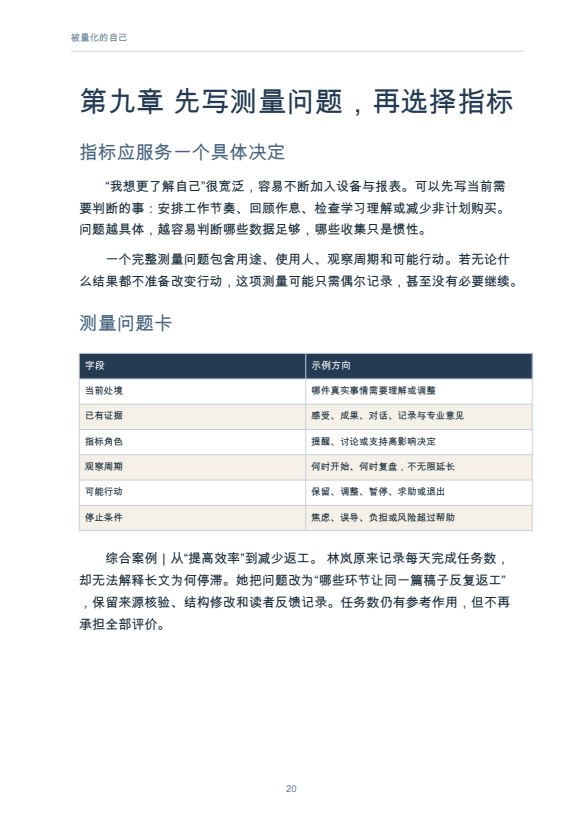

# 被量化的自己

当生活变成一份数据报告

作者：李钊 · 出版单位：晓翊工作室  
增订版 1.1 · 原书日期：2026-11-11 · 增订日期：2026-11-19 · PDF 50 页

帮助读者区分测量、解释与行动，建立个人数据审计和恢复主观判断的方法。

## 阅读导引

本次增订保留原书基础内容、署名和出版记录，21章、7份附录。新增实践方法、综合案例或模拟练习及可直接使用的工作表。案例的材料性质以正文标注为准，不构成真实客户成效或专业结果保证。

读者可先浏览前言与原八章建立共同概念，再按当前任务选读新增章节和附录。表格需结合自己的资料填写，动态规则、产品能力和专业事项仍按当前正式来源核实。

## 完整目录

展开全书目录

- 前言　当数字先于感受
- 第一章　从测量到解释：数字如何获得权威
- 第二章　身体：设备能告诉我们什么
- 第三章　工作：效率指标如何改变工作
- 第四章　学习：可见进度与不可见理解
- 第五章　消费与注意力：被计算的选择
- 第六章　关系：比较、排名与共同生活
- 第七章　数据权利：谁能看、谁能改、谁能删
- 第八章　重新掌握解释权
- 第九章　先写测量问题，再选择指标
- 第十章　基线与条件：比较之前先保持可比
- 第十一章　数字与感受冲突时：建立第三种记录
- 第十二章　身体数据的安全出口：从自我观察到专业沟通
- 第十三章　工作指标的权力审查：谁可以评价谁
- 第十四章　学习的迁移测试：离开原页面还会多少
- 第十五章　注意力与推荐：审计候选范围如何形成
- 第十六章　家庭与照护数据：同意需要能够拒绝
- 第十七章　导出、删除与换用服务：让数据真的能离开
- 第十八章　七天适度量化实验：一份完整模拟
- 第十九章　当指标参与决定：人工复核与申诉怎样落地
- 第二十章　一个月少一项指标：从数据减法恢复选择
- 第二十一章　当分数变成身份：保留改变的可能
- 附录　个人数据审计工作表
- 附录二　指标登记与测量问题卡
- 附录三　七天对照日记
- 附录四　数字与其他证据冲突记录
- 附录五　高影响用途评审表
- 附录六　数据退出与迁移检查包
- 附录七　个人数据原则与月度复盘
- 参考资料

## 实际内页预览

页码包含封面，从 1 起算。样页由本次 50 页 PDF 重新生成。

PDF 文件第 9 页：前言。

PDF 文件第 20 页：新增实践章节。

## 阅读与下载

- [Markdown 在线阅读](output/markdown/被量化的自己_李钊_20261111.md)
- [PDF · 50 页](https://github.com/njxshr/ruogu-books/releases/download/expanded-books-20261119-v1.1/quantified-self.pdf)
- [EPUB](https://github.com/njxshr/ruogu-books/releases/download/expanded-books-20261119-v1.1/quantified-self.epub)
- [Markdown 离线包（含配图）](https://github.com/njxshr/ruogu-books/releases/download/expanded-books-20261119-v1.1/quantified-self-markdown.zip)

## 增订与检查

[20 轮增订记录](REVISION_LOG.md) · [实际检查报告](QA_REPORT.md)

本次重新生成 Markdown、PDF 和 EPUB。PDF 全部 50 页已渲染并逐张查看总览；EPUB 解包读取封面、前中后章节，108 个导航目标与本地资源检查通过。具体范围与限制见报告。

## 来源与权利

[来源记录](SOURCES.md) · [主稿](manuscript/book.md) · [出版配置](book.json)

来源记录保留原有核查范围。本次扩充没有借综合案例或模拟推演新增真实访谈、客户成效和统计证据。

版权所有 © 2026 李钊。保留所有权利。第三方资料权利归原权利人。公开阅读与下载不另行授予开放许可。

[返回书目](../../目录.md)
