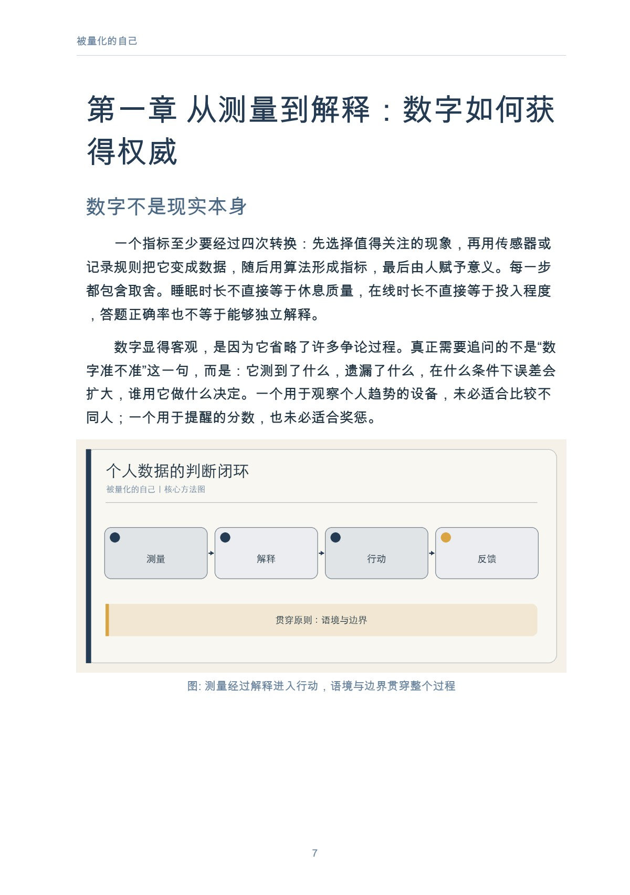
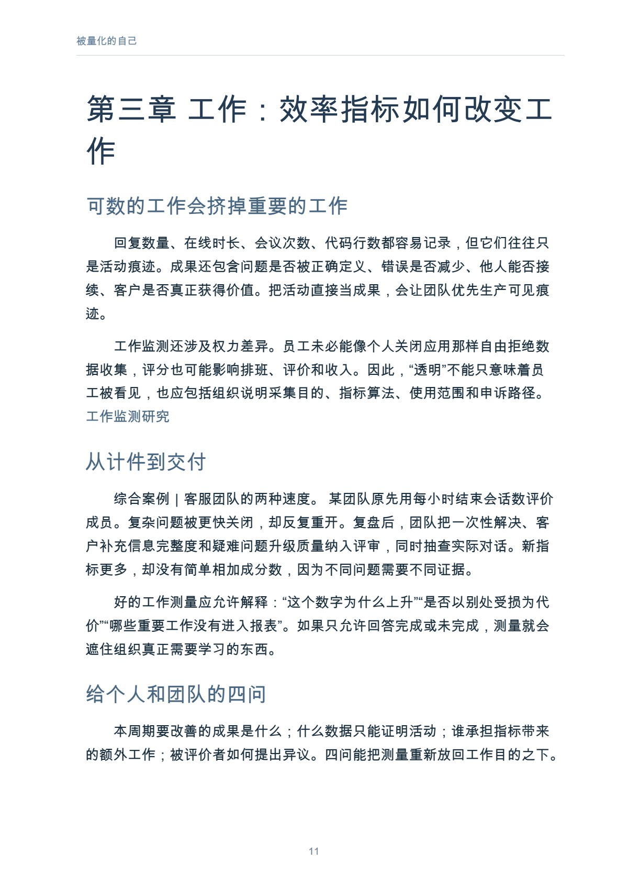

# 被量化的自己

当生活变成一份数据报告

作者：李钊 · 出版单位：晓翊工作室  
第一版 · 原书日期：2026-11-11 · 上架日期：2026-11-11 · PDF 18 页

帮助读者区分测量、解释与行动，建立个人数据审计和恢复主观判断的方法。

## 阅读导引

醒来以后，你先看睡眠评分，再决定自己休息得好不好；结束一天工作，你先统计完成了多少任务，再判断这一天是否值得；读完一章书，应用告诉你阅读时长和连续打卡天数，却没有告诉你，哪一个观点真正改变了你的理解。

测量本来是一种帮助。它让模糊的变化变得可见，让长期趋势有机会摆脱瞬时印象。但当数字从线索变成裁决，我们会开始为分数调整感受，为指标重排生活，甚至把无法被记录的部分当成不存在。

本书讨论的不是要不要使用设备，而是测量、解释和行动之间发生了什么。读完本书，你可以完成一次个人数据审计：知道哪些指标值得保留，哪些只能作为参考，哪些应当关闭；也能在身体感受、工作成果、学习理解和人际关系中，重新给不可量化的经验留下位置。

书中涉及健康的内容仅用于理解消费级数据的边界，不构成医学建议。综合案例由常见处境合并而成，不对应某个真实个人。

建议先读前言与前两章，理解问题和基本方法；再结合当前问题选择后续章节，使用附录整理自己的记录。

## 完整目录

展开全书目录

- 前言　当数字先于感受
- 第一章　从测量到解释：数字如何获得权威
- 第二章　身体：设备能告诉我们什么
- 第三章　工作：效率指标如何改变工作
- 第四章　学习：可见进度与不可见理解
- 第五章　消费与注意力：被计算的选择
- 第六章　关系：比较、排名与共同生活
- 第七章　数据权利：谁能看、谁能改、谁能删
- 第八章　重新掌握解释权
- 附录　个人数据审计工作表
- 参考资料

## 实际内页预览

页码为包含封面的 PDF 文件页码，从 1 起算。

PDF 文件第 7 页：被量化的自己 7 第一章 从测量到解释：数字如何获 得权威 数字不是现实本身 一个指标至少要经过四次转换：先选择值得关注的现象，再

PDF 文件第 11 页：被量化的自己 11 第三章 工作：效率指标如何改变工 作 可数的工作会挤掉重要的工作 回复数量、在线时长、会议次数、代码行数都容易

## 阅读与下载

- [Markdown 在线阅读](output/markdown/被量化的自己_李钊_20261111.md)
- [PDF · 18 页](https://github.com/njxshr/ruogu-books/releases/download/new-books-20261111-v1.0/quantified-self.pdf)
- [EPUB](https://github.com/njxshr/ruogu-books/releases/download/new-books-20261111-v1.0/quantified-self.epub)
- [Markdown 离线包（含配图）](https://github.com/njxshr/ruogu-books/releases/download/new-books-20261111-v1.0/quantified-self-markdown.zip)

## 来源与权利

[来源记录](SOURCES.md) · [主稿](manuscript/book.md) · [出版配置](book.json)

书中的综合案例、模拟情境和作者建议按正文标注理解，不作为真实客户成效承诺。来源记录保留原有核查范围，本次上架不代表重新核查全部外部来源。

版权所有 © 2026 李钊。保留所有权利。 第三方资料权利归原权利人。公开阅读与下载不另行授予开放许可。

[返回书目](../../目录.md)
