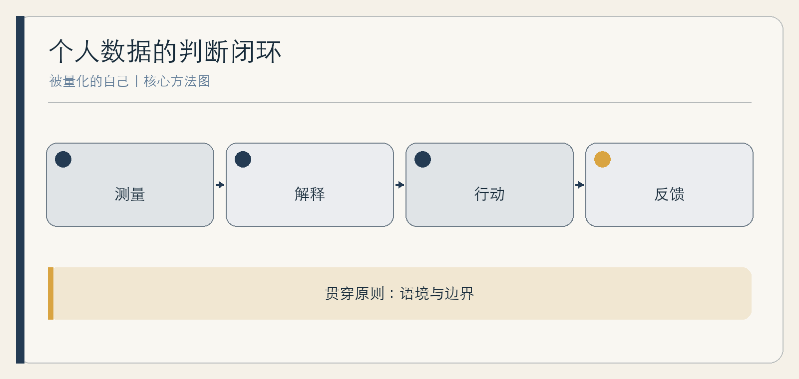

# 被量化的自己

当生活变成一份数据报告

作者：李钊  
日期：2026 年 11 月 11 日

---

## 前言　当数字先于感受

醒来以后，你先看睡眠评分，再决定自己休息得好不好；结束一天工作，你先统计完成了多少任务，再判断这一天是否值得；读完一章书，应用告诉你阅读时长和连续打卡天数，却没有告诉你，哪一个观点真正改变了你的理解。

测量本来是一种帮助。它让模糊的变化变得可见，让长期趋势有机会摆脱瞬时印象。但当数字从线索变成裁决，我们会开始为分数调整感受，为指标重排生活，甚至把无法被记录的部分当成不存在。

本书讨论的不是要不要使用设备，而是测量、解释和行动之间发生了什么。读完本书，你可以完成一次个人数据审计：知道哪些指标值得保留，哪些只能作为参考，哪些应当关闭；也能在身体感受、工作成果、学习理解和人际关系中，重新给不可量化的经验留下位置。

书中涉及健康的内容仅用于理解消费级数据的边界，不构成医学建议。综合案例由常见处境合并而成，不对应某个真实个人。

## 第一章　从测量到解释：数字如何获得权威

### 数字不是现实本身

一个指标至少要经过四次转换：先选择值得关注的现象，再用传感器或记录规则把它变成数据，随后用算法形成指标，最后由人赋予意义。每一步都包含取舍。睡眠时长不直接等于休息质量，在线时长不直接等于投入程度，答题正确率也不等于能够独立解释。

数字显得客观，是因为它省略了许多争论过程。真正需要追问的不是“数字准不准”这一句，而是：它测到了什么，遗漏了什么，在什么条件下误差会扩大，谁用它做什么决定。一个用于观察个人趋势的设备，未必适合比较不同人；一个用于提醒的分数，也未必适合奖惩。

### 指标会反过来塑造行为

一旦某个数字被持续展示，人就会调整行为去适应它。打卡让坚持可见，也可能让中断一天的损失显得过大；任务计数让进展明确，也可能鼓励先完成容易勾选的小事。问题不在于人太功利，而在于可见结果天然更容易进入选择。

**综合案例｜被提前完成的一周。** 林岚用任务应用管理写作。为了维持连续记录，她把“写一百字”也列为完成，几周后打卡很漂亮，长文的论证却仍停在原处。她把指标拆成“资料核验、关键段落、全文修订”三类，不再用篇数衡量。变化不是更能坚持，而是终于看见真正卡住的工作。

### 一个实用判断

使用指标前写三句话：它帮助我看见什么；它可能诱使我忽略什么；如果它与其他证据冲突，我如何复核。第三句尤其重要。没有复核规则的指标，很容易从助手变成裁判。

## 第二章　身体：设备能告诉我们什么

### 传感器、算法与身体感受不是同一件事

消费级睡眠设备通常根据运动、心率等信号估计状态。研究综述指出，不同设备、算法和人群之间的表现并不相同，睡眠分期的解释尤其需要谨慎。美国睡眠医学学会也明确提醒，消费级睡眠技术不能替代医学评估。[AASM](https://aasm.org/consumer-sleep-technology-position-statement/) [研究综述](https://pmc.ncbi.nlm.nih.gov/articles/PMC6579636/)

这并不意味着数据无用。相对规律的记录可能帮助观察作息、回顾习惯和与专业人士沟通。危险在于把估计值当作身体本身的最终陈述，或因为一个低分就预言自己今天必然疲惫。

若目的是观察自己的变化，应尽量固定设备、佩戴方式和记录条件，并同时保留主观记录。不同设备或不同算法给出的分数不能直接当成同一把尺子；设备更新后出现的突变，也要先排除口径变化。

### 当改善分数变成新的压力

“orthosomnia”相关病例系列描述了一类现象：部分使用者过度追求完美的睡眠数据，反而加重困扰。病例系列不能说明这种情况有多普遍，却足以提示一种机制——本用于改善睡眠的工具，可能参与制造焦虑。[病例论文](https://pmc.ncbi.nlm.nih.gov/articles/PMC5263088/)

**综合案例｜先看分数的人。** 周屿醒来后觉得尚可，看到“深睡不足”便立刻认定自己状态不好。连续两周，他提前上床、减少晨间活动，白天却更关注疲惫。后来他先记录主观感受，再看设备，并只保留每周趋势。若持续不适，他选择的不是继续优化分数，而是寻求专业评估。

### 保留两种记录

可以尝试七天对照：每天先写“精力、情绪、身体不适”三项主观记录，再查看设备；晚上补充一项值得注意的生活事件。比较二者何时一致、何时冲突。冲突不是谁撒谎，而是提醒你需要更多语境。持续或严重的症状，应交给合格专业人士判断。

## 第三章　工作：效率指标如何改变工作

### 可数的工作会挤掉重要的工作

回复数量、在线时长、会议次数、代码行数都容易记录，但它们往往只是活动痕迹。成果还包含问题是否被正确定义、错误是否减少、他人能否接续、客户是否真正获得价值。把活动直接当成果，会让团队优先生产可见痕迹。

工作监测还涉及权力差异。员工未必能像个人关闭应用那样自由拒绝数据收集，评分也可能影响排班、评价和收入。因此，“透明”不能只意味着员工被看见，也应包括组织说明采集目的、指标算法、使用范围和申诉路径。[工作监测研究](https://pmc.ncbi.nlm.nih.gov/articles/PMC10026198/)

### 从计件到交付

**综合案例｜客服团队的两种速度。** 某团队原先用每小时结束会话数评价成员。复杂问题被更快关闭，却反复重开。复盘后，团队把一次性解决、客户补充信息完整度和疑难问题升级质量纳入评审，同时抽查实际对话。新指标更多，却没有简单相加成分数，因为不同问题需要不同证据。

好的工作测量应允许解释：“这个数字为什么上升”“是否以别处受损为代价”“哪些重要工作没有进入报表”。如果只允许回答完成或未完成，测量就会遮住组织真正需要学习的东西。

### 给个人和团队的四问

本周期要改善的成果是什么；什么数据只能证明活动；谁承担指标带来的额外工作；被评价者如何提出异议。四问能把测量重新放回工作目的之下。

## 第四章　学习：可见进度与不可见理解

### 完成内容不等于发生学习

学习平台擅长记录观看、答题、打卡和正确率，却很难直接看见迁移、解释与长期保持。一个答案正确，可能来自真正理解，也可能来自刚看过解析。反过来说，学习过程中的犹豫、错误和重做虽然不好看，却可能是理解正在形成的证据。

AI 让答案更容易获得，进一步放大了这个差别。学生可以生成完整解题过程，但能否不看答案独立复述、辨认条件变化、解释为什么另一种方法不成立，才是另一种层级的证据。

### 把“求助”变成学习过程

**综合案例｜一份漂亮作业。** 家长发现孩子能用 AI 写出完整作文，却无法说明自己为什么这样安排材料。家庭没有禁用工具，而把任务改为四步：先写自己的尝试；指出具体卡点；比较两种建议；最后合上对话独立重写。评价对象从成品是否流畅，转向孩子能否解释选择。

这套做法也适用于成人。学习新工具时，可以让系统给出反例或测验，而不是只给总结；读专业书时，可以写下作者结论成立所需的条件，再找一个可能推翻它的情境。

### 建立“理解证据”

一次学习结束，至少留下三项中的一项：不看资料的复述、在新情境中的应用、对错误或反例的解释。它们仍不是完美的测量，却比观看时长更接近理解。

## 第五章　消费与注意力：被计算的选择

### 推荐也在记录一个“你”

推荐系统根据过去行为预测可能感兴趣的内容。它节省搜索成本，也会把某些行为进一步变成标签：看过一次焦虑内容，随后得到更多相似内容；买过一件商品，相关需求不断被扩展。系统认识的是可由数据描述的过去，不是人全部的可能。

个人画像还会影响什么被放在眼前。选择看似仍由自己完成，候选范围却已经改变。因此，自主权不仅是“最后由我点击”，也包括能否主动搜索、改变推荐、清空历史和接触不在预测内的东西。

### 一次候选范围审计

**综合案例｜原本只想买一盏灯。** 陈可在购物后连续收到全屋改造内容，开始把许多原本无感的物品视为必需。她没有只责备自控力，而是关闭不必要的个性化推荐、取消关注促销账号，并重新使用清单和主动搜索。更重要的是，她在购买前写下“没有看到这些推荐时，我原本要解决什么问题”。

注意力审计也可以这样做：记录一周内三次非计划使用，分别写下触发入口、当时目标和离开后的结果。不要把所有使用都当浪费，只识别那些目标已经消失、推荐仍在替你续接任务的时刻。

### 给偶然留下入口

每周保留一次不依赖推荐的探索：走进书店翻阅未听说的书、主动查找相反观点、让朋友直接分享而不是平台代选。自主选择不只是拒绝算法，也需要练习形成自己的兴趣。

## 第六章　关系：比较、排名与共同生活

### 数据让一些付出更容易被看见

家庭中的步数、消费和任务分配可以被记录，照护、安抚、记住他人偏好却不容易进入报表。若家庭只用可见数字讨论公平，擅长留下记录的人可能占据解释优势。数字可以促进沟通，也可能把关系变成持续举证。

亲密关系中的量化还涉及同意。共享位置、健康数据或家庭设备记录，不能因为技术上可开启就默认合理。被记录者是否理解、能否拒绝、能否只分享必要范围，比“我们都是一家人”更重要。

### 不用分数代替对话

**综合案例｜家庭健康排行榜。** 一家人本来为了鼓励运动建立排行榜，后来老人因排名靠后减少参与，孩子则反复追问谁走了更多。家人取消排名，改为各自选择一个目标，每周只分享一件“身体更舒服的具体时刻”。运动数据仍在，但不再决定谁在家庭中更自律、更值得肯定。

讨论共同数据时，可以先问用途：是为了互相支持、发现异常，还是评价对错。用途不同，所需数据范围和保存时间也不同。支持不必需要完整监视。

### 给不可记录者留位置

一次家庭复盘除了数字，还应回答：谁承担了没有被记录的劳动；谁因为持续被看见而不自在；哪些时刻不需要证明也有价值。关系的质量不能被一张报表完整表达。

## 第七章　数据权利：谁能看、谁能改、谁能删

### 隐私不是“没有秘密可藏”

日常数据单独看似普通，组合后可能呈现作息、健康、位置、关系和财务状况。自我追踪应用的隐私研究建议至少追问知情、控制、访问和第三方披露，而不是只看是否有一篇隐私政策。[隐私评估研究](https://pmc.ncbi.nlm.nih.gov/articles/PMC6231850/)

个人还需要区分设备本地记录、账号云同步、平台分析和第三方共享。界面里的“删除记录”究竟删除哪一层，需要以具体产品说明为准。本书不替任何产品作承诺，最稳妥的原则是减少不必要的敏感信息输入。

### 家庭数据审计

列出设备或应用、收集内容、受益人、被记录者、共享对象、关闭方式和删除入口。特别标出受益人与被记录者不一致的项目，例如家长查看儿童、远程照护者查看老人、管理者查看员工。这里需要的不只是权限设置，还需要对权力差异的讨论。

**综合案例｜客厅里的访客。** 家庭智能音箱为成员提供便利，访客却不知道哪些功能会保留语音。户主把客用区域的无必要功能关闭，并在朋友到来时主动说明，而不是把访客默认纳入家庭便利。

### 保留退出与纠错能力

定期导出重要资料，确认更换设备或服务时能否迁移；检查是否能更正错误记录；对高风险用途，保留人工复核。真正的数据权利不是看懂全部技术细节，而是知道谁能改变与你有关的决定，以及你能做什么。

## 第八章　重新掌握解释权

### 不追求彻底退出测量

完全不用数据既不现实，也没有必要。更可持续的目标是“适度量化”：有明确用途、能够理解、允许质疑、可以退出、不会把不同人的处境压成同一分数。一个指标若长期只制造焦虑而没有改变行动，就值得暂停。

可以采用三层使用法。第一层是提醒，只帮助留意趋势；第二层是讨论，用数据与他人共同寻找解释；第三层是决定，用于奖惩、诊断、资源分配等高影响场景。越接近第三层，越需要可靠证据、专业判断和申诉机制。

### 一份个人原则

**综合案例｜保留一块没有仪表盘的空地。** 林岚继续使用任务应用，但把资料核验、关键段落和全文修订放在勾选数量之前；周屿仍记录睡眠趋势，却不在醒来第一时间查看分数；陈可保留购物清单和主动搜索，不再让推荐不断扩展需求。他们没有回到无技术生活，只是不再让数字垄断一天的解释权。

你可以写下自己的五条原则，例如：先感受后看分；不为打卡保留无意义动作；高影响决定不只靠算法；家庭数据先谈同意；每月关闭一个没有实际帮助的指标。

### 七天后的复盘

重新阅读七天前的记录：哪一个数字真正帮助你行动；哪一个只增加比较；哪一次你根据其他证据纠正了指标。最终目标不是让测量消失，而是让它回到工具的位置——帮助人理解生活，而不是替人宣布生活过得怎样。

## 附录　个人数据审计工作表

### 第一张表：逐项盘点

| 项目 | 要填写的内容 | 判断提示 |
| --- | --- | --- |
| 测量对象 | 设备、应用、指标 | 它直接测到了什么？ |
| 使用目的 | 提醒、讨论或决定 | 风险越高，核验越严格 |
| 解释边界 | 误差、遗漏、冲突证据 | 何时不应采纳？ |
| 数据流向 | 同步、共享、第三方 | 被记录者是否同意？ |
| 退出方式 | 关闭、导出、删除、人工渠道 | 退出是否真正可用？ |

### 第二张表：七天实验

1. 每天先记录一次主观感受或工作目标，再看指标。
2. 选一项高频指标，只在固定时间查看。
3. 选一项排名或连续打卡，暂停七天。
4. 记录一次数字与其他证据冲突的过程。
5. 结束后只保留能支持明确行动的功能。

### 第三张表：需要升级判断的情形

涉及持续身体不适、明显心理困扰、劳动奖惩、儿童或老人权益、财务与合同后果时，不要只依赖个人实验或通用内容，应寻找相应专业人士和正式救济渠道。

## 参考资料

1. Baron, K. G. 等：[Orthosomnia: Are Some Patients Taking the Quantified Self Too Far?](https://pmc.ncbi.nlm.nih.gov/articles/PMC5263088/)，2017。
2. de Zambotti, M. 等：[Wearable Sleep Technology in Clinical and Research Settings](https://pmc.ncbi.nlm.nih.gov/articles/PMC6579636/)，2019。
3. American Academy of Sleep Medicine：[Consumer sleep technology is no substitute for medical evaluation](https://aasm.org/consumer-sleep-technology-position-statement/)，2018。
4. Chinoy, E. D. 等：[The good, the bad, and the ugly of consumer sleep technologies](https://pmc.ncbi.nlm.nih.gov/articles/PMC10362482/)，2023。
5. Huckvale, K. 等：[Assessing the Privacy of mHealth Apps for Self-Tracking](https://pmc.ncbi.nlm.nih.gov/articles/PMC6231850/)，2018。
6. [A policy primer and roadmap on AI worker surveillance](https://pmc.ncbi.nlm.nih.gov/articles/PMC10026198/)，2022。

资料收集截至 2026 年 11 月 11 日。具体产品功能、数据政策与医学指南在后续使用时应重新核对。
