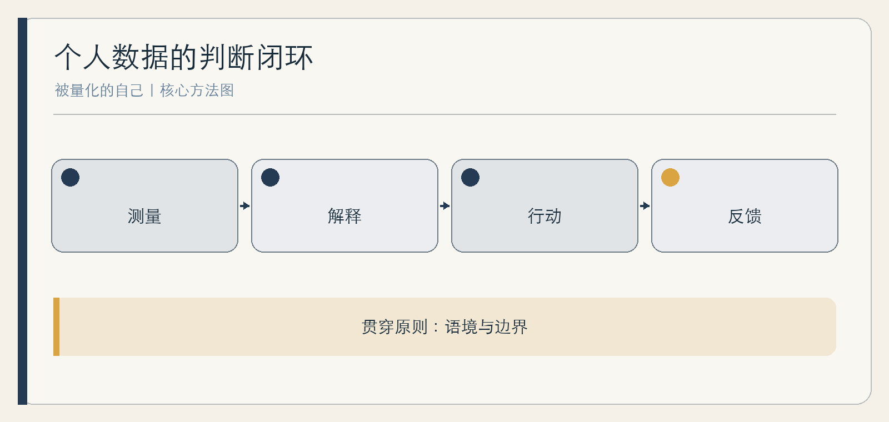

# 被量化的自己

当生活变成一份数据报告

作者：李钊  
日期：2026 年 11 月 11 日

---

## 前言　当数字先于感受

醒来以后，你先看睡眠评分，再决定自己休息得好不好；结束一天工作，你先统计完成了多少任务，再判断这一天是否值得；读完一章书，应用告诉你阅读时长和连续打卡天数，却没有告诉你，哪一个观点真正改变了你的理解。

测量本来是一种帮助。它让模糊的变化变得可见，让长期趋势有机会摆脱瞬时印象。但当数字从线索变成裁决，我们会开始为分数调整感受，为指标重排生活，甚至把无法被记录的部分当成不存在。

本书讨论的不是要不要使用设备，而是测量、解释和行动之间发生了什么。读完本书，你可以完成一次个人数据审计：知道哪些指标值得保留，哪些只能作为参考，哪些应当关闭；也能在身体感受、工作成果、学习理解和人际关系中，重新给不可量化的经验留下位置。

书中涉及健康的内容仅用于理解消费级数据的边界，不构成医学建议。综合案例由常见处境合并而成，不对应某个真实个人。

## 第一章　从测量到解释：数字如何获得权威

### 数字不是现实本身

一个指标至少要经过四次转换：先选择值得关注的现象，再用传感器或记录规则把它变成数据，随后用算法形成指标，最后由人赋予意义。每一步都包含取舍。睡眠时长不直接等于休息质量，在线时长不直接等于投入程度，答题正确率也不等于能够独立解释。

数字显得客观，是因为它省略了许多争论过程。真正需要追问的不是“数字准不准”这一句，而是：它测到了什么，遗漏了什么，在什么条件下误差会扩大，谁用它做什么决定。一个用于观察个人趋势的设备，未必适合比较不同人；一个用于提醒的分数，也未必适合奖惩。

### 指标会反过来塑造行为

一旦某个数字被持续展示，人就会调整行为去适应它。打卡让坚持可见，也可能让中断一天的损失显得过大；任务计数让进展明确，也可能鼓励先完成容易勾选的小事。问题不在于人太功利，而在于可见结果天然更容易进入选择。

**综合案例｜被提前完成的一周。** 林岚用任务应用管理写作。为了维持连续记录，她把“写一百字”也列为完成，几周后打卡很漂亮，长文的论证却仍停在原处。她把指标拆成“资料核验、关键段落、全文修订”三类，不再用篇数衡量。变化不是更能坚持，而是终于看见真正卡住的工作。

### 一个实用判断

使用指标前写三句话：它帮助我看见什么；它可能诱使我忽略什么；如果它与其他证据冲突，我如何复核。第三句尤其重要。没有复核规则的指标，很容易从助手变成裁判。

## 第二章　身体：设备能告诉我们什么

### 传感器、算法与身体感受不是同一件事

消费级睡眠设备通常根据运动、心率等信号估计状态。研究综述指出，不同设备、算法和人群之间的表现并不相同，睡眠分期的解释尤其需要谨慎。美国睡眠医学学会也明确提醒，消费级睡眠技术不能替代医学评估。[AASM](https://aasm.org/consumer-sleep-technology-position-statement/) [研究综述](https://pmc.ncbi.nlm.nih.gov/articles/PMC6579636/)

这并不意味着数据无用。相对规律的记录可能帮助观察作息、回顾习惯和与专业人士沟通。危险在于把估计值当作身体本身的最终陈述，或因为一个低分就预言自己今天必然疲惫。

若目的是观察自己的变化，应尽量固定设备、佩戴方式和记录条件，并同时保留主观记录。不同设备或不同算法给出的分数不能直接当成同一把尺子；设备更新后出现的突变，也要先排除口径变化。

### 当改善分数变成新的压力

“orthosomnia”相关病例系列描述了一类现象：部分使用者过度追求完美的睡眠数据，反而加重困扰。病例系列不能说明这种情况有多普遍，却足以提示一种机制——本用于改善睡眠的工具，可能参与制造焦虑。[病例论文](https://pmc.ncbi.nlm.nih.gov/articles/PMC5263088/)

**综合案例｜先看分数的人。** 周屿醒来后觉得尚可，看到“深睡不足”便立刻认定自己状态不好。连续两周，他提前上床、减少晨间活动，白天却更关注疲惫。后来他先记录主观感受，再看设备，并只保留每周趋势。若持续不适，他选择的不是继续优化分数，而是寻求专业评估。

### 保留两种记录

可以尝试七天对照：每天先写“精力、情绪、身体不适”三项主观记录，再查看设备；晚上补充一项值得注意的生活事件。比较二者何时一致、何时冲突。冲突不是谁撒谎，而是提醒你需要更多语境。持续或严重的症状，应交给合格专业人士判断。

## 第三章　工作：效率指标如何改变工作

### 可数的工作会挤掉重要的工作

回复数量、在线时长、会议次数、代码行数都容易记录，但它们往往只是活动痕迹。成果还包含问题是否被正确定义、错误是否减少、他人能否接续、客户是否真正获得价值。把活动直接当成果，会让团队优先生产可见痕迹。

工作监测还涉及权力差异。员工未必能像个人关闭应用那样自由拒绝数据收集，评分也可能影响排班、评价和收入。因此，“透明”不能只意味着员工被看见，也应包括组织说明采集目的、指标算法、使用范围和申诉路径。[工作监测研究](https://pmc.ncbi.nlm.nih.gov/articles/PMC10026198/)

### 从计件到交付

**综合案例｜客服团队的两种速度。** 某团队原先用每小时结束会话数评价成员。复杂问题被更快关闭，却反复重开。复盘后，团队把一次性解决、客户补充信息完整度和疑难问题升级质量纳入评审，同时抽查实际对话。新指标更多，却没有简单相加成分数，因为不同问题需要不同证据。

好的工作测量应允许解释：“这个数字为什么上升”“是否以别处受损为代价”“哪些重要工作没有进入报表”。如果只允许回答完成或未完成，测量就会遮住组织真正需要学习的东西。

### 给个人和团队的四问

本周期要改善的成果是什么；什么数据只能证明活动；谁承担指标带来的额外工作；被评价者如何提出异议。四问能把测量重新放回工作目的之下。

## 第四章　学习：可见进度与不可见理解

### 完成内容不等于发生学习

学习平台擅长记录观看、答题、打卡和正确率，却很难直接看见迁移、解释与长期保持。一个答案正确，可能来自真正理解，也可能来自刚看过解析。反过来说，学习过程中的犹豫、错误和重做虽然不好看，却可能是理解正在形成的证据。

AI 让答案更容易获得，进一步放大了这个差别。学生可以生成完整解题过程，但能否不看答案独立复述、辨认条件变化、解释为什么另一种方法不成立，才是另一种层级的证据。

### 把“求助”变成学习过程

**综合案例｜一份漂亮作业。** 家长发现孩子能用 AI 写出完整作文，却无法说明自己为什么这样安排材料。家庭没有禁用工具，而把任务改为四步：先写自己的尝试；指出具体卡点；比较两种建议；最后合上对话独立重写。评价对象从成品是否流畅，转向孩子能否解释选择。

这套做法也适用于成人。学习新工具时，可以让系统给出反例或测验，而不是只给总结；读专业书时，可以写下作者结论成立所需的条件，再找一个可能推翻它的情境。

### 建立“理解证据”

一次学习结束，至少留下三项中的一项：不看资料的复述、在新情境中的应用、对错误或反例的解释。它们仍不是完美的测量，却比观看时长更接近理解。

## 第五章　消费与注意力：被计算的选择

### 推荐也在记录一个“你”

推荐系统根据过去行为预测可能感兴趣的内容。它节省搜索成本，也会把某些行为进一步变成标签：看过一次焦虑内容，随后得到更多相似内容；买过一件商品，相关需求不断被扩展。系统认识的是可由数据描述的过去，不是人全部的可能。

个人画像还会影响什么被放在眼前。选择看似仍由自己完成，候选范围却已经改变。因此，自主权不仅是“最后由我点击”，也包括能否主动搜索、改变推荐、清空历史和接触不在预测内的东西。

### 一次候选范围审计

**综合案例｜原本只想买一盏灯。** 陈可在购物后连续收到全屋改造内容，开始把许多原本无感的物品视为必需。她没有只责备自控力，而是关闭不必要的个性化推荐、取消关注促销账号，并重新使用清单和主动搜索。更重要的是，她在购买前写下“没有看到这些推荐时，我原本要解决什么问题”。

注意力审计也可以这样做：记录一周内三次非计划使用，分别写下触发入口、当时目标和离开后的结果。不要把所有使用都当浪费，只识别那些目标已经消失、推荐仍在替你续接任务的时刻。

### 给偶然留下入口

每周保留一次不依赖推荐的探索：走进书店翻阅未听说的书、主动查找相反观点、让朋友直接分享而不是平台代选。自主选择不只是拒绝算法，也需要练习形成自己的兴趣。

## 第六章　关系：比较、排名与共同生活

### 数据让一些付出更容易被看见

家庭中的步数、消费和任务分配可以被记录，照护、安抚、记住他人偏好却不容易进入报表。若家庭只用可见数字讨论公平，擅长留下记录的人可能占据解释优势。数字可以促进沟通，也可能把关系变成持续举证。

亲密关系中的量化还涉及同意。共享位置、健康数据或家庭设备记录，不能因为技术上可开启就默认合理。被记录者是否理解、能否拒绝、能否只分享必要范围，比“我们都是一家人”更重要。

### 不用分数代替对话

**综合案例｜家庭健康排行榜。** 一家人本来为了鼓励运动建立排行榜，后来老人因排名靠后减少参与，孩子则反复追问谁走了更多。家人取消排名，改为各自选择一个目标，每周只分享一件“身体更舒服的具体时刻”。运动数据仍在，但不再决定谁在家庭中更自律、更值得肯定。

讨论共同数据时，可以先问用途：是为了互相支持、发现异常，还是评价对错。用途不同，所需数据范围和保存时间也不同。支持不必需要完整监视。

### 给不可记录者留位置

一次家庭复盘除了数字，还应回答：谁承担了没有被记录的劳动；谁因为持续被看见而不自在；哪些时刻不需要证明也有价值。关系的质量不能被一张报表完整表达。

## 第七章　数据权利：谁能看、谁能改、谁能删

### 隐私不是“没有秘密可藏”

日常数据单独看似普通，组合后可能呈现作息、健康、位置、关系和财务状况。自我追踪应用的隐私研究建议至少追问知情、控制、访问和第三方披露，而不是只看是否有一篇隐私政策。[隐私评估研究](https://pmc.ncbi.nlm.nih.gov/articles/PMC6231850/)

个人还需要区分设备本地记录、账号云同步、平台分析和第三方共享。界面里的“删除记录”究竟删除哪一层，需要以具体产品说明为准。本书不替任何产品作承诺，最稳妥的原则是减少不必要的敏感信息输入。

### 家庭数据审计

列出设备或应用、收集内容、受益人、被记录者、共享对象、关闭方式和删除入口。特别标出受益人与被记录者不一致的项目，例如家长查看儿童、远程照护者查看老人、管理者查看员工。这里需要的不只是权限设置，还需要对权力差异的讨论。

**综合案例｜客厅里的访客。** 家庭智能音箱为成员提供便利，访客却不知道哪些功能会保留语音。户主把客用区域的无必要功能关闭，并在朋友到来时主动说明，而不是把访客默认纳入家庭便利。

### 保留退出与纠错能力

定期导出重要资料，确认更换设备或服务时能否迁移；检查是否能更正错误记录；对高风险用途，保留人工复核。真正的数据权利不是看懂全部技术细节，而是知道谁能改变与你有关的决定，以及你能做什么。

## 第八章　重新掌握解释权

### 不追求彻底退出测量

完全不用数据既不现实，也没有必要。更可持续的目标是“适度量化”：有明确用途、能够理解、允许质疑、可以退出、不会把不同人的处境压成同一分数。一个指标若长期只制造焦虑而没有改变行动，就值得暂停。

可以采用三层使用法。第一层是提醒，只帮助留意趋势；第二层是讨论，用数据与他人共同寻找解释；第三层是决定，用于奖惩、诊断、资源分配等高影响场景。越接近第三层，越需要可靠证据、专业判断和申诉机制。

### 一份个人原则

**综合案例｜保留一块没有仪表盘的空地。** 林岚继续使用任务应用，但把资料核验、关键段落和全文修订放在勾选数量之前；周屿仍记录睡眠趋势，却不在醒来第一时间查看分数；陈可保留购物清单和主动搜索，不再让推荐不断扩展需求。他们没有回到无技术生活，只是不再让数字垄断一天的解释权。

你可以写下自己的五条原则，例如：先感受后看分；不为打卡保留无意义动作；高影响决定不只靠算法；家庭数据先谈同意；每月关闭一个没有实际帮助的指标。

### 七天后的复盘

重新阅读七天前的记录：哪一个数字真正帮助你行动；哪一个只增加比较；哪一次你根据其他证据纠正了指标。最终目标不是让测量消失，而是让它回到工具的位置——帮助人理解生活，而不是替人宣布生活过得怎样。

## 第九章　先写测量问题，再选择指标

### 指标应服务一个具体决定

“我想更了解自己”很宽泛，容易不断加入设备与报表。可以先写当前需要判断的事：安排工作节奏、回顾作息、检查学习理解或减少非计划购买。问题越具体，越容易判断哪些数据足够，哪些收集只是惯性。

一个完整测量问题包含用途、使用人、观察周期和可能行动。若无论什么结果都不准备改变行动，这项测量可能只需偶尔记录，甚至没有必要继续。

### 测量问题卡

| 字段 | 示例方向 |
| --- | --- |
| 当前处境 | 哪件真实事情需要理解或调整 |
| 已有证据 | 感受、成果、对话、记录与专业意见 |
| 指标角色 | 提醒、讨论或支持高影响决定 |
| 观察周期 | 何时开始、何时复盘，不无限延长 |
| 可能行动 | 保留、调整、暂停、求助或退出 |
| 停止条件 | 焦虑、误导、负担或风险超过帮助 |

**综合案例｜从“提高效率”到减少返工。** 林岚原来记录每天完成任务数，却无法解释长文为何停滞。她把问题改为“哪些环节让同一篇稿子反复返工”，保留来源核验、结构修改和读者反馈记录。任务数仍有参考作用，但不再承担全部评价。

### 先尝试不增加数据的版本

写卡后可以先用现有材料完成一次复盘。若一次对话、一份作品或主观记录已经能支持行动，就不必新增持续追踪。减少测量并不等于拒绝证据，而是避免证据生产成本超过实际用途。

## 第十章　基线与条件：比较之前先保持可比

### 同一个数字也可能换了含义

设备、算法、记录口径、佩戴习惯和生活条件都会改变数字。新版本上线、换设备或工作节奏变化后出现的突变，需要先检查测量条件，再解释为生活变化。跨设备、跨人群比较尤其需要谨慎。

个人观察可以保留简短条件日志，无需把生活变成实验室。记录影响本次理解的少数关键事项即可，例如更换设备、旅行、轮班或明显事件。健康相关情况仍由合格专业人士评估。

### 一张可比性检查表

| 条件 | 本次是否变化 | 对解释的影响 |
| --- | --- | --- |
| 设备、应用与算法版本 |  | 新旧分数能否直接比较 |
| 记录规则与单位 |  | 口径是否一致 |
| 使用方式 |  | 佩戴、输入或操作是否改变 |
| 生活与工作事件 |  | 是否有更重要语境 |
| 缺失与异常 |  | 空白是否被当成零或失败 |

**综合案例｜更新后的“进步”。** 周屿看到应用更新后评分提高，起初以为作息改善。回看记录才发现指标说明也发生变化。他保留更新前后的分组，不再把分数差直接当成身体变化，同时以自己的日常感受补充观察。

### 不需要制造虚假的精确

缺少稳定基线时，可以写“当前无法比较”，不必用小数点或复杂公式掩饰。个人决策有时只需识别一个反复出现的模式，高影响决定则需要更可靠证据与专业审查。

## 第十一章　数字与感受冲突时：建立第三种记录

### 冲突先成为待解释现象

主观感受可能受期待影响，设备数据也有误差和适用范围。二者冲突时，不必立即决定相信哪一边。可以记录当时状态、测量条件、实际任务和其他证据，让冲突留下进一步理解的机会。

例如醒来后感觉尚可而分数偏低，可以先安排普通活动并观察实际精力；若持续不适或症状严重，则寻求专业评估，不能用个人实验排除健康问题。职场奖惩与资源分配也不应由个人自测替代正式复核。

### 冲突记录四列

| 数字与条件 | 主观或其他证据 | 可能解释与未知 | 安全行动 |
| --- | --- | --- | --- |
| 指标值、时间、设备与版本 | 感受、成果、对话、实际表现 | 列出多种可能，不急于确诊 | 复核、暂停高影响用途或求助 |

**综合案例｜高分与无法集中。** 一名学习者平台正确率很高，实际合上资料却讲不清核心概念。他没有把感受直接当能力结论，而是增加独立复述和新题练习。结果提示原来的高分更多反映熟悉题型，学习任务随之调整。

### 不让第三种记录变成新负担

冲突记录只保留支持下一步所需的内容。如果每次记录都引发更长检查和焦虑，可以降低频率、暂停非必要指标或寻求可信任者与专业支持。测量的目的仍是生活，不是持续证明自己。

## 第十二章　身体数据的安全出口：从自我观察到专业沟通

### 消费级数据适合承担有限任务

个人设备可帮助整理时间线和变化线索，但不能独自完成诊断、治疗调整或紧急风险判断。持续、严重或急性身体与精神问题需要合格专业服务。急性危险直接联系当地急救或其他正式紧急服务。

就诊或咨询前，可以整理记录周期、设备与应用、主要变化、主观感受和希望讨论的问题。无需把所有原始数据无差别交出，敏感信息的共享范围可提前询问。

### 一页专业沟通摘要

| 项目 | 可以准备的内容 |
| --- | --- |
| 主要困扰 | 持续多久、怎样影响日常生活 |
| 个人观察 | 精力、感受、行为与实际事件 |
| 设备记录 | 来源、口径、代表片段与缺失 |
| 已尝试动作 | 哪些改变有帮助或带来不适 |
| 待专业判断 | 需要评估、检查或处理的问题 |

**综合案例｜带趋势，不带自我诊断。** 周屿因持续不适寻求专业帮助。他整理一周作息与感受，保留设备名称和记录限制，没有提前写下“某病已确诊”。专业评估因此多了一项材料，结论仍由合格人员作出。

### 停止让指标加重病情焦虑

若反复查看分数已经增加痛苦，可以与可信任者或合格专业人士讨论减少查看、暂停非必要功能和替代支持。不要只凭通用文章开始或停止治疗，也不要因设备显示正常而忽略真实症状。

## 第十三章　工作指标的权力审查：谁可以评价谁

### 个人效率方法不能直接搬到管理

个人可以暂停一个应用，员工却可能无法拒绝与考核、排班和收入相关的监测。团队引入指标前，应说明目的、采集范围、算法或规则、谁能查看、保存多久和怎样申诉。被评价者的参与不能只用一次通知代替。

指标若影响奖惩、合同、排班或劳动权益，应按适用制度与法律要求处理。本书不提供合规结论，组织需要由合格人员评估。

### 指标影响地图

| 问题 | 需要的证据 |
| --- | --- |
| 为什么收集 | 与真实工作成果的关系 |
| 谁承担记录劳动 | 新增步骤、时间与情绪压力 |
| 谁能解释 | 被评价者能否补充语境和纠错 |
| 谁从中受益 | 管理者、员工、客户是否同样受益 |
| 错误怎样纠正 | 人工复核、申诉与实际补救 |
| 何时停止 | 目的结束、副作用过大或替代出现 |

**综合案例｜会话数上升之后。** 某虚构客服团队为提升会话数设置排行榜，复杂问题随后被更快关闭，也更多重开。复盘没有再加一个“质量分”相互抵消，而是按问题类型抽查实际处理，允许成员补充语境，并重新评估排行榜是否必要。

### 指标之外保留工作证据

客户结果、问题难度、同事协作、知识交接和防止错误都可能难以量化。管理者应通过实际工作与对话理解它们，不能只奖励最容易出现在仪表盘上的人。

## 第十四章　学习的迁移测试：离开原页面还会多少

### 进度完成后安排一次独立任务

观看、打卡与答题可以记录学习活动，迁移测试则要求学习者在不同条件下解释或使用。测试不必复杂：合上资料复述、改变一个条件、指出反例，或完成一个没有模板的小任务。

独立任务应选择适合当前阶段的难度。过难只会制造挫败，过易又可能重复熟悉感。错误可用于决定下一次练习，无需换算成永久能力标签。

### 三种理解证据

| 证据 | 做法 | 能发现的缺口 |
| --- | --- | --- |
| 独立复述 | 不看答案解释核心关系 | 只记住术语 |
| 条件变化 | 更换一个前提再判断 | 机械套用步骤 |
| 错误解释 | 说明错在哪里、怎样修正 | 答案碰巧正确 |

**综合案例｜同一份解析，两种学习。** 学生先读AI生成的完整解析，能顺利复述句子，却无法处理条件改变后的题。练习改为先写自己的尝试，再比较解析，最后独立做一道变式。AI仍参与学习，评价落在学生实际完成的动作上。

### 不用新的分数覆盖旧问题

迁移测试也可以保留文字与作品，不必再生成“理解指数”。学习的反馈应帮助选择下一次练习，过多的元指标可能再次把注意力从理解拉到打卡。

## 第十五章　注意力与推荐：审计候选范围如何形成

### 记录入口，而不只记录时长

同样一小时使用，可能来自主动完成任务，也可能来自连续推荐。一次有效审计可记录打开前的目标、触发入口、看到的主要候选和离开后的结果。这样能看见选择在哪个环节被重新安排。

不需要把所有推荐都视为操纵。它们有时确实减少搜索成本。需要识别的是目标已经结束后，系统仍通过何种机制续接任务，以及自己能否方便地主动搜索、关闭或改变推荐。

### 三次非计划使用记录

| 时点 | 当时目标与触发 | 实际路径 | 离开后的结果与调整 |
| --- | --- | --- | --- |
| 第一次 |  |  |  |
| 第二次 |  |  |  |
| 第三次 |  |  |  |

**综合案例｜一盏灯之外的清单。** 陈可购买灯具后收到大量改造内容。她回看发现，新清单多来自推荐页而非真实居住问题，于是回到主动搜索与原有预算清单，并关闭不必要的促销通知。记录没有证明平台造成了所有消费，只帮助自己看清候选来源。

### 给未预测的兴趣留位置

可以定期由自己选择主题、来源和探索路径，接触推荐之外的材料。对重要公共、健康、财务或职业决定，还要主动寻找可靠来源和不同意见，不能只依赖个性化信息流。

## 第十六章　家庭与照护数据：同意需要能够拒绝

### 先区分关心、照护与监督

家庭共享数据可能帮助协作，也可能让被记录者长期处于被检查状态。讨论时应明确谁需要哪些信息、用于什么、保存多久，以及拒绝后是否仍能获得必要照护与尊重。

儿童、老人、残障者或依赖他人照护的人，可能有不同的表达与决定条件。监护人或照护者也不应默认可以查看全部内容，具体权利和义务按适用规则与专业意见处理。

### 一次家庭数据约定

| 议题 | 共同约定 |
| --- | --- |
| 必要用途 | 哪项照护或协作确实需要数据 |
| 最小范围 | 哪些字段、时段与设备不必共享 |
| 查看与通知 | 谁能看，是否向被记录者可见 |
| 拒绝与暂停 | 怎样关闭而不遭受惩罚或羞辱 |
| 删除与离开 | 家庭成员变化后怎样处理历史 |
| 正式求助 | 安全、健康或权益问题找谁 |

**综合案例｜从排行榜到各自目标。** 一家人取消健康排名后，又发现老人仍担心被随时查看。家庭把共享缩小到本人选择的提醒，普通步数不再自动公开，并约定出现异常时先沟通。安全紧急事项按实际条件与正式服务处理。

### 访客与其他家庭成员也属于被记录者

公共设备的语音、摄像和通知可能收集访客或同住者信息。户主需要检查提示与设置，不应因自己方便就替所有人同意。无须持续记录的功能可以关闭，具体产品效果以当前说明和实际检查为准。

## 第十七章　导出、删除与换用服务：让数据真的能离开

### 下载按钮只是开始

导出后要打开文件，检查内容、日期范围、可读性和是否包含不必要敏感信息。专有格式若没有合适工具读取，不能把下载成功等同于可迁移。重要资料可在更换服务前完成一次独立恢复演练。

删除也要区分本地记录、云端历史、共享副本、备份和账号。各产品的范围不同，应保存当前说明与实际操作结果，不能从界面消失推断所有副本立即消失。

### 数据退出记录

| 步骤 | 实际动作 | 验收与未知 |
| --- | --- | --- |
| 盘点 | 设备、账号、共享与第三方 | 是否遗漏其他成员数据 |
| 导出 | 选择必要范围与格式 | 文件能否独立打开 |
| 迁移 | 新服务或本地替代 | 核心记录是否完整可用 |
| 删除 | 分层处理历史与副本 | 可见结果、保留期与未确认处 |
| 撤销 | 设备权限、登录和共享 | 原服务是否仍能访问 |
| 保留 | 必要备份与说明 | 谁能看、何时再复核 |

**模拟练习｜换手机之前。** 使用者先导出一份普通非敏感记录并在家用电脑上打开，发现图片没有包含在文本文件中，于是另行保存必要附件。完成迁移后再处理旧设备，避免先清空才发现缺少材料。

### 为不再使用保留清楚结尾

服务停止时，关闭不再需要的花费与通知，保留必要联系和投诉入口。若涉及他人资料或高影响权益，按正式渠道确认处理，不只依赖个人设置页面。

## 第十八章　七天适度量化实验：一份完整模拟

### 实验前的选择

以下为**模拟综合练习**，不对应真实个人效果。一名虚构使用者希望减少醒来先看分数和工作中反复打卡带来的压力。他选择睡眠评分与任务数量两个指标，其他数据暂不改变，避免一次调整过多。

第一天先记录目标和停止条件：若持续不适或焦虑加重，就暂停实验并寻求适当支持；若出现急性危险，直接联系当地紧急服务。实验不用于诊断，也不替代原有专业安排。

### 七天记录如何展开

前三天，他先写主观精力和当天重要工作，再查看数字，同时记录设备或应用是否更新。第四天发现一次评分与感受冲突，于是补充实际工作状态而非延长检查。第五天暂停任务排行榜，保留必要的交付提醒。

第六天，他导出一次记录并确认文件可读，关闭一个不再需要的共享入口。第七天复盘时，把“继续保留”“降低频率”“暂停”和“需要专业判断”分开，不合成一个总分。

| 复盘决定 | 本次依据 | 下一步 |
| --- | --- | --- |
| 保留每周作息趋势 | 能帮助回顾生活节奏 | 固定每周查看一次 |
| 暂停醒来即时评分 | 查看后反复预期疲惫 | 先记录主观状态 |
| 取消任务排行榜 | 诱导选择容易勾选事项 | 以实际作品复盘 |
| 保留交付提醒 | 与真实承诺直接相关 | 不增加额外统计 |

### 实验结束不证明长期结果

七天只能提供短期个人线索，不能推断疾病、长期绩效或他人效果。使用者保留一项变化，下一周再观察；持续不适则寻求专业评估。实验的成果是一次更有依据的选择，而非一套完美数据生活。

## 第十九章　当指标参与决定：人工复核与申诉怎样落地

### 分数不能成为拒绝解释的理由

当评分影响贷款、招聘、排班、教育机会、保险或公共服务时，当事人需要知道决定由谁作出、使用了哪些信息、怎样纠正错误。仅被告知“系统这样算”无法说明责任，也无法处理数据过期、身份匹配错误和特殊处境。

不同领域有不同正式要求，组织应由合格人员审查。个人可以使用本书的问题整理材料，但不必独自证明整个算法有错，才能提出具体异议或寻求正式帮助。

### 一条可执行的复核路径

| 环节 | 应当留下的材料 |
| --- | --- |
| 决定通知 | 实际结果、依据范围、责任主体与日期 |
| 数据查看 | 本人可获得的记录、来源与必要语境 |
| 错误更正 | 错误字段、支持材料和提交入口 |
| 人工复核 | 有权限改变结果的人及其实际审查 |
| 申诉与救济 | 正式渠道、时限和可获得的帮助 |
| 补救与停止 | 错误影响怎样恢复，相关自动决定是否暂停 |

**综合案例｜一项异常排班评分。** 某虚构员工发现评分引用了已完成更正的出勤记录。她保存当前通知和更正凭证，通过正式渠道要求人工核查，而不是继续优化日常行为迎合错误数据。组织需要处理记录同步和受影响决定，不能只修改一个展示数字。

### 复核要防止形式化

如果人工只能重复系统结论、无法查看原始语境或没有实际修改权限，复核渠道仍可能形同虚设。评审者应抽查被改变的案例和未获支持者的理由，并保留适当的独立申诉入口。

对个人而言，重要决定前的材料尽量通过正式方式提交并保存回执。面临紧急权益或安全后果时，及时寻求法律、劳动、医疗或其他合格专业支持，不用个人量化实验替代正式程序。

## 第二十章　一个月少一项指标：从数据减法恢复选择

### 数据减法从一个具体负担开始

前面的审计可能列出许多问题，若一次性关闭全部工具，反而增加生活打断。可以选择一项长期只带来比较、重复检查或无意义打卡的指标，先暂停一个月，同时保留真正需要的提醒和安全安排。

减法之前写清它原来声称提供的帮助、实际使用和可能的替代。例如连续打卡可用每周作品复盘替代，家庭排名可改为本人选择的照护提醒。重要医疗、财务或工作记录不能随意停止，应按专业与正式要求处理。

### 一个月的四个观察点

| 时点 | 要观察的事实 |
| --- | --- |
| 开始前 | 使用目的、频率、负担和不能失去的功能 |
| 第一周 | 是否反复想查看，哪些替代真正可用 |
| 中间 | 生活任务、感受和现实关系发生了什么 |
| 月末 | 恢复、降低频率、继续暂停或永久退出 |

**模拟练习｜暂停连续学习打卡。** 一名虚构学习者发现为了维持记录，常选择已经很熟的内容。暂停打卡后，他保留每周一次独立复述和变式练习。第一周仍多次想打开排行榜，月末则决定保留学习记录但关闭公开排名。这个模拟不证明长期学习效果，只展示怎样以实际任务评估指标。

### 复盘不需要再生成总分

月末可以回答三个具体问题：哪个原本担心失去的帮助没有出现，哪个真实负担有所减少，哪个功能仍值得保留。也记录没有变化或变得更糟的情况，让恢复指标同样成为可接受结果。

数据减法的成果是更清楚的选择权。一个指标可以在某些生活阶段有用，在条件变化后退出；恢复使用也不需要被解释为失败。重要是每项测量都能再次说明自己的用途、边界和去向。

## 第二十一章　当分数变成身份：保留改变的可能

### 描述一次状态，不给人定型

“本周专注时长较少”描述一段记录，“我就是无法自律的人”则把记录变成身份。身份标签看似能简化选择，实际会把特定时间、环境和测量方式下的结果带入未来。下一次状态不好时，人可能把标签当成预言，连尝试其他方法的理由也一并放弃。

平台也擅长把行为汇总为形象：高效者、夜猫子、阅读达人、落后成员。这些称呼有时带来鼓励，有时只是提高打开应用的频率。使用者可以保留自己认可的部分，同时追问它来自哪些记录、排除了哪些生活、正在引导什么行动。

### 区分四层语言

| 层次 | 一种表达 | 需要保留的边界 |
| --- | --- | --- |
| 原始记录 | 某设备在某晚记录了若干小时 | 来源、缺失与版本 |
| 指标解释 | 该应用据此形成一个评分 | 算法估计及适用范围 |
| 当前判断 | 这几天我需要回顾作息 | 其他证据与身体感受 |
| 身份断言 | 我是睡不好、没毅力的人 | 证据不足以支持永久定型 |

**综合案例｜“低效的人”。** 一名虚构自由职业者连续几周看到效率分偏低，开始在简介里称自己低效。回看记录后发现，分数没有计入客户沟通和资料核验，恰好漏掉了当前工作的主要部分。他删掉身份描述，把观察改成“现有计时方式没有覆盖完整工作”，随后决定是否还使用这个指标。改变的是测量安排，不需要先证明自己属于另一种固定人格。

### 允许不同阶段的自己使用不同工具

一个指标在康复、备考或项目冲刺阶段可能有帮助，进入日常生活后却变成压力。阶段变化时重新讨论用途，不必因为过去受益就永远保留，也不必因为后来暂停就否定曾经的帮助。个人原则可以有有效期，工具选择也允许随处境调整。

与他人讨论时，也要避免用数据替对方定型。家长用一次阅读时长推断孩子“不爱学习”，管理者用一段在线记录推断员工“不负责”，都跳过了任务、环境与权力差异。涉及健康、教育和劳动后果时，需要相应专业判断与正式复核，个人标签不能成为决定依据。

### 一次去标签练习

从自己的常用描述中选一句含有人格判断的话，把它拆成“何时、在什么条件下、记录了什么、还有什么没有记录”。再写一个可以在本周完成的小动作，以及一个可能改变当前判断的反例。动作可以只是安排一次对话、完成一件作品或暂停一天非必要查看。

去标签并不要求放弃所有归类。医学诊断、正式资格和明确工作标准各有其专业用途，不能凭个人感受任意取消。这里要处理的是把消费级分数、短期活动痕迹和平台称号无限扩展成自我价值的习惯。

最后可以留下一句更宽松的记录：“我在这个阶段，用这些有限的材料，作了当前的选择；新材料出现后，我可以修改。”这句话没有量化整个自我，却给行动和变化留下了真实位置。

## 附录　个人数据审计工作表

### 第一张表：逐项盘点

| 项目 | 要填写的内容 | 判断提示 |
| --- | --- | --- |
| 测量对象 | 设备、应用、指标 | 它直接测到了什么？ |
| 使用目的 | 提醒、讨论或决定 | 风险越高，核验越严格 |
| 解释边界 | 误差、遗漏、冲突证据 | 何时不应采纳？ |
| 数据流向 | 同步、共享、第三方 | 被记录者是否同意？ |
| 退出方式 | 关闭、导出、删除、人工渠道 | 退出是否真正可用？ |

### 第二张表：七天实验

1. 每天先记录一次主观感受或工作目标，再看指标。
2. 选一项高频指标，只在固定时间查看。
3. 选一项排名或连续打卡，暂停七天。
4. 记录一次数字与其他证据冲突的过程。
5. 结束后只保留能支持明确行动的功能。

### 第三张表：需要升级判断的情形

涉及持续身体不适、明显心理困扰、劳动奖惩、儿童或老人权益、财务与合同后果时，不要只依赖个人实验或通用内容，应寻找相应专业人士和正式救济渠道。

## 附录二　指标登记与测量问题卡

### 一项指标只写一种主要用途

同一个指标可以被用于提醒、讨论或奖惩，但不同用途需要不同证据和保护。登记时先选当前主要用途，若同时进入高影响决定，应另行审查可靠性与申诉，不能沿用个人提醒的宽松标准。

| 登记项 | 填写提示 |
| --- | --- |
| 名称、来源与版本 | 哪个设备、应用或记录规则产生 |
| 直接测量与算法加工 | 原始信号是什么，分数怎样形成 |
| 使用目的与受益人 | 谁使用，谁承担记录和影响 |
| 观察周期 | 何时复盘，何时自然结束 |
| 解释边界 | 误差、缺失、跨设备和跨人群限制 |
| 冲突证据 | 感受、实际成果、对话或专业意见 |
| 停止与退出 | 关闭、导出、删除和人工渠道 |

### 测量前的空指标测试

先假设这个指标永远为空白，自己将依靠什么作出决定。如果已有足够证据，可以暂缓新增收集；如果空白会遮住关键风险，再讨论怎样以最小范围补足。这个练习帮助识别习惯性仪表盘。

## 附录三　七天对照日记

### 每日记录不超过必要范围

| 日期与条件 | 先写主观或任务目标 | 后看指标与版本 | 冲突或一致 | 当天动作 |
| --- | --- | --- | --- | --- |
| 第一天 |  |  |  |  |
| 第二天 |  |  |  |  |
| 第三天 |  |  |  |  |
| 第四天 |  |  |  |  |
| 第五天 |  |  |  |  |
| 第六天 |  |  |  |  |
| 第七天 |  |  |  |  |

条件栏只记可能影响理解的设备更新、佩戴变化、旅行、轮班或重要事件，不要求记录全部生活。健康数据尽量减少不必要的身份细节，持续或严重不适直接寻求合格专业评估。

### 第七天的四种去向

保留：有明确用途且能帮助行动；降低频率：有价值但查看过密；暂停：主要增加焦虑、比较或记录负担；升级判断：涉及健康、劳动、财务、儿童或其他高影响事项。四种去向可以并存，不需要合成总分。

## 附录四　数字与其他证据冲突记录

| 项目 | 本次内容 |
| --- | --- |
| 指标、时间、设备与版本 |  |
| 主观感受或实际成果 |  |
| 缺失、异常与测量条件 |  |
| 两种以上可能解释 |  |
| 仍不能确认的内容 |  |
| 低风险下一步 |  |
| 需要专业或正式复核的原因 |  |

**模拟填写｜学习正确率与独立复述。** 一名虚构学习者连续答题正确，却无法不看资料解释。记录列出“熟悉题型”“已经理解”“解析仍在记忆中”等多种可能，下一步安排独立复述和变式练习。这个练习只用于学习反馈，不推断固定能力。

### 何时停止自我试验

急性身体或精神危险、自伤或伤害他人的风险直接联系当地正式紧急服务。持续症状、明显心理困扰、劳动奖惩、财务合同和权益问题进入合格专业或正式救济流程，不通过增加观察天数延迟处理。

## 附录五　高影响用途评审表

当指标进入诊断、奖惩、排班、信贷、保险、教育评价或公共资源分配时，评审责任超出个人效率实验。组织需要由合格人员检查适用规则、有效性、公平、隐私和救济。

| 评审项 | 必备问题 |
| --- | --- |
| 目的与必要性 | 是否有侵害更小的替代方式 |
| 适用人群 | 在哪些人、条件和版本上验证过 |
| 误差与缺失 | 哪些人会承受更高错误或不可见 |
| 数据权利 | 是否知情、可拒绝、可访问、可更正和删除 |
| 人工复核 | 谁有能力改变结果，是否查看实际语境 |
| 申诉与补救 | 错误决定怎样停止、恢复和赔偿 |
| 退出 | 目的结束或副作用过大时怎样停止 |

本表不提供法律或医学合规结论。它用于提醒组织者：高风险用途不能仅凭历史相关性、供应商演示或个人同意页面获得批准。

## 附录六　数据退出与迁移检查包

### 导出验收

选择一份不含高敏感信息的样例先测试。保存导出范围、日期、文件格式和大小，实际打开检查文字、图片、时间与附件。若需要专有软件，记录读取方式和替代方案。不要把文件下载完成直接写为迁移成功。

### 删除与撤销

| 对象 | 操作与产品说明 | 实际结果与未确认处 |
| --- | --- | --- |
| 单条历史与本地缓存 |  |  |
| 云端账号与长期记录 |  |  |
| 共享成员和第三方应用 |  |  |
| 已导出文件与备份 |  |  |
| 通知、订阅和设备权限 |  |  |

具体保留期与服务器副本以当前产品正式说明和实际处理结果为准。涉及他人数据和法定保留时，按正式渠道处理。

### 模拟迁移｜从排行榜到个人记录

一名虚构使用者决定停用家庭排行榜。他先导出自己需要的普通活动记录，打开确认可读，再与家人讨论共享历史和照护提醒。必要提醒转到本人选择的本地方式，随后撤销设备共享并处理各自副本。家庭成员保留各自选择，没有一个人替全家删除所有资料。

## 附录七　个人数据原则与月度复盘

### 写出可以执行的原则

原则要落到动作，例如“先记录感受再看睡眠分”“工作奖惩必须有人工复核”“家庭共享先说用途和拒绝方式”“每月检查一个没有实际帮助的指标”。避免只写“理性使用数据”这类无法检查的口号。

| 本月原则 | 一次真实执行 | 遇到的困难 | 下月保留或调整 |
| --- | --- | --- | --- |
|  |  |  |  |
|  |  |  |  |
|  |  |  |  |

### 复盘生活是否回到中心

回看测量带来的行动：哪些让生活更清楚，哪些让重要经验更难被看见，哪些本可用一次对话解决。也检查记录工作本身占用了多少时间与注意力。若一个指标只持续制造焦虑，可以暂停并寻求适当支持。

月度复盘不是新的评分任务。留下几条有依据的变化即可，其余时间和经历不必转化为仪表盘。持续或严重的问题进入正式专业流程，不用下一个月的个人实验替代当前需要的帮助。

## 参考资料

1. Baron, K. G. 等：[Orthosomnia: Are Some Patients Taking the Quantified Self Too Far?](https://pmc.ncbi.nlm.nih.gov/articles/PMC5263088/)，2017。
2. de Zambotti, M. 等：[Wearable Sleep Technology in Clinical and Research Settings](https://pmc.ncbi.nlm.nih.gov/articles/PMC6579636/)，2019。
3. American Academy of Sleep Medicine：[Consumer sleep technology is no substitute for medical evaluation](https://aasm.org/consumer-sleep-technology-position-statement/)，2018。
4. Chinoy, E. D. 等：[The good, the bad, and the ugly of consumer sleep technologies](https://pmc.ncbi.nlm.nih.gov/articles/PMC10362482/)，2023。
5. Huckvale, K. 等：[Assessing the Privacy of mHealth Apps for Self-Tracking](https://pmc.ncbi.nlm.nih.gov/articles/PMC6231850/)，2018。
6. [A policy primer and roadmap on AI worker surveillance](https://pmc.ncbi.nlm.nih.gov/articles/PMC10026198/)，2022。

资料收集截至 2026 年 11 月 11 日。具体产品功能、数据政策与医学指南在后续使用时应重新核对。
