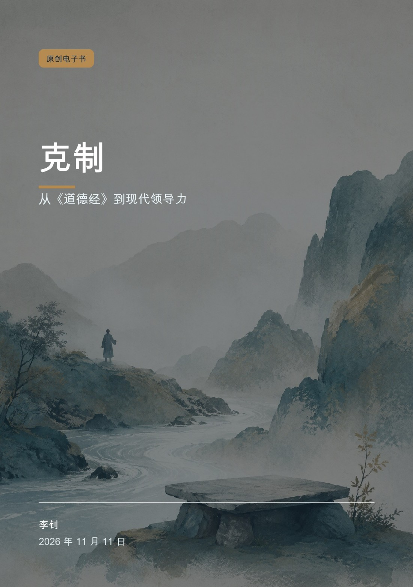
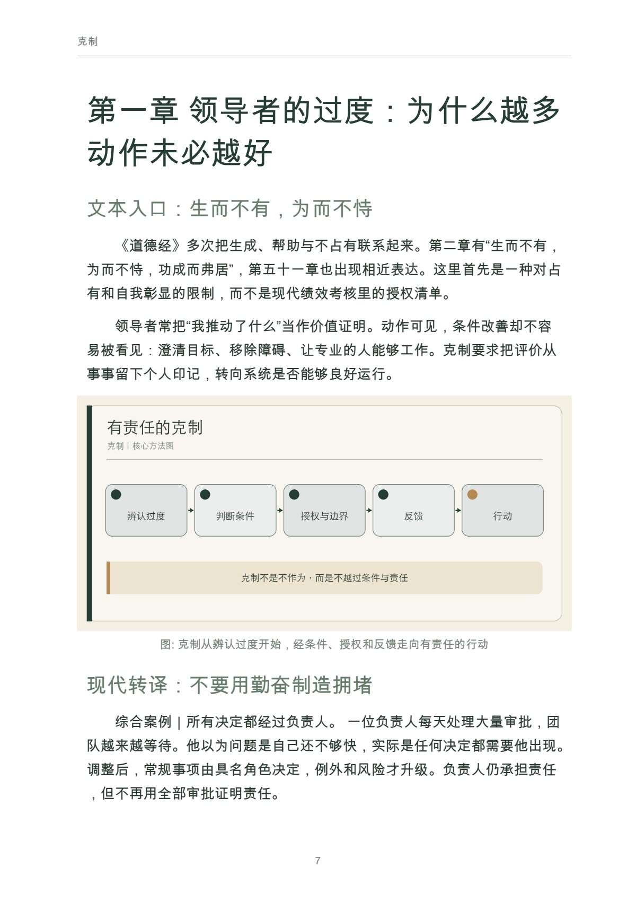
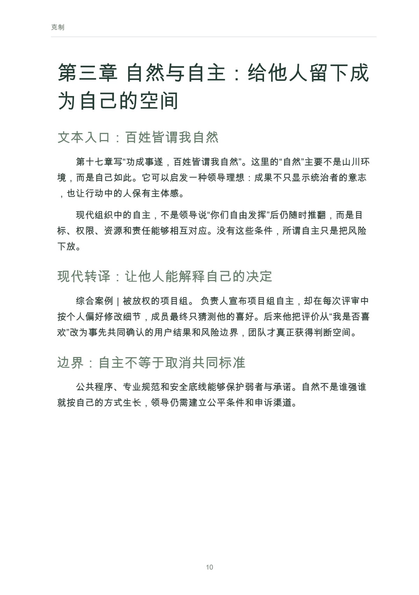

# 克制

从《道德经》到现代领导力

作者：李钊 · 出版单位：晓翊工作室  
第一版 · 原书日期：2026-11-11 · 上架日期：2026-11-11 · PDF 17 页

以可靠文本阅读讨论过度干预、权力、自主、冲突、扩张与责任。

## 阅读导引

现代组织鼓励快速响应、持续增长和主动作为。管理者很容易用更多会议、更多指标和更多干预证明负责，却很少追问：这些动作是否越过了问题的需要，是否让他人失去判断，是否正在制造下一轮更复杂的治理。

《道德经》提供了一种反向观看。它谈无为、自然、柔弱、不争、知足与反转，不是给现代管理者准备的成功技巧，而是对权力、欲望和过度行动的持续质疑。

本书选择八个现代领导问题，与相关章句对读。原文以通行本为主要坐标，解释参考王弼、河上公及现代研究；不同学术理解不作唯一裁定。现代案例是检验启发的场景，不证明老子早已预言当代制度。

建议先读前言与前两章，理解问题和基本方法；再结合当前问题选择后续章节，使用附录整理自己的记录。

## 完整目录

展开全书目录

- 前言　领导力不只是增加动作
- 第一章　领导者的过度：为什么越多动作未必越好
- 第二章　无为不是不为：行动之前的条件判断
- 第三章　自然与自主：给他人留下成为自己的空间
- 第四章　柔弱与边界：不以强硬证明力量
- 第五章　不争与冲突：不把一切关系变成胜负
- 第六章　知足与扩张：增长何时失去尺度
- 第七章　反者道之动：看见成功的副作用
- 第八章　把克制变成制度：授权、反馈与责任
- 附录　主题阅读与领导练习
- 参考资料

## 实际内页预览

页码为包含封面的 PDF 文件页码，从 1 起算。

PDF 文件第 7 页：克制 7 第一章 领导者的过度：为什么越多 动作未必越好 文本入口：生而不有，为而不恃 《道德经》多次把生成、帮助与不占有联系起来

PDF 文件第 10 页：克制 10 第三章 自然与自主：给他人留下成 为自己的空间 文本入口：百姓皆谓我自然 第十七章写“功成事遂，百姓皆谓我自然”。这里

## 阅读与下载

- [Markdown 在线阅读](output/markdown/克制_李钊_20261111.md)
- [PDF · 17 页](https://github.com/njxshr/ruogu-books/releases/download/new-books-20261111-v1.0/restraint.pdf)
- [EPUB](https://github.com/njxshr/ruogu-books/releases/download/new-books-20261111-v1.0/restraint.epub)
- [Markdown 离线包（含配图）](https://github.com/njxshr/ruogu-books/releases/download/new-books-20261111-v1.0/restraint-markdown.zip)

## 来源与权利

[来源记录](SOURCES.md) · [主稿](manuscript/book.md) · [出版配置](book.json)

书中的综合案例、模拟情境和作者建议按正文标注理解，不作为真实客户成效承诺。来源记录保留原有核查范围，本次上架不代表重新核查全部外部来源。

版权所有 © 2026 李钊。保留所有权利。 第三方资料权利归原权利人。公开阅读与下载不另行授予开放许可。

[返回书目](../../目录.md)
