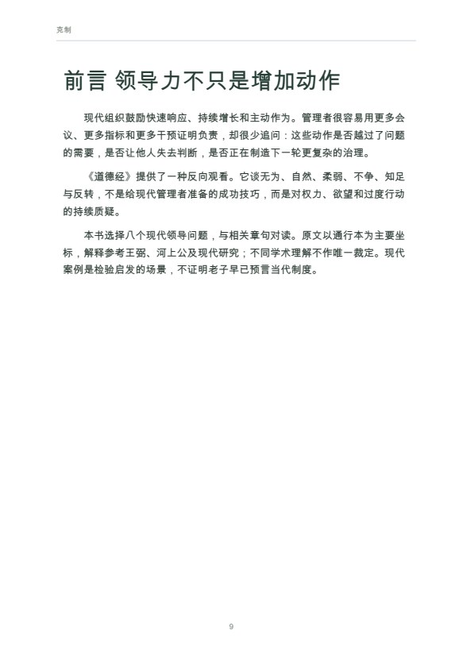
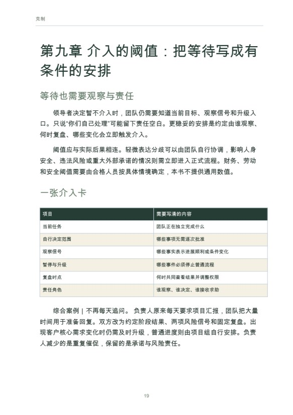

# 克制

从《道德经》到现代领导力

作者：李钊 · 出版单位：晓翊工作室  
增订版 1.1 · 原书日期：2026-11-11 · 增订日期：2026-11-19 · PDF 51 页

以可靠文本阅读讨论过度干预、权力、自主、冲突、扩张与责任。

## 阅读导引

本次增订保留原书基础内容、署名和出版记录，21章、7份附录。新增实践方法、综合案例或模拟练习及可直接使用的工作表。案例的材料性质以正文标注为准，不构成真实客户成效或专业结果保证。

读者可先浏览前言与原八章建立共同概念，再按当前任务选读新增章节和附录。表格需结合自己的资料填写，动态规则、产品能力和专业事项仍按当前正式来源核实。

## 完整目录

展开全书目录

- 前言　领导力不只是增加动作
- 第一章　领导者的过度：为什么越多动作未必越好
- 第二章　无为不是不为：行动之前的条件判断
- 第三章　自然与自主：给他人留下成为自己的空间
- 第四章　柔弱与边界：不以强硬证明力量
- 第五章　不争与冲突：不把一切关系变成胜负
- 第六章　知足与扩张：增长何时失去尺度
- 第七章　反者道之动：看见成功的副作用
- 第八章　把克制变成制度：授权、反馈与责任
- 第九章　介入的阈值：把等待写成有条件的安排
- 第十章　减少审批：把决定放到合适的位置
- 第十一章　授权的四条边：目标、资源、例外与纠错
- 第十二章　冲突中的克制：让不同意见保留事实
- 第十三章　知足与指标：增长不能免除代价核算
- 第十四章　成功的副作用：建立第二轮后果评审
- 第十五章　必须介入的时候：克制不妨碍果断
- 第十六章　权力与待遇：克制先约束拥有资源的人
- 第十七章　把个人修养变成可交接的制度
- 第十八章　三十天克制实践：一次完整模拟
- 第十九章　远程与异步协作：少打断也需要清楚约定
- 第二十章　项目停止之后：让责任有尊严地结束
- 第二十一章　领导者交接：让克制脱离个人魅力
- 附录　主题阅读与领导练习
- 附录二　介入与等待记录表
- 附录三　审批与授权合并工作台
- 附录四　分歧与二阶后果记录
- 附录五　文本阅读与现代转译卡
- 附录六　三十天记录册与停止条件
- 附录七　领导交接与共管记录
- 参考资料

## 实际内页预览

页码包含封面，从 1 起算。样页由本次 51 页 PDF 重新生成。

PDF 文件第 9 页：前言。

PDF 文件第 19 页：新增实践章节。

## 阅读与下载

- [Markdown 在线阅读](output/markdown/克制_李钊_20261111.md)
- [PDF · 51 页](https://github.com/njxshr/ruogu-books/releases/download/expanded-books-20261119-v1.1/restraint.pdf)
- [EPUB](https://github.com/njxshr/ruogu-books/releases/download/expanded-books-20261119-v1.1/restraint.epub)
- [Markdown 离线包（含配图）](https://github.com/njxshr/ruogu-books/releases/download/expanded-books-20261119-v1.1/restraint-markdown.zip)

## 增订与检查

[20 轮增订记录](REVISION_LOG.md) · [实际检查报告](QA_REPORT.md)

本次重新生成 Markdown、PDF 和 EPUB。PDF 全部 51 页已渲染并逐张查看总览；EPUB 解包读取封面、前中后章节，112 个导航目标与本地资源检查通过。具体范围与限制见报告。

## 来源与权利

[来源记录](SOURCES.md) · [主稿](manuscript/book.md) · [出版配置](book.json)

来源记录保留原有核查范围。本次扩充没有借综合案例或模拟推演新增真实访谈、客户成效和统计证据。

版权所有 © 2026 李钊。保留所有权利。第三方资料权利归原权利人。公开阅读与下载不另行授予开放许可。

[返回书目](../../目录.md)
