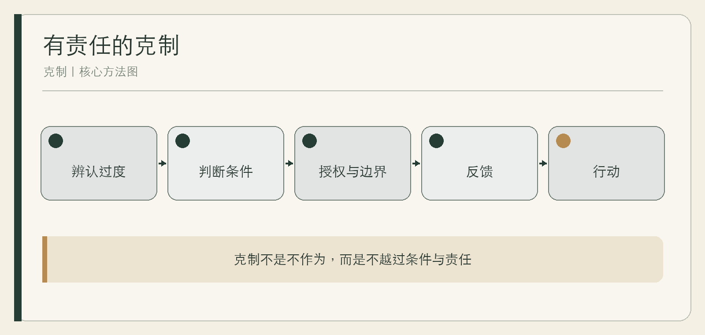

# 克制

从《道德经》到现代领导力

作者：李钊  
日期：2026 年 11 月 11 日

---

## 前言　领导力不只是增加动作

现代组织鼓励快速响应、持续增长和主动作为。管理者很容易用更多会议、更多指标和更多干预证明负责，却很少追问：这些动作是否越过了问题的需要，是否让他人失去判断，是否正在制造下一轮更复杂的治理。

《道德经》提供了一种反向观看。它谈无为、自然、柔弱、不争、知足与反转，不是给现代管理者准备的成功技巧，而是对权力、欲望和过度行动的持续质疑。

本书选择八个现代领导问题，与相关章句对读。原文以通行本为主要坐标，解释参考王弼、河上公及现代研究；不同学术理解不作唯一裁定。现代案例是检验启发的场景，不证明老子早已预言当代制度。

## 第一章　领导者的过度：为什么越多动作未必越好

### 文本入口：生而不有，为而不恃

《道德经》多次把生成、帮助与不占有联系起来。第二章有“生而不有，为而不恃，功成而弗居”，第五十一章也出现相近表达。这里首先是一种对占有和自我彰显的限制，而不是现代绩效考核里的授权清单。

领导者常把“我推动了什么”当作价值证明。动作可见，条件改善却不容易被看见：澄清目标、移除障碍、让专业的人能够工作。克制要求把评价从事事留下个人印记，转向系统是否能够良好运行。

### 现代转译：不要用勤奋制造拥堵

**综合案例｜所有决定都经过负责人。** 一位负责人每天处理大量审批，团队越来越等待。他以为问题是自己还不够快，实际是任何决定都需要他出现。调整后，常规事项由具名角色决定，例外和风险才升级。负责人仍承担责任，但不再用全部审批证明责任。

### 边界：少干预不是少负责

涉及安全、违法、伤害和重大承诺时，果断介入是责任。克制不是把“放手”变成逃避，而是让介入与问题需要相匹配。

## 第二章　无为不是不为：行动之前的条件判断

### 文本入口：为无为，则无不治

第三章的“为无为，则无不治”，以及第三十七章“道常无为而无不为”，使无为不可能简单等于不做事。它更适合被理解为对强作、妄为和越过条件的警惕。不同注家和现代研究仍有解释差异，不能把一种管理翻译当成原句唯一含义。

刘笑敢从权力自我节制解释老子哲学，为理解无为提供了一种重要路径，但这是一种学术解释，不是全书所有章句的唯一答案。[论文摘要](https://zxyj.cbpt.cnki.net/portal/journal/portal/client/paper/1a4f0a6d6df2b5aeae457cefe1409acd)

### 现代转译：先改变条件，再增加命令

**综合案例｜反复催促的交付。** 团队连续延期，管理者不断增加进度会。复盘发现，需求在开发后仍频繁变化。真正的行动是固定阶段边界、明确变更代价，而不是再催促一次。导致延期的原因得到处理后，进度会才有机会减少；少开会本身并不是目标。

### 行动前的三问

问题是否必须由我干预；现有系统已经在朝什么方向发展；我的动作会不会制造新的依赖。三问不是拖延，而是避免把即时可见的动作当成唯一贡献。

等待也需要边界。事先写下介入阈值：何种安全信号必须立即处理，何种承诺逾期需要协调，何种一般分歧可以先让团队自行验证。这样，克制才不会被误用为对明确责任的延迟。

## 第三章　自然与自主：给他人留下成为自己的空间

### 文本入口：百姓皆谓我自然

第十七章写“功成事遂，百姓皆谓我自然”。这里的“自然”主要不是山川环境，而是自己如此。它可以启发一种领导理想：成果不只显示统治者的意志，也让行动中的人保有主体感。

现代组织中的自主，不是领导说“你们自由发挥”后仍随时推翻，而是目标、权限、资源和责任能够相互对应。没有这些条件，所谓自主只是把风险下放。

### 现代转译：让他人能解释自己的决定

**综合案例｜被放权的项目组。** 负责人宣布项目组自主，却在每次评审中按个人偏好修改细节，成员最终只猜测他的喜好。后来他把评价从“我是否喜欢”改为事先共同确认的用户结果和风险边界，团队才真正获得判断空间。

### 边界：自主不等于取消共同标准

公共程序、专业规范和安全底线能够保护弱者与承诺。自然不是谁强谁就按自己的方式生长，领导仍需建立公平条件和申诉渠道。

## 第四章　柔弱与边界：不以强硬证明力量

### 文本入口：天下莫柔弱于水

第七十八章以水说明柔弱与坚强之间的关系，第四十三章也谈“天下之至柔，驰骋天下之至坚”。这些章句不是要求人忍受伤害，而是挑战把力量等同于硬碰硬的想象。

领导中的柔，可以表现为不被对方的激烈牵引，能调整方法而不放弃目的，能在不羞辱他人的情况下坚持边界。

### 现代转译：坚定不必靠升级语气

**综合案例｜一次质量争议。** 业务要求跳过必要测试，技术负责人没有用人身攻击回应，也没有含糊妥协，而是明确不可省略的风险、可缩短的范围和必须保留的验收。语气保持平稳，边界反而更清楚。

### 边界：柔弱不能成为要求弱者沉默

面对暴力、歧视和专业错误，明确制止不是“不够柔”。若不争被用来让受影响者放弃权利，或让强者逃避责任，就已经偏离了对权力节制的追问。

## 第五章　不争与冲突：不把一切关系变成胜负

### 文本入口：水善利万物而不争

第八章“上善若水。水善利万物而不争”，第六十八章也有“不争之德”。不争首先挑战的是以自我胜负支配行动，不等于否认所有分歧。

组织把每个讨论都做成胜负时，人们会更关心立场是否输，而不是事实是否改变。领导者若只奖励最会赢的人，就会逐渐失去真实信息。

### 现代转译：把冲突重新指向问题

**综合案例｜两个部门的方案之争。** 销售与交付各执一词，会议变成证明谁更懂客户。负责人要求双方分别写出方案依赖的条件、最担心的后果和可以共同验证的小实验。争论没有消失，但从人格胜负转向可检验差异。

### 边界：不争不代替原则谈判

合同、资源和权利仍需清楚协商。克制不是一味让步，而是不把压过对方当成额外目标，不用胜利扩大不必要的伤害。

## 第六章　知足与扩张：增长何时失去尺度

### 文本入口：知足不辱，知止不殆

第四十四章把知足、知止与长久联系起来，第四十六章也警惕欲望扩张。这里的思想不能直接变成企业不得增长，而是帮助辨认增长何时开始吞噬它原本服务的目标。

增长会带来协调、维护、责任和注意力的成本。只计算新增收入，不计算复杂度，组织可能在规模扩大时失去最重要的能力。

### 现代转译：把停止当作战略选择

**综合案例｜不断增加的定制。** 一家服务团队为每位客户增加特殊功能，短期订单增长，交付却越来越依赖少数人。团队重新限定标准服务，把不能持续维护的需求拒绝或转为单独项目。选择不是反增长，而是保护交付承诺。

### 边界：知足不能用来压低合理待遇

要求员工接受不公平报酬、要求用户放弃正当权益，不是知足。知足首先应约束拥有资源和权力的人，而不是成为对弱者说教的工具。

## 第七章　反者道之动：看见成功的副作用

### 文本入口：反者道之动

第四十章的“反者道之动”，与第五十八章祸福相倚的思考，提示事物在发展中可能发生转化。它不是一条可以精确预测商业周期的公式，而是一种二阶后果意识。

一种做法在局部有效，被不断强化后可能走向反面。指标最初帮助聚焦，后来替代目标；加班最初解决紧急问题，后来掩盖流程缺陷；集中权力最初加快决定，后来让组织失去纠错。

### 现代转译：成功之后增加一次反问

**综合案例｜高效流程的隐性代价。** 团队通过标准模板显著缩短方案时间，随后所有客户都被要求适应同一模板，复杂需求反而无法表达。复盘后保留标准部分，同时为例外设置评估入口。效率不再以排除难例为代价。

### 建立停止和复核信号

成功时写下：哪些条件使做法有效；哪些信号表示条件已变；谁有权提出停止。克制不是拒绝成功，而是不让成功经验获得永久豁免。

## 第八章　把克制变成制度：授权、反馈与责任

### 克制不能只依赖领导者的修养

一个愿意放手的负责人离开后，组织是否仍能自主？如果答案是否定的，克制还只是个人风格。制度需要把权限、例外、信息、申诉和责任保存下来，使权力不被个人心情随意收回。

授权要写明决定范围与资源；反馈要让一线信息能改变上级；责任要保证错误有人处理；申诉要让被系统影响的人能够挑战决定。它们与现代治理相连，但不是从《道德经》直接推导出的现成方案。

### 一张领导者的克制清单

这件事是否必须做；是否必须由我做；我的动作会增强谁的能力；是否保留不同意见；错误由谁纠正；成功何时需要停止。清单的作用不是让领导变得消极，而是让行动更符合尺度。

**综合案例｜从个人风格到共同规则。** 一位创始人过去靠临场克制赢得团队信任，却没有留下权限规则。扩张后，新管理者重新集中所有决定。团队随后把常规决定、例外升级、复盘和申诉写进共同制度，克制才开始超越个人。

### 结语：有力量，也有不使用全部力量的能力

《道德经》的现代价值，不在于给领导者一套更隐蔽的控制术，而在于让权力看见自身边界。真正成熟的行动，不是永远更少，而是知道何时行动、何时等待、何时让他人完成，以及何时承担不可推卸的责任。

## 第九章　介入的阈值：把等待写成有条件的安排

### 等待也需要观察与责任

领导者决定暂不介入时，团队仍需要知道当前目标、观察信号和升级入口。只说“你们自己处理”可能留下责任空白。更稳妥的安排是约定由谁观察、何时复盘、哪些变化会立即触发介入。

阈值应与实际后果相连。轻微表达分歧可以由团队自行协调，影响人身安全、违法风险或重大外部承诺的情况则需立即进入正式流程。财务、劳动和安全阈值需要由合格人员按具体情境确定，本书不提供通用数值。

### 一张介入卡

| 项目 | 需要写清的内容 |
| --- | --- |
| 当前任务 | 团队正在独立完成什么 |
| 自行决定范围 | 哪些事项无需逐次批准 |
| 观察信号 | 哪些事实表示进展顺利或条件变化 |
| 暂停与升级 | 哪些事件必须停止普通流程 |
| 复盘时点 | 何时共同查看结果并调整权限 |
| 责任角色 | 谁观察、谁决定、谁接收求助 |

**综合案例｜不再每天追问。** 负责人原来每天要求项目汇报，团队把大量时间用于准备回复。双方改为约定阶段结果、两项风险信号和固定复盘。出现客户核心需求变化时仍需及时升级，普通进度则由项目组自行安排。负责人减少的是重复催促，保留的是承诺与风险责任。

### 复盘等待是否合适

等待后既要看任务结果，也要看团队是否获得足够信息与资源。若最终不得不由领导亲自补救，应追查权限、能力和条件缺口，不能简单证明“还是离不开我”。这种结论会掩盖授权设计失败。

## 第十章　减少审批：把决定放到合适的位置

### 审批多并不自动带来安全

每项审批都有等待、解释和协调成本。审批者离实际工作越远，越可能只凭简短摘要作出判断。团队为了通过审批，还可能隐藏不确定性，只呈现最容易获得同意的版本。

减少审批应先分类：常规可逆决定、需要专业复核的决定、重大或不可逆承诺。不同类别采用不同证据与责任，不必全部进入同一条链。涉及法定或专业审查的事项仍按适用要求执行。

### 从撤掉一次低价值审批开始

**综合案例｜一份反复旅行的申请表。** 某团队的小额公共支出需要四级签字，实际核对预算和票据的人只有一位。组织重新明确额度、凭证和抽查责任，常规事项由直接角色处理，异常与超预算事项升级。节省的环节来自清楚规则，监督并未消失。

| 决定类型 | 合适动作 | 保留的证据 |
| --- | --- | --- |
| 常规且可逆 | 具名执行者决定 | 范围、结果与抽查 |
| 专业判断 | 由合适专业角色复核 | 依据、条件与异议 |
| 跨团队资源 | 共同协调优先级 | 取舍与受影响承诺 |
| 重大或不可逆 | 正式评审与批准 | 风险、备选和责任 |

### 防止审批以其他名字回来

取消签字后，若负责人仍通过即时消息逐条干预，团队并未获得决定空间。复盘要检查实际行为：有多少事项被临时上报，哪些意见被当成必须服从，什么情况下原授权被收回。制度与日常习惯需要一起变化。

## 第十一章　授权的四条边：目标、资源、例外与纠错

### 授权不是把任务往下推

一项可执行的授权需要目标、决定范围、资源和责任相互匹配。只给目标不给预算，只给责任不给信息，或要求团队为无法控制的后果负责，都会让自主变成风险转移。

授权双方还应讨论例外。什么属于常规波动，什么需要专业或组织层面介入，写清后才能减少临时猜测。例外不宜无限列举，可以先来自一次典型任务和一次历史异常。

### 授权交接练习

接收者用自己的话复述目标、可做决定和升级条件，授权者补充误解。随后选一个低风险事项由接收者独立处理，再共同查看结果。口头宣布“以后你负责”没有完成这一练习。

**综合案例｜有权排期，无权变更。** 团队被告知可以自主安排交付，却在调整范围时屡次被推翻。复盘后，组织把排期、资源协调和范围变更分开：前两项由项目组决定，后一项按客户承诺共同评审。边界变清楚，授权不再随个人偏好摇摆。

### 纠错不意味着立即收回全部权限

错误发生后，先判断它来自信息不足、能力差距、流程缺陷还是越权行为。针对原因补条件，比一律回到集中审批更有效。确需缩小权限时，说明范围、期限和恢复条件，让团队知道怎样重新获得信任。

## 第十二章　冲突中的克制：让不同意见保留事实

### 不急于把分歧归为沟通问题

有些冲突来自目标、资源、权利和风险的真实差异，仅靠改善语气无法消除。领导者先让各方说明自己观察到什么、担心什么、可以确认什么，再决定协调、验证或正式裁决。

强势者的长篇表达不应占用全部空间。受影响者可以提交书面材料、由合适代表协助，或在不受报复的环境中提出异议。具体保护按组织制度和适用规则执行。

### 一次分歧记录

| 记录项 | 各方需要提供 |
| --- | --- |
| 共同目标 | 哪部分承诺仍然一致 |
| 事实差异 | 哪些观察或数据不一致 |
| 条件差异 | 各自方案在什么前提下成立 |
| 风险承担 | 错误后果由谁承担 |
| 可验证动作 | 哪项小范围行动能增加信息 |
| 正式裁决 | 无法共识时由谁按何种程序决定 |

**综合案例｜不再争夺“最懂客户”。** 两个团队围绕交付范围争执，负责人先让双方写出各自承诺和证据。差异集中在接口条件未确认，会议改为安排一次联合验证，而非评选哪个部门更正确。最终仍可能需要取舍，但取舍有了共同事实基础。

### 克制也包括适时结束讨论

当事实已足够、权限明确或安全要求必须执行时，持续邀请讨论可能变成拖延。决策者应说明已听到的主要意见、最终理由和后续复核，不以“共识”掩盖真实分歧。

## 第十三章　知足与指标：增长不能免除代价核算

### 把新增承诺的总成本写出来

增长除了收入与规模，还带来维护、协调、培训、合规、支持和退出成本。若这些成本分散到不同团队，决策者可能只看到局部的繁荣。评审新增承诺时，应让承担后续工作的人参与。

知足在这里是一种组织边界意识：知道哪些机会与核心承诺相符，哪些复杂度超过维护能力。它不能成为拒绝合理投入、压低员工待遇或忽视用户权利的理由。

### 新增业务评审卡

| 维度 | 需要核对的代价 |
| --- | --- |
| 交付 | 新流程、例外与质量保障 |
| 人员 | 学习、值班、情绪负荷与单点依赖 |
| 技术 | 数据、权限、集成与长期维护 |
| 外部责任 | 合同、专业、安全与客户退出 |
| 机会成本 | 哪些原有承诺将延后或缩减 |
| 停止成本 | 不再继续时怎样交接和补救 |

**综合案例｜一张很诱人的订单。** 服务团队获得新订单，却需要为单一客户维护特殊流程。评审发现支持工作会长期依赖两名成员。团队缩小定制范围并给出替代方案，客户未接受，订单最终没有签下。放弃订单的结论只对应这次成本与能力，不被包装成普遍经营原则。

### 停止也是兑现责任

产品、项目或合作停止时，需要处理通知、数据、未完成承诺和人员安排。只计算停止能省多少钱，会把既有责任从账上抹去。知止因此也包含对退出后果的承担。

## 第十四章　成功的副作用：建立第二轮后果评审

### 有效做法为何需要复核

一种做法成功后容易扩大范围。模板从辅助变成限制，集中协调从应急变成常态，指标从观察变成奖惩。评审应寻找使用条件的变化，以及原先没有被看见的人开始承担什么。

“反者道之动”为这种复核提供古典启发，但不能预测某项业务何时必然反转。现代组织仍需实际记录、受影响者反馈和可检验信号。

### 二阶后果地图

先写第一轮直接结果，再追问行为如何适应、成本转移到哪里、长期能力怎样变化。每个判断标明是已有观察还是待验证推演，避免把担忧写成确定未来。

| 做法 | 第一轮帮助 | 可能的适应行为 | 需要观察的副作用 |
| --- | --- | --- | --- |
| 标准模板 | 减少重复准备 | 难例被挤到模板之外 | 例外数量与用户结果 |
| 集中审批 | 临时统一口径 | 团队等待、隐藏分歧 | 决定延迟与信息质量 |
| 排名激励 | 提高可见活动 | 选择容易计分的任务 | 质量、合作与申诉 |
| 紧急加班 | 应对短期峰值 | 常态依赖透支 | 错误、健康与人员流失 |

### 保留可逆的小范围试验

不确定副作用时，可先限定时间、对象和停止条件，再比较实际结果。试验不能用未经同意的高风险人群承担成本，也不能以“创新”为名省略必要保护。复核后选择继续、调整或退出，并保存理由。

## 第十五章　必须介入的时候：克制不妨碍果断

### 明确不可等待的事项

正在发生的人身危险、违法或严重侵权、重大数据与安全事件、无法逆转的外部承诺，需要立即进入合适的正式流程。领导者不能以无为为由放任伤害，也不能要求一线独自承担超出权限的风险。

介入先限制影响、保护人员和保存必要证据，再由合格人员调查与决定。具体法律、医疗、安全和劳动事项应寻求相应专业支持。本书的古典阅读不处理这些专业结论。

### 介入的最低秩序

| 顺序 | 动作 | 需要避免 |
| --- | --- | --- |
| 保护 | 停止危险或扩大影响的动作 | 为维持表面进度延迟处置 |
| 求援 | 联系正式紧急或专业渠道 | 只靠内部聊天判断严重风险 |
| 保存 | 保留版本、记录和受影响范围 | 在原证据上反复试验 |
| 通知 | 说明已知、未知和下一次更新 | 用确定口吻掩盖调查状态 |
| 恢复 | 验收、补救并检查后续责任 | 只恢复服务而不处理影响 |

**模拟演练｜系统仍在自动执行。** 某虚构团队发现自动化可能越权修改数据。负责人立即停止相关权限，保留日志并启动正式安全响应，没有等待常规周会。后续再审查自动化范围、审批和监控为何未能提前发现。

### 事件结束后回到克制

紧急介入会形成临时集中权力。事件结束后，应撤销不再需要的临时权限、恢复正常决定路径，并复盘哪些制度需要改变。否则一次必要介入可能永久扩大管理者的动作范围。

## 第十六章　权力与待遇：克制先约束拥有资源的人

### 不能用同一套话要求所有人

对拥有预算、职位和决定权的人，克制意味着减少占有与过度干预；对正在承受不公平待遇的人，组织仍需保障表达、申诉和获得支持。把“知足”“不争”用于要求弱者接受损失，会掩盖权力差异。

讨论自主时，应看当事人是否真能拒绝。员工担心考核、老人依赖照护、儿童面对成人规则时，形式上的同意不一定充分。具体权利与保护依适用规则处理，必要时寻求合格专业帮助。

### 一项措施影响了谁

| 受影响者 | 需要听到的经验 | 组织者要核对 |
| --- | --- | --- |
| 执行任务的人 | 工作负担、资源与可拒绝空间 | 是否把责任下放而保留权力 |
| 被评价的人 | 指标误差、申诉与实际后果 | 是否能挑战错误决定 |
| 服务对象 | 选择、人工替代与退出 | 是否为效率牺牲必要服务 |
| 缺席的人 | 未来或非直接用户承担的影响 | 谁代表其利益进入评审 |

**综合案例｜自愿参加的额外工作。** 团队把持续加班描述为成员自愿，复盘却发现绩效和晋升都暗示不能拒绝。负责人先调整评价与资源，再讨论个人工作方式。组织条件没有改变前，单纯倡导放下欲望无法解决问题。

### 让申诉产生实际变化

受理之后需要调查、保护、纠错和必要补救。若每次申诉都只回到原决定者而没有独立复核，形式上开放的渠道仍可能让人沉默。克制要求权力愿意被约束，也接受自己的决定可以被改变。

## 第十七章　把个人修养变成可交接的制度

### 从“遇到好领导”到“规则仍然有效”

个人风格很难复制。组织需要把常规决定、例外升级、资源、异议和责任写进制度，并由不同层级的人实际使用。制度不必冗长，关键是新负责人到来后不能随意把全部权限收回。

可以选一项跨团队工作，让原负责人短期不参与日常决定，观察团队能否找到规则、处理异常并完成复盘。演练要提前约定安全边界，不能在真实高风险事件中放任失控。

### 制度是否有效的四个场景

| 场景 | 观察什么 |
| --- | --- |
| 常规任务 | 团队能否不等待额外批准 |
| 条件变化 | 是否知道暂停、升级和求助 |
| 领导异议 | 不同意见能否被记录和回应 |
| 人员更替 | 权限、责任和知识是否顺利移交 |

**综合案例｜新负责人到来。** 原负责人靠个人信任维持授权，新负责人则要求重新审批所有事项。团队利用既有权限表、项目承诺和复盘记录，共同确认哪些规则继续有效，哪些需要正式修改。制度没有阻止新领导判断，却要求改变有清楚范围和理由。

### 给制度安排退出

过时审批、临时应急权限和无效会议也要定期退出。清理前检查引用、责任和历史记录需求，避免删掉流程后没人知道工作怎样继续。克制因此既约束新增动作，也维护必要秩序。

## 第十八章　三十天克制实践：一次完整模拟

### 背景

以下为**模拟综合演练**，不对应真实企业成效。一位虚构负责人发现，团队大量事项等待自己批准，会议持续增加。他没有以“少管事”为目标，而是选择一项低风险、可逆的内部内容发布流程进行三十天实践。

第一周，团队还原三次任务，记录等待、重复修改与真正发现错误的审批。结果发现多数延误来自范围不清，部分专业核查则确有必要。团队把普通文字修改、发布范围和高影响承诺分开，保留必要专业入口。

### 第二至四周

第二周，负责人与执行者共同写授权卡，约定常规范围、两项升级信号和每周复盘。执行者独立处理一次任务，负责人在复盘前不通过即时消息追加修改。出现意见时先记录下来，区分个人偏好与已确认标准。

第三周，一个异常触发升级。负责人介入协调资源，随后把临时权限收回，并与团队讨论为什么原规则没有覆盖。第四周，另一位成员按授权卡完成任务，检验制度能否脱离固定两个人。

| 周次 | 实际材料 | 停止或调整信号 |
| --- | --- | --- |
| 第一周 | 三次任务时间线与审批分类 | 把必要专业审查误判为浪费 |
| 第二周 | 授权卡与一次独立任务 | 责任、资源或信息不匹配 |
| 第三周 | 异常介入记录 | 临时集中权力没有退出 |
| 第四周 | 第二位成员复测与复盘 | 只有原作者能够理解规则 |

### 结束后的选择

团队保留常规自主决定，修订两条升级条件，取消一次重复进度会，同时保留专业审核。没有计算虚构效率提升，也没有把一次模拟扩展到全部部门。下一项实践要等本次缺陷处理后再开始。

## 第十九章　远程与异步协作：少打断也需要清楚约定

### 即时回复不等于共同推进

远程工作中，领导者可以用消息随时进入团队。一次简短询问看起来成本很低，频繁发生时却会不断打断判断与创作。团队也可能把谁在线、谁秒回误认为谁更负责，逐渐隐藏实际成果和困难。

异步协作需要更完整的书面语境：任务目标、当前状态、决定权限、待办责任和下一次反馈时点。缺少这些条件，减少会议只会让信息分散到更多私聊里。

### 给协作设置响应边界

| 事项 | 推荐安排 | 需要防止 |
| --- | --- | --- |
| 普通进展 | 在共同入口按约定更新 | 用反复追问制造可见忙碌 |
| 需要决定 | 写清选项、依据、期限和决定者 | 在多个频道重复征求随机意见 |
| 深度工作 | 约定不打扰时段和必要联系人 | 以文化名义要求持续在线 |
| 紧急事件 | 明确真正的紧急入口 | 把全部消息标成紧急 |
| 跨时区交接 | 保存当前版本与下一步 | 让最后一离线的人承担全部解释 |

**综合案例｜一条“有空吗”。** 负责人习惯只发“有空吗”，成员无法判断紧急程度，往往立即停下手头工作。双方后来约定普通事项直接写背景和需要回复的时间，真正紧急事项使用专门入口。领导者的表达多用了两分钟，团队获得了安排注意力的依据。

### 异步不能取消人的处境

书面记录不应成为无限监控或要求全天候回应的理由。跨时区、照护责任、残障与不同工作条件会影响参与方式。团队需要共同确认可用时段和替代渠道，劳动权益问题按适用制度处理。

复盘时可以抽查一周消息：哪些询问已有文档答案，哪些决定只在私聊发生，哪些成员因时区或职责承担了额外解释。把发现写回协作规则，而非再增加一份无人阅读的沟通规范。

## 第二十章　项目停止之后：让责任有尊严地结束

### 停止不等于抹去曾经投入

项目可能因条件变化、风险过高或维护成本过大而停止。领导者若只把停止视为失败，团队会倾向于隐藏坏消息，继续投入以证明过去正确。克制允许根据新信息改变承诺，同时认真处理已经产生的影响。

停止评审先区分外部条件、执行偏差与原判断问题，保存当时记录和未解决异议。没有必要为所有人寻找一个统一故事，但客户、员工、合作方与用户的现实去向必须清楚。

### 一张停止工作表

| 事项 | 需要完成的责任 |
| --- | --- |
| 未完成承诺 | 通知、协商、替代、退款或其他正式处理 |
| 数据与账号 | 导出、迁移、权限撤销、保留与删除 |
| 人员与知识 | 工作交接、经验记录、可获得的过渡支持 |
| 合作与供应 | 合同结束、未结算事项与联系入口 |
| 系统与内容 | 停止自动执行，更新导航和默认推荐 |
| 复盘与复核 | 保存证据、剩余风险和具名后续责任 |

**综合案例｜停止一项定制服务。** 某虚构团队发现长期维护成本超过自身能力，决定不再接收新定制需求。团队没有立即关闭全部入口，而是先停止新承诺，与现有客户逐项确认过渡，保留必要导出和联系人，再撤销不再需要的系统权限。复盘同时承认早期接单时的边界判断不足。

### 不把退出成本转给最弱的人

停止项目时，组织不能把全部损失推给员工、用户或小型合作方，还以知止之名宣布自己轻装前进。具体合同、劳动与权益责任需要合格人员评估，组织应先确认实际义务和受影响者选择。

最后还要撤销围绕项目形成的临时权力和指标。若项目已结束，负责人仍保留特别审批、团队仍按旧排名行动，停止只发生在名称上。克制的完整闭环包括不再做的事、仍需承担的事和可以重新开始的事。

## 第二十一章　领导者交接：让克制脱离个人魅力

### 先接住承诺，再展示新风格

新负责人到任后，最容易看见的是等待自己的决定、可以重排的会议和能够更换的流程，较难看见的是旧安排保护了哪些承诺。立即增加审批可以显示主动，却也可能让原本独立工作的团队突然失去权限。交接应先还原正在运行的工作，再决定哪些改变确有必要。

前任留下的记录也有局限。成功的授权可能只适用于熟悉彼此的人，书面流程可能早已脱离实际。接手者需要听取执行者、协作者和受影响者的经验，核对真实决定路径，不能只凭一份制度汇编宣布一切正常。

### 一份交接审计

| 审计对象 | 需要还原的事实 | 改变前要确认 |
| --- | --- | --- |
| 外部承诺 | 已答应的结果、期限与退出责任 | 谁承担变化造成的影响 |
| 决定权限 | 哪些常规事项由一线完成 | 收回权限为何必要、持续多久 |
| 专业入口 | 哪些审查保护安全与质量 | 新流程是否保留合格复核 |
| 例外与申诉 | 过去怎样处理难例和异议 | 被影响者能否继续获得回应 |
| 临时权力 | 应急审批、特别访问和额外报告 | 是否已有结束条件 |
| 非正式协调 | 哪些工作依赖私人关系与记忆 | 怎样转成可交接的公共条件 |

**综合案例｜新负责人的第一张表。** 某虚构负责人接手后，发现团队对同一事项有三种不同说法。他没有马上判定谁不遵守制度，而与三名成员各还原一次最近任务。差异来自一份旧授权邮件和后来新增的口头要求。负责人先确认当前承诺，再把有效规则写成一页交接说明，旧口头要求随之停止。审计解决的是实际矛盾，没有把所有历史做法合理化。

### 改变权限要有过渡

确需收回某项权限时，应写明范围、理由、起止时间和恢复条件，同时安排正在处理中的事项。临时集中权力若默认永久有效，交接就会成为一次不易察觉的扩权。对正在等待客户、合作方或内部服务的人，还要给出新的联系入口，避免他们在两套规则之间反复说明。

过渡期间可以保留一次低风险对照：同类事项分别按旧规则与新规则走一遍，比较发现的风险、等待和信息缺口。这个练习只适用于可控工作，高风险事项按正式要求处理。比较结果由双方共同查看，不把旧流程故意设计得难以使用，以此证明改变正确。

### 离任者也要练习克制

离任负责人仍可能因熟悉情况而被频繁咨询。他可以提供背景、指出记录和说明当时取舍，却不宜绕过现任负责人继续发号施令。紧急风险按正式入口处理，普通选择由现任者承担判断。未经约定的私下指导，会让团队面对两套权力。

离任交接可以留下三样东西：未完成承诺清单、关键决定及其条件、仍需验证的假设。尽量不把个人偏好写成永久禁令，也不要求继任者用维护过去来证明尊重。记录越清楚，继任者越能在新条件下改变决定，同时理解改变的代价。

### 三十天后检查谁的权力增加了

交接复盘除了业务进度，还应检查实际权力变化：哪些事项开始需要额外批准，哪些专业意见不再进入讨论，谁承担了新的解释劳动，哪些临时入口已经关闭。新负责人也应记录自己被团队纠正的一次决定，观察制度能否约束接手者本人。

克制的交接没有固定方向。结果可能减少审批，也可能恢复一项被忽略的必要审查。评价它要看责任是否更清楚、受影响者是否更有保障、团队能否在新负责人不在场时继续作出合适决定。

## 附录　主题阅读与领导练习

### 主题阅读路径

- 无为与行动：第二、三、三十七、四十八、五十七章。
- 自主与自然：第十七、二十五、五十一章。
- 柔弱与力量：第四十三、七十六、七十八章。
- 不争与冲突：第八、六十八、八十一章。
- 知足与尺度：第九、四十四、四十六章。
- 变化与二阶后果：第四十、五十八、六十四章。

阅读时应回到全章语境，并参考校释与研究，不凭单句建立管理规则。

### 一周练习

选择一项你频繁介入的工作，记录介入前的目标、动作和结果；标出一次真正必要的介入、一次可由条件改善替代的介入；与协作者确认哪些权限和责任需要调整；一周后复盘是否出现新的风险。

### 现代应用的四条红线

不把无为写成不作为；不把不争写成弱者沉默；不把知足写成压低合理待遇；不把古典启发写成不需要专业证据的管理处方。

## 附录二　介入与等待记录表

### 事件前

| 记录项 | 本次填写 |
| --- | --- |
| 任务与真实承诺 |  |
| 目前由谁决定、需要哪些资源 |  |
| 我原计划介入的动作 |  |
| 介入要保护的结果 |  |
| 不介入可能观察到什么 |  |
| 必须立即升级的信号 |  |

选择介入、等待或改变条件后，写下理由。这个理由可以包含不确定性，不必把等待包装成确定最优。若涉及安全、法律、劳动、医疗或其他专业风险，按正式流程处理，不能仅以本表决定等待。

### 事件后

复盘实际结果、团队获得的能力、被忽略的影响和下一步权限。分别记录“介入解决了什么”“介入制造了什么”“等待让什么变得可见”。若结果不好，回到当时信息判断，不把后来知道的一切当成当时显而易见。

**模拟填写｜取消一次进度追问。** 某虚构团队约定两天内自行整理方案，负责人保留客户范围变化时升级的入口。复盘中发现团队确实完成初稿，却因缺少预算信息无法比较方案。下一步不是恢复每日追问，而是补充预算口径和获取权限。

## 附录三　审批与授权合并工作台

### 审批分类

| 当前审批 | 实际防范的风险 | 能否改为规则、抽查或专业复核 | 保留／调整／退出 |
| --- | --- | --- | --- |
|  |  |  |  |
|  |  |  |  |

不能因为某项审批从未发现问题，就断言它没有作用；也不能因为它存在多年，就认定不可替代。查看实际失败、等待和沟通记录，再决定怎样调整。法定或必要专业审查应保留其正式责任。

### 授权卡

- 任务与预期结果：
- 接收者可独立决定的范围：
- 可用预算、信息、人员与工具：
- 需要共同决定的跨团队事项：
- 必须暂停与升级的例外：
- 错误报告、人工复核和申诉入口：
- 临时权限的结束与恢复条件：
- 双方复述与低风险试做结果：

授权后记录一次被临时收回或额外干预的事项，检查实际行为是否与授权卡一致。若确需改变，保存理由、范围和后续恢复条件。

## 附录四　分歧与二阶后果记录

### 分歧记录

每位参与者先独立写共同目标、观察事实、方案条件、最担心的后果和可接受验证。主持人把相同事实与不同解释分开，避免一边拥有更多会议时间，另一边只能被动回应。

| 讨论结果 | 责任与日期 | 验收 |
| --- | --- | --- |
| 可以共同验证的差异 |  |  |
| 需要正式协调的资源 |  |  |
| 仍需保留的异议 |  |  |
| 决策者及理由 |  |  |

讨论结束后，允许参与者补充对过程与决定的书面意见。共识不能靠删除异议制造。

### 二阶后果地图

选择一项正在被强化的成功做法，写出直接帮助、行为适应、成本转移和长期能力变化。每格标记“已观察”或“待验证”，并找一个可能推翻当前判断的反例。

例如，集中审批的直接帮助是统一口径，已观察适应可能是等待增加，待验证推演可能是新人不再练习判断。下一步可以先收集决定延迟和实际讨论记录，不把推演写成必然结局。

## 附录五　文本阅读与现代转译卡

### 阅读记录

- 章句与所用版本：
- 全章语境及相关章句：
- 注家或研究的解释范围：
- 本书采用的现代启发：
- 这一启发无法直接证明的制度或效果：
- 一个不适用的现代情境：

古典文本可以提供观看权力与行动的角度，现代制度仍需要当代证据、专业判断与受影响者参与。引用时避免把不同注家压成唯一答案，也不把现代案例写成古代预言的验证。

### 现代案例审查

检查案例是否标明综合或模拟性质，是否把结果写成真实企业成效，是否省略权力差异和必要专业流程。若案例只用来展示一种思考方式，应删去暗示普遍效果的句子和虚构精确数字。

## 附录六　三十天记录册与停止条件

| 周期 | 要完成的真实材料 | 复核重点 |
| --- | --- | --- |
| 第一周 | 三次任务时间线、审批分类 | 哪些动作解决根因，哪些只增加等待 |
| 第二周 | 一张授权卡、一次独立任务 | 目标、资源、权限与责任是否匹配 |
| 第三周 | 异常介入和临时权限记录 | 介入是否必要，临时权力是否退出 |
| 第四周 | 另一位成员复测、共同复盘 | 规则能否脱离原负责人运行 |

### 应当暂停普通练习的情形

正在发生的人身危险、重大安全或数据事件、严重侵权、违法风险或不可逆外部承诺，不进入普通授权试验。先保护人员、限制影响并联系合适的正式专业与紧急渠道。

### 结束时只记录实际发生的事

完成了几次任务就写几次，没有执行的复测不勾选。可以决定继续、缩小、恢复某项审批或停止整个实践，但要写明依据、责任和未完成承诺。克制并不要求每次练习都以减少动作告终，有时结论恰恰是增加必要资源与保护。

## 附录七　领导交接与共管记录

### 交接前的事实清单

| 项目 | 离任者提供 | 接任者核对 |
| --- | --- | --- |
| 未完成承诺 | 对象、期限、已完成部分与风险 | 与实际执行者及受影响方确认 |
| 有效权限 | 常规决定、专业复核与例外 | 最近任务是否确实这样运行 |
| 未解决异议 | 不同意见、依据和处理状态 | 保留正式回应与复核入口 |
| 临时权力 | 特别审批、访问和报告安排 | 结束日期与撤销责任 |
| 关键依赖 | 人员、系统、预算和外部协作 | 失去任一依赖时的替代路径 |

记录尚未确认的事实，不要求离任者把记忆整理成毫无缺口的历史。接任者可以作出不同决定，但应让团队知道新规则从何时生效、进行中的事项怎样处理，以及原授权是否有过渡期。

### 共管期间的边界

若离任与接任者短期共同工作，应明确谁能作最终决定、哪些咨询只提供背景、出现紧急风险走哪个入口。普通事项不采用两个人都必须同意的双签，除非这种复核确有必要并有结束条件。

**模拟使用｜一次决定被两个人推翻。** 某虚构团队在交接期收到相反指示。双方随后还原任务，确认接任者负责当前排期，离任者只解释旧承诺；涉及原合同变更时再共同核对。团队获得一个决定入口，也保留了必要历史语境。

### 三十天后的退出检查

检查临时双签、额外汇报和特别访问是否按计划结束，记录仍需保留的事项及理由。由一位实际执行者、一位协作者和接任者分别复述当前规则，差异回到交接材料修订。未执行的退出动作保持未完成，不用一句“交接顺利”盖住它。

## 参考资料

1. 王弼注、楼宇烈校释：《老子道德经注校释》，中华书局，2008。
2. Alan K. L. Chan：[Laozi](https://plato.stanford.edu/entries/laozi/)，Stanford Encyclopedia of Philosophy，2025 修订。
3. 刘笑敢：《权力的自我节制：对老子哲学的一种解读》，[期刊摘要](https://zxyj.cbpt.cnki.net/portal/journal/portal/client/paper/1a4f0a6d6df2b5aeae457cefe1409acd)。
4. [Dao De Jing 原文与英译对照](https://www.gutenberg.org/files/49965/49965-h/49965-h.htm)，Project Gutenberg。
5. 维基文库：[《道德经（王弼本）》](https://zh.wikisource.org/wiki/道德經_(王弼本))与《老子河上公章句》，仅作检索辅助。
6. 高明：《帛书老子校注》，中华书局，1996；刘笑敢：《老子古今》，中国社会科学出版社，2006。
7. 李钊：《道德经新解》及共享考据来源，2026。

资料收集截至 2026 年 11 月 11 日。网络版本的校订状态与后续研究在再版时应重新核对；古典文本的现代应用不替代专业判断。
