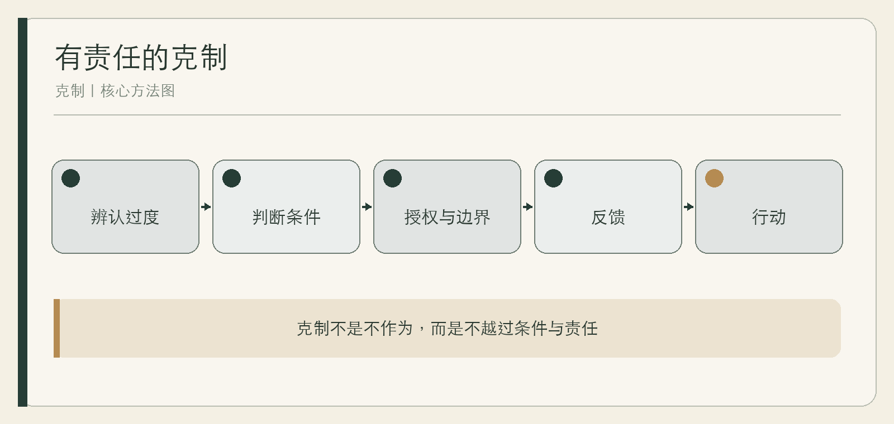

# 克制

从《道德经》到现代领导力

作者：李钊  
日期：2026 年 11 月 11 日

---

## 前言　领导力不只是增加动作

现代组织鼓励快速响应、持续增长和主动作为。管理者很容易用更多会议、更多指标和更多干预证明负责，却很少追问：这些动作是否越过了问题的需要，是否让他人失去判断，是否正在制造下一轮更复杂的治理。

《道德经》提供了一种反向观看。它谈无为、自然、柔弱、不争、知足与反转，不是给现代管理者准备的成功技巧，而是对权力、欲望和过度行动的持续质疑。

本书选择八个现代领导问题，与相关章句对读。原文以通行本为主要坐标，解释参考王弼、河上公及现代研究；不同学术理解不作唯一裁定。现代案例是检验启发的场景，不证明老子早已预言当代制度。

## 第一章　领导者的过度：为什么越多动作未必越好

### 文本入口：生而不有，为而不恃

《道德经》多次把生成、帮助与不占有联系起来。第二章有“生而不有，为而不恃，功成而弗居”，第五十一章也出现相近表达。这里首先是一种对占有和自我彰显的限制，而不是现代绩效考核里的授权清单。

领导者常把“我推动了什么”当作价值证明。动作可见，条件改善却不容易被看见：澄清目标、移除障碍、让专业的人能够工作。克制要求把评价从事事留下个人印记，转向系统是否能够良好运行。

### 现代转译：不要用勤奋制造拥堵

**综合案例｜所有决定都经过负责人。** 一位负责人每天处理大量审批，团队越来越等待。他以为问题是自己还不够快，实际是任何决定都需要他出现。调整后，常规事项由具名角色决定，例外和风险才升级。负责人仍承担责任，但不再用全部审批证明责任。

### 边界：少干预不是少负责

涉及安全、违法、伤害和重大承诺时，果断介入是责任。克制不是把“放手”变成逃避，而是让介入与问题需要相匹配。

## 第二章　无为不是不为：行动之前的条件判断

### 文本入口：为无为，则无不治

第三章的“为无为，则无不治”，以及第三十七章“道常无为而无不为”，使无为不可能简单等于不做事。它更适合被理解为对强作、妄为和越过条件的警惕。不同注家和现代研究仍有解释差异，不能把一种管理翻译当成原句唯一含义。

刘笑敢从权力自我节制解释老子哲学，为理解无为提供了一种重要路径，但这是一种学术解释，不是全书所有章句的唯一答案。[论文摘要](https://zxyj.cbpt.cnki.net/portal/journal/portal/client/paper/1a4f0a6d6df2b5aeae457cefe1409acd)

### 现代转译：先改变条件，再增加命令

**综合案例｜反复催促的交付。** 团队连续延期，管理者不断增加进度会。复盘发现，需求在开发后仍频繁变化。真正的行动是固定阶段边界、明确变更代价，而不是再催促一次。导致延期的原因得到处理后，进度会才有机会减少；少开会本身并不是目标。

### 行动前的三问

问题是否必须由我干预；现有系统已经在朝什么方向发展；我的动作会不会制造新的依赖。三问不是拖延，而是避免把即时可见的动作当成唯一贡献。

等待也需要边界。事先写下介入阈值：何种安全信号必须立即处理，何种承诺逾期需要协调，何种一般分歧可以先让团队自行验证。这样，克制才不会被误用为对明确责任的延迟。

## 第三章　自然与自主：给他人留下成为自己的空间

### 文本入口：百姓皆谓我自然

第十七章写“功成事遂，百姓皆谓我自然”。这里的“自然”主要不是山川环境，而是自己如此。它可以启发一种领导理想：成果不只显示统治者的意志，也让行动中的人保有主体感。

现代组织中的自主，不是领导说“你们自由发挥”后仍随时推翻，而是目标、权限、资源和责任能够相互对应。没有这些条件，所谓自主只是把风险下放。

### 现代转译：让他人能解释自己的决定

**综合案例｜被放权的项目组。** 负责人宣布项目组自主，却在每次评审中按个人偏好修改细节，成员最终只猜测他的喜好。后来他把评价从“我是否喜欢”改为事先共同确认的用户结果和风险边界，团队才真正获得判断空间。

### 边界：自主不等于取消共同标准

公共程序、专业规范和安全底线能够保护弱者与承诺。自然不是谁强谁就按自己的方式生长，领导仍需建立公平条件和申诉渠道。

## 第四章　柔弱与边界：不以强硬证明力量

### 文本入口：天下莫柔弱于水

第七十八章以水说明柔弱与坚强之间的关系，第四十三章也谈“天下之至柔，驰骋天下之至坚”。这些章句不是要求人忍受伤害，而是挑战把力量等同于硬碰硬的想象。

领导中的柔，可以表现为不被对方的激烈牵引，能调整方法而不放弃目的，能在不羞辱他人的情况下坚持边界。

### 现代转译：坚定不必靠升级语气

**综合案例｜一次质量争议。** 业务要求跳过必要测试，技术负责人没有用人身攻击回应，也没有含糊妥协，而是明确不可省略的风险、可缩短的范围和必须保留的验收。语气保持平稳，边界反而更清楚。

### 边界：柔弱不能成为要求弱者沉默

面对暴力、歧视和专业错误，明确制止不是“不够柔”。若不争被用来让受影响者放弃权利，或让强者逃避责任，就已经偏离了对权力节制的追问。

## 第五章　不争与冲突：不把一切关系变成胜负

### 文本入口：水善利万物而不争

第八章“上善若水。水善利万物而不争”，第六十八章也有“不争之德”。不争首先挑战的是以自我胜负支配行动，不等于否认所有分歧。

组织把每个讨论都做成胜负时，人们会更关心立场是否输，而不是事实是否改变。领导者若只奖励最会赢的人，就会逐渐失去真实信息。

### 现代转译：把冲突重新指向问题

**综合案例｜两个部门的方案之争。** 销售与交付各执一词，会议变成证明谁更懂客户。负责人要求双方分别写出方案依赖的条件、最担心的后果和可以共同验证的小实验。争论没有消失，但从人格胜负转向可检验差异。

### 边界：不争不代替原则谈判

合同、资源和权利仍需清楚协商。克制不是一味让步，而是不把压过对方当成额外目标，不用胜利扩大不必要的伤害。

## 第六章　知足与扩张：增长何时失去尺度

### 文本入口：知足不辱，知止不殆

第四十四章把知足、知止与长久联系起来，第四十六章也警惕欲望扩张。这里的思想不能直接变成企业不得增长，而是帮助辨认增长何时开始吞噬它原本服务的目标。

增长会带来协调、维护、责任和注意力的成本。只计算新增收入，不计算复杂度，组织可能在规模扩大时失去最重要的能力。

### 现代转译：把停止当作战略选择

**综合案例｜不断增加的定制。** 一家服务团队为每位客户增加特殊功能，短期订单增长，交付却越来越依赖少数人。团队重新限定标准服务，把不能持续维护的需求拒绝或转为单独项目。选择不是反增长，而是保护交付承诺。

### 边界：知足不能用来压低合理待遇

要求员工接受不公平报酬、要求用户放弃正当权益，不是知足。知足首先应约束拥有资源和权力的人，而不是成为对弱者说教的工具。

## 第七章　反者道之动：看见成功的副作用

### 文本入口：反者道之动

第四十章的“反者道之动”，与第五十八章祸福相倚的思考，提示事物在发展中可能发生转化。它不是一条可以精确预测商业周期的公式，而是一种二阶后果意识。

一种做法在局部有效，被不断强化后可能走向反面。指标最初帮助聚焦，后来替代目标；加班最初解决紧急问题，后来掩盖流程缺陷；集中权力最初加快决定，后来让组织失去纠错。

### 现代转译：成功之后增加一次反问

**综合案例｜高效流程的隐性代价。** 团队通过标准模板显著缩短方案时间，随后所有客户都被要求适应同一模板，复杂需求反而无法表达。复盘后保留标准部分，同时为例外设置评估入口。效率不再以排除难例为代价。

### 建立停止和复核信号

成功时写下：哪些条件使做法有效；哪些信号表示条件已变；谁有权提出停止。克制不是拒绝成功，而是不让成功经验获得永久豁免。

## 第八章　把克制变成制度：授权、反馈与责任

### 克制不能只依赖领导者的修养

一个愿意放手的负责人离开后，组织是否仍能自主？如果答案是否定的，克制还只是个人风格。制度需要把权限、例外、信息、申诉和责任保存下来，使权力不被个人心情随意收回。

授权要写明决定范围与资源；反馈要让一线信息能改变上级；责任要保证错误有人处理；申诉要让被系统影响的人能够挑战决定。它们与现代治理相连，但不是从《道德经》直接推导出的现成方案。

### 一张领导者的克制清单

这件事是否必须做；是否必须由我做；我的动作会增强谁的能力；是否保留不同意见；错误由谁纠正；成功何时需要停止。清单的作用不是让领导变得消极，而是让行动更符合尺度。

**综合案例｜从个人风格到共同规则。** 一位创始人过去靠临场克制赢得团队信任，却没有留下权限规则。扩张后，新管理者重新集中所有决定。团队随后把常规决定、例外升级、复盘和申诉写进共同制度，克制才开始超越个人。

### 结语：有力量，也有不使用全部力量的能力

《道德经》的现代价值，不在于给领导者一套更隐蔽的控制术，而在于让权力看见自身边界。真正成熟的行动，不是永远更少，而是知道何时行动、何时等待、何时让他人完成，以及何时承担不可推卸的责任。

## 附录　主题阅读与领导练习

### 主题阅读路径

- 无为与行动：第二、三、三十七、四十八、五十七章。
- 自主与自然：第十七、二十五、五十一章。
- 柔弱与力量：第四十三、七十六、七十八章。
- 不争与冲突：第八、六十八、八十一章。
- 知足与尺度：第九、四十四、四十六章。
- 变化与二阶后果：第四十、五十八、六十四章。

阅读时应回到全章语境，并参考校释与研究，不凭单句建立管理规则。

### 一周练习

选择一项你频繁介入的工作，记录介入前的目标、动作和结果；标出一次真正必要的介入、一次可由条件改善替代的介入；与协作者确认哪些权限和责任需要调整；一周后复盘是否出现新的风险。

### 现代应用的四条红线

不把无为写成不作为；不把不争写成弱者沉默；不把知足写成压低合理待遇；不把古典启发写成不需要专业证据的管理处方。

## 参考资料

1. 王弼注、楼宇烈校释：《老子道德经注校释》，中华书局，2008。
2. Alan K. L. Chan：[Laozi](https://plato.stanford.edu/entries/laozi/)，Stanford Encyclopedia of Philosophy，2025 修订。
3. 刘笑敢：《权力的自我节制：对老子哲学的一种解读》，[期刊摘要](https://zxyj.cbpt.cnki.net/portal/journal/portal/client/paper/1a4f0a6d6df2b5aeae457cefe1409acd)。
4. [Dao De Jing 原文与英译对照](https://www.gutenberg.org/files/49965/49965-h/49965-h.htm)，Project Gutenberg。
5. 维基文库：[《道德经（王弼本）》](https://zh.wikisource.org/wiki/道德經_(王弼本))与《老子河上公章句》，仅作检索辅助。
6. 高明：《帛书老子校注》，中华书局，1996；刘笑敢：《老子古今》，中国社会科学出版社，2006。
7. 李钊：《道德经新解》及共享考据来源，2026。

资料收集截至 2026 年 11 月 11 日。网络版本的校订状态与后续研究在再版时应重新核对；古典文本的现代应用不替代专业判断。
