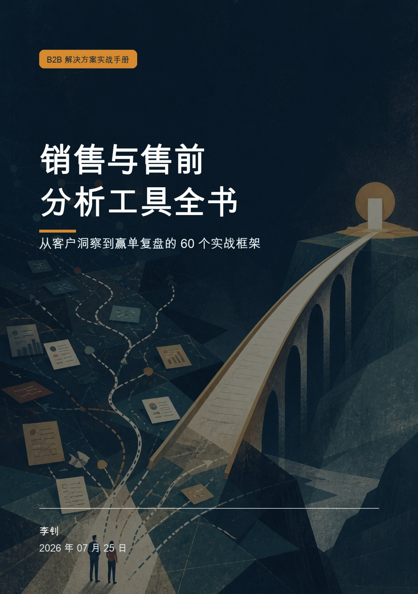
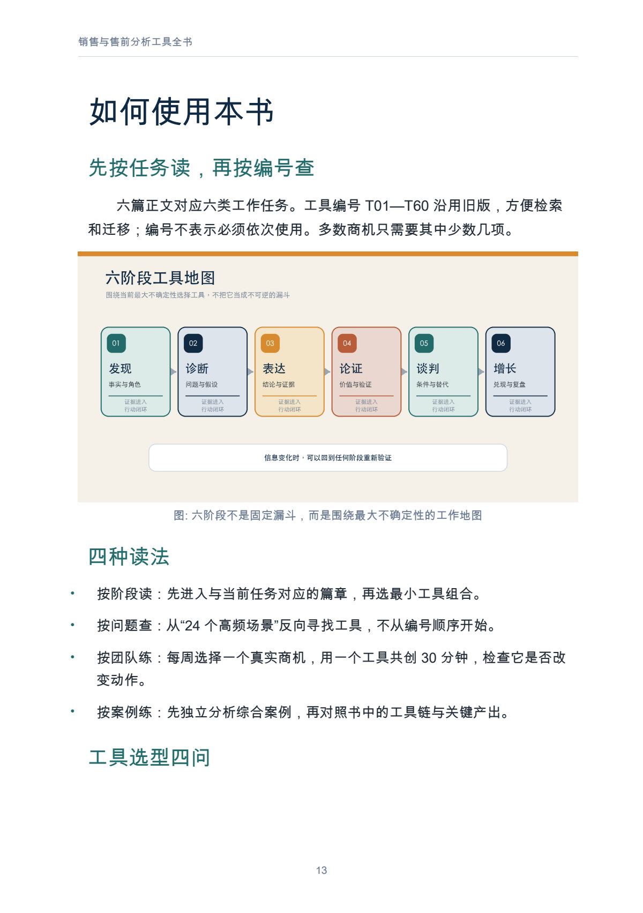
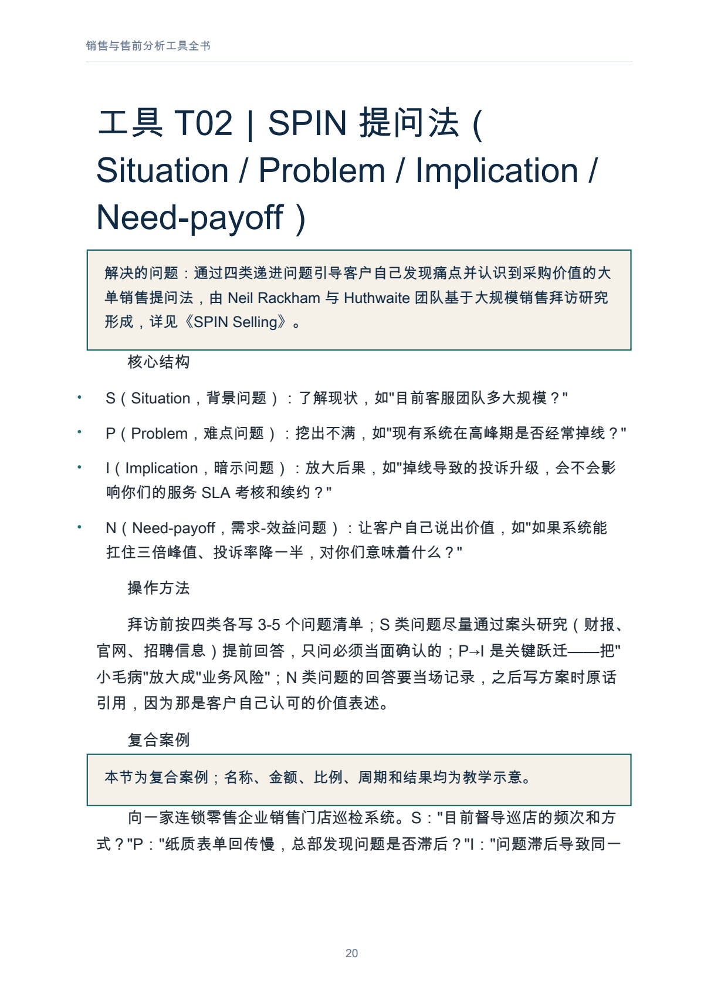
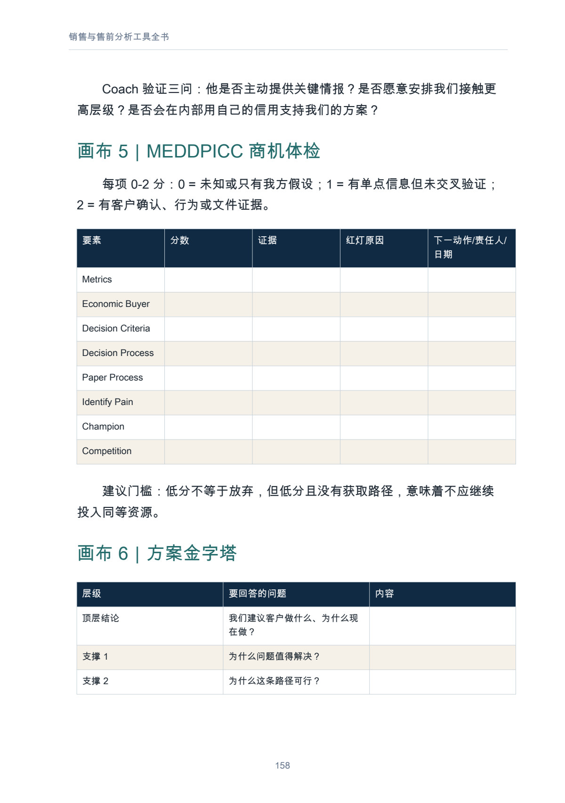

# 销售与售前分析工具全书

从客户洞察到赢单复盘的 60 个实战框架

**快速导航：** [完整目录](#user-content-完整目录) · [正文预览](#user-content-正文预览) · [阅读与下载](#user-content-阅读与下载)

作者：李钊  
版本：重制修订版  
原书日期：2026-07-25 · 最近重制修订记录：2026-08-17  
书房整理日期：2026-11-08

一本按真实工作任务组织的复杂 B2B 销售与售前手册：用工具暴露未知、形成判断，并把判断落实为下一步。含六篇、60 个工具、9 幅正文配图，PDF 共 172 页。

## 这本书讲什么

书从客户发现、问题诊断和方案表达出发，逐步进入竞争分析、价值量化、POC 验证、谈判及客户经营。每个工具按“解决的问题、核心结构、操作方法、复合案例、边界与误用、最小产出”展开，让读者知道何时使用、会留下什么成果，以及哪些条件下容易误用。全书区分已确认事实、行为证据、团队判断和待验证假设，要求未知项对应明确的验证动作。

工具之后还有两则贯穿多个阶段的教学案例：一则从模糊线索走到价值兑现，另一则复盘技术领先却丢单的原因。十二张工作画布、二十四个场景组合和四周训练方案，把访谈、商机评审、汇报、验证与复盘接到团队日常工作中。T01—T60 编号沿用旧版方便检索；篇章按任务重排，读者可以从当前最需要解决的不确定性进入。

## 适合谁，怎样阅读

- **销售、客户经理与大客户负责人**：从第一篇检查需求和决策链，按项目进度进入第四至第六篇。
- **售前、方案顾问与解决方案架构师**：重点读第二至第四篇，再用工作画布准备访谈、汇报、演示和 POC。
- **销售运营、客户成功和团队管理者**：关注证据口径、第六篇、失败案例及团队训练，把工具接到评审与复盘。
- **刚进入复杂 B2B 业务的读者**：先看阅读指南和完整案例，再回查其中用到的工具。

按阶段读、按问题查、按案例练、按团队共创均可。一次先选一个主工具，再根据缺口补充；每次检查它有没有改变下一步，而不是一次填完所有表格。

## 能从书中获得什么

- 六类工作任务下的工具选择路径，以及每个工具应形成的最小产出。
- 从客户原话、数据和行为中识别证据、标注假设的方法。
- 将需求、价值、竞争、验收和谈判条件串起来的案例参照。
- 十二张工作画布与二十四个场景组合，可用于会议准备和团队讨论。
- 访谈、商机判断、结构表达和行动复盘的四周训练安排。

## 完整目录

以下保留原文章节与工具标题，按全书实际篇章顺序列出；正文见 [Markdown 全书](output/markdown/销售与售前分析工具全书_重制版_李钊_20260725.md)。展开各篇可查看全部 60 个工具。

| 开篇内容 | 解决的问题 |
| --- | --- |
| 出版说明 | 读者对象、复合案例和示意数据的使用范围。 |
| 前言｜工具的价值，是减少关键不确定性 | 怎样避免工具只剩缩写和形式？ |
| 如何使用本书 | 怎样按任务、问题、团队或案例选择读法？ |
| 统一证据口径｜先写事实，再写判断 | 已确认事实、行为证据、判断和假设怎样区分？ |
| 一次客户接触的最小闭环 | 会前、会中、会后怎样形成可验证的下一步？ |

第一篇｜发现与资格判断（13 个工具）

先理解客户正在完成什么工作，再核对痛点、价值、关键角色与推进条件。核心问题是：这个项目为什么需要改变，谁能推动改变，是否值得继续投入？

- 工具 T01｜5W1H 与 5W2H
- 工具 T02｜SPIN 提问法（Situation / Problem / Implication / Need-payoff）
- 工具 T07｜痛点链（Pain Chain，痛点-影响-收益）
- 工具 T08｜客户画像五维分析（业务诉求/技术要求/财务约束/组织政治/个人动机）
- 工具 T09｜决策链分析：EB/TB/UB/Coach 角色识别 + 权力地图（Power Map）
- 工具 T10｜客户旅程地图（Customer Journey Map）
- 工具 T11｜KANO 需求模型（基本型/期望型/兴奋型/无差异/反向）
- 工具 T12｜JTBD（Jobs-to-be-Done，用户要完成的任务）
- 工具 T13｜$APPEALS 需求分析模型
- 工具 T14｜同理心地图（Empathy Map：说/想/做/感）
- 工具 T04｜BANT 商机资格审查（Budget / Authority / Need / Timeline）
- 工具 T06｜NEAT / CHAMP / ANUM 等资格审查框架
- 工具 T05｜MEDDIC / MEDDPICC 复杂销售方法论

第二篇｜问题诊断与决策（15 个工具）

把症状拆成问题，把原因写成能够验证的假设。核心问题是：现在应该先查什么、验证什么，又依据什么作出取舍？

- 工具 T24｜5Why 根因分析
- 工具 T25｜鱼骨图/石川图（人机料法环测）
- 工具 T26｜MECE 原则（相互独立、完全穷尽）
- 工具 T27｜逻辑树/议题树（Issue Tree）
- 工具 T28｜KT 理性分析法（Kepner-Tregoe：情境分析/问题分析/决策分析/风险分析）
- 工具 T29｜PDCA 循环
- 工具 T30｜8D 问题解决方法
- 工具 T31｜六顶思考帽
- 工具 T32｜头脑风暴 + 亲和图（KJ 法）
- 工具 T33｜SWOT 分析 + TOWS 策略矩阵（SO/WO/ST/WT）
- 工具 T34｜PEST/PESTEL 宏观环境分析
- 工具 T35｜假设驱动法（Hypothesis-driven）
- 工具 T36｜二八法则/帕累托分析
- 工具 T37｜第一性原理
- 工具 T38｜系统思考与因果回路图

第三篇｜结构表达与方案呈现（10 个工具）

根据听众需要作出的判断组织结论、证据、案例与演示。核心问题是：如何让一份复杂方案形成可理解、可讨论、可决策的主线？

- 工具 T15｜金字塔原理（结论先行、以上统下、归类分组、逻辑递进；MECE）
- 工具 T16｜SCQA 故事化开场（情境-冲突-疑问-答案）
- 工具 T17｜PREP 表达法（Point-Reason-Example-Point）
- 工具 T18｜STAR 法则（情境-任务-行动-结果，讲成功案例用）
- 工具 T19｜AIDA 模型（注意-兴趣-欲望-行动）
- 工具 T20｜电梯演讲（Elevator Pitch，30 秒/3 分钟版本）
- 工具 T21｜FAB 利益陈述法
- 工具 T22｜三点表达法与数字锚定
- 工具 T23｜Tell-Show-Tell 演示结构（Demo 脚本设计）
- 工具 T03｜FABE 法则（Feature / Advantage / Benefit / Evidence）

第四篇｜竞争、价值与验证（8 个工具）

从市场和竞争判断进入客户能够比较的价值口径，再通过 POC/POV 减少关键风险。核心问题是：方案凭什么值得选择，哪些价值与能力还需要证明？

- 工具 T39｜波特五力模型
- 工具 T40｜竞争雷达图与竞品对比矩阵
- 工具 T41｜蓝海战略四步动作框架 ERRC（剔除-减少-增加-创造）
- 工具 T42｜BCG 矩阵 / GE 九宫格（产品与方案组合）
- 工具 T43｜安索夫矩阵
- 工具 T44｜TCO/ROI 价值量化分析
- 工具 T45｜商业论证 Business Case 五要素
- 工具 T46｜POC/POV 价值验证设计（目标-指标-验收标准）

第五篇｜谈判与成交（4 个工具）

同时考虑利益、替代方案、可接受空间和授权边界。核心问题是：怎样把单点压价转为范围、期限、付款、服务与风险的条件组合？

- 工具 T47｜BATNA 最佳替代方案
- 工具 T48｜ZOPA 可达成协议空间
- 工具 T49｜哈佛原则式谈判四原则
- 工具 T50｜让步矩阵与条件交换（If-Then）

第六篇｜客户成功、复盘与经营（10 个工具）

签约后继续检查采用、价值、风险与客户关系，并让得失进入下一次行动。核心问题是：如何把一次交付与一次复盘转成持续经营的共同知识？

- 工具 T51｜NPS 净推荐值
- 工具 T52｜RFM 客户分层模型
- 工具 T53｜AAR 行动后复盘
- 工具 T54｜GRAI 复盘法（Goal-Result-Analysis-Insight）
- 工具 T55｜KISS 复盘法（Keep-Improve-Start-Stop）
- 工具 T56｜销售漏斗/管道管理（阶段定义、赢率、漏斗健康度）
- 工具 T57｜SMART 原则
- 工具 T58｜OKR 与 OGSM
- 工具 T59｜平衡计分卡（BSC 四维度）
- 工具 T60｜大客户作战地图（Account Plan：关系-商机-目标-行动）

| 案例与配套章节 | 内容与读者问题 |
| --- | --- |
| 案例一｜华岭装备集团：从模糊线索到价值兑现 | 如何把访谈、需求、竞争、价值、POC、谈判与上线评价接成一条工具链？ |
| 案例二｜技术分第一，为什么仍然丢单 | 怎样用 GRAI、5Why 与 KISS 追查预算、关系和评审机制中的缺口？ |
| 十二张可直接使用的工作画布 | 客户画像、SPIN、痛点链、权力地图、MEDDPICC、方案金字塔、演示脚本、TCO/ROI、POC、谈判、AAR 与大客户作战地图。 |
| 二十四个高频场景的工具组合 | 按拜访与需求、方案与竞争、谈判与增长查找最小工具组合。 |
| 团队落地｜把方法变成共同工作语言 | 四周训练如何组织，管理者怎样检查证据和行为变化？ |
| 来源与延伸阅读 | 关键方法来源与进一步阅读入口。 |
| 附录｜六十个工具索引 | 按原有 T01—T60 编号回查工具及工作阶段。 |
| 结语｜把判断写下来，把行动做出来 | 从一次客户会议开始形成可验证输出。 |

## 正文预览

页码按 PDF 文件从第 1 页起计，包含封面；点击图片可查看大图。

**六阶段工作地图：按任务选工具，而非按编号套流程（PDF 文件第 13 页）**

**SPIN 工具卡：提问结构、操作方法与复合案例（PDF 文件第 20 页）**

**MEDDPICC 商机体检画布：把证据缺口转为下一步动作（PDF 文件第 158 页）**

## 阅读与下载

- [Markdown 在线阅读](output/markdown/销售与售前分析工具全书_重制版_李钊_20260725.md)
- [PDF 下载 · 172 页](https://github.com/njxshr/ruogu-books/releases/download/v2026.11.08/sales-presales-tools.pdf)
- [EPUB 下载](https://github.com/njxshr/ruogu-books/releases/download/v2026.11.08/sales-presales-tools.epub)
- [Markdown 离线包 · 含配图](https://github.com/njxshr/ruogu-books/releases/download/v2026.11.08/sales-presales-tools-markdown.zip)

文件名及书内日期保留原有的 2026-07-25，重制修订过程记录于 2026-08-17，两者不作混用。

## 来源与维护

[来源台账](SOURCES.md) · [修订记录](REVISION_LOG.md) · [写作主稿](manuscript/book.md) · [出版配置](book.json)

本次上架保持既有成品内容不变。书中客户名称为教学化名，具体场景为复合案例；金额、比例、周期与结果为示意数据，不代表真实客户或普遍效果。各项来源的已核查与未逐页核查范围见台账。

版权所有 © 2026 李钊。保留所有权利。书房未对本书另行授予开放许可。

[返回书籍目录](../../目录.md) · [若谷书房](../../README.md)
