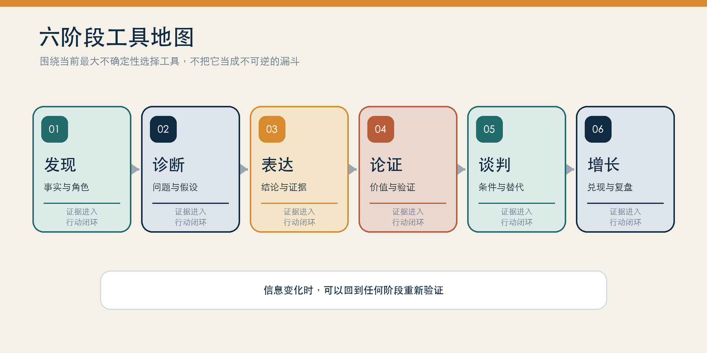
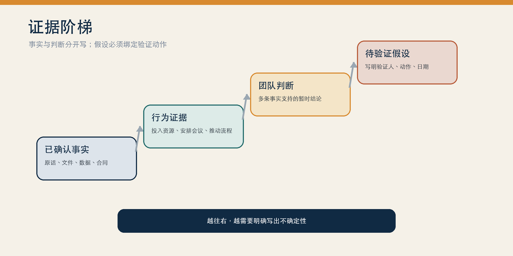
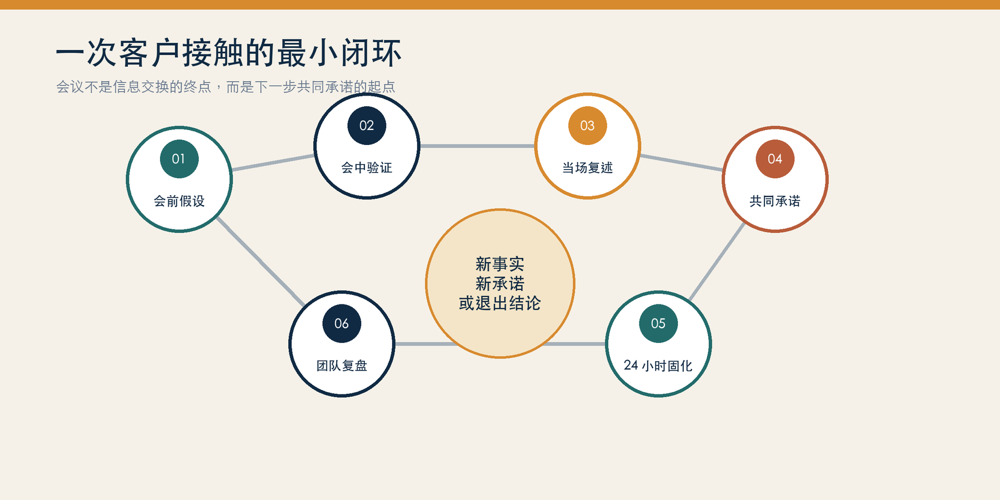

# 销售与售前分析工具全书

从客户洞察到赢单复盘的 60 个实战框架

作者：李钊  
日期：2026 年 07 月 25 日

---

## 出版说明

本书由《销售售前分析工具大全》重新审校、编排与设计而成，面向企业级软件、数字化平台、咨询服务与复杂解决方案业务中的销售、售前、销售运营、客户成功与管理者。

“华岭装备集团”“云栖市政务服务中心”“远帆零售”等名称均为教学化名。书中具体场景均为复合案例，由常见项目模式抽象、合并而成；金额、比例、周期与结果为示意数据，不代表任何真实客户、厂商、项目或普遍效果。实际工作应以客户确认的数据、合同条款、最新法规与合规要求为准。

版权所有 © 2026 李钊。保留所有权利。

## 前言｜工具的价值，是减少关键不确定性

复杂销售失败，很少只是因为产品少了一个功能。更多时候，团队在错误的阶段解决了错误的问题：需求还没摸清就急着演示，没见到经济决策人就开始报价，客户尚未形成内部共识就投入重型 POC，或在谈判桌上用无条件降价换取一句含糊的“再考虑一下”。

工具的价值，不是给经验换一个英文缩写，而是把经验变成可讨论、可验证、可复用的工作语言。SPIN 让访谈从背景走向业务影响；MEDDPICC 迫使团队诚实面对商机缺口；金字塔与 SCQA 帮助方案先回答“为什么”，再回答“是什么”；BATNA 与 ZOPA 让谈判回到替代方案和条件交换；AAR 与 GRAI 则把一次得失转化为下一次行动。

工具越多，也越容易制造形式主义。新版因此只保留三条总原则：

1. 先判断任务，再选工具。第一次访谈、方案评审、采购谈判和上线复盘的任务不同，工具也应不同。
2. 一次只减少一个关键不确定性。会前先写清楚：我们必须知道什么、让谁相信什么、获得什么承诺。
3. 所有分析都要改变下一步。没有责任人、日期、证据和完成标准的表格，只是更整齐的猜测。

如果只记住一句话，请记住：**不要展示你会多少工具，要让客户感受到你真正理解他的决策。**

## 如何使用本书

### 先按任务读，再按编号查

六篇正文对应六类工作任务。工具编号 T01—T60 沿用旧版，方便检索和迁移；编号不表示必须依次使用。多数商机只需要其中少数几项。

### 四种读法

- 按阶段读：先进入与当前任务对应的篇章，再选最小工具组合。
- 按问题查：从“24 个高频场景”反向寻找工具，不从编号顺序开始。
- 按团队练：每周选择一个真实商机，用一个工具共创 30 分钟，检查它是否改变动作。
- 按案例练：先独立分析综合案例，再对照书中的工具链与关键产出。

### 工具选型四问

| 问题 | 要确认的内容 | 最小输出 |
| --- | --- | --- |
| 我们处在哪个阶段？ | 发现、诊断、表达、论证、谈判、增长 | 当前任务与准出条件 |
| 最大的不确定性是什么？ | 问题、价值、权力、标准、流程、价格、风险 | 1—2 个待验证假设 |
| 这次要影响谁？ | 经济决策人、技术决策人、业务用户、内部推动者、采购、法务、交付 | 角色立场与沟通重点 |
| 会后要拿到什么？ | 数据、会议、认可、资源、承诺、签字 | 责任人、日期与完成标准 |

## 统一证据口径｜先写事实，再写判断

很多“内容问题”并不是模型错了，而是团队把推测写成了事实。全书统一使用四种证据状态：

| 状态 | 定义 | 写法示例 |
| --- | --- | --- |
| 已确认事实 | 客户原话、签字文件、系统数据、合同或可追溯公开资料 | “采购文件写明安全审查需 20 个工作日” |
| 行为证据 | 客户投入资源、安排会议、共享数据或推动流程 | “客户协调三部门参加指标确认会” |
| 团队判断 | 由多条事实推导出的暂时结论 | “财务总监可能是实际经济决策人，依据是……” |
| 待验证假设 | 尚无充分证据的推测 | “预算可能缩减；周三前由客户经理向财务线核实” |

敏感的组织政治、个人动机和关系判断应限制访问范围，并遵守客户与本公司的合规要求。

## 一次客户接触的最小闭环

1. 会前假设：写下客户可能的目标、阻力与关键角色，不超过一页。
2. 会中验证：围绕 1—2 个最大不确定性提问，记录客户原话与数据来源。
3. 当场复述：用“我的理解是……”确认问题、影响、优先级和边界。
4. 共同承诺：明确双方要做的事、负责人、日期与完成标准。
5. 24 小时内固化：形成纪要，更新权力地图和资格判断。
6. 团队复盘：比较预期与实际，决定继续投入、调整打法或主动退出。

> 一次会议不应以“聊得不错”结束。没有获得新事实、新承诺或明确退出结论，就不算闭环。

## 第一篇｜发现与资格判断

先看见客户的真实工作，再判断问题是否值得投入。这个阶段优先减少四类不确定性：发生了什么、为什么必须改变、谁能推动改变、项目是否具备推进条件。

## 工具 T01｜5W1H 与 5W2H

> **解决的问题**：用 6-7 个标准问题把一件事问全、问透的基础提问框架。

**核心结构**

  - 5W1H：What（什么事）、Why（为什么）、Who（谁）、When（何时）、Where（何处/哪个环节）、How（怎么做）
  - 5W2H：在 5W1H 基础上增加 How much（多少：预算、量级、代价）

**操作方法**

第一次拜访前用它把客户背景查全（Who 是决策人、What 业务痛点、When 项目窗口期）；访谈中用它补全需求要素——"这个流程现在谁在做（Who）、在哪个环节卡住（Where）、每月多花多少人力（How much）"；写需求确认书时用它检查是否有遗漏字段；投标前用它核对招标文件的每个响应点。

**复合案例**

> 本节为复合案例；名称、金额、比例、周期和结果均为教学示意。

客户说"想上一套客服系统"。用 5W2H 追问：What——要覆盖哪些渠道？Why——为什么现在做（投诉率超标/人力成本）？Who——谁拍板、谁使用？When——希望何时上线？How——倾向 SaaS 还是私有化？How much——预算区间和坐席数？问完才能判断商机真实性。

**边界与误用**

  1. 不要像审问一样连珠炮式发问，要穿插在对话中；
  2. How much（预算、损失金额）最难问，通常要放在信任建立之后；
  3. 它只保证"问全"，不保证"问出痛点深度"，深度靠 SPIN 的 Implication 问题。

**最小产出**

一页已知/未知清单，以及缺失信息的获取路径。

## 工具 T02｜SPIN 提问法（Situation / Problem / Implication / Need-payoff）

> **解决的问题**：通过四类递进问题引导客户自己发现痛点并认识到采购价值的大单销售提问法，由 Neil Rackham 与 Huthwaite 团队基于大规模销售拜访研究形成，详见《SPIN Selling》。

**核心结构**

  - S（Situation，背景问题）：了解现状，如"目前客服团队多大规模？"
  - P（Problem，难点问题）：挖出不满，如"现有系统在高峰期是否经常掉线？"
  - I（Implication，暗示问题）：放大后果，如"掉线导致的投诉升级，会不会影响你们的服务 SLA 考核和续约？"
  - N（Need-payoff，需求-效益问题）：让客户自己说出价值，如"如果系统能扛住三倍峰值、投诉率降一半，对你们意味着什么？"

**操作方法**

拜访前按四类各写 3-5 个问题清单；S 类问题尽量通过案头研究（财报、官网、招聘信息）提前回答，只问必须当面确认的；P→I 是关键跃迁——把"小毛病"放大成"业务风险"；N 类问题的回答要当场记录，之后写方案时原话引用，因为那是客户自己认可的价值表述。

**复合案例**

> 本节为复合案例；名称、金额、比例、周期和结果均为教学示意。

向一家连锁零售企业销售门店巡检系统。S："目前督导巡店的频次和方式？"P："纸质表单回传慢，总部发现问题是否滞后？"I："问题滞后导致同一家门店反复违规，对门店评级和店长绩效有什么连锁影响？"N："如果违规问题当天就能闭环，对你们的运营考核体系价值多大？"

**边界与误用**

  1. S 问题问太多会显得没做功课，研究证实背景问题过多反而降低成交率；
  2. I 问题最难设计，需理解客户业务的因果链，建议与「痛点链」组合使用；
  3. 小单销售中不必走完四步，SPIN 主要面向决策链长、金额大的复杂销售。

**最小产出**

两条递进问题链、客户原话和一项经客户确认的业务影响。

## 工具 T07｜痛点链（Pain Chain，痛点-影响-收益）

> **解决的问题**：把基层的操作痛点逐层追溯到高管的业务损失，从而把方案价值讲给决策层听的分析工具，源自解决方案销售（Solution Selling，Mike Bosworth）体系中的 Pain Chain 概念。

**核心结构**

按组织层级构建因果链：操作层痛点（如"报表靠手工"）→ 部门层影响（"数据滞后三天"）→ 管理层影响（"补货决策失误"）→ 高管层损失（"库存资金占用增加 2000 万"）。每个节点回答三问：痛是什么？影响了谁？值多少钱？

**操作方法**

访谈时对不同层级的人问不同层的问题，回来拼出完整痛点链；方案汇报时对高管只讲链的顶端（业务损失与收益），对执行层只讲链的底端（操作改善），但二者用同一条链串起来；与 SPIN 组合——痛点链帮你设计 Implication 问题的方向；写 ROI 测算时，痛点链就是收益口径的来源。

**复合案例**

> 本节为复合案例；名称、金额、比例、周期和结果均为教学示意。

向连锁餐饮企业销售供应链系统。操作层：门店店长手工报货、凭经验；部门层：采购部汇总慢、次日才能下单；管理层：缺货与报损并存，损耗率 8%；高管层：年损耗 3000 万、扩张计划受供应链能力制约。对 CEO 汇报时直接从"3000 万损耗和扩张瓶颈"切入，再下钻到方案如何解决报货环节。

**边界与误用**

  1. 链上的每一环都必须有客户原话或数据支撑，自己脑补的因果链在客户面前一戳就破；
  2. 痛点必须能追到"钱"或高管 KPI，追不到顶的痛点撑不起大单；
  3. 别只挖一条链，多条痛点链交汇的痛点（多部门都受其害）优先级最高。

**最小产出**

一条由操作问题追到管理指标的因果链及证据来源。

## 工具 T08｜客户画像五维分析（业务诉求/技术要求/财务约束/组织政治/个人动机）

> **解决的问题**：从五个维度立体描绘目标客户的采购处境，避免"只看需求、不看人和钱"的片面判断。

**核心结构**

  - 业务诉求：客户要解决什么业务问题、对应谁 KPI
  - 技术要求：现有架构、集成约束、安全合规红线
  - 财务约束：预算规模、审批层级、CAPEX/OPEX 偏好
  - 组织政治：谁推动、谁反对、部门间利益关系、历史项目恩怨
  - 个人动机：关键人个人的诉求（出业绩、求稳、避责、升迁）

**操作方法**

大客户首次立项前，团队用一页纸完成五维画像并标注"已知/未知"，未知项转化为下一步探询任务；方案设计阶段用"技术要求+财务约束"过滤不可行选项（如客户只接受 OPEX，则不推买断式报价）；报价与谈判前重看"组织政治+个人动机"，预判谁会反对、为什么；画像每季度更新，重大项目每次关键接触后更新。

**复合案例**

> 本节为复合案例；名称、金额、比例、周期和结果均为教学示意。

某城商行核心系统改造商机。业务诉求：支撑零售业务三年翻番；技术要求：必须国产化数据库、两地三中心；财务约束：预算 5000 万分三年、走 OPEX 更顺；组织政治：科技部与零售部对供应商选择有分歧；个人动机：科技部新行长嫡系、需要标杆项目立威。据此策略：方案主打国产数据库成熟案例，报价按订阅制设计，优先争取科技条线支持。

**边界与误用**

  1. "个人动机"最容易被忽略也最容易误判，要多渠道交叉验证（Coach、离职员工、合作伙伴）；
  2. 五个维度互相影响，单维结论可能误导（如技术上我方领先但政治上客户倾向对手）；
  3. 画像要落到行动——每个维度至少对应一条"所以我要做什么"。

**最小产出**

五个维度的事实、判断、未知项和下一步动作。

## 工具 T09｜决策链分析：EB/TB/UB/Coach 角色识别 + 权力地图（Power Map）

> **解决的问题**：识别客户组织里"谁拍板、谁把关、谁使用、谁帮我"，并画出影响力关系网，是复杂销售的基本功。

**核心结构**

  - EB（Economic Buyer，经济决策人）：掌握预算、能一票否决的人，通常只有一位
  - TB（Technical Buyer，技术把关人）：评估方案技术可行性、合规性，能否决不能拍板（IT、安全、法务、采购常扮演）
  - UB（User Buyer，使用方）：最终使用者，关注好不好用，影响口碑与验收
  - Coach（教练/内线）：希望你赢、愿意透露内部信息并指导你打法的人
  - 权力地图：在组织架构图上标注各角色的立场（支持/中立/反对）、影响力（高/中/低）与相互关系线

**操作方法**

立项时先画初版权力地图，空白处就是信息缺口，转化为拜访计划（"本月必须接触到 TB"）；每次拜访后更新立场标记，立场变化是商机风险信号；对反对者制定转化或中性化策略，对支持者提供"弹药"（数据、案例）让他在内部替你说话；Coach 要靠互惠维护，且需验证其信息准确率。

**复合案例**

> 本节为复合案例；名称、金额、比例、周期和结果均为教学示意。

某集团 HR 系统项目。EB：分管人力副总裁（未接触，红）；TB：信息中心主任（倾向竞品，因现任供应商是其老关系）；UB：HR 专员们（强烈支持我方，因体验好）；Coach：HR 经理（提供"副总裁最关心子公司管控"的情报）。打法：借 UB 的正面反馈做内部口碑，绕开 TB 安排面向副总裁的"集团管控"专题汇报，争取副总裁定调后让 TB 转为执行评估。

**边界与误用**

  1. 最常见错误：只和 UB 聊得火热，从未见过 EB——大单死在"没摸到钱袋子"；
  2. TB 说"行"不等于能成交，TB 只有否决权没有拍板权；
  3. 谨防"假 Coach"——有些客户联系人同时对多家供应商扮演内线，关键情报要交叉验证。

**校订提示**：权力地图涉及个人立场与组织政治，应限制访问范围、标注信息来源并遵守客户与本公司的合规要求。

**最小产出**

关键角色、影响力、立场、关系责任人和转化动作。

## 工具 T10｜客户旅程地图（Customer Journey Map）

> **解决的问题**：按时间线还原客户从"意识到问题"到"使用续约"全过程的行为、触点与情绪，用于找到销售与服务的改进点。

**核心结构**

横轴为阶段（认知→调研→评估→决策→采购→实施→使用→续约/增购），纵轴通常包括：客户目标、关键行为、接触点（官网/销售/方案汇报/POC/交付）、情绪曲线、痛点与机会点。

**操作方法**

销售团队用它校准"客户在哪个阶段，我该给什么"——认知期给行业洞察白皮书，评估期给对比材料和 POC，决策期给 ROI 测算和高层拜访；市场部门用它发现触点断点（如官网留资后 48 小时无人跟进）；售前用它设计各阶段交付物模板；实施与续约阶段的情绪低点（如上线首月）要提前安排客户成功介入。

**复合案例**

> 本节为复合案例；名称、金额、比例、周期和结果均为教学示意。

一家 SaaS 公司画出中型客户旅程后发现两个断点：一是评估期客户要求的安全白皮书响应平均要 5 天，拖慢了整体周期；二是实施期到首次业务价值呈现平均 90 天，导致续约谈判被动。改进：安全白皮书模板化（24 小时响应）、推行"30 天首价值"实施方法论，续约率提升 9 个百分点。

**边界与误用**

  1. 地图要基于真实客户访谈和数据画，不能坐在办公室里想象；
  2. 不同客户分层（大客户/中小客户）旅程差异很大，一张图打天下会失真；
  3. 地图是诊断工具，画完必须落到具体触点的改进动作和负责人。

**最小产出**

按阶段展开的触点、情绪、断点、机会与负责人。

## 工具 T11｜KANO 需求模型（基本型/期望型/兴奋型/无差异/反向）

> **解决的问题**：把需求按"满足程度与满意度的关系"分成五类，帮助决定方案里哪些必须做、哪些用来赢单、哪些不要做，由东京理工大学教授狩野纪昭（Noriaki Kano）于 1984 年提出。

**核心结构**

  - 基本型（Must-be）：理所当然要有，缺了强烈不满，有了也不加分（如系统稳定性）
  - 期望型（One-dimensional）：做得越好越满意，线性关系（如响应速度、价格）
  - 兴奋型（Attractive）：客户没想到的惊喜，有了大喜，没有也不抱怨（如 AI 自动生成分析报告）
  - 无差异型（Indifferent）：客户不在乎
  - 反向型（Reverse）：做了反而招致反感（如强制改变用户习惯的功能）

**操作方法**

需求调研后给每条需求打 KANO 标签：基本型在方案中作为"承诺与 SLA"呈现（证明不掉链子），期望型作为与竞品拉开差距的主战场，兴奋型控制在 2-3 个作为汇报高潮和记忆点；投标响应时，招标文件的硬性条款基本是基本型，逐条满足即可，评分拉分靠期望型和兴奋型；警惕把研发资源砸在无差异型需求上。

**复合案例**

> 本节为复合案例；名称、金额、比例、周期和结果均为教学示意。

投标某医院排队叫号系统。基本型：与 HIS 稳定对接、断网可降级运行（写进 SLA）；期望型：平均候诊时间下降幅度、报表丰富度（重点承诺并量化）；兴奋型：就诊进度实时推送到患者手机、候诊预测（现场演示制造"哇"时刻）；识别出"强制患者装 App 才能取号"是反向型需求，主动向院方建议改为可选。

**边界与误用**

  1. KANO 分类会随时间漂移——今天的兴奋型明年就变成基本型（如移动审批），标签要定期刷新；
  2. 分类应基于对目标客户的调研，而非销售自己的猜测；
  3. 兴奋型不是越多越好，堆砌炫技功能会让客户质疑成本与稳定性。

**校订提示**：严格的 KANO 分类通常需要成对提问或结构化研究。售前会议中的快速标签只能视为优先级假设，不能冒充客户研究结论。

**最小产出**

需求分类、分类依据和本轮优先级；分类日期必须保留。

## 工具 T12｜JTBD（Jobs-to-be-Done，用户要完成的任务）

> **解决的问题**：客户"雇用"一个产品是为了完成某项任务，从任务而非产品功能出发理解需求，由克莱顿·克里斯坦森（Clayton Christensen）等推广（Tony Ulwick 的 ODI 方法将其系统化）。

**核心结构**

描述一个 Job 的标准句式："当【情境】时，我想要【任务/进展】，以便【期望结果】"。Job 分三层：功能任务（要做的事）、情感任务（想获得/避免的感受）、社会任务（想给他人留下的印象）。与需求洞察的因果：产品只是完成 Job 的候选方案之一。

**操作方法**

访谈时少问"你想要什么功能"，多问"你在什么情况下、要完成什么事、怎样算做成了"——得到的答案直接就是方案价值的表述；竞争分析时把对手扩展到"完成同一 Job 的一切替代方案"（客户用 Excel+人工也是竞争者）；写方案开篇用客户的 Job 语言复述任务，证明你理解的是业务而非软件；对同一产品识别不同角色的不同 Job，分别设计卖点（IT 的 Job 是"少出事好维护"，业务的 Job 是"快速拿数做决策"）。

**复合案例**

> 本节为复合案例；名称、金额、比例、周期和结果均为教学示意。

客户采购 BI 工具。传统问法得到"要拖拽、要大屏"；JTBD 问法得到："当每月经营分析会前，我想要在半天内整合五个系统的数据出报告，以便不再因数据口径不一致被领导质疑。"方案与报价随即围绕"口径统一的数据层+半天出报告"设计，而非罗列功能清单，直击客户真正付钱的原因。

**边界与误用**

  1. Job 要描述"进展/结果"而不是解决方案（"完成经营分析"是 Job，"买一个 BI"不是）;
  2. 别忽略情感与社会层任务——大客户采购中"不背锅""有政绩"往往是隐性 Job;
  3. JTBD 告诉你"为什么买"，不直接告诉你"买谁"，需与竞品分析工具组合。

**最小产出**

至少一个按情境、任务和结果写出的角色 Job。

## 工具 T13｜$APPEALS 需求分析模型

> **解决的问题**：从八个维度结构化地收集和分析客户对产品/方案的期望，常见于 IPD（集成产品开发）需求管理实践。

**核心结构**

  - $ Price（价格）：价格与总体拥有成本
  - A Availability（可获得性）：购买渠道、交付周期、供货能力
  - P Packaging（包装）：外观、部署形态、品牌呈现
  - P Performance（性能）：功能、规格、技术指标
  - E Ease of Use（易用性）：易上手、易维护、用户体验
  - A Assurances（保证）：可靠性、安全、服务与质保承诺
  - L Life Cycle Costs（生命周期成本）：升级、运维、迁移的长期成本
  - S Social Acceptance（社会接受度）：行业口碑、标杆案例、标准合规

**操作方法**

需求调研时按八个维度设访谈提纲，确保不漏维度（销售最容易只问 Performance 和 Price）；竞品对标时按八维度打分做雷达图，找到我方优势维度作为主攻方向、劣势维度提前准备应对话术；投标前对照评分表把各维度证据材料备齐；产品反馈时按八维度向研发提需求，避免只反馈"客户说要加功能"。

**复合案例**

> 本节为复合案例；名称、金额、比例、周期和结果均为教学示意。

与竞品争夺某政务云项目。$APPEALS 对标发现：Performance 双方相当，我方在 Assurances（等保三级+同城双活案例）和 Social Acceptance（三个省级标杆）占优，在 Price 和 Life Cycle Costs 上处于劣势。打法：汇报重心放在可靠性与标杆背书，商务上推出"五年 TCO 封顶"方案化解生命周期成本劣势，避开裸价格比拼。

**边界与误用**

  1. 八个维度权重因客户而异，先搞清楚客户最看重哪两三个再分配火力；
  2. "包装"在 to B 语境更多指部署形态与交付呈现，不要望文生义为外观设计；
  3. 该模型适合结构化"收集"需求，需求间的优先级取舍还需 KANO 或痛点链配合。

**校订提示**：$APPEALS 常见于 IPD 需求管理实践。其历史归因公开材料并不充分，本书只采用八维检查逻辑。

**最小产出**

八维需求清单、客户权重与每项证据。

## 工具 T14｜同理心地图（Empathy Map：说/想/做/感）

> **解决的问题**：把某个关键角色"说、想、做、感"可视化，帮助销售和售前站在对方立场设计沟通策略，由 Dave Gray（XPLANE）推广。

**核心结构**

画布以目标角色为中心，分四（或六）象限：Says（他公开说什么）、Thinks（他心里真正想什么）、Does（他实际做什么）、Feels（他有什么情绪/顾虑）；常扩展加上 Pains（痛点）与 Gains（期望收益）。

**操作方法**

拜访关键人之前，团队花 15 分钟填一张他的同理心地图——"采购总监在会上说'要货比三家'（Says），实际担心选错供应商被追责（Thinks/Feels），私下在打听供应商财务状况（Does）"，据此调整沟通重点（突出公司资质与风险保障）；方案汇报前对在场每个角色各填一张，预判各自关心的问题与可能的刁难；丢单复盘时用它重建决策者的真实心理，校验是否误读了对方。

**复合案例**

> 本节为复合案例；名称、金额、比例、周期和结果均为教学示意。

向某医院信息科主任推销数据平台。地图显示：Says——"要国产自主可控"；Thinks——"别又像上一个项目一样烂尾影响我退休前评价"；Does——反复询问同行业落地细节与厂商驻场能力；Feels——焦虑、求稳。策略调整：汇报中减少技术炫技，增加"交付保障体系+驻场服务承诺+同规模医院案例清单"，直击其求稳心理。

**边界与误用**

  1. 象限内容必须来自真实接触（谈话、观察、内线情报），拍脑袋填的地图只会强化偏见；
  2. Says 与 Thinks 常常不一致，差异处正是销售机会所在；
  3. 一张地图只画一个角色，把"客户"当一个整体填等于没填。

**校订提示**：“想”和“感”通常是推测，除非来自访谈或行为证据。不要把对个人动机的猜测写成事实。

**最小产出**

一个角色的说、想、做、感；推测项必须单独标注。

## 工具 T04｜BANT 商机资格审查（Budget / Authority / Need / Timeline）

> **解决的问题**：用预算、决策权、需求、时间四要素快速判断一个商机是否值得投入的资格审查框架，形成于早期企业销售资格审查实践。

**核心结构**

  - B（Budget，预算）：客户是否有预算、预算多少、预算在谁手里
  - A（Authority，决策权）：谁在拍板、决策流程是什么
  - N（Need，需求）：需求是否真实、紧迫、与我们能力匹配
  - T（Timeline，时间）：何时决策、何时采购、何时上线

**操作方法**

新线索进来先做 BANT 初筛，四项中缺两项以上原则上不投入售前资源；CRM 中把 BANT 设为商机必填字段，作为销售例会逐项过漏斗的口径；四项信息都不是问一次就有的，要拆到多次接触中逐步确认——第一次问 N 和 T，关系深入后问 B，通过多线接触摸清 A。

**复合案例**

> 本节为复合案例；名称、金额、比例、周期和结果均为教学示意。

某制造业客户咨询 MES 系统。确认 N：两条产线质检靠人工、漏检率高（真实）；T：Q3 前完成选型（明确）；A：对接人是 IT 主管，但预算审批在副总（部分明确）；B：对方说"看方案再定预算"——预算未立项，商机降级为培育，只安排标准化资料跟进，不投入定制 POC。

**边界与误用**

  1. BANT 是资格"筛查"工具，不是赢单方法论——四项全满足不等于能赢；
  2. "客户说没预算"不等于 B 不成立，大客户常是先有痛点、方案打动后才立项造预算；
  3. 复杂大单建议升级到 MEDDIC/MEDDPICC，BANT 对决策政治和客户内部流程覆盖不足。

**最小产出**

预算、决策权、需求和时间四项的证据状态与投入等级。

## 工具 T06｜NEAT / CHAMP / ANUM 等资格审查框架

> **解决的问题**：BANT 的几种现代变体，各自调整了资格审查的要素与优先级，适用于不同销售模式。

**核心结构**

  - **NEAT**（由 The Harris Consulting Group 提出）：Need（核心需求）→ Economic impact（经济影响）→ Access to authority（接触决策人的途径）→ Timeline（时间线）。强调"经济影响"而非"预算"——先算账，预算可以被创造。
  - **CHAMP**（由 InsightSquared 推广）：Challenges（挑战）→ Authority（决策权）→ Money（资金）→ Prioritization（优先级）。把"挑战/痛点"放在第一位，认为没有痛点就没有资格谈钱。
  - **ANUM**：Authority（决策权）→ Need（需求）→ Urgency（紧迫度）→ Money（资金）。把"是否在对的人身上花时间"放第一位，适合渠道与分销场景快速过滤。

**操作方法**

与 BANT 对比选型——产品价值容易量化、客户经常"先算账后立项"时用 NEAT；方案型销售、痛点驱动采购时用 CHAMP；渠道商/代理商筛选下级客户、需要快速判断"接电话的人值不值得聊"时用 ANUM。团队内选定一个框架统一口径，写进 CRM 字段，避免多框架混用造成评估口径不一。

**复合案例**

> 本节为复合案例；名称、金额、比例、周期和结果均为教学示意。

SaaS 公司向成长型企业销售费控系统，用 NEAT 资格审查：N——报销流程全靠线下、财务月底加班；E——测算每年可省 40 万人工与差错成本，远高于 12 万订阅费；A——财务总监愿意引荐 CFO；T——客户希望新财年前切换。四项齐备，商机进入 POC。

**边界与误用**

  1. 这几个框架是同一类工具的不同切片，不必全部使用，选一个与业务匹配的即可；
  2. "预算（B/M）"在新采购模式下越来越靠后，先验证痛点和经济价值更现实；
  3. 资格审查是持续动作而非一次性打分，每次关键接触后都应刷新。

**校订提示**：NEAT、CHAMP、ANUM 与 BANT 属于同类资格框架。团队应选择一套主口径，再按业务补字段，避免一单多表。

**最小产出**

团队选定的一套资格口径；不要同时维护多套分数。

## 工具 T05｜MEDDIC / MEDDPICC 复杂销售方法论

> **解决的问题**：面向大额复杂商机的全要素资格审查与赢单检查清单，由 PTC 销售团队在 20 世纪 90 年代形成，后演化出 MEDDPICC 版本。

**核心结构**

  - M（Metrics，量化指标）：客户认可的可量化的业务收益（如成本下降 X%）
  - E（Economic Buyer，经济决策人）：真正掌握预算并能拍板的人，是否接触过
  - D（Decision Criteria，决策标准）：客户用什么标准评估方案（技术/商务/合规）
  - D（Decision Process，决策流程）：从评估到签约经过哪些环节、谁参与
  - P（Paper Process，采购流程）：合同审批、法务、采购的纸面流程与周期（MEDDPICC 新增）
  - I（Identify Pain，识别痛点）：是否有足够痛、足够广的业务痛点
  - C（Champion，内部拥护者）：客户内部是否有人主动帮你推动，且有影响力
  - C（Competition，竞争态势）：竞争对手是谁、客户内部各角色倾向谁（MEDDPICC 新增）

**操作方法**

把八要素做成商机打分卡（每项 0-2 分），CRM 阶段推进与打分挂钩——例如未接触 Economic Buyer 不得进入商务谈判阶段；每周漏斗会逐项过"红灯项"并定补救动作（如"两周内通过 Champion 约到 EB"）；售前资源投入以 MEDDIC 分数为门槛，低于阈值的商机只给标准方案。

**复合案例**

> 本节为复合案例；名称、金额、比例、周期和结果均为教学示意。

一个 800 万的 ERP 商机卡在签约前。用 MEDDPICC 排查发现：Metrics 只停留在"提升效率"没有量化（红），Champion 是信息部经理但近期被边缘化（红），Paper Process 完全没摸清——客户走集采招标需两个月。三项补救：联合客户业务部重新测算量化收益、发展财务总监为新 Champion、提前与采购部确认招标流程与资质要求。

**边界与误用**

  1. MEDDIC 的本质是"诚实地评估商机"，最大的误区是把它当表格应付、各项都打高分；
  2. Champion 必须验证（他是否愿意为你安排会议、透露内部信息），自我感觉是 Champion 不算；
  3. 中小客单价、快周转业务用 MEDDIC 过重，BANT 足够。

**校订提示**：MEDDIC 由 PTC 销售团队在 20 世纪 90 年代形成。公开资料对具体个人贡献的表述不完全一致，本书不把方法归功于单一人物。

**最小产出**

八要素红灯清单，以及每个红灯的责任人、动作和日期。

## 第二篇｜问题诊断与决策

把症状拆成问题，把问题拆成可证伪的假设，再用证据决定先做什么。这个阶段的产出不是一张漂亮的图，而是可验证的原因、取舍和行动。

## 工具 T24｜5Why 根因分析

> **解决的问题**：对一个问题连续追问"为什么"直至触及根因的归因方法，源于丰田生产体系（大野耐一倡导）。

**核心结构**

陈述问题 → 问"为什么会发生"→ 对答案再问"为什么"，通常五层左右（不是机械的五次），直到答案是流程/机制层面、且解决它能防止复发为止；每一层答案都要有事实依据。

**操作方法**

丢单复盘时不用"价格太高"这类表面原因止步，要连问下去——为什么客户觉得价格高？因为没感知到价值；为什么没感知到价值？因为汇报对象只有 IT、没有业务方；为什么没接触到业务方？因为 Champion 层级不够……根因落在"商机初期权力地图缺失"，改进动作才是可执行的；同样用于客户流失分析、项目延期分析、投标失败分析。

**复合案例**

> 本节为复合案例；名称、金额、比例、周期和结果均为教学示意。

某项目 POC 失败。Why1 为什么失败？验收指标未达标。Why2 为什么未达标？测试环境数据量只有真实的十分之一。Why3 为什么数据量不够？POC 启动时没和客户确认数据准备责任。Why4 为什么没确认？POC 方案没有数据准备 checklist。Why5 为什么没有？公司没有 POC 标准化模板。根因：缺少 POC 流程标准。改进：建立含数据准备、验收标准、责任分工的 POC 启动包。

**边界与误用**

  1. 每个 Why 的答案必须基于事实而非推测，否则会顺着一个错误假设问到底；
  2. 问题有多条因果链时，5Why 单线追问会漏因，配合鱼骨图先穷举再逐链深挖；
  3. 止步的标准是"机制可改进"，不是"问到人"——归因到个人容易变成追责会。

**校订提示**：“五次”不是硬性次数。每一层因果都应能被事实验证；复杂问题常需要鱼骨图、数据分析或实验补充。

**最小产出**

一条经证据验证的因果链和可实施的纠正措施。

## 工具 T25｜鱼骨图/石川图（人机料法环测）

> **解决的问题**：把问题的原因按类别穷举展开的因果分析图，由日本质量管理专家石川馨（Kaoru Ishikawa）提出，又称因果图、特性要因图。

**核心结构**

鱼头是问题（特性），大骨是原因类别——制造业经典六类：人（Man）、机（Machine）、料（Material）、法（Method）、环（Environment）、测（Measurement）；服务行业可自定义类别（如人员、流程、系统、客户、政策）。每根大骨上继续分中骨、小骨，逐层细化。

**操作方法**

团队复盘复杂丢单时，先按类别穷举所有可能原因（人：关键人变动；法：投标策略失误；机/系统：产品功能缺口；环：政策变化、竞品动作），再逐条评估证据强度，锁定主因进入 5Why 深挖；售前分析"方案竞争力不足"时用鱼骨图拆分（性能、价格、案例、服务、关系、品牌），避免情绪化归因于"销售不行"；也可正向用作"成功要素拆解图"——把赢单因素穷举出来形成打法清单。

**复合案例**

> 本节为复合案例；名称、金额、比例、周期和结果均为教学示意。

分析"连续三个金融客户 POC 转化率低于 30%"。鱼骨展开：人（POC 工程师对金融业务不熟）、法（验收标准事先未书面确认）、机（产品在国产化数据库下性能衰减）、环（信创政策收紧）、测（缺少 POC 效果度量口径）。数据验证后确认"验收标准未书面确认"与"国产化性能"为主因，分别立项整改。

**边界与误用**

  1. 鱼骨图穷举的是"假设"，必须逐条用数据或事实验证后才成为"原因"；
  2. 类别是脚手架不是教条，可根据业务自定义；
  3. 画图会上要鼓励"往细里写"，停在"沟通不畅"这种粗颗粒原因上没有行动价值。

**最小产出**

按统一口径列出的原因假设、验证结果和关键根因。

## 工具 T26｜MECE 原则（相互独立、完全穷尽）

> **解决的问题**：分类时做到"不重不漏"的逻辑检验标准，由芭芭拉·明托在麦肯锡系统化提出，是金字塔原理的组成部分。

**核心结构**

ME（Mutually Exclusive，相互独立）：各分类之间无重叠；CE（Collectively Exhaustive，完全穷尽）：合起来覆盖全部。常用切分维度：时间顺序、结构组成、程度层级、内外部、流程环节、数学公式分解（如 销售额=客户数×客单价）。

**操作方法**

盘点市场时按行业×区域 MECE 切分，确保销售辖区无重叠无空白；分析商机来源按渠道（直销/伙伴/老客户增购/市场活动）MECE 归类，看哪条渠道产出异常；拆解业绩缺口用公式法——"缺口 = 商机数不足？赢率下滑？客单价下降？周期拉长？"四项相互独立且覆盖全部，逐一定位；给客户做诊断报告时，问题清单先过 MECE 检验，避免客户挑出"这两个问题是重复的"或"你们漏了 X"的硬伤。

**复合案例**

> 本节为复合案例；名称、金额、比例、周期和结果均为教学示意。

季度业绩差 2000 万，团队用公式拆解：商机总额（差 3000 万：新签商机获取不足）× 赢率（实际高于预期，贡献 +600 万）× 客单价（基本持平，+100 万）× 当季转化率（周期拉长，+300 万）。结论 MECE 且唯一指向：问题在市场获客而非销售能力，资源应向市场端倾斜。

**边界与误用**

  1. MECE 是"分类质量"的检验器，不是分类本身——先分类再检验，别为了 MECE 而 MECE；
  2. 完全穷尽做不到时，加"其他"项兜底并说明；
  3. 不同切分维度结论不同，多试几个维度（按客户分、按产品分、按区域分）找到最能解释问题的那把刀。

**最小产出**

不重不漏的分类口径，以及无法覆盖部分的明确说明。

## 工具 T27｜逻辑树/议题树（Issue Tree）

> **解决的问题**：把一个大问题逐层拆解成可分析、可分配、可解决的子问题的树状工具，是咨询式问题解决的骨架。

**核心结构**

树根是核心议题，逐层分解为子议题，要求每层符合 MECE；两种树形：议题树（Why/What——把问题拆成子问题，如"赢率为何下降"）与假设树（How——直接给出假设方案再验证，如"赢率下降是因为竞品降价"）。拆到叶子节点必须是"可通过数据/访谈验证的最小单元"。

**操作方法**

面对"如何拿下 A 集团"这类大命题，先画议题树：客户的决策结构如何？各角色诉求是什么？竞争态势如何？我方切入点在哪？——每个分支分配给团队不同成员调研；给高层汇报策略时，逻辑树就是汇报大纲；客户提出模糊需求（"我们要数字化转型"）时，用议题树帮客户把命题拆成可落地的子项目清单，顺势把范围引导向我方优势领域。

**复合案例**

> 本节为复合案例；名称、金额、比例、周期和结果均为教学示意。

拆解"大客户续约率下滑"。第一层：客户维度（行业/规模/使用年限）× 原因维度（产品价值未兑现/服务问题/价格/客户自身变故/竞品挖角）。逐层用数据切分后定位：使用年限 2-3 年、因"价值未兑现"流失的占比最高——问题收敛为"实施后的价值运营缺失"，而非销售续约动作问题。

**边界与误用**

  1. 分解质量取决于对业务的理解，不了解业务就画树会得到漂亮的废纸；
  2. 别贪全——拆到第三层后按重要性剪掉次要分支（结合二八法则）；
  3. 树要动态维护，验证推翻某分支时及时更新整个推理链。

**最小产出**

一棵拆到可验证叶子节点的议题树或假设树。

## 工具 T28｜KT 理性分析法（Kepner-Tregoe：情境分析/问题分析/决策分析/风险分析）

> **解决的问题**：把"理现状、找根因、做决策、防风险"四件事各用一套程序化方法处理的系统理性流程，由查尔斯·凯普纳（Charles Kepner）和本杰明·特雷戈（Benjamin Tregoe）创立，见《The Rational Manager》（1965）。

**核心结构**

  - 情境分析（SA）：把混杂事项拆分、排序，确定先处理什么
  - 问题分析（PA）：通过"是/不是"对比（什么、何处、何时、范围四个维度区分发生与未发生的边界）定位偏差根因
  - 决策分析（DA）：列出必选条件（Must）与期望条件（Want，加权打分），系统评估备选方案
  - 风险分析（PPA，Potential Problem Analysis）：对选定方案预演"可能出什么错"，定预防与应急措施

**操作方法**

多个商机/问题同时爆发时用 SA 排资源优先级；客户生产事故类紧急支持用 PA 的"是/不是"矩阵快速定位故障边界（"升级后出现/升级前正常、A 模块出现/B 模块正常"），这比盲目排查快得多；方案选型或投标决策（自研/外采/合作）用 DA 打分表，让团队和客户都看到决策依据；重大项目签约后启动会用 PPA 列风险清单与应对预案。

**复合案例**

> 本节为复合案例；名称、金额、比例、周期和结果均为教学示意。

帮客户做容灾方案选型。Must：RTO<15 分钟、满足监管要求、预算内。Want（权重）：运维简便性（30%）、扩展性（25%）、厂商本地服务（25%）、与现有架构兼容（20%）。三个候选方案加权打分后方案 B 胜出；随后 PPA 识别出"B 方案的供应商有并购传闻"为高风险项，应对措施写入合同（源代码托管条款）。

**边界与误用**

  1. DA 打分前必须先定 Must 条件——不满足必选项的方案直接出局，不参与加权，防止"平均分高但硬伤致命"的方案胜出；
  2. 权重设定要拉关键相关方共同确认，否则打分表只是包装既定结论；
  3. 四步法不必每次全用，按场景取用（日常决策用 DA 即可）。

**最小产出**

Must 条件、Want 权重、方案评分和潜在问题预案。

## 工具 T29｜PDCA 循环

> **解决的问题**：计划-执行-检查-处理的持续改进闭环，是常见的持续改进闭环；与强调学习的 PDSA 密切相关。

**核心结构**

P（Plan）：定目标与计划（现状分析→目标→措施）；D（Do）：小范围执行；C（Check）：对照目标检查结果与数据；A（Act）：有效的标准化推广，无效的进入下一轮 PDCA。大环套小环、阶梯式上升。

**操作方法**

销售团队管理：月初 P（目标+重点客户+打法）、周中 D（执行拜访计划）、周会 C（漏斗数据对照计划找偏差）、月末 A（复盘并把有效打法沉淀为 SOP）；投标质量改进：每次投标后跑一轮 PDCA，把"标书常见失分点"清单化进下一轮 Plan；新打法试点（如新的 POC 流程）先选 2-3 个商机小范围 Do，验证有效再推广——避免全团队一次性切换的风险。

**复合案例**

> 本节为复合案例；名称、金额、比例、周期和结果均为教学示意。

团队发现"方案汇报后客户杳无音信"比例过高。P：分析 10 个案例，假设原因是"汇报后没有约定下一步动作"，定措施——每次汇报结尾必须当场约定下一步（二次交流/POC/高层会面）并记入 CRM。D：全团队执行一个月。C：汇报后两周内有下文的比例从 40% 提升到 75%。A：该动作写入销售 SOP，同时发现新问题（POC 启动慢）进入下一轮 PDCA。

**边界与误用**

  1. 多数团队只有 P 和 D，没有 C 和 A——不检查的改进等于没改进；
  2. C 要用数据对照目标，不是"感觉还行"；
  3. A 阶段的标准化沉淀（SOP/模板/checklist）是 PDCA 的真正产出。

**校订提示**：PDCA 是常见管理表达；戴明本人强调 PDSA，第三步是 Study，重点在检验预测与学习，而非只检查是否完成。

**最小产出**

目标、预测、小范围试验、学习结果和下一轮调整。

## 工具 T30｜8D 问题解决方法

> **解决的问题**：面向重大质量/客诉问题的八步团队解决流程，由福特（Ford）汽车公司创立，广泛用于制造业及重大客诉处理。

**核心结构**

D1 成立跨职能小组 → D2 描述问题（用 5W2H 量化）→ D3 临时围堵措施（止血）→ D4 根因分析与验证（用 5Why/鱼骨图）→ D5 选择永久纠正措施 → D6 实施并验证 → D7 防止再发（改流程/标准）→ D8 表彰小组、关闭问题。

**操作方法**

重大客户事故（系统宕机导致客户业务中断、交付严重延期）时启动 8D：D3 先给客户临时方案止血（回滚/备用系统/人工兜底），稳住客户关系再谈根因；向客户汇报时按 8D 结构呈现（已采取什么临时措施、根因是什么、永久措施与验证结果、如何防止再发），这是重建信任的最专业方式；把重复出现的客诉类型沉淀为 8D 案例库，售前在投标时可主动展示"问题响应与纠正体系"，化被动为竞争力。

**复合案例**

> 本节为复合案例；名称、金额、比例、周期和结果均为教学示意。

某客户月结日系统性能崩溃。D1：由交付、研发、客户成功组成小组；D2：量化问题（月结批处理超时 4 小时，影响 3 个部门）；D3：48 小时内提供分批执行临时脚本，当月月结完成；D4：根因定为索引缺失+数据归档策略缺失；D5-D6：补索引、上线归档，次月月结耗时降至 20 分钟；D7：把"月结场景压测"加入所有同类项目交付 checklist；D8：向客户提交完整 8D 报告并复盘。

**边界与误用**

  1. D3（止血）与 D4（根因）不可颠倒或省略——先止血是客户立场，找根因是专业立场；
  2. 8D 是团队流程不是个人检讨，D1 的跨职能组队决定后续质量；
  3. 不是所有问题都要 8D，小问题用 5Why 即可，8D 留给重大、重复、高影响问题。

**最小产出**

围堵、根因、永久纠正、防再发和关闭标准。

## 工具 T31｜六顶思考帽

> **解决的问题**：让团队在同一时间只用一种思维模式讨论的平行思考法，由爱德华·德博诺（Edward de Bono）提出。

**核心结构**

白帽（事实与数据）、红帽（情绪与直觉）、黄帽（价值与好处）、黑帽（风险与质疑）、绿帽（创意与新方案）、蓝帽（过程控制与总结）。会议中依次"戴上"某顶帽子，所有人从同一角度发言。

**操作方法**

重大商机的赢单策略会：白帽摆客户与竞争事实 → 黄帽说我方机会点 → 黑帽讲风险与对手杀招 → 绿帽头脑风暴破局打法 → 红帽让每人说直觉判断 → 蓝帽总结定行动；投标决策（投/不投）用六帽避免"领导先表态、全员附和"；给客户做方案共创工作坊时也可引导客户团队按帽子讨论，显得专业且高效。

**复合案例**

> 本节为复合案例；名称、金额、比例、周期和结果均为教学示意。

讨论"是否以低价策略抢某战略标杆客户"。黑帽环节暴露出：低价中标后二期扩容无利可图、且可能被对手反诉不正当竞争；绿帽环节产出替代方案：一期按成本价但捆绑三年服务合同、并写入二期优先权条款。最终决策比单纯"降价/不降价"精细得多。

**边界与误用**

  1. 规则是"同一时间全组只戴一顶帽"，混着吵就退化成普通会议；
  2. 黑帽环节要保护发言者，避免提风险的人被当成"唱反调"；
  3. 红帽（直觉）要短，避免把会议变成情绪宣泄。

**最小产出**

按六种思维模式形成的事实、价值、风险、创意和结论。

## 工具 T32｜头脑风暴 + 亲和图（KJ 法）

> **解决的问题**：先发散产生大量想法、再用亲和分组收敛结构的两段式创意工具；亲和图由日本人文学家川喜田二郎（Jiro Kawakita）创立，又称 KJ 法。

**核心结构**

头脑风暴四原则——延迟评判、追求数量、欢迎狂野想法、在他人的想法上叠加；亲和图收敛——把所有想法写在卡片上，不打断地按相似性分组，给每组命名，再看组间关系形成结构。

**操作方法**

赢单策略会先用 20 分钟风暴"所有可能的赢单路径"（打高层关系/技术绑定/价格策略/联合生态/改变采购规则……），再用亲和图归成"关系线/产品线/商务线/规则线"几大类，逐类评估可行性；客户需求工作坊中，让客户团队把需求写便签贴墙，亲和分组后自然浮现需求主题，比一条条过 Excel 高效且客户参与感强；丢单原因收集、新市场进入策略、标书亮点策划均适用。

**复合案例**

> 本节为复合案例；名称、金额、比例、周期和结果均为教学示意。

针对"如何在央企集团客户破局"，风暴产出 47 条想法，亲和分组为六簇：高层引荐路径、样板工程策略、行业标准参与、生态伙伴借力、试点部门选择、商务条款设计。团队发现"行业标准参与"一簇被长期忽略，定为新打法并安排专人跟进行业协会。

**边界与误用**

  1. 风暴阶段严禁评判（"这不现实"一出口，创意就死）；
  2. 亲和分组时保持安静移动卡片，讨论会绑架分组；
  3. 风暴只是起点，产出必须接评估与行动计划，否则只是热闹的贴纸条活动。

**最小产出**

完整想法池、亲和分组、优先项和责任人。

## 工具 T33｜SWOT 分析 + TOWS 策略矩阵（SO/WO/ST/WT）

> **解决的问题**：盘点内部优劣势与外部机会威胁、并据此推导四类行动策略的经典战略工具；SWOT 在 20 世纪中后期战略实践中逐步成型；TOWS 用于把盘点结果转化为行动。

**核心结构**

S（优势）、W（劣势）为内部因素；O（机会）、T（威胁）为外部因素。TOWS 交叉出四类策略：SO（优势抓机会，进攻）、WO（借机会补劣势，补强）、ST（用优势化解威胁，防御）、WT（减少劣势规避威胁，生存/退出）。

**操作方法**

针对单个重要商机做"对战 SWOT"——S/W 写我方相对主要竞品的对比项（必须有证据），O/T 写客户内部与环境变化（预算扩张、政策、关键人变动）；然后逐格写行动：SO 格是汇报主攻点，ST 格是应对客户"为什么不选对手"的答辩弹药，WO 格是要补的课（如拉生态伙伴补行业资质），WT 格是止损线（满足什么条件就放弃该商机）；区域/产品线年度规划同样适用。

**复合案例**

> 本节为复合案例；名称、金额、比例、周期和结果均为教学示意。

与竞品 A 争夺某零售集团项目。S：本地化交付团队、零售案例多；W：产品 AI 能力弱于 A；O：客户 CIO 新上任求变革、集团要求数据不出省；T：A 报价低 20%、A 与集团高层有旧关系。行动：SO——主打本省交付+同业态案例；ST——用"数据不出省"的私有化部署能力对冲价格（A 只有公有云版本）；WO——联合 AI 伙伴补能力短板；WT——若客户坚持单一公有云架构则战略性退出。

**边界与误用**

  1. 最大误区：S/W/O/T 四条清单列完就结束——价值全在 TOWS 交叉出的行动；
  2. 优劣势必须是"相对特定对手、对客户重要的"维度，泛泛的"服务好"无意义；
  3. SWOT 是快照不是真相，商机推进中要随信息更新。

**校订提示**：SWOT/TOWS 只能组织已知信息，不能把主观判断变成证据。每项都应标注来源和更新时间。

**最小产出**

四象限事实清单和至少一条可执行的 TOWS 策略。

## 工具 T34｜PEST/PESTEL 宏观环境分析

> **解决的问题**：从政治、经济、社会、技术（+环境、法律）六个维度扫描宏观环境的框架，源自弗朗西斯·阿吉拉尔（Francis Aguilar）20 世纪 60 年代提出的企业环境扫描方法（ETPS），后演化为 PEST/PESTEL。

**核心结构**

P（Political，政治/政策）、E（Economic，经济）、S（Social，社会/人口/文化）、T（Technological，技术）；扩展为 PESTEL 时增加 E（Environmental，环境/可持续）与 L（Legal，法律/合规）。

**操作方法**

进入新行业/新区域前做 PESTEL 扫描（如"双碳政策→能源企业数字化预算增加"是 P，"信创目录扩容→国产化替代商机"是 P+L）；给客户写行业洞察报告时用它组织素材，体现"你懂他的行业"；年度销售规划中，用 PESTEL 判断哪些行业客户预算将扩张/收缩，据此调整行业资源配比；向客户高层汇报时引用 P 和 L 维度（政策合规驱动）制造紧迫感。

**复合案例**

> 本节为复合案例；名称、金额、比例、周期和结果均为教学示意。

某数据安全厂商做年度规划。P/L：《数据安全法》《个保法》落地+行业监管检查常态化→合规刚需；E：企业 IT 总预算收紧→项目更讲 ROI；S：数据泄露舆情敏感→高管重视；T：隐私计算技术成熟→新方案窗口。结论：主打"合规刚需+可量化降险"的金融、政务行业，压缩纯效率型卖点。

**边界与误用**

  1. 每个维度必须落到"所以对我们意味着什么"，否则只是新闻摘抄；
  2. 宏观趋势到具体商机之间还有很长链条，PESTEL 用于定方向，不用于定单个商机打法；
  3. 年度更新一次即可，过度频繁扫描没有增量信息。

**校订提示**：宏观信号必须带日期与来源。法规和政策只用于识别方向，具体合规判断应回到最新正式文本与专业意见。

**最小产出**

带日期和来源的宏观变化，以及对业务的明确含义。

## 工具 T35｜假设驱动法（Hypothesis-driven）

> **解决的问题**：先提出可能的答案（假设）、再用数据验证或推翻，而非收集全部信息后再下结论的高效问题解决方法，是麦肯锡等咨询公司的核心工作方式。

**核心结构**

基于经验与有限信息快速形成假设 → 明确"什么证据能证实/证伪它" → 定向收集数据 → 证实则深化，证伪则修正假设再迭代。与逻辑树配合：假设树把核心问题直接拆成候选答案。

**操作方法**

商机停滞时，与其等客户回复，不如列出假设（预算被砍？对手介入？关键人变动？优先级下降？），针对每个假设设计低成本的验证动作（问 Coach、看客户财报/新闻、试探性约会议），一周内定位真因；投标前对"评标权重"形成假设（价格 40% 还是技术 40%？），通过内线与招标文件措辞交叉验证，再定投标策略；进入陌生行业时用假设驱动快速建立认知，避免无边界调研。

**复合案例**

> 本节为复合案例；名称、金额、比例、周期和结果均为教学示意。

某商机两周无进展。假设一：客户预算冻结——验证：Coach 透露其他项目正常推进，排除；假设二：竞品安排了高层互访——验证：客户朋友圈出现竞品公司考察照片，证实。立即行动：一周内安排我方高层回访并抛出标杆客户参访邀约，扳回局面。

**边界与误用**

  1. 假设要被"可证伪的证据"检验，只找支持证据是确认偏误；
  2. 假设来自经验，新人使用时要借助团队集体智慧提假设；
  3. 该方法追求"足够好地快速定位"，不追求穷尽——紧急场景下尤其适用。

**最小产出**

一个可证伪假设、判定证据、低成本验证动作和期限。

## 工具 T36｜二八法则/帕累托分析

> **解决的问题**：约 80% 的结果来自 20% 的原因，据此聚焦关键少数的资源分配原则；源于维尔弗雷多·帕累托（Vilfredo Pareto）对财富分布的观察，由质量管理大师朱兰（Joseph Juran）命名为"帕累托法则"。

**核心结构**

把对象按贡献排序，计算累计占比，识别贡献约 80% 的头部少数（A 类）、中间段（B 类）与长尾（C 类），差异化投入资源。常与 ABC 分类法结合使用。

**操作方法**

客户分级——按收入/潜力把客户分 ABC，A 类（头部 20%）配专属销售+售前+高层 Sponsor，C 类走标准化/渠道覆盖；丢单原因帕累托分析——把一年丢单按原因归类排序，解决前两大根因通常能消除大半损失；售前时间分配——统计售前工时投向，确保 80% 精力在高赢率×高金额商机；产品功能投诉分析——Top 20% 的缺陷往往造成 80% 的客诉。

**复合案例**

> 本节为复合案例；名称、金额、比例、周期和结果均为教学示意。

分析全年 60 个丢单：价格因素 22 个（37%）、关系不到位 17 个（28%）、产品功能 10 个（17%）、其他 11 个。累计看，前两类占 65%。资源投向：建立价格审批与价值呈现专项培训（针对价格）、推行权力地图强制检查（针对关系），而非平均用力改十个问题。

**边界与误用**

  1. 20/80 是经验比例不是精确定律，实际可能是 30/70；
  2. 长尾不等于无价值——C 类客户可能是未来 A 类，放弃方式要设计（转渠道而非断联）；
  3. 聚焦头部后要定期重排，客户贡献是动态变化的。

**校订提示**：80/20 是聚焦关键少数的经验表达，不是必须出现的精确比例。

**最小产出**

按贡献排序的关键少数，以及对不同层级的差异化动作。

## 工具 T37｜第一性原理

> **解决的问题**：抛开类比与惯例，回到事物最基本的要素重新推导解决方案的思维方式；概念可追溯至亚里士多德，近年因埃隆·马斯克（Elon Musk）多次公开阐释而流行。

**核心结构**

识别并质疑所有"向来如此"的假设 → 拆解到不可再分的基本事实/要素 → 从基本要素出发重新组合构建方案。与"类比思维"（别人都这么做、上次这么做）相对。

**操作方法**

报价破局——客户说"预算只有去年一半"，回到基本要素：客户真正要的结果是什么（基本事实）？实现它的最小方案是什么？把"去年的方案打折"换成"按结果重构方案"（如砍掉非核心模块、改 SaaS 订阅、分三期）；方案创新——对手都做私有化部署时，问"客户要的是数据掌控感，掌控感只能通过私有化获得吗？"可能得出"专属云+密钥自持"的更优解；内部降本——拆解交付成本到基本要素（人天、差旅、复用率），找到结构性降本空间。

**复合案例**

> 本节为复合案例；名称、金额、比例、周期和结果均为教学示意。

某客户坚持要"本地化部署的大模型"，预算 300 万远远不够。第一性原理拆解：客户的真实需求是"内部知识库问答且数据不出域"（基本事实），而非"大模型私有化"这个手段。重构方案：小参数模型+检索增强+国产一体机，预算内落地，拿下项目。

**边界与误用**

  1. 拆到"基本事实"要克制——物理定律、客户真实约束是事实，行业惯例不是；
  2. 重构方案成本不低，日常重复性工作用最佳实践（类比法）效率更高；
  3. 对客户提重构方案时，要先让客户认可"基本事实"，否则显得你在推翻他。

**校订提示**：回到底层约束不等于忽略预算、监管、既有系统和组织能力；真正的重构必须能重新接受这些约束检验。

**最小产出**

被拆到基础约束的命题、可重构变量和不能忽略的现实条件。

## 工具 T38｜系统思考与因果回路图

> **解决的问题**：把问题放回相互作用的系统中，用反馈回路理解"为什么问题越解决越糟"的动态思维工具；系统动力学由杰伊·福瑞斯特（Jay Forrester）创立，彼得·圣吉（Peter Senge）在《第五项修炼》中将其推广到管理领域。

**核心结构**

用因果链与反馈回路描述系统：增强回路（R，滚雪球式自我强化）与调节回路（B，趋向平衡/目标）；识别常见系统基模（如"舍本逐末""饮鸩止渴""成长上限"）；关注时间延迟——因与果之间的滞后常导致误判。

**操作方法**

分析团队级顽疾：如"业绩差→加压冲单→折扣泛滥→利润下降→投入售前资源减少→赢率下降→业绩更差"是一个恶性循环的增强回路，破解点不在"更努力"而在打断回路（如折扣审批上收）；客户经营——"服务好→口碑→转介绍→新客户"是正向增强回路，值得主动投入启动（如标杆客户打造）；给客户做咨询式诊断时，因果回路图能解释客户"为什么上了系统问题依旧"（系统解决了症状，流程回路未变），从而把项目从工具销售升级为持续合作。

**复合案例**

> 本节为复合案例；名称、金额、比例、周期和结果均为教学示意。

某公司发现"售前资源永远不够"。画图：商机增多→售前平均每个商机投入时间减少→方案质量下降→赢率下降→为补业绩，销售报更多低质量商机→售前更忙。破解动作针对回路而非加人：建立商机资格审查门槛（BANT/MEDDIC 过滤低质量商机），回路被打断，售前人均产出回升。

**边界与误用**

  1. 回路图是对话工具不是精确模型，用于统一团队对问题结构的认知；
  2. 警惕用系统思考为不作为找借口（"这是系统问题，急不得"）——识别回路后仍要找到杠杆点立即行动；
  3. 时间延迟最容易被忽视：今天的折扣政策，三个季度后才在利润表上爆发。

**校订提示**：因果回路图表达的是待验证的机制假设，不等于统计因果证明。

**最小产出**

变量、因果方向、反馈回路和需要数据验证的关键连接。

## 第三篇｜结构表达与方案呈现

把复杂材料压缩为听得懂、记得住、能决策的结构。先决定听众需要作出什么判断，再选择论证、案例和演示，而不是先堆页面。

## 工具 T15｜金字塔原理（结论先行、以上统下、归类分组、逻辑递进；MECE）

> **解决的问题**：先说结论、再用分层论据支撑的结构化思考与表达方法，由芭芭拉·明托（Barbara Minto）在麦肯锡工作期间创立，见《金字塔原理》。

**核心结构**

  - 结论先行：顶层只有一个中心论点，开口先抛结论
  - 以上统下：每一层都是对上一层的支撑，上层是下层的概括
  - 归类分组：同层论点属于同一逻辑范畴，且遵循 MECE（相互独立、完全穷尽）
  - 逻辑递进：同层按时间、结构、重要性等顺序排列

**操作方法**

方案汇报 PPT 的结构直接按金字塔搭：首页一句话结论（"我们建议用 X 方案，可在 12 个月内降低 Y 成本 Z%"），下设 3-4 个支撑论点（为什么是这个问题、为什么是这个方案、为什么是我们、为什么是现在），每个论点下再放证据页；给高管的邮件/微信遵循"第一句说结论"；写标书的技术方案章节用金字塔组织，评审专家快速抓重点；被客户追问时自下而上随时能展开任何一层。

**复合案例**

> 本节为复合案例；名称、金额、比例、周期和结果均为教学示意。

向 CFO 汇报费用管控方案。开场结论："建议上线智能费控平台，预计一年节省费用支出 5%、释放财务人力 30%。"支撑三层：①现状问题——报销流程 7 个环节、差错率 6%（数据）；②方案匹配——功能如何覆盖四个痛点（对照表）；③风险可控——三个月分期上线、已有同行业案例。每个支撑点下备有明细数据页，被问到再展开。

**边界与误用**

  1. 对技术型听众可以适度倒装（先背景后结论），但对高管必须结论先行；
  2. 同层论点超过 7 个就要再归组，否则听众记不住；
  3. 金字塔搭的是逻辑，开场抓注意力还需 SCQA 配合——"金字塔+SCQA"是方案汇报开场的经典组合。

**最小产出**

一句顶层结论、三项同类支撑和对应证据。

## 工具 T16｜SCQA 故事化开场（情境-冲突-疑问-答案）

> **解决的问题**：用"讲故事"的方式引出方案的开场结构，源自芭芭拉·明托《金字塔原理》中的序言写法。

**核心结构**

  - S（Situation，情境）：从听众熟悉且无争议的现状切入，建立共识
  - C（Complication，冲突）：打破稳定的矛盾/变化/威胁，制造张力
  - Q（Question，疑问）：听众自然产生的疑问——"那该怎么办？"
  - A（Answer，答案）：给出你的主张/方案

**操作方法**

方案汇报前 3 页 PPT 按 SCQA 写：S 用客户自己的战略或数据开场（"贵司规划三年门店翻番"），C 指出阻碍（"但供应链损耗率 8%，扩张越快亏得越多"），Q 自然浮现（"如何在扩张中把损耗降下来？"），A 给出方案主张；写销售邮件、标书总述、高层简报均可用 SCQA 开头；变体——开门见山式（ASC，先给答案）适用于时间极短的高管汇报，突出信心式（CSQA，先讲冲突）适用于需要唤醒紧迫感的场景。

**复合案例**

> 本节为复合案例；名称、金额、比例、周期和结果均为教学示意。

开场 30 秒："S：过去一年贵司线上渠道销售占比从 15% 提到 35%，这是很大的成功。C：但客服工单量同步翻了两倍，平均响应时长已经超过行业均值 50%，开始拖累复购。Q：如何在不线性增加客服人力的情况下扛住业务增长？A：我们建议的智能客服方案，正是解决这个问题的。"

**边界与误用**

  1. S 必须是听众认同的事实，开场就引发争议等于自毁；
  2. C 要具体到客户业务，讲行业大趋势作为 C 太泛、不痛；
  3. Q 由听众心里产生而非你替他问出口时，效果最好。

**最小产出**

一个从共同事实到冲突、问题和答案的开场。

## 工具 T17｜PREP 表达法（Point-Reason-Example-Point）

> **解决的问题**：观点-理由-案例-重申观点的四步表达结构，用于把单个观点讲得清晰可信。

**核心结构**

P（Point，先亮观点）→ R（Reason，讲清理由/逻辑）→ E（Example，给出实例/数据）→ P（Point，回扣观点，加深记忆）。

**操作方法**

回答客户关键问题时用 PREP 而不是想到哪说到哪——客户问"你们系统稳定吗？"，答："P：稳定性是我们的强项。R：架构上做了双活和自动 failover。E：某证券客户三个交易年零重大故障，这是其运维报告截图。P：所以稳定性您可以放心。"也用于汇报中逐个击破客户顾虑、电梯对话、标书答辩的单题回答；与金字塔关系：金字塔管整体结构，PREP 管每个论点内部的表达。

**复合案例**

> 本节为复合案例；名称、金额、比例、周期和结果均为教学示意。

竞对公司质疑我方交付能力时："P：我们完全有能力按期交付。R：本地有 40 人交付团队，且该产品已标准化，实施周期比定制项目缩短一半。E：上季度我们在同省交付了三个同等规模项目，平均提前两周验收。P：所以工期风险在我们这里不是主要矛盾。"

**边界与误用**

  1. 中间的 E 最有说服力，务必准备真实可验证的案例与数据；
  2. 一次 PREP 只讲一个观点，多观点就拆成多轮；
  3. 结尾的 P 要与开头的 P 用词一致，形成闭环。

**最小产出**

针对一个关键问题的一段观点—理由—证据—回扣。

## 工具 T18｜STAR 法则（情境-任务-行动-结果，讲成功案例用）

> **解决的问题**：把过往经历讲成可信故事的四要素结构，最初用于行为面试，同样适用于销售讲客户成功案例。

**核心结构**

S（Situation，情境：客户背景与面临的问题）→ T（Task，任务：要达成什么目标）→ A（Action，行动：做了什么、怎么做的）→ R（Result，结果：可量化的成果）。

**操作方法**

把公司标杆案例全部按 STAR 改写成 1 分钟和 3 分钟两个版本，建立案例库；见客户时选同行业、同规模、同痛点的案例讲（情境越接近，可信度越高）；投标文件中"类似项目业绩"章节按 STAR 写，突出 R 的量化指标；讲案例时 A 部分突出"方法论与如何克服困难"，这是客户判断你能力的主要依据。

**复合案例**

> 本节为复合案例；名称、金额、比例、周期和结果均为教学示意。

"S：某全国性连锁药房，3000 家门店，促销季订单峰值是平日 8 倍。T：要求订单系统大促期间零宕机，且不能按峰值常备资源浪费成本。A：我们做了弹性扩容架构+全链路压测+大促护航值守三件事。R：连续两年大促零故障，IT 资源成本反而下降 22%。"

**边界与误用**

  1. R 必须量化且真实，客户随口一问"哪家公司？我能问问吗"时不能说不出；
  2. 案例与被访客户情境差异太大反而起反作用（给 50 人公司讲央企案例）；
  3. 涉密案例要提前取得客户授权或用脱敏表述。

**最小产出**

一个可核验的 1 分钟案例和一个可展开的 3 分钟版本。

## 工具 T19｜AIDA 模型（注意-兴趣-欲望-行动）

> **解决的问题**：按受众心理推进顺序设计营销与销售沟通的经典漏斗模型，在早期广告与营销实践中逐步成型。

**核心结构**

Attention（抓住注意）→ Interest（激发兴趣）→ Desire（勾起欲望/向往）→ Action（促进行动）。

**操作方法**

写陌生开发邮件/电话开场白时按 AIDA 设计——A 用一条与客户相关的行业数据或事件开场，I 指出该事件对他的影响，D 给出"同行已经因此获益"的证据，A 给出低门槛动作（"15 分钟电话"）；市场活动落地页、展会宣讲、产品发布会按此推进节奏；销售推动客户进入下一阶段（约演示、约 POC）时检查当前卡在哪一环：没注意是触达问题，没兴趣是内容问题，没欲望是价值问题，没行动是门槛问题。

**复合案例**

> 本节为复合案例；名称、金额、比例、周期和结果均为教学示意。

开发邮件："A：贵行业 Q3 平均获客成本同比上涨了 40%（行业报告数据）。I：这意味着靠买流量增长的模式利润空间被进一步压缩。D：我们帮助同行业的 A 公司通过私域精细化运营，把复购贡献占比提到了 45%。A：本周四上午 15 分钟，我给您看下他们是怎么做的？"

**边界与误用**

  1. AIDA 是沟通顺序而非说服公式，强推流程而无真实价值只会被当推销话术；
  2. 复杂大单不能只靠 AIDA，决策链上每个角色都需各自走一遍；
  3. 最后的 Action 必须具体、低门槛、带时间锚点（"本周四 15 分钟"优于"期待合作"）。

**最小产出**

针对一个具体受众的触达内容与单一下一步动作。

## 工具 T20｜电梯演讲（Elevator Pitch，30 秒/3 分钟版本）

> **解决的问题**：在极短时间内说清"你是谁、解决什么问题、为什么不同"的浓缩表达技术。

**核心结构**

30 秒版三句话：我们是谁（定位）→ 为谁解决什么问题（价值）→ 凭什么（差异点/证据）。3 分钟版在此基础上扩展：市场背景一句 → 痛点描述 → 方案概述 → 量化价值 → 标杆证据 → 期望的下一步。

**操作方法**

每个销售与售前必须背熟本公司、本方案、本行业的三个版本（30 秒/3 分钟/10 分钟），用于电梯偶遇高管、展会开场、会议自我介绍、转介绍场景；按客户角色定制——对 CEO 讲业务价值，对 CIO 讲架构与风险，对业务部门讲场景效果；结尾永远带一个"钩子"（问题或下一步邀约），把偶遇变成正式会面。

**复合案例**

> 本节为复合案例；名称、金额、比例、周期和结果均为教学示意。

"我们是做制造业设备预测性维护的。像贵司这样的离散制造企业，非计划停机一小时损失十几万；我们用传感器+算法把故障提前 72 小时预警，某汽车零部件客户一年减少停机损失 800 万。不知道贵司目前的设备管理方式是怎样的？"

**边界与误用**

  1. 最大的毛病是塞产品功能而非讲价值——30 秒里客户只想知道"关我什么事"；
  2. 要按听众现场裁剪，背稿子感太强会失效；
  3. 结尾不抛钩子，等于白讲。

**最小产出**

30 秒、3 分钟两个版本，以及一个明确邀约。

## 工具 T21｜FAB 利益陈述法

> **解决的问题**：FABE 的简化版，把特性转译为利益的三步表达，用于日常沟通中快速讲卖点。

**核心结构**

F（Feature，特性："它是什么"）→ A（Advantage，优势："所以它能做到什么"）→ B（Benefit，利益："所以您能从中得到什么"）。连接句式："因为……所以……这意味着……"

**操作方法**

日常拜访、电话、演示中随口讲卖点时都用 FAB 句式自我约束——说完一个特性必须接"这意味着对您……"；把产品 Top 10 卖点预先全部转写成 FAB 卡片，团队统一口径；演示时每个功能讲完补一句 B（"这能帮您把对账时间从两天缩到两小时"），防止演示变成功能巡游；B 要对接前面挖出的痛点，同一特性对不同角色说不同的 B。

**复合案例**

> 本节为复合案例；名称、金额、比例、周期和结果均为教学示意。

对 IT 负责人："系统支持开放 API（F），可以和您现有的 ERP、MES 双向打通（A），这意味着不用推翻现有系统、两周内就能集成上线，您的架构风险最低（B）。"对业务负责人则换成："这意味着业务数据当天就能汇总，您不用再等 IT 导数（B）。"

**边界与误用**

  1. 只说 F 是新手第一大忌；只说 F+A 不说 B 是中手常犯的错误；
  2. 正式投标、关键汇报中证据（E）不可省，用完整 FABE；
  3. B 必须站在客户立场用客户的语言，"行业领先"不是利益。

**最小产出**

一条“特性—优势—利益”的即时口头表达。

## 工具 T22｜三点表达法与数字锚定

> **解决的问题**：任何表达归纳为三条要点、并用数字给听众建立记忆锚点的通用表达纪律。

**核心结构**

把内容强制收敛为"三点"（"我从三个方面汇报：问题、方案、计划"）；关键结论配一个数字锚（"一个目标、两个抓手、三个月见效"）；要点之间用序号明示进度（"这是第一点……接下来第二点……"）。

**操作方法**

汇报开场先报结构（"今天用 20 分钟讲三点"），让听众建立预期；客户问"你们方案有什么优势"，永远答三条而非十条——三条可记，十条全忘；提炼方案的记忆点标签（如"一朵云、两张网、三个平台"），让 Champion 在客户内部替你复述时有抓手；时间被压缩时砍细节不砍结构（"三点结论不变，每点我各用一句话"）。

**复合案例**

> 本节为复合案例；名称、金额、比例、周期和结果均为教学示意。

投标答辩 5 分钟陈述："我们方案的核心是三句话：一，全栈国产化，满足信创验收——这是底线；二，同城双活架构，业务零中断——这是安全垫；三，五年 TCO 比现状下降 30%——这是经济账。"

**边界与误用**

  1. 三点要真的相互独立、覆盖完整，硬凑三点反而暴露逻辑混乱；
  2. 数字锚定后必须兑现——说了"三个平台"就得讲清是哪三个；
  3. 超过三点的场合用"3+1"结构（三点主线+一个补充），不要无限扩展。

**最小产出**

一个中心观点、三个同类分点和一致的编号口径。

## 工具 T23｜Tell-Show-Tell 演示结构（Demo 脚本设计）

> **解决的问题**：演示任何功能时"先讲要做什么、再演示、再总结价值"的三段式脚本结构，源自培训与教学设计的经典方法。

**核心结构**

Tell 1（预告："接下来您将看到……，它能解决您刚才提到的……问题"）→ Show（演示：只演示与该痛点相关的最短路径，配合解说）→ Tell 2（总结："所以您刚才看到的意味着……，这对您的价值是……"）。

**操作方法**

写 Demo 脚本时把整场演示切成 3-5 个场景，每个场景严格走 Tell-Show-Tell；Tell 1 必须回扣客户痛点（前面 SPIN 挖到的），让客户带着"我的问题将被解决"的预期看演示；Show 环节坚持"最短路径原则"——从登录到看到结果不超过 3 分钟，配角功能（权限设置、参数配置）事先备好数据不现场演；Tell 2 用 FAB 收尾并抛一个确认问题（"这个流程是否符合贵司预期？"）把演示变成对话。

**复合案例**

> 本节为复合案例；名称、金额、比例、周期和结果均为教学示意。

演示费用报销模块。Tell 1："您提到财务月底审单要加班三天，接下来看员工提交到财务审核的全流程。"Show：员工拍照上传发票→系统自动验真、填单→财务端一键批量审核，90 秒完成。Tell 2："所以每张单子的处理从 15 分钟降到 1 分钟，月底三天加班可以归零——这符合您对效率目标的期待吗？"

**边界与误用**

  1. 演示第一大忌是"功能巡游"——按菜单顺序把所有功能点一遍；
  2. 现场演示必须有 Plan B（录屏备份），网络或环境问题不能成为冷场理由；
  3. 每个场景结束没拿到客户的口头确认，就等于白演示——演示的目的是收集认可，不是展示产品。

**最小产出**

三个场景的 Tell—Show—Tell 脚本与确认问题。

## 工具 T03｜FABE 法则（Feature / Advantage / Benefit / Evidence）

> **解决的问题**：把产品特性转化为客户利益、并用证据取信的结构化产品介绍法。

**核心结构**

  - F（Feature，特性）：产品是什么、有什么，如"支持私有化部署"
  - A（Advantage，优势）：比竞品/现状强在哪，如"数据不出客户内网，满足等保要求"
  - B（Benefit，利益）：对客户的具体好处，如"让您不用改安全合规流程就能上线"
  - E（Evidence，证据）：证明所言不虚，如"这是某银行的上线验收报告和等保测评证书"

**操作方法**

售前写方案时，每个核心卖点都按 F→A→B→E 展开成一段，杜绝只罗列功能列表；销售在客户提出"你们和 X 家有什么区别"时，用 FABE 回答而不是背参数；E 素材要建库管理（案例、证书、第三方报告、客户证言），并按行业分类以便快速调用。

**复合案例**

> 本节为复合案例；名称、金额、比例、周期和结果均为教学示意。

介绍 BI 产品的自助分析功能。F：业务人员可拖拽建报表；A：无需 IT 排期开发；B：报表需求从两周缩短到当天，业务响应速度提升；E：某零售客户上线后 IT 报表工单下降 70%，可安排与该企业 IT 负责人电话交流。

**边界与误用**

  1. 最常见的错误是只讲 F 不讲 B——客户买的是利益不是特性；
  2. B 必须与前面挖掘出的需求对应，否则会"讲了一堆好处但都不是客户关心的"；
  3. E 要具体可验证，"很多客户都在用"不是证据。

**校订提示**：FAB 是 FABE 的轻量版本：现场口头表达可先用 FAB；正式方案和关键卖点应补上可核验的 Evidence。

**最小产出**

每个核心卖点的一组“特性—优势—利益—证据”表达。

## 第四篇｜竞争、价值与验证

把“功能更强”改写为一套客户可比较、可量化、可验证的商业论证。市场判断提供方向，价值模型形成决策语言，POC/POV 负责减少关键风险。

## 工具 T39｜波特五力模型

> **解决的问题**：分析行业竞争结构与盈利压力的框架，由迈克尔·波特（Michael Porter）于 1979 年在《哈佛商业评论》提出。

**核心结构**

五种力量决定行业吸引力——现有竞争者的竞争强度、供应商议价能力、购买者议价能力、潜在进入者威胁、替代品威胁。每种力量越强，行业利润空间越小。

**操作方法**

评估是否进入一个行业市场：若该行业客户集中度高（购买者议价能力强）、且客户习惯招标比价，就要预判毛利压力、设计差异化策略；理解客户处境——用五力分析客户所在行业的压力，把方案价值讲成"帮你增强对上下游的议价能力/应对替代威胁"，这是高管语言；战略层面判断哪些细分行业值得深耕（五力相对温和、数字化预算增长的行业优先）。

**复合案例**

> 本节为复合案例；名称、金额、比例、周期和结果均为教学示意。

向连锁餐饮企业销售供应链系统时做客户行业的五力分析：消费者对价格敏感（购买者强势）、食材供应商分散（供应商弱）、行业进入门槛低、外卖平台是替代威胁。方案汇报切入点定为"供应链效率是您在低毛利、高竞争行业里为数不多的可控利润来源"，直击客户经营本质。

**边界与误用**

  1. 五力分析的是"行业"不是单个公司，别拿它做单客户分析；
  2. 分析结果是战略输入，不直接产生销售动作，需与 SWOT/TOWS 衔接；
  3. 数字化时代注意"替代品"常来自行业外（如 SaaS 替代定制开发），视野要放宽。

**最小产出**

五种力量的证据、趋势和对我方进入/退出决策的影响。

## 工具 T40｜竞争雷达图与竞品对比矩阵

> **解决的问题**：把竞品在多个维度上的强弱可视化（雷达图）或逐条罗列（对比矩阵），用于知己知彼和应对客户比价。

**核心结构**

对比矩阵——行是评估维度（功能、性能、价格、交付、案例、服务），列是我方与各竞品，逐格填事实；雷达图——选 5-8 个关键维度，按统一刻度（如 1-5 分）给各家打分，连成多边形直观对比。维度可借用 $APPEALS 八维或招标文件评分项。

**操作方法**

建立并季度更新竞品对比矩阵，作为标书答辩与"客户说对手也有这功能"时的弹药库；维度选择引导竞争——把客户关注引向我方占优维度（如本地服务、行业案例），在客户需求阶段就植入这些评估标准（"贵司选型时建议重点考察供应商的驻场响应能力"）；雷达图用于内部策略会，对外给客户看时用"第三方报告/客户证言"替代自评分数，避免王婆卖瓜；丢单后把本次竞品的实际打法与价格回填矩阵，保持情报鲜活。

**复合案例**

> 本节为复合案例；名称、金额、比例、周期和结果均为教学示意。

售前为客户编制"供应商评估建议表"，列出八项评估维度及权重建议，其中"同行业实施案例（20%）""本地化服务网点（15%）"是我方强项而外地竞品弱项。客户采纳该评估框架后，我方在技术评分中自然领先，把竞争从价格战拉回价值战。

**边界与误用**

  1. 数据必须真实可溯源，夸大对比被客户拆穿后信誉全毁；
  2. 对比维度由"客户关心什么"决定，不是"我们哪里强"——但可以主动影响客户关心什么；
  3. 贬低竞品的口头表述是红线，用客户证据说话。

**最小产出**

客户权重、可核验评分、证据来源和对竞争策略的影响。

## 工具 T41｜蓝海战略四步动作框架 ERRC（剔除-减少-增加-创造）

> **解决的问题**：通过重构价值要素跳出同质化竞争的框架，由 W. 钱·金（W. Chan Kim）与勒妮·莫博涅（Renée Mauborgne）在《蓝海战略》中提出。

**核心结构**

对照行业惯例问四问——Eliminate（剔除：哪些理所当然的元素可以去掉）、Reduce（减少：哪些元素可降低到标准以下）、Raise（增加：哪些元素应提高到标准以上）、Create（创造：哪些行业从未提供过的元素应创造出来）。产出新的价值曲线。

**操作方法**

方案同质化严重时，用 ERRC 重构方案组合——剔除：客户用不上的大而全模块（降低总价）；减少：非核心场景的功能深度；增加：客户最痛的 2-3 个场景的完成度与服务保障；创造：对手没有的价值（如按效果付费、业务运营陪跑、与绩效挂钩的 SLA）；向高层汇报时，ERRC 四象限一页纸比功能清单更能讲清"我们的不同"。

**复合案例**

> 本节为复合案例；名称、金额、比例、周期和结果均为教学示意。

CRM 市场竞争白热化。某厂商 ERRC：剔除复杂定制开发平台（多数客户用不上）、减少标准报表数量、增加行业化开箱模板与上线陪跑服务、创造"按商机转化效果分成"的收费模式。新价值曲线避开与巨头的功能军备竞赛，在成长型企业市场打开局面。

**边界与误用**

  1. 剔除与减少同样重要——蓝海不是"加法"而是取舍，不敢砍就没有成本优势；
  2. 创造的新元素必须有客户愿意为之付钱，先小范围验证再全面推出；
  3. 蓝海会被模仿变红，ERRC 要周期性重做。

**最小产出**

剔除、减少、增加、创造四类动作与新价值曲线假设。

## 工具 T42｜BCG 矩阵 / GE 九宫格（产品与方案组合）

> **解决的问题**：按"市场增长率×相对份额"把业务分四象限以配置资源的组合管理工具，由波士顿咨询公司（BCG，创始人布鲁斯·亨德森）于 1970 年前后提出；GE 九宫格是麦肯锡为通用电气开发的增强版。

**核心结构**

BCG 四象限——明星（高增长高份额：加大投入）、金牛（低增长高份额：收割利润供养他处）、问题（高增长低份额：选择性加注或放弃）、瘦狗（低增长低份额：收缩退出）。GE 九宫格改用"行业吸引力×竞争地位"两个复合维度（各含多个加权因子），分九格，判断更细但更重。

**操作方法**

产品线/方案组合规划——明确销售团队当前主推的明星产品（资源倾斜）、靠哪些金牛产品保利润（标准化销售、控售前投入）、问题产品押注还是放弃；行业组合——把各行业客户群按"行业数字化投入增速×我方地位"放入九宫格，决定明年重点打哪两个行业；客户内部同样适用——帮客户分析其产品线组合（咨询式销售的增值内容）。

**复合案例**

> 本节为复合案例；名称、金额、比例、周期和结果均为教学示意。

某软件公司产品线分析：传统报表工具是金牛（份额高但市场萎缩）——维持存量客户、控制新投入；数据平台是明星——销售与售前资源 60% 倾斜；AI 应用是问题业务——选两个行业做标杆验证，一年后再决定去留；老 OA 产品是瘦狗——引导客户迁移到数据平台并逐步退市。

**边界与误用**

  1. 份额定义依赖"市场边界"怎么画，边界不同结论不同，要先统一口径；
  2. BCG 只看增长与份额两个维度，忽略协同与战略价值，瘦狗业务可能是进入某客户的敲门砖；
  3. 矩阵定位是动态的，每半年到一年重评一次。

**最小产出**

组合分类、数据口径、资源动作和复评日期。

## 工具 T43｜安索夫矩阵

> **解决的问题**：按"现有/新产品×现有/新市场"四象限规划增长路径的框架，由伊戈尔·安索夫（Igor Ansoff）于 1957 年在《哈佛商业评论》提出。

**核心结构**

市场渗透（现有产品×现有市场：深耕份额）、市场开发（现有产品×新市场：新区域/新行业）、产品开发（新产品×现有市场：向老客户卖新品）、多元化（新产品×新市场：风险最高）。

**操作方法**

年度增长规划先按矩阵分解目标——多少来自老产品深耕（提升赢率与客单价）、多少来自老客户交叉销售（向存量客户卖新产品线，这是成本最低的增长）、多少来自新行业拓展；大客户经营中优先"产品开发"象限：向已合作客户推相邻产品（买过 CRM 的推营销自动化），信任成本最低；评估新市场机会时清醒认识风险梯度：多元化象限需要最长培育期和最多投入，销售目标别压在它身上。

**复合案例**

> 本节为复合案例；名称、金额、比例、周期和结果均为教学示意。

某公司年度 1 亿目标分解：市场渗透 4000 万（现有行业份额从 15% 提到 22%）、产品开发 3500 万（向 200 家存量客户交叉销售新模块，转化率目标 20%）、市场开发 2000 万（新拓展医疗行业）、多元化 500 万（试探性）。资源与激励按此配比，避免团队一窝蜂去追性感的新市场。

**边界与误用**

  1. 四象限风险递增，目标分解要匹配风险承受力；
  2. "向老客户卖新品"常被低估，其获客成本通常只有新客户的 1/5 以下；
  3. 矩阵管方向不管打法，落到行业/客户还需大客户作战地图等工具。

**最小产出**

市场/产品方向、进入条件、风险和阶段性试验。

## 工具 T44｜TCO/ROI 价值量化分析

> **解决的问题**：把方案的全部成本（TCO，总体拥有成本）与收益量化算账（ROI，投资回报率），帮客户做投资决策的价值工具。

**核心结构**

TCO = 显性成本（许可/订阅、硬件、实施）+ 隐性成本（运维人力、升级、培训、集成、迁移、停机风险）全生命周期加总，常按 3-5 年计。ROI =（收益 - 成本）/ 成本 ×100%；收益分增收、降本、风险规避三类，需与客户共同确认测算口径；辅助指标：投资回收期（Payback Period）、NPV/IRR（大客户财务部会用）。

**操作方法**

方案报价阶段主动提交 TCO/ROI 测算表，把对话从"你比对手贵 20%"拉回到"三年总账你更省 15% 且多带来 X 收益"；测算假设（人力单价、差错率、损耗率）尽量用客户的数据并让客户方参与填数——他们认可的假设推导出的结论才有说服力；POC 阶段埋点采集数据，上线后用实测数据刷新 ROI 报告，成为续约与增购的依据；对手打低价牌时，TCO 是标准反击武器（低价许可+高额运维的陷阱）。

**复合案例**

> 本节为复合案例；名称、金额、比例、周期和结果均为教学示意。

某客户对比两套 WMS：我方报价 150 万，对手 100 万。TCO 测算五年：我方实施 30 万+年运维 8 万，合计 220 万；对手实施因接口定制需 60 万、年运维 15 万且两年一次大版本升级费，合计约 245 万。叠加收益测算（库存周转提升带来资金占用下降 120 万/年），我方方案回收期 11 个月，CFO 当场拍板。

**边界与误用**

  1. 收益测算宁保守勿激进——夸大的 ROI 在验收时会反噬；
  2. 隐性成本列全是 TCO 的灵魂，只比许可价格是最业余的对比；
  3. 让客户的人参与测算过程，结论远比我们单方报告可信。

**校订提示**：收益与成本必须使用同一时间口径；避免重复计算收益，区分现金收益、效率释放和风险价值，并公开关键假设。

**最小产出**

保守、基准、进取三种情景的 TCO/ROI 假设表。

## 工具 T45｜商业论证 Business Case 五要素

> **解决的问题**：向客户决策层证明"为什么值得投、为什么现在投、为什么选你"的完整投资论证文档，是客户内部立项的关键输入。

**核心结构**

战略契合（为什么这件事与公司战略/KPI 一致）→ 方案选项分析（做过哪些备选：维持现状/自研/外购，各自优劣）→ 收益与成本（量化收益、TCO、ROI、回收期）→ 风险与应对（实施风险、变革风险、依赖项）→ 实施计划（里程碑、资源、治理机制）。

**操作方法**

大项目中主动帮 Champion 撰写供其内部立项的 Business Case——客户内部推动者往往需要这份材料说服 EB 和财务，你代笔等于掌握了叙事权；选项分析部分要客观（包含"维持现状"选项并指出其代价），客观性是让决策层信任的前提；风险部分主动披露并给出应对，比回避风险更专业；把验收成功标准写进 Business Case，与后续 POC/POV 的指标设计衔接。

**复合案例**

> 本节为复合案例；名称、金额、比例、周期和结果均为教学示意。

帮助客户 CIO 向董事会立项数据中台项目。Business Case 包含：战略契合（集团十四五数字化规划原文引用）；三选项对比（维持现状年损失估算 600 万/自研需 25 人两年/外购我方方案）；收益测算（决策效率+数据资产复用，三年 ROI 180%）；风险（组织数据治理能力不足→配套咨询与分期实施）；计划（三阶段 18 个月里程碑）。项目顺利过会。

**边界与误用**

  1. Business Case 的署名作者最好是客户方，我们提供弹药——客户内部文件由内部人背书；
  2. 财务部分要用客户财务认可的口径（折旧、资金成本），必要时请客户财务参与；
  3. 立项成功不是终点——实施过程要持续对照 Business Case 兑现承诺，否则影响二期。

**最小产出**

一页商业论证：问题、方案、价值、风险与决策请求。

## 工具 T46｜POC/POV 价值验证设计（目标-指标-验收标准）

> **解决的问题**：把概念验证（POC）/价值验证（POV）从"试用产品"升级为"用数据证明价值"的结构化设计方法。

**核心结构**

启动前书面确认三件事——验证目标（解决什么业务问题，对应痛点链顶端）；成功指标（可量化的验收标准，如"识别准确率≥95%""处理时长≤X"，含基线值与目标值）；测试设计（范围、数据、周期、双方投入、评判人）。结束后按指标出验证报告并衔接商务。

**操作方法**

售前主导 POC 方案设计，坚持"先签 POC 章程再动手"——章程写明指标与验收流程，防止客户测试完无限扩大范围或主观评判；指标设计技巧：选我方强项且客户真痛的 2-3 个指标，不贪多；POC 期间每周同步数据进展，让客户决策链持续感知价值累积；POC 报告直接引用 Business Case 的收益口径，形成"立项-验证-采购"的证据闭环；把成功 POC 模板化，成为可复用资产。

**复合案例**

> 本节为复合案例；名称、金额、比例、周期和结果均为教学示意。

某 AI 质检项目 POC 章程：目标——验证 AI 替代人工初检的可行性；指标——缺陷召回率≥98%（基线：人工 92%）、误报率≤5%、单件检测时间≤3 秒；范围——一条产线、两类缺陷、4 周；双方投入——客户提供标注样本 5000 张与产线接口，我方提供模型与两名工程师；验收——客户品质部与生产部双签。POC 达标后直接进入商务，四周签约。

**边界与误用**

  1. 最大的坑是"无章程 POC"——免费干活、范围失控、验收标准事后任人解释；
  2. 指标要能归因于我方方案（避免受客户环境干扰说不清）；
  3. POC 成功必须当场约定下一步（商务谈判时间表），否则"验证成功"也会被无限期搁置。

**校订提示**：POC 主要验证技术或概念可行性；POV 更强调业务价值。两者都不应在没有验收标准和后续决策路径时启动。

**最小产出**

双方确认的目标、范围、指标、资源、验收和后续决策。

## 第五篇｜谈判与成交

把价格对抗改成条件组合。先明确双方利益、替代方案和授权边界，再交换范围、期限、服务、付款和风险承担。

## 工具 T47｜BATNA 最佳替代方案

> **解决的问题**：谈不成时的最佳替代选择，是谈判中底气的来源；由罗杰·费希尔（Roger Fisher）与威廉·尤里（William Ury）在《Getting to Yes》（1981）中系统提出。

**核心结构**

谈判前明确：我方的 BATNA 是什么（这单丢了还有什么？其他商机、维持现状的代价）；对方的 BATNA 是什么（不买我们的，他能怎样？选竞品、延期、自研，各有什么代价）；谈判中持续强化我方 BATNA（让更多商机进入管道）、弱化对方 BATNA（让"不选我们"的代价变得清晰）。

**操作方法**

报价谈判前团队先过一遍 BATNA：我方管道里还有三个同量级商机→价格让步空间可以收紧；客户那边若"延期半年"的代价是错过补贴窗口→时间就是我们的筹码；永远不要在没有 BATNA 时进入最终报价（单一商机押注的季度末最容易签出烂单）；通过展示"维持现状的量化损失"（痛点链成果）直接削弱对方"再等等"的 BATNA。

**复合案例**

> 本节为复合案例；名称、金额、比例、周期和结果均为教学示意。

客户在合同额 300 万上要求七折。我方 BATNA 评估：当季管道健康，且该客户竞品方案因架构问题难以通过其安全评审（对方 BATNA 弱）。策略：坚持九折底线，同时把让步转化为条件交换（"九折可以，但需本月签约且首付款 50%"）。最终九折成交。

**边界与误用**

  1. BATNA 不是"底线价"，而是替代方案的整体价值评估，别混淆；
  2. 估算对方 BATNA 要诚实——客户"不买了"往往比我们想象的更容易发生；
  3. 最佳策略是谈判前改善自己的 BATNA，而不是谈判桌上虚张声势。

**校订提示**：BATNA 必须是可执行的外部替代方案，并与桌面协议做可比口径换算。模糊的“以后还有机会”不是 BATNA。

**最小产出**

可执行的最佳替代方案、改善动作和触发退出的条件。

## 工具 T48｜ZOPA 可达成协议空间

> **解决的问题**：双方底线之间的重叠区域，是判断"有没有得谈、在哪里成交"的空间工具，同样源自《Getting to Yes》谈判体系。

**核心结构**

卖方底线（可接受的最低价）与买方上限（可接受的最高价）之间的区间即 ZOPA（Zone of Possible Agreement）；若两线无重叠，则价格维度不存在协议空间，需引入其他变量（付款方式、范围、期限、服务）创造空间或体面退出。

**操作方法**

报价前预估 ZOPA：我方底价 240 万（考虑成本与折扣政策），客户预算上限 300 万→空间 240-300 万，报价策略锚定 320 万留出让步轨道；谈判中通过提问和信息收集不断校准对客户上限的判断（"预算批复数""去年类似项目金额"）；发现无 ZOPA 时（客户上限 180 万 < 我方底线 240 万），立即调整范围而非硬磨价格——砍模块、分期、转订阅制，重建一个新的 ZOPA；多议题谈判中 ZOPA 是多维的，价格死结常在付款条件上解开。

**复合案例**

> 本节为复合案例；名称、金额、比例、周期和结果均为教学示意。

客户预算批复 200 万，我方标准报价 280 万。单看价格 ZOPA 不存在。引入变量重构：核心模块 200 万一次性买断（满足预算红线）+ 增值模块改为两年订阅（每年 40 万，走运营预算），双方各得其所，总合同额实际达 280 万。

**边界与误用**

  1. 双方底线都是动态且模糊的，ZOPA 是估计值，要用多轮试探持续校准；
  2. 先开价往往设定锚点，但不了解对方区间时贸然开价可能开出低于对方上限的亏单价；
  3. 别把 ZOPA 理解成"中间点"——成交位置取决于双方 BATNA 强弱，不是简单对半。

**最小产出**

双方底线假设、可接受区间、待验证项与授权边界。

## 工具 T49｜哈佛原则式谈判四原则

> **解决的问题**：把谈判从立场争夺转为共同解决问题的方法论，出自费希尔与尤里《Getting to Yes》（1981），由哈佛谈判项目发展。

**核心结构**

①把人与事分开——对事强硬、对人温和，关系与实质问题分开处理；②关注利益而非立场——立场是表面的要价，利益是背后的真实诉求；③创造多方受益的选项——先发散创造蛋糕，再分配；④坚持客观标准——用市场价、先例、行业基准、第三方评估作为依据，而非比谁强硬。

**操作方法**

客户强势压价时，用原则②探问立场背后的利益——"预算红线是财务硬性要求，还是希望看到更高的性价比证明？"前者解法是付款结构，后者解法是 ROI 报告；用原则④替代讨价还价——"同规模客户的价格区间""行业毛利率基准""第三方监理的工时评估"让价格讨论有客观锚；谈判陷入僵局回到原则③，开选项清单会（范围、交付、付款、期限、服务各种组合）；全程维护关系（原则①）——拒绝对手的无理要求，但给足对方面子与台阶。

**复合案例**

> 本节为复合案例；名称、金额、比例、周期和结果均为教学示意。

客户采购经理要求"再降 15%，否则选对手"。我方回应：承认其达成业绩指标的诉求（原则①②），提出三个等价值选项（原则③）——降 8%+延长质保一年；维持价格+免费增加两个模块；降 15%但改为三年分期且范围缩减 20%；并附第三方同类型项目价格基准报告（原则④）。采购经理选第二项，其内部汇报有了"争取到额外价值"的交代。

**边界与误用**

  1. "关注利益"要求真听懂对方，不是话术技巧——没搞清利益之前的让步都是浪费；
  2. 客观标准要提前准备，谈判现场现找显得心虚；
  3. 对方不按原则出牌（极端要价、人身施压）时，坚持回到标准与利益，不被拖入立场战。

**最小产出**

利益清单、客观标准、备选方案和可共同执行的协议。

## 工具 T50｜让步矩阵与条件交换（If-Then）

> **解决的问题**：管理让步节奏与交换条件的纪律工具——任何让步都必须换回对等价值（"如果你……那么我……"）。

**核心结构**

让步矩阵——横轴是可让项（价格、付款、交期、范围、服务等级），纵轴标注每项对我方成本与对客户感知价值，优先让"我方成本低、客户感知高"的项；让步规则——幅度递减（如 8%→4%→2%，传递接近底线信号）、每步必带 If-Then 条件、让步书面记录。

**操作方法**

谈判前团队划定让步矩阵与授权边界（销售可让到哪、总监可让到哪），避免现场被客户的压力测试击穿；执行 If-Then 句式——"如果您接受三年合同，那么价格可以到 X""如果贵司同意作为标杆案例，那么我们赠送 Y 模块"；识别客户最常用的"最后再要一点"策略，预留一个小额低成本项作为收官让步；丢单复盘时检查让步记录：是否单方面让了没换到东西。

**复合案例**

> 本节为复合案例；名称、金额、比例、周期和结果均为教学示意。

最终谈判客户要求总价再降 5%。销售按矩阵回应："价格我可以申请再让 2%（If），但需要您接受两个条件（Then）：本周五前签约、首付款比例从 30% 提到 50%。"客户接受。复盘确认：2% 让步换回了季度目标确认与现金流改善，且递减让步（此前已让过 6%）传递了底线信号。

**边界与误用**

  1. 无条件让步是最大的错误——它不会换来感激，只会引来下一轮索取；
  2. 让步幅度要递减，等幅让步（5%、5%、5%）会让对方认为永远还有空间；
  3. 让"对方感知价值高"的项——先搞清楚对方真正在乎什么（可能不是价格而是交期或面子）。

**最小产出**

让步矩阵、交换条件、授权级别和书面确认路径。

## 第六篇｜客户成功、复盘与经营

签约之后，用采用、价值、风险和关系指标判断合作质量；每次得失都要进入下一次行动、模板和管理机制。

## 工具 T51｜NPS 净推荐值

> **解决的问题**：用"你有多大可能把我们推荐给同事/朋友（0-10 分）"一个问题的答案衡量客户忠诚度，由弗雷德·赖克哈尔德（Fred Reichheld）于 2003 年在《哈佛商业评论》提出，贝恩公司推广。

**核心结构**

按打分分三类：推荐者（9-10）、被动者（7-8）、贬损者（0-6）；NPS = 推荐者% − 贬损者%（范围 -100 到 +100）。配套追问一个开放问题："给出这个分数的主要原因是什么？"

**操作方法**

定期（如每半年）向客户关键角色发 NPS 调研，按客户分层追踪分数变化；贬损反馈提示续约与口碑风险——团队应按约定时效由客户成功经理跟进闭环（"closed loop"机制），重大贬损触发高层介入；推荐者是转介绍与案例素材的金矿——请其做标杆参访、证言、转介绍；把 NPS 按项目/交付团队/产品线拆分，定位是产品问题还是服务问题；售前投标时引用 NPS 与标杆客户名单作为 Assurances 证据。

**复合案例**

> 本节为复合案例；名称、金额、比例、周期和结果均为教学示意。

某公司 NPS 从 42 跌到 18，按客户分层拆解发现：新签约的中小客户群中贬损者集中，追问原因均指向"上线后无人指导"。改进：为中小客户上线标准化"首月陪跑"服务，半年后该群体 NPS 回到 35，续约率同步回升。

**边界与误用**

  1. NPS 是指示灯不是诊断书——分数只告诉你"有问题"，开放追问与后续访谈才告诉你"什么问题"；
  2. 别把 NPS 当销售团队的单一考核，会引发刷分与讨好行为；
  3. 单次分数意义有限，趋势与细分拆解才有管理价值。

**校订提示**：NPS 是反馈入口，不应单独预测续约。在企业级账户中还要看样本角色、采用、价值兑现、关系和合同风险。

**最小产出**

分数、开放反馈、根因假设、闭环责任人和复查日期。

## 工具 T52｜RFM 客户分层模型

> **解决的问题**：按最近一次购买（Recency）、购买频次（Frequency）、购买金额（Monetary）三个维度给客户分层的经典数据库营销模型。

**核心结构**

三个维度各自打分（如 1-5 分），组合成分层（如 R 高 F 高 M 高 = 重要价值客户；R 低 F 高 M 高 = 流失预警客户；R 高 F 低 M 低 = 新客待培育）。B2B 场景常改造为：最近互动/采购时间、合作频次、合同额/钱包份额。

**操作方法**

存量客户盘点——用 RFM 把客户分八类，销售资源向"重要价值"与"流失预警"两类倾斜：前者做增购与转介绍，后者立即安排高层回访诊断；市场活动投放——对不同分层用不同内容（高 M 客户推旗舰方案，新客推轻量入门版）；客户成功排期——按 RFM 优先级安排季度业务回顾（QBR），高价值客户面对面，长尾客户线上批量；识别"F 高 M 低"客户——频繁合作但金额小，可能存在钱包份额提升空间或价格体系问题。

**复合案例**

> 本节为复合案例；名称、金额、比例、周期和结果均为教学示意。

盘点 120 家存量客户：重要价值客户 15 家（占收入 58%）——配置专属客户成功+每季 QBR+优先试用新产品；流失预警客户 9 家（历史金额高但 12 个月无互动）——销售总监逐一回访，发现 4 家因关键对接人离职导致断联，重新建立关系后挽回 3 家；长尾客户走伙伴与线上服务覆盖，释放直销精力。

**边界与误用**

  1. B2B 采购周期长，R 的阈值要按行业校准（有些行业两年一单是常态，不算流失）；
  2. RFM 只看历史交易，不含潜力——高潜力新客会被低估，需配合客户画像补充；
  3. 分层是为了差异化动作，分完层没有动作差异等于白分。

**校订提示**：RFM 最适合有高频交易记录的业务。低频复杂 B2B 账户应把 RFM 与采用度、已兑现价值、关系覆盖和未来潜力结合。

**最小产出**

带行业周期校准的客户分层，以及每层不同的服务动作。

## 工具 T53｜AAR 行动后复盘

> **解决的问题**：对一次行动立即进行结构化回顾的简短复盘法，在军事行动复盘实践中系统化（After Action Review）。

**核心结构**

四个问题：我们原计划发生什么（What was supposed to happen）？实际发生了什么（What actually happened）？为什么会有差异（Why was there a difference）？下次我们保持/改进什么（What will we sustain or improve）？单场 15-60 分钟，行动后尽快进行。

**操作方法**

轻量高频使用——每次重要客户拜访、方案汇报、投标答辩、谈判结束后 24 小时内，项目组花 20 分钟过四个问题，结论记入 CRM 商机备注；重点在"原计划 vs 实际"的差异（比如客户突然问了没准备的问题、预期反对的人反而支持），差异处信息量最大；AAR 的产出立刻转化为下一次接触的调整动作；与深度复盘（GRAI）搭配：AAR 管单次动作，GRAI 管项目级复盘。

**复合案例**

> 本节为复合案例；名称、金额、比例、周期和结果均为教学示意。

某方案汇报后 AAR：原计划 CIO 认可后当场约 EB 会面；实际 CIO 对方案认可但提出需先过安全合规预审。差异原因：未预判到该客户新出台的安全审查流程。行动：下次接触前先提交安全白皮书，同时更新该客户的决策流程图（MEDDIC 的 Decision Process 项）。

**边界与误用**

  1. AAR 的氛围是"对事不对人"，变成追责会就没人说真话；
  2. 趁热做——隔一周后细节全忘，只剩各自立场的说辞；
  3. 结论必须落到"下次具体改什么动作"，感悟式总结（"要加强沟通"）无价值。

**最小产出**

计划与实际差异、原因、保持项和下一次具体动作。

## 工具 T54｜GRAI 复盘法（Goal-Result-Analysis-Insight）

> **解决的问题**：从目标出发回顾结果、分析原因、提炼规律的项目级复盘法，常用于项目级复盘。

**核心结构**

G（Goal，回顾目标）：当初的目标是什么、如何设定的；R（Result，评估结果）：实际结果对照目标，亮点与不足；A（Analysis，分析原因）：成功的关键因素与失败的根因（区分主观/客观、可控/不可控）；I（Insight，总结规律）：可复用的规律、方法论与下一步行动。

**操作方法**

重大项目结束（无论赢单丢单）后 1-2 周内开 GRAI 复盘会，2-3 小时，项目组+相关售前/交付参加；G 环节先还原"当初我们对客户的判断"（翻出最初的权力地图与 MEDDIC 评分），检验判断偏差；A 环节用 5Why/鱼骨图深挖根因，并要求区分"运气因素与能力因素"——赢单归运气则不可复制，丢单归运气则会重蹈覆辙；I 环节输出两条：写入打法库的规律、以及责任人明确的改进行动。

**复合案例**

> 本节为复合案例；名称、金额、比例、周期和结果均为教学示意。

某 2000 万项目丢单 GRAI 复盘。G：目标中标，策略为"技术优势+高层关系"。R：第二轮出局，技术分第一但综合价落后。A：根因——客户预算在招标前被削减 40%（客观），但我方内线未提前获知（主观可控：Coach 覆盖度不足，未触达财务部）；同时高层关系只到 CIO，未覆盖分管副总。I：规律——大单必须双线覆盖"技术线+预算线"；行动——大客户作战地图模板增加"财务线接触状态"必填项。

**边界与误用**

  1. G 环节最容易走过场——必须用文档还原当初真实目标，而非事后美化；
  2. 区分"可复制的经验"与"偶然的运气"，把运气当经验是复盘最大的自欺；
  3. 复盘的产出要进入组织资产（打法库、模板、培训），否则会开完就散。

**校订提示**：GRAI 的公开起源缺少统一权威版本，本书把它作为一种实务复盘结构使用，不作单一企业归因。

**最小产出**

目标、结果、原因、规律，以及进入组织机制的改动。

## 工具 T55｜KISS 复盘法（Keep-Improve-Start-Stop）

> **解决的问题**：按"保持/改进/开始/停止"四类归纳行动清单的简洁复盘工具。

**核心结构**

Keep——哪些做得好、要继续保持；Improve——哪些在做但需改进；Start——哪些没做、应该开始做；Stop——哪些在做、应该立即停止。

**操作方法**

团队例会/季度复盘用 KISS 快速收敛行动项——每类限 3 条以内，防止清单过长无法执行；个人层面：销售每月自查（Keep：坚持拜访前写提问清单；Stop：停止无差别群发资料）；团队层面：销售运营每季度收集一线 KISS 反馈，把 Start/Stop 转化为流程调整（Stop：停止要求售前支持未过 BANT 的商机）；与 GRAI 组合——GRAI 做深度分析，结论用 KISS 格式落地成行动清单。

**复合案例**

> 本节为复合案例；名称、金额、比例、周期和结果均为教学示意。

售前团队季度 KISS：Keep——方案汇报坚持 SCQA 开场（客户反馈好）；Improve——POC 周期偏长，引入标准环境模板缩短准备时间；Start——建立竞品动态双周同步机制；Stop——停止为无明确时间表的商机写定制方案。四条均有责任人与检查节点。

**边界与误用**

  1. Stop 是最难也最有价值的一类——组织习惯做加法，真正的效率来自减法；
  2. 每类控制在 3 条以内，行动清单不是愿望清单；
  3. KISS 是行动归纳工具，不替代原因分析——先想清楚"为什么"再填格子。

**校订提示**：KISS 在不同团队中有多种展开。本书固定采用 Keep、Improve、Start、Stop，团队使用时应先统一词义。

**最小产出**

每类不超过三项的行动清单，并写明责任人与节点。

## 工具 T56｜销售漏斗/管道管理（阶段定义、赢率、漏斗健康度）

> **解决的问题**：把商机按成熟度分阶段管理，用数量、金额、赢率、流速四个指标诊断业务健康度的销售运营基础工具。

**核心结构**

阶段定义（示例）：线索→初步接触→需求确认→方案/报价→谈判→签约，每阶段设客观准出标准（如"需求确认"= 客户书面确认需求范围+接触过 EB）；关键指标：各阶段商机数量与金额、阶段转化率、平均停留天数、加权管道金额（金额×阶段赢率）；健康度需要依据历史赢率、客单价与销售周期校准管道覆盖倍数。

**操作方法**

每周漏斗会三问——量够不够（覆盖倍数是否达到团队校准值）？动没动（超期滞留商机逐一过，停滞即降级或清出）？准不准（阶段判定是否符合准出标准，防止"虚假繁荣"）；用转化率漏斗定位流程瓶颈（如"方案→谈判"转化率异常低，说明方案质量或价值呈现有问题）；个人层面：销售按"倒推法"定活动量（目标÷客单价÷赢率÷线索转化率 = 每月需新增线索数）；管理层用加权管道预测季度业绩，提前一个季度干预。

**复合案例**

> 本节为复合案例；名称、金额、比例、周期和结果均为教学示意。

季度目标 3000 万，当前管道 6000 万（2 倍），预警。拆解发现"需求确认"阶段积压 15 个商机平均滞留 45 天（正常 20 天），逐一诊断：8 个无明确时间表（降级培育）、4 个 EB 未接触（安排高层拜访）、3 个真实推进。清理后管道 4500 万，同时市场端加投获客把新商机补充到 9000 万，季度末达标。

**边界与误用**

  1. 漏斗质量取决于阶段准出标准是否客观——"客户说挺感兴趣"不是标准，可验证的事件才是；
  2. 警惕为凑管道倍数把僵尸商机留在里面，虚假管道比少管道更害人；
  3. 漏斗是诊断工具不是考核棍棒——用它惩罚销售会导致数据造假，失去诊断价值。

**校订提示**：管道覆盖倍数不是固定标准，应根据历史赢率、客单价、销售周期和阶段转化率校准。

**最小产出**

客观阶段、转化率、停留时间、管道覆盖和清理动作。

## 工具 T57｜SMART 原则

> **解决的问题**：检验一个目标是否清晰可执行的五项标准，由乔治·多兰（George Doran）于 1981 年在管理文献中系统提出。

**核心结构**

S（Specific，具体的）、M（Measurable，可衡量的）、A（Achievable，可达成的）、R（Relevant，相关的）、T（Time-bound，有时限的）。

**操作方法**

把模糊口号改写成 SMART 目标——"提升大客户份额"改为"Q3 末前在 Top20 客户中拿下 4 个新签，单均≥80 万"；分解到动作层——"本月完成 8 次 EB 级别拜访，其中 3 次由总监陪同"；检查下属计划时逐字过 SMART（最常见的缺口是 M 和 T："尽快推进"要改成"6 月 15 日前完成 POC 章程签署"）；给客户共同制定的联合计划（如共创里程碑）也用 SMART 表述，便于双方向各自组织交差。

**复合案例**

> 本节为复合案例；名称、金额、比例、周期和结果均为教学示意。

售前团队的季度目标改写：原"提升方案质量"→ 改后"9 月 30 日前完成 3 个行业方案模板升级并通过评审；模板方案在投标中的技术分平均提升 5%；售前方案一次通过率从 70% 提升到 85%"。S/M/T 齐备，R 与公司赢率目标挂钩，A 经团队评估可行。

**边界与误用**

  1. SMART 是目标的质检器，不负责判断目标"对不对"——方向错误的目标再 SMART 也没用（方向用 OKR/战略工具校验）；
  2. A（可达成）要结合历史数据与资源评估，拍脑袋的"跳起来够得着"常变成"跳起来也够不着"；
  3. 过程指标与结果指标都要 SMART，只定结果不定过程等于许愿。

**最小产出**

可检验的目标、口径、负责人和明确期限。

## 工具 T58｜OKR 与 OGSM

> **解决的问题**：两套把战略转化为可执行目标的管理框架：OKR（目标与关键结果）在企业目标管理中发展并普及；OGSM（目的—目标—策略—衡量）来自企业经营规划实践。

**核心结构**

  - OKR：O（Objective，有挑战、有感染力的定性目标）+ KR（Key Results，3-5 个可量化的关键结果，衡量 O 是否达成）。强调对齐、透明、挑战性与定期回顾（通常季度）。
  - OGSM：O（Objective，长期定性目的）→ G（Goal，阶段性量化目标）→ S（Strategy，达成目标的策略选择）→ M（Measurement，衡量策略执行的指标与行动计划）。一页纸呈现"目的-目标-打法-度量"的完整逻辑。

**操作方法**

团队季度 OKR 示例：O"成为金融行业数据平台首选厂商"；KR1 金融行业新签 12 家、KR2 金融商机赢率从 30%→45%、KR3 打造 2 个可参访标杆、KR4 行业方案模板完成并通过专家评审——把收入、能力、资产三类结果同时纳入；OGSM 适合做年度经营计划一页纸：O（三年成为细分前三）→G（今年收入 1.2 亿）→S（聚焦金融+能源、标杆战略、伙伴杠杆）→M（分解到季度的管道、赢率、人效指标）；个人 OKR 与团队对齐，售前 KR 避免只挂"支持 N 个项目"这类被动指标，应含资产沉淀与转化贡献。

**复合案例**

> 本节为复合案例；名称、金额、比例、周期和结果均为教学示意。

区域团队 OGSM 一页纸。O：成为本省制造业数字化首选伙伴；G：年收入 5000 万、客户数 60 家；S：①聚焦装备制造细分打透标杆 ②与本地集成商共建交付 ③老客户交叉销售率 40%；M：标杆客户 3 家（Q2）、伙伴贡献占比 25%（Q4）、交叉销售额 1200 万，月度经营会检查。

**边界与误用**

  1. OKR 的 KR 必须是"结果"不是"任务"——"拜访 50 次客户"是任务，"新增有效商机 3000 万"才是结果；
  2. OKR 与绩效考核强挂钩会诱发保守定标，多数实践建议弱挂钩；
  3. OKR 轻灵、OGSM 严密，快速变化团队用 OKR、经营计划用 OGSM，别混用成四不像。

**最小产出**

一页目标系统：方向、结果、策略选择和衡量方式。

## 工具 T59｜平衡计分卡（BSC 四维度）

> **解决的问题**：从财务、客户、内部流程、学习与成长四个维度平衡衡量组织绩效的战略管理工具，由罗伯特·卡普兰（Robert Kaplan）与大卫·诺顿（David Norton）于 1992 年在《哈佛商业评论》提出。

**核心结构**

四维度因果链：学习与成长（人才、文化、系统能力）→ 驱动内部流程改进（销售流程、交付流程）→ 带来客户维度成果（满意度、份额、留存）→ 最终达成财务目标（收入、利润）。配套工具：战略地图（把四维度目标的因果关系画出来）。

**操作方法**

设计销售组织考核时避免"唯收入论"——财务（收入、毛利、回款）、客户（NPS、续约率、标杆数）、流程（漏斗健康度、方案一次通过率、POC 达标率）、学习成长（人均认证数、案例/打法库新增数）四维配权重；年度规划时用战略地图讲清逻辑：为什么今年要投入售前认证（学习成长）→ 因为能提升 POC 达标率（流程）→ 进而提升赢单与口碑（客户）→ 最终支撑收入（财务）——这让"能力建设预算"在管理层面前说得通；个人绩效面谈用四维度引导销售关注可持续能力而非一锤子买卖。

**复合案例**

> 本节为复合案例；名称、金额、比例、周期和结果均为教学示意。

某销售团队上年度收入达标但续约率下滑、骨干流失。用 BSC 诊断：财务绿、客户黄（NPS 降）、流程黄（交付延期率升）、学习红（全年零培训、打法库两年未更新）。新一年调整：收入权重从 70% 降到 50%，新增续约率、POC 达标率、人才梯队指标，把团队从"透支式冲单"拉回均衡经营。

**边界与误用**

  1. 指标贵精不贵多，每维度 2-3 个关键指标足够，贪多失去焦点；
  2. 四维度的因果假设要定期验证（"培训真的提升了赢率吗"），否则变成形式主义打卡；
  3. BSC 是组织级工具，直接套到个人考核会失真——个人层用 OKR/SMART 更合适。

**校订提示**：四个维度之间是战略假设，不是自动成立的因果律；应通过领先指标和结果指标持续验证。

**最小产出**

四维目标与指标，以及需要持续验证的因果链。

## 工具 T60｜大客户作战地图（Account Plan：关系-商机-目标-行动）

> **解决的问题**：把一个大客户的经营策略浓缩成一页纸：看清关系、盘出商机、定准目标、落到行动的大客户经营核心工具。

**核心结构**

  - 客户认知：业务战略、组织与决策链（权力地图）、五维画像摘要
  - 关系现状：各关键角色的覆盖度与立场、Coach 状态、高层关系通道
  - 商机盘点：在手商机（按漏斗阶段）、潜在机会（客户预算与规划中的项目）、钱包份额分析（我方占客户该类采购的比例）
  - 目标与行动：年度目标（收入/份额/标杆）→ 关键策略（3 条以内）→ 行动计划（事项、责任人、时间、所需资源/高层支持）

**操作方法**

每个战略客户每年初由客户经理牵头制定作战地图，售前、交付、高层 Sponsor 共同评审；季度滚动更新——关系板块回答"这季度关系网有什么变化"、商机板块刷新漏斗、行动板块检查完成率；向公司要资源时作战地图就是依据（"该客户需要 CTO 出面见 EB，因为……"）；新销售接手客户时，作战地图是最快的交接载体；与 MEDDIC、权力地图、痛点链组合使用——它们都是作战地图的输入。

**复合案例**

> 本节为复合案例；名称、金额、比例、周期和结果均为教学示意。

某能源集团作战地图摘要：关系——信息部主任（支持）、生产副总（中立，未接触）、财务总监（未知）；商机——在手数据平台二期 400 万（谈判阶段），潜在：新能源板块集控系统（客户规划明年 Q2 立项）；目标——今年收入 600 万、钱包份额从 30%→50%、进入集团集采短名单；行动——①Q2 前安排我方总裁拜访集团董事长（借二期签约契机）②售前提前介入新能源板块规划咨询 ③发展财务部内线。季度评审逐项跟踪。

**边界与误用**

  1. 作战地图的最大敌人是"年初填一次、年终看一眼"——必须季度滚动、随时更新；
  2. 行动计划要具体到"谁在什么时间做什么"，"加强高层关系"不是行动；
  3. 地图是团队协同文档不是销售的私人笔记，要让售前、交付、管理层都能看到并对齐。

**最小产出**

一页客户战略、关系缺口、商机组合、目标和 90 天行动。

## 案例一｜华岭装备集团：从模糊线索到价值兑现

> 案例声明：本章为教学用脱敏综合案例。公司、人物、金额与指标均为虚构或重组数据，只用于说明工具如何串联，不对应任何真实项目。

华岭装备集团是一家拥有 18 家子公司、约 2.3 万名员工的制造集团。集团希望在六个月内完成协同办公、文档管理与知识检索平台升级，并逐步替换多个分散建设的系统。表面需求是一套“统一办公平台”，真正的决策涉及业务效率、国产化适配、数据权限、子公司管控、预算分摊与历史供应商关系。

本案例不追求展示一个“完美销售过程”，而是展示每个阶段怎样用少量工具解决当时最重要的不确定性。

### 阶段 1｜第一阶段：从模糊线索到合格商机

#### 初始线索

集团行政管理部通过活动留资，留言只有一句：“我们计划统一集团办公和文档管理，请尽快提供方案与报价。”

销售没有立刻发送 80 页产品资料，而是先用 5W2H 列出未知项：

| 维度 | 已知 | 未知与下一步 |
| --- | --- | --- |
| What | 统一办公与文档管理 | 是否包含流程、会议、知识、移动端与外部协作 |
| Why | 多系统并存 | 当前损失、战略要求与不改变的后果 |
| Who | 行政管理部发起 | EB、TB、UB、采购与子公司代表 |
| When | 六个月内 | 是上线时间、签约时间还是立项要求 |
| Where | 集团总部与 18 家子公司 | 首期范围、网络环境与数据边界 |
| How | 未明确 | SaaS、私有化、混合部署与迁移方式 |
| How much | 未明确 | 预算来源、三年 TCO 与子公司分摊 |

#### SPIN 访谈

第一次访谈只选择两条问题链，不试图问完所有内容。

**问题链 A：制度文件发布**

- S：集团制度目前如何从总部发布到 18 家子公司？
- P：不同子公司是否会保留旧版本或自行修改？
- I：版本不一致会影响哪些审计、质量或安全检查？
- N：如果每份制度都能追踪唯一版本、阅读确认与例外反馈，最先改善哪项管理指标？

**问题链 B：跨组织文档协作**

- S：经营分析材料通常由多少部门、多少人共同编制？
- P：合并版本时最常见的问题是什么？
- I：返工会不会压缩管理层审阅时间，导致会议决策基于过期数据？
- N：如果能把编制周期从五天缩短到两天，集团最希望把节省的时间用在哪里？

客户给出的关键原话是：“真正麻烦的不是文档放在哪里，而是总部无法确认子公司看到的是不是同一版，也不知道制度有没有真正执行。”这句话把需求从“网盘替换”抬升为“集团管控与执行可追踪”。

#### 痛点链

团队据此构建并由客户确认一条痛点链：

**多人通过邮件和即时通信传文件** → **版本混乱、权限不可追溯** → **总部每月投入约 1,600 小时核对与催办** → **经营材料晚两天进入决策会** → **重大制度执行缺乏可证明的闭环**。

痛点链的高层价值不是“少发几个文件”，而是“提高集团制度执行的确定性、缩短经营决策准备周期”。团队把每一环标注为“客户确认”“待取数”或“我方假设”，没有把推测写成事实。

#### BANT 初筛与 MEDDPICC 升级

初筛结果：Need 与 Timeline 明确，Authority 与 Budget 尚不完整。由于项目跨 18 家子公司、预估金额较大，团队从 BANT 升级为 MEDDPICC。

| 要素 | 现状 | 证据 | 状态 | 补救动作 |
| --- | --- | --- | --- | --- |
| Metrics | 编制周期、催办工时有初步数据 | 行政部访谈 | 黄 | 与财务共享中心核对基线 |
| Economic Buyer | 推测为分管运营副总裁 | 组织架构 | 红 | 请行政总监安排价值汇报 |
| Decision Criteria | 安全、国产化、集团权限、迁移 | 信息中心清单 | 黄 | 形成加权评分表并确认权重 |
| Decision Process | 需求评审后进入集采 | 项目经理口述 | 黄 | 与采购核对完整流程和日期 |
| Paper Process | 未知 | 无 | 红 | 提前获取合同模板、法务条款 |
| Identify Pain | 已确认两条痛点链 | 访谈纪要 | 绿 | 继续量化并覆盖子公司 |
| Champion | 行政信息化经理积极推动 | 主动提供资料 | 黄 | 用“能否安排 EB 会面”验证 |
| Competition | 原 OA 厂商与一家集成商 | 客户口述 | 黄 | 分析各自在客户内的关系基础 |

阶段结论不是“这是一个好商机”，而是：**值得投入一次联合诊断工作坊，但在接触 EB、确认采购流程前，不启动重型 POC。**

#### 阶段 1 产出

- 一页客户画像与已知/未知清单；
- 两条经客户复述确认的痛点链；
- MEDDPICC 红黄绿评分；
- 下一次会议的明确目标：取得基线数据、确认决策标准、争取 EB 级价值汇报。

### 阶段 2｜第二阶段：从需求清单到可决策的方案

#### 用 JTBD 改写需求

客户最初列出 126 条功能需求。售前没有按菜单逐条讲功能，而是先把不同角色的任务改写为 JTBD：

- **运营副总裁**：当集团发布重要制度时，我希望在两天内确认所有子公司已阅读、已反馈例外，以便降低执行偏差和审计风险。
- **行政管理部**：当跨部门编制经营材料时，我希望只维护一个可信版本并看见每个环节状态，以便把催办与合并时间减半。
- **信息中心**：当系统扩展到 2.3 万人时，我希望权限、日志、国产化适配与容灾边界清晰，以便不增加不可控的运维风险。
- **子公司用户**：当我收到总部任务时，我希望在移动端快速看懂“要做什么、何时完成、交付到哪里”，以便少在多个群里寻找附件。

这一步让方案章节从“产品模块”改为“角色任务与业务结果”。

#### 用 KANO 分层

| 类型 | 需求 | 方案处理 |
| --- | --- | --- |
| 基本型 | 统一身份、细粒度权限、审计日志、国产化适配、数据备份 | 写入基线能力、SLA 与验收项 |
| 期望型 | 检索准确率、流程配置效率、移动端体验、迁移速度 | 作为评分主战场，量化对比 |
| 兴奋型 | 自动归纳长文档、制度问答、会议材料摘要 | 只选 2 项做场景化演示 |
| 无差异型 | 大量低频皮肤与装饰配置 | 不作为方案重点 |
| 反向型 | 强制所有外部伙伴安装客户端 | 改为受控链接与多种访问方式 |

售前刻意限制兴奋型能力的数量，因为复杂项目中“炫技”过多会放大客户对成本、合规和稳定性的担忧。

#### 用金字塔与 SCQA 组织汇报

汇报顶层结论是：

**建议以“统一文档底座 + 制度执行闭环 + 三类高频协作场景”为首期范围，在六个月内形成集团级可复制标准，再滚动替换分散系统。**

三个支撑论点：

1. 先解决集团管控与高频协作，价值更快被看见；
2. 底座统一但按场景分期，能控制迁移与组织变更风险；
3. 用业务指标、技术指标和采用指标共同验收，避免“系统上线但没人用”。

开场采用 SCQA：

- S：华岭已经形成集团化经营体系，18 家子公司需要共享制度、经营材料与专业知识。
- C：当前多套系统和文件流转方式让总部难以确认版本、权限与执行状态，扩张越快，协调成本越高。
- Q：如何在不打断现有业务的前提下，六个月形成统一、可控、可推广的协同底座？
- A：以三类高价值场景为牵引，先验证价值与边界，再分批迁移。

#### Tell-Show-Tell 演示脚本

演示不按菜单顺序，而是围绕“集团制度发布”：

1. **Tell**：先复述现状与成功标准，“下面用 8 分钟验证制度从发布、阅读到例外反馈是否可以形成闭环。”
2. **Show**：行政人员发布唯一版本，系统按组织与权限触达；子公司负责人阅读、转派并提交例外；总部看到进度与未完成名单；审计人员追溯版本和操作记录。
3. **Tell**：回扣价值，“刚才验证的是唯一版本、可见进度、可追溯证据三件事。它们分别对应版本失控、人工催办与审计取证。”
4. **确认问题**：请客户评价“这条链是否覆盖真实流程、哪些例外未被考虑、哪项指标最适合写入 POC”。

#### 阶段 2 产出

- 角色 JTBD 与 KANO 分层表；
- 一页未来状态蓝图；
- 结论先行的方案目录；
- 三个场景化 Demo 脚本；
- 由客户确认的“必须验、可以后置、不做”边界。

### 阶段 3｜第三阶段：竞争策略、价值量化与 POC

#### $APPEALS 对标

团队没有把竞品对比做成“我方全绿、对手全红”，而是邀请客户确认权重。

| 维度 | 权重 | 我方判断 | 应对策略 |
| --- | ---: | --- | --- |
| 价格 | 15% | 不占优 | 转向三年 TCO 与分期价值 |
| 可获得性 | 10% | 本地服务能力较强 | 给出资源名单和响应机制 |
| 部署形态 | 10% | 混合部署匹配 | 明确边界与迁移路径 |
| 性能/能力 | 20% | 协作与知识场景较强 | 用 POC 证明，不做口头比较 |
| 易用性 | 15% | 需要真实用户验证 | 纳入任务完成时间与满意度 |
| 保证 | 15% | 安全与审计证据完整 | 证书、测试、案例分层提供 |
| 生命周期成本 | 10% | 迁移工作量是风险 | 提供工具、方法和责任矩阵 |
| 社会接受度 | 5% | 行业案例数量一般 | 选择规模和场景更接近的案例 |

这个表暴露了真实短板：价格与迁移风险。团队没有回避，而是把谈判和 POC 资源提前放在这两个维度。

#### 三年 TCO/ROI

价值模型只采用可追溯的基线，不把“风险避免”强行折算成收益。

| 收益项 | 基线与假设 | 年收益 | 三年收益 |
| --- | --- | ---: | ---: |
| 材料编制与催办效率 | 经抽样确认的工时 × 完全人力成本，按 55% 可释放计算 | 135 万元 | 405 万元 |
| 打印、快递与线下归档 | 近一年费用，按减少 58% 计算 | 70 万元 | 210 万元 |
| 重复系统维护与接口 | 三套系统可在稳定迁移后退役 | 60 万元 | 180 万元 |
| 合计 | 不含审计风险与决策质量收益 | 265 万元 | 795 万元 |

项目三年总投入按 480 万元测算，则：

- 三年净收益 = 795 - 480 = **315 万元**；
- ROI = 315 ÷ 480 = **65.6%**；
- 静态回收期 = 480 ÷ 265 × 12 ≈ **21.7 个月**。

团队同时做三种情景：

| 情景 | 年收益 | 三年 ROI | 用途 |
| --- | ---: | ---: | --- |
| 保守 | 205 万元 | 28.1% | CFO 风险判断 |
| 基准 | 265 万元 | 65.6% | 立项主口径 |
| 进取 | 330 万元 | 106.3% | 展示充分采用后的上限 |

关键不是算出一个漂亮数字，而是让客户财务人员认可每个口径、数据源、实现条件与责任人。

#### POC 章程

POC 范围被限定为 4 周、3 家子公司、120 名用户、3 个业务场景。双方先签章程再搭环境。

| 目标 | 指标 | 验收标准 | 证据 |
| --- | --- | --- | --- |
| 制度唯一版本与触达 | 权限正确率 | 抽样账号 100% 符合预期 | 权限测试记录 |
| 多人材料编制 | 冲突与任务完成 | 关键任务完成率 ≥ 95%，无不可恢复冲突 | 操作日志与任务表 |
| 知识检索 | 典型问题命中率 | 预定义 40 题首屏有效命中 ≥ 85% | 盲测记录 |
| 移动处理 | 单任务完成时间 | 80% 用户在 3 分钟内完成 | 可用性测试 |
| 国产环境适配 | 兼容清单 | 约定清单全部通过或有书面处置方案 | 联合测试报告 |

POC 周会只讨论三件事：指标、阻塞、变更。新增需求进入“后续路线图”，不在现场无限扩范围。

#### 阶段 3 产出

- 客户确认权重的 $APPEALS 评分表；
- 可复核的三情景价值模型；
- 双方签字的 POC 章程；
- 每个红灯项的责任人与截止日期；
- 一份“如果 POC 达标，采购流程如何继续”的联合行动计划。

### 阶段 4｜第四阶段：从价格对抗到条件交换

POC 达标后，客户采购以竞品报价为锚，要求从 530 万元降到 380 万元，并要求增加两项定制。

#### 先确定 BATNA

我方 BATNA 不是“死守价格”，而是三个可执行替代：

1. 缩小首期范围，只交付文档底座与制度场景；
2. 延后两项非关键定制，转为联合路线图；
3. 若付款、责任与范围均不可接受，暂停本期，保留标准化培育关系。

客户可能的 BATNA 包括继续使用原系统一年、选择低价竞品或拆分采购。团队分别评估其切换成本、时间压力与内部风险，没有把“客户必须买”当作事实。

#### 估算 ZOPA

经过财务和交付评估，我方在三年期、范围冻结、付款条件合理的前提下，可接受区间为 445-480 万元；客户业务部门愿意推动的区间约为 450-470 万元。潜在 ZOPA 存在，但前提必须写清。

#### 让步矩阵

| 可让条件 | 成本/风险 | 必须交换的条件 |
| --- | --- | --- |
| 价格下降 3% | 毛利下降 | 三年合同 + 首付款提高 |
| 增加一次专项培训 | 可控人天 | 客户统一组织参训并提供场地 |
| 一项接口提前 | 排期风险 | 另一项低优先级接口后移 |
| 延长质保三个月 | 服务成本 | 范围冻结、验收节点不变 |
| 提供行业案例共创 | 资源投入 | 验收后获得脱敏案例授权 |

销售所有表达都采用 If-Then：“如果贵方可以把合同期调整为三年并在签约后支付 50%，那么我们可以在当前范围内申请 3% 的整体优化。”每一次让步都降低幅度、提高交换要求，避免连续单向降价。

#### 最终结果

双方以 462 万元达成三年合作，付款为 50%/40%/10%，新增培训纳入范围，两项定制一前一后调整，验收标准沿用 POC 章程。价格低于初始报价，但范围、现金流与交付风险得到保护。

谈判的成功标准不是“价格最高”，而是形成一个能交付、能验收、能继续合作的协议。

### 阶段 5｜第五阶段：上线、价值验证与扩展

签约不是价值终点。客户成功团队把 POC 指标升级为季度价值看板：

| 维度 | 领先指标 | 结果指标 |
| --- | --- | --- |
| 采用 | 周活跃率、关键角色覆盖率、培训完成率 | 高频场景线上化率 |
| 效率 | 协同任务完成时长、检索成功率 | 月度节省工时 |
| 管控 | 制度阅读确认率、例外闭环率 | 审计取证时间 |
| 稳定 | 故障恢复时间、接口成功率 | SLA 达成率 |
| 满意 | 问题关闭速度、关键人反馈 | NPS 与续约意向 |

首个季度出现一个警报：总部使用良好，但两家子公司周活跃率不足 35%。团队没有把它解释为“用户抵触”，而是用 5Why 与同理心地图访谈，发现子公司仍需重复登录旧系统，而且移动端权限申请平均等待四天。后续动作是打通身份、缩短权限审批、由子公司业务负责人主持场景培训。六周后活跃率回升到 72%。

季度业务回顾不以“本季度关闭了多少工单”为主，而按金字塔汇报：

1. 已兑现的业务价值；
2. 尚未兑现的原因与改进责任；
3. 下一阶段可扩展的场景与前置条件。

在首期价值被验证后，团队用大客户作战地图规划知识问答、会议材料与外部协作三项扩展机会，并重新绘制新业务线的权力地图，避免把首期的关系优势想当然地复制到新部门。

### 阶段 6｜案例复盘：哪些工具真正改变了胜率

| 转折点 | 如果不用工具 | 工具带来的改变 |
| --- | --- | --- |
| 看到“统一办公”线索 | 直接发方案与报价 | SPIN/痛点链把需求提升到集团管控 |
| 行政部积极推动 | 把联系人当作决策人 | 权力地图/MEDDPICC暴露 EB 与采购流程缺口 |
| 126 条功能需求 | 按菜单逐条响应 | JTBD/KANO把功能变成角色任务与优先级 |
| 竞品低价 | 进入裸价比较 | $APPEALS/TCO把竞争转向总价值与风险 |
| 客户要求 POC | 无限扩场景 | POC 章程锁定目标、指标、范围与后续流程 |
| 采购强压价格 | 连续无条件让步 | BATNA/ZOPA/If-Then保护范围和现金流 |
| 上线活跃率低 | 归因于用户习惯 | 5Why/同理心地图找到身份和审批的具体阻塞 |

本案例最重要的启示不是“要把所有工具都用一遍”，而是：每个阶段只选择能解决当前最大不确定性的工具，并把输出带入下一阶段。

---

## 案例二｜技术分第一，为什么仍然丢单

> 复合案例：本节用于展示失败复盘。根因判断只在案例设定内成立。

另一个教学案例来自“云栖市政务服务中心”知识库项目。团队在技术评审中排名第一，却在综合评审后出局。

### 复盘 1｜GRAI 复盘

**Goal**：以技术领先与本地服务能力赢得 320 万元项目。  
**Result**：技术分第一，商务与综合风险评分偏低，未进入最终谈判。  
**Analysis**：表面原因是价格高 12%，深层原因包括：

- 团队只接触信息化负责人，未覆盖采购与分管领导；
- “内线”能提供需求信息，却无法影响评标权重，不是真正 Champion；
- 招标前预算被压缩，团队没有财务线信息源；
- 案例材料虽然数量多，但与政务数据边界和本地服务的相似度不高；
- 报价前没有设计范围梯度，只能在同一范围内被动降价。

**Insight**：

1. 复杂项目的 Champion 必须通过“能否影响流程、安排关键会面、在内部替我方论证”验证；
2. 决策标准与决策流程必须分开管理：知道“评什么”不等于知道“怎么定”；
3. 报价前必须准备范围、服务、期限、付款四个维度的组合方案。

### 复盘 2｜5Why：为什么没有提前发现预算变化

1. 为什么报价超出客户可接受区间？——预算在招标前被削减。
2. 为什么团队不知道？——信息来源只有信息化部门。
3. 为什么没有覆盖财务与采购？——权力地图把他们标成“流程角色”，没有分配关系责任人。
4. 为什么没有分配？——商机例会只检查技术与方案进度。
5. 为什么例会口径不完整？——CRM 阶段准出标准没有要求确认 Paper Process 与预算变更机制。

根因不是某位销售“关系不到位”，而是管理流程没有把预算线和采购线设为阶段门槛。

### 复盘 3｜KISS 行动清单

| Keep | Improve | Start | Stop |
| --- | --- | --- | --- |
| 保持技术场景验证 | 提高案例相似度 | 方案阶段同步绘制采购流程 | 停止把热情联系人自动视为 Champion |
| 保持本地资源承诺 | 报价增加范围梯度 | 把财务线覆盖纳入大单检查 | 停止在投标前才讨论价格策略 |

复盘结束后，团队修改了三个组织资产：MEDDPICC 评分卡、报价评审清单和商机阶段准出标准。只有进入流程与模板的经验，才算真正完成复盘。

---

## 十二张可直接使用的工作画布

这些画布不是为了增加表格，而是为了让团队在真实会议里快速形成共同判断。建议每张控制在一页：先填事实，再填判断；所有未知项必须对应获取方式。

这些画布不是为了增加表格，而是为了让团队在真实会议里快速形成共同判断。建议每张画布控制在一页，先填事实，再填判断；所有未知项必须对应一个获取方式。

### 画布 1｜客户五维画像

| 维度 | 已确认事实与来源 | 关键判断 | 未知项 | 下一步动作 |
| --- | --- | --- | --- | --- |
| 业务诉求 |  |  |  |  |
| 技术要求 |  |  |  |  |
| 财务约束 |  |  |  |  |
| 组织政治 |  |  |  |  |
| 个人动机 |  |  |  |  |

使用规则：事实和判断分栏；敏感判断不写进对外材料；每个维度至少形成一条“所以我们要……”。

### 画布 2｜SPIN 访谈提纲

| 类型 | 准备的问题 | 客户原话/数据 | 追问 | 对方案的影响 |
| --- | --- | --- | --- | --- |
| S 背景 |  |  |  |  |
| P 问题 |  |  |  |  |
| I 影响 |  |  |  |  |
| N 收益 |  |  |  |  |

使用规则：S 类问题尽量会前研究；每发现一个 P，至少追问一次 I；N 的回答优先使用客户自己的表述。

### 画布 3｜痛点链与价值口径

| 层级 | 痛点/影响 | 影响角色与 KPI | 数据与来源 | 可信度 |
| --- | --- | --- | --- | --- |
| 操作层 |  |  |  | 已确认/待验证 |
| 部门层 |  |  |  | 已确认/待验证 |
| 管理层 |  |  |  | 已确认/待验证 |
| 高管层 |  |  |  | 已确认/待验证 |

价值假设句式：如果将【基线指标】从【当前值】改善到【目标值】，每年可产生【收益/风险下降】，前提是【采用条件】。

### 画布 4｜权力地图角色卡

| 角色/姓名 | EB/TB/UB/Coach | 影响力 | 当前立场 | 个人关注 | 关系责任人 | 转化动作 |
| --- | --- | --- | --- | --- | --- | --- |
|  |  | 高/中/低 | 支持/中立/反对/未知 |  |  |  |
|  |  | 高/中/低 | 支持/中立/反对/未知 |  |  |  |
|  |  | 高/中/低 | 支持/中立/反对/未知 |  |  |  |
|  |  | 高/中/低 | 支持/中立/反对/未知 |  |  |  |

Coach 验证三问：他是否主动提供关键情报？是否愿意安排我们接触更高层级？是否会在内部用自己的信用支持我们的方案？

### 画布 5｜MEDDPICC 商机体检

每项 0-2 分：0 = 未知或只有我方假设；1 = 有单点信息但未交叉验证；2 = 有客户确认、行为或文件证据。

| 要素 | 分数 | 证据 | 红灯原因 | 下一动作/责任人/日期 |
| --- | ---: | --- | --- | --- |
| Metrics |  |  |  |  |
| Economic Buyer |  |  |  |  |
| Decision Criteria |  |  |  |  |
| Decision Process |  |  |  |  |
| Paper Process |  |  |  |  |
| Identify Pain |  |  |  |  |
| Champion |  |  |  |  |
| Competition |  |  |  |  |

建议门槛：低分不等于放弃，但低分且没有获取路径，意味着不应继续投入同等资源。

### 画布 6｜方案金字塔

| 层级 | 要回答的问题 | 内容 |
| --- | --- | --- |
| 顶层结论 | 我们建议客户做什么、为什么现在做？ |  |
| 支撑 1 | 为什么问题值得解决？ |  |
| 支撑 2 | 为什么这条路径可行？ |  |
| 支撑 3 | 为什么风险可控、为什么由我们做？ |  |
| 证据 | 数据、案例、POC、证书、客户原话 |  |
| 行动 | 希望客户作出什么决定？ |  |

检查：顶层能否在 30 秒讲清；同层是否同类；每个结论是否有证据；删掉任何一页是否影响主线。

### 画布 7｜Tell-Show-Tell Demo 脚本

| 场景 | Tell：问题与成功标准 | Show：操作步骤 | Tell：价值回扣 | 确认问题 | 备用分支 |
| --- | --- | --- | --- | --- | --- |
|  |  |  |  |  |  |
|  |  |  |  |  |  |
|  |  |  |  |  |  |

规则：每个场景控制在 5-10 分钟；只展示与成功标准有关的操作；遇到未准备的分支，先确认必要性再决定是否现场展开。

### 画布 8｜TCO/ROI 假设表

| 项目 | 当前基线 | 目标值 | 计算公式 | 年度价值 | 数据所有人 | 实现条件 |
| --- | ---: | ---: | --- | ---: | --- | --- |
| 人力效率 |  |  |  |  |  |  |
| 直接成本 |  |  |  |  |  |  |
| 系统退役 |  |  |  |  |  |  |
| 收入/产能 |  |  |  |  |  |  |
| 风险项 |  |  | 不强行计入 ROI |  |  |  |

必须同时给出保守、基准、进取三种情景；所有收益标注“已验证/待验证”；成本包含许可、实施、迁移、集成、培训与运维。

### 画布 9｜POC/POV 章程

| 项目 | 双方确认内容 |
| --- | --- |
| 业务目标 |  |
| 参与组织与用户 |  |
| 场景范围 |  |
| 明确不在范围内 |  |
| 指标与验收阈值 |  |
| 数据、环境与合规责任 |  |
| 双方资源与责任人 |  |
| 里程碑与周会机制 |  |
| 变更处理 |  |
| 达标后的采购/决策步骤 |  |

POC 的终点不是一份漂亮报告，而是客户能基于约定证据作出下一步决策。

### 画布 10｜BATNA、ZOPA 与让步矩阵

**谈判准备**

| 项目 | 我方 | 对方推测 | 证据/验证方式 |
| --- | --- | --- | --- |
| 核心利益 |  |  |  |
| 底线 |  |  |  |
| 目标 |  |  |  |
| BATNA |  |  |  |
| 时间压力 |  |  |  |
| 决策权限 |  |  |  |

**条件交换**

| 可让条件 | 对我方成本 | 对客户价值 | 可交换条件 | 授权级别 |
| --- | --- | --- | --- | --- |
|  |  |  |  |  |
|  |  |  |  |  |
|  |  |  |  |  |

规则：不做无条件让步；先交换低成本高价值项；价格每次让步幅度递减；任何口头承诺都进入书面协议。

### 画布 11｜AAR 会议纪要

| 问题 | 记录 |
| --- | --- |
| 原计划发生什么？ |  |
| 实际发生了什么？ |  |
| 哪些差异最有信息量？ |  |
| 原因是什么？ |  |
| 保持什么？ |  |
| 下次改变什么？ |  |
| 行动、责任人、截止时间 |  |

建议在关键行动后 24 小时内完成，控制在 20-30 分钟，对事不对人。

### 画布 12｜大客户作战地图

| 板块 | 关键内容 |
| --- | --- |
| 客户战略与年度重点 |  |
| 五维画像摘要 |  |
| 权力地图与关系缺口 |  |
| 在手商机 |  |
| 潜在机会与钱包份额 |  |
| 竞争态势 |  |
| 年度目标 |  |
| 三条关键策略 |  |
| 未来 90 天行动 |  |
| 所需管理层与跨团队支持 |  |

作战地图必须季度滚动更新。若关系、预算、组织或战略发生变化，应在下一次例会前更新，而不是等到季度末。

---

## 二十四个高频场景的工具组合

组合不是固定流程。先选一个主工具，再按缺口补一个辅助工具；如果三个工具仍不能改变下一步，应回到任务与证据重新判断。

### 场景组 1｜拜访与需求

| 场景 | 首选组合 | 最小产出 |
| --- | --- | --- |
| 第一次见客户 | 5W2H + SPIN + 同理心地图 | 已知/未知、客户原话、下一步 |
| 需求很多但优先级不清 | JTBD + KANO + $APPEALS | 角色任务、需求分层、权重 |
| 客户只谈功能不谈价值 | 痛点链 + SPIN 的 I/N 问题 | 业务影响与价值假设 |
| 只接触到普通联系人 | 权力地图 + MEDDPICC | 关键角色缺口与引荐计划 |
| 商机真假难辨 | BANT/CHAMP + 时间线 | 投入等级与退出标准 |
| 大单推进停滞 | MEDDPICC + 逻辑树 | 红灯项、根因与补救动作 |

### 场景组 2｜方案、演示与竞争

| 场景 | 首选组合 | 最小产出 |
| --- | --- | --- |
| 高管方案汇报 | SCQA + 金字塔 + 三点表达 | 30 秒结论与 3 个支撑 |
| 产品卖点没有客户感 | FABE + 客户原话 | 利益与可验证证据 |
| Demo 容易跑偏 | Tell-Show-Tell + KANO | 3 个场景脚本与确认问题 |
| 讲案例像念简历 | STAR + PREP | 1 分钟与 3 分钟版本 |
| 竞品低价压制 | $APPEALS + TCO/ROI | 加权对标与三年价值模型 |
| 投标策略不聚焦 | 假设驱动 + SWOT/TOWS | 关键假设、打法与证据 |
| 客户要求 POC | POC 章程 + SMART + PDCA | 范围、指标、责任与里程碑 |
| 帮客户内部立项 | 痛点链 + ROI + Business Case | 一页立项商业论证 |

### 场景组 3｜谈判、复盘与增长

| 场景 | 首选组合 | 最小产出 |
| --- | --- | --- |
| 客户突然大幅压价 | BATNA + ZOPA + 让步矩阵 | 底线、空间与交换条件 |
| 多方利益冲突 | 哈佛原则式谈判 + 六顶帽 | 利益清单与客观标准 |
| 重大客户投诉 | 8D + 5Why + 鱼骨图 | 止血、根因、纠正与防再发 |
| 拜访后快速复盘 | AAR | 差异与下次动作 |
| 赢单/丢单深度复盘 | GRAI + 5Why + KISS | 可复用规律与流程改动 |
| 漏斗虚高 | 漏斗管理 + 二八法则 | 清理结果与补充计划 |
| 续约率下降 | NPS + 旅程地图 + RFM | 风险客户、断点与分层动作 |
| 大客户增长 | 作战地图 + 安索夫 + 权力地图 | 钱包机会与 90 天行动 |
| 团队年度经营 | OGSM + BSC + SMART | 战略、指标与行动分解 |
| 新行业进入 | PESTEL + 五力 + 假设驱动 | 市场假设与验证计划 |

---

## 团队落地｜把方法变成共同工作语言

### 1｜从三个工具开始

不要同时上线 60 张表。对多数企业级销售团队，第一阶段只需要：

1. **SPIN + 痛点链**：提高访谈深度；
2. **MEDDPICC + 权力地图**：提高商机判断真实性；
3. **金字塔 + SCQA**：提高方案汇报质量；
4. **AAR**：让每次关键行动都留下学习。

当这四组能稳定改变行为，再加入 ROI、POC、谈判与客户成功工具。

### 2｜四周训练法

| 周次 | 训练主题 | 真实任务 | 评价标准 |
| --- | --- | --- | --- |
| 第 1 周 | 访谈 | 为一个真实客户写 SPIN 清单并执行 | 是否获得新的业务影响与客户原话 |
| 第 2 周 | 商机 | 对一个大单做 MEDDPICC 诚实评分 | 是否暴露红灯并获得补救动作 |
| 第 3 周 | 表达 | 把现有方案改成 SCQA + 金字塔 | 高管能否在 3 分钟抓住结论 |
| 第 4 周 | 复盘 | 对一次关键行动做 AAR | 是否形成责任人和截止时间 |

### 3｜管理者要检查的不是“填没填”

管理者应追问：

- 这个判断的证据是什么，是客户行为还是团队感觉？
- 哪个未知项最可能让商机失败？
- 这张表改变了下一步的哪个动作？
- 如果客户不同意我们的假设，替代路径是什么？
- 哪项经验已进入模板、阶段门槛或培训？

当工具只用于汇报状态，它会迅速变成形式主义；当工具用于分配资源、暴露风险和形成决策，它才会成为组织能力。

---

## 来源与延伸阅读

- Neil Rackham：《SPIN Selling》；Huthwaite International 的 SPIN 研究说明。
- Barbara Minto：《The Pyramid Principle》。
- Roger Fisher、William Ury、Bruce Patton：《Getting to Yes》。
- Clayton M. Christensen 等：《Competing Against Luck》及 Christensen Institute 的 Jobs to Be Done 资料。
- Noriaki Kano、Nobuhiko Seraku、Fumio Takahashi、Shin-ichi Tsuji：Attractive Quality and Must-Be Quality，1984。
- Robert S. Kaplan、David P. Norton：The Balanced Scorecard—Measures that Drive Performance，1992。
- Charles H. Kepner、Benjamin B. Tregoe：《The Rational Manager》。
- Lean Enterprise Institute：5 Whys；W. Edwards Deming Institute：PDSA Cycle。
- Fred Reichheld、Bain & Company：Net Promoter System。

完整来源、链接与核验状态保存在本书项目的 `SOURCES.md`。方法的价值不在固定术语，而在问题、证据、边界与行动之间的连接。

## 附录｜六十个工具索引

| 编号 | 工具 | 工作阶段 |
| ---: | --- | --- |
| T01 | 5W1H 与 5W2H | 发现与资格判断 |
| T02 | SPIN 提问法（Situation / Problem / Implication / Need-payoff） | 发现与资格判断 |
| T03 | FABE 法则（Feature / Advantage / Benefit / Evidence） | 结构表达与方案呈现 |
| T04 | BANT 商机资格审查（Budget / Authority / Need / Timeline） | 发现与资格判断 |
| T05 | MEDDIC / MEDDPICC 复杂销售方法论 | 发现与资格判断 |
| T06 | NEAT / CHAMP / ANUM 等资格审查框架 | 发现与资格判断 |
| T07 | 痛点链（Pain Chain，痛点-影响-收益） | 发现与资格判断 |
| T08 | 客户画像五维分析（业务诉求/技术要求/财务约束/组织政治/个人动机） | 发现与资格判断 |
| T09 | 决策链分析：EB/TB/UB/Coach 角色识别 + 权力地图（Power Map） | 发现与资格判断 |
| T10 | 客户旅程地图（Customer Journey Map） | 发现与资格判断 |
| T11 | KANO 需求模型（基本型/期望型/兴奋型/无差异/反向） | 发现与资格判断 |
| T12 | JTBD（Jobs-to-be-Done，用户要完成的任务） | 发现与资格判断 |
| T13 | $APPEALS 需求分析模型 | 发现与资格判断 |
| T14 | 同理心地图（Empathy Map：说/想/做/感） | 发现与资格判断 |
| T15 | 金字塔原理（结论先行、以上统下、归类分组、逻辑递进；MECE） | 结构表达与方案呈现 |
| T16 | SCQA 故事化开场（情境-冲突-疑问-答案） | 结构表达与方案呈现 |
| T17 | PREP 表达法（Point-Reason-Example-Point） | 结构表达与方案呈现 |
| T18 | STAR 法则（情境-任务-行动-结果，讲成功案例用） | 结构表达与方案呈现 |
| T19 | AIDA 模型（注意-兴趣-欲望-行动） | 结构表达与方案呈现 |
| T20 | 电梯演讲（Elevator Pitch，30 秒/3 分钟版本） | 结构表达与方案呈现 |
| T21 | FAB 利益陈述法 | 结构表达与方案呈现 |
| T22 | 三点表达法与数字锚定 | 结构表达与方案呈现 |
| T23 | Tell-Show-Tell 演示结构（Demo 脚本设计） | 结构表达与方案呈现 |
| T24 | 5Why 根因分析 | 问题诊断与决策 |
| T25 | 鱼骨图/石川图（人机料法环测） | 问题诊断与决策 |
| T26 | MECE 原则（相互独立、完全穷尽） | 问题诊断与决策 |
| T27 | 逻辑树/议题树（Issue Tree） | 问题诊断与决策 |
| T28 | KT 理性分析法（Kepner-Tregoe：情境分析/问题分析/决策分析/风险分析） | 问题诊断与决策 |
| T29 | PDCA 循环 | 问题诊断与决策 |
| T30 | 8D 问题解决方法 | 问题诊断与决策 |
| T31 | 六顶思考帽 | 问题诊断与决策 |
| T32 | 头脑风暴 + 亲和图（KJ 法） | 问题诊断与决策 |
| T33 | SWOT 分析 + TOWS 策略矩阵（SO/WO/ST/WT） | 问题诊断与决策 |
| T34 | PEST/PESTEL 宏观环境分析 | 问题诊断与决策 |
| T35 | 假设驱动法（Hypothesis-driven） | 问题诊断与决策 |
| T36 | 二八法则/帕累托分析 | 问题诊断与决策 |
| T37 | 第一性原理 | 问题诊断与决策 |
| T38 | 系统思考与因果回路图 | 问题诊断与决策 |
| T39 | 波特五力模型 | 竞争、价值与验证 |
| T40 | 竞争雷达图与竞品对比矩阵 | 竞争、价值与验证 |
| T41 | 蓝海战略四步动作框架 ERRC（剔除-减少-增加-创造） | 竞争、价值与验证 |
| T42 | BCG 矩阵 / GE 九宫格（产品与方案组合） | 竞争、价值与验证 |
| T43 | 安索夫矩阵 | 竞争、价值与验证 |
| T44 | TCO/ROI 价值量化分析 | 竞争、价值与验证 |
| T45 | 商业论证 Business Case 五要素 | 竞争、价值与验证 |
| T46 | POC/POV 价值验证设计（目标-指标-验收标准） | 竞争、价值与验证 |
| T47 | BATNA 最佳替代方案 | 谈判与成交 |
| T48 | ZOPA 可达成协议空间 | 谈判与成交 |
| T49 | 哈佛原则式谈判四原则 | 谈判与成交 |
| T50 | 让步矩阵与条件交换（If-Then） | 谈判与成交 |
| T51 | NPS 净推荐值 | 客户成功、复盘与经营 |
| T52 | RFM 客户分层模型 | 客户成功、复盘与经营 |
| T53 | AAR 行动后复盘 | 客户成功、复盘与经营 |
| T54 | GRAI 复盘法（Goal-Result-Analysis-Insight） | 客户成功、复盘与经营 |
| T55 | KISS 复盘法（Keep-Improve-Start-Stop） | 客户成功、复盘与经营 |
| T56 | 销售漏斗/管道管理（阶段定义、赢率、漏斗健康度） | 客户成功、复盘与经营 |
| T57 | SMART 原则 | 客户成功、复盘与经营 |
| T58 | OKR 与 OGSM | 客户成功、复盘与经营 |
| T59 | 平衡计分卡（BSC 四维度） | 客户成功、复盘与经营 |
| T60 | 大客户作战地图（Account Plan：关系-商机-目标-行动） | 客户成功、复盘与经营 |

索引编号与原书一致。实际使用时请从场景和最大不确定性出发，不要按编号机械套用。

## 结语｜把判断写下来，把行动做出来

销售与售前的专业，不是能背出多少模型，而是面对不完整信息时，仍能用清晰的方法形成判断；面对多角色、多目标和多约束时，仍能让团队围绕同一件事协作。

从下一次客户会议开始，选择一个工具，完成一个可验证输出。把客户原话写下来，把未知项标出来，把下一步的责任人与日期定下来。一次次闭环之后，工具会退出你的注意力，留下的是稳定的思考习惯。

这才是工具最终的价值：让团队在复杂中保持清醒，在竞争中保持证据，在合作中持续兑现价值。
