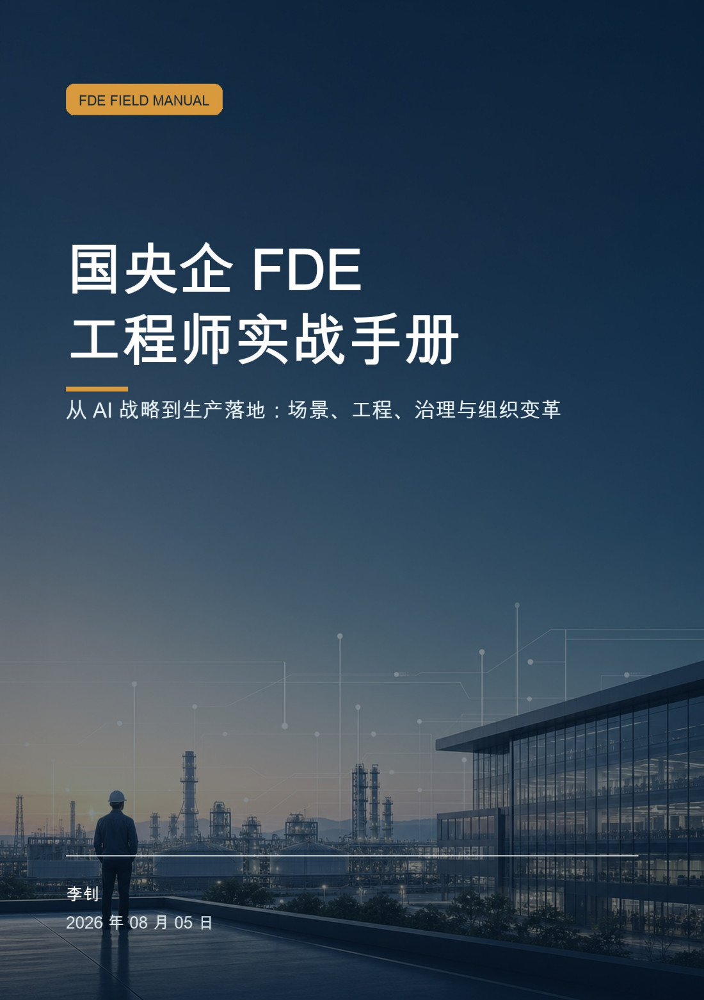
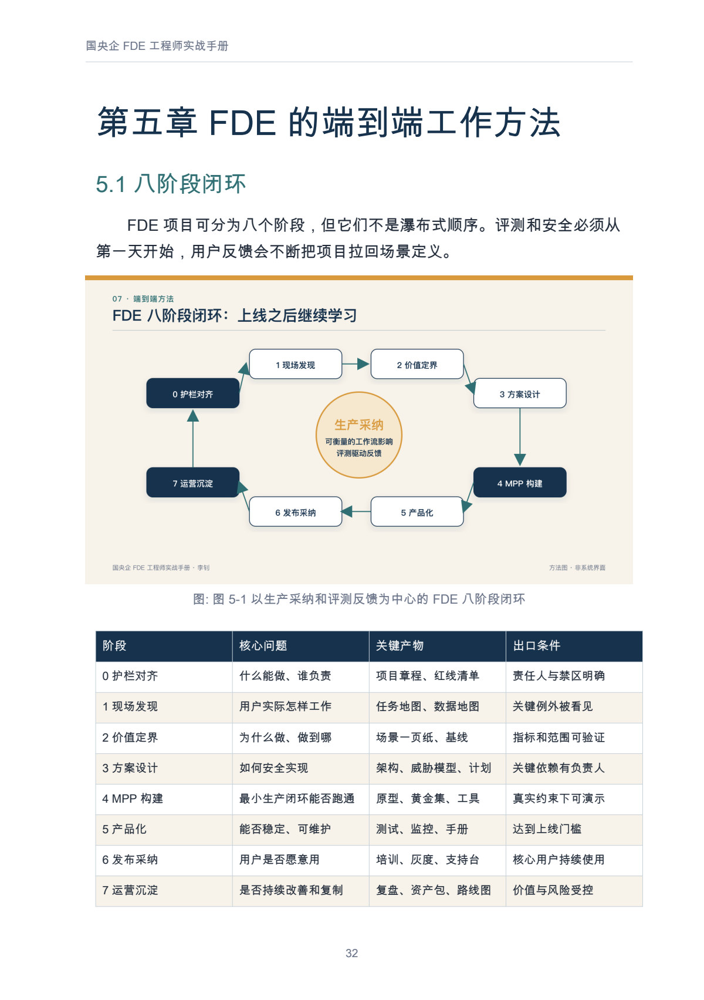
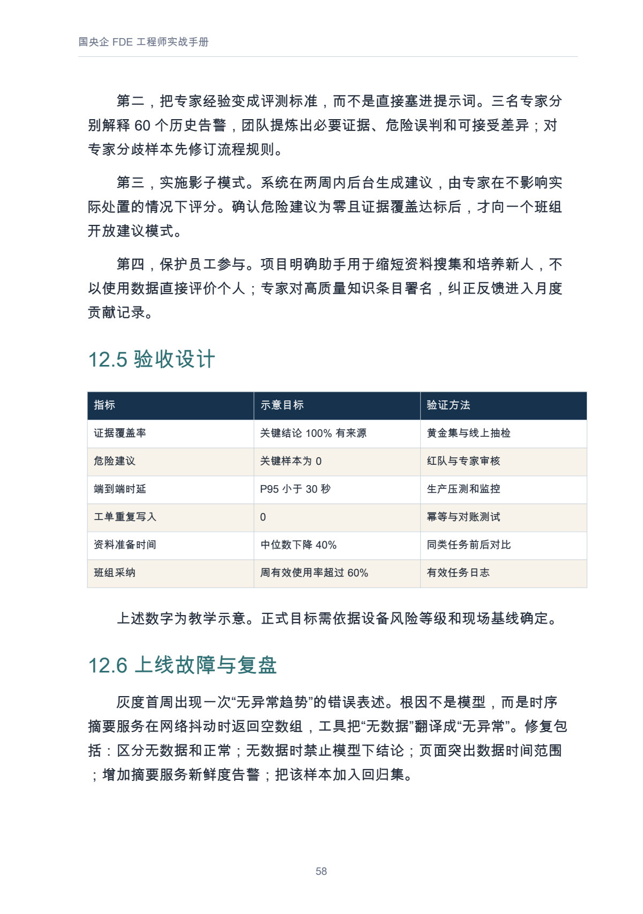
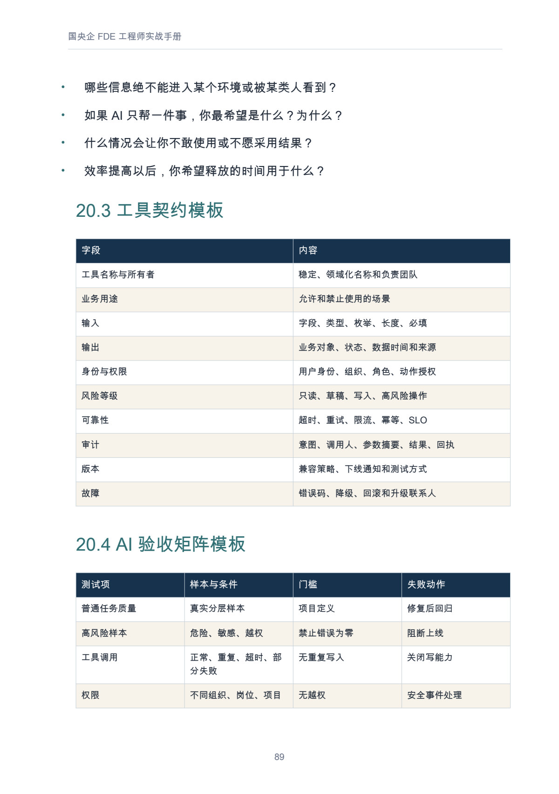

# 国央企 FDE 工程师实战手册

从 AI 战略到生产落地：场景、工程、治理与组织变革

**快速导航：** [完整目录](#完整目录) · [正文预览](#内页预览) · [阅读与下载](#阅读与下载)

## 基本信息与定位

| 项目 | 内容 |
| --- | --- |
| 作者 | 李钊 |
| 版本 | 第一版·WPS Comate 增订 |
| 篇幅与配图 | 全书 21 章，23 幅正文配图，PDF 95 页 |
| 原书日期 | 2026-08-05 |
| 增订修订记录 | 2026-08-11 |
| 书房整理日期 | 2026-11-08 |

这是一部面向国央企 AI 项目现场的实践手册，围绕 FDE（Forward Deployed Engineer）怎样与业务、IT、数据、安全及实施团队共同工作，把一个 AI 原型推进为可评测、可治理、有人使用且能够持续维护的生产能力。

## 全书讲什么

本书从国央企的转型诉求和高价值场景选择出发，先回答“为什么做、由谁负责、做到什么范围”，再展开现场发现、价值定界、方案设计、最小可行生产证明、产品化、发布采纳与运营沉淀。生产工程部分把架构、知识与数据、存量系统集成、评测、安全和持续运营放在同一条任务链上，讨论权限、写操作、人工确认、异常与回退，以及如何用业务结果和真实使用情况检验价值。

应用部分包含能源设备检修、制造企业客诉与质量闭环、城市运营工单、WPS Comate 与 ERP 联邦双入口四个脱敏复合案例。WPS Comate 增订进一步讨论项目型业主公司怎样把知识、SOP、系统接口和评测装配为岗位能力，并给出十二周推进路线。后半部提供 90 天作战手册、组织协作、常见问题与项目模板，便于把阅读接到立项、评审、交付和复盘。案例中的工期、准确率、节省时间与收益均为教学示意，不对应特定真实企业，也不作为项目承诺。

## 适合谁与阅读路线

| 读者或当前任务 | 建议路线 |
| --- | --- |
| 刚进入项目现场的 FDE、售前或项目经理 | 第 1—4 章统一目标与角色；第 5—11 章准备生产闭环；第 12—17 章参考案例与推进计划。 |
| 架构、模型、数据、集成与运维人员 | 重点读第 7—11 章，结合第 20 章的工具契约、验收矩阵和上线清单检查设计。 |
| 业务负责人或数字化管理者 | 先读第 1—3、9、17—18 章，关注场景价值、验收证据、Owner 与能力移交。 |
| 安全、法务、保密或审计参与者 | 从第 10 章进入，结合第 9、19—20 章检查适用要求、测试门槛与责任分工。 |
| 已采用 WPS 365、准备建设组织级 AI 能力的团队 | 重点读第 15—16 章，再按第 17—18 章安排推进与协作；产品能力按实际版本和部署核验。 |
| 项目已有试点，但迟迟不能进入生产 | 先读第 3、19 章定位障碍，再回到第 5—11、20 章核对缺失的工程与运营条件。 |

## 读者可以获得什么

- 将模糊需求收敛为场景一页纸的方法，明确用户、基线、目标、边界、样本和负责人。
- 一张从护栏对齐到运营沉淀的工作地图，以及各阶段的产物和出口条件。
- 把知识、数据、工具与人机审批连起来的设计线索，识别只读、草稿和高风险写操作的不同控制要求。
- 评测与验收框架：用真实任务组织黄金集，分别观察质量、性能、安全、采纳和业务结果。
- 四个复合案例的定界、架构、故障与复盘思路，以及场景、工具契约、验收、上线和周报等可复用模板。

## 完整目录

前置内容：前言《把 AI 从演示环境带进生产现场》、阅读指南。

| 主题 | 原章名 | 本章回答的问题 |
| --- | --- | --- |
| 目标与障碍 | 第一章　AI 时代的国央企转型命题 | 国央企的 AI 转型需要交付哪些业务与组织结果？ |
| 目标与障碍 | 第二章　高价值不是“大模型能做什么” | 怎样把模型能力转成有边界、可验证的高价值任务？ |
| 目标与障碍 | 第三章　中大型企业 AI 落地的三大障碍 | 员工抵触、系统复杂与入口竞争为何会相互强化？ |
| 角色与方法 | 第四章　FDE 工程师到底做什么 | FDE 对什么结果负责，与相邻岗位怎样分工？ |
| 角色与方法 | 第五章　FDE 的端到端工作方法 | 从护栏对齐到运营沉淀，每阶段留下什么产物？ |
| 角色与方法 | 第六章　场景发现与需求工程 | 怎样在现场发现真实任务、例外、风险和验收条件？ |
| 生产工程 | 第七章　生产级 AI 架构 | 模型、工具、身份、权限与人机审批怎样协同？ |
| 生产工程 | 第八章　数据、知识与系统集成 | 知识时效、数据口径和存量系统如何进入同一闭环？ |
| 生产工程 | 第九章　评测、验收与价值证明 | 怎样建立黄金集、验收门槛和包含复核成本的价值台账？ |
| 生产工程 | 第十章　安全、合规与负责任 AI | 如何把数据、模型、写操作和治理责任落实为工程控制？ |
| 生产工程 | 第十一章　上线运营与规模复制 | 上线后怎样监测、处理事件、回退并沉淀可复制资产？ |
| 复合案例 | 第十二章　生产案例一：能源设备检修助手 | 设备告警怎样形成带证据的建议，并保留人工确认？ |
| 复合案例 | 第十三章　生产案例二：制造企业客诉与质量闭环 | 怎样把客诉中的事实、建议、质量责任和反馈分开？ |
| 复合案例 | 第十四章　生产案例三：城市运营工单助手 | 跨部门工单怎样派发、转派和升级，避免自动推诿？ |
| 复合案例 | 第十五章　生产案例四：WPS Comate 与 ERP 的联邦双入口 | 通用办公入口与 ERP 入口怎样共享控制和审计？ |
| Comate 增订 | 第十六章　FDE + WPS Comate：业主公司 AI 生产落地方案 | FDE 怎样将知识、SOP、系统与 Comate 装配为岗位能力？ |
| 推进与组织 | 第十七章　FDE 的 90 天项目作战手册 | 首个 90 天怎样对齐场景、完成 MPP、产品化并运营？ |
| 推进与组织 | 第十八章　团队、协作与组织变革 | 业务、IT、数据、安全与实施人员怎样共同承担交付？ |
| 推进与组织 | 第十九章　常见问题 | 面对角色、模型、安全、成本与生态疑问，先检查什么？ |
| 随用随查 | 第二十章　可直接复用的工作模板 | 立项、工具接入、验收、上线和周报可以使用哪些模板？ |
| 随用随查 | 第二十一章　术语表 | 如何统一 FDE、RAG、MPP、SLO 等关键术语的含义？ |

后附内容：结语《FDE 是一种把不确定性变成生产能力的方法》、参考资料与延伸阅读。

[进入完整 Markdown 正文](output/markdown/国央企%20FDE%20工程师实战手册.md)

## 内页预览

以下均为本书正式 PDF 的实际页面；页码从 PDF 文件第一页起算，包含封面。

**01｜端到端工作地图 · PDF 第 32 页**

第五章的八阶段闭环图与阶段表，展示核心问题、关键产物和出口条件怎样相互衔接。

**02｜复合案例的验收与复盘 · PDF 第 58 页**

第十二章能源设备检修助手案例中的验收设计与一次上线故障复盘。表中目标值属于教学示意，展示的是如何设置证据和测试方法。

**03｜可复用的工程模板 · PDF 第 89 页**

第二十章的工具契约与 AI 验收矩阵节选，展示用途、输入输出、身份权限、可靠性、审计与失败处理如何写成明确字段。

## 阅读与下载

- [Markdown 在线阅读](output/markdown/国央企%20FDE%20工程师实战手册.md)
- [PDF 下载 · 95 页](https://github.com/njxshr/ruogu-books/releases/download/v2026.11.08/soe-fde-handbook.pdf)
- [EPUB 下载](https://github.com/njxshr/ruogu-books/releases/download/v2026.11.08/soe-fde-handbook.epub)
- [Markdown 离线包 · 含配图](https://github.com/njxshr/ruogu-books/releases/download/v2026.11.08/soe-fde-handbook-markdown.zip)

本次采用 WPS Comate 增订后的正式版本，保留原书日期；较早的批注版不列入本书下载。需要按目录检索或复制模板时可使用 Markdown；评审和固定版式阅读可使用 PDF；需要调整字号时可使用 EPUB。离线使用 Markdown 时应保留配图目录。

## 来源与维护

[来源台账](SOURCES.md) · [修订记录](REVISION_LOG.md) · [写作主稿](manuscript/book.md) · [出版配置](book.json)

本次整理保留既有成品内容。资料核验记录截至 2026-08-11；政策、产品功能和链接可能更新，正式项目仍需按最新资料与实际部署核验。案例中的工期、准确率、节省时间与收益均为教学示意，不作为项目承诺。

后续正文修订以 `manuscript/book.md` 为唯一主稿，并同步制作、检查和更新相关阅读版本。读者可通过[仓库议题](https://github.com/njxshr/ruogu-books/issues)反馈来源、技术表述或模板使用问题，附章号和项目条件便于核对。

原书用途说明：本书仅供学习与项目实践参考；案例均为脱敏复合案例，不对应特定真实企业。各项材料的权利以原有说明为准，书房未对本书另行授予开放许可。

[返回书籍目录](../../目录.md) · [若谷书房](../../README.md)
