# 国央企 FDE 工程师实战手册

从 AI 战略到生产落地：场景、工程、治理与组织变革

作者：李钊  
日期：2026 年 08 月 05 日  
版本：第一版·WPS Comate 增订

---

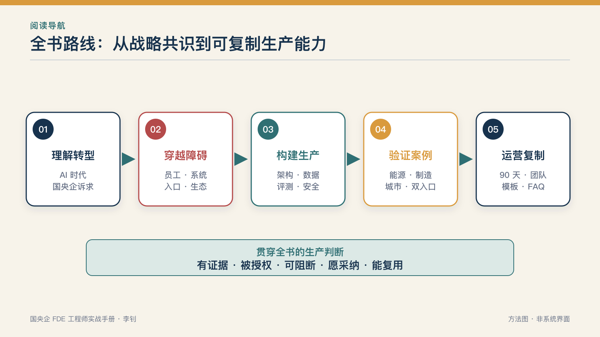

## 前言　把 AI 从演示环境带进生产现场

今天，几乎每家大型企业都做过 AI 演示。问答机器人能写总结，知识库能回答制度，智能体能调用几个工具，领导参观时也颇有“未来感”。但演示结束以后，真正困难的工作才开始：它能否在真实权限下读取正确的数据，能否理解跨部门流程，能否在系统异常时安全降级，能否留下完整审计记录，能否让一线员工愿意每天使用，能否把一次性交付沉淀成可以复制的组织能力？

FDE，Forward Deployed Engineer，常译为前线部署工程师或前沿部署工程师，正是为解决这段“最后一公里”而出现的复合型角色。FDE 不是驻场程序员的新名称，也不是售前、项目经理、算法工程师和实施顾问的简单相加。它站在业务价值、产品能力、工程系统和组织变革的交界处，对“进入生产并产生可验证效果”负责。

国有企业和中央企业的 AI 落地有鲜明特征：业务链条长，存量系统多，数据分级严格，安全生产责任重，决策和协作边界复杂，同时还承担产业引领、科技创新和高质量发展的任务。这里既不适合“先上线再治理”，也不能因风险而停留在永远的试点。需要一种能够在约束中推进、在生产中学习、在共性中复用的工程方法。

本书因此选择一个务实的主线：从高价值场景出发，以可控架构和评测体系为底座，以用户采纳和组织协同为保障，最终把一个 AI 原型变成持续运行的生产系统。全书同时回应三类中大型企业普遍面对的障碍：员工对岗位变化的抵触、CRM 与 ERP 等复杂系统和流程的整合、办公入口与业务入口之间的生态竞争。

书中案例均为多个项目经验抽象而成的脱敏复合案例，不对应任何特定企业；案例中的工期、准确率、节省时间和收益均为教学用示意指标，不能直接作为项目承诺。涉及法律、监管和保密的内容用于建立工程检查框架，具体项目仍应由本单位法务、网信、保密、数据和安全生产主管部门共同确认。

## 阅读指南

这本手册面向五类读者：刚进入国央企项目的 FDE 工程师；承担 AI 方案与交付的售前、架构师和项目经理；负责数字化与 AI 转型的业务和科技管理者；参与模型、数据、集成和运维的技术人员；以及需要判断 AI 项目风险与价值的审计、法务、保密和安全人员。

本书的核心承诺是：读者不仅能解释 FDE 是什么，还能独立完成一个国央企 AI 场景从现场发现、价值定界、生产架构、评测安全到灰度运营的最小闭环，并知道何时扩大、何时降级、何时停止。它不是模型使用说明，也不替代企业制度、行业规范和专业法律意见。

如果你正在启动一个项目，可先读第一至第四章，统一目标和角色；再按第五至第十一章完成场景、架构、数据、评测、安全和运营设计；随后参照第十二至第十五章的案例组织首个生产闭环。已经采用 WPS 365、希望建设组织级 AI 岗位能力的读者，可重点阅读第十六章；若项目已陷入困境，可从第三章“三大障碍”和第十九章“常见问题”开始定位。第二十章提供可直接复用的项目模板。

全书使用下列标记习惯：

- “生产”指被真实用户用于真实工作，并具有权限、审计、监控、支持和退出机制，不等同于部署到服务器。
- “高价值场景”指价值足够大、边界足够清、数据与流程可达、风险可以治理且成功后能够复用的任务闭环。
- “人机协同”不是一句免责声明，而是明确谁在何时审批、AI 提供何种证据、错误如何阻断和追责。
- “示意指标”用于讲解设计方法，正式项目必须用本单位基线数据重新测算。

图表采用统一阅读语法：深蓝表示企业主责与稳定能力，青绿表示协同和可演进能力，金色表示价值节点或人工确认，红色表示风险边界。图表用于解释关系和决策，不代表任何具体软件界面。

## 第一章　AI 时代的国央企转型命题

### 1.1 从数字化、网络化到智能化

国央企的 AI 转型不是一场孤立的模型采购。早在 2020 年，国务院国资委发布《关于加快推进国有企业数字化转型工作的通知》，就提出以数字化、网络化、智能化为方向，建设数据和业务中台，组建跨部门团队，强化主要负责人责任，并以价值效益衡量转型结果。到 2025 年，中央企业“AI+”专项行动进一步强调战略性高价值场景、行业数据集、算力、模型、生态和人才。2026 年发布的第二批战略性高价值场景，又把重点推向规模化、体系化和智能软件工厂等共性能力建设。参见[国资委数字化转型通知](https://www.sasac.gov.cn/n2588020/n2588072/n2591148/n2591150/c15517908/content.html)、[中央企业“AI+”专项行动](https://www.sasac.gov.cn/n2588025/n2643314/c32881575/content.html)与[2026 年第二批高价值场景发布信息](https://wap.sasac.gov.cn/n2588020/n2588072/n2590902/n2590904/c35690985/content.html)。

这条政策与产业脉络传递出三个信号。

第一，AI 必须进入主责主业。只做通用写作、会议纪要和知识问答，能够改善体验，却很难单独支撑战略价值。设备运维、生产排程、工程建设、供应链、能源调度、客户服务、风险合规等核心流程，才是价值密度更高的地方。

第二，AI 必须从单点模型变成系统能力。模型是重要组件，但生产效果还取决于数据质量、知识时效、工具接口、身份权限、流程设计、评测、监控和员工使用。模型能力越强，系统工程的重要性越高。

第三，AI 必须同时回答发展与安全。国央企不能只问“能不能做”，还要问“该不该自动做、允许读什么、能够写什么、谁来批准、发生错误如何回退”。真正成熟的系统不是无边界自动化，而是风险与自主程度相匹配。

### 1.2 大模型改变的是任务分工，不只是软件界面

传统软件要求用户把意图翻译为菜单、字段和规则。大模型让自然语言成为新的交互层，并能对非结构化内容进行理解、生成和推理。它带来三种变化：

- 人机接口从“找功能”变成“说目标”，但用户意图仍需被约束为可执行任务。
- 自动化对象从固定字段扩展到文档、语音、图像和复杂语义，但输出更具概率性。
- 软件从被动工具变成可以规划和调用工具的智能体，但权限半径和故障半径随之扩大。

因此，AI 项目不能沿用纯信息化项目的全部假设。传统系统多以“功能是否按需求实现”验收；AI 系统还要验证样本覆盖、输出质量、拒答边界、工具调用、数据泄露、对抗输入、业务结果和用户采纳。以前上线是项目终点，现在上线是持续评测和改进的起点。

### 1.3 国央企的六类核心诉求

| 转型诉求 | 典型问题 | FDE 应交付的结果 |
|---|---|---|
| 战略牵引 | 如何形成可展示、可推广的 AI 标杆 | 高价值场景组合与复制路线 |
| 降本增效 | 是否真正缩短周期、减少返工 | 基线、目标、实测与收益台账 |
| 提质安全 | 能否减少漏检、误判和事故 | 证据链、审批点与安全阈值 |
| 业务创新 | 能否形成新服务和新能力 | 可运营产品与用户闭环 |
| 自主可控 | 模型、数据和平台是否可替换 | 分层解耦架构与退出预案 |
| 组织升级 | 人才和流程能否持续适应 | 角色机制、培训和能力资产 |

这六类诉求经常彼此拉扯。例如，为追求自动化率而扩大权限，可能损害安全；为追求完全自主而重复建设，可能拖慢价值兑现；为追求短期演示而绕开主系统，又会形成新的数据孤岛。FDE 的价值不是给出单项技术最优解，而是在业务约束下形成能够落地的整体解。

### 1.4 从“模型可用”到“业务有效”

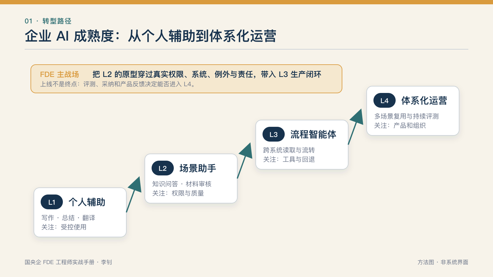

建议用四个层级判断企业 AI 的成熟度：

| 层级 | 主要表现 | 常见误区 | 升级关键 |
|---|---|---|---|
| L1 个人辅助 | 写作、总结、翻译 | 只统计账号和调用量 | 任务模板与基础安全 |
| L2 场景助手 | 知识问答、材料审核 | 把检索命中当业务价值 | 数据权限与质量评测 |
| L3 流程智能体 | 跨系统读取、生成和流转 | 自动化越高越先进 | 工具契约、审批和回退 |
| L4 体系化运营 | 多场景复用、持续评测 | 只建设统一平台 | 产品经营、组织与生态 |

大多数失败都发生在 L2 到 L3：原型能回答问题，但接入真实系统后，身份、权限、脏数据、接口限流、流程例外和责任边界集中出现。FDE 的主战场正是这一步。

### 1.5 转型组织从项目交付走向能力共建

上传材料提醒了一个容易被技术团队忽略的变化：国央企组织 AI 转型的方式也在演进。第一种形态是单项目交付，业务部门提出需求，乙方按合同建设，验收后进入运维；第二种形态是平台与场景共建，由集团科技或数字化部门建设共享底座，二级单位持续申报场景；第三种形态是联合运营，业主业务、IT、数据、安全与外部 FDE 组成混编小队，共同定义任务、迭代产品并沉淀资产。

| 组织形态 | 主要优势 | 常见失效 | FDE 的重点 |
|---|---|---|---|
| 单项目交付 | 目标集中，合同边界清楚 | 交付即离场，知识断层 | 从第一天设计移交与维护 |
| 平台与场景共建 | 共性能力可复用 | 平台先行、业务价值滞后 | 用真实场景验证共享能力 |
| 联合运营 | 学习速度快，能力转移强 | 角色模糊、长期依赖外部 | 明确 Owner、版本和退出机制 |

组织形态越成熟，FDE 越不能只交付代码。文档、工具契约、评测集、知识管理员、培训、运行看板和问题闭环都必须成为显性交付物。判断能力是否真正转移，有一个朴素问题：FDE 退出护航后，业主团队能否独立更新知识、回归评测、处理告警并决定下一次发布？如果答案是否定的，项目仍然停留在外包能力，而没有成为组织能力。

## 第二章　高价值不是“大模型能做什么”

### 2.1 用任务闭环替代功能清单

一个好的场景描述必须同时包含角色、触发条件、输入、判断、行动、系统、异常和结果。例如，“建设设备维修智能体”过于宽泛；更可执行的描述是：“当某型泵机振动告警达到阈值时，值班工程师需要在十分钟内汇总实时测点、最近三次工单、同型设备故障案例和检修规程，形成带证据的处置建议，经班长批准后创建 EAM 工单。”

这句话暴露了真正需要解决的问题：时序数据和文档数据如何关联；设备编码是否一致；建议必须引用哪些证据；AI 是否允许创建工单；班长如何审批；EAM 不可用时如何降级。它把一个模糊愿望变成可设计、可评测、可验收的闭环。

### 2.2 场景评分法

候选场景可按五个维度各打 1 至 5 分，再讨论权重。不要让评分替代判断，它的作用是迫使团队公开假设。

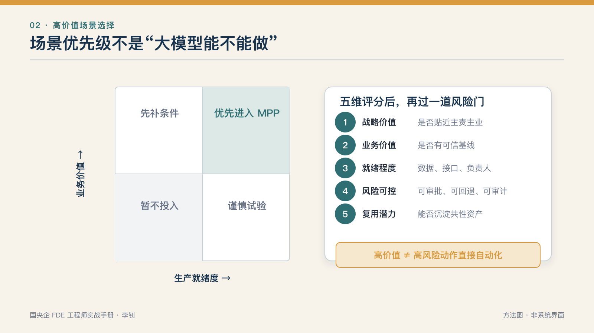

| 维度 | 关键问题 | 高分特征 |
|---|---|---|
| 战略价值 | 是否贴近主责主业和年度重点 | 高层关注且可形成标杆 |
| 业务价值 | 频次、耗时、损失或增收多大 | 有可信基线和明确受益人 |
| 就绪程度 | 数据、接口、流程和负责人如何 | 边界清晰且资源可获得 |
| 风险可控 | 错误后果、敏感数据、写操作如何 | 可审批、可回退、可审计 |
| 复用潜力 | 能否复制到其他单位和流程 | 共性任务和标准接口占比高 |

可用一个简单的示意公式：

> 场景优先级 = 战略价值 × 25% + 业务价值 × 30% + 就绪程度 × 20% + 风险可控 × 15% + 复用潜力 × 10%

若一个场景业务价值很高但风险不可控，不应因总分高就直接自动化。应先缩小自主范围，例如从“自动处置”退回“生成建议”，从“全量数据”退回“已脱敏字段”，从“写入主系统”退回“生成待审批草稿”。

出现以下任一信号时，应暂停或重新设计，而不是继续加模型能力：找不到愿意对流程结果负责的业务所有者；无法获得代表性真实样本；关键数据的使用依据和权限长期不清；错误后果无法通过人工确认、技术阻断或业务回退降到可接受范围。场景退出机制越早写清，越能避免“试点已经投入，所以必须上线”的沉没成本偏差。

### 2.3 四类价值证据

FDE 在立项时就应约定价值证据，而不是上线后才寻找亮点。

- 效率证据：平均处理时长、等待时长、材料准备时长、一次完成率。
- 质量证据：准确率、漏检率、返工率、证据覆盖率、专家一致性。
- 风险证据：越权次数、敏感信息暴露、错误写入、回退时间、安全事件。
- 采纳证据：周活跃用户、任务完成量、复用率、人工接管率、满意度。

“生成速度很快”和“模型准确率 95%”都不是充分的业务证据。前者可能把时间转移给复核人，后者可能掩盖关键少数错误。生产项目要观察端到端任务结果，并单独衡量高风险样本。

### 2.4 最小可行生产闭环

MVP 常被误解为功能少的演示。对 FDE 而言，更有用的概念是 MPP，Minimum Production Proof，最小可行生产证明。它至少要具备：真实用户、真实数据、明确权限、有限但完整的任务闭环、可执行评测、日志与告警、人工审批、故障回退、负责人和支持窗口。

一个 MPP 可以只服务一个班组、一个设备类型或一类工单，但不能绕开最关键的生产约束。只有穿过真实约束，团队学到的东西才足以支撑规模化。

## 第三章　中大型企业 AI 落地的三大障碍

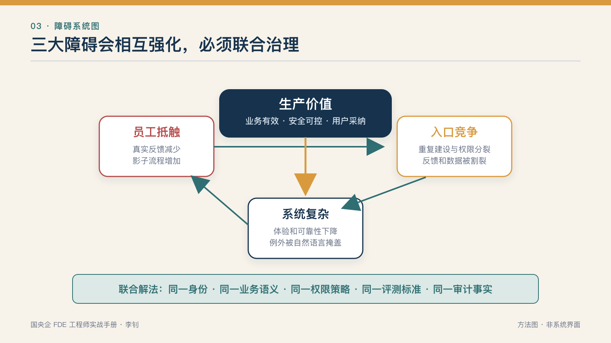

三大障碍并非三个孤立问题。员工抵触会减少真实反馈，使系统只能在“干净样本”上优化；系统复杂会降低体验和可靠性，加深员工对 AI 的不信任；入口争夺会造成重复建设、权限分裂和数据孤岛，进一步放大复杂性。FDE 应把它们看作一个互相强化的系统，而不是分别交给人力、IT 和采购处理。

### 3.1 障碍一：员工抵触与岗位威胁感

员工抵触通常不等于不愿学习新技术。很多时候，它是对不透明变化的理性反应：AI 的目标由谁定义，自己的经验是否被无偿抽取，系统出错由谁负责，效率提升后是否直接裁减岗位，绩效标准是否突然变化？如果这些问题没有答案，要求“提高 AI 使用率”只会产生表面活跃和隐性绕行。

可以用一个非数学的诊断式理解威胁感：

> 威胁感 = 目标不透明 + 收益分配不对称 + 技能迁移路径缺失 + 责任边界模糊

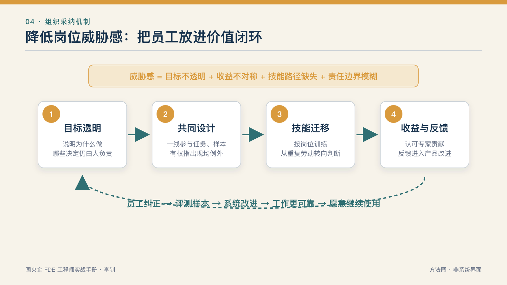

#### 把“替代岗位”改写为“重构任务”

岗位是多项任务的集合。AI 通常先改变其中可标准化、可数字化、反馈快速的部分，而不是一次性替代完整岗位。FDE 应与业务、人力和一线代表制作任务地图，将工作分为四类：

| 任务类型 | 建议模式 | 示例 |
|---|---|---|
| 重复且低风险 | 自动执行，抽样复核 | 格式整理、台账汇总 |
| 高频且需判断 | AI 建议，人来确认 | 工单分类、条款初审 |
| 低频且高风险 | 专家主导，AI 提供证据 | 重大故障处置、合规结论 |
| 关系与责任密集 | 人主导，AI 辅助准备 | 谈判、组织沟通、签批 |

这张地图必须与组织承诺相连。项目初期可明确：试点阶段不以 AI 使用结果直接进行人员淘汰；效率收益优先用于减少无效加班、提升一次完成率和扩大服务能力；被系统吸收的专家经验要通过荣誉、绩效或岗位发展得到确认。具体承诺由企业决定，但不能只要求员工贡献知识而不说明收益。

项目公告至少要让员工得到四个明确答案：AI 改变哪些任务而非笼统改变哪些岗位；哪些判断和责任仍由人承担；效率收益首先如何使用；员工通过什么训练、反馈和申诉渠道参与变化。四个答案若由不同部门分别发布，FDE 应推动形成一致版本，避免业务、技术和人力口径互相冲突。

#### 让一线员工成为共同设计者

一个可执行的采纳机制包括：

- 每个场景至少配置一名一线“流程教练”，有权否决不符合现场规律的设计。
- 在原型阶段记录员工修改 AI 输出的原因，将其转化为评测样本和规则。
- 发布时同时公布能力边界、已知错误、人工接管方式和问题响应时限。
- 培训围绕真实任务，不以“模型原理课”代替岗位实践。
- 将采纳指标与质量、效率和安全联合观察，不追求单一调用量。

#### 一个反例

某集团上线公文助手，管理层要求月调用量，却没有说明生成内容的责任边界。员工担心错误留痕，先把非敏感材料复制到个人工具，再把结果粘回系统，平台数据看似活跃，实际形成新的泄露风险。FDE 复盘后把指标改为“在受控工作区完成的有效任务数”，提供引用溯源、敏感字段提示和人工确认，并由办公室发布责任说明。采纳的关键不是更强的宣传，而是更低的不确定性。

### 3.2 障碍二：系统复杂性与生态共建

大企业的 AI 很少只面对一个数据库。一个“查询客户欠款并建议下一步行动”的任务，可能同时涉及 CRM 客户信息、ERP 应收、合同系统条款、OA 审批、客服记录和组织身份。每个系统都有自己的编码、权限、接口能力和变更节奏；上下游厂商又掌握不同数据和领域规则。

系统复杂性的本质不是“系统数量多”，而是五种不一致叠加：

- 身份不一致：同一人员、客户、设备在不同系统有不同标识。
- 语义不一致：“客户”“在途”“完工”等字段定义不同。
- 权限不一致：页面可见不等于 API 可读，读取权限不等于生成式使用授权。
- 流程不一致：正式流程、线下变通和历史遗留路径同时存在。
- 生命周期不一致：模型、接口、主数据和业务规则更新频率不同。

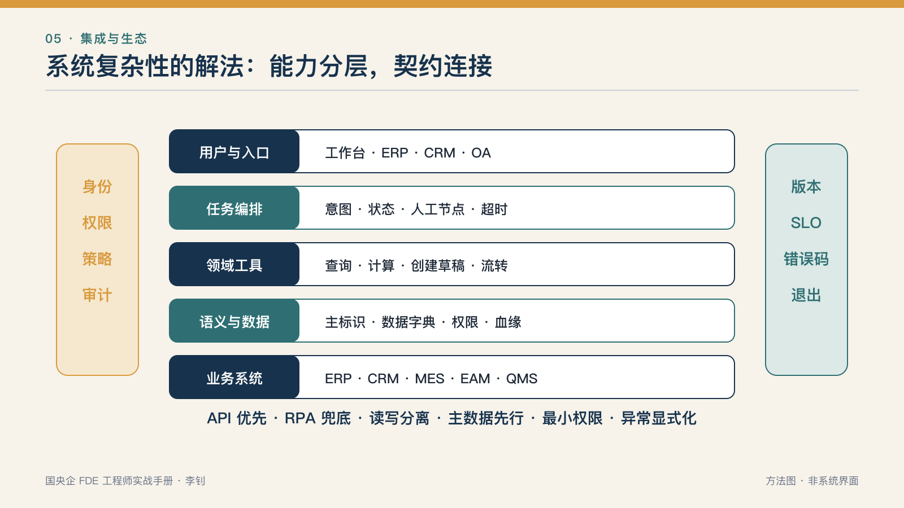

#### 分层解耦，而不是让智能体直连一切

推荐采用七层思路：用户入口、任务编排、领域能力与工具、数据和知识、模型网关、安全策略、观测与评测。智能体调用的是经过治理的“业务工具”，而不是直接拼接数据库语句。每个工具都要定义输入、输出、权限、幂等、超时、错误码、审计和回滚。

生产接入遵循几个朴素原则：

- API 优先，RPA 兜底。只有在无接口且短期价值明确时使用界面自动化，并为页面变更准备监控。
- 读写分离。先证明“读数据和给建议”可靠，再开放“创建草稿”，最后才考虑受控写入。
- 主数据先行。客户、设备、物料、组织等关键标识必须建立映射和归属人。
- 最小权限。权限在工具层和数据层同时校验，不把高权限账号交给模型。
- 异常显式化。缺数据、冲突数据、接口超时不能被自然语言掩盖，必须返回可处理状态。

#### 生态共建要交付“契约”

仅签署合作协议不会自动形成生态。生态共建的最小单元是可验证的契约：统一身份映射、数据字典、API 或 MCP 工具说明、服务等级、版本兼容、审计字段、责任边界、退出与迁移方式。上游系统厂商负责领域语义和稳定接口，AI 平台负责模型、编排和安全底座，实施伙伴负责场景配置，企业负责流程所有权和数据治理，FDE 负责让这些责任在一个生产闭环中对齐。

契约必须能被测试。身份映射用已知用户和越权用户验证；数据字典用争议样本验证；接口用正常、空值、超时、重复和部分失败验证；服务等级用监控验证；退出条款用一次实际导出演练验证。不能执行的“开放生态”只是宣传语言。

#### 警惕“万能中台”

为解决复杂性而先建设一个包罗万象的 AI 中台，可能把业务价值延后一年。更稳妥的方法是“场景牵引、共性下沉”：先从两个高价值场景提取真正重复的身份、知识、工具、评测和审计能力，再建设共享层；每新增一个场景，都检验能否复用并反哺平台。

### 3.3 障碍三：办公入口、业务入口与 FDE 入口之争

生成式 AI 让自然语言成为新的软件入口。WPS Comate 这类横向 AI 办公平台希望承接文档、表格、演示、会议内容和跨应用任务；ERP、CRM、OA 等传统厂商则拥有高频业务页面、领域对象、交易权限和实施网络。对金蝶、用友等传统企业软件厂商而言，表面问题是“接入 WPS Comate 生态还是自主建设入口”，更深的问题是：谁拥有用户意图，谁组织工具和数据，谁沉淀反馈，谁承担生产责任。

WPS 的公开资料显示，Comate 可通过岗位专家、Skill、Wiki、自动化任务、团队空间等方式承载组织任务，并以 Comate Studio 管理专家与技能、以 DataHub 连接企业数据、以模型管理能力配置模型接入和使用策略。这里引用的是公开产品说明，不代表对具体版本、部署方式或客户环境适用性的背书。参见[WPS Comate 官网](https://comate.wps.cn/)、[团队协作能力](https://plus.wps.cn/blog/p108404.html)、[专家、DataHub 与 Studio](https://plus.wps.cn/blog/p108379.html)和[模型管理](https://plus.wps.cn/blog/p108194.html)。

企业不应把选择简化为“依附”或“对抗”。可考虑三种策略：

| 策略 | 适用条件 | 优势 | 主要风险 |
|---|---|---|---|
| 接入横向生态 | 办公任务多、需要快速触达用户 | 获客与交互成本低，生态丰富 | 品牌弱化、规则受平台影响 |
| 自建领域入口 | 高频交易、领域语义深、责任重 | 控制流程、数据和体验 | 重复建设，跨应用能力弱 |
| 联邦双入口 | 大型集团，多系统长期共存 | 兼顾通用体验与领域控制 | 需要统一治理和协议 |

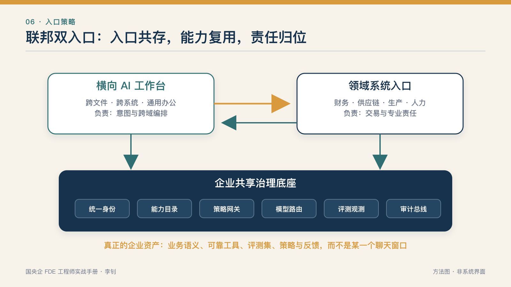

本书更推荐国央企采用“联邦双入口”：横向工作台承接跨文件、跨系统和通用办公任务；领域系统内的智能体承接交易性强、责任边界严的专业流程。两类入口共享企业身份、能力目录、模型网关、数据分级、策略决策、审计和评测，但保留各自的交互和业务所有权。

#### 入口决策的七个问题

- 用户是否每天都在该入口完成同一类任务？
- 任务是否具有写入、审批、支付、调度等交易权力？
- 业务语义是否只能由领域系统准确解释？
- 是否需要跨多个系统和文件完成目标？
- 数据敏感性和部署约束能否被入口满足？
- 能力是否可以通过标准工具暴露并被多个入口复用？
- 若更换入口或模型，数据、提示词、评测集和日志能否迁移？

入口不是一张首页，而是一组控制权。FDE 应推动企业把“入口之争”转为“协议之治”：用统一能力注册、语义契约、策略网关和可观测性，让多个入口协同，而不是让每个入口重复保存知识、复制权限和封闭反馈。

每次入口决策都应形成一页记录：任务由哪个入口发起；意图、上下文和反馈由谁保存；领域工具由谁提供并承担 SLO；写操作在哪个系统确认；身份与策略在哪里执行；用户能否看见跨入口一致的证据；更换平台时哪些资产可迁移。这样，入口选择从产品偏好变成可审计的架构决定。

### 3.4 三大障碍的联合解法

| 障碍 | 错误解法 | FDE 的联合解法 | 验证指标 |
|---|---|---|---|
| 员工抵触 | 强制调用、只做培训 | 任务重构、共同设计、收益与责任透明 | 有效任务、纠正采纳、满意度 |
| 系统复杂 | 直连数据库、先建万能平台 | 场景牵引、工具契约、读写分离 | 接口成功、可追溯、复用率 |
| 入口竞争 | 单一入口包打天下 | 联邦入口、统一治理、能力可迁移 | 跨入口一致性、迁移成本 |

联合解法的关键是“同一套生产事实”：同一个身份、同一项业务定义、同一条权限策略、同一个评测标准、同一份审计记录。只有这样，员工在不同入口中看到的结果才一致，系统集成才能复用，生态合作才不会变成新的锁定。

## 第四章　FDE 工程师到底做什么

### 4.1 一个面向结果的定义

OpenAI 对 FDE 岗位的公开描述强调：FDE 与客户共同完成发现、技术范围界定、系统设计、构建和生产发布；成功以生产采纳、可衡量的工作流影响和评测驱动的反馈衡量；同时把项目中验证过的模式沉淀为产品能力和实践手册。参见[OpenAI Forward Deployed Engineer 职位说明](https://openai.com/careers/forward-deployed-engineer-%28fde%29-sf-san-francisco/)。

结合国央企环境，本书给出如下定义：

> FDE 是深入业务现场、以生产效果为责任边界，能够把组织目标翻译为 AI 任务闭环，并完成架构、集成、评测、安全、上线、采纳和产品反馈的复合型工程师。

为防止“对结果负责”变成无限责任，项目还应签署一个结果契约：FDE 对端到端技术闭环、证据和风险透明负责；业务所有者对流程目标、专家规则和价值兑现负责；数据与系统所有者对源数据、接口和权限负责；安全与合规人员对控制要求与例外批准负责。FDE 负责连接和暴露缝隙，不替代这些法定或管理责任。

这一定义有三个关键词。

- 前线：接近真实用户、真实流程、真实数据和真实故障，而非只在会议室接收需求。
- 部署：不是安装软件，而是让能力在生产责任体系中长期运行。
- 工程：用可重复方法、可观测数据和可维护资产解决问题，不依赖个人英雄主义。

### 4.2 FDE 与相邻角色的区别

| 角色 | 主要关注 | 典型交付 | 与 FDE 的关系 |
|---|---|---|---|
| 售前顾问 | 需求、方案、商业可行性 | 方案书、演示、报价输入 | FDE 验证生产假设并回传可交付边界 |
| 解决方案架构师 | 总体架构和技术选型 | 架构蓝图、技术规范 | FDE 在真实约束中实现和校正架构 |
| 算法工程师 | 模型、训练、推理和效果 | 模型服务、算法指标 | FDE 把模型嵌入业务闭环并建立评测 |
| 实施顾问 | 配置、迁移、流程上线 | 配置、数据、培训 | FDE 处理 AI 的概率性和快速迭代 |
| 项目经理 | 范围、进度、资源和风险 | 计划、台账、协调 | FDE 对技术与业务闭环负责 |
| 产品经理 | 用户价值和产品路线 | 需求、路线图、版本 | FDE 将现场共性沉淀为产品输入 |
| SRE 与安全 | 稳定性、运维与防护 | 监控、预案、策略 | FDE 将其前置到方案和验收 |

在小型项目里，一个人可能兼任多个角色；在大型项目里，FDE 不应越过专业团队独自决策。FDE 的核心不是“什么都做”，而是对跨角色缝隙负责，确保没有人只完成自己的局部交付，却留下一个无人负责的生产系统。

### 4.3 FDE 的八项责任

1. 发现：进入现场，识别真实任务、例外、数据和责任链。
2. 定义：把愿望转化为范围、指标、边界和验收样本。
3. 架构：设计模型、数据、知识、工具、权限和运行环境。
4. 构建：快速实现可验证原型，并保留通向生产的路径。
5. 评测：建立离线、在线、业务和安全评测，驱动迭代。
6. 发布：完成集成、容量、监控、回退、文档和移交。
7. 采纳：与一线共同设计流程，培训用户，改善使用体验。
8. 沉淀：把通用连接器、工具、评测集和方法反馈给产品。

### 4.4 FDE 不应该做什么

- 不以承诺尚未验证的模型能力换取项目启动。
- 不绕开数据、保密、安全、法务和业务责任人私自上线。
- 不把客户环境改造成只有自己能维护的“黑盒”。
- 不以提示词技巧掩盖数据缺失、流程冲突和权限问题。
- 不把所有业务例外硬塞进一个巨大智能体。
- 不用一次试点的偶然效果替代可重复评测。
- 不替业务负责人作出重大经营、安全或合规决定。

### 4.5 能力模型：T 型还不够

优秀 FDE 更像“梳子型”人才：有一项足够深的工程主能力，同时在多个领域具备可协作的深度。

| 能力域 | 必备能力 | 进阶表现 |
|---|---|---|
| 业务与产品 | 任务分析、价值测算、范围管理 | 重构流程并经营产品采纳 |
| 软件与集成 | API、数据、前后端、云与部署 | 在复杂遗留环境设计可演进架构 |
| AI 工程 | 提示、RAG、工具调用、智能体 | 评测、路由、微调与失败诊断 |
| 安全与治理 | 权限、日志、数据分级、威胁意识 | 将政策转成机器可执行控制 |
| 交付与运营 | 计划、测试、监控、事件响应 | 多团队生产运营和规模复制 |
| 沟通与变革 | 访谈、共创、培训、书面表达 | 处理利益冲突并建立共同目标 |

能力培养不应只刷模型知识。一个成熟训练计划，应让 FDE 完整经历需求访谈、接口失败、红队测试、上线值守、用户投诉和复盘沉淀。没有生产反馈，技术判断很容易停留在理想条件。

### 4.6 FDE 的一天：让认知与产出交替推进

上传手册用“一天与一周”描述了 FDE 的真实工作形态，这对新人很重要。典型驻场日不是连续编码八小时：上班先看夜间评测、告警和用户反馈；短站会确认当天要证伪的假设；上午处理数据、检索、接口或缺陷；下午完成跨部门对齐、成块开发和小范围试用；离场前更新决策、风险与问题台账，把需要后方支持的事项同步出去。

这种节奏的关键不是排满日历，而是让两类活动交替发生：一类增加认知，例如贴岗观察、争议样本评审和故障复盘；一类形成可验证产出，例如数据契约、原型增量、评测报告和发布记录。只有认知没有产出，项目会变成长调研；只有产出没有认知，团队会高速构建错误的东西。

可用三个问题检查个人节奏：本周是否至少观察或回访了一次真实任务；是否用同一批代表性样本验证了最新改动；是否把一次临时协调沉淀成规则、接口、文档或责任机制。FDE 的价值不由“开了多少会”或“写了多少代码”单独决定，而由现场不确定性是否持续转化为可复用生产资产决定。

## 第五章　FDE 的端到端工作方法

### 5.1 八阶段闭环

FDE 项目可分为八个阶段，但它们不是瀑布式顺序。评测和安全必须从第一天开始，用户反馈会不断把项目拉回场景定义。

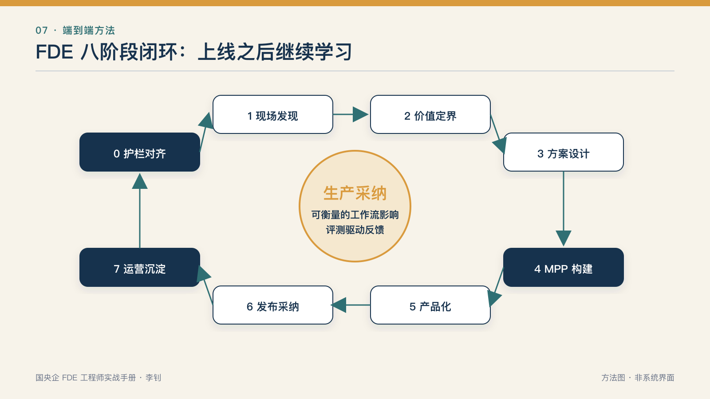

| 阶段 | 核心问题 | 关键产物 | 出口条件 |
|---|---|---|---|
| 0 护栏对齐 | 什么能做、谁负责 | 项目章程、红线清单 | 责任人与禁区明确 |
| 1 现场发现 | 用户实际怎样工作 | 任务地图、数据地图 | 关键例外被看见 |
| 2 价值定界 | 为什么做、做到哪 | 场景一页纸、基线 | 指标和范围可验证 |
| 3 方案设计 | 如何安全实现 | 架构、威胁模型、计划 | 关键依赖有负责人 |
| 4 MPP 构建 | 最小生产闭环能否跑通 | 原型、黄金集、工具 | 真实约束下可演示 |
| 5 产品化 | 能否稳定、可维护 | 测试、监控、手册 | 达到上线门槛 |
| 6 发布采纳 | 用户是否愿意用 | 培训、灰度、支持台 | 核心用户持续使用 |
| 7 运营沉淀 | 是否持续改善和复制 | 复盘、资产包、路线图 | 价值与风险受控 |

### 5.2 阶段 0：先画红线，再讨论想象力

启动会需要业务负责人、科技部门、数据、安全、保密、法务或合规、运维和主要供应商共同参加。至少确定：目标场景，业务所有者，系统所有者，数据范围，部署边界，允许使用的模型，禁止动作，审批机制，验收机制，事故升级链和退出条件。

红线应写成可测试陈述。例如“不得泄露敏感信息”过于笼统；“未通过二级权限校验的用户不得检索合同正文；输出和日志不得出现身份证号明文；外部模型调用不得包含涉密、工作秘密和未经批准的个人信息”更有执行性。

### 5.3 阶段 1：去现场看一次完整任务

访谈用户时，不要只问“你希望 AI 做什么”。请用户打开真实系统，从一个真实触发开始，完整演示一次普通案例和一次异常案例。记录：信息从哪里来，在哪复制，谁判断，谁等待，哪些口径靠经验，哪些字段经常错误，最后结果写到哪里。

FDE 要特别寻找“影子流程”：Excel 台账、个人文件夹、微信群截图、电话确认、手工编码映射和系统外审批。影子流程往往决定生产成败，但在正式流程图中不存在。

### 5.4 阶段 2：把承诺写进场景一页纸

一页纸至少包含：用户与任务、当前基线、目标指标、输入与输出、系统和数据、范围内与范围外、风险等级、人机分工、验收样本、里程碑、业务负责人和技术负责人。任何一项写不清，都意味着团队仍在对不同项目达成表面共识。

建议同时列出“不做清单”。例如首期不自动发送外部邮件，不直接修改主数据，不处理涉密材料，不覆盖海外法域，不承诺全集团推广。清晰的边界比宏大的愿景更能建立信任。

### 5.5 阶段 3 至 5：快速，但不跳过生产问题

MPP 迭代可以按周推进：第一周跑通数据和检索，第二周加入工具和评测，第三周进入小范围真实任务，第四周修复高风险失败。但快速不等于用临时代码永久运行。每一轮都应回答：哪些假设被证伪，哪些错误可通过数据或产品设计解决，哪些错误必须通过人工边界控制。

进入产品化前，至少完成以下事项：

- 环境隔离、配置和密钥管理。
- 身份认证、最小权限和工具级授权。
- 单元、集成、端到端、负载和安全测试。
- 黄金评测集、关键阈值和回归流程。
- 日志、指标、追踪、成本和质量看板。
- 降级、熔断、回退、备份和恢复演练。
- 版本说明、用户手册、运维手册和责任人。

### 5.6 阶段 6 至 7：发布不是剪彩

灰度发布应选择愿意共同改进、又能代表真实复杂度的用户。首批用户太“友好”，会掩盖问题；太“敌对”，会在系统尚不稳定时形成负面口碑。可以从一个班组或区域开始，保留原流程一段时间，比较任务质量和周期。

每周运营会不再汇报“开发完成百分比”，而是审查有效任务、失败分布、人工接管、用户纠正、业务指标、风险事件、成本和待验证假设。经过验证的工具、数据映射、评测集、提示模板、培训材料和治理策略，应组成可复制资产包。

## 第六章　场景发现与需求工程

### 6.1 三层访谈法

同一个流程至少访谈三层人员：管理者说明目标和责任，一线人员展示实际任务，系统与数据负责人解释约束。三层叙述不一致很正常，差异本身就是需求。

管理者访谈聚焦：为什么现在做，失败代价是什么，哪个指标会改变决策，谁拥有流程，哪些红线不能碰。一线访谈聚焦：一天如何开始，最耗时步骤，异常如何处理，哪些信息不可信，什么结果才愿意采用。技术访谈聚焦：数据源、接口、身份、权限、容量、版本、日志、维护窗口和历史债务。

### 6.2 把需求写成可评测故事

传统用户故事“作为设备工程师，我希望获得维修建议”还不够。AI 用户故事应加入证据、边界和评测：

> 当设备告警且用户拥有该装置权限时，系统在 30 秒内汇总最近 24 小时关键测点、适用规程和同型故障工单；建议必须逐条引用来源，对缺失测点明确提示；置信不足时不得推荐停机操作；班长确认后才可创建工单草稿。

这段话可以直接拆成测试：权限测试、时延测试、检索测试、引用测试、缺失数据测试、危险建议测试和工具调用测试。

### 6.3 需求优先级：风险先于炫技

将能力按 P0、P1、P2 管理：

- P0 是进入生产的必要条件，如权限、来源引用、审批、日志、回退和关键样本质量。
- P1 是显著改善价值的能力，如多轮追问、个性化模板、跨系统联动和质量反馈。
- P2 是体验增强，如丰富视觉、更多模型选择和低频扩展功能。

项目压力增大时，不能把 P0 当作可以延后的“非功能需求”。AI 的权限、评测和审计就是核心功能。

### 6.4 需求冻结与学习速度

AI 项目不适合一次性冻结所有细节，但需要冻结目标、红线和版本边界。可以采用“双轨需求”：承诺轨记录本版本必须交付和验收的内容；探索轨记录待验证的模型、数据和交互假设。探索成功后才进入下一版本承诺轨。这样既避免无限试验，也避免在信息不足时签下虚假确定性。

## 第七章　生产级 AI 架构

### 7.1 七层参考架构

生产架构的目标不是堆齐流行组件，而是让责任边界清晰、能力可以替换、故障可以定位。推荐按七层理解：

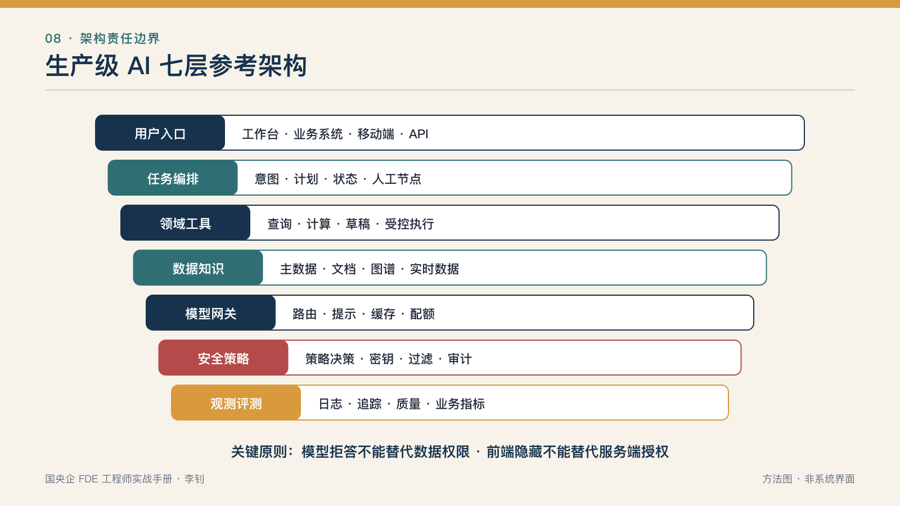

| 层级 | 主要能力 | 关键控制 |
|---|---|---|
| 用户入口 | 工作台、业务系统、移动端、API | 身份、会话、反馈 |
| 任务编排 | 意图、计划、状态、人工节点 | 步数、超时、自主范围 |
| 领域工具 | 查询、计算、创建草稿、流转 | 参数校验、授权、幂等 |
| 数据知识 | 主数据、文档、向量、图谱、实时数据 | 分级、时效、血缘、权限 |
| 模型网关 | 模型路由、提示、缓存、配额 | 模型白名单、脱敏、成本 |
| 安全策略 | 策略决策、内容过滤、密钥、审计 | 默认拒绝、职责分离 |
| 观测评测 | 日志、追踪、质量、业务指标 | 版本关联、告警、回归 |

七层可以由不同产品实现，但逻辑职责不宜混淆。例如，模型拒绝回答不能替代数据层权限；前端隐藏按钮不能替代工具层授权；系统日志不能替代业务证据链。

重要取舍应写入架构决策记录：背景与约束、候选方案、选择理由、已知代价、风险控制、验证证据、触发复审的条件。模型、入口、向量库和集成方式都可能更换；没有决策记录，后来团队只能看到结果，无法判断旧选择何时已经失效。

### 7.2 智能体不是无限循环

智能体适合处理步骤需要动态选择、信息可能不完整、工具组合随上下文变化的任务。但许多企业流程其实更适合确定性工作流：节点、审批和失败路径已明确，只需在其中几个节点加入 AI 理解或生成。

可以采用三档自主等级：

| 等级 | AI 权力 | 适用场景 | 默认控制 |
|---|---|---|---|
| A1 建议 | 读取并生成建议 | 高风险决策、早期试点 | 人工确认全部结果 |
| A2 草稿行动 | 创建草稿或待办 | 工单、邮件、报告 | 关键写操作审批 |
| A3 受控执行 | 在规则内自动调用工具 | 高频低风险闭环 | 限额、回滚、抽检 |

若团队无法说明一个场景属于哪一档，说明权力设计还没有完成。自主等级应按动作划分，而不是按整个智能体统一设置。一个智能体可以自动查询库存，却必须经人批准才能变更采购单。

### 7.3 工具设计决定生产上限

工具是 AI 与业务系统之间的受控边界。一个合格工具需要：清晰名称与用途；结构化参数和枚举；业务语义说明；调用者身份；权限检查；输入验证；确定性返回；错误码；超时与重试；幂等键；审计字段；版本策略。

不要提供 `execute_sql` 或 `call_any_api` 这类过宽工具。应提供 `get_equipment_alarm_summary`、`create_maintenance_work_order_draft` 等窄而可审计的能力。工具描述要告诉模型“什么时候不该调用”，返回值要区分“无数据”“无权限”“系统异常”，不能都变成一句“查询失败”。

涉及写操作时，建议使用“预览—确认—执行—回执”四段式：系统先生成将要变更的对象和差异；用户或审批规则确认；工具携带幂等键执行；最后返回业务系统单号和审计编号。任何一步超时，都能判断是否已经写入。

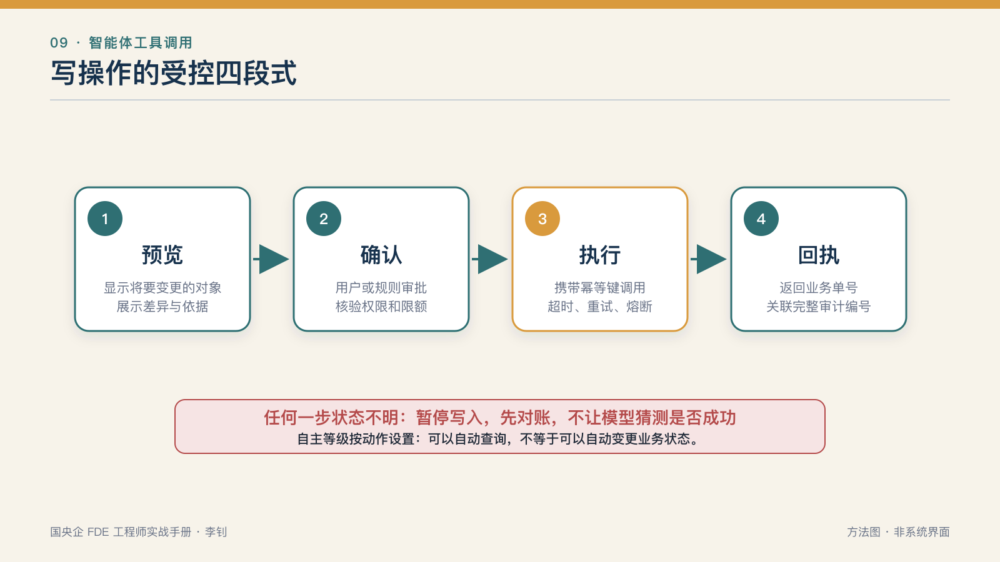

### 7.4 模型路由与可替换性

国央企常需同时使用私有化模型、行业模型和经批准的云端模型。模型网关应根据数据等级、任务类型、质量、时延、成本和可用性路由，而不是把所有请求都送往“最强模型”。

可替换性不等于所有模型输出完全相同，而是核心资产不被单一模型吞没：提示模板版本化；工具协议独立；知识库保留原始文档和元数据；评测集由企业掌握；会话与审计采用中立格式；关键业务规则放在策略或代码中，而非只写在提示词里。

### 7.5 入口联邦的技术落点

当 WPS Comate 作为横向 AI 办公入口，与 ERP、CRM、OA 等领域入口并存时，建议共享六类底座：

- 企业身份与组织目录，确保同一用户在各入口获得一致授权。
- 能力注册表，描述工具所有者、版本、数据等级、动作风险和可用范围。
- 策略决策点，集中执行模型、数据、工具和地域规则。
- 统一模型网关，管理路由、配额、脱敏和供应商退出。
- 评测与观测平台，比较不同入口完成同一任务的结果。
- 审计总线，将用户意图、模型版本、证据、工具调用和审批关联起来。

领域厂商可以将业务能力发布为标准工具，在自身入口内提供最完整体验，也允许经授权的横向入口调用；横向工作台则避免复制交易规则，只负责任务编排和跨域体验。这是“入口共存、能力复用、责任归位”。

### 7.6 非功能目标必须量化

生产架构评审时至少定义：可用性、端到端时延、峰值并发、恢复时间目标、恢复点目标、单任务成本、日志保存期、评测频率、故障降级方式和人工支持时间。对 AI 还要定义模型不可用、检索不可用、工具不可用、内容过滤误拦截等局部故障的体验。

“系统支持高并发”不可验收；“工作日 9:00 至 18:00，在 300 并发用户下，知识问答 P95 小于 8 秒，工具型任务 P95 小于 30 秒；模型网关故障时切换到批准的备用模型，写操作默认暂停”才可测试。

## 第八章　数据、知识与系统集成

### 8.1 先证明数据可用，再谈模型参数

很多效果问题表面像“模型不聪明”，根因却是文档过期、扫描件无法解析、表格结构丢失、设备编码不统一或用户无权读取正确内容。FDE 应建立数据就绪清单：来源、所有者、更新频率、质量、敏感等级、使用目的、授权依据、保留期限和删除方式。

数据团队负责可获得，不代表业务语义正确；业务专家知道含义，不代表可以直接用于模型；合规批准某类使用，也不代表技术系统已实施最小权限。三者要在数据产品或知识域层共同负责。

### 8.2 RAG 不是“文档切片加向量库”

一个可用的检索增强生成系统至少包含：文档接入、解析、清洗、结构恢复、元数据、切分、索引、权限过滤、混合检索、重排、上下文组装、引用、质量评测和更新机制。

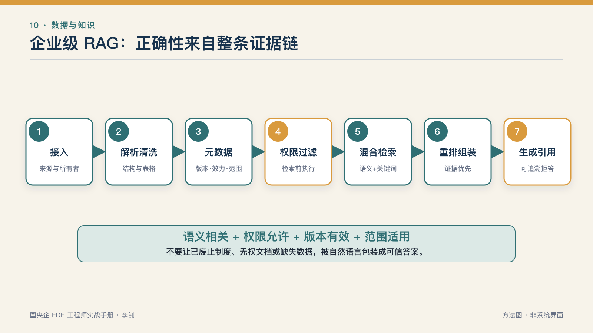

国央企制度和工程资料尤其要保留：发文单位、文号、版本、效力状态、生效日期、适用组织、设备或项目范围、密级、附件关系和替代文件。只按文字相似度检索，可能把已废止制度排在现行制度之前。正确性来自“语义相关 + 权限允许 + 版本有效 + 范围适用”。

知识新鲜度需要服务目标。为每类知识定义更新来源、同步周期、最大允许延迟、失败告警和旧版本处置。例如，安全操作规程发生替代关系时，应先让旧版本退出可检索集合，再开放新版本；同步失败时，系统宁可明确提示“知识可能过期”，也不应继续无提示回答。

### 8.3 权限过滤必须在检索前执行

生成后再删除敏感内容属于事后补救。系统应在查询数据源和检索候选文档之前，将用户身份映射为组织、岗位、项目、数据域和操作权限。检索索引可以共享，但结果必须按访问控制列表或属性策略过滤；缓存也应包含权限上下文，防止不同用户共享错误结果。

对“用户上传文件”要单独治理：文件是否允许离开终端，是否含个人信息或商业秘密，是否进入公共知识库，多久删除，其他用户能否检索。默认将临时上传与企业知识分开，未经批准不用于训练。

### 8.4 主数据和语义契约

跨系统智能体需要一个最小语义层，不必一开始建设庞大知识图谱。先选择场景中的核心对象，如客户、合同、设备、物料、组织、工单，为其定义企业主标识、各系统映射、关键属性、状态含义和所有者。

语义契约要解决“同名不同义”和“同义不同名”。例如 ERP 的“已完成”可能指财务过账，项目系统的“已完成”可能指现场验收。智能体不能凭字段名猜测，工具返回应包含业务定义和时间口径。

### 8.5 API、事件、文件与 RPA 的选择

| 集成方式 | 适合场景 | 优点 | 风险与控制 |
|---|---|---|---|
| API | 实时查询和稳定写入 | 结构化、可治理 | 版本、限流、幂等 |
| 事件 | 状态变化触发任务 | 解耦、实时 | 重复、乱序、追踪 |
| 批量文件 | 老系统、周期同步 | 实施简单 | 时效、对账、加密 |
| RPA | 无接口的过渡场景 | 快速穿透旧界面 | 易受页面变化影响 |

RPA 应被视作有退出日期的适配层，不是长期核心架构。所有集成都需要对账：AI 认为已完成的任务，必须能在源系统找到一致记录；对账失败要进入人工队列。

### 8.6 数据质量闭环

AI 会放大数据问题，也能帮助暴露问题。把“检索不到”“编码冲突”“字段缺失”“专家纠正”结构化记录，按数据源、对象和责任部门汇总。业务系统修复后，相关评测样本应自动回归。这样，AI 项目不只消费数据，也推动数据治理产生可量化需求。

## 第九章　评测、验收与价值证明

### 9.1 没有评测集，就没有可控迭代

AI 输出具有概率性，不能只靠项目组随机提问。黄金评测集应来自真实任务，覆盖常见、困难、边界、异常、对抗和高风险样本。每个样本包含输入、必要上下文、期望行为、禁止行为、评分标准和业务解释。

评测集不宜完全外包给供应商。供应商可以协助构建，但企业必须掌握样本、标准和历史结果，否则更换模型或平台时无法判断能力是否退化。

### 9.2 六维评测体系

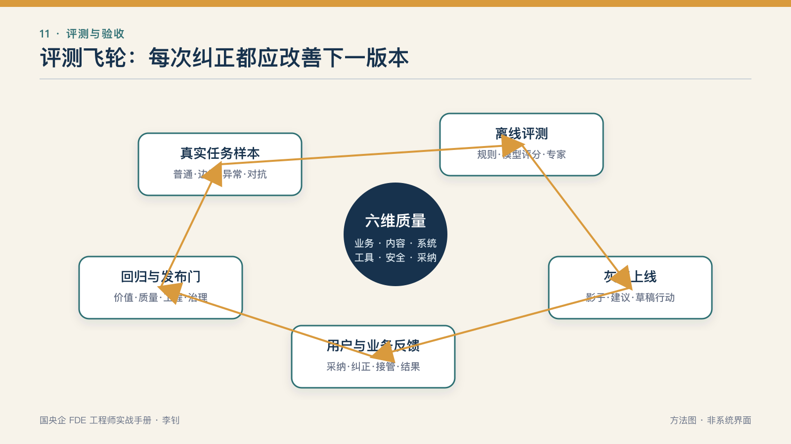

| 维度 | 关注问题 | 示例指标 |
|---|---|---|
| 业务结果 | 是否完成任务并改善指标 | 周期、返工、损失避免 |
| 内容质量 | 是否正确、完整、有证据 | 专家评分、引用覆盖 |
| 系统性能 | 是否稳定、快速、可恢复 | 成功率、P95、恢复时间 |
| 工具执行 | 是否选对工具并正确调用 | 参数正确、重复写入为零 |
| 安全合规 | 是否守住权限与内容边界 | 越权、泄露、危险建议 |
| 用户采纳 | 是否真正进入日常工作 | 有效任务、复用、接管率 |

某些指标需要门槛而非平均分。例如，高危设备停机建议的禁止错误应为零；普通文案润色可以容忍少量风格差异。验收矩阵应同时给出目标值、最低门槛、样本量、测试环境、负责人和失败处理。

黄金集还应按业务风险分层报告，不能只给一个总体平均数。至少区分高频普通样本、低频困难样本、关键少数样本、权限与隐私样本、提示注入等对抗样本、工具超时和重复请求等工程样本。总体分数上升但关键少数退化时，版本仍不应发布。

### 9.3 规则评分、模型评分与专家评分

规则适合判断格式、字段、引用存在、工具参数和禁止词；模型评分适合大规模比较相关性、完整性和表达，但必须用人类样本校准；专家评分适合高风险语义和业务可用性，但成本较高且存在分歧。

推荐三者结合：先用规则筛出硬失败，再用经过校准的模型评分扩大覆盖，最后由专家审查高风险样本和随机抽样。若专家之间一致性很低，说明评分标准或业务规则本身尚未统一。

### 9.4 离线评测与在线实验

离线评测用于快速回归和版本比较；在线实验用于验证真实工作流影响。上线前至少比较当前流程、候选模型或方案和人工基线。上线后记录用户是否采纳、修改或放弃建议，但不能把“点击采纳”直接等同于正确。

对高风险流程不宜直接做无保护的 A/B 实验。可使用影子模式：AI 在后台生成结果，不影响真实决策，由专家事后比较；达到阈值后转为建议模式，再逐步开放草稿行动。

### 9.5 价值台账

价值计算应有基线、归因和成本。一个简单台账包括：任务量、原平均工时、新平均工时、人工复核时间、返工变化、系统与模型成本、实施维护成本、风险事件和用户覆盖。避免把所有节省时间直接折算为裁员收益；更可信的表达是产能释放、响应加快、加班减少或损失避免。

示意：某流程月均 2000 单，原人工处理 20 分钟，AI 后生成 3 分钟、复核 7 分钟，每单净节省 10 分钟，月释放约 333 小时。若质量无下降且这些时间被用于处理积压或提升服务，才形成业务价值。正式测算还需考虑采用率、峰谷、培训、维护和机会成本。

### 9.6 发布门槛

上线决策不应由一次演示决定。建议设置四道门：

- 价值门：业务负责人确认目标仍成立，真实样本显示改善。
- 质量门：黄金集达标，高风险失败已关闭或受控。
- 工程门：容量、监控、回退、备份和支持准备完成。
- 治理门：数据、模型、内容、保密、法务和审计要求已签字确认。

任一门未通过，可以缩小范围、降低自主等级或延后发布，而不是用会议纪要把风险变成“后续优化”。

## 第十章　安全、合规与负责任 AI

### 10.1 先判断适用范围

中国的生成式 AI 监管要求会因服务对象、部署方式、数据类型、行业和地区而不同。《生成式人工智能服务管理暂行办法》主要针对向中国境内公众提供生成式 AI 服务，同时强调发展和安全并重；企业内部研发与应用不能简单等同于公开服务，也不意味着没有网络安全、数据安全、个人信息、保密和行业监管义务。参见[《生成式人工智能服务管理暂行办法》](https://www.cac.gov.cn/2023-07/13/c_1690898327029107.htm)。

FDE 的正确动作不是自行下法律结论，而是在项目章程中列出服务对象、网络边界、模型来源、数据范围、生成内容去向和自动化动作，交由法务、网信、保密和行业主管人员判断适用要求，并把结论转成工程控制和验收用例。

### 10.2 数据与保密底线

项目至少应对照《个人信息保护法》《数据安全法》《保守国家秘密法》及所在行业规定。参考[个人信息保护法](https://www.miit.gov.cn/jgsj/zfs/fl/art/2022/art_515a4b20c12f430eab54bb4f56d89f56.html)、[数据安全法](https://www.miit.gov.cn/zwgk/zcwj/flfg/art/2022/art_284b390b84484f10b0e43eeafaad0f6d.html)和[保守国家秘密法](https://www.gjbmj.gov.cn/n1/2024/0227/c409088-40184579.html)。

工程上要回答：

- 哪些数据属于国家秘密、工作秘密、核心或重要数据、个人信息、商业秘密？
- 数据是否允许进入该网络区、模型服务、日志、缓存和评测环境？
- 使用目的是否明确且最小，是否需要告知、授权或单独同意？
- 谁能查看原文、提示、输出、工具参数和追踪记录？
- 供应商是否留存或用于训练，分包商和跨境链路如何控制？
- 到期如何删除，备份和派生索引是否同步删除？

涉密信息系统及涉密数据必须遵守专门管理要求。不要把“私有化部署”自动等同于“可以处理涉密信息”，部署位置只是条件之一。

### 10.3 模型与生成内容治理

若项目面向公众提供生成式 AI 服务，应与主管部门核实算法备案、生成式 AI 服务备案或登记等要求。国家网信办持续公开相关服务备案信息，并对未落实安全评估、备案、训练数据安全和标识义务等问题开展治理。参见[生成式人工智能服务已备案信息](https://www.cac.gov.cn/2024-04/02/c_1713729983803145.htm)和[2026 年 AI 领域违法违规整治信息](https://www.cac.gov.cn/2026-04/30/c_1779289298718765.htm)。

《人工智能生成合成内容标识办法》自 2025 年 9 月 1 日起施行，对适用的生成合成内容规定显式和隐式标识等要求。企业系统应根据内容类型、传播对象和适用范围设计标识、元数据和日志，不能只在页面角落写一句“AI 生成”。参见[标识办法发布信息](https://www.cac.gov.cn/2025-03/14/c_1743654684782215.htm)。

### 10.4 AI 特有威胁

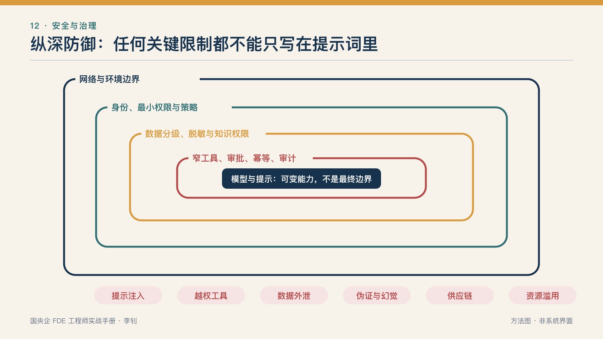

| 威胁 | 典型表现 | 主要控制 |
|---|---|---|
| 提示注入 | 文档诱导模型忽略规则并泄露数据 | 内容隔离、指令分层、工具授权 |
| 数据外泄 | 提示、输出、日志或缓存暴露敏感信息 | 分级、脱敏、最小化、访问控制 |
| 越权工具 | 模型调用用户无权执行的动作 | 服务端鉴权、最小工具、审批 |
| 幻觉与伪证 | 编造事实、引用或法规 | 证据约束、拒答、人工复核 |
| 资源滥用 | 无限循环、超量调用、拒绝服务 | 步数、预算、速率、熔断 |
| 供应链风险 | 模型、插件、Skill 或依赖被污染 | 白名单、签名、扫描、版本锁定 |

提示词中的“不得泄露”不是安全边界。任何关键限制都要在模型之外由权限、策略、网络和代码执行。

每个生产智能体应有可验证的“停止按钮”：能够撤销工具凭证、关闭写操作、切换只读、停止某个模型或知识源、终止正在运行的长任务，并确认止损已经生效。停止按钮的权限与使用场景要进入事件演练，不能只存在于后台配置说明中。

### 10.5 威胁建模的五步法

1. 列资产：数据、模型、提示、凭证、工具、业务动作和声誉。
2. 画信任边界：终端、入口、编排、模型、数据源、第三方和运维面。
3. 列攻击者：外部用户、恶意内部人、误操作人员、受污染文档和供应链。
4. 推演滥用：越权读取、诱导写入、批量导出、伪造证据、消耗资源。
5. 建测试：把每项高风险威胁转为红队样本、监控指标和事件预案。

威胁模型不是上线前的一次文档。模型、工具、入口、数据源或权限变化时，都要重新评审。

### 10.6 供应商合同与退出

合同与技术方案要相互验证。至少约定数据所有权和用途、是否用于训练、数据位置、留存删除、分包商、漏洞通知、事件响应、审计权、模型和接口变更、服务水平、可迁移格式、终止后的数据与资产返还。

企业自有资产包括：场景定义、提示模板、领域规则、知识原文与元数据、工具协议、评测集、反馈数据、审计记录和运维手册。若这些资产只能在单一平台中使用，所谓“模型可替换”仍然不成立。

### 10.7 国央企特殊地形：信创、私有化与采购节奏

上传手册将信创适配、数据保密、私有化架构和采购预算称为国央企 AI 项目的“地形”。这个比喻很准确：它们不是上线前才检查的障碍，而是从第一版方案就必须进入架构、计划和验收的设计输入。

信创适配至少要覆盖处理器与加速卡、操作系统与依赖库、数据库与向量组件、模型推理框架四层。不要只看兼容清单；应在目标环境用代表性模型、真实上下文长度、并发和数据规模完成基准测试，把性能、稳定性和运维差异写进验收。若某个新组件尚无成熟适配，应给出替代、降级或延期选择，而不是在合同签署后才暴露风险。

私有化和混合架构需要回答四个问题：模型在哪里运行，数据和知识在哪里处理，业务系统如何经统一网关接入，未来十二个月的升级和扩容如何完成。私有化不是堆硬件，混合也不是把敏感任务送云端；选择依据应是数据等级、模型能力、时延、成本、可用性和运维能力的组合。知识更新仍要走内容审批，模型、提示、索引和规则仍要版本化。

采购与预算节奏也会决定技术能否落地。FDE 虽不替代采购和商务，但应维护一张“工程—采购依赖图”：算力、软件许可、数据治理、接口改造、安全测评和实施服务分别需要何种预算、采购和验收流程；哪些资源必须在 PoC 前获得；哪些里程碑触发付款；范围变化如何办理正式变更。所有先行试验都应合规透明并可审计，不能以“创新”为名绕开制度。

把安全、信创、采购团队提前拉入共同设计，会增加启动阶段的会议，却显著减少上线前集中返工。成熟的 FDE 方案不是在通用蓝图上贴一层“国产化、私有化”标签，而是从目标环境、组织流程和预算边界中生长出来。

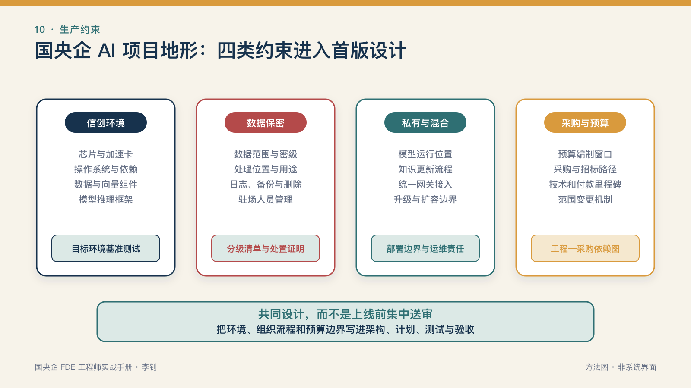

## 第十一章　上线运营与规模复制

### 11.1 生产观测的四条链

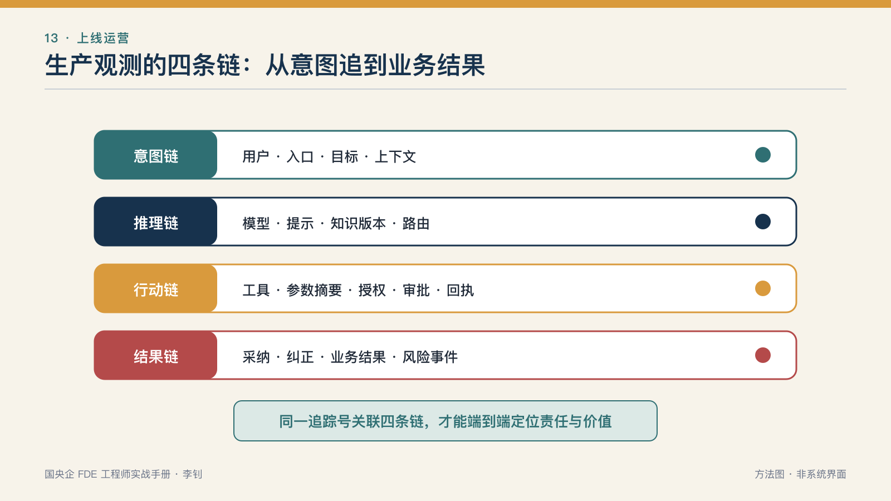

一次 AI 任务应能串起四条链：

- 意图链：用户是谁、目标是什么、使用哪个入口、上下文是什么。
- 推理链：使用何种模型、提示和知识版本，不要求暴露模型私有思维过程。
- 行动链：调用哪些工具、参数摘要、授权结果、审批人和业务回执。
- 结果链：用户是否采纳、业务结果怎样、是否发生纠正、投诉或风险事件。

日志要可关联但不应无节制保存敏感正文。可以存储必要摘要、哈希、引用标识和脱敏字段，并按目的限定保存期限。

### 11.2 看板不要只有调用量

一个运营看板至少包括：

| 类别 | 关键指标 |
|---|---|
| 可用性 | 请求成功率、工具成功率、P95、故障时长 |
| 质量 | 任务完成率、引用覆盖、专家抽检、回归变化 |
| 安全 | 拒绝、越权、敏感命中、异常导出、红队结果 |
| 成本 | 单任务 Token、模型、检索、工具和人工复核成本 |
| 采纳 | 活跃用户、有效任务、复用、纠正和人工接管 |
| 价值 | 周期、返工、积压、服务量、损失避免 |

调用量上升可能是好事，也可能说明用户反复重试。需要把调用与任务完成和业务结果关联。

### 11.3 事件分级与回退

将事件按业务影响分级。P0 可包括敏感数据大规模暴露、错误高风险写入和影响安全生产的建议；P1 包括关键场景不可用或质量显著退化；P2 包括局部功能和体验问题。每一级明确通知对象、响应时限、止损动作和复盘要求。

回退不只是切换旧模型。可能包括关闭写工具、降级为只读、切换备用知识库、恢复人工流程、撤销最近配置或下线某个入口。上线前必须演练，确保操作人员知道从哪里关、关什么以及如何确认已止损。

### 11.4 模型、提示、知识和工具的联合版本

一次结果可能同时受模型版本、系统提示、业务提示、检索配置、知识快照、工具版本和策略影响。发布记录应把这些版本绑定为一个可追踪发布单元。任何组件变化都触发相应范围的回归；高风险场景不得在无评测情况下自动跟随模型升级。

变更分三类管理：标准变更已有自动回归和低风险窗口；正常变更需要评审、灰度和回退计划；紧急变更用于止损，事后必须补齐证据与复盘。供应商在后台更新模型或安全策略，也属于可能影响业务结果的变更，合同和网关都应提供发现与冻结机制。

### 11.5 从一个项目复制到十个项目

规模复制不是复制代码仓库，而是复制经过验证的资产和治理机制。建议把资产分为四包：

- 场景包：任务地图、范围、流程、人机分工和价值模型。
- 工程包：架构、工具、数据映射、部署模板和监控。
- 质量包：黄金集、指标、红队样本、上线门槛和回归结果。
- 运营包：培训、支持、事件预案、采纳机制和复盘模板。

复制前要区分“不变量”和“本地变量”。设备检修场景中的工具协议、评测方法可能通用，但设备编码、组织权限、规程版本和审批链必须本地化。强行统一所有细节会阻碍现场，放任完全定制则无法形成平台。

### 11.6 FDE 向产品团队反馈什么

有效反馈不是“客户希望更智能”，而是可复现事实：哪个角色在什么任务中，因为哪条系统约束失败；失败频次和业务影响多大；当前临时方案是什么；哪些客户出现相同模式；建议产品化为工具、策略、界面还是文档。

当多个项目反复实现同一身份映射、引用组件、审批节点或评测工具时，FDE 应推动其进入平台产品。FDE 的长期价值，在于让下一次交付不再从零开始。

## 第十二章　生产案例一：能源设备检修助手

本书四个生产案例均为脱敏复合案例。阅读时不要复制示意指标，而要观察五件事：团队怎样缩小场景；权限和写操作怎样分级；失败如何被发现；人工在哪个节点承担实质责任；项目最后沉淀了什么可复用资产。每个案例都保留一个“不完美结果”，因为生产复盘比成功叙事更有迁移价值。

### 12.1 背景与矛盾

某能源集团拥有多座场站，关键旋转设备来自不同年代和厂商。告警发生后，值班工程师要查看时序监控、EAM 设备台账、历史工单、点检记录和检修规程，再通过电话向资深专家确认。普通告警处置准备需要 20 至 40 分钟，夜班和新员工耗时更长。

集团希望建设“设备智能诊断”，但现场有三个担忧：监控网与管理网隔离，AI 能读到哪些数据；历史工单质量参差，错误经验会不会被放大；如果 AI 建议停机造成损失，责任由谁承担。

### 12.2 场景定界

FDE 没有从“自动诊断全部设备”开始，而是选择故障知识相对完整、告警频次适中、专家有明确判断框架的一类泵机。首期目标定义为：

> 告警触发后，在 30 秒内生成带证据的初步排查清单；只读取获批数据，不直接控制设备，不自动下达停机指令；班长确认后可创建 EAM 工单草稿。

首期范围外包括：预测剩余寿命、控制 DCS 或 SCADA、自动采购备件、替代安全操作规程、处理涉密装置数据。

### 12.3 任务与架构

任务链如下：告警事件进入事件网关；系统根据设备主标识查询最近时序摘要；读取设备台账和最近工单；按设备型号、故障码和有效版本检索规程；规则引擎检查危险操作；模型生成“现象—可能原因—核查步骤—证据—不确定项”；用户查看并修订；班长批准；EAM 工具创建草稿并返回工单号。

架构采用读写分离。时序系统只提供预计算摘要，不允许模型发起任意查询；规程索引保留版本、适用设备和生效状态；EAM 写工具只能创建草稿，不能关闭工单或变更设备状态；每条建议引用具体测点时间窗、工单号或规程条款。

### 12.4 FDE 的关键动作

第一，统一设备标识。团队发现监控系统用点位前缀，EAM 用资产编码，规程按型号归档。FDE 组织设备、数据和系统团队建立最小映射表，并为映射缺失设置“停止生成、转人工”的状态。

第二，把专家经验变成评测标准，而不是直接塞进提示词。三名专家分别解释 60 个历史告警，团队提炼出必要证据、危险误判和可接受差异；对专家分歧样本先修订流程规则。

第三，实施影子模式。系统在两周内后台生成建议，由专家在不影响实际处置的情况下评分。确认危险建议为零且证据覆盖达标后，才向一个班组开放建议模式。

第四，保护员工参与。项目明确助手用于缩短资料搜集和培养新人，不以使用数据直接评价个人；专家对高质量知识条目署名，纠正反馈进入月度贡献记录。

### 12.5 验收设计

| 指标 | 示意目标 | 验证方法 |
|---|---|---|
| 证据覆盖率 | 关键结论 100% 有来源 | 黄金集与线上抽检 |
| 危险建议 | 关键样本为 0 | 红队与专家审核 |
| 端到端时延 | P95 小于 30 秒 | 生产压测和监控 |
| 工单重复写入 | 0 | 幂等与对账测试 |
| 资料准备时间 | 中位数下降 40% | 同类任务前后对比 |
| 班组采纳 | 周有效使用率超过 60% | 有效任务日志 |

上述数字为教学示意。正式目标需依据设备风险等级和现场基线确定。

### 12.6 上线故障与复盘

灰度首周出现一次“无异常趋势”的错误表述。根因不是模型，而是时序摘要服务在网络抖动时返回空数组，工具把“无数据”翻译成“无异常”。修复包括：区分无数据和正常；无数据时禁止模型下结论；页面突出数据时间范围；增加摘要服务新鲜度告警；把该样本加入回归集。

复盘结论是：生产可靠性往往由最普通的数据状态决定。自然语言会让错误看起来合理，因此工具返回必须保留确定性状态，界面必须让用户看到证据是否完整。

### 12.7 可复用资产

项目沉淀了设备标识映射规范、时序摘要工具、带版本权限的规程检索、维修建议评测集结构、危险动作规则、EAM 草稿工具和班组上线手册。这些资产可复制到风机、压缩机等设备，但具体测点、阈值和规程必须重新验证。

## 第十三章　生产案例二：制造企业客诉与质量闭环

### 13.1 背景与目标

某制造集团每天从热线、邮件和经销商系统收到大量客诉。客服在 CRM 建单后，质量人员需要核对产品批次、BOM、检验记录、相似缺陷、出货和退换货信息，再决定是否升级为质量事件。信息分散在 CRM、ERP、QMS、MES 和文档库中，同一物料在不同系统还存在历史编码。

原流程平均需要两天完成初步归因，关键客诉有时因分类错误延迟升级。项目目标不是让 AI 自动判定质量责任，而是缩短信息聚合时间、提高分类一致性，并让所有判断能够追溯。

### 13.2 首期闭环

首期选择一个产品线和三类高频缺陷。AI 完成：识别客诉中的产品、现象、时间和使用条件；提示缺失信息；映射序列号和批次；查询检验、生产和历史客诉；推荐分类与相似案例；生成 8D 报告初稿的已知事实部分。质量工程师确认分类，重大事件升级仍由质量负责人批准。

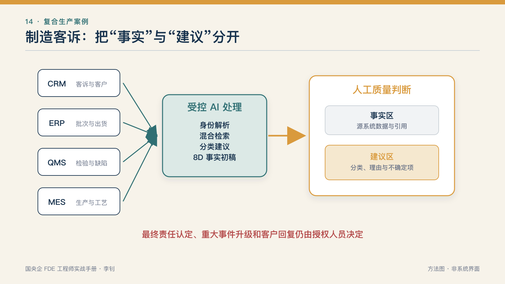

AI 不做最终责任认定，不向客户自动发送解释，不修改物料和质量主数据，不把未经核实的推测写入正式 8D 结论。

### 13.3 系统复杂性的真实表现

项目初期，团队试图直接通过接口按“物料编码”关联，测试准确率却波动很大。现场调查发现：经销商使用销售型号，CRM 保存商品编码，ERP 保存物料编码，MES 还保留旧编码；部分客诉只有包装照片。FDE 将问题拆为身份解析服务：条码识别、序列号规则、产品别名、历史编码映射和人工确认队列。

又一个问题是“相似客诉”。纯向量相似会把文字相近、批次无关的案例排在前面。团队采用混合检索：产品族、部件、缺陷代码、发生阶段和文本语义共同评分，并把时间和已关闭原因作为过滤条件。

### 13.4 人机协同设计

客服担心 AI 用于压缩岗位，质量人员担心系统把建议当结论。项目采用两张清晰界面：左侧是“事实区”，只显示源系统数据和引用；右侧是“建议区”，展示模型分类、理由和不确定项。用户修改建议时需选择原因，如信息缺失、编码错误、规则例外或模型误判，这些反馈分别进入数据治理、流程治理和模型评测队列。

项目还调整绩效口径：首期不按个人处理数量排名，而看团队积压、一次信息完整率和重大事件及时升级率。这样避免用户为了速度无条件接受 AI。

### 13.5 示例验收结果

经过六周灰度，示意结果如下：首期三类客诉的初步材料准备中位时间由 90 分钟降为 35 分钟；必填事实完整率从 72% 提升到 91%；重大事件漏升级在验证样本中为零；AI 推荐分类的专家一致率为 88%；约 18% 的任务需要人工修正产品映射。

这些数据说明价值已出现，也说明主数据问题仍显著。团队没有把 88% 宣传为“自动化率”，而是保持人工确认，并将产品映射修复列为下一阶段重点。

### 13.6 复盘：AI 项目反向推动数据治理

过去，产品编码问题分散在客服抱怨中，没有统一证据。AI 系统将每次映射失败结构化，按产品线和源系统形成热力图，主数据团队终于获得清晰优先级。FDE 的贡献不仅是提高模型效果，还把“数据很乱”变成可分派、可衡量、可回归的问题。

## 第十四章　生产案例三：城市运营工单助手

### 14.1 背景与边界

某城市运营集团承担园区、市政设施和公共服务工单。事项来自热线、移动端、巡检和上级交办，涉及供水、道路、停车、物业等多家单位。坐席需要判断地点、事项类型、紧急程度和责任单位，再通过工单平台派发。地址表达不标准、跨部门事项和重复来电是主要难点。

项目希望通过 AI 提升分派效率，但包含联系方式、地址、录音文本等个人信息，部分事项涉及应急和公共安全。首期采用“建议分派 + 人工确认”，不自动关闭工单，不向公众自动回复，不对个人进行画像。

### 14.2 业务流程

系统先对文本或经批准转写的录音进行结构化，抽取地点、设施、现象、时间和诉求；地址标准化服务将自然语言映射到 GIS 网格；规则和检索共同推荐事项分类、责任单位和时限；发现相似地点与时间的工单时提示可能重复；坐席确认后通过工单 API 派发。

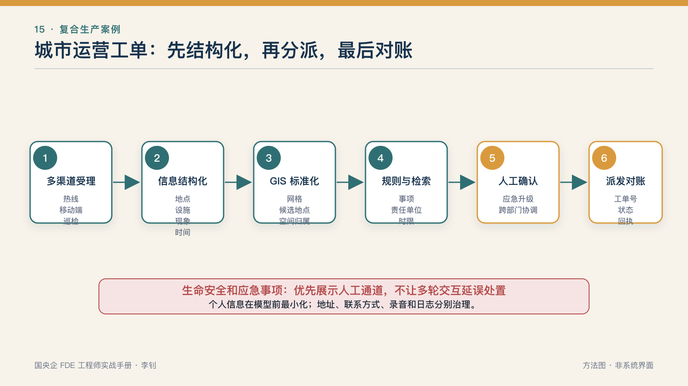

高风险词并不直接触发自动结论。系统展示命中原因，并按应急预案提示坐席升级。涉及生命安全的情况优先显示人工应急通道，避免模型多轮追问耽误时间。

### 14.3 隐私与最小化

FDE 与数据和法务团队逐字段确认使用目的。模型分类通常不需要完整手机号和身份证号，进入模型前进行掩码；原始录音和转写文本分库存储，普通运维人员只看脱敏内容；评测集使用脱敏或合成样本；日志不保存无关正文。

位置数据也需按任务最小化：地址标准化工具返回网格和候选地点，不向无权用户暴露居民详细信息。外部模型仅处理经批准的数据等级，敏感任务路由到受控环境。

### 14.4 跨部门语义与责任

“路面有水”可能属于供水漏损、雨水积水、施工排水或物业保洁。仅靠文本分类无法稳定决定责任。团队建立最小事项本体，包含设施类型、空间归属、现象、天气、工程状态和责任规则；对于跨部门冲突，生成联合工单草稿并要求调度员确认。

FDE 组织各单位用 200 条争议工单进行规则对齐。真正的难点不是模型选择，而是过去没有统一定义“谁在什么条件下负责”。AI 项目迫使流程所有者公开解决灰区。

### 14.5 运营与公众沟通

项目的线上指标包括分派建议接受率、改派率、平均分派时长、重复工单识别、超时率、隐私拦截和公众投诉。AI 生成的对外内容若进入发布链路，应按适用要求进行人工审核和生成合成内容标识；用户有权知道如何转人工。

一次版本更新后，某类道路施工工单改派率升高。联合版本追踪显示模型未变，是责任规则表更新遗漏了两个新项目。团队回滚规则、补充配置测试，并要求以后规则发布与组织和项目主数据同步。这个事件再次证明，AI 质量是整个系统的质量。

## 第十五章　生产案例四：WPS Comate 与 ERP 的联邦双入口

### 15.1 决策背景

某大型集团已经部署 WPS 365、ERP、CRM 和 OA，希望通过 WPS Comate 提升跨文件和跨系统任务体验。财务、人力、采购等领域系统厂商也在建设自己的智能助手。集团面临选择：统一要求所有能力进入 Comate，还是继续让各业务系统掌握入口？

FDE 先拆解了四类任务：

- “汇总本周三个项目的采购进度并生成周报”需要跨 ERP、项目系统和文件，适合横向工作台。
- “审核付款申请并执行过账”交易性和责任性强，应留在财务系统入口。
- “查询某供应商合同、交付和付款状态”可在多个入口触发，底层能力应复用。
- “根据会议纪要创建采购需求草稿”可由工作台发起，但必须进入 ERP 待办确认。

### 15.2 联邦方案

集团没有设定唯一入口，而是建立企业 AI 能力目录。ERP 厂商发布 `query_supplier_status`、`create_purchase_request_draft` 等领域工具；OA 发布流程和组织工具；文档与知识资产通过受权限控制的 Wiki 或检索服务提供。WPS Comate 侧的岗位专家经 Skill 与 DataHub 调用获批能力，领域系统内的助手也调用同一组企业工具。

所有入口必须经过统一身份和策略网关。工具接收用户身份、组织、任务目的和入口标识，在服务端执行授权；任何入口都不能凭自己的前端权限推断业务系统权限。写操作返回预览，跳转或推送到领域系统完成审批。

| 控制对象 | 横向工作台 | 领域系统 | 企业共享底座 |
|---|---|---|---|
| 用户意图 | 跨域任务编排 | 专业任务交互 | 留存与用途策略 |
| 业务语义 | 调用，不复制交易规则 | 定义对象和状态 | 统一词汇与主标识 |
| 写操作 | 发起草稿或跳转 | 校验、审批和落账 | 身份、策略与审计 |
| 质量反馈 | 记录跨域体验 | 记录专业纠正 | 联合评测与版本关联 |
| 退出迁移 | 导出会话和配置 | 保留交易事实 | 保存工具、评测和日志 |

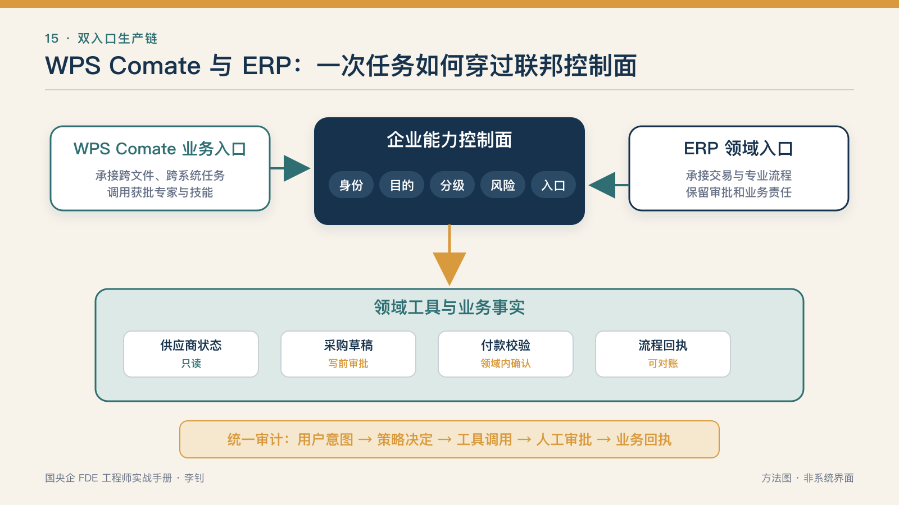

### 15.3 WPS Comate 侧的工程约束

WPS 官方公开资料把 Comate Studio 描述为专家与技能的管理后台，把 DataHub 描述为连接企业自有系统的数据层，并说明权限可在 Studio、DataHub 和用户使用侧分层配置；团队空间则用于共享技能、应用、Wiki、自动化和任务成果。FDE 应把这些产品能力映射到企业控制：专家与 Skill 的所有者、版本、发布与下线；DataHub 连接的数据口径、身份和字段范围；团队资源的可见范围；模型、凭证、网络出口、运行日志和成本策略。参考[专家、DataHub 与 Studio](https://plus.wps.cn/blog/p108379.html)和[团队协作能力](https://plus.wps.cn/blog/p108404.html)。

平台声明的能力不能替代企业验证。项目需逐项确认：云端与本地任务处理的数据位置和留存；本地文件、云文档和会议纪要的授权是否满足数据分级；连接器凭证由谁管理；专家和 Skill 是否按岗位最小授权；高风险动作是否逐次确认；日志能否进入企业审计平台；停用专家或更换模型后，正在运行的任务如何处置。

### 15.4 传统厂商的三种产品选择

对金蝶、用友等传统厂商，合理策略取决于任务控制权：

1. 生态提供者：把查询、计算、草稿和审批等领域能力以标准工具开放，在多个 AI 入口触达用户，收益来自领域服务与交易能力。
2. 领域入口经营者：在财务、供应链等高频专业工作中提供深度助手，掌握完整上下文和责任链，同时调用外部通用能力。
3. 双向联邦者：既向横向生态发布工具，也让自身入口调用集团能力目录，通过统一协议避免重复集成。

把所有能力封闭在自己的对话框里，会失去跨域任务；把全部交互交给横向入口，又可能丢失领域体验和反馈。真正的竞争力不是聊天窗口，而是准确的业务语义、可靠的交易工具、可验证的规则和持续服务网络。

### 15.5 治理与商业边界

集团在合作协议中明确：用户、任务和反馈数据归属；工具接口与版本支持；平台与领域厂商的故障责任；模型或入口更换时的迁移格式；Skill、专家和数据连接的安全评审；调用计量与费用；不得以未授权数据训练；终止合作后的凭证吊销和数据删除。

技术上为每个工具定义 SLO 和责任人。若横向工作台计划错误，由工作台团队负责；若 ERP 工具返回错误余额，由 ERP 团队负责；若企业权限策略配置错误，由集团身份与安全团队负责。FDE 维护端到端追踪，让故障不在供应商之间来回推诿。

### 15.6 示例结果与复盘

首期上线三个只读工具和一个采购草稿工具。示意结果：跨系统周报准备时间下降 45%，供应商状态查询首次完成率达到 86%，采购草稿因主数据缺失的失败率为 9%，写入重复为零。用户最喜欢的是无需寻找多个系统，财务部门最看重的是审批仍在原系统完成。

复盘表明，联邦双入口增加了初期治理工作，却降低了长期重复建设。集团没有把某一产品名称写进核心业务语义，而是将能力目录、策略、评测和审计作为企业资产。这为未来更换入口或模型保留了选择权。

## 第十六章　FDE + WPS Comate：业主公司 AI 生产落地方案

本章按工程建设、能源、制造等“项目型业主公司”理解，给出一套可直接用于方案设计和驻场推进的方法：

> 以 WPS Comate 作为业务入口和 AI 运行载体，由 FDE 把业主的业务知识、系统数据、岗位 SOP、权限规则和评价标准，装配成可使用、可考核、可运营的 AI 工作流。

这里的重点不是采购一个聊天工具，而是交付一组能够持续工作的岗位能力。每项能力都要有明确输入、标准输出、业务 Owner、评测集、权限边界、运行记录和更新机制。

### 16.1 Why：产品载体与最后一公里工程互补

WPS 的公开资料显示，Comate 的产品能力覆盖岗位专家、自动化任务、Wiki、Skill、团队协作和应用/应用广场等组织应用形态，并以 Comate Studio、DataHub、模型管理和权限配置支持企业侧管理。FDE 的价值则是驻场理解岗位、抽取规则、连接系统、设计评测和运营闭环。两者分别解决“用什么承载”和“怎样在现场有效运行”。

| 传统项目问题 | FDE 的作用 | Comate 承载方式 |
|---|---|---|
| 业务人员说不清 AI 需求 | 观察并拆解真实流程 | 对话、原型应用 |
| 专家经验只存在人脑 | 抽取 SOP 与判断规则 | Skill、岗位专家 |
| 资料分散、版本混乱 | 建立知识治理 | Wiki |
| AI 读不到真实业务数据 | 统一口径、接口和权限 | DataHub |
| Demo 不能持续运行 | 增加调度、审核与异常机制 | 自动化任务 |
| 个人会用、组织难复制 | 认证模板并运营资产 | 团队空间、共享资源 |
| 多模型成本与合规难管理 | 设计模型路由与使用规则 | 模型管理、Studio |

Comate 解决的是产品载体问题，FDE 解决的是最后一公里业务工程问题。缺少载体，经验难以规模复制；缺少 FDE，模块容易停留在功能演示。

### 16.2 What：交付六类生产资产

FDE 不应只交付提示词或聊天机器人，而应交付六类生产资产：

1. 场景清单：明确哪些流程适合 AI，价值、前置条件与风险是什么。
2. 企业知识资产：制度、标准、合同模板、项目资料和历史案例，具有所有者、版本与下线规则。
3. 可复用 Skill：固定输入、执行规则、工具边界、输出格式和质量要求。
4. 岗位专家：面向项目经理、法务、采购、运营等岗位组合知识、技能和数据。
5. 自动化工作流：按条件或周期采集、分析、生成、通知和催办，并能处理异常。
6. 评价与运营体系：跟踪准确率、采纳率、节省工时、单任务成本和风险事件。

交付对象因此从“一个模型”变成“一个可运营的 AI 岗位能力”。六类资产应进入配置库或资产目录，能够导出、回归、授权、发布和下线。

### 16.3 Why not：为什么不全部自研

如果业主已经使用 WPS 365，Comate 离文档、表格、演示、会议纪要和团队协作更近，可以把一次性对话逐步升级为 Skill、Wiki、岗位专家和自动化，降低从个人试用到组织复用的摩擦。官方资料说明，团队空间可共享技能、应用、Wiki、自动化和任务成果；Studio、DataHub 与权限体系用于管理专家、技能、数据连接和使用范围；模型管理用于统一接入和配置使用策略。参见[团队协作能力](https://plus.wps.cn/blog/p108404.html)、[专家、DataHub 与 Studio](https://plus.wps.cn/blog/p108379.html)和[模型管理](https://plus.wps.cn/blog/p108194.html)。

但 Comate 不应替代业主已有的数据仓库、主数据平台、ERP、项目管理系统、流程引擎或工业控制系统。更合理的架构原则是：

> 业务系统负责事实与交易，WPS Comate 负责理解、生成、协作和人机交互，FDE 负责把两者可靠地连接起来。

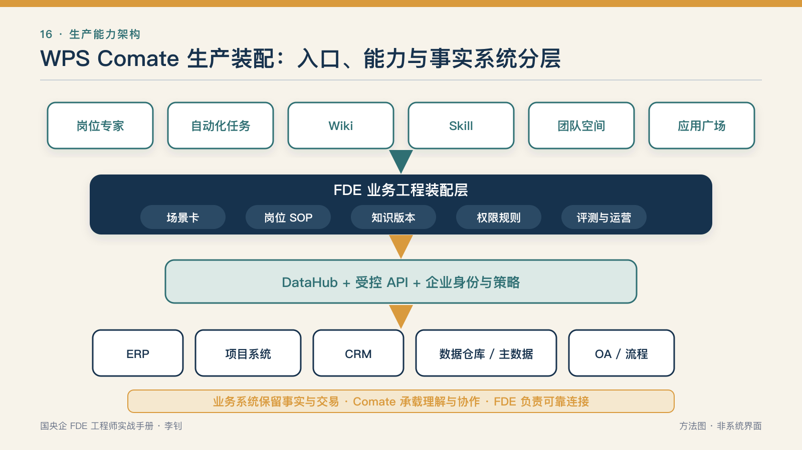

图中的治理能力不是平台按钮的简单集合。身份仍要在企业目录中统一，业务口径仍由系统和数据 Owner 决定，高风险写操作仍在领域系统完成审批，审计记录还要能够跨 Comate 与业务系统对账。

### 16.4 Who：一项场景必须有一名业务 Owner

| 角色 | 主要责任 |
|---|---|
| 业主业务负责人 | 对业务结果、规则与资源最终负责 |
| FDE | 场景发现、流程建模、集成、评测、上线和运营 |
| 业务专家 | 提供 SOP、案例、判断规则与验收标准 |
| IT/数据团队 | 接口、数据口径、身份、权限与运行环境 |

| 治理与支撑角色 | 主要责任 |
|---|---|
| 安全法务团队 | 数据分级、模型边界、审计与合规 |
| WPS/实施团队 | 产品能力、部署、版本适配与疑难问题 |
| 一线用户 | 试用、纠错、反馈与采纳确认 |
| AI 治理委员会 | 决定高风险场景的上线与自动化等级 |

每个场景必须指定一名有决策权的业务 Owner。没有 Owner，规则争议无人裁定、评测样本无人确认、上线风险无人接受，最后通常只会留下 Demo。FDE 可以组织证据和暴露分歧，但不能代替业务 Owner 作出经营或法定责任决定。

### 16.5 Where：首批场景从文档密集、规则稳定、人工可验开始

| 场景 | 推荐组合 | FDE 重点工作 |
|---|---|---|
| 项目交付助手 | Wiki + Skill + 岗位专家 | 周报、纪要、风险与验收材料 |
| 合同审查助手 | Wiki + Skill + 专家 | 条款库、红线、分级与引用 |
| 制度与标准问答 | Wiki + 专家 | 清洗、版本、权限与拒答 |
| 项目经营问数 | DataHub + 专家 | 指标口径、权限、验证与解释 |
| 工单风险监控 | 自动化任务 + Skill | 词库、评分、通知与催办 |
| 招采材料编制 | Wiki + Skill | 模板、资质与完整性检查 |
| 汇报材料生产 | Skill + WPS 文档/PPT | 固定结构、数据引用与审批 |
| 项目轻应用 | 应用 + 团队空间 | 看板、问题台账与验收清单 |

WPS 官方资料介绍，Comate Wiki 可导入本地文件、云文档和会议纪要，将内容组织为可对话的知识体系，并在问答中标注来源。这类“有原文、能溯源、可人工复核”的场景通常适合作为首批试点。参见[WPS Comate Wiki](https://plus.wps.cn/blog/p108775.html)。

一个可执行的优先级规则是：先选高频且令人痛苦的任务，再确认业务 Owner、真实样本、权限和错误后果，最后才决定使用哪个模块。不要因为某个功能容易演示，就把它包装成优先场景。

### 16.6 When：按任务成熟度选择模块和自主等级

| 任务状态 | 建议能力 |
|---|---|
| 临时、探索、只做一次 | AI 对话 |
| 经常重复、规则基本稳定 | Skill |
| 依赖大量制度和项目资料 | Wiki |
| 需要完整岗位能力 | 岗位专家 |
| 需要读取 ERP、CRM、项目系统数据 | DataHub + 专家 |
| 每日、每周、每月固定执行 | 自动化任务 |
| 需要多人接力和资产共享 | 团队空间 |
| 需要可视化操作界面 | 应用 |
| 需要统一模型、权限、发布和下线 | Studio + 模型管理 |

适合正式启动的条件包括：流程基本稳定；有真实数据和代表性历史样本；输出能够由业务人员验收；业务 Owner 愿意投入；可以建立上线前后的效率和质量基线；安全与权限边界可以定义。

付款、招标定标、合同签署、安全生产处置和设备控制等不可逆或高风险任务，不宜在早期全自动化；数据口径未统一、流程每日变化、系统无可靠接口或无法定义正确性的任务，也应先停在“AI 给建议、人做确认”。自主程度按“问答—草稿—建议—人工确认执行—有限自动化”逐级放权。

### 16.7 How：四阶段、十二周推进生产

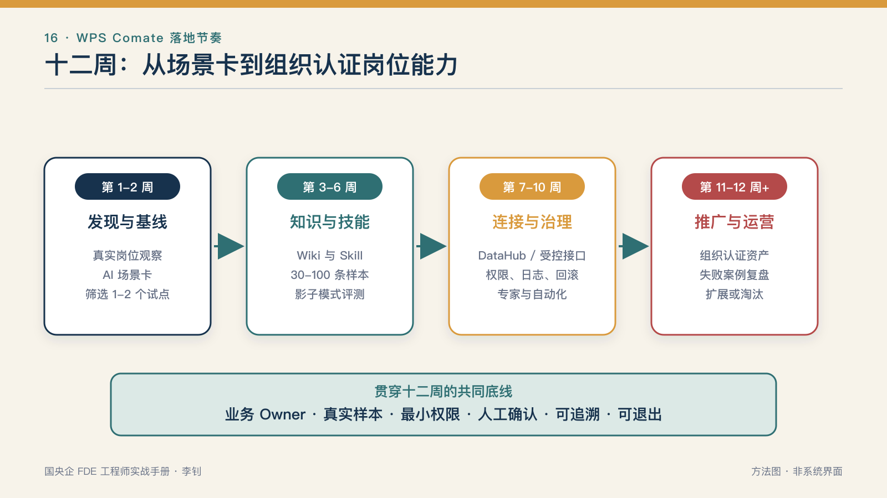

#### 第一阶段：场景发现与基线建立（第 1—2 周）

FDE 跟踪真实岗位完成任务，不以需求访谈会替代现场观察。每个场景形成一张 AI 场景卡：发起人和触发条件、输入来源、当前步骤与耗时、专家判断、使用对象、错误后果、允许自动完成的步骤，以及效率、质量和成本基线。随后用“价值 × 可行性 × 风险”筛选一至两个试点。

#### 第二阶段：知识与技能试点（第 3—6 周）

清洗制度、模板、案例和项目资料，建设场景 Wiki，把稳定 SOP 编成 Skill，准备三十至一百条具有代表性的评测样本。先采用影子模式：AI 生成结果但不直接进入正式流程，由业务专家逐条评价正确性、完整性、引用依据和可用性。样本数量不是目标，覆盖普通、边界、高风险和拒答任务才是目标。

#### 第三阶段：系统连接与生产治理（第 7—10 周）

通过 DataHub 或受控接口连接业务数据，按部门、项目和岗位授权，对敏感字段最小化或脱敏；关键结论附来源；写回、发送和审批设置人工确认；配置日志、联合版本、异常处理和回滚。稳定任务再升级为岗位专家或自动化任务。WPS 官方资料说明，Comate 定时任务支持云端和本地周期执行，而本地模式依赖终端运行条件；FDE 应按数据敏感性、稳定性和可维护性选择执行方式。参见[自动化任务说明](https://plus.wps.cn/blog/p108418.html)。

#### 第四阶段：推广与运营（第 11—12 周及以后）

将通过评测的 Skill、专家和 Wiki 纳入组织认证，在团队空间共享受控资产；培训从“怎么写提示词”转向“什么任务交给哪个 AI、何时必须人工确认”；每周复盘失败案例，每月检查知识时效、模型成本和权限，淘汰低价值场景，扩展高价值场景。每次错误都应转成新的评测样本、知识修订、Skill 规则或权限限制。

### 16.8 生产门槛与三项坚持

建议为试点设置六个上线门槛，数值应由业主依据场景风险和基线调整：

1. 效率：单任务平均耗时下降约 30%。
2. 质量：首轮结果可采纳率达到约 80%。
3. 风险：严重事实错误、越权访问和错误写回为零。
4. 追溯：关键结论可定位到数据或文档来源。
5. 使用：试点用户周活跃率达到约 60%。
6. 经济性：单个合格成果的综合成本低于原流程。

上述比例只是规划参考，正式验收必须使用本项目基线与风险分层，不能照抄。

只有“有人用、结果对、过程可控、经济上值得”同时成立，才可称为生产落地。调用次数、生成字数和账号开通数不能单独证明价值。

FDE 还应坚持三项原则：先改造流程，再配置 AI；先辅助决策，再逐步自动执行；把失败案例沉淀为评测、知识、Skill 或权限资产。理想结果不是一个大而全的企业智能体，而是一组小而可靠的 AI 岗位能力。

> 每个能力解决一个明确问题，有确定输入，有标准输出，有业务负责人，有评测集，有权限边界，也有持续运营机制。

### 16.9 采购前用真实 PoC 和合同条款逐项验收

WPS Comate 更新较快，部分 WPS 365 官方博客也明确标注包含 AI 自动整理内容。因此，FDE 不应只根据网页名称或销售演示作出架构承诺。采购前至少核验：目标版本实际可用的模型与连接器；公有云、专有云、本地或混合部署边界；文档、提示、日志和任务结果是否上传、存放多久、如何删除；DataHub 的身份透传与行列权限；团队空间的资源可见性；专家、Skill 和自动化的发布、停用与回滚；本地任务的终端依赖；模型路由、限额、审计和费用口径；资产导出和合同终止后的迁移方式。

PoC 验收应使用真实脱敏数据、真实组织身份、真实异常和代表性历史样本。合同技术条款则把 PoC 结论写成版本、范围、服务等级、数据处理、支持响应和退出责任。公开资料负责说明可能性，PoC 与合同才负责确认可交付性。

## 第十七章　FDE 的 90 天项目作战手册

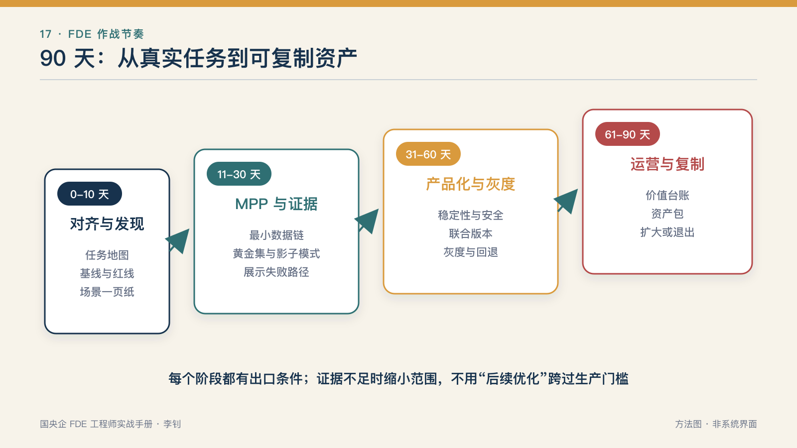

### 17.1 第 0 至 10 天：对齐与发现

目标是证明问题值得解决，并识别会阻止项目进入生产的真实约束。

- 确认业务负责人、技术负责人和治理负责人。
- 选择一个足够重要但边界可控的任务闭环。
- 观察至少五次真实任务，覆盖普通和异常案例。
- 建立当前流程、系统、数据、权限和责任地图。
- 采集首批黄金样本，明确禁止行为。
- 记录基线和价值假设，建立风险台账。
- 输出场景一页纸与首期不做清单。

第 10 天评审只回答三件事：用户问题是否真实；数据和系统是否可达；风险是否有可行控制。若任一项为否，调整场景而非盲目开发。

### 17.2 第 11 至 30 天：MPP 与证据

目标是在真实约束下跑通最小生产证明。

- 建立受控开发与测试环境。
- 打通最小数据链和一至两个窄工具。
- 实现身份透传、权限过滤、引用和审计。
- 构建包含普通、边界和对抗样本的评测集。
- 与一线用户每周两次共创，记录纠正原因。
- 使用影子或建议模式验证，不急于开放写操作。
- 形成第一版架构、威胁模型和上线差距清单。

第 30 天的演示必须使用真实脱敏样本，并展示失败：无权限如何响应、无数据如何提示、工具超时如何降级、危险请求如何阻断。只展示成功路径的演示无法支持生产决策。

### 17.3 第 31 至 60 天：产品化与灰度

目标是从“能跑”走向“可负责”。

- 修复高风险失败，扩充黄金集和回归自动化。
- 完成容量、稳定性、权限、安全与恢复测试。
- 建立模型、提示、知识、工具和策略联合版本。
- 接入监控、质量、成本、采纳和价值看板。
- 完成用户、运维、事件、回退和供应商手册。
- 选择代表性班组灰度，保留人工流程和快速支持。
- 每周由业务、安全和技术共同审查上线数据。

开放写操作时，从草稿开始，并实施预览、确认、幂等和回执。发现不可解释的错误写入立即关闭写能力。

### 17.4 第 61 至 90 天：运营与复制决策

目标是证明持续价值，决定扩大、调整或停止。

- 对比基线与实际，扣除复核、培训和运行成本。
- 分析活跃、放弃、纠正和人工接管，不只看调用量。
- 关闭无价值功能，优化高频失败和体验摩擦。
- 完成事故或未遂事件复盘，更新威胁模型。
- 将通用工具、评测、策略和培训沉淀为资产包。
- 评估下一单位的本地变量和依赖，而非直接复制。
- 由业务负责人作出扩大、维持、转向或退出决定。

第 90 天不是必须宣布成功。一个及时停止、说明假设为何不成立的项目，也比长期消耗资源的“僵尸试点”更有价值。

### 17.5 每周工作节奏

| 时间 | 活动 | 产出 |
|---|---|---|
| 周一 | 指标与风险审查 | 本周假设、优先级 |
| 周二至周三 | 构建、集成、用户共创 | 可测试增量 |
| 周四 | 评测、红队、运维检查 | 失败分布、发布建议 |
| 周五 | 业务演示与复盘 | 决策、资产、下周计划 |

FDE 要保护面向现场和评测的时间。如果整周被协调会占满，团队会失去真实反馈，最终只能用进度表替代结果。

## 第十八章　团队、协作与组织变革

### 18.1 最小跨职能小队

一个生产场景通常需要：业务所有者、产品或流程负责人、FDE、应用与集成工程师、数据或知识工程师、模型工程师、安全与合规代表、运维或 SRE、一线流程教练。人员可以兼职，但责任不能缺席。

业务所有者决定价值和流程；FDE 负责端到端闭环；系统所有者保证接口和生产责任；安全与合规决定控制和例外；一线代表验证是否可用。供应商可以交付能力，不能替代企业的流程所有权和风险接受。

### 18.2 简化 RACI

| 决策 | 负责 R | 最终负责 A | 咨询 C |
|---|---|---|---|
| 场景价值与范围 | 产品负责人、FDE | 业务所有者 | 一线、财务、科技 |
| 架构与集成 | FDE、架构师 | 技术负责人 | 系统厂商、安全 |
| 数据使用与权限 | 数据负责人、安全 | 数据或业务所有者 | 法务、保密、FDE |
| 评测与上线 | FDE、测试、运维 | 业务与技术共同 | 安全、一线专家 |
| 高风险例外 | 安全、法务、业务 | 授权管理者 | FDE、供应商 |
| 运营与退出 | 产品、运维、FDE | 业务所有者 | 财务、安全、用户 |

高风险上线不宜只有技术负责人签字；业务价值和风险接受必须由相应权责主体承担。

### 18.3 处理员工抵触的八个动作

1. 在立项时说明为什么做、影响哪些任务、哪些决定仍由人负责。
2. 请一线代表参与需求、样本、验收和上线，而非发布前才通知。
3. 把专家纠正计入贡献，建立知识维护职责和激励。
4. 先消除资料搬运和重复录入，让员工尽早获得可感知收益。
5. 提供能力边界、已知问题和人工通道，降低责任焦虑。
6. 按岗位设计训练，从真实任务练习，不只发通用课程。
7. 同时监测工作负担，避免“AI 生成更快、人工复核更多”。
8. 与人力部门设计技能迁移和岗位发展，公开阶段性安排。

组织变革的基本原则是：员工越早获得信息和参与权，越可能提供关键隐性知识；越晚被告知，越会把系统视为外部评价工具。

### 18.4 供应商协作机制

多供应商项目需要一张责任与接口清单，而不是靠 FDE 私下协调。每个依赖写清所有者、输入输出、服务等级、测试环境、版本计划、故障升级和退出方案。联合问题单使用统一端到端追踪号，避免各家只证明“自己的系统正常”。

在周会上按用户任务复盘，而不是按厂商轮流汇报。用户任务失败可能跨越入口、模型、检索、网络和 ERP；只有围绕整条链，才能找到真实瓶颈。

### 18.5 FDE 的个人工作系统

FDE 应维护五本账：假设账记录待验证判断；决策账记录重要取舍、依据和责任人；风险账记录概率、影响、控制和剩余风险；评测账记录版本与失败分布；资产账记录可复用组件和适用边界。

每个重要结论尽量附证据：用户观察、样本结果、日志、性能数据或责任人确认。口头共识在复杂项目中很快消失，清晰书面记录是协作工具，而非形式负担。

## 第十九章　常见问题

### 角色与方法

#### 19.1 FDE 是不是高级驻场开发？

不是。驻场只是工作位置，FDE 的区分在于责任范围：从场景发现到生产采纳，从技术实现到产品反馈。若一个人只按任务单写接口、无权参与范围和验收，也不对生产效果负责，就不是完整的 FDE 工作模式。

#### 19.2 FDE 与售前的分界在哪里？

售前重点是机会识别、方案和商业可行性，FDE 重点是验证生产假设并实现闭环。两者最好在立项前共同工作：售前避免承诺不可交付内容，FDE 也理解商业目标。进入交付后，范围变更仍需商务和项目机制处理，FDE 不应私自承诺。

#### 19.3 必须会训练大模型吗？

不一定，但必须理解模型局限、提示、检索、工具调用、评测和推理成本，能与算法团队定位问题。多数企业场景首先需要的是数据、集成、评测和产品设计；当证据表明微调或训练能解决稳定问题时，再引入专项能力。

#### 19.4 应该先建平台还是先做场景？

通常先做一至两个高价值场景，同时设计可复用边界。完全场景化会重复建设，完全平台化会远离价值。采用“场景牵引、共性下沉”：每个场景必须使用或贡献共享能力，平台能力必须由真实场景验证。

#### 19.5 如何选择第一个场景？

选择价值可测、负责人明确、数据可达、风险可控、四至八周能形成最小生产证明的任务。不要选只因资料容易而价值很低的问答，也不要一开始挑战全集团最复杂、最高风险流程。

### 知识、模型与集成

#### 19.6 知识库回答准确率高，为什么用户仍不用？

可能是入口不顺、等待时间长、引用不可见、权限导致找不到关键文档、答案无法进入下一步流程，或员工担心责任。查看完整任务而非问答分数，观察用户从问题到行动还要做多少手工工作。

#### 19.7 模型幻觉能彻底消除吗？

不能承诺彻底消除。可以通过受控知识、工具、结构化输出、引用、规则、拒答、评测和人工审批降低概率与影响。高风险设计的目标不是“相信模型永不犯错”，而是错误能够被发现、阻断和恢复。

#### 19.8 RAG 还是微调？

需要最新事实、企业文档和引用时优先 RAG；需要稳定风格、分类模式或领域行为时可评估微调；两者可以结合。先用评测定位失败类型：知识缺失、检索错误、指令遵循、推理不足还是领域表达，再选择手段。

#### 19.9 是否越大的模型越适合国央企？

不是。任务还受数据等级、部署条件、时延、成本和可解释要求约束。模型路由可以让复杂推理使用强模型，高频分类使用小模型，敏感任务使用受控模型。用端到端评测选择，不靠参数规模判断。

### 安全、权限与责任

#### 19.10 私有化部署是否天然安全？

不是。私有化可减少部分外部传输风险，但仍有账号、权限、日志、供应链、漏洞、内部滥用、数据误用和运维问题。安全来自完整控制体系，而非服务器位置。

#### 19.11 企业内部使用是否不受监管？

不能这样概括。面向公众的生成式 AI 专门规定有其适用范围，企业内部仍可能适用网络安全、数据安全、个人信息保护、保密、知识产权、劳动和行业监管要求。由法务与主管部门按具体场景判断，FDE 负责实现控制。

#### 19.12 能不能让智能体直接连数据库？

生产环境一般不建议。应通过窄接口或受控数据服务访问，执行身份校验、字段过滤、限流和审计。确需查询时使用只读账号、参数化模板、允许列表、行列权限和结果上限，不给模型任意 SQL 权力。

#### 19.13 如何开放写操作？

按“建议—草稿—受控执行”逐级开放。工具必须服务端鉴权、参数校验、幂等、预览、确认、回执和回滚；高风险操作加入双人审批或职责分离；上线前用重复请求、超时和部分失败测试。

#### 19.14 什么叫有效的人工在环？

人工拥有足够信息、时间和权力作出判断，能看到证据与差异，能够拒绝并转人工，责任边界明确。若审批人每天面对数千条结果只能机械点击，“人工在环”只是名义控制。

### 组织、生态与资产

#### 19.15 如何衡量员工抵触？

结合访谈和行为：有效使用、任务放弃、反复重试、人工纠正、绕开受控入口、复核时间、培训完成和匿名反馈。不要用单一登录率，也不要把抵触直接归因为态度问题。

#### 19.16 AI 提效后一定会裁员吗？

这是组织决策，不由技术自然决定。企业可以将释放产能用于减少积压、扩大服务、提高质量、缩短周期和岗位升级。项目应透明说明阶段目标，并由人力和业务团队提供技能迁移路径。隐瞒问题只会削弱员工合作。

#### 19.17 谁拥有提示词和评测集？

应在合同和项目章程中明确。对于企业场景定义、领域规则、企业数据形成的评测集和反馈，企业通常应保有可导出、可迁移的权利。供应商通用底层资产可另行约定，避免边界模糊。

#### 19.18 WPS Comate 和 ERP 助手只能二选一吗？

不必。跨文件、跨域通用任务适合横向工作台；高频交易和专业责任流程适合领域入口。通过统一身份、能力目录、策略、评测和审计实现联邦双入口，能降低重复建设和锁定。

#### 19.19 传统软件厂商会不会失去入口？

可能失去部分通用交互，但仍掌握领域语义、业务对象、交易工具和服务网络。更可持续的策略是将这些能力产品化为可治理工具，同时经营专业入口，而不是只守住菜单或重新做一个通用聊天框。

#### 19.20 如何避免平台锁定？

分层解耦；掌握知识原文、提示、工具协议、评测和日志；统一身份和策略在企业侧；合同约定导出、迁移和终止；定期演练替换模型或入口。完全无锁定不现实，目标是锁定可见、可定价、可退出。

### 评测、成本与运营

#### 19.21 上线前至少需要多少评测样本？

没有适用于所有场景的固定数字。低风险窄任务可从数十到数百条开始，高风险或多样任务需要更多，并保证关键分层覆盖。样本代表性、失败门槛和持续增长比追求一个漂亮总数更重要。

#### 19.22 模型升级后是否必须重新验收？

至少要按变更影响回归。模型升级可能改变回答风格、工具选择、拒答和安全行为。高风险场景应跑完整关键集；低风险场景可分层抽样。未经评测不要自动跟随供应商版本。

#### 19.23 如何控制成本？

先看每个有效任务成本，而非 Token 单价。使用模型路由、上下文压缩、检索优化、缓存、批处理和小模型；减少无效重试和过长提示；把人工复核、运维和供应商成本一起计入。低价但低完成率的方案可能更贵。

#### 19.24 何时应该停止一个 AI 项目？

当业务问题不重要、数据长期不可达、风险无法合理控制、用户流程不接受、端到端价值低于持续成本，或关键假设多轮被证伪时，应缩小、转向或停止。停止不是失败，隐瞒证据才是。

#### 19.25 FDE 如何避免长期成为救火队？

每次救火都要沉淀监控、测试、工具、文档或产品改进；对重复问题推动平台化；明确系统所有者和支持责任；项目稳定后有计划地移交。FDE 应解决未知和跨域问题，不应永久替代运维与产品团队。

## 第二十章　可直接复用的工作模板

### 20.1 场景一页纸

| 字段 | 填写要点 |
|---|---|
| 场景名称 | 用具体任务命名，不用“智能化平台” |
| 用户与触发 | 谁在什么情况下开始任务 |
| 当前流程与基线 | 步骤、耗时、质量、积压、风险 |
| 目标与指标 | 业务、质量、安全、采纳、成本 |
| 输入与输出 | 数据、证据、最终业务对象 |
| 系统与工具 | 读取、写入、身份和接口 |
| 人机分工 | AI 建议、人工审批、自动执行范围 |
| 范围外 | 本期明确不做的对象和动作 |
| 风险与控制 | 数据、模型、流程、运营、供应商 |
| 验收与负责人 | 样本、门槛、业务和技术签字人 |

### 20.2 现场发现问题清单

- 请演示一次最近完成的真实任务。
- 任务由什么触发，什么结果才算完成？
- 最耗时、最易错、最需要等待的是哪一步？
- 普通案例和最麻烦的例外分别是什么？
- 哪些信息在正式系统之外流转？
- 哪些判断依赖老员工经验，依据是什么？
- 数据错误时你如何发现，向谁确认？
- 哪个动作出错的后果最大？
- 哪些信息绝不能进入某个环境或被某类人看到？
- 如果 AI 只帮一件事，你最希望是什么？为什么？
- 什么情况会让你不敢使用或不愿采用结果？
- 效率提高以后，你希望释放的时间用于什么？

### 20.3 工具契约模板

| 字段 | 内容 |
|---|---|
| 工具名称与所有者 | 稳定、领域化名称和负责团队 |
| 业务用途 | 允许和禁止使用的场景 |
| 输入 | 字段、类型、枚举、长度、必填 |
| 输出 | 业务对象、状态、数据时间和来源 |
| 身份与权限 | 用户身份、组织、角色、动作授权 |
| 风险等级 | 只读、草稿、写入、高风险操作 |
| 可靠性 | 超时、重试、限流、幂等、SLO |
| 审计 | 意图、调用人、参数摘要、结果、回执 |
| 版本 | 兼容策略、下线通知和测试方式 |
| 故障 | 错误码、降级、回滚和升级联系人 |

### 20.4 AI 验收矩阵模板

| 测试项 | 样本与条件 | 门槛 | 失败动作 |
|---|---|---|---|
| 普通任务质量 | 真实分层样本 | 项目定义 | 修复后回归 |
| 高风险样本 | 危险、敏感、越权 | 禁止错误为零 | 阻断上线 |
| 工具调用 | 正常、重复、超时、部分失败 | 无重复写入 | 关闭写能力 |
| 权限 | 不同组织、岗位、项目 | 无越权 | 安全事件处理 |
| 性能容量 | 峰值并发和依赖降级 | 达到 SLO | 扩容或缩范围 |
| 恢复 | 模型、检索、工具故障 | 达到 RTO | 演练整改 |
| 用户任务 | 灰度真实流程 | 达到业务门槛 | 调整流程或停止 |

### 20.5 上线检查清单

- 业务目标、范围和不做清单仍然有效。
- 业务、技术、数据、安全和运维负责人已确认。
- 生产数据来源、用途、权限、保留和删除已批准。
- 模型、插件、Skill、MCP 和供应链组件已进入白名单。
- 黄金集、红队集和关键阈值已通过。
- 身份、最小权限、服务端鉴权和审计已验证。
- 写操作具备预览、确认、幂等、回执和回滚。
- 监控覆盖可用性、质量、安全、成本、采纳和价值。
- 模型、提示、知识、工具和策略版本可追踪。
- 降级、熔断、人工接管、备份和恢复已经演练。
- 用户培训说明能力边界、证据、责任和问题通道。
- 事件分级、值守、供应商升级和对外沟通已明确。
- 生成内容标识、服务备案或登记等适用性已由主管人员确认。
- 退出条件、资产导出、凭证吊销和数据删除方式明确。

### 20.6 项目复盘模板

复盘按事实而非情绪进行：目标和基线是什么；实际结果是什么；哪些假设得到验证或被证伪；失败分布在哪里；发生了什么风险事件或未遂事件；用户如何改变工作；哪些成本被低估；哪些资产可复用；哪些技术债必须偿还；下一阶段扩大、维持、转向还是退出；每项行动由谁在何时完成。

### 20.7 FDE 项目周报模板

项目周报应控制在一页以内，并让决策者先看到偏差而不是活动数量：

| 模块 | 填写要求 |
|---|---|
| 本周完成 | 对照上周计划逐条写结果，不写过程性口号 |
| 关键指标 | 评测、使用、成本和风险指标，与基线或上周对比 |
| 风险与问题 | 每项写影响、责任人、建议和需要的支持 |
| 下周计划 | 写要验证的假设、交付物和完成条件 |
| 需决策事项 | 明确决策人、选项、建议与期望时间 |

原则是“坏消息不过夜、数字能够复核、事项必须有人”。重大安全、越权或错误写入不等待周报，应立即按事件机制升级。

## 第二十一章　术语表

| 术语 | 本书含义 |
|---|---|
| FDE | 深入业务现场并对 AI 生产落地结果负责的复合型工程师 |
| 智能体 | 能根据目标规划步骤并调用工具的 AI 系统 |
| RAG | 先检索外部知识，再让模型基于上下文生成 |
| MCP | 连接模型或智能体与外部工具、数据的开放协议思想与实现 |
| Skill | 封装指令、流程、脚本或工具的可复用能力包，具体定义依平台而异 |
| WPS Comate | 承载对话、岗位专家、Skill、Wiki、自动化和团队协作的 AI 办公平台；具体能力以采购版本和合同为准 |
| MPP | 最小可行生产证明，包含真实用户、数据、权限、评测和回退 |
| 黄金集 | 用于质量比较和回归的代表性评测样本集合 |
| 红队测试 | 主动构造攻击、越权、边界和滥用样本验证控制 |
| 幂等 | 同一请求重复执行不会产生重复业务结果 |
| SLO | 对可用性、时延等服务目标的量化约定 |
| RTO | 故障后恢复服务所允许的目标时间 |
| RPO | 故障后允许丢失数据的目标时间点范围 |
| 主数据 | 跨系统共享的客户、设备、物料、组织等核心对象 |
| 数据血缘 | 数据从来源到加工、索引和使用的可追踪关系 |
| 模型网关 | 统一管理模型接入、路由、配额、安全和观测的层 |
| 人工在环 | 人在有信息、有权力、可拒绝的节点作出实质判断 |
| 联邦双入口 | 横向 AI 工作台与领域系统入口共存并共享治理底座 |

## 结语　FDE 是一种把不确定性变成生产能力的方法

AI 的想象空间来自模型，生产价值却来自一个更完整的系统：真实任务、可信数据、受控工具、清晰权限、持续评测、稳定运营和愿意参与的人。FDE 的工作，是在这些要素之间建立可运行的联系。

面对员工抵触，答案不是更强的推广，而是任务、收益、责任和成长路径的透明；面对系统复杂，答案不是让智能体直连一切，而是用场景牵引、语义契约、分层工具和生态责任逐步解开；面对入口竞争，答案不是押注唯一聊天窗口，而是把身份、能力、策略、评测和审计掌握在企业手中，让通用入口与领域入口各得其所。

一名优秀 FDE 不以演示惊艳为终点。他会问：这个结果是否有证据，动作是否被授权，错误能否阻断，用户是否愿意采用，业务是否真正改善，下一支团队能否复用。把这些问题一遍遍回答清楚，企业才会从“拥有 AI”走向“拥有持续使用 AI 解决问题的能力”。

现在就从一个任务开始：找一名真实用户，看他完成一次真实工作；写下基线、例外和红线；选择最小闭环；建立第一批评测样本；在有限范围里进入生产。FDE 的方法不追求一步到位，它追求每一步都有证据、可控制、能积累。

## 参考资料与延伸阅读

### 政策、法律与监管

- 国务院国资委：《[关于加快推进国有企业数字化转型工作的通知](https://www.sasac.gov.cn/n2588020/n2588072/n2591148/n2591150/c15517908/content.html)》。
- 国务院国资委：《[中央企业“AI+”专项行动有关信息](https://www.sasac.gov.cn/n2588025/n2643314/c32881575/content.html)》。
- 国务院国资委：《[2026 年第二批战略性高价值场景发布信息](https://wap.sasac.gov.cn/n2588020/n2588072/n2590902/n2590904/c35690985/content.html)》。
- 国家互联网信息办公室等：《[生成式人工智能服务管理暂行办法](https://www.cac.gov.cn/2023-07/13/c_1690898327029107.htm)》。
- 国家互联网信息办公室等：《[人工智能生成合成内容标识办法](https://www.cac.gov.cn/2025-03/14/c_1743654684782215.htm)》。
- 国家互联网信息办公室：《[生成式人工智能服务已备案信息公告](https://www.cac.gov.cn/2024-04/02/c_1713729983803145.htm)》。
- 工业和信息化部转载：《[中华人民共和国个人信息保护法](https://www.miit.gov.cn/jgsj/zfs/fl/art/2022/art_515a4b20c12f430eab54bb4f56d89f56.html)》。
- 工业和信息化部转载：《[中华人民共和国数据安全法](https://www.miit.gov.cn/zwgk/zcwj/flfg/art/2022/art_284b390b84484f10b0e43eeafaad0f6d.html)》。
- 国家保密局：《[中华人民共和国保守国家秘密法](https://www.gjbmj.gov.cn/n1/2024/0227/c409088-40184579.html)》。

### FDE 与平台能力

- OpenAI：《[Forward Deployed Engineer 职位说明](https://openai.com/careers/forward-deployed-engineer-%28fde%29-sf-san-francisco/)》。
- WPS：《[WPS Comate 官网](https://comate.wps.cn/)》。
- WPS 365：《[WPS Comate 团队：多人 AI 协同工作空间](https://plus.wps.cn/blog/p108404.html)》。
- WPS 365：《[WPS Comate 专家 + DataHub + Studio](https://plus.wps.cn/blog/p108379.html)》。
- WPS 365：《[WPS Comate 模型管理能力解析](https://plus.wps.cn/blog/p108194.html)》。
- WPS 365：《[WPS Comate Wiki 核心能力解析](https://plus.wps.cn/blog/p108775.html)》。
- WPS 365：《[WPS Comate 定时任务](https://plus.wps.cn/blog/p108418.html)》。

### 版本说明

本书主体初版日期为 2026 年 08 月 05 日，WPS Comate 增订资料核验截至 2026 年 08 月 11 日。政策、产品功能和链接可能更新；正式项目应核验最新版本，并以主管部门、企业制度、真实版本 PoC 和产品合同为准。
