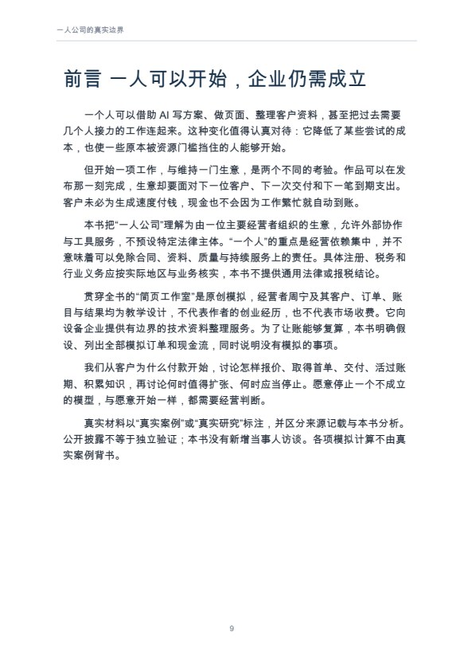
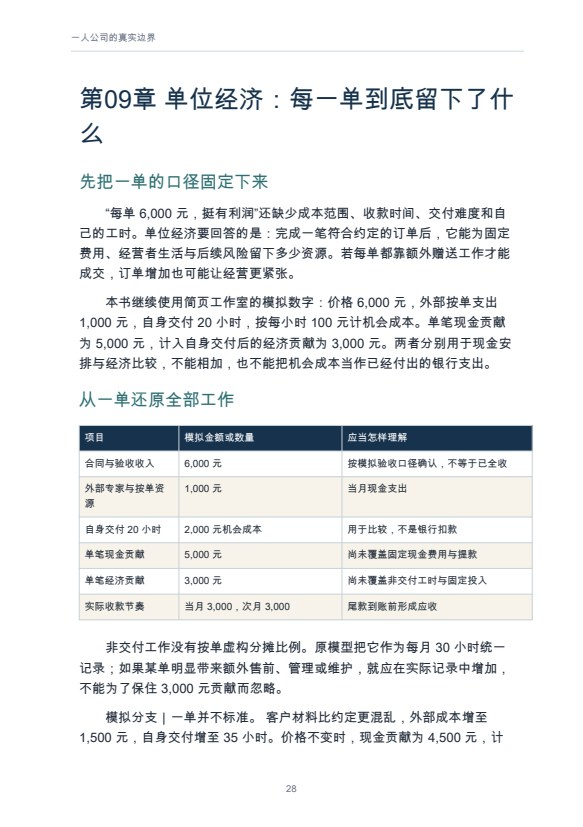

# 一人公司的真实边界

作者：李钊 · 出版单位：若谷书房  
增订版 1.1 · 原书日期：2026-11-10 · 增订日期：2026-11-19 · PDF 54 页

## 阅读导引

本次增订保留原书基础内容、署名和出版记录，形成16章、6份附录。新增实践方法、综合模拟、练习与可直接使用的工作表；模拟人物、数字和结果不构成真实客户成效或专业结果保证。

读者可先浏览前言与原八章建立共同概念，再按当前任务选读新增章节和附录。表格需结合自己的资料填写，动态规则、产品能力和专业事项仍按当前正式来源核实。

## 完整目录

展开全书目录

- 前言　一人可以开始，企业仍需成立
- 第01章　先找到有人愿意解决的问题
- 第02章　报价是在出售边界
- 第03章　首单验证什么，不能验证什么
- 第04章　把交付做成一个可检查的过程
- 第05章　把账算到现金真正留下来
- 第06章　知识沉淀应减少下一次依赖
- 第07章　把不能独自承担的风险说清楚
- 第08章　扩张、维持或停止
- 第09章　单位经济：每一单到底留下了什么
- 第10章　十三周现金流：看见下一次低点在哪里
- 第11章　范围变化：修改怎样进入报价与排期
- 第12章　获客证据：比较渠道时别漏掉未成交劳动
- 第13章　外包与协作：交付责任怎样一起交接
- 第14章　经营连续性：生病、断网与账号失效时怎样履约
- 第15章　停止与退出：把最后一笔责任也算进生意
- 第16章　第四个月模拟：没有新订单时账目怎样变化
- 结语　给生意一个可以承受的形状
- 附录A　接单前的一页约定
- 附录B　每月经营复盘
- 附录C　单位经济与十三周滚动表
- 附录D　范围变化与获客投入记录
- 附录E　协作与经营连续性检查包
- 附录F　退出与第四月模拟复核
- 来源与方法说明
- 若谷书房

## 实际内页预览

页码包含封面，从 1 起算。样页由本次 54 页 PDF 重新生成。

PDF 文件第 9 页：前言。

PDF 文件第 28 页：新增实践章节。

## 阅读与下载

- [Markdown 在线阅读](output/markdown/solo-company.md)
- [PDF · 54 页](https://github.com/njxshr/ruogu-books/releases/download/expanded-books-20261119-v1.1/solo-company.pdf)
- [EPUB](https://github.com/njxshr/ruogu-books/releases/download/expanded-books-20261119-v1.1/solo-company.epub)
- [Markdown 离线包（正文与实际生成资源）](https://github.com/njxshr/ruogu-books/releases/download/expanded-books-20261119-v1.1/solo-company-markdown.zip)

## 增订与检查

[20 轮增订记录](REVISION_LOG.md) · [实际检查报告](QA_REPORT.md)

本次重新生成 Markdown、PDF 和 EPUB。PDF 全部 54 页已渲染并逐张查看总览；EPUB 解包读取封面、前中后章节，96 个导航目标与本地资源检查通过。具体范围与限制见报告。

## 来源与权利

[来源记录](SOURCES.md) · [主稿](manuscript/book.md) · [出版配置](book.json)

来源记录保留原有核查范围。本次扩充没有借综合模拟或练习新增真实访谈、客户成效和统计证据，也没有将重新成书记为全部旧来源的再次独立核验。

© 2026 李钊／若谷书房。第三方资料的权利归原权利人所有。公开阅读与下载不另行授予开放许可。

[返回书目](../../目录.md)
